# Bad & Energie GmbH Lahn-Dill: Prompt-Bibliothek (126 Bildprompts)

Modell: GPT Image 2.5, Variante Sunburst · 107 Feed-Posts (3:4, 1080 × 1440) · 19 Stories (9:16, 1080 × 1920)

Jeder Prompt unten ist komplett: Brand-Block, Szene und der Text im Bild. In Arena oder ChatGPT einfach den Codeblock kopieren und senden. Karussell-Slides ab Nr. 2: vorher die fertige Cover-Slide hochladen. Danach Text im Bild Wort für Wort prüfen und das echte Logo unten rechts einsetzen.

⚠️ = vor dem Posten Fakten prüfen (Stand steht in den Hinweisen).

## Übersicht

| ID | Titel | Kategorie | Format | Text im Bild | Bild |
| --- | --- | --- | --- | --- | --- |
| [BE-001](#be-001) ⚠️ | 100 Jahre: Hauptmotiv | Jubiläum | 3:4 | 100 Jahre Handwerk aus Wetzlar | [ansehen](bilder/instagram-3x4/BE-001.jpg) |
| [BE-002](#be-002) ⚠️ | 100 Jahre: Danke | Jubiläum | 3:4 | Danke für 100 Jahre Vertrauen | [ansehen](bilder/instagram-3x4/BE-002.jpg) |
| [BE-003](#be-003) ⚠️ | Heizungsförderung | Förderung | 3:4 | Neue Heizung: 30 bis 80 % Zuschuss | [ansehen](bilder/instagram-3x4/BE-003.jpg) |
| [BE-004](#be-004) ⚠️ | Stichtag Heizungsbonus | Förderung | 3:4 | Heizungsbonus sinkt ab 1. Februar 2027 | [ansehen](bilder/instagram-3x4/BE-004.jpg) |
| [BE-005](#be-005) | Heizungswartung | Heizung | 3:4 | Fit für den Winter: Heizung warten | [ansehen](bilder/instagram-3x4/BE-005.jpg) |
| [BE-006](#be-006) | Heizung mieten | Heizung | 3:4 | Heizung mieten statt kaufen | [ansehen](bilder/instagram-3x4/BE-006.jpg) |
| [BE-007](#be-007) | Bad aus einer Hand | Bad | 3:4 | Ihr neues Bad, alles aus einer Hand | [ansehen](bilder/instagram-3x4/BE-007.jpg) |
| [BE-008](#be-008) | 3D-Badplaner | Bad | 3:4 | Planen Sie Ihr Traumbad in 3D | [ansehen](bilder/instagram-3x4/BE-008.jpg) |
| [BE-009](#be-009) | Barrierefrei und schön | Bad | 3:4 | Barrierefrei, und trotzdem schön | [ansehen](bilder/instagram-3x4/BE-009.jpg) |
| [BE-010](#be-010) ⚠️ | Zuschuss der Pflegekasse | Förderung | 3:4 | Bis zu 4.180 € Zuschuss fürs Bad | [ansehen](bilder/instagram-3x4/BE-010.jpg) |
| [BE-011](#be-011) | Wanne raus, Dusche rein | Bad | 3:4 | Wanne raus, Dusche rein | [ansehen](bilder/instagram-3x4/BE-011.jpg) |
| [BE-012](#be-012) | Wärmepumpe und Photovoltaik | Heizung | 3:4 | Sonnenstrom für Ihre Wärmepumpe | [ansehen](bilder/instagram-3x4/BE-012.jpg) |
| [BE-013](#be-013) | Trinkwasser | Haustechnik | 3:4 | Frisches Wasser, sauber installiert | [ansehen](bilder/instagram-3x4/BE-013.jpg) |
| [BE-014](#be-014) | Raumklima | Lüftung | 3:4 | Angenehmes Raumklima, das ganze Jahr | [ansehen](bilder/instagram-3x4/BE-014.jpg) |
| [BE-015](#be-015) | Online-Termin | Service | 3:4 | Termin anfragen, auch nach Feierabend | [ansehen](bilder/instagram-3x4/BE-015.jpg) |
| [BE-016](#be-016) ⚠️ | Ausbildung | Recruiting | 3:4 | Starte deine Ausbildung bei uns | [ansehen](bilder/instagram-3x4/BE-016.jpg) |
| [BE-017](#be-017) | Verstärkung gesucht | Recruiting | 3:4 | Wir suchen Verstärkung im Team | [ansehen](bilder/instagram-3x4/BE-017.jpg) |
| [BE-018](#be-018) | Gewerbekunden | Gewerbe | 3:4 | Sanitär und Heizung für Gewerbe | [ansehen](bilder/instagram-3x4/BE-018.jpg) |
| [BE-019](#be-019) | Badausstellung | Bad | 3:4 | Bäder live erleben: Wetzlar und Gießen | [ansehen](bilder/instagram-3x4/BE-019.jpg) |
| [BE-020](#be-020) | Transparente Kosten | Service | 3:4 | Klare Planung, transparente Kosten | [ansehen](bilder/instagram-3x4/BE-020.jpg) |
| [BE-021](#be-021) ⚠️ | 100 Jahre in 6 Bildern: Cover (K1 1/7) | Karussell | 3:4 | 100 Jahre in 6 Bildern | [ansehen](bilder/instagram-3x4/BE-021.jpg) |
| [BE-022](#be-022) ⚠️ | 1926: Gründung (K1 2/7) | Karussell | 3:4 | 1926: Gründung in der Wetzlarer Hintergasse | [ansehen](bilder/instagram-3x4/BE-022.jpg) |
| [BE-023](#be-023) ⚠️ | 1945: Zweite Generation (K1 3/7) | Karussell | 3:4 | 1945: Die zweite Generation übernimmt | [ansehen](bilder/instagram-3x4/BE-023.jpg) |
| [BE-024](#be-024) ⚠️ | 1950er: Umzug (K1 4/7) | Karussell | 3:4 | 1950er: Umzug in die Garbenheimer Straße | [ansehen](bilder/instagram-3x4/BE-024.jpg) |
| [BE-025](#be-025) ⚠️ | 2001: Neuer Name (K1 5/7) | Karussell | 3:4 | 2001: Neuer Name, Bad & Energie GmbH | [ansehen](bilder/instagram-3x4/BE-025.jpg) |
| [BE-026](#be-026) ⚠️ | Heute: Bad, Heizung, Haustechnik (K1 6/7) | Karussell | 3:4 | Heute: Bad, Heizung, Haustechnik | [ansehen](bilder/instagram-3x4/BE-026.jpg) |
| [BE-027](#be-027) ⚠️ | Auf die nächsten 100 Jahre (K1 7/7) | Karussell | 3:4 | Auf die nächsten 100 Jahre! | [ansehen](bilder/instagram-3x4/BE-027.jpg) |
| [BE-028](#be-028) ⚠️ | Heizungsförderung in 5 Schritten: Cover (K2 1/7) | Karussell | 3:4 | Heizungsförderung in 5 Schritten | [ansehen](bilder/instagram-3x4/BE-028.jpg) |
| [BE-029](#be-029) ⚠️ | Schritt 1: Angebot und Bestätigung (K2 2/7) | Karussell | 3:4 | 1. Angebot und Bestätigung vom Fachbetrieb | [ansehen](bilder/instagram-3x4/BE-029.jpg) |
| [BE-030](#be-030) ⚠️ | Schritt 2: Vertrag mit Förder-Vorbehalt (K2 3/7) | Karussell | 3:4 | 2. Vertrag mit Förder-Vorbehalt schließen | [ansehen](bilder/instagram-3x4/BE-030.jpg) |
| [BE-031](#be-031) ⚠️ | Schritt 3: Antrag bei der KfW (K2 4/7) | Karussell | 3:4 | 3. Antrag bei der KfW, vor Baubeginn | [ansehen](bilder/instagram-3x4/BE-031.jpg) |
| [BE-032](#be-032) ⚠️ | Schritt 4: Heizung einbauen (K2 5/7) | Karussell | 3:4 | 4. Heizung einbauen lassen | [ansehen](bilder/instagram-3x4/BE-032.jpg) |
| [BE-033](#be-033) ⚠️ | Schritt 5: Nachweis und Zuschuss (K2 6/7) | Karussell | 3:4 | 5. Nachweis einreichen, Zuschuss erhalten | [ansehen](bilder/instagram-3x4/BE-033.jpg) |
| [BE-034](#be-034) ⚠️ | Abschluss: Wir begleiten Sie (K2 7/7) | Karussell | 3:4 | Wir begleiten Sie: Link in Bio | [ansehen](bilder/instagram-3x4/BE-034.jpg) |
| [BE-035](#be-035) ⚠️ | 5 Details für ein sicheres Bad: Cover (K3 1/7) | Karussell | 3:4 | 5 Details für ein sicheres Bad | [ansehen](bilder/instagram-3x4/BE-035.jpg) |
| [BE-036](#be-036) ⚠️ | Detail 1: Dusche ohne Stufe (K3 2/7) | Karussell | 3:4 | 1. Dusche ohne Stufe | [ansehen](bilder/instagram-3x4/BE-036.jpg) |
| [BE-037](#be-037) ⚠️ | Detail 2: Rutschhemmende Fliesen (K3 3/7) | Karussell | 3:4 | 2. Rutschhemmende Fliesen | [ansehen](bilder/instagram-3x4/BE-037.jpg) |
| [BE-038](#be-038) ⚠️ | Detail 3: Haltegriffe (K3 4/7) | Karussell | 3:4 | 3. Haltegriffe, wo man sie braucht | [ansehen](bilder/instagram-3x4/BE-038.jpg) |
| [BE-039](#be-039) ⚠️ | Detail 4: Sitzen beim Duschen (K3 5/7) | Karussell | 3:4 | 4. Sitzen beim Duschen | [ansehen](bilder/instagram-3x4/BE-039.jpg) |
| [BE-040](#be-040) ⚠️ | Detail 5: Platz zum Bewegen (K3 6/7) | Karussell | 3:4 | 5. Platz zum Bewegen | [ansehen](bilder/instagram-3x4/BE-040.jpg) |
| [BE-041](#be-041) ⚠️ | Abschluss: Beratung vor Ort (K3 7/7) | Karussell | 3:4 | Beratung vor Ort: Link in Bio | [ansehen](bilder/instagram-3x4/BE-041.jpg) |
| [BE-042](#be-042) | Heizungsanfrage online | Heizung | 3:4 | Heizungsanfrage online starten | [ansehen](bilder/instagram-3x4/BE-042.jpg) |
| [BE-043](#be-043) | Wärmepumpe im Altbau | Heizung | 3:4 | Wärmepumpe auch im Altbau? | [ansehen](bilder/instagram-3x4/BE-043.jpg) |
| [BE-044](#be-044) | Hybridheizung | Heizung | 3:4 | Hybridheizung: zwei Wärmeerzeuger, ein System | [ansehen](bilder/instagram-3x4/BE-044.jpg) |
| [BE-045](#be-045) | Brennstoffzellenheizung | Heizung | 3:4 | Strom und Wärme aus einem Gerät | [ansehen](bilder/instagram-3x4/BE-045.jpg) |
| [BE-046](#be-046) | BHKW fürs Gewerbe | Heizung | 3:4 | BHKW: Strom und Wärme fürs Gewerbe | [ansehen](bilder/instagram-3x4/BE-046.jpg) |
| [BE-047](#be-047) | Wärme richtig verteilen | Heizung | 3:4 | Wärme richtig verteilen | [ansehen](bilder/instagram-3x4/BE-047.jpg) |
| [BE-048](#be-048) | Heizkörper entlüften | Tipp | 3:4 | Heizkörper gluckert? Entlüften! | [ansehen](bilder/instagram-3x4/BE-048.jpg) |
| [BE-049](#be-049) | Heizungsdruck prüfen | Tipp | 3:4 | Heizungsdruck im grünen Bereich? | [ansehen](bilder/instagram-3x4/BE-049.jpg) |
| [BE-050](#be-050) | Dusch-WC | Bad | 3:4 | Dusch-WC: mehr Komfort im Alltag | [ansehen](bilder/instagram-3x4/BE-050.jpg) |
| [BE-051](#be-051) | Kleines Gäste-WC | Bad | 3:4 | Kleines Gäste-WC, große Wirkung | [ansehen](bilder/instagram-3x4/BE-051.jpg) |
| [BE-052](#be-052) | Kleines Bad, clever geplant | Bad | 3:4 | Kleines Bad, clever geplant | [ansehen](bilder/instagram-3x4/BE-052.jpg) |
| [BE-053](#be-053) | Ihr Bad, Ihr Stil | Bad | 3:4 | Ihr Bad, Ihr Stil | [ansehen](bilder/instagram-3x4/BE-053.jpg) |
| [BE-054](#be-054) | Multifunktionsarmatur Küche | Küche | 3:4 | Kochend, sprudelnd, gefiltert: ein Hahn | [ansehen](bilder/instagram-3x4/BE-054.jpg) |
| [BE-055](#be-055) | Weiches Wasser | Haustechnik | 3:4 | Weiches Wasser für Ihr Zuhause | [ansehen](bilder/instagram-3x4/BE-055.jpg) |
| [BE-056](#be-056) | Dezentrale Lüftung | Lüftung | 3:4 | Frische Luft bei geschlossenem Fenster | [ansehen](bilder/instagram-3x4/BE-056.jpg) |
| [BE-057](#be-057) | Sicherheit, die gut aussieht | Bad | 3:4 | Sicherheit, die gut aussieht | [ansehen](bilder/instagram-3x4/BE-057.jpg) |
| [BE-058](#be-058) | Meisterbetrieb aus Wetzlar | Betrieb | 3:4 | Meisterbetrieb aus Wetzlar | [ansehen](bilder/instagram-3x4/BE-058.jpg) |
| [BE-059](#be-059) | In der Region unterwegs | Betrieb | 3:4 | Wir sind in der Region unterwegs | [ansehen](bilder/instagram-3x4/BE-059.jpg) |
| [BE-060](#be-060) | Objekt- und Anlagenbau | Gewerbe | 3:4 | Objekt- und Anlagenbau | [ansehen](bilder/instagram-3x4/BE-060.jpg) |
| [BE-061](#be-061) | Dusche kalt? | Humor | 3:4 | Montagmorgen, Dusche kalt? | [ansehen](bilder/instagram-3x4/BE-061.jpg) |
| [BE-062](#be-062) | Bereit für den Winter? | Humor | 3:4 | Bereit für den Winter? | [ansehen](bilder/instagram-3x4/BE-062.jpg) |
| [BE-063](#be-063) ⚠️ | Frohe Weihnachten | Saison | 3:4 | Frohe Weihnachten aus Wetzlar | [ansehen](bilder/instagram-3x4/BE-063.jpg) |
| [BE-064](#be-064) | Gutes neues Jahr | Saison | 3:4 | Ein gutes neues Jahr 2027 | [ansehen](bilder/instagram-3x4/BE-064.jpg) |
| [BE-065](#be-065) | Story-Umfrage: Alter der Heizung | Story | 9:16 | Wie alt ist Ihre Heizung? | [ansehen](bilder/story-9x16/BE-065.jpg) |
| [BE-066](#be-066) | Story-Umfrage: Wanne oder Dusche | Story | 9:16 | Wanne oder Dusche? | [ansehen](bilder/story-9x16/BE-066.jpg) |
| [BE-067](#be-067) | Story: Termin anfragen | Story | 9:16 | Termin anfragen: Link antippen | [ansehen](bilder/story-9x16/BE-067.jpg) |
| [BE-068](#be-068) ⚠️ | Story: 100 Jahre Bad & Energie | Story | 9:16 | 100 Jahre Bad & Energie | [ansehen](bilder/story-9x16/BE-068.jpg) |
| [BE-069](#be-069) | Ihr Weg zum neuen Bad: Cover (K4 1/7) | Karussell | 3:4 | Ihr Weg zum neuen Bad | [ansehen](bilder/instagram-3x4/BE-069.jpg) |
| [BE-070](#be-070) | Schritt 1: Ideen im 3D-Badplaner (K4 2/7) | Karussell | 3:4 | 1. Ideen im 3D-Badplaner sammeln | [ansehen](bilder/instagram-3x4/BE-070.jpg) |
| [BE-071](#be-071) | Schritt 2: Beratung in der Ausstellung (K4 3/7) | Karussell | 3:4 | 2. Beratung in unserer Ausstellung | [ansehen](bilder/instagram-3x4/BE-071.jpg) |
| [BE-072](#be-072) | Schritt 3: Planung und Kosten (K4 4/7) | Karussell | 3:4 | 3. Planung und Kostenaufstellung vorab | [ansehen](bilder/instagram-3x4/BE-072.jpg) |
| [BE-073](#be-073) | Schritt 4: Der Umbau beginnt (K4 5/7) | Karussell | 3:4 | 4. Der Umbau beginnt | [ansehen](bilder/instagram-3x4/BE-073.jpg) |
| [BE-074](#be-074) | Schritt 5: Das fertige Bad (K4 6/7) | Karussell | 3:4 | 5. Ihr neues Bad ist fertig | [ansehen](bilder/instagram-3x4/BE-074.jpg) |
| [BE-075](#be-075) | Abschluss: Badanfrage starten (K4 7/7) | Karussell | 3:4 | Badanfrage starten: Link in Bio | [ansehen](bilder/instagram-3x4/BE-075.jpg) |
| [BE-076](#be-076) ⚠️ | Wärmepumpe-Fragen: Cover (K5 1/7) | Karussell | 3:4 | Wärmepumpe? Ihre Fragen, unsere Antworten | [ansehen](bilder/instagram-3x4/BE-076.jpg) |
| [BE-077](#be-077) ⚠️ | Frage 1: Passt sie zum Haus? (K5 2/7) | Karussell | 3:4 | Passt eine Wärmepumpe zu Ihrem Haus? | [ansehen](bilder/instagram-3x4/BE-077.jpg) |
| [BE-078](#be-078) ⚠️ | Frage 2: Förderung (K5 3/7) | Karussell | 3:4 | Gibt es dafür Förderung? | [ansehen](bilder/instagram-3x4/BE-078.jpg) |
| [BE-079](#be-079) ⚠️ | Frage 3: Photovoltaik (K5 4/7) | Karussell | 3:4 | Lässt sich Photovoltaik kombinieren? | [ansehen](bilder/instagram-3x4/BE-079.jpg) |
| [BE-080](#be-080) ⚠️ | Frage 4: Hybridheizung (K5 5/7) | Karussell | 3:4 | Wärmepumpe plus Brennwertkessel? | [ansehen](bilder/instagram-3x4/BE-080.jpg) |
| [BE-081](#be-081) ⚠️ | Frage 5: Wartung (K5 6/7) | Karussell | 3:4 | Wer kümmert sich um die Wartung? | [ansehen](bilder/instagram-3x4/BE-081.jpg) |
| [BE-082](#be-082) ⚠️ | Abschluss: Ihre Frage (K5 7/7) | Karussell | 3:4 | Ihre Frage fehlt? Schreiben Sie uns | [ansehen](bilder/instagram-3x4/BE-082.jpg) |
| [BE-083](#be-083) ⚠️ | Klimageschwindigkeitsbonus: Wer ihn bekommt | Förderung | 3:4 | Alte Heizung? Bonus beim Tausch prüfen | [ansehen](bilder/instagram-3x4/BE-083.jpg) |
| [BE-084](#be-084) ⚠️ | Heizungstausch in Ruhe planen | Heizung | 3:4 | Heizungstausch jetzt in Ruhe planen | [ansehen](bilder/instagram-3x4/BE-084.jpg) |
| [BE-085](#be-085) | Hydraulischer Abgleich | Heizung | 3:4 | Hier zu kalt, dort zu warm? | [ansehen](bilder/instagram-3x4/BE-085.jpg) |
| [BE-086](#be-086) | Laub weg, Wärmepumpe frei | Tipp | 3:4 | Laub weg, Wärmepumpe frei | [ansehen](bilder/instagram-3x4/BE-086.jpg) |
| [BE-087](#be-087) | Heizkörper freihalten | Tipp | 3:4 | Freie Heizkörper heizen besser | [ansehen](bilder/instagram-3x4/BE-087.jpg) |
| [BE-088](#be-088) | Stoßlüften im Winter | Tipp | 3:4 | Stoßlüften statt Fenster kippen | [ansehen](bilder/instagram-3x4/BE-088.jpg) |
| [BE-089](#be-089) ⚠️ | Story-Quiz: Förderantrag vor Baubeginn | Story | 9:16 | Förderantrag: vor oder nach Baubeginn? | [ansehen](bilder/story-9x16/BE-089.jpg) |
| [BE-090](#be-090) ⚠️ | Story-Countdown: Bonus-Stichtag | Story | 9:16 | Bonus-Stichtag naht: Heizung jetzt planen | [ansehen](bilder/story-9x16/BE-090.jpg) |
| [BE-091](#be-091) | Heizkurve einstellen | Heizung | 3:4 | Heizkurve richtig eingestellt? | [ansehen](bilder/instagram-3x4/BE-091.jpg) |
| [BE-092](#be-092) | Fliesenarbeiten aus einer Hand | Bad | 3:4 | Saubere Fugen, gerade Linien | [ansehen](bilder/instagram-3x4/BE-092.jpg) |
| [BE-093](#be-093) | Bad für jede Lebensphase | Bad | 3:4 | Ein Bad für jede Lebensphase | [ansehen](bilder/instagram-3x4/BE-093.jpg) |
| [BE-094](#be-094) | Handtuchheizkörper im Winter | Bad | 3:4 | Warme Handtücher an kalten Morgen | [ansehen](bilder/instagram-3x4/BE-094.jpg) |
| [BE-095](#be-095) | Duschnische | Bad | 3:4 | Platz für alles: die Duschnische | [ansehen](bilder/instagram-3x4/BE-095.jpg) |
| [BE-096](#be-096) | Licht im Bad | Bad | 3:4 | Gutes Licht macht das Bad wohnlich | [ansehen](bilder/instagram-3x4/BE-096.jpg) |
| [BE-097](#be-097) | Vom 70er-Jahre-Bad zum Wohlfühlbad | Vorher/Nachher | 3:4 | Vom 70er-Jahre-Bad zum Wohlfühlbad | [ansehen](bilder/instagram-3x4/BE-097.jpg) |
| [BE-098](#be-098) | Silikonfugen erneuern | Tipp | 3:4 | Silikonfugen rechtzeitig erneuern | [ansehen](bilder/instagram-3x4/BE-098.jpg) |
| [BE-099](#be-099) | Story-Umfrage: Fliesen hell oder dunkel | Story | 9:16 | Fliesen: hell oder dunkel? | [ansehen](bilder/story-9x16/BE-099.jpg) |
| [BE-100](#be-100) ⚠️ | Story: Zuschuss mit Pflegegrad | Story | 9:16 | Pflegegrad? Die Pflegekasse kann mitzahlen | [ansehen](bilder/story-9x16/BE-100.jpg) |
| [BE-101](#be-101) | Photovoltaik auf dem eigenen Dach | Haustechnik | 3:4 | Strom vom eigenen Dach | [ansehen](bilder/instagram-3x4/BE-101.jpg) |
| [BE-102](#be-102) | Zentrale Wohnraumlüftung | Lüftung | 3:4 | Frische Luft für das ganze Haus | [ansehen](bilder/instagram-3x4/BE-102.jpg) |
| [BE-103](#be-103) | Kalk und hartes Wasser | Haustechnik | 3:4 | Kalk an Duschkopf und Armaturen? | [ansehen](bilder/instagram-3x4/BE-103.jpg) |
| [BE-104](#be-104) | Trinkwasser nach dem Urlaub | Haustechnik | 3:4 | Nach dem Urlaub: Wasser kurz laufen lassen | [ansehen](bilder/instagram-3x4/BE-104.jpg) |
| [BE-105](#be-105) | Story-Umfrage: Photovoltaik | Story | 9:16 | Haben Sie schon eine Photovoltaikanlage? | [ansehen](bilder/story-9x16/BE-105.jpg) |
| [BE-106](#be-106) | Sanitär für Behörden und Kommunen | Gewerbe | 3:4 | Sanitär für Behörden und Kommunen | [ansehen](bilder/instagram-3x4/BE-106.jpg) |
| [BE-107](#be-107) ⚠️ | Jahresrückblick Jubiläumsjahr | Jubiläum | 3:4 | Unser Jubiläumsjahr geht zu Ende | [ansehen](bilder/instagram-3x4/BE-107.jpg) |
| [BE-108](#be-108) ⚠️ | Story-Quiz: Seit wann gibt es uns | Story | 9:16 | Quiz: Seit wann gibt es uns? | [ansehen](bilder/story-9x16/BE-108.jpg) |
| [BE-109](#be-109) | Story: Handwerk mit Zukunft | Story | 9:16 | Lust auf Handwerk mit Zukunft? | [ansehen](bilder/story-9x16/BE-109.jpg) |
| [BE-110](#be-110) | Fachbetrieb in Wetzlar und Umgebung | Lokal | 3:4 | Ihr Fachbetrieb in Wetzlar und Umgebung | [ansehen](bilder/instagram-3x4/BE-110.jpg) |
| [BE-111](#be-111) ⚠️ | 100 Jahre Erfahrung | Betrieb | 3:4 | 100 Jahre Erfahrung, von Hand zu Hand | [ansehen](bilder/instagram-3x4/BE-111.jpg) |
| [BE-112](#be-112) ⚠️ | Ausbildung mit Zukunft | Recruiting | 3:4 | Ausbildung mit Zukunft: Bad, Heizung, Wärmepumpe | [ansehen](bilder/instagram-3x4/BE-112.jpg) |
| [BE-113](#be-113) | Vom Einfamilienhaus bis zum Gewerbeobjekt | Gewerbe | 3:4 | Vom Einfamilienhaus bis zum Gewerbeobjekt | [ansehen](bilder/instagram-3x4/BE-113.jpg) |
| [BE-114](#be-114) | Feiertage: Schlange vorm Bad | Humor | 3:4 | Feiertage: Schlange vorm Bad? | [ansehen](bilder/instagram-3x4/BE-114.jpg) |
| [BE-115](#be-115) | Wärmepumpe ohne Winterschlaf | Humor | 3:4 | Winterschlaf? Nicht für die Wärmepumpe | [ansehen](bilder/instagram-3x4/BE-115.jpg) |
| [BE-116](#be-116) | Erster Advent | Saison | 3:4 | Einen warmen ersten Advent | [ansehen](bilder/instagram-3x4/BE-116.jpg) |
| [BE-117](#be-117) | Außenwasserhahn winterfest machen | Tipp | 3:4 | Außenwasserhahn vor dem Frost entleeren | [ansehen](bilder/instagram-3x4/BE-117.jpg) |
| [BE-118](#be-118) | Heizung bei Abwesenheit | Tipp | 3:4 | Verreist? Heizung nicht ganz abdrehen | [ansehen](bilder/instagram-3x4/BE-118.jpg) |
| [BE-119](#be-119) | Story-Umfrage: Vorsatz fürs neue Jahr | Story | 9:16 | Ihr Vorsatz fürs neue Jahr? | [ansehen](bilder/story-9x16/BE-119.jpg) |
| [BE-120](#be-120) ⚠️ | Story: 100 Jahre: Hauptmotiv | Story | 9:16 | 100 Jahre Handwerk aus Wetzlar | [ansehen](bilder/story-9x16/BE-120.jpg) |
| [BE-121](#be-121) ⚠️ | Story: Heizungsförderung | Story | 9:16 | Neue Heizung: 30 bis 80 % Zuschuss | [ansehen](bilder/story-9x16/BE-121.jpg) |
| [BE-122](#be-122) ⚠️ | Story: Stichtag Heizungsbonus | Story | 9:16 | Heizungsbonus sinkt ab 1. Februar 2027 | [ansehen](bilder/story-9x16/BE-122.jpg) |
| [BE-123](#be-123) | Story: Heizungswartung | Story | 9:16 | Fit für den Winter: Heizung warten | [ansehen](bilder/story-9x16/BE-123.jpg) |
| [BE-124](#be-124) | Story: Bad aus einer Hand | Story | 9:16 | Ihr neues Bad, alles aus einer Hand | [ansehen](bilder/story-9x16/BE-124.jpg) |
| [BE-125](#be-125) | Story: Barrierefrei und schön | Story | 9:16 | Barrierefrei, und trotzdem schön | [ansehen](bilder/story-9x16/BE-125.jpg) |
| [BE-126](#be-126) ⚠️ | Story: Ausbildung | Story | 9:16 | Starte deine Ausbildung bei uns | [ansehen](bilder/story-9x16/BE-126.jpg) |

<a id="be-001"></a>
## BE-001 · 100 Jahre: Hauptmotiv

Jubiläum · 3:4 · Dokument Nr. 1

```text
Brand style for a long-established plumbing, heating and bathroom company in Germany. Look: bright, warm and trustworthy; realistic photographic style; clean German homes and tidy technical rooms; natural daylight; subtle depth of field. Palette: white and very light warm grey surfaces, brand blue (#111D6D) as the main colour, brand red (#D60000) only as a small accent, dark charcoal text (#222222). Typography: bold, friendly sans-serif headline, left-aligned, generous whitespace, at most two text sizes. People: only anonymous (hands, from behind or cropped at the shoulders), never a recognisable face. Layout: vertical 3:4 portrait format (1080x1440 proportions); keep all text and key objects inside an 8% safe margin; keep the bottom-right corner (14% of the width) empty and calm for a logo added later. Do not draw any logo, manufacturer logo or label on devices, and no company name outside the quoted headline. Text rules: render ONLY the German text given in quotes, exactly once, verbatim, with correct umlauts (ä, ö, ü, ß); no other words, numbers or watermarks. One continuous bathroom seen straight on: the left third is a 1920s bathroom in warm sepia (claw-foot tub, exposed copper pipes, small white wall tiles) that blends softly into a bright modern bathroom on the right (floor-level walk-in shower, large light-grey tiles, blue accent wall). Headline: "100 Jahre Handwerk aus Wetzlar"
```

**Text im Bild:** „100 Jahre Handwerk aus Wetzlar“  
**Caption:** 1926 gründete SHK-Meister Karl Schmidt in der Wetzlarer Hintergasse den Betrieb, aus dem die Bad & Energie GmbH Lahn-Dill wurde. 100 Jahre später planen und bauen wir Bäder und Heizungen für die ganze Region. Danke für Ihr Vertrauen! Symbolbild. Termin anfragen: Link in Bio.  
**Hashtags:** #shk #handwerk #meisterbetrieb #ausbildungsbetrieb #seit1926 #wetzlar #lahndill #mittelhessen #solms #lahnau  
**Hinweise:** ⚠️ Fakten prüfen. Faktencheck Firmengeschichte: Gründungsangaben (1926, SHK-Meister Karl Schmidt, Wetzlarer Hintergasse) stammen von bad-energie.de; vor dem Posten mit der Geschäftsführung abgleichen, Stand 29.10.2026. „Symbolbild“ in der Caption ergänzt (fotorealistisches Bad, fehlte im Dokument). Headline laut Dokument oben links platzieren. Posting-Plan: Woche 1, Mo 2.11.2026, gegen 18 Uhr.  
**Bilder:** [original](bilder/original/BE-001.jpg) · [instagram-3x4](bilder/instagram-3x4/BE-001.jpg) · [facebook-linkedin-4x5](bilder/facebook-linkedin-4x5/BE-001.jpg)

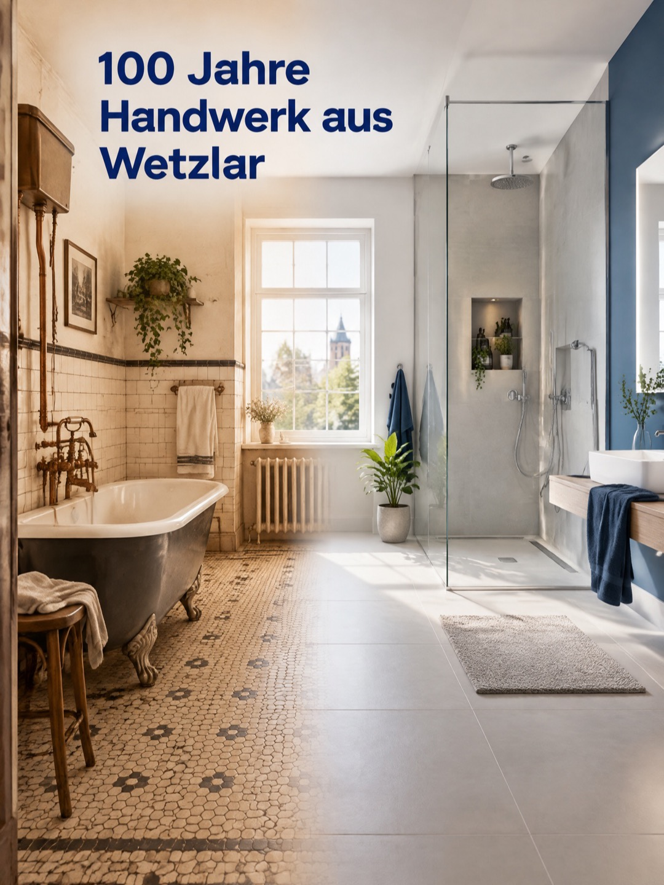

<a id="be-002"></a>
## BE-002 · 100 Jahre: Danke

Jubiläum · 3:4 · Dokument Nr. 2

```text
Brand style for a long-established plumbing, heating and bathroom company in Germany. Look: bright, warm and trustworthy; realistic photographic style; clean German homes and tidy technical rooms; natural daylight; subtle depth of field. Palette: white and very light warm grey surfaces, brand blue (#111D6D) as the main colour, brand red (#D60000) only as a small accent, dark charcoal text (#222222). Typography: bold, friendly sans-serif headline, left-aligned, generous whitespace, at most two text sizes. People: only anonymous (hands, from behind or cropped at the shoulders), never a recognisable face. Layout: vertical 3:4 portrait format (1080x1440 proportions); keep all text and key objects inside an 8% safe margin; keep the bottom-right corner (14% of the width) empty and calm for a logo added later. Do not draw any logo, manufacturer logo or label on devices, and no company name outside the quoted headline. Text rules: render ONLY the German text given in quotes, exactly once, verbatim, with correct umlauts (ä, ö, ü, ß); no other words, numbers or watermarks. Close-up still life on a white stone ledge: an old brass tap from the 1920s next to a modern matte-black tap, both polished, soft daylight, a thin blue ribbon lying between them. Headline: "Danke für 100 Jahre Vertrauen"
```

**Text im Bild:** „Danke für 100 Jahre Vertrauen“  
**Caption:** Seit 1926 lassen Familien in und um Wetzlar ihre Bäder und Heizungen von uns bauen. Dafür sagen wir Danke und freuen uns auf alles, was kommt.  
**Hashtags:** #shk #handwerk #meisterbetrieb #ausbildungsbetrieb #seit1926 #wetzlar #lahndill #mittelhessen #solms #lahnau  
**Hinweise:** ⚠️ Fakten prüfen. Faktencheck: Gründungsjahr 1926 vor dem Posten mit der Geschäftsführung abgleichen (Stand 29.10.2026). Posting-Plan: Woche 5, Mo 30.11.2026, gegen 18 Uhr.  
**Bilder:** [original](bilder/original/BE-002.jpg) · [instagram-3x4](bilder/instagram-3x4/BE-002.jpg) · [facebook-linkedin-4x5](bilder/facebook-linkedin-4x5/BE-002.jpg)

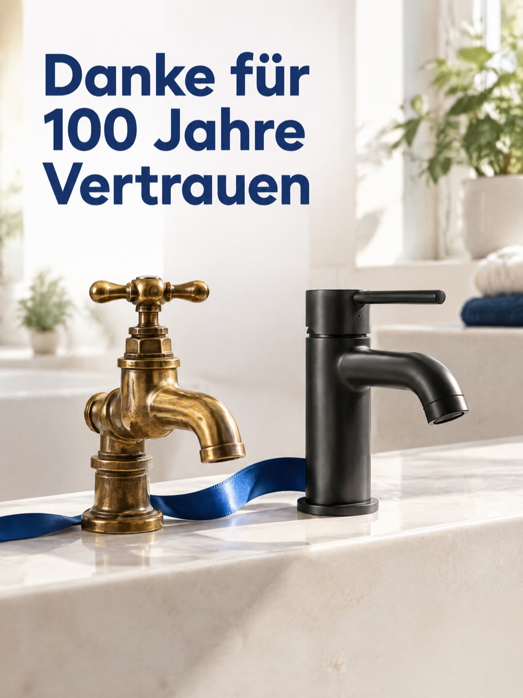

<a id="be-003"></a>
## BE-003 · Heizungsförderung

Förderung · 3:4 · Dokument Nr. 3

```text
Brand style for a long-established plumbing, heating and bathroom company in Germany. Look: bright, warm and trustworthy; realistic photographic style; clean German homes and tidy technical rooms; natural daylight; subtle depth of field. Palette: white and very light warm grey surfaces, brand blue (#111D6D) as the main colour, brand red (#D60000) only as a small accent, dark charcoal text (#222222). Typography: bold, friendly sans-serif headline, left-aligned, generous whitespace, at most two text sizes. People: only anonymous (hands, from behind or cropped at the shoulders), never a recognisable face. Layout: vertical 3:4 portrait format (1080x1440 proportions); keep all text and key objects inside an 8% safe margin; keep the bottom-right corner (14% of the width) empty and calm for a logo added later. Do not draw any logo, manufacturer logo or label on devices, and no company name outside the quoted headline. Text rules: render ONLY the German text given in quotes, exactly once, verbatim, with correct umlauts (ä, ö, ü, ß); no other words, numbers or watermarks. A modern air-to-water heat pump outdoor unit without any logo on a small concrete base beside a typical Hessian single-family house with a dark tiled roof, crisp autumn morning light, a few golden leaves on the lawn. Headline: "Neue Heizung: 30 bis 80 % Zuschuss"
```

**Text im Bild:** „Neue Heizung: 30 bis 80 % Zuschuss“  
**Caption:** Für eine neue klimafreundliche Heizung wie die Wärmepumpe zahlt die KfW (Programm 458) 30 % Grundförderung. Wer selbst im Haus wohnt, kann Boni bekommen, je nach Einkommen bis zu 80 % der förderfähigen Kosten (Stand 29.10.2026). Wichtig: Antrag vor Baubeginn. Wir beraten Sie und erstellen das Angebot. Symbolbild.  
**Hashtags:** #wärmepumpe #heizungstausch #heizungsmodernisierung #heizungsförderung #heizung #wetzlar #lahndill #mittelhessen #solms #lahnau  
**Hinweise:** ⚠️ Fakten prüfen. Faktencheck: Förderzahlen (KfW 458: 30 % Grundförderung, mit Boni je nach Einkommen bis zu 80 %, Antrag vor Baubeginn) vor dem Posten tagesaktuell auf der KfW-Seite prüfen, Stand 29.10.2026; den Stand in der Caption auf das Prüfdatum aktualisieren. Im 1. Quartal 2027 könnte die Grundförderung für Wärmepumpen von außerhalb der EU sinken; die Förderung steht unter dem Vorbehalt verfügbarer Haushaltsmittel. „Symbolbild“ in der Caption ergänzt (fotorealistische Wärmepumpe am Haus). Posting-Plan: Woche 1, Mi 4.11.2026, gegen 18 Uhr.  
**Bilder:** [original](bilder/original/BE-003.jpg) · [instagram-3x4](bilder/instagram-3x4/BE-003.jpg) · [facebook-linkedin-4x5](bilder/facebook-linkedin-4x5/BE-003.jpg)

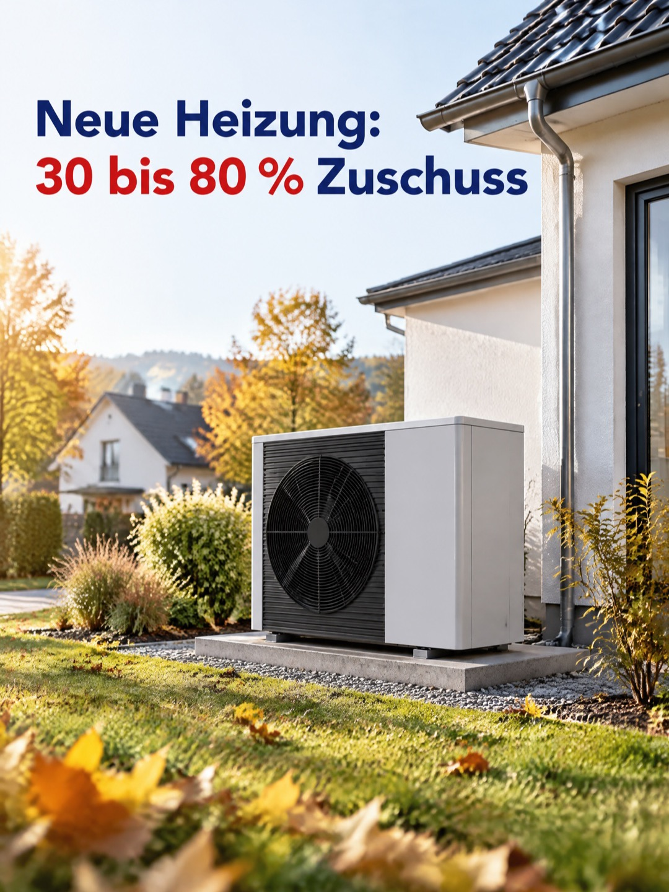

<a id="be-004"></a>
## BE-004 · Stichtag Heizungsbonus

Förderung · 3:4 · Dokument Nr. 4

```text
Brand style for a long-established plumbing, heating and bathroom company in Germany. Look: bright, warm and trustworthy; realistic photographic style; clean German homes and tidy technical rooms; natural daylight; subtle depth of field. Palette: white and very light warm grey surfaces, brand blue (#111D6D) as the main colour, brand red (#D60000) only as a small accent, dark charcoal text (#222222). Typography: bold, friendly sans-serif headline, left-aligned, generous whitespace, at most two text sizes. People: only anonymous (hands, from behind or cropped at the shoulders), never a recognisable face. Layout: vertical 3:4 portrait format (1080x1440 proportions); keep all text and key objects inside an 8% safe margin; keep the bottom-right corner (14% of the width) empty and calm for a logo added later. Do not draw any logo, manufacturer logo or label on devices, and no company name outside the quoted headline. Text rules: render ONLY the German text given in quotes, exactly once, verbatim, with correct umlauts (ä, ö, ü, ß); no other words, numbers or watermarks. A clean wall calendar page on a light wall, shown as a plain grid of empty squares without any numbers or words, the first square circled with a red marker stroke, a small model of a heat pump on the desk below, soft daylight. Headline: "Heizungsbonus sinkt ab 1. Februar 2027"
```

**Text im Bild:** „Heizungsbonus sinkt ab 1. Februar 2027“  
**Caption:** Wer seine Ölheizung, Nachtspeicherheizung oder eine mindestens 20 Jahre alte Gasheizung tauscht und selbst im Haus wohnt, kann bei der KfW aktuell 16 % Klimageschwindigkeitsbonus bekommen (Stand 29.10.2026). Für Anträge ab dem 1.2.2027 sinkt er auf 12 %, danach halbjährlich weiter. Jetzt planen, wir helfen beim Antrag.  
**Hashtags:** #wärmepumpe #heizungstausch #heizungsmodernisierung #heizungsförderung #heizung #hüttenberg #wettenberg #biebertal #ehringshausen #aßlar  
**Hinweise:** ⚠️ Fakten prüfen. Faktencheck: Klimageschwindigkeitsbonus (aktuell 16 %, für Anträge ab 1.2.2027 12 %, danach halbjährlich weiter sinkend) vor jedem Posten auf der KfW-Seite prüfen, Stand 29.10.2026; den Stand in der Caption auf das Prüfdatum aktualisieren. Kalenderblatt ohne Ziffern und Schrift, das Datum steht nur in der Headline. Posting-Plan: Woche 2, Fr 13.11.2026; Woche 7, Mi 16.12.2026 (neue Bildvariante); Woche 10, Mo 4.1.2027 (letzte Wochen vor dem Stichtag); jeweils gegen 18 Uhr.  
**Bilder:** [original](bilder/original/BE-004.jpg) · [instagram-3x4](bilder/instagram-3x4/BE-004.jpg) · [facebook-linkedin-4x5](bilder/facebook-linkedin-4x5/BE-004.jpg)

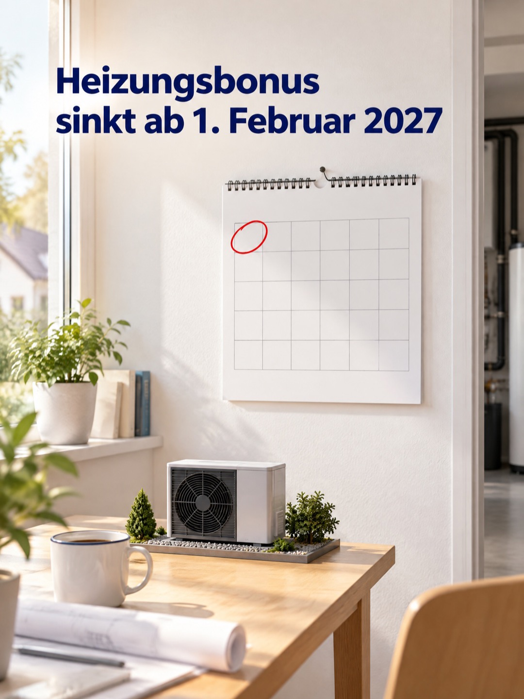

<a id="be-005"></a>
## BE-005 · Heizungswartung

Heizung · 3:4 · Dokument Nr. 5

```text
Brand style for a long-established plumbing, heating and bathroom company in Germany. Look: bright, warm and trustworthy; realistic photographic style; clean German homes and tidy technical rooms; natural daylight; subtle depth of field. Palette: white and very light warm grey surfaces, brand blue (#111D6D) as the main colour, brand red (#D60000) only as a small accent, dark charcoal text (#222222). Typography: bold, friendly sans-serif headline, left-aligned, generous whitespace, at most two text sizes. People: only anonymous (hands, from behind or cropped at the shoulders), never a recognisable face. Layout: vertical 3:4 portrait format (1080x1440 proportions); keep all text and key objects inside an 8% safe margin; keep the bottom-right corner (14% of the width) empty and calm for a logo added later. Do not draw any logo, manufacturer logo or label on devices, and no company name outside the quoted headline. Text rules: render ONLY the German text given in quotes, exactly once, verbatim, with correct umlauts (ä, ö, ü, ß); no other words, numbers or watermarks. Gloved hands of a technician in a blue work jacket checking the pressure gauge of a modern white wall-hung boiler in a tidy utility room, warm light, a small torch on the shelf. Headline: "Fit für den Winter: Heizung warten"
```

**Text im Bild:** „Fit für den Winter: Heizung warten“  
**Caption:** Eine regelmäßige Wartung hält Ihre Heizung effizient und beugt Ausfällen in der kalten Jahreszeit vor. Wir warten Ihre Anlage in Wetzlar und Umgebung. Symbolbild. Termin online anfragen: Link in Bio.  
**Hashtags:** #wärmepumpe #heizungstausch #heizungsmodernisierung #heizungsförderung #heizung #wetzlar #lahndill #mittelhessen #solms #lahnau  
**Hinweise:** „Symbolbild“ in der Caption ergänzt (fotorealistischer Heizungsraum mit Monteur). Posting-Plan: Woche 1, Fr 6.11.2026, gegen 18 Uhr.  
**Bilder:** [original](bilder/original/BE-005.jpg) · [instagram-3x4](bilder/instagram-3x4/BE-005.jpg) · [facebook-linkedin-4x5](bilder/facebook-linkedin-4x5/BE-005.jpg)

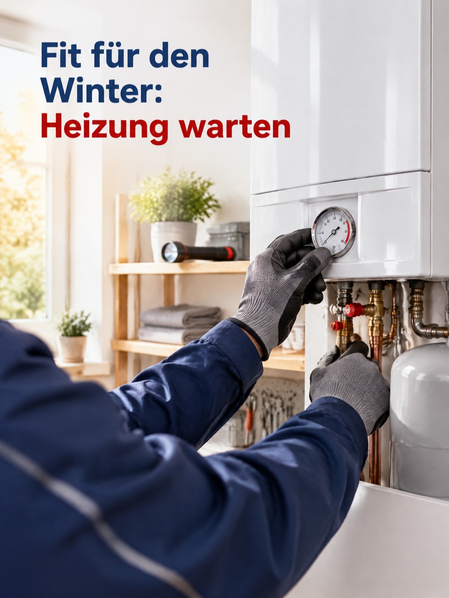

<a id="be-006"></a>
## BE-006 · Heizung mieten

Heizung · 3:4 · Dokument Nr. 6

```text
Brand style for a long-established plumbing, heating and bathroom company in Germany. Look: bright, warm and trustworthy; realistic photographic style; clean German homes and tidy technical rooms; natural daylight; subtle depth of field. Palette: white and very light warm grey surfaces, brand blue (#111D6D) as the main colour, brand red (#D60000) only as a small accent, dark charcoal text (#222222). Typography: bold, friendly sans-serif headline, left-aligned, generous whitespace, at most two text sizes. People: only anonymous (hands, from behind or cropped at the shoulders), never a recognisable face. Layout: vertical 3:4 portrait format (1080x1440 proportions); keep all text and key objects inside an 8% safe margin; keep the bottom-right corner (14% of the width) empty and calm for a logo added later. Do not draw any logo, manufacturer logo or label on devices, and no company name outside the quoted headline. Text rules: render ONLY the German text given in quotes, exactly once, verbatim, with correct umlauts (ä, ö, ü, ß); no other words, numbers or watermarks. A bright, tidy utility room with a modern heating unit on the wall, a small house-shaped key ring hanging on a hook beside it, calm morning light, no text on any device. Headline: "Heizung mieten statt kaufen"
```

**Text im Bild:** „Heizung mieten statt kaufen“  
**Caption:** Mit dem Mietmodell bekommen Sie eine neue Heizung, ohne die Anschaffung auf einen Schlag zu bezahlen. Symbolbild. Wie das Modell funktioniert und was es enthält, erklären wir Ihnen persönlich: 06441-42956.  
**Hashtags:** #wärmepumpe #heizungstausch #heizungsmodernisierung #heizungsförderung #heizung #hüttenberg #wettenberg #biebertal #ehringshausen #aßlar  
**Hinweise:** „Symbolbild“ in der Caption ergänzt (fotorealistischer Technikraum). Nicht im Posting-Plan des Dokuments, als Zusatz- oder Ersatzpost nutzen. Mietmodell vor dem Posten mit der Geschäftsführung bestätigen.  
**Bilder:** [original](bilder/original/BE-006.jpg) · [instagram-3x4](bilder/instagram-3x4/BE-006.jpg) · [facebook-linkedin-4x5](bilder/facebook-linkedin-4x5/BE-006.jpg)

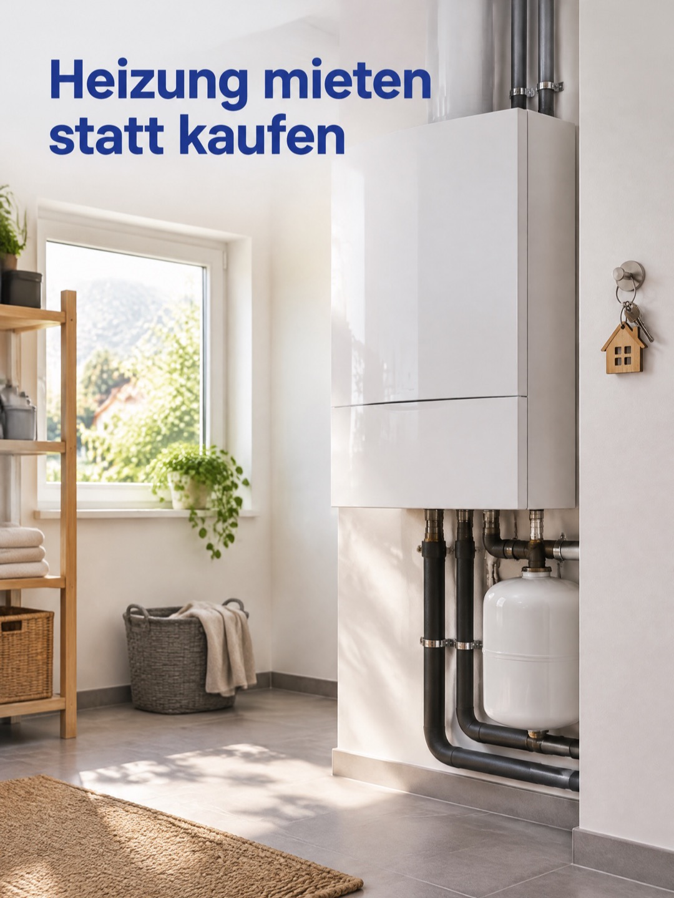

<a id="be-007"></a>
## BE-007 · Bad aus einer Hand

Bad · 3:4 · Dokument Nr. 7

```text
Brand style for a long-established plumbing, heating and bathroom company in Germany. Look: bright, warm and trustworthy; realistic photographic style; clean German homes and tidy technical rooms; natural daylight; subtle depth of field. Palette: white and very light warm grey surfaces, brand blue (#111D6D) as the main colour, brand red (#D60000) only as a small accent, dark charcoal text (#222222). Typography: bold, friendly sans-serif headline, left-aligned, generous whitespace, at most two text sizes. People: only anonymous (hands, from behind or cropped at the shoulders), never a recognisable face. Layout: vertical 3:4 portrait format (1080x1440 proportions); keep all text and key objects inside an 8% safe margin; keep the bottom-right corner (14% of the width) empty and calm for a logo added later. Do not draw any logo, manufacturer logo or label on devices, and no company name outside the quoted headline. Text rules: render ONLY the German text given in quotes, exactly once, verbatim, with correct umlauts (ä, ö, ü, ß); no other words, numbers or watermarks. A bright modern bathroom with large light-grey tiles, a floor-level walk-in shower behind a frameless glass panel, a floating light-oak vanity, one blue accent wall, soft morning light through a frosted window. Headline: "Ihr neues Bad, alles aus einer Hand"
```

**Text im Bild:** „Ihr neues Bad, alles aus einer Hand“  
**Caption:** Von der ersten Planung bis zur fertigen Umsetzung begleiten wir Ihr Badprojekt. Vorab bekommen Sie eine detaillierte Planung und eine transparente Kostenaufstellung. Symbolbild. Badanfrage starten: Link in Bio.  
**Hashtags:** #badsanierung #badmodernisierung #badezimmer #traumbad #barrierefreiesbad #wetzlar #lahndill #mittelhessen #solms #lahnau  
**Hinweise:** „Symbolbild“ in der Caption ist Pflicht (enthalten). Posting-Plan: Woche 2, Mi 11.11.2026, gegen 18 Uhr.  
**Bilder:** [original](bilder/original/BE-007.jpg) · [instagram-3x4](bilder/instagram-3x4/BE-007.jpg) · [facebook-linkedin-4x5](bilder/facebook-linkedin-4x5/BE-007.jpg)

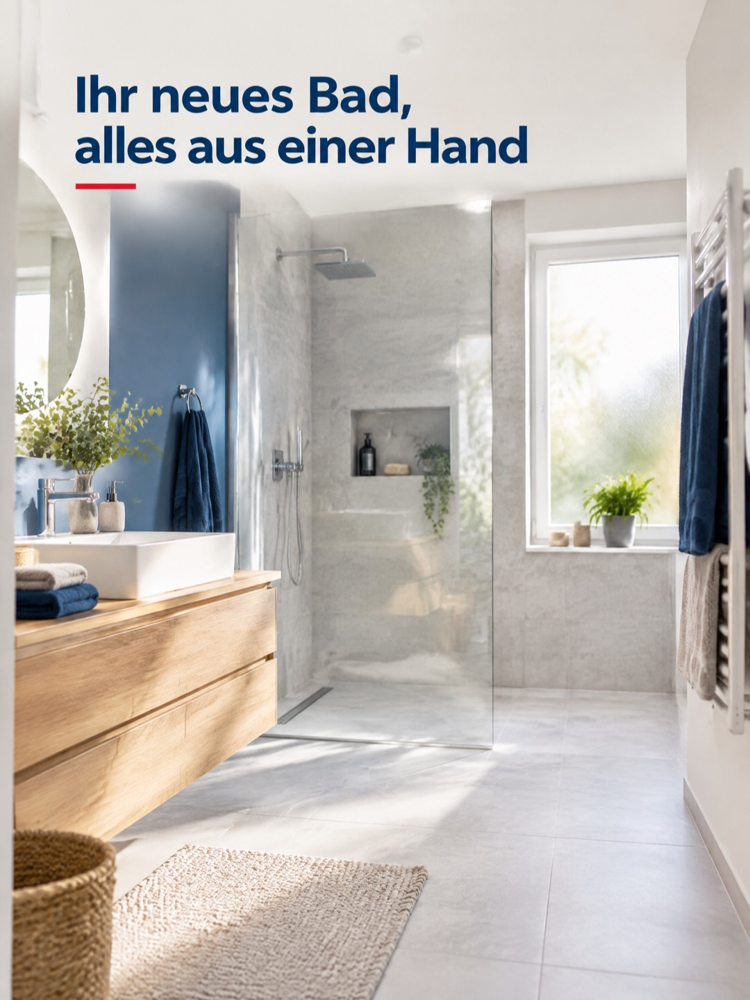

<a id="be-008"></a>
## BE-008 · 3D-Badplaner

Bad · 3:4 · Dokument Nr. 8

```text
Brand style for a long-established plumbing, heating and bathroom company in Germany. Look: bright, warm and trustworthy; realistic photographic style; clean German homes and tidy technical rooms; natural daylight; subtle depth of field. Palette: white and very light warm grey surfaces, brand blue (#111D6D) as the main colour, brand red (#D60000) only as a small accent, dark charcoal text (#222222). Typography: bold, friendly sans-serif headline, left-aligned, generous whitespace, at most two text sizes. People: only anonymous (hands, from behind or cropped at the shoulders), never a recognisable face. Layout: vertical 3:4 portrait format (1080x1440 proportions); keep all text and key objects inside an 8% safe margin; keep the bottom-right corner (14% of the width) empty and calm for a logo added later. Do not draw any logo, manufacturer logo or label on devices, and no company name outside the quoted headline. Text rules: render ONLY the German text given in quotes, exactly once, verbatim, with correct umlauts (ä, ö, ü, ß); no other words, numbers or watermarks. A tablet lying on a kitchen table showing an abstract 3D bathroom floor plan drawn in thin blue lines (no readable text), next to a cup of coffee and a few tile samples, warm daylight. Headline: "Planen Sie Ihr Traumbad in 3D"
```

**Text im Bild:** „Planen Sie Ihr Traumbad in 3D“  
**Caption:** Mit dem 3D-Badplaner auf unserer Website gestalten Sie Ihr Bad am Bildschirm und bringen Ihre Ideen direkt ins Beratungsgespräch mit. Link in Bio.  
**Hashtags:** #badsanierung #badmodernisierung #badezimmer #traumbad #barrierefreiesbad #hüttenberg #wettenberg #biebertal #ehringshausen #aßlar  
**Hinweise:** Posting-Plan: Woche 4, Fr 27.11.2026, gegen 18 Uhr.  
**Bilder:** [original](bilder/original/BE-008.jpg) · [instagram-3x4](bilder/instagram-3x4/BE-008.jpg) · [facebook-linkedin-4x5](bilder/facebook-linkedin-4x5/BE-008.jpg)

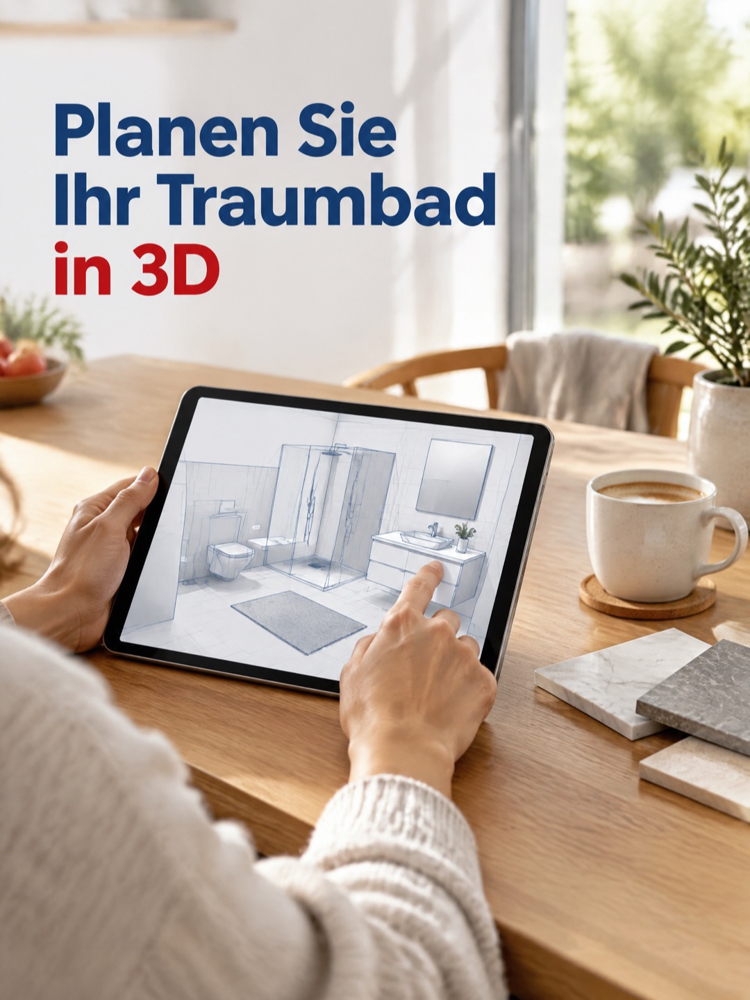

<a id="be-009"></a>
## BE-009 · Barrierefrei und schön

Bad · 3:4 · Dokument Nr. 9

```text
Brand style for a long-established plumbing, heating and bathroom company in Germany. Look: bright, warm and trustworthy; realistic photographic style; clean German homes and tidy technical rooms; natural daylight; subtle depth of field. Palette: white and very light warm grey surfaces, brand blue (#111D6D) as the main colour, brand red (#D60000) only as a small accent, dark charcoal text (#222222). Typography: bold, friendly sans-serif headline, left-aligned, generous whitespace, at most two text sizes. People: only anonymous (hands, from behind or cropped at the shoulders), never a recognisable face. Layout: vertical 3:4 portrait format (1080x1440 proportions); keep all text and key objects inside an 8% safe margin; keep the bottom-right corner (14% of the width) empty and calm for a logo added later. Do not draw any logo, manufacturer logo or label on devices, and no company name outside the quoted headline. Text rules: render ONLY the German text given in quotes, exactly once, verbatim, with correct umlauts (ä, ö, ü, ß); no other words, numbers or watermarks. An elegant barrier-free bathroom: floor-level shower, a slim matte-black grab bar that doubles as a towel rail, a fold-down shower seat, warm oak and soft blue tones, wide free floor space, nothing clinical. Headline: "Barrierefrei, und trotzdem schön"
```

**Text im Bild:** „Barrierefrei, und trotzdem schön“  
**Caption:** Ein Bad ohne Stufen und Schwellen macht den Alltag sicherer, in jedem Alter. Wir planen barrierefreie Bäder, die nach Wohnraum aussehen und nicht nach Klinik. Symbolbild.  
**Hashtags:** #badsanierung #badmodernisierung #badezimmer #traumbad #barrierefreiesbad #wetzlar #lahndill #mittelhessen #solms #lahnau  
**Hinweise:** „Symbolbild“ in der Caption ist Pflicht (enthalten). Posting-Plan: Woche 3, Mo 16.11.2026, gegen 18 Uhr.  
**Bilder:** [original](bilder/original/BE-009.jpg) · [instagram-3x4](bilder/instagram-3x4/BE-009.jpg) · [facebook-linkedin-4x5](bilder/facebook-linkedin-4x5/BE-009.jpg)

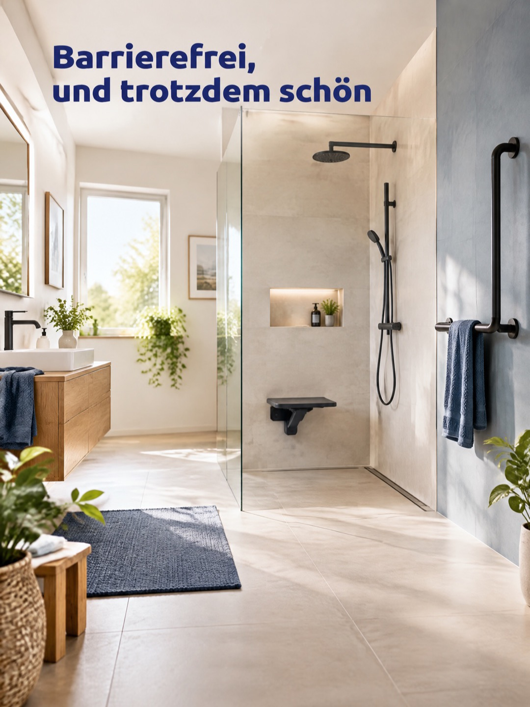

<a id="be-010"></a>
## BE-010 · Zuschuss der Pflegekasse

Förderung · 3:4 · Dokument Nr. 10

```text
Brand style for a long-established plumbing, heating and bathroom company in Germany. Look: bright, warm and trustworthy; realistic photographic style; clean German homes and tidy technical rooms; natural daylight; subtle depth of field. Palette: white and very light warm grey surfaces, brand blue (#111D6D) as the main colour, brand red (#D60000) only as a small accent, dark charcoal text (#222222). Typography: bold, friendly sans-serif headline, left-aligned, generous whitespace, at most two text sizes. People: only anonymous (hands, from behind or cropped at the shoulders), never a recognisable face. Layout: vertical 3:4 portrait format (1080x1440 proportions); keep all text and key objects inside an 8% safe margin; keep the bottom-right corner (14% of the width) empty and calm for a logo added later. Do not draw any logo, manufacturer logo or label on devices, and no company name outside the quoted headline. Text rules: render ONLY the German text given in quotes, exactly once, verbatim, with correct umlauts (ä, ö, ü, ß); no other words, numbers or watermarks. A bright bathroom with a floor-level shower and a fold-down seat; in the foreground on a small side table a closed blue folder and a pen, calm and reassuring. Headline: "Bis zu 4.180 € Zuschuss fürs Bad"
```

**Text im Bild:** „Bis zu 4.180 € Zuschuss fürs Bad“  
**Caption:** Mit anerkanntem Pflegegrad (1–5) zahlt die Pflegekasse für wohnumfeldverbessernde Maßnahmen bis zu 4.180 € pro Person (Stand 29.10.2026), zum Beispiel für die bodengleiche Dusche statt Wanne. Stellen Sie den Antrag möglichst vor Beginn der Arbeiten, das Angebot dafür bekommen Sie von uns. Symbolbild.  
**Hashtags:** #badsanierung #badmodernisierung #badezimmer #traumbad #barrierefreiesbad #hüttenberg #wettenberg #biebertal #ehringshausen #aßlar  
**Hinweise:** ⚠️ Fakten prüfen. Faktencheck: Zuschuss der Pflegekasse (bis zu 4.180 € pro Person, Pflegegrad 1–5) vor dem Posten prüfen, Stand 29.10.2026 (Quelle im Dokument: Stand 04/2026); den Stand in der Caption auf das Prüfdatum aktualisieren. „Symbolbild“ in der Caption ergänzt (fotorealistisches Bad, fehlte im Dokument). Posting-Plan: Woche 4, Mo 23.11.2026, gegen 18 Uhr.  
**Bilder:** [original](bilder/original/BE-010.jpg) · [instagram-3x4](bilder/instagram-3x4/BE-010.jpg) · [facebook-linkedin-4x5](bilder/facebook-linkedin-4x5/BE-010.jpg)

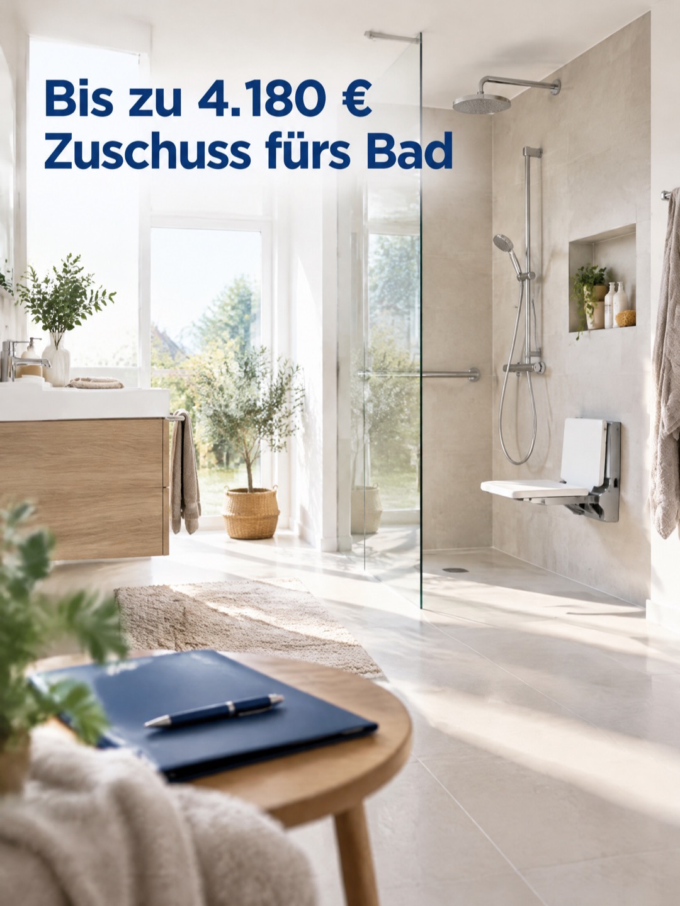

<a id="be-011"></a>
## BE-011 · Wanne raus, Dusche rein

Bad · 3:4 · Dokument Nr. 11

```text
Brand style for a long-established plumbing, heating and bathroom company in Germany. Look: bright, warm and trustworthy; realistic photographic style; clean German homes and tidy technical rooms; natural daylight; subtle depth of field. Palette: white and very light warm grey surfaces, brand blue (#111D6D) as the main colour, brand red (#D60000) only as a small accent, dark charcoal text (#222222). Typography: bold, friendly sans-serif headline, left-aligned, generous whitespace, at most two text sizes. People: only anonymous (hands, from behind or cropped at the shoulders), never a recognisable face. Layout: vertical 3:4 portrait format (1080x1440 proportions); keep all text and key objects inside an 8% safe margin; keep the bottom-right corner (14% of the width) empty and calm for a logo added later. Do not draw any logo, manufacturer logo or label on devices, and no company name outside the quoted headline. Text rules: render ONLY the German text given in quotes, exactly once, verbatim, with correct umlauts (ä, ö, ü, ß); no other words, numbers or watermarks. Split image with a thin white divider: left, an old bathtub with a high rim and dated beige tiles; right, the same room with a floor-level walk-in shower, large grey tiles and a glass panel. Headline: "Wanne raus, Dusche rein". Small label (left half, small): "Vorher". Small label (right half, small): "Nachher".
```

**Text im Bild:** „Wanne raus, Dusche rein“  
**Label:** „Vorher“ (left half, small)  
**Label:** „Nachher“ (right half, small)  
**Caption:** Symbolbild. Der Umbau von der Badewanne zur bodengleichen Dusche macht den Einstieg leichter und das Bad sicherer. Wir zeigen Ihnen, was in Ihrem Bad möglich ist.  
**Hashtags:** #badsanierung #badmodernisierung #badezimmer #traumbad #barrierefreiesbad #wetzlar #lahndill #mittelhessen #solms #lahnau  
**Hinweise:** „Symbolbild“ in der Caption ist Pflicht (enthalten). Posting-Plan: Woche 5, Mi 2.12.2026, gegen 18 Uhr.  
**Bilder:** [original](bilder/original/BE-011.jpg) · [instagram-3x4](bilder/instagram-3x4/BE-011.jpg) · [facebook-linkedin-4x5](bilder/facebook-linkedin-4x5/BE-011.jpg)

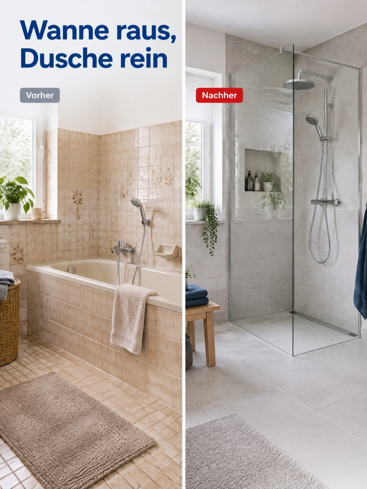

<a id="be-012"></a>
## BE-012 · Wärmepumpe und Photovoltaik

Heizung · 3:4 · Dokument Nr. 12

```text
Brand style for a long-established plumbing, heating and bathroom company in Germany. Look: bright, warm and trustworthy; realistic photographic style; clean German homes and tidy technical rooms; natural daylight; subtle depth of field. Palette: white and very light warm grey surfaces, brand blue (#111D6D) as the main colour, brand red (#D60000) only as a small accent, dark charcoal text (#222222). Typography: bold, friendly sans-serif headline, left-aligned, generous whitespace, at most two text sizes. People: only anonymous (hands, from behind or cropped at the shoulders), never a recognisable face. Layout: vertical 3:4 portrait format (1080x1440 proportions); keep all text and key objects inside an 8% safe margin; keep the bottom-right corner (14% of the width) empty and calm for a logo added later. Do not draw any logo, manufacturer logo or label on devices, and no company name outside the quoted headline. Text rules: render ONLY the German text given in quotes, exactly once, verbatim, with correct umlauts (ä, ö, ü, ß); no other words, numbers or watermarks. A single-family house on a sunny spring day with solar panels on the roof and a heat pump outdoor unit beside the wall, blue sky, green garden, no logos. Headline: "Sonnenstrom für Ihre Wärmepumpe"
```

**Text im Bild:** „Sonnenstrom für Ihre Wärmepumpe“  
**Caption:** Wer Photovoltaik und Wärmepumpe kombiniert, nutzt eigenen Strom fürs Heizen und für Warmwasser. Wir planen Haustechnik, die zusammenpasst. Symbolbild.  
**Hashtags:** #wärmepumpe #heizungstausch #heizungsmodernisierung #heizungsförderung #heizung #hüttenberg #wettenberg #biebertal #ehringshausen #aßlar  
**Hinweise:** „Symbolbild“ in der Caption ergänzt (fotorealistisches Haus mit Anlage). Posting-Plan: Woche 4, Mi 25.11.2026, gegen 18 Uhr.  
**Bilder:** [original](bilder/original/BE-012.jpg) · [instagram-3x4](bilder/instagram-3x4/BE-012.jpg) · [facebook-linkedin-4x5](bilder/facebook-linkedin-4x5/BE-012.jpg)

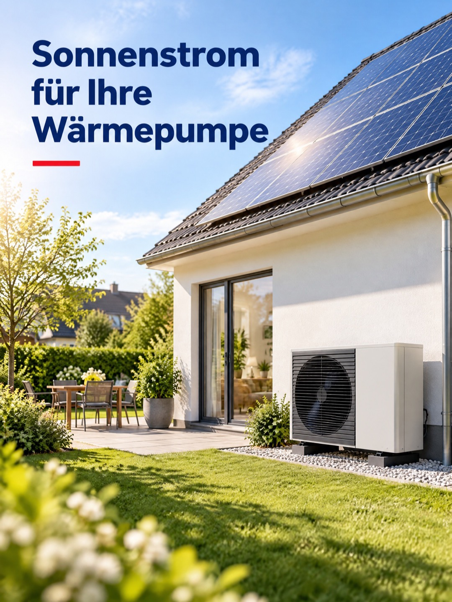

<a id="be-013"></a>
## BE-013 · Trinkwasser

Haustechnik · 3:4 · Dokument Nr. 13

```text
Brand style for a long-established plumbing, heating and bathroom company in Germany. Look: bright, warm and trustworthy; realistic photographic style; clean German homes and tidy technical rooms; natural daylight; subtle depth of field. Palette: white and very light warm grey surfaces, brand blue (#111D6D) as the main colour, brand red (#D60000) only as a small accent, dark charcoal text (#222222). Typography: bold, friendly sans-serif headline, left-aligned, generous whitespace, at most two text sizes. People: only anonymous (hands, from behind or cropped at the shoulders), never a recognisable face. Layout: vertical 3:4 portrait format (1080x1440 proportions); keep all text and key objects inside an 8% safe margin; keep the bottom-right corner (14% of the width) empty and calm for a logo added later. Do not draw any logo, manufacturer logo or label on devices, and no company name outside the quoted headline. Text rules: render ONLY the German text given in quotes, exactly once, verbatim, with correct umlauts (ä, ö, ü, ß); no other words, numbers or watermarks. A clear glass being filled with water from a modern kitchen tap, fine droplets, bright kitchen, cool blue reflections. Headline: "Frisches Wasser, sauber installiert"
```

**Text im Bild:** „Frisches Wasser, sauber installiert“  
**Caption:** Filter, Enthärtung und hygienische Leitungen: Wir kümmern uns um die Trinkwasserinstallation in Ihrem Haus. Symbolbild.  
**Hashtags:** #wetzlar #lahndill #mittelhessen #solms #lahnau #trinkwasser #wasserfilter  
**Hinweise:** „Symbolbild“ in der Caption ergänzt (fotorealistische Küchenarmatur). Posting-Plan: Woche 10, Mi 6.1.2027, gegen 18 Uhr.  
**Bilder:** [original](bilder/original/BE-013.jpg) · [instagram-3x4](bilder/instagram-3x4/BE-013.jpg) · [facebook-linkedin-4x5](bilder/facebook-linkedin-4x5/BE-013.jpg)

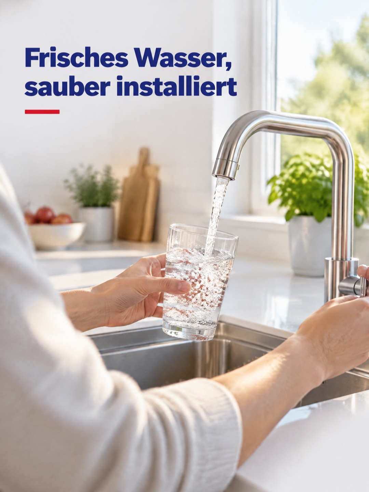

<a id="be-014"></a>
## BE-014 · Raumklima

Lüftung · 3:4 · Dokument Nr. 14

```text
Brand style for a long-established plumbing, heating and bathroom company in Germany. Look: bright, warm and trustworthy; realistic photographic style; clean German homes and tidy technical rooms; natural daylight; subtle depth of field. Palette: white and very light warm grey surfaces, brand blue (#111D6D) as the main colour, brand red (#D60000) only as a small accent, dark charcoal text (#222222). Typography: bold, friendly sans-serif headline, left-aligned, generous whitespace, at most two text sizes. People: only anonymous (hands, from behind or cropped at the shoulders), never a recognisable face. Layout: vertical 3:4 portrait format (1080x1440 proportions); keep all text and key objects inside an 8% safe margin; keep the bottom-right corner (14% of the width) empty and calm for a logo added later. Do not draw any logo, manufacturer logo or label on devices, and no company name outside the quoted headline. Text rules: render ONLY the German text given in quotes, exactly once, verbatim, with correct umlauts (ä, ö, ü, ß); no other words, numbers or watermarks. A calm bedroom on a summer evening with a slim white wall-mounted air conditioner above the bed (no logo), light curtains, warm lamp light. Headline: "Angenehmes Raumklima, das ganze Jahr"
```

**Text im Bild:** „Angenehmes Raumklima, das ganze Jahr“  
**Caption:** Klimageräte und Wohnraumlüftung sorgen für frische Luft und angenehme Temperaturen. Wir beraten Sie zu dezentralen und zentralen Lösungen. Symbolbild.  
**Hashtags:** #hüttenberg #wettenberg #biebertal #ehringshausen #aßlar #klimaanlage #wohnraumlüftung  
**Hinweise:** „Symbolbild“ in der Caption ergänzt (fotorealistischer Wohnraum). Nicht im Posting-Plan des Dokuments; Sommermotiv mit Klimagerät, eher im Frühjahr oder Sommer posten.  
**Bilder:** [original](bilder/original/BE-014.jpg) · [instagram-3x4](bilder/instagram-3x4/BE-014.jpg) · [facebook-linkedin-4x5](bilder/facebook-linkedin-4x5/BE-014.jpg)

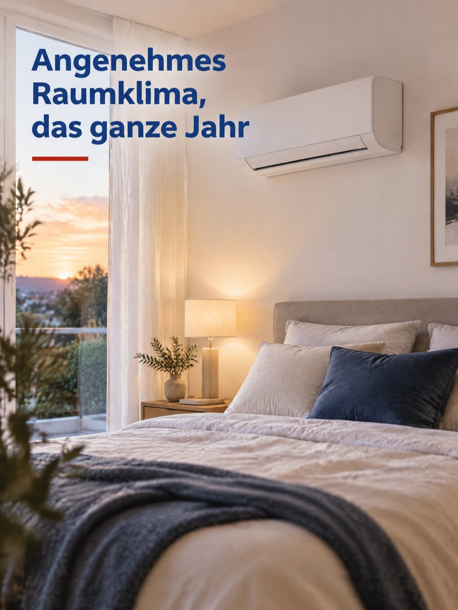

<a id="be-015"></a>
## BE-015 · Online-Termin

Service · 3:4 · Dokument Nr. 15

```text
Brand style for a long-established plumbing, heating and bathroom company in Germany. Look: bright, warm and trustworthy; realistic photographic style; clean German homes and tidy technical rooms; natural daylight; subtle depth of field. Palette: white and very light warm grey surfaces, brand blue (#111D6D) as the main colour, brand red (#D60000) only as a small accent, dark charcoal text (#222222). Typography: bold, friendly sans-serif headline, left-aligned, generous whitespace, at most two text sizes. People: only anonymous (hands, from behind or cropped at the shoulders), never a recognisable face. Layout: vertical 3:4 portrait format (1080x1440 proportions); keep all text and key objects inside an 8% safe margin; keep the bottom-right corner (14% of the width) empty and calm for a logo added later. Do not draw any logo, manufacturer logo or label on devices, and no company name outside the quoted headline. Text rules: render ONLY the German text given in quotes, exactly once, verbatim, with correct umlauts (ä, ö, ü, ß); no other words, numbers or watermarks. A hand holding a smartphone (no face visible) showing an abstract calendar grid with one day highlighted in blue (no numbers or text), cosy living room in the background. Headline: "Termin anfragen, auch nach Feierabend"
```

**Text im Bild:** „Termin anfragen, auch nach Feierabend“  
**Caption:** Über unsere Website fragen Sie Ihren Termin bequem online an, wann es Ihnen passt. Wir melden uns zeitnah bei Ihnen. Link in Bio.  
**Hashtags:** #shk #handwerk #meisterbetrieb #ausbildungsbetrieb #seit1926 #wetzlar #lahndill #mittelhessen #solms #lahnau  
**Hinweise:** Bildschirm ohne Ziffern und Schrift prüfen. Posting-Plan: Woche 8, Mo 21.12.2026, gegen 18 Uhr.  
**Bilder:** [original](bilder/original/BE-015.jpg) · [instagram-3x4](bilder/instagram-3x4/BE-015.jpg) · [facebook-linkedin-4x5](bilder/facebook-linkedin-4x5/BE-015.jpg)

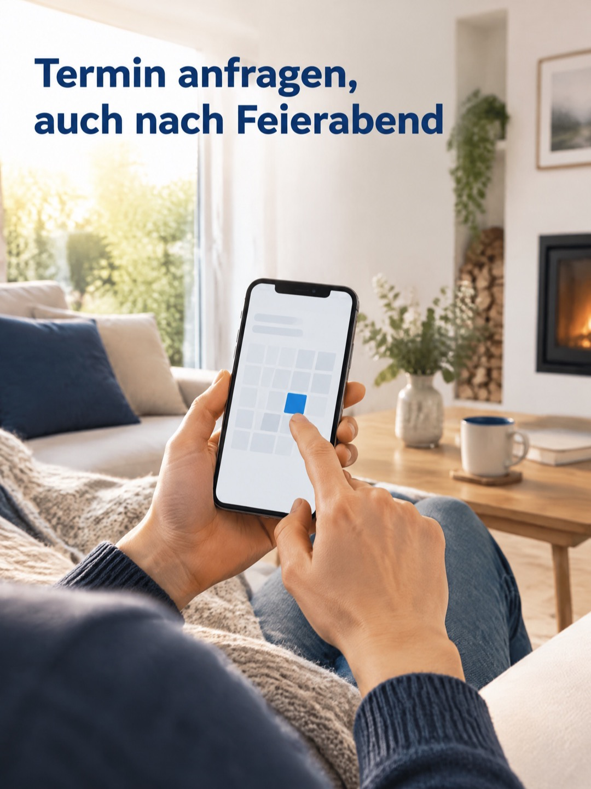

<a id="be-016"></a>
## BE-016 · Ausbildung

Recruiting · 3:4 · Dokument Nr. 16

```text
Brand style for a long-established plumbing, heating and bathroom company in Germany. Look: bright, warm and trustworthy; realistic photographic style; clean German homes and tidy technical rooms; natural daylight; subtle depth of field. Palette: white and very light warm grey surfaces, brand blue (#111D6D) as the main colour, brand red (#D60000) only as a small accent, dark charcoal text (#222222). Typography: bold, friendly sans-serif headline, left-aligned, generous whitespace, at most two text sizes. People: only anonymous (hands, from behind or cropped at the shoulders), never a recognisable face. Layout: vertical 3:4 portrait format (1080x1440 proportions); keep all text and key objects inside an 8% safe margin; keep the bottom-right corner (14% of the width) empty and calm for a logo added later. Do not draw any logo, manufacturer logo or label on devices, and no company name outside the quoted headline. Text rules: render ONLY the German text given in quotes, exactly once, verbatim, with correct umlauts (ä, ö, ü, ß); no other words, numbers or watermarks. A young apprentice seen from behind in a blue work jacket fitting copper pipes in a bright bathroom under construction, tools neatly arranged on a mat, natural light. Headline: "Starte deine Ausbildung bei uns"
```

**Text im Bild:** „Starte deine Ausbildung bei uns“  
**Caption:** Wir sind Ausbildungsbetrieb: Bad, Heizung, Wärmepumpe, ein Handwerk mit Zukunft in einem Betrieb mit 100 Jahren Erfahrung. Symbolbild. Alle Infos und Bewerbung: Link in Bio.  
**Hashtags:** #shk #handwerk #meisterbetrieb #ausbildungsbetrieb #seit1926 #ausbildung #handwerkerausbildung  
**Hinweise:** ⚠️ Fakten prüfen. Recruiting-Post in Du-Form (Headline). Faktencheck: Ausbildungsberuf und Start vorher mit der Ausbildungsseite abgleichen (im Dokument als letzter Satz der Caption, hier in die Notizen verschoben); „100 Jahre“ (Gründung 1926) mit der Geschäftsführung abgleichen, Stand 29.10.2026. „Symbolbild“ in der Caption ergänzt (fotorealistische Baustelle im Bad). Posting-Plan: Woche 3, Fr 20.11.2026, gegen 18 Uhr.  
**Bilder:** [original](bilder/original/BE-016.jpg) · [instagram-3x4](bilder/instagram-3x4/BE-016.jpg) · [facebook-linkedin-4x5](bilder/facebook-linkedin-4x5/BE-016.jpg)

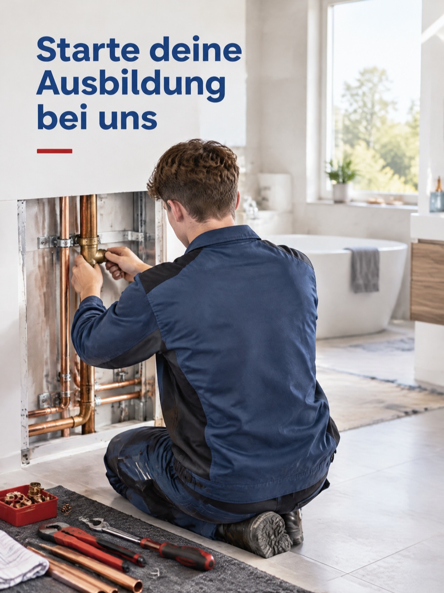

<a id="be-017"></a>
## BE-017 · Verstärkung gesucht

Recruiting · 3:4 · Dokument Nr. 17

```text
Brand style for a long-established plumbing, heating and bathroom company in Germany. Look: bright, warm and trustworthy; realistic photographic style; clean German homes and tidy technical rooms; natural daylight; subtle depth of field. Palette: white and very light warm grey surfaces, brand blue (#111D6D) as the main colour, brand red (#D60000) only as a small accent, dark charcoal text (#222222). Typography: bold, friendly sans-serif headline, left-aligned, generous whitespace, at most two text sizes. People: only anonymous (hands, from behind or cropped at the shoulders), never a recognisable face. Layout: vertical 3:4 portrait format (1080x1440 proportions); keep all text and key objects inside an 8% safe margin; keep the bottom-right corner (14% of the width) empty and calm for a logo added later. Do not draw any logo, manufacturer logo or label on devices, and no company name outside the quoted headline. Text rules: render ONLY the German text given in quotes, exactly once, verbatim, with correct umlauts (ä, ö, ü, ß); no other words, numbers or watermarks. Two craftsmen seen from behind wheeling a heat pump unit on a sack truck toward the side of a house, autumn light, teamwork, no text on clothing. Headline: "Wir suchen Verstärkung im Team"
```

**Text im Bild:** „Wir suchen Verstärkung im Team“  
**Caption:** Für Bad, Heizung und Haustechnik suchen wir Verstärkung in Wetzlar. Symbolbild. Alle offenen Stellen: Link in Bio.  
**Hashtags:** #shk #handwerk #meisterbetrieb #ausbildungsbetrieb #seit1926 #wetzlar #lahndill #mittelhessen #solms #lahnau #handwerksjobs  
**Hinweise:** Recruiting-Post. „Symbolbild“ in der Caption ergänzt (fotorealistische Monteure, von hinten). Offene Stellen vor dem Posten mit der Stellenseite abgleichen. Posting-Plan: Woche 6, Fr 11.12.2026, gegen 18 Uhr.  
**Bilder:** [original](bilder/original/BE-017.jpg) · [instagram-3x4](bilder/instagram-3x4/BE-017.jpg) · [facebook-linkedin-4x5](bilder/facebook-linkedin-4x5/BE-017.jpg)

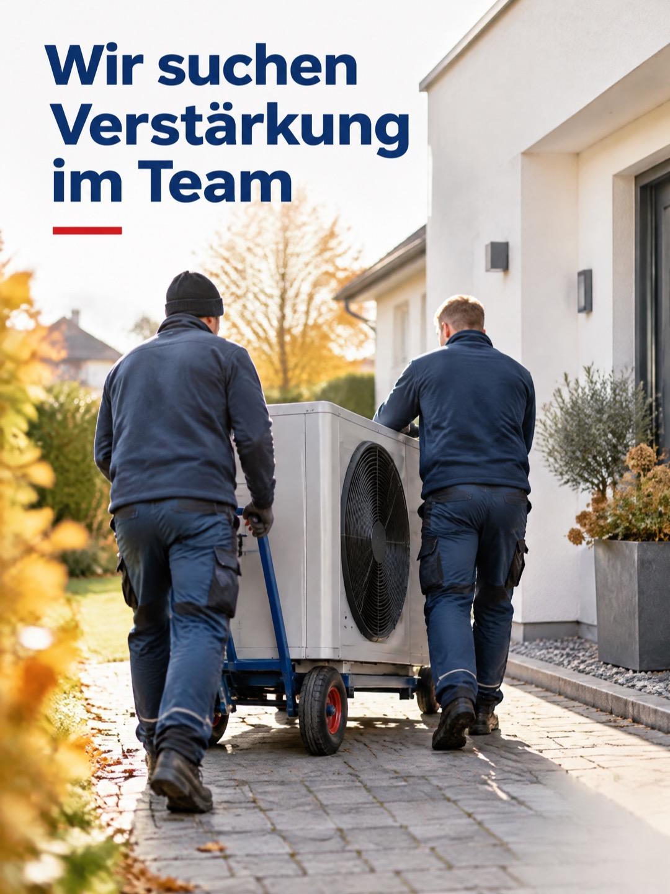

<a id="be-018"></a>
## BE-018 · Gewerbekunden

Gewerbe · 3:4 · Dokument Nr. 18

```text
Brand style for a long-established plumbing, heating and bathroom company in Germany. Look: bright, warm and trustworthy; realistic photographic style; clean German homes and tidy technical rooms; natural daylight; subtle depth of field. Palette: white and very light warm grey surfaces, brand blue (#111D6D) as the main colour, brand red (#D60000) only as a small accent, dark charcoal text (#222222). Typography: bold, friendly sans-serif headline, left-aligned, generous whitespace, at most two text sizes. People: only anonymous (hands, from behind or cropped at the shoulders), never a recognisable face. Layout: vertical 3:4 portrait format (1080x1440 proportions); keep all text and key objects inside an 8% safe margin; keep the bottom-right corner (14% of the width) empty and calm for a logo added later. Do not draw any logo, manufacturer logo or label on devices, and no company name outside the quoted headline. Text rules: render ONLY the German text given in quotes, exactly once, verbatim, with correct umlauts (ä, ö, ü, ß); no other words, numbers or watermarks. A spotless commercial washroom with a row of wall-hung toilets behind partitions and sensor taps over a long basin, cool daylight, stainless steel details. Headline: "Sanitär und Heizung für Gewerbe"
```

**Text im Bild:** „Sanitär und Heizung für Gewerbe“  
**Caption:** Wir planen und bauen Sanitär- und Heizsysteme für Industrie, Gewerbe, Behörden und Kommunen. Symbolbild. Sprechen Sie uns an: 06441-42956.  
**Hashtags:** #wetzlar #lahndill #mittelhessen #solms #lahnau #gewerbebau #sanitär  
**Hinweise:** „Symbolbild“ in der Caption ergänzt (fotorealistischer Sanitärraum, fehlte im Dokument). Posting-Plan: Woche 10, Fr 8.1.2027, gegen 18 Uhr.  
**Bilder:** [original](bilder/original/BE-018.jpg) · [instagram-3x4](bilder/instagram-3x4/BE-018.jpg) · [facebook-linkedin-4x5](bilder/facebook-linkedin-4x5/BE-018.jpg)

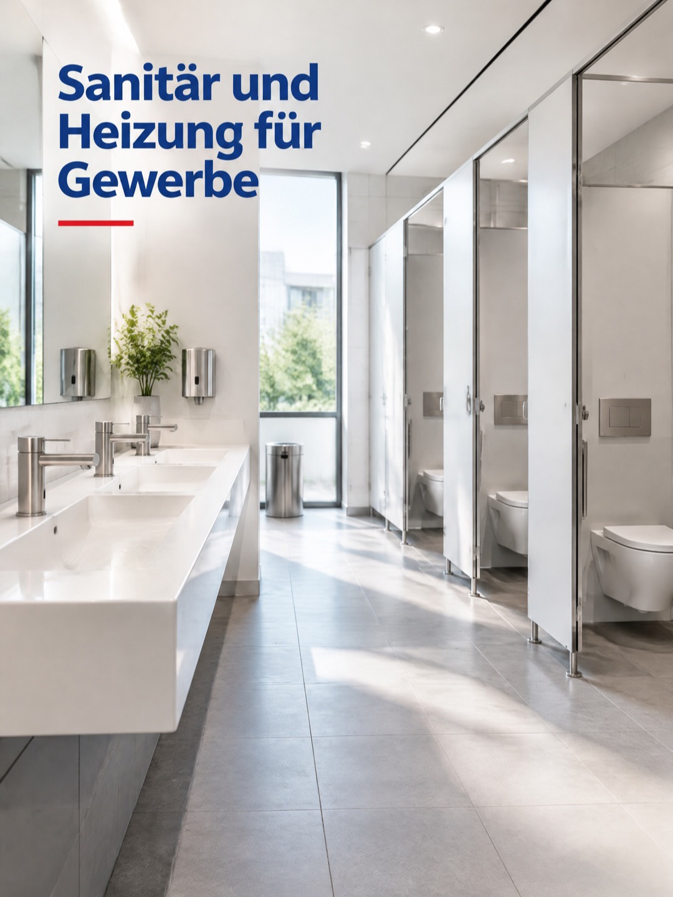

<a id="be-019"></a>
## BE-019 · Badausstellung

Bad · 3:4 · Dokument Nr. 19

```text
Brand style for a long-established plumbing, heating and bathroom company in Germany. Look: bright, warm and trustworthy; realistic photographic style; clean German homes and tidy technical rooms; natural daylight; subtle depth of field. Palette: white and very light warm grey surfaces, brand blue (#111D6D) as the main colour, brand red (#D60000) only as a small accent, dark charcoal text (#222222). Typography: bold, friendly sans-serif headline, left-aligned, generous whitespace, at most two text sizes. People: only anonymous (hands, from behind or cropped at the shoulders), never a recognisable face. Layout: vertical 3:4 portrait format (1080x1440 proportions); keep all text and key objects inside an 8% safe margin; keep the bottom-right corner (14% of the width) empty and calm for a logo added later. Do not draw any logo, manufacturer logo or label on devices, and no company name outside the quoted headline. Text rules: render ONLY the German text given in quotes, exactly once, verbatim, with correct umlauts (ä, ö, ü, ß); no other words, numbers or watermarks. A bright bathroom showroom with several styled display bathrooms side by side, warm spotlights, tiles and fittings on display, no people, no signage. Headline: "Bäder live erleben: Wetzlar und Gießen"
```

**Text im Bild:** „Bäder live erleben: Wetzlar und Gießen“  
**Caption:** In den Ausstellungen in Wetzlar und Gießen sehen Sie Bäder, Materialien und Armaturen vor Ort. Symbolbild. Vereinbaren Sie einen Termin, wir beraten Sie dort persönlich.  
**Hashtags:** #badsanierung #badmodernisierung #badezimmer #traumbad #barrierefreiesbad #wetzlar #lahndill #mittelhessen #solms #lahnau #badausstellung  
**Hinweise:** „Symbolbild“ in der Caption ergänzt (fotorealistische Ausstellung, nicht die echte). Posting-Plan: Woche 7, Fr 18.12.2026, gegen 18 Uhr.  
**Bilder:** [original](bilder/original/BE-019.jpg) · [instagram-3x4](bilder/instagram-3x4/BE-019.jpg) · [facebook-linkedin-4x5](bilder/facebook-linkedin-4x5/BE-019.jpg)

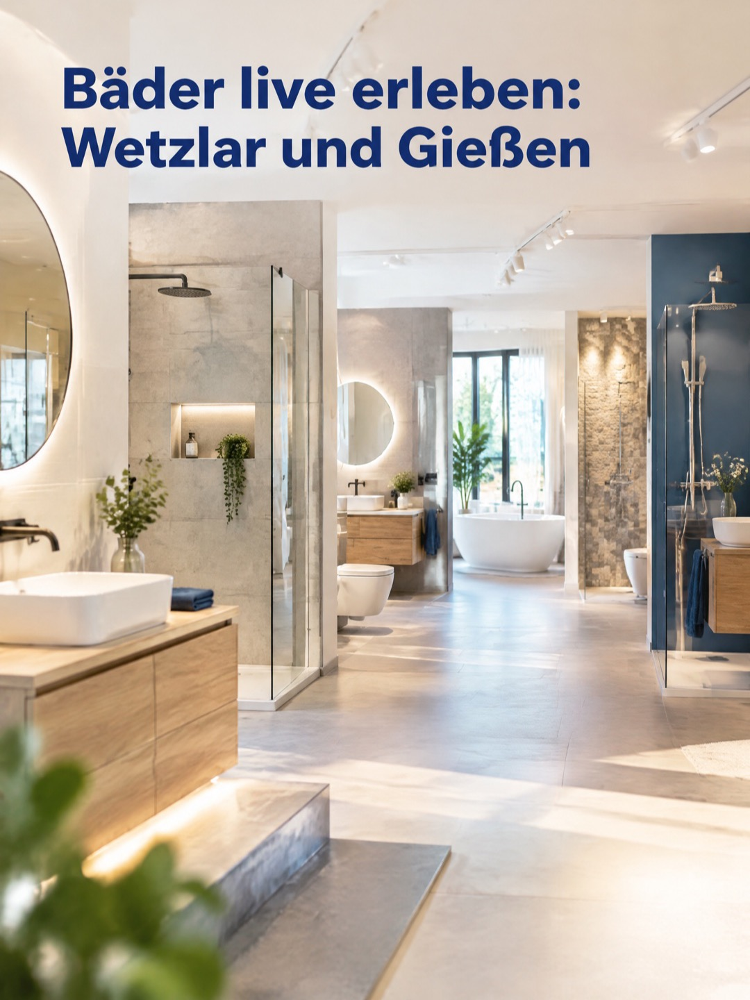

<a id="be-020"></a>
## BE-020 · Transparente Kosten

Service · 3:4 · Dokument Nr. 20

```text
Brand style for a long-established plumbing, heating and bathroom company in Germany. Look: bright, warm and trustworthy; realistic photographic style; clean German homes and tidy technical rooms; natural daylight; subtle depth of field. Palette: white and very light warm grey surfaces, brand blue (#111D6D) as the main colour, brand red (#D60000) only as a small accent, dark charcoal text (#222222). Typography: bold, friendly sans-serif headline, left-aligned, generous whitespace, at most two text sizes. People: only anonymous (hands, from behind or cropped at the shoulders), never a recognisable face. Layout: vertical 3:4 portrait format (1080x1440 proportions); keep all text and key objects inside an 8% safe margin; keep the bottom-right corner (14% of the width) empty and calm for a logo added later. Do not draw any logo, manufacturer logo or label on devices, and no company name outside the quoted headline. Text rules: render ONLY the German text given in quotes, exactly once, verbatim, with correct umlauts (ä, ö, ü, ß); no other words, numbers or watermarks. A clipboard with a neatly laid-out cost overview made of abstract lines and boxes (no readable numbers), a pen and a single tile sample on a light desk, soft daylight. Headline: "Klare Planung, transparente Kosten"
```

**Text im Bild:** „Klare Planung, transparente Kosten“  
**Caption:** Bevor es losgeht, erhalten Sie von uns eine detaillierte Planung und eine transparente Kostenaufstellung. So entscheiden Sie in Ruhe.  
**Hashtags:** #badsanierung #badmodernisierung #badezimmer #traumbad #barrierefreiesbad #wärmepumpe #heizungstausch #heizungsmodernisierung #heizungsförderung #heizung #hüttenberg #wettenberg #biebertal #ehringshausen #aßlar  
**Hinweise:** Posting-Plan: Woche 7, Mo 14.12.2026, gegen 18 Uhr.  
**Bilder:** [original](bilder/original/BE-020.jpg) · [instagram-3x4](bilder/instagram-3x4/BE-020.jpg) · [facebook-linkedin-4x5](bilder/facebook-linkedin-4x5/BE-020.jpg)

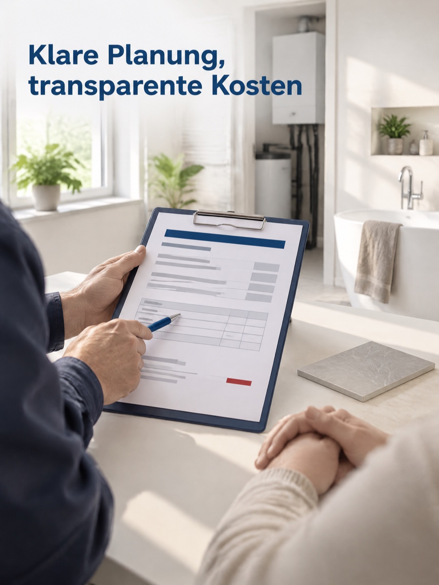

<a id="be-021"></a>
## BE-021 · 100 Jahre in 6 Bildern: Cover

Karussell · 3:4 · Karussell K1 „100 Jahre in 6 Bildern“, Slide 1 von 7 · Dokument Nr. K1-1

```text
Brand style for a long-established plumbing, heating and bathroom company in Germany. Look: bright, warm and trustworthy; realistic photographic style; clean German homes and tidy technical rooms; natural daylight; subtle depth of field. Palette: white and very light warm grey surfaces, brand blue (#111D6D) as the main colour, brand red (#D60000) only as a small accent, dark charcoal text (#222222). Typography: bold, friendly sans-serif headline, left-aligned, generous whitespace, at most two text sizes. People: only anonymous (hands, from behind or cropped at the shoulders), never a recognisable face. Layout: vertical 3:4 portrait format (1080x1440 proportions); keep all text and key objects inside an 8% safe margin; keep the bottom-right corner (14% of the width) empty and calm for a logo added later. Do not draw any logo, manufacturer logo or label on devices, and no company name outside the quoted headline. Text rules: render ONLY the German text given in quotes, exactly once, verbatim, with correct umlauts (ä, ö, ü, ß); no other words, numbers or watermarks. A vintage pipe wrench and a modern press tool crossed on a light wooden workbench, soft light. Headline: "100 Jahre in 6 Bildern". Small label (bottom-left, small): "Swipe →".
```

**Text im Bild:** „100 Jahre in 6 Bildern“  
**Label:** „Swipe →“ (bottom-left, small)  
**Caption:** Von der Werkstatt in der Hintergasse bis zur Wärmepumpe: 100 Jahre Handwerk aus Wetzlar in sechs Bildern. Symbolbilder. Danke, dass Sie uns so lange begleiten!  
**Hashtags:** #shk #handwerk #meisterbetrieb #ausbildungsbetrieb #seit1926 #wetzlar #lahndill #mittelhessen #solms #lahnau  
**Hinweise:** ⚠️ Fakten prüfen. Caption und Hashtags gelten für das ganze Karussell (einmal posten). Faktencheck: Die Jahreszahlen (1926, 1945, 1950er, 2001) stammen von bad-energie.de; vor dem Posten mit der Geschäftsführung abgleichen (Stand 29.10.2026). „Symbolbilder“ in der Caption ist Pflicht (enthalten). Cover dient als Stilreferenz für die Slides 2–7. Posting-Plan: Woche 2, Mo 9.11.2026, gegen 18 Uhr.  
**Bilder:** [original](bilder/original/BE-021.jpg) · [instagram-3x4](bilder/instagram-3x4/BE-021.jpg) · [facebook-linkedin-4x5](bilder/facebook-linkedin-4x5/BE-021.jpg)

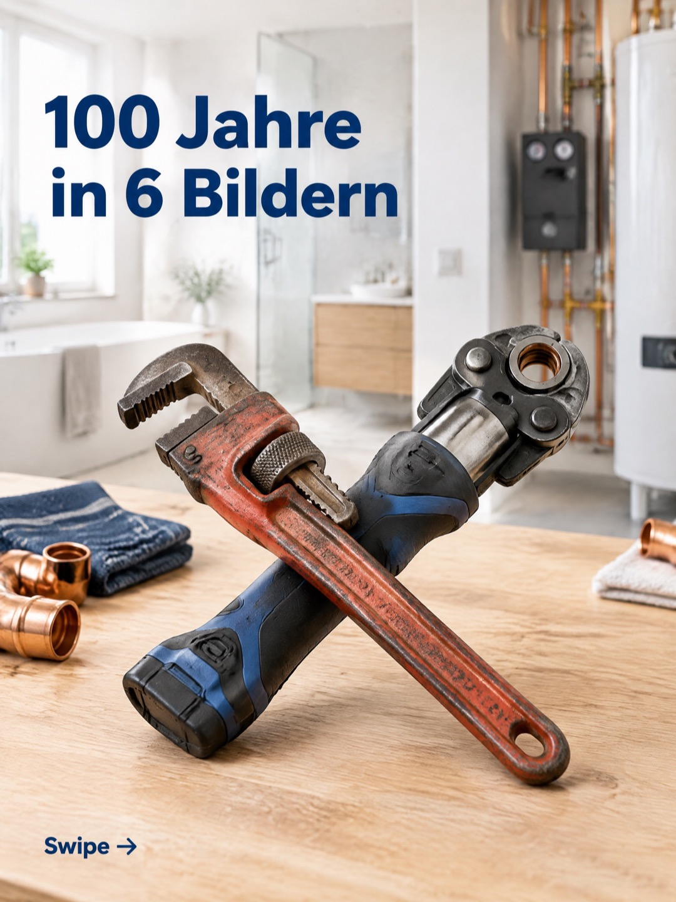

<a id="be-022"></a>
## BE-022 · 1926: Gründung

Karussell · 3:4 · Karussell K1 „100 Jahre in 6 Bildern“, Slide 2 von 7 · Dokument Nr. K1-2

Vorher die Cover-Slide dieser Serie hochladen (Stilreferenz).

```text
Use the uploaded image as the exact style reference: same background, colours, typography and layout. Create the next slide of this carousel. Brand style for a long-established plumbing, heating and bathroom company in Germany. Look: bright, warm and trustworthy; realistic photographic style; clean German homes and tidy technical rooms; natural daylight; subtle depth of field. Palette: white and very light warm grey surfaces, brand blue (#111D6D) as the main colour, brand red (#D60000) only as a small accent, dark charcoal text (#222222). Typography: bold, friendly sans-serif headline, left-aligned, generous whitespace, at most two text sizes. People: only anonymous (hands, from behind or cropped at the shoulders), never a recognisable face. Layout: vertical 3:4 portrait format (1080x1440 proportions); keep all text and key objects inside an 8% safe margin; keep the bottom-right corner (14% of the width) empty and calm for a logo added later. Do not draw any logo, manufacturer logo or label on devices, and no company name outside the quoted headline. Text rules: render ONLY the German text given in quotes, exactly once, verbatim, with correct umlauts (ä, ö, ü, ß); no other words, numbers or watermarks. A 1920s plumber's workshop in sepia: wooden workbench, copper pipes, oil lamp, no people, no signage. Headline: "1926: Gründung in der Wetzlarer Hintergasse"
```

**Text im Bild:** „1926: Gründung in der Wetzlarer Hintergasse“  
**Caption:** Von der Werkstatt in der Hintergasse bis zur Wärmepumpe: 100 Jahre Handwerk aus Wetzlar in sechs Bildern. Symbolbilder. Danke, dass Sie uns so lange begleiten!  
**Hashtags:** #shk #handwerk #meisterbetrieb #ausbildungsbetrieb #seit1926 #wetzlar #lahndill #mittelhessen #solms #lahnau  
**Hinweise:** ⚠️ Fakten prüfen. Caption und Hashtags gelten für das ganze Karussell (einmal posten). Faktencheck: Die Jahreszahlen (1926, 1945, 1950er, 2001) stammen von bad-energie.de; vor dem Posten mit der Geschäftsführung abgleichen (Stand 29.10.2026). „Symbolbilder“ in der Caption ist Pflicht (enthalten). Ab Slide 2 das fertige Cover als Stilreferenz hochladen (siehe E6). Posting-Plan: Woche 2, Mo 9.11.2026, gegen 18 Uhr.  
**Bilder:** [original](bilder/original/BE-022.jpg) · [instagram-3x4](bilder/instagram-3x4/BE-022.jpg) · [facebook-linkedin-4x5](bilder/facebook-linkedin-4x5/BE-022.jpg)

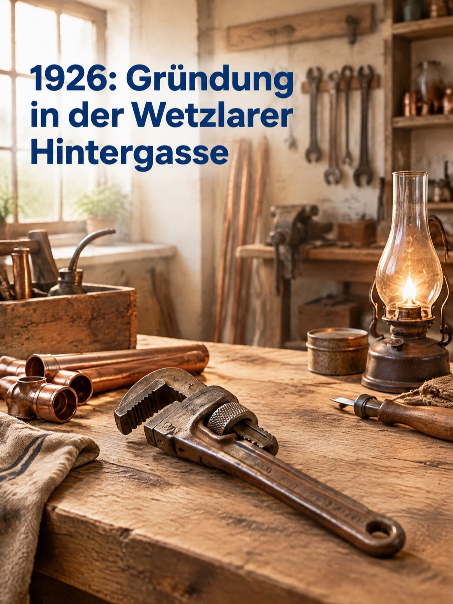

<a id="be-023"></a>
## BE-023 · 1945: Zweite Generation

Karussell · 3:4 · Karussell K1 „100 Jahre in 6 Bildern“, Slide 3 von 7 · Dokument Nr. K1-3

Vorher die Cover-Slide dieser Serie hochladen (Stilreferenz).

```text
Use the uploaded image as the exact style reference: same background, colours, typography and layout. Create the next slide of this carousel. Brand style for a long-established plumbing, heating and bathroom company in Germany. Look: bright, warm and trustworthy; realistic photographic style; clean German homes and tidy technical rooms; natural daylight; subtle depth of field. Palette: white and very light warm grey surfaces, brand blue (#111D6D) as the main colour, brand red (#D60000) only as a small accent, dark charcoal text (#222222). Typography: bold, friendly sans-serif headline, left-aligned, generous whitespace, at most two text sizes. People: only anonymous (hands, from behind or cropped at the shoulders), never a recognisable face. Layout: vertical 3:4 portrait format (1080x1440 proportions); keep all text and key objects inside an 8% safe margin; keep the bottom-right corner (14% of the width) empty and calm for a logo added later. Do not draw any logo, manufacturer logo or label on devices, and no company name outside the quoted headline. Text rules: render ONLY the German text given in quotes, exactly once, verbatim, with correct umlauts (ä, ö, ü, ß); no other words, numbers or watermarks. A vintage enamel bathtub and a cast-iron radiator in faded post-war colours. Headline: "1945: Die zweite Generation übernimmt"
```

**Text im Bild:** „1945: Die zweite Generation übernimmt“  
**Caption:** Von der Werkstatt in der Hintergasse bis zur Wärmepumpe: 100 Jahre Handwerk aus Wetzlar in sechs Bildern. Symbolbilder. Danke, dass Sie uns so lange begleiten!  
**Hashtags:** #shk #handwerk #meisterbetrieb #ausbildungsbetrieb #seit1926 #wetzlar #lahndill #mittelhessen #solms #lahnau  
**Hinweise:** ⚠️ Fakten prüfen. Caption und Hashtags gelten für das ganze Karussell (einmal posten). Faktencheck: Die Jahreszahlen (1926, 1945, 1950er, 2001) stammen von bad-energie.de; vor dem Posten mit der Geschäftsführung abgleichen (Stand 29.10.2026). „Symbolbilder“ in der Caption ist Pflicht (enthalten). Ab Slide 2 das fertige Cover als Stilreferenz hochladen (siehe E6). Posting-Plan: Woche 2, Mo 9.11.2026, gegen 18 Uhr.  
**Bilder:** [original](bilder/original/BE-023.jpg) · [instagram-3x4](bilder/instagram-3x4/BE-023.jpg) · [facebook-linkedin-4x5](bilder/facebook-linkedin-4x5/BE-023.jpg)

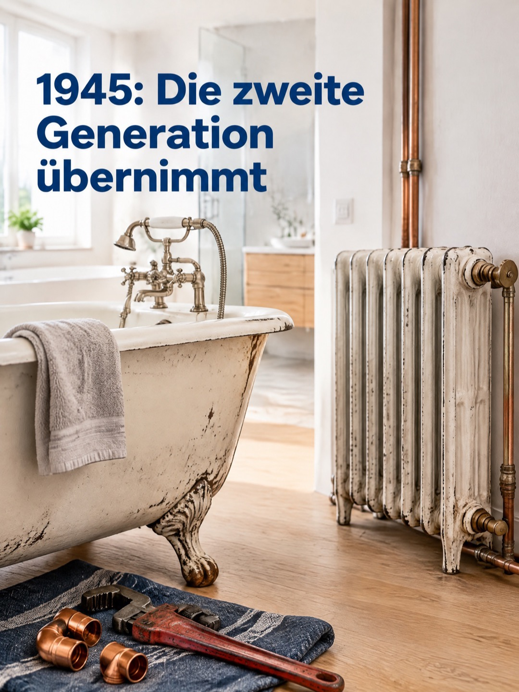

<a id="be-024"></a>
## BE-024 · 1950er: Umzug

Karussell · 3:4 · Karussell K1 „100 Jahre in 6 Bildern“, Slide 4 von 7 · Dokument Nr. K1-4

Vorher die Cover-Slide dieser Serie hochladen (Stilreferenz).

```text
Use the uploaded image as the exact style reference: same background, colours, typography and layout. Create the next slide of this carousel. Brand style for a long-established plumbing, heating and bathroom company in Germany. Look: bright, warm and trustworthy; realistic photographic style; clean German homes and tidy technical rooms; natural daylight; subtle depth of field. Palette: white and very light warm grey surfaces, brand blue (#111D6D) as the main colour, brand red (#D60000) only as a small accent, dark charcoal text (#222222). Typography: bold, friendly sans-serif headline, left-aligned, generous whitespace, at most two text sizes. People: only anonymous (hands, from behind or cropped at the shoulders), never a recognisable face. Layout: vertical 3:4 portrait format (1080x1440 proportions); keep all text and key objects inside an 8% safe margin; keep the bottom-right corner (14% of the width) empty and calm for a logo added later. Do not draw any logo, manufacturer logo or label on devices, and no company name outside the quoted headline. Text rules: render ONLY the German text given in quotes, exactly once, verbatim, with correct umlauts (ä, ö, ü, ß); no other words, numbers or watermarks. Exterior of a small 1950s workshop building, faded film look, no readable signs. Headline: "1950er: Umzug in die Garbenheimer Straße"
```

**Text im Bild:** „1950er: Umzug in die Garbenheimer Straße“  
**Caption:** Von der Werkstatt in der Hintergasse bis zur Wärmepumpe: 100 Jahre Handwerk aus Wetzlar in sechs Bildern. Symbolbilder. Danke, dass Sie uns so lange begleiten!  
**Hashtags:** #shk #handwerk #meisterbetrieb #ausbildungsbetrieb #seit1926 #wetzlar #lahndill #mittelhessen #solms #lahnau  
**Hinweise:** ⚠️ Fakten prüfen. Caption und Hashtags gelten für das ganze Karussell (einmal posten). Faktencheck: Die Jahreszahlen (1926, 1945, 1950er, 2001) stammen von bad-energie.de; vor dem Posten mit der Geschäftsführung abgleichen (Stand 29.10.2026). „Symbolbilder“ in der Caption ist Pflicht (enthalten). Ab Slide 2 das fertige Cover als Stilreferenz hochladen (siehe E6). Posting-Plan: Woche 2, Mo 9.11.2026, gegen 18 Uhr.  
**Bilder:** [original](bilder/original/BE-024.jpg) · [instagram-3x4](bilder/instagram-3x4/BE-024.jpg) · [facebook-linkedin-4x5](bilder/facebook-linkedin-4x5/BE-024.jpg)

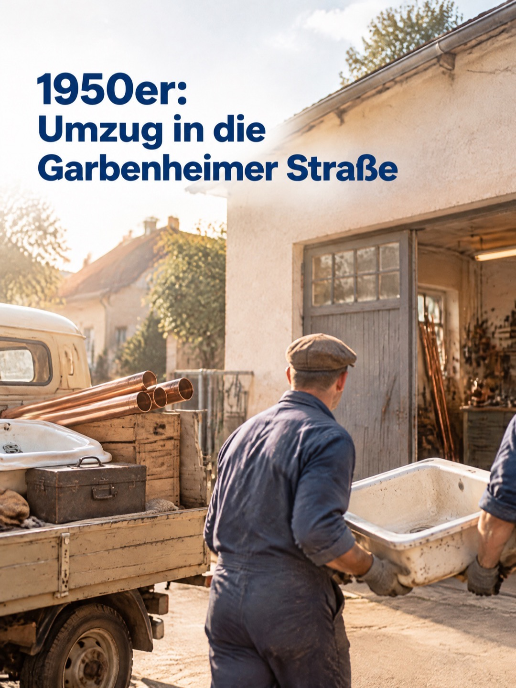

<a id="be-025"></a>
## BE-025 · 2001: Neuer Name

Karussell · 3:4 · Karussell K1 „100 Jahre in 6 Bildern“, Slide 5 von 7 · Dokument Nr. K1-5

Vorher die Cover-Slide dieser Serie hochladen (Stilreferenz).

```text
Use the uploaded image as the exact style reference: same background, colours, typography and layout. Create the next slide of this carousel. Brand style for a long-established plumbing, heating and bathroom company in Germany. Look: bright, warm and trustworthy; realistic photographic style; clean German homes and tidy technical rooms; natural daylight; subtle depth of field. Palette: white and very light warm grey surfaces, brand blue (#111D6D) as the main colour, brand red (#D60000) only as a small accent, dark charcoal text (#222222). Typography: bold, friendly sans-serif headline, left-aligned, generous whitespace, at most two text sizes. People: only anonymous (hands, from behind or cropped at the shoulders), never a recognisable face. Layout: vertical 3:4 portrait format (1080x1440 proportions); keep all text and key objects inside an 8% safe margin; keep the bottom-right corner (14% of the width) empty and calm for a logo added later. Do not draw any logo, manufacturer logo or label on devices, and no company name outside the quoted headline. Text rules: render ONLY the German text given in quotes, exactly once, verbatim, with correct umlauts (ä, ö, ü, ß); no other words, numbers or watermarks. An early-2000s bathroom and a new condensing boiler, crisp colours. Headline: "2001: Neuer Name, Bad & Energie GmbH"
```

**Text im Bild:** „2001: Neuer Name, Bad & Energie GmbH“  
**Caption:** Von der Werkstatt in der Hintergasse bis zur Wärmepumpe: 100 Jahre Handwerk aus Wetzlar in sechs Bildern. Symbolbilder. Danke, dass Sie uns so lange begleiten!  
**Hashtags:** #shk #handwerk #meisterbetrieb #ausbildungsbetrieb #seit1926 #wetzlar #lahndill #mittelhessen #solms #lahnau  
**Hinweise:** ⚠️ Fakten prüfen. Caption und Hashtags gelten für das ganze Karussell (einmal posten). Faktencheck: Die Jahreszahlen (1926, 1945, 1950er, 2001) stammen von bad-energie.de; vor dem Posten mit der Geschäftsführung abgleichen (Stand 29.10.2026). „Symbolbilder“ in der Caption ist Pflicht (enthalten). Ab Slide 2 das fertige Cover als Stilreferenz hochladen (siehe E6). Posting-Plan: Woche 2, Mo 9.11.2026, gegen 18 Uhr.  
**Bilder:** [original](bilder/original/BE-025.jpg) · [instagram-3x4](bilder/instagram-3x4/BE-025.jpg) · [facebook-linkedin-4x5](bilder/facebook-linkedin-4x5/BE-025.jpg)

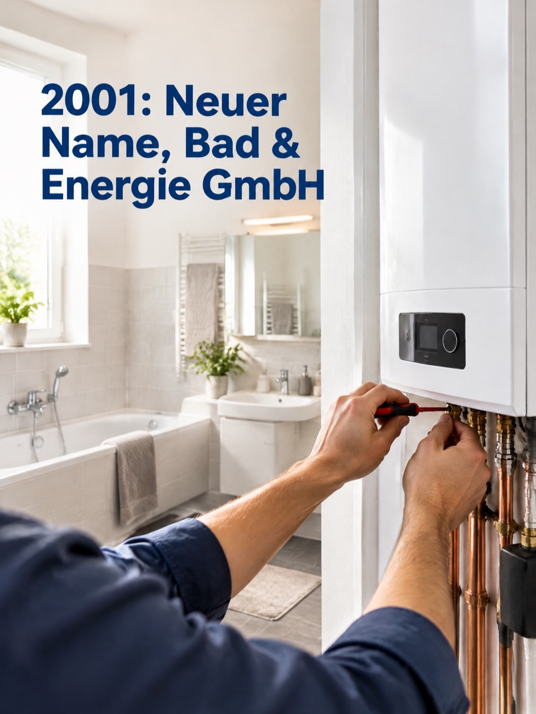

<a id="be-026"></a>
## BE-026 · Heute: Bad, Heizung, Haustechnik

Karussell · 3:4 · Karussell K1 „100 Jahre in 6 Bildern“, Slide 6 von 7 · Dokument Nr. K1-6

Vorher die Cover-Slide dieser Serie hochladen (Stilreferenz).

```text
Use the uploaded image as the exact style reference: same background, colours, typography and layout. Create the next slide of this carousel. Brand style for a long-established plumbing, heating and bathroom company in Germany. Look: bright, warm and trustworthy; realistic photographic style; clean German homes and tidy technical rooms; natural daylight; subtle depth of field. Palette: white and very light warm grey surfaces, brand blue (#111D6D) as the main colour, brand red (#D60000) only as a small accent, dark charcoal text (#222222). Typography: bold, friendly sans-serif headline, left-aligned, generous whitespace, at most two text sizes. People: only anonymous (hands, from behind or cropped at the shoulders), never a recognisable face. Layout: vertical 3:4 portrait format (1080x1440 proportions); keep all text and key objects inside an 8% safe margin; keep the bottom-right corner (14% of the width) empty and calm for a logo added later. Do not draw any logo, manufacturer logo or label on devices, and no company name outside the quoted headline. Text rules: render ONLY the German text given in quotes, exactly once, verbatim, with correct umlauts (ä, ö, ü, ß); no other words, numbers or watermarks. Split view: a heat pump beside a house and a modern walk-in shower. Headline: "Heute: Bad, Heizung, Haustechnik"
```

**Text im Bild:** „Heute: Bad, Heizung, Haustechnik“  
**Caption:** Von der Werkstatt in der Hintergasse bis zur Wärmepumpe: 100 Jahre Handwerk aus Wetzlar in sechs Bildern. Symbolbilder. Danke, dass Sie uns so lange begleiten!  
**Hashtags:** #shk #handwerk #meisterbetrieb #ausbildungsbetrieb #seit1926 #wetzlar #lahndill #mittelhessen #solms #lahnau  
**Hinweise:** ⚠️ Fakten prüfen. Caption und Hashtags gelten für das ganze Karussell (einmal posten). Faktencheck: Die Jahreszahlen (1926, 1945, 1950er, 2001) stammen von bad-energie.de; vor dem Posten mit der Geschäftsführung abgleichen (Stand 29.10.2026). „Symbolbilder“ in der Caption ist Pflicht (enthalten). Ab Slide 2 das fertige Cover als Stilreferenz hochladen (siehe E6). Posting-Plan: Woche 2, Mo 9.11.2026, gegen 18 Uhr.  
**Bilder:** [original](bilder/original/BE-026.jpg) · [instagram-3x4](bilder/instagram-3x4/BE-026.jpg) · [facebook-linkedin-4x5](bilder/facebook-linkedin-4x5/BE-026.jpg)

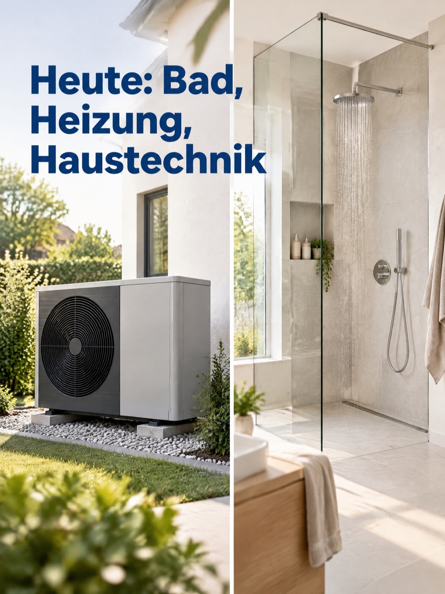

<a id="be-027"></a>
## BE-027 · Auf die nächsten 100 Jahre

Karussell · 3:4 · Karussell K1 „100 Jahre in 6 Bildern“, Slide 7 von 7 · Dokument Nr. K1-7

Vorher die Cover-Slide dieser Serie hochladen (Stilreferenz).

```text
Use the uploaded image as the exact style reference: same background, colours, typography and layout. Create the next slide of this carousel. Brand style for a long-established plumbing, heating and bathroom company in Germany. Look: bright, warm and trustworthy; realistic photographic style; clean German homes and tidy technical rooms; natural daylight; subtle depth of field. Palette: white and very light warm grey surfaces, brand blue (#111D6D) as the main colour, brand red (#D60000) only as a small accent, dark charcoal text (#222222). Typography: bold, friendly sans-serif headline, left-aligned, generous whitespace, at most two text sizes. People: only anonymous (hands, from behind or cropped at the shoulders), never a recognisable face. Layout: vertical 3:4 portrait format (1080x1440 proportions); keep all text and key objects inside an 8% safe margin; keep the bottom-right corner (14% of the width) empty and calm for a logo added later. Do not draw any logo, manufacturer logo or label on devices, and no company name outside the quoted headline. Text rules: render ONLY the German text given in quotes, exactly once, verbatim, with correct umlauts (ä, ö, ü, ß); no other words, numbers or watermarks. Plain blue background with a subtle white line drawing of a house. Headline: "Auf die nächsten 100 Jahre!"
```

**Text im Bild:** „Auf die nächsten 100 Jahre!“  
**Caption:** Von der Werkstatt in der Hintergasse bis zur Wärmepumpe: 100 Jahre Handwerk aus Wetzlar in sechs Bildern. Symbolbilder. Danke, dass Sie uns so lange begleiten!  
**Hashtags:** #shk #handwerk #meisterbetrieb #ausbildungsbetrieb #seit1926 #wetzlar #lahndill #mittelhessen #solms #lahnau  
**Hinweise:** ⚠️ Fakten prüfen. Caption und Hashtags gelten für das ganze Karussell (einmal posten). Faktencheck: Die Jahreszahlen (1926, 1945, 1950er, 2001) stammen von bad-energie.de; vor dem Posten mit der Geschäftsführung abgleichen (Stand 29.10.2026). „Symbolbilder“ in der Caption ist Pflicht (enthalten). Ab Slide 2 das fertige Cover als Stilreferenz hochladen (siehe E6). Posting-Plan: Woche 2, Mo 9.11.2026, gegen 18 Uhr.  
**Bilder:** [original](bilder/original/BE-027.jpg) · [instagram-3x4](bilder/instagram-3x4/BE-027.jpg) · [facebook-linkedin-4x5](bilder/facebook-linkedin-4x5/BE-027.jpg)

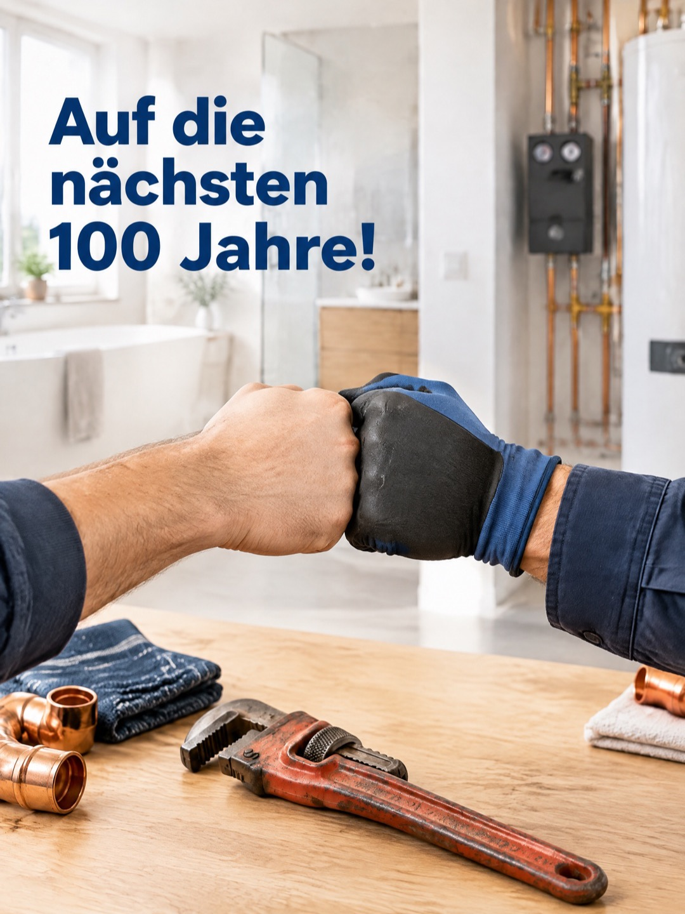

<a id="be-028"></a>
## BE-028 · Heizungsförderung in 5 Schritten: Cover

Karussell · 3:4 · Karussell K2 „Heizungsförderung in 5 Schritten“, Slide 1 von 7 · Dokument Nr. K2-1

```text
Brand style for a long-established plumbing, heating and bathroom company in Germany. Look: bright, warm and trustworthy; realistic photographic style; clean German homes and tidy technical rooms; natural daylight; subtle depth of field. Palette: white and very light warm grey surfaces, brand blue (#111D6D) as the main colour, brand red (#D60000) only as a small accent, dark charcoal text (#222222). Typography: bold, friendly sans-serif headline, left-aligned, generous whitespace, at most two text sizes. People: only anonymous (hands, from behind or cropped at the shoulders), never a recognisable face. Layout: vertical 3:4 portrait format (1080x1440 proportions); keep all text and key objects inside an 8% safe margin; keep the bottom-right corner (14% of the width) empty and calm for a logo added later. Do not draw any logo, manufacturer logo or label on devices, and no company name outside the quoted headline. Text rules: render ONLY the German text given in quotes, exactly once, verbatim, with correct umlauts (ä, ö, ü, ß); no other words, numbers or watermarks. Minimal illustration of a heat pump and a small stack of coins on a light background. Headline: "Heizungsförderung in 5 Schritten". Small label (bottom-left, small): "Swipe →".
```

**Text im Bild:** „Heizungsförderung in 5 Schritten“  
**Label:** „Swipe →“ (bottom-left, small)  
**Caption:** So kommen Sie an die KfW-Heizungsförderung. Wichtig ist die Reihenfolge, denn der Antrag muss vor Baubeginn gestellt sein (Stand 29.10.2026). Wir erstellen Ihr Angebot und behalten die Fristen mit Ihnen im Blick.  
**Hashtags:** #wärmepumpe #heizungstausch #heizungsmodernisierung #heizungsförderung #heizung #hüttenberg #wettenberg #biebertal #ehringshausen #aßlar  
**Hinweise:** ⚠️ Fakten prüfen. Caption und Hashtags gelten für das ganze Karussell (einmal posten). Faktencheck: Förderablauf laut KfW vor dem Posten auf der KfW-Seite prüfen, Stand 29.10.2026; den Stand in der Caption auf das Prüfdatum aktualisieren. Cover dient als Stilreferenz für die Slides 2–7. Posting-Plan: Woche 3, Mi 18.11.2026, gegen 18 Uhr.  
**Bilder:** [original](bilder/original/BE-028.jpg) · [instagram-3x4](bilder/instagram-3x4/BE-028.jpg) · [facebook-linkedin-4x5](bilder/facebook-linkedin-4x5/BE-028.jpg)


<a id="be-029"></a>
## BE-029 · Schritt 1: Angebot und Bestätigung

Karussell · 3:4 · Karussell K2 „Heizungsförderung in 5 Schritten“, Slide 2 von 7 · Dokument Nr. K2-2

Vorher die Cover-Slide dieser Serie hochladen (Stilreferenz).

```text
Use the uploaded image as the exact style reference: same background, colours, typography and layout. Create the next slide of this carousel. Brand style for a long-established plumbing, heating and bathroom company in Germany. Look: bright, warm and trustworthy; realistic photographic style; clean German homes and tidy technical rooms; natural daylight; subtle depth of field. Palette: white and very light warm grey surfaces, brand blue (#111D6D) as the main colour, brand red (#D60000) only as a small accent, dark charcoal text (#222222). Typography: bold, friendly sans-serif headline, left-aligned, generous whitespace, at most two text sizes. People: only anonymous (hands, from behind or cropped at the shoulders), never a recognisable face. Layout: vertical 3:4 portrait format (1080x1440 proportions); keep all text and key objects inside an 8% safe margin; keep the bottom-right corner (14% of the width) empty and calm for a logo added later. Do not draw any logo, manufacturer logo or label on devices, and no company name outside the quoted headline. Text rules: render ONLY the German text given in quotes, exactly once, verbatim, with correct umlauts (ä, ö, ü, ß); no other words, numbers or watermarks. Clipboard icon with a blue check mark. Headline: "1. Angebot und Bestätigung vom Fachbetrieb"
```

**Text im Bild:** „1. Angebot und Bestätigung vom Fachbetrieb“  
**Caption:** So kommen Sie an die KfW-Heizungsförderung. Wichtig ist die Reihenfolge, denn der Antrag muss vor Baubeginn gestellt sein (Stand 29.10.2026). Wir erstellen Ihr Angebot und behalten die Fristen mit Ihnen im Blick.  
**Hashtags:** #wärmepumpe #heizungstausch #heizungsmodernisierung #heizungsförderung #heizung #hüttenberg #wettenberg #biebertal #ehringshausen #aßlar  
**Hinweise:** ⚠️ Fakten prüfen. Caption und Hashtags gelten für das ganze Karussell (einmal posten). Faktencheck: Förderablauf laut KfW vor dem Posten auf der KfW-Seite prüfen, Stand 29.10.2026; den Stand in der Caption auf das Prüfdatum aktualisieren. Ab Slide 2 das fertige Cover als Stilreferenz hochladen (siehe E6). Posting-Plan: Woche 3, Mi 18.11.2026, gegen 18 Uhr.  
**Bilder:** [original](bilder/original/BE-029.jpg) · [instagram-3x4](bilder/instagram-3x4/BE-029.jpg) · [facebook-linkedin-4x5](bilder/facebook-linkedin-4x5/BE-029.jpg)

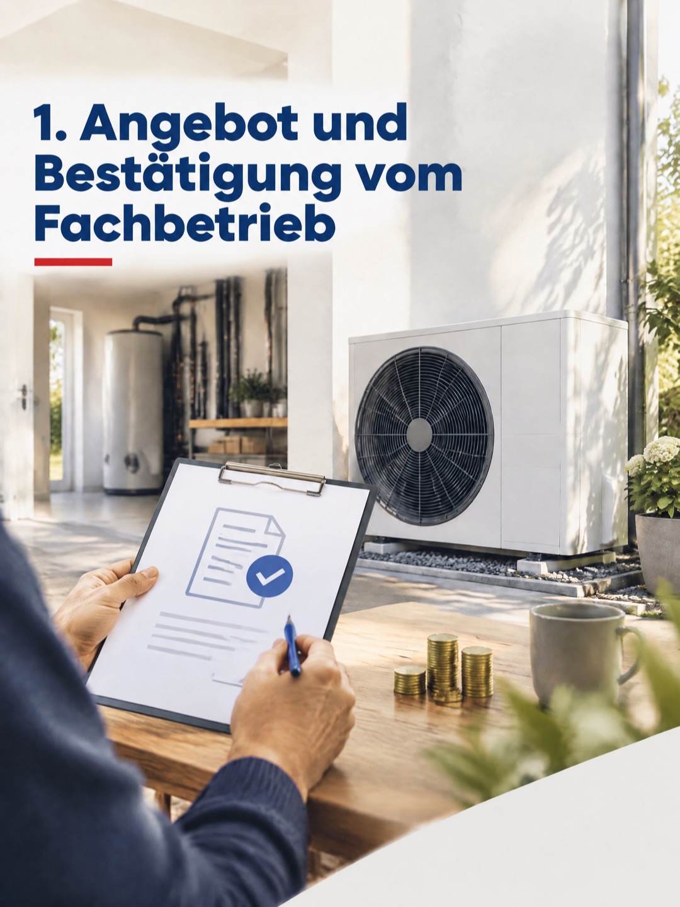

<a id="be-030"></a>
## BE-030 · Schritt 2: Vertrag mit Förder-Vorbehalt

Karussell · 3:4 · Karussell K2 „Heizungsförderung in 5 Schritten“, Slide 3 von 7 · Dokument Nr. K2-3

Vorher die Cover-Slide dieser Serie hochladen (Stilreferenz).

```text
Use the uploaded image as the exact style reference: same background, colours, typography and layout. Create the next slide of this carousel. Brand style for a long-established plumbing, heating and bathroom company in Germany. Look: bright, warm and trustworthy; realistic photographic style; clean German homes and tidy technical rooms; natural daylight; subtle depth of field. Palette: white and very light warm grey surfaces, brand blue (#111D6D) as the main colour, brand red (#D60000) only as a small accent, dark charcoal text (#222222). Typography: bold, friendly sans-serif headline, left-aligned, generous whitespace, at most two text sizes. People: only anonymous (hands, from behind or cropped at the shoulders), never a recognisable face. Layout: vertical 3:4 portrait format (1080x1440 proportions); keep all text and key objects inside an 8% safe margin; keep the bottom-right corner (14% of the width) empty and calm for a logo added later. Do not draw any logo, manufacturer logo or label on devices, and no company name outside the quoted headline. Text rules: render ONLY the German text given in quotes, exactly once, verbatim, with correct umlauts (ä, ö, ü, ß); no other words, numbers or watermarks. Contract icon with a small clock. Headline: "2. Vertrag mit Förder-Vorbehalt schließen"
```

**Text im Bild:** „2. Vertrag mit Förder-Vorbehalt schließen“  
**Caption:** So kommen Sie an die KfW-Heizungsförderung. Wichtig ist die Reihenfolge, denn der Antrag muss vor Baubeginn gestellt sein (Stand 29.10.2026). Wir erstellen Ihr Angebot und behalten die Fristen mit Ihnen im Blick.  
**Hashtags:** #wärmepumpe #heizungstausch #heizungsmodernisierung #heizungsförderung #heizung #hüttenberg #wettenberg #biebertal #ehringshausen #aßlar  
**Hinweise:** ⚠️ Fakten prüfen. Caption und Hashtags gelten für das ganze Karussell (einmal posten). Faktencheck: Förderablauf laut KfW vor dem Posten auf der KfW-Seite prüfen, Stand 29.10.2026; den Stand in der Caption auf das Prüfdatum aktualisieren. Ab Slide 2 das fertige Cover als Stilreferenz hochladen (siehe E6). Posting-Plan: Woche 3, Mi 18.11.2026, gegen 18 Uhr.  
**Bilder:** [original](bilder/original/BE-030.jpg) · [instagram-3x4](bilder/instagram-3x4/BE-030.jpg) · [facebook-linkedin-4x5](bilder/facebook-linkedin-4x5/BE-030.jpg)

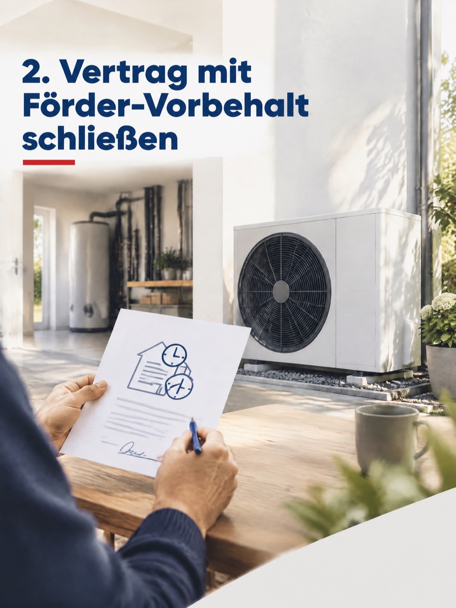

<a id="be-031"></a>
## BE-031 · Schritt 3: Antrag bei der KfW

Karussell · 3:4 · Karussell K2 „Heizungsförderung in 5 Schritten“, Slide 4 von 7 · Dokument Nr. K2-4

Vorher die Cover-Slide dieser Serie hochladen (Stilreferenz).

```text
Use the uploaded image as the exact style reference: same background, colours, typography and layout. Create the next slide of this carousel. Brand style for a long-established plumbing, heating and bathroom company in Germany. Look: bright, warm and trustworthy; realistic photographic style; clean German homes and tidy technical rooms; natural daylight; subtle depth of field. Palette: white and very light warm grey surfaces, brand blue (#111D6D) as the main colour, brand red (#D60000) only as a small accent, dark charcoal text (#222222). Typography: bold, friendly sans-serif headline, left-aligned, generous whitespace, at most two text sizes. People: only anonymous (hands, from behind or cropped at the shoulders), never a recognisable face. Layout: vertical 3:4 portrait format (1080x1440 proportions); keep all text and key objects inside an 8% safe margin; keep the bottom-right corner (14% of the width) empty and calm for a logo added later. Do not draw any logo, manufacturer logo or label on devices, and no company name outside the quoted headline. Text rules: render ONLY the German text given in quotes, exactly once, verbatim, with correct umlauts (ä, ö, ü, ß); no other words, numbers or watermarks. Laptop icon with a blank submit button shape (no text). Headline: "3. Antrag bei der KfW, vor Baubeginn"
```

**Text im Bild:** „3. Antrag bei der KfW, vor Baubeginn“  
**Caption:** So kommen Sie an die KfW-Heizungsförderung. Wichtig ist die Reihenfolge, denn der Antrag muss vor Baubeginn gestellt sein (Stand 29.10.2026). Wir erstellen Ihr Angebot und behalten die Fristen mit Ihnen im Blick.  
**Hashtags:** #wärmepumpe #heizungstausch #heizungsmodernisierung #heizungsförderung #heizung #hüttenberg #wettenberg #biebertal #ehringshausen #aßlar  
**Hinweise:** ⚠️ Fakten prüfen. Caption und Hashtags gelten für das ganze Karussell (einmal posten). Faktencheck: Förderablauf laut KfW vor dem Posten auf der KfW-Seite prüfen, Stand 29.10.2026; den Stand in der Caption auf das Prüfdatum aktualisieren. Ab Slide 2 das fertige Cover als Stilreferenz hochladen (siehe E6). Posting-Plan: Woche 3, Mi 18.11.2026, gegen 18 Uhr. Button im Bild ohne Schrift prüfen.  
**Bilder:** [original](bilder/original/BE-031.jpg) · [instagram-3x4](bilder/instagram-3x4/BE-031.jpg) · [facebook-linkedin-4x5](bilder/facebook-linkedin-4x5/BE-031.jpg)

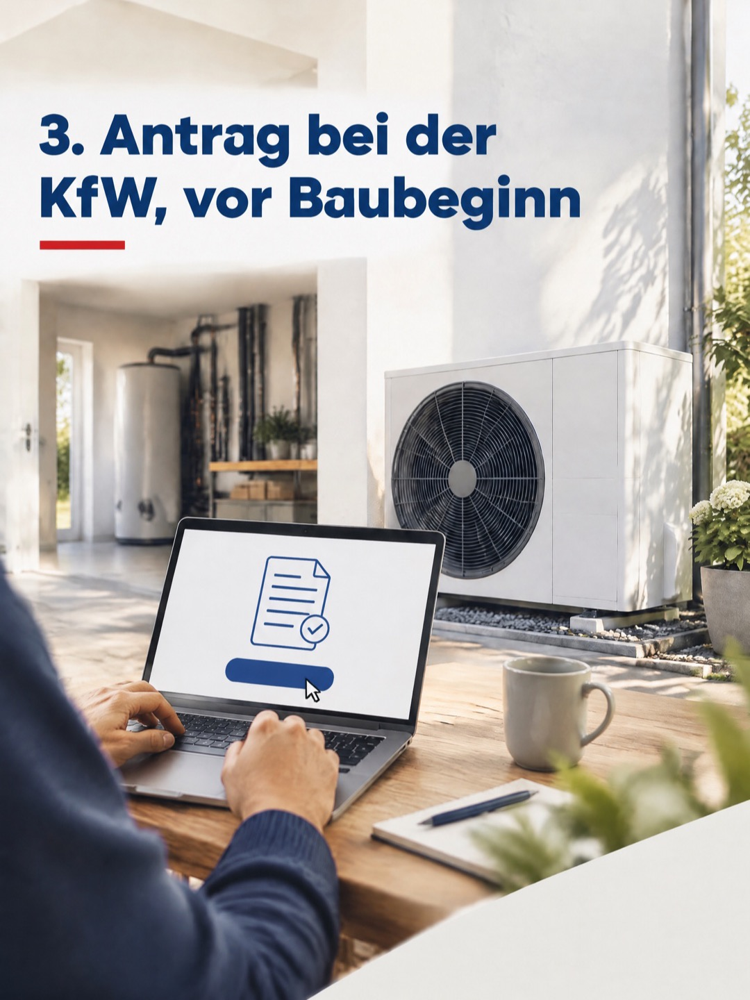

<a id="be-032"></a>
## BE-032 · Schritt 4: Heizung einbauen

Karussell · 3:4 · Karussell K2 „Heizungsförderung in 5 Schritten“, Slide 5 von 7 · Dokument Nr. K2-5

Vorher die Cover-Slide dieser Serie hochladen (Stilreferenz).

```text
Use the uploaded image as the exact style reference: same background, colours, typography and layout. Create the next slide of this carousel. Brand style for a long-established plumbing, heating and bathroom company in Germany. Look: bright, warm and trustworthy; realistic photographic style; clean German homes and tidy technical rooms; natural daylight; subtle depth of field. Palette: white and very light warm grey surfaces, brand blue (#111D6D) as the main colour, brand red (#D60000) only as a small accent, dark charcoal text (#222222). Typography: bold, friendly sans-serif headline, left-aligned, generous whitespace, at most two text sizes. People: only anonymous (hands, from behind or cropped at the shoulders), never a recognisable face. Layout: vertical 3:4 portrait format (1080x1440 proportions); keep all text and key objects inside an 8% safe margin; keep the bottom-right corner (14% of the width) empty and calm for a logo added later. Do not draw any logo, manufacturer logo or label on devices, and no company name outside the quoted headline. Text rules: render ONLY the German text given in quotes, exactly once, verbatim, with correct umlauts (ä, ö, ü, ß); no other words, numbers or watermarks. Wrench and heat pump icon. Headline: "4. Heizung einbauen lassen"
```

**Text im Bild:** „4. Heizung einbauen lassen“  
**Caption:** So kommen Sie an die KfW-Heizungsförderung. Wichtig ist die Reihenfolge, denn der Antrag muss vor Baubeginn gestellt sein (Stand 29.10.2026). Wir erstellen Ihr Angebot und behalten die Fristen mit Ihnen im Blick.  
**Hashtags:** #wärmepumpe #heizungstausch #heizungsmodernisierung #heizungsförderung #heizung #hüttenberg #wettenberg #biebertal #ehringshausen #aßlar  
**Hinweise:** ⚠️ Fakten prüfen. Caption und Hashtags gelten für das ganze Karussell (einmal posten). Faktencheck: Förderablauf laut KfW vor dem Posten auf der KfW-Seite prüfen, Stand 29.10.2026; den Stand in der Caption auf das Prüfdatum aktualisieren. Ab Slide 2 das fertige Cover als Stilreferenz hochladen (siehe E6). Posting-Plan: Woche 3, Mi 18.11.2026, gegen 18 Uhr.  
**Bilder:** [original](bilder/original/BE-032.jpg) · [instagram-3x4](bilder/instagram-3x4/BE-032.jpg) · [facebook-linkedin-4x5](bilder/facebook-linkedin-4x5/BE-032.jpg)

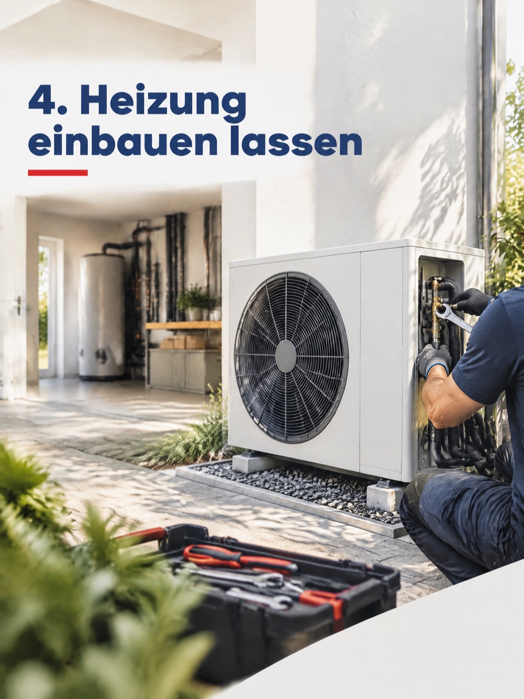

<a id="be-033"></a>
## BE-033 · Schritt 5: Nachweis und Zuschuss

Karussell · 3:4 · Karussell K2 „Heizungsförderung in 5 Schritten“, Slide 6 von 7 · Dokument Nr. K2-6

Vorher die Cover-Slide dieser Serie hochladen (Stilreferenz).

```text
Use the uploaded image as the exact style reference: same background, colours, typography and layout. Create the next slide of this carousel. Brand style for a long-established plumbing, heating and bathroom company in Germany. Look: bright, warm and trustworthy; realistic photographic style; clean German homes and tidy technical rooms; natural daylight; subtle depth of field. Palette: white and very light warm grey surfaces, brand blue (#111D6D) as the main colour, brand red (#D60000) only as a small accent, dark charcoal text (#222222). Typography: bold, friendly sans-serif headline, left-aligned, generous whitespace, at most two text sizes. People: only anonymous (hands, from behind or cropped at the shoulders), never a recognisable face. Layout: vertical 3:4 portrait format (1080x1440 proportions); keep all text and key objects inside an 8% safe margin; keep the bottom-right corner (14% of the width) empty and calm for a logo added later. Do not draw any logo, manufacturer logo or label on devices, and no company name outside the quoted headline. Text rules: render ONLY the German text given in quotes, exactly once, verbatim, with correct umlauts (ä, ö, ü, ß); no other words, numbers or watermarks. Document and coin icon. Headline: "5. Nachweis einreichen, Zuschuss erhalten"
```

**Text im Bild:** „5. Nachweis einreichen, Zuschuss erhalten“  
**Caption:** So kommen Sie an die KfW-Heizungsförderung. Wichtig ist die Reihenfolge, denn der Antrag muss vor Baubeginn gestellt sein (Stand 29.10.2026). Wir erstellen Ihr Angebot und behalten die Fristen mit Ihnen im Blick.  
**Hashtags:** #wärmepumpe #heizungstausch #heizungsmodernisierung #heizungsförderung #heizung #hüttenberg #wettenberg #biebertal #ehringshausen #aßlar  
**Hinweise:** ⚠️ Fakten prüfen. Caption und Hashtags gelten für das ganze Karussell (einmal posten). Faktencheck: Förderablauf laut KfW vor dem Posten auf der KfW-Seite prüfen, Stand 29.10.2026; den Stand in der Caption auf das Prüfdatum aktualisieren. Ab Slide 2 das fertige Cover als Stilreferenz hochladen (siehe E6). Posting-Plan: Woche 3, Mi 18.11.2026, gegen 18 Uhr.  
**Bilder:** [original](bilder/original/BE-033.jpg) · [instagram-3x4](bilder/instagram-3x4/BE-033.jpg) · [facebook-linkedin-4x5](bilder/facebook-linkedin-4x5/BE-033.jpg)

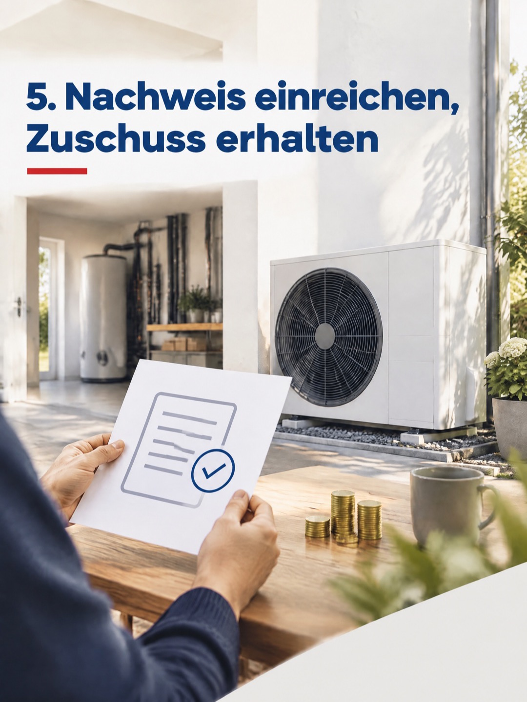

<a id="be-034"></a>
## BE-034 · Abschluss: Wir begleiten Sie

Karussell · 3:4 · Karussell K2 „Heizungsförderung in 5 Schritten“, Slide 7 von 7 · Dokument Nr. K2-7

Vorher die Cover-Slide dieser Serie hochladen (Stilreferenz).

```text
Use the uploaded image as the exact style reference: same background, colours, typography and layout. Create the next slide of this carousel. Brand style for a long-established plumbing, heating and bathroom company in Germany. Look: bright, warm and trustworthy; realistic photographic style; clean German homes and tidy technical rooms; natural daylight; subtle depth of field. Palette: white and very light warm grey surfaces, brand blue (#111D6D) as the main colour, brand red (#D60000) only as a small accent, dark charcoal text (#222222). Typography: bold, friendly sans-serif headline, left-aligned, generous whitespace, at most two text sizes. People: only anonymous (hands, from behind or cropped at the shoulders), never a recognisable face. Layout: vertical 3:4 portrait format (1080x1440 proportions); keep all text and key objects inside an 8% safe margin; keep the bottom-right corner (14% of the width) empty and calm for a logo added later. Do not draw any logo, manufacturer logo or label on devices, and no company name outside the quoted headline. Text rules: render ONLY the German text given in quotes, exactly once, verbatim, with correct umlauts (ä, ö, ü, ß); no other words, numbers or watermarks. Plain blue background. Headline: "Wir begleiten Sie: Link in Bio"
```

**Text im Bild:** „Wir begleiten Sie: Link in Bio“  
**Caption:** So kommen Sie an die KfW-Heizungsförderung. Wichtig ist die Reihenfolge, denn der Antrag muss vor Baubeginn gestellt sein (Stand 29.10.2026). Wir erstellen Ihr Angebot und behalten die Fristen mit Ihnen im Blick.  
**Hashtags:** #wärmepumpe #heizungstausch #heizungsmodernisierung #heizungsförderung #heizung #hüttenberg #wettenberg #biebertal #ehringshausen #aßlar  
**Hinweise:** ⚠️ Fakten prüfen. Caption und Hashtags gelten für das ganze Karussell (einmal posten). Faktencheck: Förderablauf laut KfW vor dem Posten auf der KfW-Seite prüfen, Stand 29.10.2026; den Stand in der Caption auf das Prüfdatum aktualisieren. Ab Slide 2 das fertige Cover als Stilreferenz hochladen (siehe E6). Posting-Plan: Woche 3, Mi 18.11.2026, gegen 18 Uhr.  
**Bilder:** [original](bilder/original/BE-034.jpg) · [instagram-3x4](bilder/instagram-3x4/BE-034.jpg) · [facebook-linkedin-4x5](bilder/facebook-linkedin-4x5/BE-034.jpg)

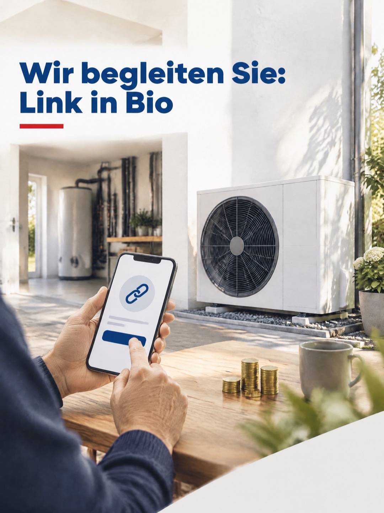

<a id="be-035"></a>
## BE-035 · 5 Details für ein sicheres Bad: Cover

Karussell · 3:4 · Karussell K3 „Barrierefreies Bad: 5 Details“, Slide 1 von 7 · Dokument Nr. K3-1

```text
Brand style for a long-established plumbing, heating and bathroom company in Germany. Look: bright, warm and trustworthy; realistic photographic style; clean German homes and tidy technical rooms; natural daylight; subtle depth of field. Palette: white and very light warm grey surfaces, brand blue (#111D6D) as the main colour, brand red (#D60000) only as a small accent, dark charcoal text (#222222). Typography: bold, friendly sans-serif headline, left-aligned, generous whitespace, at most two text sizes. People: only anonymous (hands, from behind or cropped at the shoulders), never a recognisable face. Layout: vertical 3:4 portrait format (1080x1440 proportions); keep all text and key objects inside an 8% safe margin; keep the bottom-right corner (14% of the width) empty and calm for a logo added later. Do not draw any logo, manufacturer logo or label on devices, and no company name outside the quoted headline. Text rules: render ONLY the German text given in quotes, exactly once, verbatim, with correct umlauts (ä, ö, ü, ß); no other words, numbers or watermarks. A calm bathroom corner with a floor-level shower, soft blue tones. Headline: "5 Details für ein sicheres Bad". Small label (bottom-left, small): "Swipe →".
```

**Text im Bild:** „5 Details für ein sicheres Bad“  
**Label:** „Swipe →“ (bottom-left, small)  
**Caption:** Fünf Details, die ein Bad sicherer machen, ohne dass es nach Klinik aussieht. Mit Pflegegrad zahlt die Pflegekasse bis zu 4.180 € dazu (Stand 29.10.2026). Symbolbilder.  
**Hashtags:** #badsanierung #badmodernisierung #badezimmer #traumbad #barrierefreiesbad #wetzlar #lahndill #mittelhessen #solms #lahnau  
**Hinweise:** ⚠️ Fakten prüfen. Caption und Hashtags gelten für das ganze Karussell (einmal posten). Faktencheck: Zuschuss der Pflegekasse (bis zu 4.180 €) vor dem Posten prüfen, Stand 29.10.2026; „Stand 2026“ aus dem Dokument in der Caption auf „Stand 29.10.2026“ präzisiert, beim Posten auf das Prüfdatum aktualisieren. „Symbolbilder“ in der Caption ist Pflicht (enthalten). Cover dient als Stilreferenz für die Slides 2–7. Posting-Plan: Woche 6, Mo 7.12.2026, gegen 18 Uhr.  
**Bilder:** [original](bilder/original/BE-035.jpg) · [instagram-3x4](bilder/instagram-3x4/BE-035.jpg) · [facebook-linkedin-4x5](bilder/facebook-linkedin-4x5/BE-035.jpg)

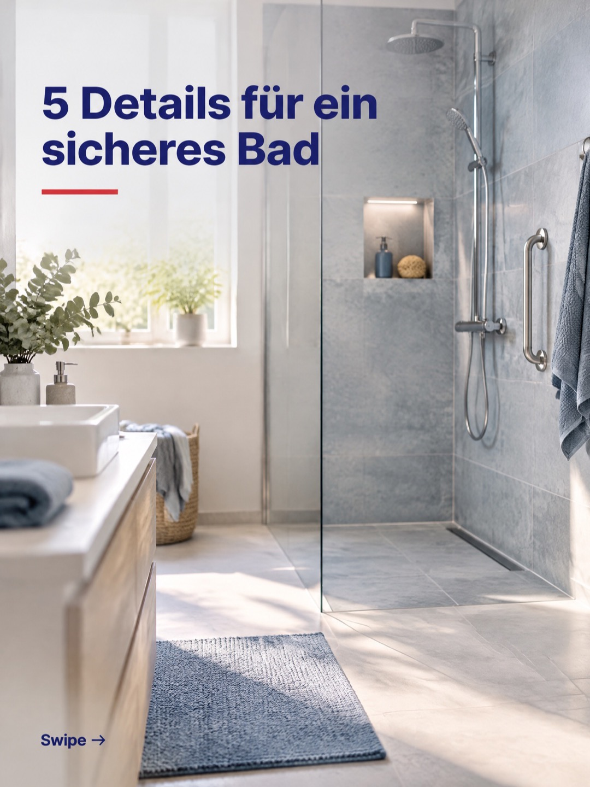

<a id="be-036"></a>
## BE-036 · Detail 1: Dusche ohne Stufe

Karussell · 3:4 · Karussell K3 „Barrierefreies Bad: 5 Details“, Slide 2 von 7 · Dokument Nr. K3-2

Vorher die Cover-Slide dieser Serie hochladen (Stilreferenz).

```text
Use the uploaded image as the exact style reference: same background, colours, typography and layout. Create the next slide of this carousel. Brand style for a long-established plumbing, heating and bathroom company in Germany. Look: bright, warm and trustworthy; realistic photographic style; clean German homes and tidy technical rooms; natural daylight; subtle depth of field. Palette: white and very light warm grey surfaces, brand blue (#111D6D) as the main colour, brand red (#D60000) only as a small accent, dark charcoal text (#222222). Typography: bold, friendly sans-serif headline, left-aligned, generous whitespace, at most two text sizes. People: only anonymous (hands, from behind or cropped at the shoulders), never a recognisable face. Layout: vertical 3:4 portrait format (1080x1440 proportions); keep all text and key objects inside an 8% safe margin; keep the bottom-right corner (14% of the width) empty and calm for a logo added later. Do not draw any logo, manufacturer logo or label on devices, and no company name outside the quoted headline. Text rules: render ONLY the German text given in quotes, exactly once, verbatim, with correct umlauts (ä, ö, ü, ß); no other words, numbers or watermarks. Close-up of a floor-level shower entrance without any step. Headline: "1. Dusche ohne Stufe"
```

**Text im Bild:** „1. Dusche ohne Stufe“  
**Caption:** Fünf Details, die ein Bad sicherer machen, ohne dass es nach Klinik aussieht. Mit Pflegegrad zahlt die Pflegekasse bis zu 4.180 € dazu (Stand 29.10.2026). Symbolbilder.  
**Hashtags:** #badsanierung #badmodernisierung #badezimmer #traumbad #barrierefreiesbad #wetzlar #lahndill #mittelhessen #solms #lahnau  
**Hinweise:** ⚠️ Fakten prüfen. Caption und Hashtags gelten für das ganze Karussell (einmal posten). Faktencheck: Zuschuss der Pflegekasse (bis zu 4.180 €) vor dem Posten prüfen, Stand 29.10.2026; „Stand 2026“ aus dem Dokument in der Caption auf „Stand 29.10.2026“ präzisiert, beim Posten auf das Prüfdatum aktualisieren. „Symbolbilder“ in der Caption ist Pflicht (enthalten). Ab Slide 2 das fertige Cover als Stilreferenz hochladen (siehe E6). Posting-Plan: Woche 6, Mo 7.12.2026, gegen 18 Uhr.  
**Bilder:** [original](bilder/original/BE-036.jpg) · [instagram-3x4](bilder/instagram-3x4/BE-036.jpg) · [facebook-linkedin-4x5](bilder/facebook-linkedin-4x5/BE-036.jpg)

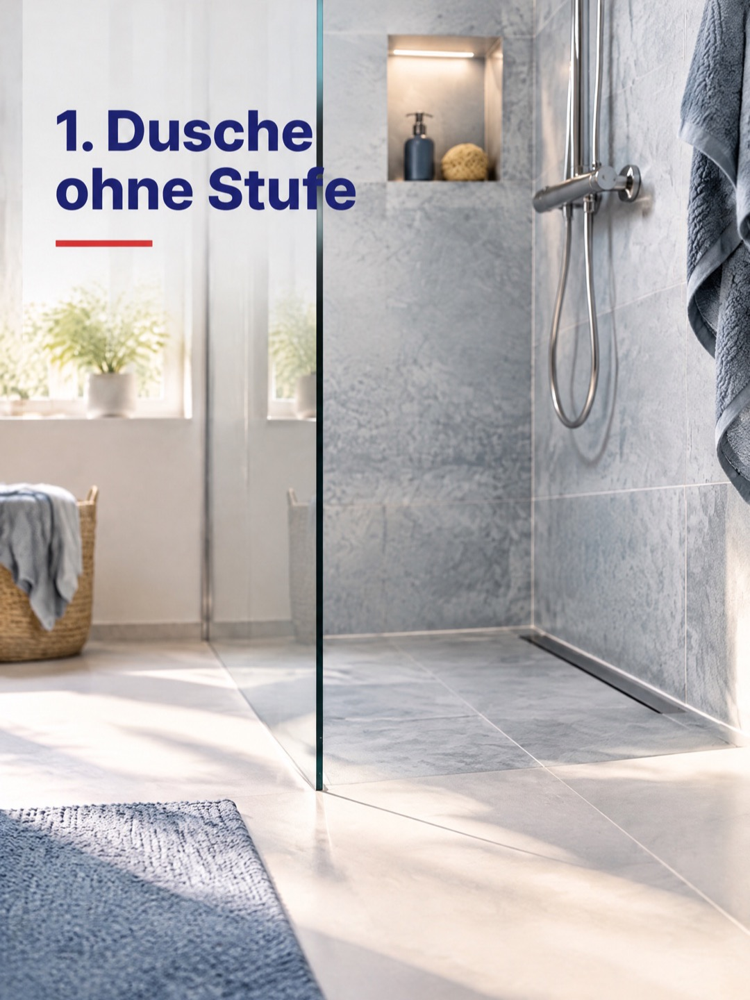

<a id="be-037"></a>
## BE-037 · Detail 2: Rutschhemmende Fliesen

Karussell · 3:4 · Karussell K3 „Barrierefreies Bad: 5 Details“, Slide 3 von 7 · Dokument Nr. K3-3

Vorher die Cover-Slide dieser Serie hochladen (Stilreferenz).

```text
Use the uploaded image as the exact style reference: same background, colours, typography and layout. Create the next slide of this carousel. Brand style for a long-established plumbing, heating and bathroom company in Germany. Look: bright, warm and trustworthy; realistic photographic style; clean German homes and tidy technical rooms; natural daylight; subtle depth of field. Palette: white and very light warm grey surfaces, brand blue (#111D6D) as the main colour, brand red (#D60000) only as a small accent, dark charcoal text (#222222). Typography: bold, friendly sans-serif headline, left-aligned, generous whitespace, at most two text sizes. People: only anonymous (hands, from behind or cropped at the shoulders), never a recognisable face. Layout: vertical 3:4 portrait format (1080x1440 proportions); keep all text and key objects inside an 8% safe margin; keep the bottom-right corner (14% of the width) empty and calm for a logo added later. Do not draw any logo, manufacturer logo or label on devices, and no company name outside the quoted headline. Text rules: render ONLY the German text given in quotes, exactly once, verbatim, with correct umlauts (ä, ö, ü, ß); no other words, numbers or watermarks. Close-up of a textured, slip-resistant floor tile with water drops. Headline: "2. Rutschhemmende Fliesen"
```

**Text im Bild:** „2. Rutschhemmende Fliesen“  
**Caption:** Fünf Details, die ein Bad sicherer machen, ohne dass es nach Klinik aussieht. Mit Pflegegrad zahlt die Pflegekasse bis zu 4.180 € dazu (Stand 29.10.2026). Symbolbilder.  
**Hashtags:** #badsanierung #badmodernisierung #badezimmer #traumbad #barrierefreiesbad #wetzlar #lahndill #mittelhessen #solms #lahnau  
**Hinweise:** ⚠️ Fakten prüfen. Caption und Hashtags gelten für das ganze Karussell (einmal posten). Faktencheck: Zuschuss der Pflegekasse (bis zu 4.180 €) vor dem Posten prüfen, Stand 29.10.2026; „Stand 2026“ aus dem Dokument in der Caption auf „Stand 29.10.2026“ präzisiert, beim Posten auf das Prüfdatum aktualisieren. „Symbolbilder“ in der Caption ist Pflicht (enthalten). Ab Slide 2 das fertige Cover als Stilreferenz hochladen (siehe E6). Posting-Plan: Woche 6, Mo 7.12.2026, gegen 18 Uhr.  
**Bilder:** [original](bilder/original/BE-037.jpg) · [instagram-3x4](bilder/instagram-3x4/BE-037.jpg) · [facebook-linkedin-4x5](bilder/facebook-linkedin-4x5/BE-037.jpg)

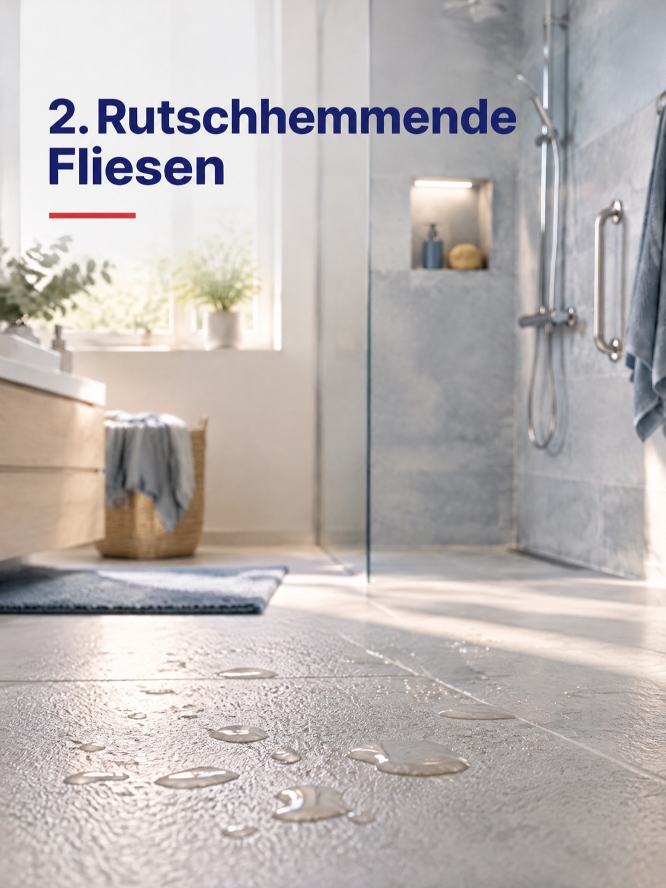

<a id="be-038"></a>
## BE-038 · Detail 3: Haltegriffe

Karussell · 3:4 · Karussell K3 „Barrierefreies Bad: 5 Details“, Slide 4 von 7 · Dokument Nr. K3-4

Vorher die Cover-Slide dieser Serie hochladen (Stilreferenz).

```text
Use the uploaded image as the exact style reference: same background, colours, typography and layout. Create the next slide of this carousel. Brand style for a long-established plumbing, heating and bathroom company in Germany. Look: bright, warm and trustworthy; realistic photographic style; clean German homes and tidy technical rooms; natural daylight; subtle depth of field. Palette: white and very light warm grey surfaces, brand blue (#111D6D) as the main colour, brand red (#D60000) only as a small accent, dark charcoal text (#222222). Typography: bold, friendly sans-serif headline, left-aligned, generous whitespace, at most two text sizes. People: only anonymous (hands, from behind or cropped at the shoulders), never a recognisable face. Layout: vertical 3:4 portrait format (1080x1440 proportions); keep all text and key objects inside an 8% safe margin; keep the bottom-right corner (14% of the width) empty and calm for a logo added later. Do not draw any logo, manufacturer logo or label on devices, and no company name outside the quoted headline. Text rules: render ONLY the German text given in quotes, exactly once, verbatim, with correct umlauts (ä, ö, ü, ß); no other words, numbers or watermarks. A grab bar mounted next to a wall-hung toilet. Headline: "3. Haltegriffe, wo man sie braucht"
```

**Text im Bild:** „3. Haltegriffe, wo man sie braucht“  
**Caption:** Fünf Details, die ein Bad sicherer machen, ohne dass es nach Klinik aussieht. Mit Pflegegrad zahlt die Pflegekasse bis zu 4.180 € dazu (Stand 29.10.2026). Symbolbilder.  
**Hashtags:** #badsanierung #badmodernisierung #badezimmer #traumbad #barrierefreiesbad #wetzlar #lahndill #mittelhessen #solms #lahnau  
**Hinweise:** ⚠️ Fakten prüfen. Caption und Hashtags gelten für das ganze Karussell (einmal posten). Faktencheck: Zuschuss der Pflegekasse (bis zu 4.180 €) vor dem Posten prüfen, Stand 29.10.2026; „Stand 2026“ aus dem Dokument in der Caption auf „Stand 29.10.2026“ präzisiert, beim Posten auf das Prüfdatum aktualisieren. „Symbolbilder“ in der Caption ist Pflicht (enthalten). Ab Slide 2 das fertige Cover als Stilreferenz hochladen (siehe E6). Posting-Plan: Woche 6, Mo 7.12.2026, gegen 18 Uhr.  
**Bilder:** [original](bilder/original/BE-038.jpg) · [instagram-3x4](bilder/instagram-3x4/BE-038.jpg) · [facebook-linkedin-4x5](bilder/facebook-linkedin-4x5/BE-038.jpg)

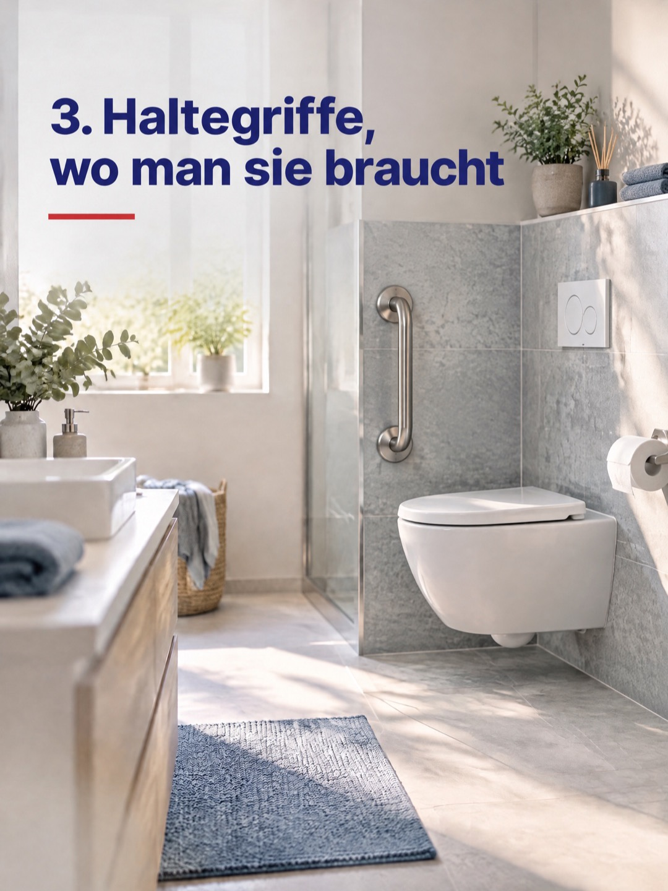

<a id="be-039"></a>
## BE-039 · Detail 4: Sitzen beim Duschen

Karussell · 3:4 · Karussell K3 „Barrierefreies Bad: 5 Details“, Slide 5 von 7 · Dokument Nr. K3-5

Vorher die Cover-Slide dieser Serie hochladen (Stilreferenz).

```text
Use the uploaded image as the exact style reference: same background, colours, typography and layout. Create the next slide of this carousel. Brand style for a long-established plumbing, heating and bathroom company in Germany. Look: bright, warm and trustworthy; realistic photographic style; clean German homes and tidy technical rooms; natural daylight; subtle depth of field. Palette: white and very light warm grey surfaces, brand blue (#111D6D) as the main colour, brand red (#D60000) only as a small accent, dark charcoal text (#222222). Typography: bold, friendly sans-serif headline, left-aligned, generous whitespace, at most two text sizes. People: only anonymous (hands, from behind or cropped at the shoulders), never a recognisable face. Layout: vertical 3:4 portrait format (1080x1440 proportions); keep all text and key objects inside an 8% safe margin; keep the bottom-right corner (14% of the width) empty and calm for a logo added later. Do not draw any logo, manufacturer logo or label on devices, and no company name outside the quoted headline. Text rules: render ONLY the German text given in quotes, exactly once, verbatim, with correct umlauts (ä, ö, ü, ß); no other words, numbers or watermarks. A fold-down shower seat on a tiled wall. Headline: "4. Sitzen beim Duschen"
```

**Text im Bild:** „4. Sitzen beim Duschen“  
**Caption:** Fünf Details, die ein Bad sicherer machen, ohne dass es nach Klinik aussieht. Mit Pflegegrad zahlt die Pflegekasse bis zu 4.180 € dazu (Stand 29.10.2026). Symbolbilder.  
**Hashtags:** #badsanierung #badmodernisierung #badezimmer #traumbad #barrierefreiesbad #wetzlar #lahndill #mittelhessen #solms #lahnau  
**Hinweise:** ⚠️ Fakten prüfen. Caption und Hashtags gelten für das ganze Karussell (einmal posten). Faktencheck: Zuschuss der Pflegekasse (bis zu 4.180 €) vor dem Posten prüfen, Stand 29.10.2026; „Stand 2026“ aus dem Dokument in der Caption auf „Stand 29.10.2026“ präzisiert, beim Posten auf das Prüfdatum aktualisieren. „Symbolbilder“ in der Caption ist Pflicht (enthalten). Ab Slide 2 das fertige Cover als Stilreferenz hochladen (siehe E6). Posting-Plan: Woche 6, Mo 7.12.2026, gegen 18 Uhr.  
**Bilder:** [original](bilder/original/BE-039.jpg) · [instagram-3x4](bilder/instagram-3x4/BE-039.jpg) · [facebook-linkedin-4x5](bilder/facebook-linkedin-4x5/BE-039.jpg)

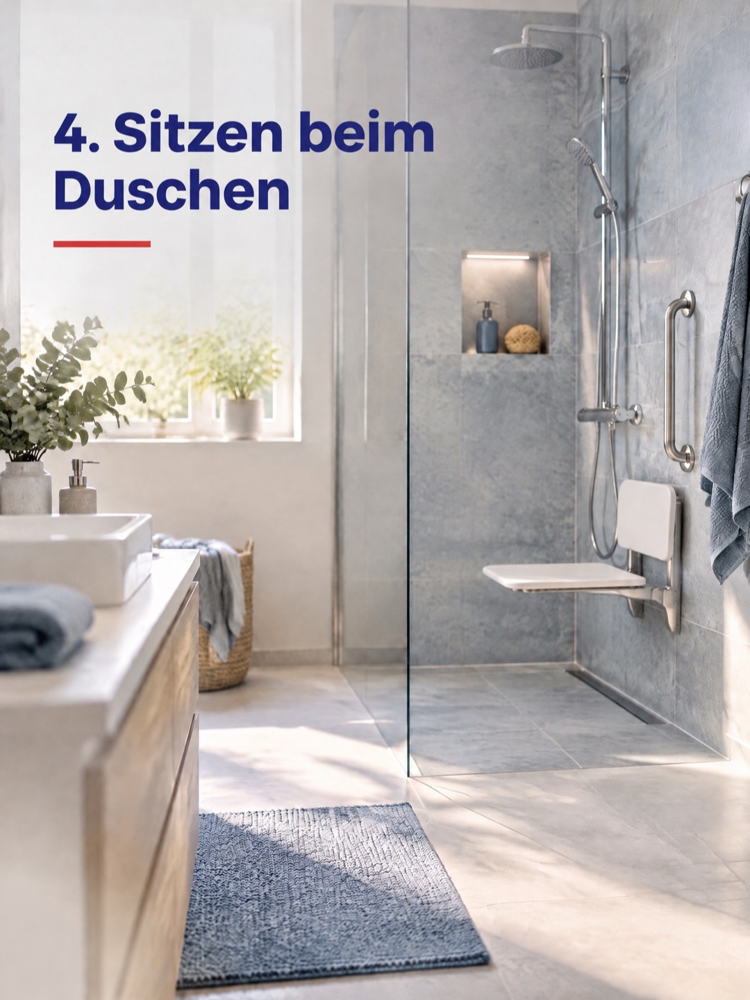

<a id="be-040"></a>
## BE-040 · Detail 5: Platz zum Bewegen

Karussell · 3:4 · Karussell K3 „Barrierefreies Bad: 5 Details“, Slide 6 von 7 · Dokument Nr. K3-6

Vorher die Cover-Slide dieser Serie hochladen (Stilreferenz).

```text
Use the uploaded image as the exact style reference: same background, colours, typography and layout. Create the next slide of this carousel. Brand style for a long-established plumbing, heating and bathroom company in Germany. Look: bright, warm and trustworthy; realistic photographic style; clean German homes and tidy technical rooms; natural daylight; subtle depth of field. Palette: white and very light warm grey surfaces, brand blue (#111D6D) as the main colour, brand red (#D60000) only as a small accent, dark charcoal text (#222222). Typography: bold, friendly sans-serif headline, left-aligned, generous whitespace, at most two text sizes. People: only anonymous (hands, from behind or cropped at the shoulders), never a recognisable face. Layout: vertical 3:4 portrait format (1080x1440 proportions); keep all text and key objects inside an 8% safe margin; keep the bottom-right corner (14% of the width) empty and calm for a logo added later. Do not draw any logo, manufacturer logo or label on devices, and no company name outside the quoted headline. Text rules: render ONLY the German text given in quotes, exactly once, verbatim, with correct umlauts (ä, ö, ü, ß); no other words, numbers or watermarks. Wide free floor area and a wide door opening. Headline: "5. Platz zum Bewegen"
```

**Text im Bild:** „5. Platz zum Bewegen“  
**Caption:** Fünf Details, die ein Bad sicherer machen, ohne dass es nach Klinik aussieht. Mit Pflegegrad zahlt die Pflegekasse bis zu 4.180 € dazu (Stand 29.10.2026). Symbolbilder.  
**Hashtags:** #badsanierung #badmodernisierung #badezimmer #traumbad #barrierefreiesbad #wetzlar #lahndill #mittelhessen #solms #lahnau  
**Hinweise:** ⚠️ Fakten prüfen. Caption und Hashtags gelten für das ganze Karussell (einmal posten). Faktencheck: Zuschuss der Pflegekasse (bis zu 4.180 €) vor dem Posten prüfen, Stand 29.10.2026; „Stand 2026“ aus dem Dokument in der Caption auf „Stand 29.10.2026“ präzisiert, beim Posten auf das Prüfdatum aktualisieren. „Symbolbilder“ in der Caption ist Pflicht (enthalten). Ab Slide 2 das fertige Cover als Stilreferenz hochladen (siehe E6). Posting-Plan: Woche 6, Mo 7.12.2026, gegen 18 Uhr.  
**Bilder:** [original](bilder/original/BE-040.jpg) · [instagram-3x4](bilder/instagram-3x4/BE-040.jpg) · [facebook-linkedin-4x5](bilder/facebook-linkedin-4x5/BE-040.jpg)

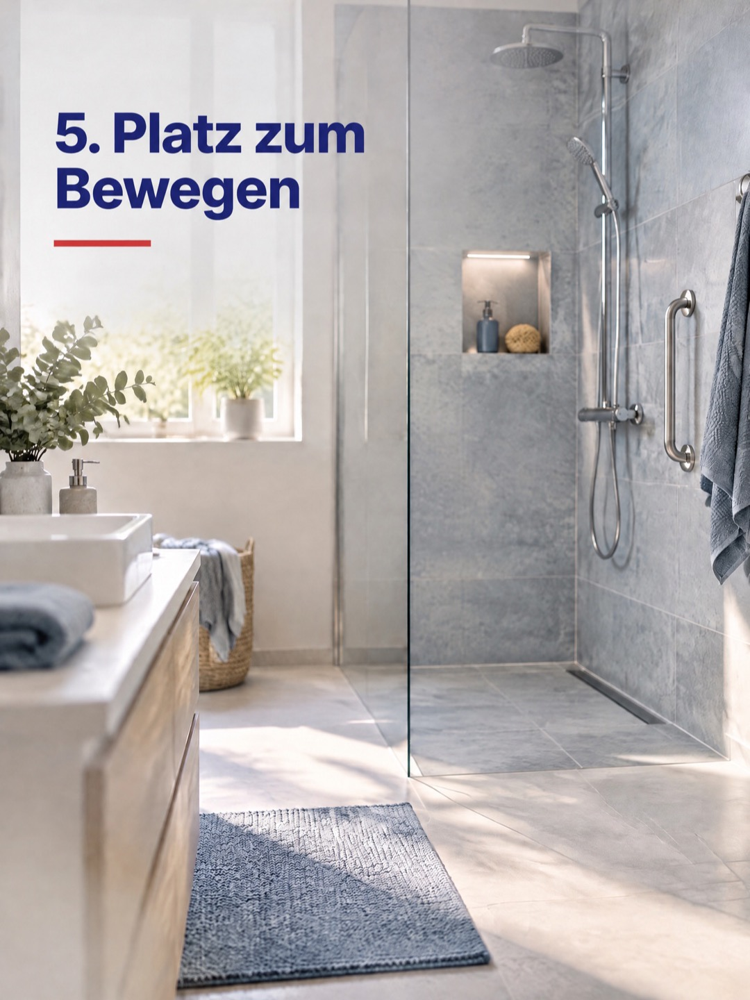

<a id="be-041"></a>
## BE-041 · Abschluss: Beratung vor Ort

Karussell · 3:4 · Karussell K3 „Barrierefreies Bad: 5 Details“, Slide 7 von 7 · Dokument Nr. K3-7

Vorher die Cover-Slide dieser Serie hochladen (Stilreferenz).

```text
Use the uploaded image as the exact style reference: same background, colours, typography and layout. Create the next slide of this carousel. Brand style for a long-established plumbing, heating and bathroom company in Germany. Look: bright, warm and trustworthy; realistic photographic style; clean German homes and tidy technical rooms; natural daylight; subtle depth of field. Palette: white and very light warm grey surfaces, brand blue (#111D6D) as the main colour, brand red (#D60000) only as a small accent, dark charcoal text (#222222). Typography: bold, friendly sans-serif headline, left-aligned, generous whitespace, at most two text sizes. People: only anonymous (hands, from behind or cropped at the shoulders), never a recognisable face. Layout: vertical 3:4 portrait format (1080x1440 proportions); keep all text and key objects inside an 8% safe margin; keep the bottom-right corner (14% of the width) empty and calm for a logo added later. Do not draw any logo, manufacturer logo or label on devices, and no company name outside the quoted headline. Text rules: render ONLY the German text given in quotes, exactly once, verbatim, with correct umlauts (ä, ö, ü, ß); no other words, numbers or watermarks. Soft blue backdrop, empty except for a faint white outline of a wide open doorway with a level, step-free threshold, plenty of calm space. Headline: "Beratung vor Ort: Link in Bio"
```

**Text im Bild:** „Beratung vor Ort: Link in Bio“  
**Caption:** Fünf Details, die ein Bad sicherer machen, ohne dass es nach Klinik aussieht. Mit Pflegegrad zahlt die Pflegekasse bis zu 4.180 € dazu (Stand 29.10.2026). Symbolbilder.  
**Hashtags:** #badsanierung #badmodernisierung #badezimmer #traumbad #barrierefreiesbad #wetzlar #lahndill #mittelhessen #solms #lahnau  
**Hinweise:** ⚠️ Fakten prüfen. Caption und Hashtags gelten für das ganze Karussell (einmal posten). Faktencheck: Zuschuss der Pflegekasse (bis zu 4.180 €) vor dem Posten prüfen, Stand 29.10.2026; „Stand 2026“ aus dem Dokument in der Caption auf „Stand 29.10.2026“ präzisiert, beim Posten auf das Prüfdatum aktualisieren. „Symbolbilder“ in der Caption ist Pflicht (enthalten). Ab Slide 2 das fertige Cover als Stilreferenz hochladen (siehe E6). Posting-Plan: Woche 6, Mo 7.12.2026, gegen 18 Uhr. Hintergrund mit Türumriss statt nur „Plain blue background“, damit sich die Slide nicht wortgleich mit K2-7 deckt.  
**Bilder:** [original](bilder/original/BE-041.jpg) · [instagram-3x4](bilder/instagram-3x4/BE-041.jpg) · [facebook-linkedin-4x5](bilder/facebook-linkedin-4x5/BE-041.jpg)

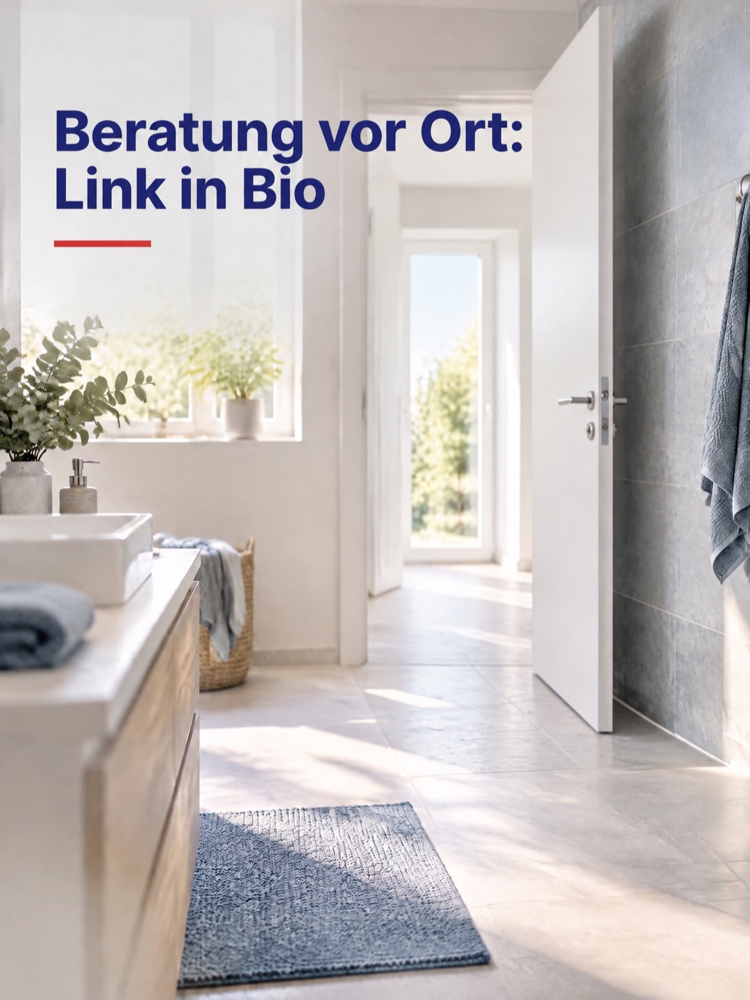

<a id="be-042"></a>
## BE-042 · Heizungsanfrage online

Heizung · 3:4 · Dokument Nr. 21

```text
Brand style for a long-established plumbing, heating and bathroom company in Germany. Look: bright, warm and trustworthy; realistic photographic style; clean German homes and tidy technical rooms; natural daylight; subtle depth of field. Palette: white and very light warm grey surfaces, brand blue (#111D6D) as the main colour, brand red (#D60000) only as a small accent, dark charcoal text (#222222). Typography: bold, friendly sans-serif headline, left-aligned, generous whitespace, at most two text sizes. People: only anonymous (hands, from behind or cropped at the shoulders), never a recognisable face. Layout: vertical 3:4 portrait format (1080x1440 proportions); keep all text and key objects inside an 8% safe margin; keep the bottom-right corner (14% of the width) empty and calm for a logo added later. Do not draw any logo, manufacturer logo or label on devices, and no company name outside the quoted headline. Text rules: render ONLY the German text given in quotes, exactly once, verbatim, with correct umlauts (ä, ö, ü, ß); no other words, numbers or watermarks. A tablet resting on a sofa armrest shows an abstract questionnaire with simple house and radiator icons and no readable text. A cosy living room is softly blurred in the background, warm daylight. Headline: "Heizungsanfrage online starten"
```

**Text im Bild:** „Heizungsanfrage online starten“  
**Caption:** Der Heizungsanfrage-Assistent auf unserer Website fragt die wichtigsten Punkte ab. Termin anfragen: Link in Bio.  
**Hashtags:** #wärmepumpe #heizungstausch #heizungsmodernisierung #heizungsförderung #heizung  
**Bilder:** [original](bilder/original/BE-042.jpg) · [instagram-3x4](bilder/instagram-3x4/BE-042.jpg) · [facebook-linkedin-4x5](bilder/facebook-linkedin-4x5/BE-042.jpg)

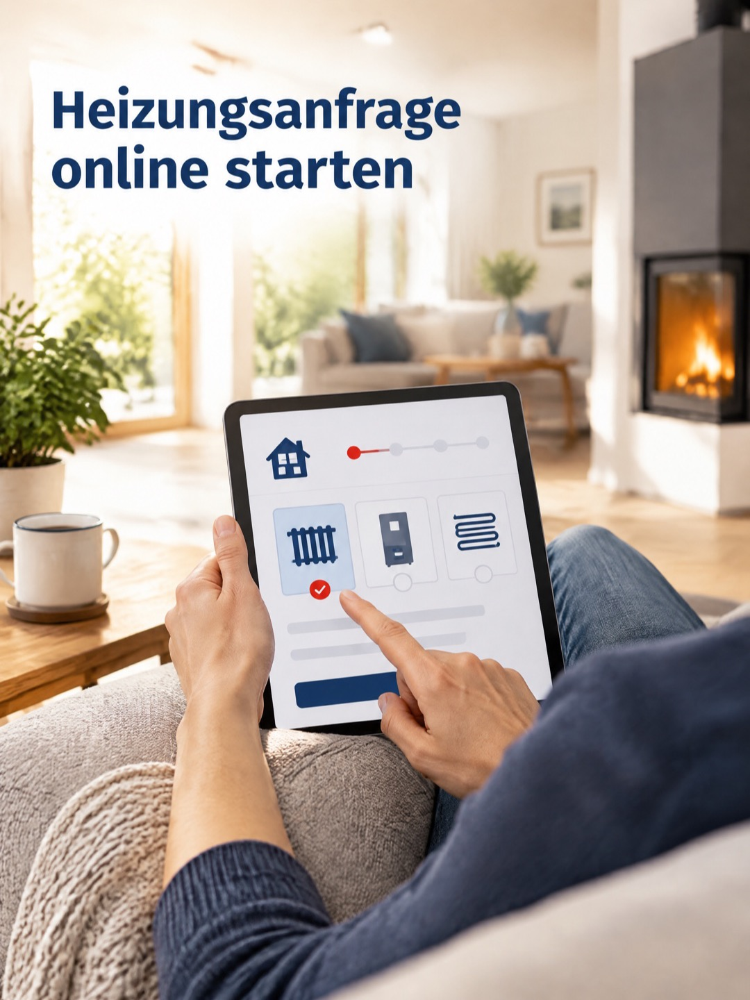

<a id="be-043"></a>
## BE-043 · Wärmepumpe im Altbau

Heizung · 3:4 · Dokument Nr. 22

```text
Brand style for a long-established plumbing, heating and bathroom company in Germany. Look: bright, warm and trustworthy; realistic photographic style; clean German homes and tidy technical rooms; natural daylight; subtle depth of field. Palette: white and very light warm grey surfaces, brand blue (#111D6D) as the main colour, brand red (#D60000) only as a small accent, dark charcoal text (#222222). Typography: bold, friendly sans-serif headline, left-aligned, generous whitespace, at most two text sizes. People: only anonymous (hands, from behind or cropped at the shoulders), never a recognisable face. Layout: vertical 3:4 portrait format (1080x1440 proportions); keep all text and key objects inside an 8% safe margin; keep the bottom-right corner (14% of the width) empty and calm for a logo added later. Do not draw any logo, manufacturer logo or label on devices, and no company name outside the quoted headline. Text rules: render ONLY the German text given in quotes, exactly once, verbatim, with correct umlauts (ä, ö, ü, ß); no other words, numbers or watermarks. A modern heat pump outdoor unit without any logo stands beside an older brick house with its original windows, soft natural daylight. Headline: "Wärmepumpe auch im Altbau?"
```

**Text im Bild:** „Wärmepumpe auch im Altbau?“  
**Caption:** Ob Ihr Haus passt, prüfen wir vor Ort. Symbolbild. Termin anfragen: Link in Bio.  
**Hashtags:** #wärmepumpe #heizungstausch #heizungsmodernisierung #heizungsförderung #heizung #wetzlar #lahndill #mittelhessen #solms #lahnau  
**Hinweise:** „Symbolbild“ in der Caption ergänzt (fotorealistische Wärmepumpe am Haus). Posting-Plan: Woche 6, Mi 9.12.2026, gegen 18 Uhr.  
**Bilder:** [original](bilder/original/BE-043.jpg) · [instagram-3x4](bilder/instagram-3x4/BE-043.jpg) · [facebook-linkedin-4x5](bilder/facebook-linkedin-4x5/BE-043.jpg)

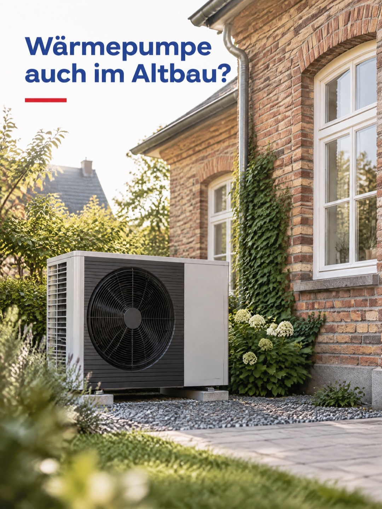

<a id="be-044"></a>
## BE-044 · Hybridheizung

Heizung · 3:4 · Dokument Nr. 23

```text
Brand style for a long-established plumbing, heating and bathroom company in Germany. Look: bright, warm and trustworthy; realistic photographic style; clean German homes and tidy technical rooms; natural daylight; subtle depth of field. Palette: white and very light warm grey surfaces, brand blue (#111D6D) as the main colour, brand red (#D60000) only as a small accent, dark charcoal text (#222222). Typography: bold, friendly sans-serif headline, left-aligned, generous whitespace, at most two text sizes. People: only anonymous (hands, from behind or cropped at the shoulders), never a recognisable face. Layout: vertical 3:4 portrait format (1080x1440 proportions); keep all text and key objects inside an 8% safe margin; keep the bottom-right corner (14% of the width) empty and calm for a logo added later. Do not draw any logo, manufacturer logo or label on devices, and no company name outside the quoted headline. Text rules: render ONLY the German text given in quotes, exactly once, verbatim, with correct umlauts (ä, ö, ü, ß); no other words, numbers or watermarks. A wall-hung gas condensing boiler hangs next to a compact indoor heat pump unit in a bright, tidy utility room. No logos or labels on the devices, soft daylight. Headline: "Hybridheizung: zwei Wärmeerzeuger, ein System"
```

**Text im Bild:** „Hybridheizung: zwei Wärmeerzeuger, ein System“  
**Caption:** In Spitzenlastzeiten springt der Brennwertkessel ein. Symbolbild. Termin anfragen: Link in Bio.  
**Hashtags:** #wärmepumpe #heizungstausch #heizungsmodernisierung #heizungsförderung #heizung  
**Hinweise:** „Symbolbild“ in der Caption ergänzt (fotorealistischer Technikraum).  
**Bilder:** [original](bilder/original/BE-044.jpg) · [instagram-3x4](bilder/instagram-3x4/BE-044.jpg) · [facebook-linkedin-4x5](bilder/facebook-linkedin-4x5/BE-044.jpg)

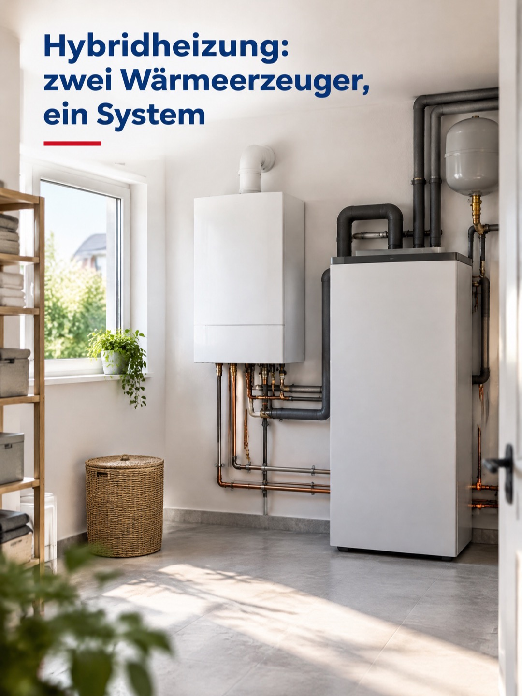

<a id="be-045"></a>
## BE-045 · Brennstoffzellenheizung

Heizung · 3:4 · Dokument Nr. 24

```text
Brand style for a long-established plumbing, heating and bathroom company in Germany. Look: bright, warm and trustworthy; realistic photographic style; clean German homes and tidy technical rooms; natural daylight; subtle depth of field. Palette: white and very light warm grey surfaces, brand blue (#111D6D) as the main colour, brand red (#D60000) only as a small accent, dark charcoal text (#222222). Typography: bold, friendly sans-serif headline, left-aligned, generous whitespace, at most two text sizes. People: only anonymous (hands, from behind or cropped at the shoulders), never a recognisable face. Layout: vertical 3:4 portrait format (1080x1440 proportions); keep all text and key objects inside an 8% safe margin; keep the bottom-right corner (14% of the width) empty and calm for a logo added later. Do not draw any logo, manufacturer logo or label on devices, and no company name outside the quoted headline. Text rules: render ONLY the German text given in quotes, exactly once, verbatim, with correct umlauts (ä, ö, ü, ß); no other words, numbers or watermarks. A sleek fuel cell heating unit stands in a clean, modern basement in soft blue light, with no logo or label on the device. Headline: "Strom und Wärme aus einem Gerät"
```

**Text im Bild:** „Strom und Wärme aus einem Gerät“  
**Caption:** Brennstoffzellenheizungen erzeugen Wärme und Strom im eigenen Haus. Symbolbild. Termin anfragen: Link in Bio.  
**Hashtags:** #wärmepumpe #heizungstausch #heizungsmodernisierung #heizungsförderung #heizung  
**Hinweise:** „Symbolbild“ in der Caption ergänzt (fotorealistisches Gerät im Keller).  
**Bilder:** [original](bilder/original/BE-045.jpg) · [instagram-3x4](bilder/instagram-3x4/BE-045.jpg) · [facebook-linkedin-4x5](bilder/facebook-linkedin-4x5/BE-045.jpg)

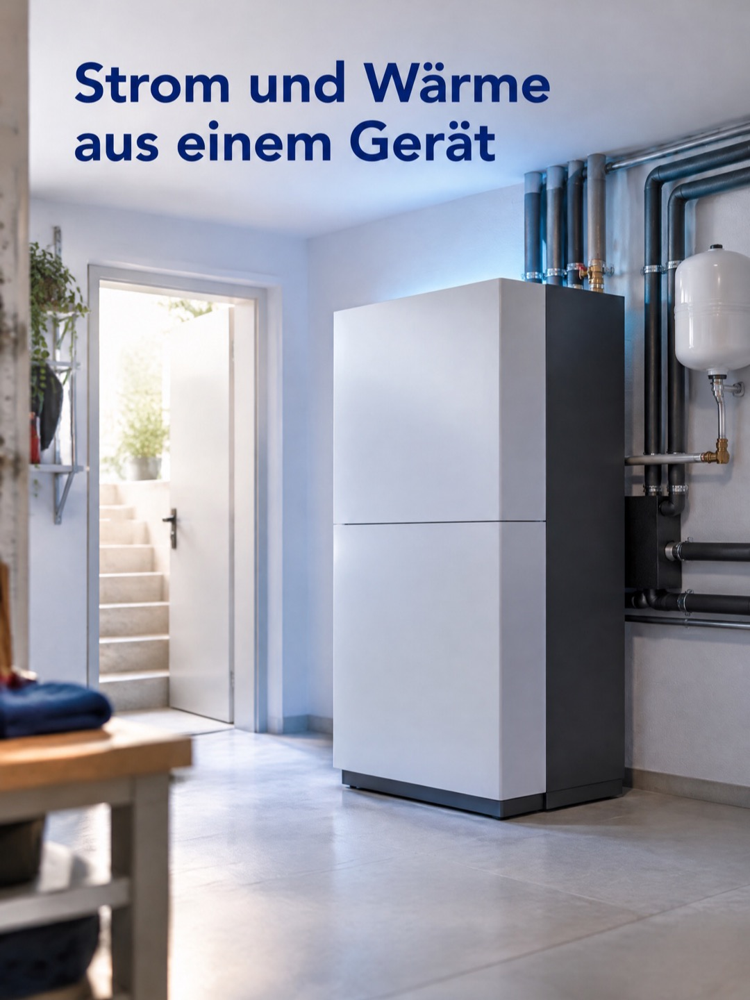

<a id="be-046"></a>
## BE-046 · BHKW fürs Gewerbe

Heizung · 3:4 · Dokument Nr. 25

```text
Brand style for a long-established plumbing, heating and bathroom company in Germany. Look: bright, warm and trustworthy; realistic photographic style; clean German homes and tidy technical rooms; natural daylight; subtle depth of field. Palette: white and very light warm grey surfaces, brand blue (#111D6D) as the main colour, brand red (#D60000) only as a small accent, dark charcoal text (#222222). Typography: bold, friendly sans-serif headline, left-aligned, generous whitespace, at most two text sizes. People: only anonymous (hands, from behind or cropped at the shoulders), never a recognisable face. Layout: vertical 3:4 portrait format (1080x1440 proportions); keep all text and key objects inside an 8% safe margin; keep the bottom-right corner (14% of the width) empty and calm for a logo added later. Do not draw any logo, manufacturer logo or label on devices, and no company name outside the quoted headline. Text rules: render ONLY the German text given in quotes, exactly once, verbatim, with correct umlauts (ä, ö, ü, ß); no other words, numbers or watermarks. A compact combined heat and power unit beside two large buffer tanks in a clean commercial boiler room, neatly insulated pipework, cool even light, no logos or labels anywhere. Headline: "BHKW: Strom und Wärme fürs Gewerbe"
```

**Text im Bild:** „BHKW: Strom und Wärme fürs Gewerbe“  
**Caption:** Wir bieten Blockheizkraftwerke für Gewerbe und größere Gebäude an. Symbolbild. Termin anfragen: Link in Bio.  
**Hashtags:** #wärmepumpe #heizungstausch #heizungsmodernisierung #heizungsförderung #heizung  
**Hinweise:** „Symbolbild“ in der Caption ergänzt (fotorealistischer Heizraum).  
**Bilder:** [original](bilder/original/BE-046.jpg) · [instagram-3x4](bilder/instagram-3x4/BE-046.jpg) · [facebook-linkedin-4x5](bilder/facebook-linkedin-4x5/BE-046.jpg)

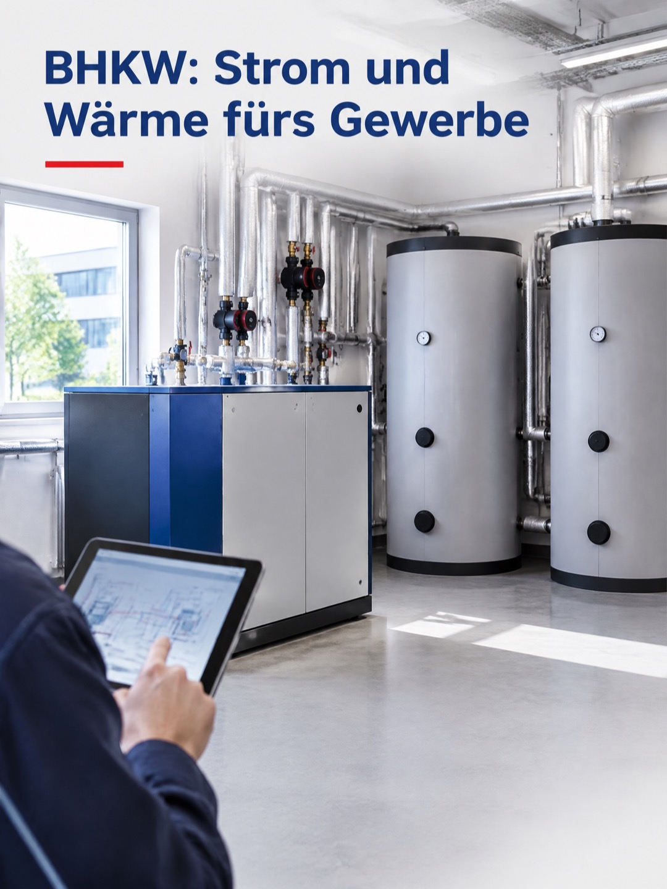

<a id="be-047"></a>
## BE-047 · Wärme richtig verteilen

Heizung · 3:4 · Dokument Nr. 26

```text
Brand style for a long-established plumbing, heating and bathroom company in Germany. Look: bright, warm and trustworthy; realistic photographic style; clean German homes and tidy technical rooms; natural daylight; subtle depth of field. Palette: white and very light warm grey surfaces, brand blue (#111D6D) as the main colour, brand red (#D60000) only as a small accent, dark charcoal text (#222222). Typography: bold, friendly sans-serif headline, left-aligned, generous whitespace, at most two text sizes. People: only anonymous (hands, from behind or cropped at the shoulders), never a recognisable face. Layout: vertical 3:4 portrait format (1080x1440 proportions); keep all text and key objects inside an 8% safe margin; keep the bottom-right corner (14% of the width) empty and calm for a logo added later. Do not draw any logo, manufacturer logo or label on devices, and no company name outside the quoted headline. Text rules: render ONLY the German text given in quotes, exactly once, verbatim, with correct umlauts (ä, ö, ü, ß); no other words, numbers or watermarks. A clean cutaway view shows underfloor heating pipes embedded in a screed layer beneath a tiled floor, bright neutral light. Headline: "Wärme richtig verteilen"
```

**Text im Bild:** „Wärme richtig verteilen“  
**Caption:** Fußbodenheizung, Heizkörper, hydraulischer Abgleich: Wir sorgen dafür, dass die Wärme ankommt. Symbolbild. Termin anfragen: Link in Bio.  
**Hashtags:** #wärmepumpe #heizungstausch #heizungsmodernisierung #heizungsförderung #heizung  
**Hinweise:** „Symbolbild“ in der Caption ergänzt (Schnittbild der Fußbodenheizung).  
**Bilder:** [original](bilder/original/BE-047.jpg) · [instagram-3x4](bilder/instagram-3x4/BE-047.jpg) · [facebook-linkedin-4x5](bilder/facebook-linkedin-4x5/BE-047.jpg)

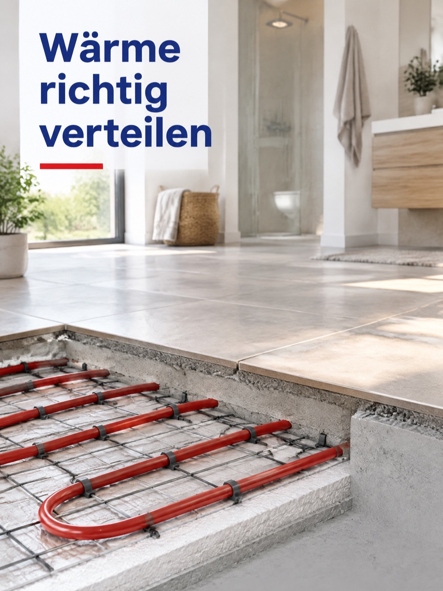

<a id="be-048"></a>
## BE-048 · Heizkörper entlüften

Tipp · 3:4 · Dokument Nr. 27

```text
Brand style for a long-established plumbing, heating and bathroom company in Germany. Look: bright, warm and trustworthy; realistic photographic style; clean German homes and tidy technical rooms; natural daylight; subtle depth of field. Palette: white and very light warm grey surfaces, brand blue (#111D6D) as the main colour, brand red (#D60000) only as a small accent, dark charcoal text (#222222). Typography: bold, friendly sans-serif headline, left-aligned, generous whitespace, at most two text sizes. People: only anonymous (hands, from behind or cropped at the shoulders), never a recognisable face. Layout: vertical 3:4 portrait format (1080x1440 proportions); keep all text and key objects inside an 8% safe margin; keep the bottom-right corner (14% of the width) empty and calm for a logo added later. Do not draw any logo, manufacturer logo or label on devices, and no company name outside the quoted headline. Text rules: render ONLY the German text given in quotes, exactly once, verbatim, with correct umlauts (ä, ö, ü, ß); no other words, numbers or watermarks. A hand turns a radiator bleed key while a small cloth catches the drops, close-up on a white radiator in a bright room, soft daylight. Headline: "Heizkörper gluckert? Entlüften!"
```

**Text im Bild:** „Heizkörper gluckert? Entlüften!“  
**Caption:** Kurzer Wintertipp: Gluckert der Heizkörper, sollten Sie ihn entlüften. Hilft es nicht, rufen Sie uns an. Symbolbild. Termin anfragen: Link in Bio.  
**Hashtags:** #wärmepumpe #heizungstausch #heizungsmodernisierung #heizungsförderung #heizung  
**Hinweise:** „Symbolbild“ in der Caption ergänzt. Posting-Plan: Woche 9, Mi 30.12.2026, gegen 18 Uhr.  
**Bilder:** [original](bilder/original/BE-048.jpg) · [instagram-3x4](bilder/instagram-3x4/BE-048.jpg) · [facebook-linkedin-4x5](bilder/facebook-linkedin-4x5/BE-048.jpg)

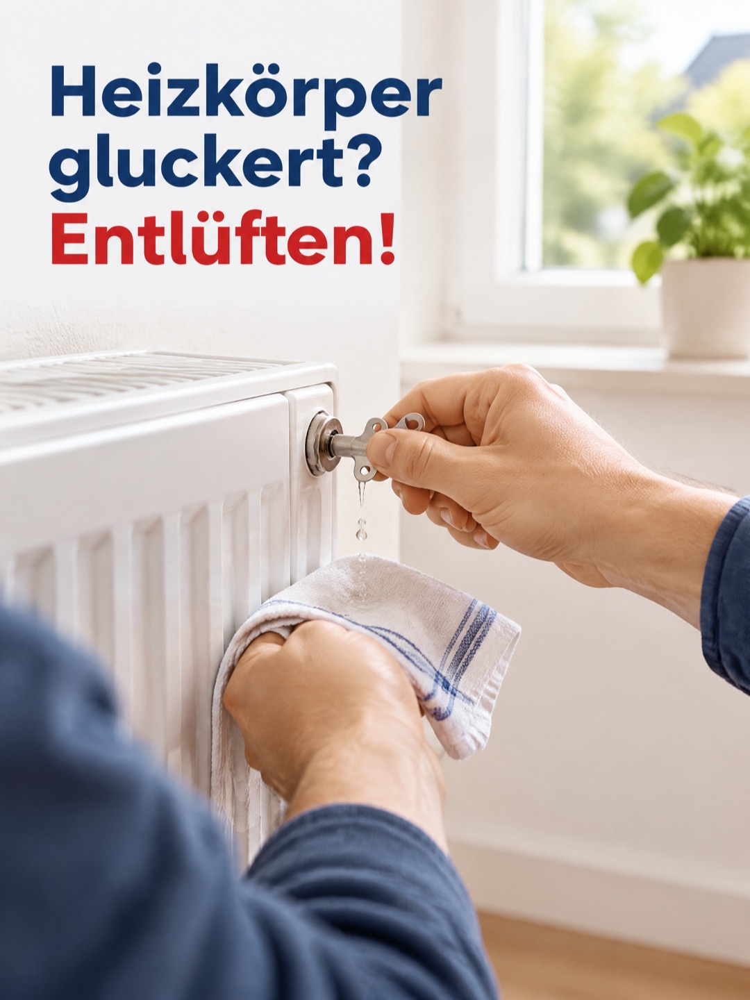

<a id="be-049"></a>
## BE-049 · Heizungsdruck prüfen

Tipp · 3:4 · Dokument Nr. 28

```text
Brand style for a long-established plumbing, heating and bathroom company in Germany. Look: bright, warm and trustworthy; realistic photographic style; clean German homes and tidy technical rooms; natural daylight; subtle depth of field. Palette: white and very light warm grey surfaces, brand blue (#111D6D) as the main colour, brand red (#D60000) only as a small accent, dark charcoal text (#222222). Typography: bold, friendly sans-serif headline, left-aligned, generous whitespace, at most two text sizes. People: only anonymous (hands, from behind or cropped at the shoulders), never a recognisable face. Layout: vertical 3:4 portrait format (1080x1440 proportions); keep all text and key objects inside an 8% safe margin; keep the bottom-right corner (14% of the width) empty and calm for a logo added later. Do not draw any logo, manufacturer logo or label on devices, and no company name outside the quoted headline. Text rules: render ONLY the German text given in quotes, exactly once, verbatim, with correct umlauts (ä, ö, ü, ß); no other words, numbers or watermarks. A close-up shows a heating pressure gauge with its needle resting in the green zone, a dial without readable numbers and a tidy utility room softly blurred behind. Headline: "Heizungsdruck im grünen Bereich?"
```

**Text im Bild:** „Heizungsdruck im grünen Bereich?“  
**Caption:** Fällt der Druck oft ab, sollte ein Fachbetrieb nachsehen. Symbolbild. Termin anfragen: Link in Bio.  
**Hashtags:** #wärmepumpe #heizungstausch #heizungsmodernisierung #heizungsförderung #heizung  
**Hinweise:** „Symbolbild“ in der Caption ergänzt. Manometer ohne lesbare Ziffern prüfen.  
**Bilder:** [original](bilder/original/BE-049.jpg) · [instagram-3x4](bilder/instagram-3x4/BE-049.jpg) · [facebook-linkedin-4x5](bilder/facebook-linkedin-4x5/BE-049.jpg)

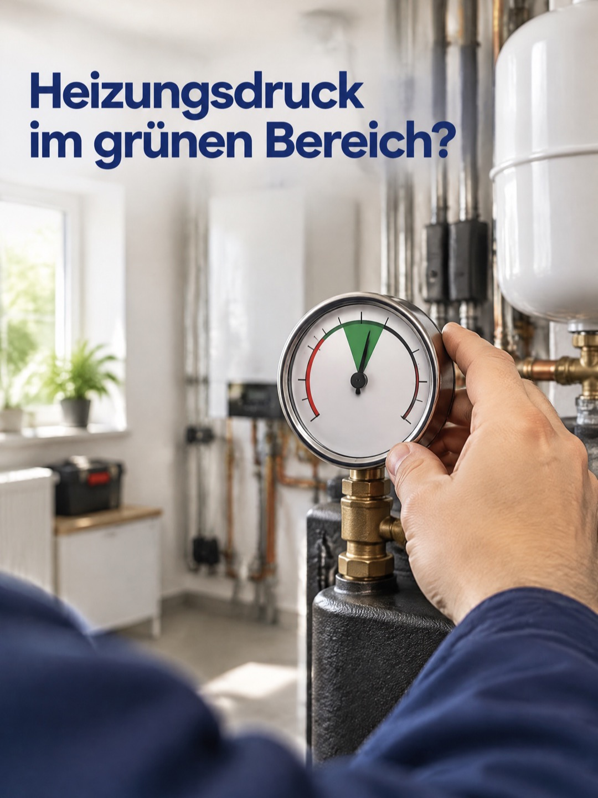

<a id="be-050"></a>
## BE-050 · Dusch-WC

Bad · 3:4 · Dokument Nr. 29

```text
Brand style for a long-established plumbing, heating and bathroom company in Germany. Look: bright, warm and trustworthy; realistic photographic style; clean German homes and tidy technical rooms; natural daylight; subtle depth of field. Palette: white and very light warm grey surfaces, brand blue (#111D6D) as the main colour, brand red (#D60000) only as a small accent, dark charcoal text (#222222). Typography: bold, friendly sans-serif headline, left-aligned, generous whitespace, at most two text sizes. People: only anonymous (hands, from behind or cropped at the shoulders), never a recognisable face. Layout: vertical 3:4 portrait format (1080x1440 proportions); keep all text and key objects inside an 8% safe margin; keep the bottom-right corner (14% of the width) empty and calm for a logo added later. Do not draw any logo, manufacturer logo or label on devices, and no company name outside the quoted headline. Text rules: render ONLY the German text given in quotes, exactly once, verbatim, with correct umlauts (ä, ö, ü, ß); no other words, numbers or watermarks. A modern wall-hung shower toilet without any logo is mounted in a bright, calm bathroom with light-grey tiles, soft daylight. Headline: "Dusch-WC: mehr Komfort im Alltag"
```

**Text im Bild:** „Dusch-WC: mehr Komfort im Alltag“  
**Caption:** Wir beraten Sie zu Dusch-WCs und bauen sie ein. Symbolbild. Termin anfragen: Link in Bio.  
**Hashtags:** #badsanierung #badmodernisierung #badezimmer #traumbad #barrierefreiesbad  
**Hinweise:** „Symbolbild“ in der Caption ergänzt (fotorealistisches Bad, fehlte im Caption-Kern).  
**Bilder:** [original](bilder/original/BE-050.jpg) · [instagram-3x4](bilder/instagram-3x4/BE-050.jpg) · [facebook-linkedin-4x5](bilder/facebook-linkedin-4x5/BE-050.jpg)

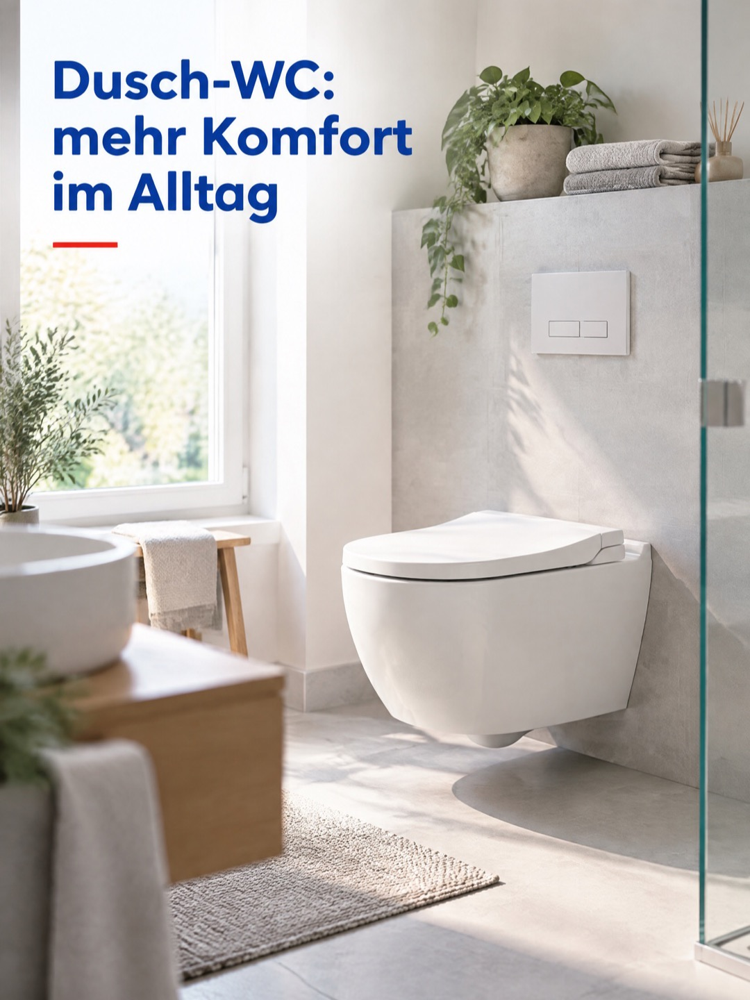

<a id="be-051"></a>
## BE-051 · Kleines Gäste-WC

Bad · 3:4 · Dokument Nr. 30

```text
Brand style for a long-established plumbing, heating and bathroom company in Germany. Look: bright, warm and trustworthy; realistic photographic style; clean German homes and tidy technical rooms; natural daylight; subtle depth of field. Palette: white and very light warm grey surfaces, brand blue (#111D6D) as the main colour, brand red (#D60000) only as a small accent, dark charcoal text (#222222). Typography: bold, friendly sans-serif headline, left-aligned, generous whitespace, at most two text sizes. People: only anonymous (hands, from behind or cropped at the shoulders), never a recognisable face. Layout: vertical 3:4 portrait format (1080x1440 proportions); keep all text and key objects inside an 8% safe margin; keep the bottom-right corner (14% of the width) empty and calm for a logo added later. Do not draw any logo, manufacturer logo or label on devices, and no company name outside the quoted headline. Text rules: render ONLY the German text given in quotes, exactly once, verbatim, with correct umlauts (ä, ö, ü, ß); no other words, numbers or watermarks. A small, bright guest WC features a compact basin and patterned floor tiles, soft daylight, tidy and inviting. Headline: "Kleines Gäste-WC, große Wirkung"
```

**Text im Bild:** „Kleines Gäste-WC, große Wirkung“  
**Caption:** Auch kleine Räume lassen sich modern gestalten. Symbolbild. Termin anfragen: Link in Bio.  
**Hashtags:** #badsanierung #badmodernisierung #badezimmer #traumbad #barrierefreiesbad  
**Hinweise:** „Symbolbild“ in der Caption ist Pflicht (enthalten).  
**Bilder:** [original](bilder/original/BE-051.jpg) · [instagram-3x4](bilder/instagram-3x4/BE-051.jpg) · [facebook-linkedin-4x5](bilder/facebook-linkedin-4x5/BE-051.jpg)

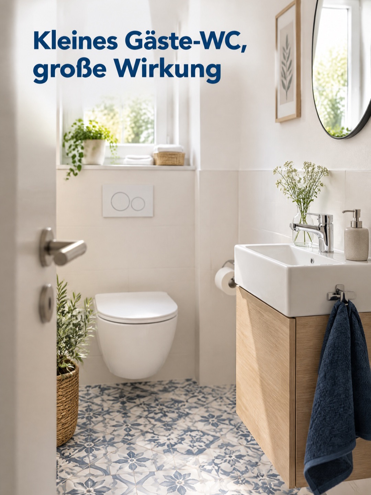

<a id="be-052"></a>
## BE-052 · Kleines Bad, clever geplant

Bad · 3:4 · Dokument Nr. 31

```text
Brand style for a long-established plumbing, heating and bathroom company in Germany. Look: bright, warm and trustworthy; realistic photographic style; clean German homes and tidy technical rooms; natural daylight; subtle depth of field. Palette: white and very light warm grey surfaces, brand blue (#111D6D) as the main colour, brand red (#D60000) only as a small accent, dark charcoal text (#222222). Typography: bold, friendly sans-serif headline, left-aligned, generous whitespace, at most two text sizes. People: only anonymous (hands, from behind or cropped at the shoulders), never a recognisable face. Layout: vertical 3:4 portrait format (1080x1440 proportions); keep all text and key objects inside an 8% safe margin; keep the bottom-right corner (14% of the width) empty and calm for a logo added later. Do not draw any logo, manufacturer logo or label on devices, and no company name outside the quoted headline. Text rules: render ONLY the German text given in quotes, exactly once, verbatim, with correct umlauts (ä, ö, ü, ß); no other words, numbers or watermarks. A narrow bathroom looks spacious thanks to large tiles, a mirror wall and a walk-in shower, soft natural daylight. Headline: "Kleines Bad, clever geplant"
```

**Text im Bild:** „Kleines Bad, clever geplant“  
**Caption:** Mit kluger Planung entsteht viel Wirkung auf wenig Fläche. Symbolbild. Termin anfragen: Link in Bio.  
**Hashtags:** #badsanierung #badmodernisierung #badezimmer #traumbad #barrierefreiesbad  
**Hinweise:** „Symbolbild“ in der Caption ist Pflicht (enthalten).  
**Bilder:** [original](bilder/original/BE-052.jpg) · [instagram-3x4](bilder/instagram-3x4/BE-052.jpg) · [facebook-linkedin-4x5](bilder/facebook-linkedin-4x5/BE-052.jpg)


<a id="be-053"></a>
## BE-053 · Ihr Bad, Ihr Stil

Bad · 3:4 · Dokument Nr. 32

```text
Brand style for a long-established plumbing, heating and bathroom company in Germany. Look: bright, warm and trustworthy; realistic photographic style; clean German homes and tidy technical rooms; natural daylight; subtle depth of field. Palette: white and very light warm grey surfaces, brand blue (#111D6D) as the main colour, brand red (#D60000) only as a small accent, dark charcoal text (#222222). Typography: bold, friendly sans-serif headline, left-aligned, generous whitespace, at most two text sizes. People: only anonymous (hands, from behind or cropped at the shoulders), never a recognisable face. Layout: vertical 3:4 portrait format (1080x1440 proportions); keep all text and key objects inside an 8% safe margin; keep the bottom-right corner (14% of the width) empty and calm for a logo added later. Do not draw any logo, manufacturer logo or label on devices, and no company name outside the quoted headline. Text rules: render ONLY the German text given in quotes, exactly once, verbatim, with correct umlauts (ä, ö, ü, ß); no other words, numbers or watermarks. A bathroom in warm terracotta and oak tones is styled around a freestanding tub, soft natural daylight. Headline: "Ihr Bad, Ihr Stil"
```

**Text im Bild:** „Ihr Bad, Ihr Stil“  
**Caption:** Holen Sie sich Inspiration aus unseren Musterbädern. Symbolbild. Termin anfragen: Link in Bio.  
**Hashtags:** #badsanierung #badmodernisierung #badezimmer #traumbad #barrierefreiesbad  
**Hinweise:** „Symbolbild“ in der Caption ist Pflicht (enthalten).  
**Bilder:** [original](bilder/original/BE-053.jpg) · [instagram-3x4](bilder/instagram-3x4/BE-053.jpg) · [facebook-linkedin-4x5](bilder/facebook-linkedin-4x5/BE-053.jpg)


<a id="be-054"></a>
## BE-054 · Multifunktionsarmatur Küche

Küche · 3:4 · Dokument Nr. 33

```text
Brand style for a long-established plumbing, heating and bathroom company in Germany. Look: bright, warm and trustworthy; realistic photographic style; clean German homes and tidy technical rooms; natural daylight; subtle depth of field. Palette: white and very light warm grey surfaces, brand blue (#111D6D) as the main colour, brand red (#D60000) only as a small accent, dark charcoal text (#222222). Typography: bold, friendly sans-serif headline, left-aligned, generous whitespace, at most two text sizes. People: only anonymous (hands, from behind or cropped at the shoulders), never a recognisable face. Layout: vertical 3:4 portrait format (1080x1440 proportions); keep all text and key objects inside an 8% safe margin; keep the bottom-right corner (14% of the width) empty and calm for a logo added later. Do not draw any logo, manufacturer logo or label on devices, and no company name outside the quoted headline. Text rules: render ONLY the German text given in quotes, exactly once, verbatim, with correct umlauts (ä, ö, ü, ß); no other words, numbers or watermarks. A modern kitchen tap without any logo dispenses boiling water into a cup as steam rises, bright kitchen, soft daylight. Headline: "Kochend, sprudelnd, gefiltert: ein Hahn"
```

**Text im Bild:** „Kochend, sprudelnd, gefiltert: ein Hahn“  
**Caption:** Wir bieten Multifunktionsarmaturen für Ihre Küche an. Symbolbild. Termin anfragen: Link in Bio.  
**Hashtags:** #wetzlar #lahndill #mittelhessen #solms #lahnau  
**Hinweise:** „Symbolbild“ in der Caption ergänzt (fotorealistische Küchenarmatur).  
**Bilder:** [original](bilder/original/BE-054.jpg) · [instagram-3x4](bilder/instagram-3x4/BE-054.jpg) · [facebook-linkedin-4x5](bilder/facebook-linkedin-4x5/BE-054.jpg)


<a id="be-055"></a>
## BE-055 · Weiches Wasser

Haustechnik · 3:4 · Dokument Nr. 34

```text
Brand style for a long-established plumbing, heating and bathroom company in Germany. Look: bright, warm and trustworthy; realistic photographic style; clean German homes and tidy technical rooms; natural daylight; subtle depth of field. Palette: white and very light warm grey surfaces, brand blue (#111D6D) as the main colour, brand red (#D60000) only as a small accent, dark charcoal text (#222222). Typography: bold, friendly sans-serif headline, left-aligned, generous whitespace, at most two text sizes. People: only anonymous (hands, from behind or cropped at the shoulders), never a recognisable face. Layout: vertical 3:4 portrait format (1080x1440 proportions); keep all text and key objects inside an 8% safe margin; keep the bottom-right corner (14% of the width) empty and calm for a logo added later. Do not draw any logo, manufacturer logo or label on devices, and no company name outside the quoted headline. Text rules: render ONLY the German text given in quotes, exactly once, verbatim, with correct umlauts (ä, ö, ü, ß); no other words, numbers or watermarks. A water softener is installed neatly at the house water connection in a clean basement, with no logo or label on the device, soft even light. Headline: "Weiches Wasser für Ihr Zuhause"
```

**Text im Bild:** „Weiches Wasser für Ihr Zuhause“  
**Caption:** Wir installieren Filter und Enthärtungsanlagen direkt am Hausanschluss. Symbolbild. Termin anfragen: Link in Bio.  
**Hashtags:** #hüttenberg #wettenberg #biebertal #ehringshausen #aßlar  
**Hinweise:** „Symbolbild“ in der Caption ergänzt (fotorealistische Anlage im Keller).  
**Bilder:** [original](bilder/original/BE-055.jpg) · [instagram-3x4](bilder/instagram-3x4/BE-055.jpg) · [facebook-linkedin-4x5](bilder/facebook-linkedin-4x5/BE-055.jpg)


<a id="be-056"></a>
## BE-056 · Dezentrale Lüftung

Lüftung · 3:4 · Dokument Nr. 35

```text
Brand style for a long-established plumbing, heating and bathroom company in Germany. Look: bright, warm and trustworthy; realistic photographic style; clean German homes and tidy technical rooms; natural daylight; subtle depth of field. Palette: white and very light warm grey surfaces, brand blue (#111D6D) as the main colour, brand red (#D60000) only as a small accent, dark charcoal text (#222222). Typography: bold, friendly sans-serif headline, left-aligned, generous whitespace, at most two text sizes. People: only anonymous (hands, from behind or cropped at the shoulders), never a recognisable face. Layout: vertical 3:4 portrait format (1080x1440 proportions); keep all text and key objects inside an 8% safe margin; keep the bottom-right corner (14% of the width) empty and calm for a logo added later. Do not draw any logo, manufacturer logo or label on devices, and no company name outside the quoted headline. Text rules: render ONLY the German text given in quotes, exactly once, verbatim, with correct umlauts (ä, ö, ü, ß); no other words, numbers or watermarks. A slim decentralised ventilation unit is set into the exterior wall of a calm, bright bedroom, no logo, soft daylight. Headline: "Frische Luft bei geschlossenem Fenster"
```

**Text im Bild:** „Frische Luft bei geschlossenem Fenster“  
**Caption:** Dezentrale Wohnraumlüftung sorgt für Luftaustausch. Symbolbild. Termin anfragen: Link in Bio.  
**Hashtags:** #wetzlar #lahndill #mittelhessen #solms #lahnau  
**Hinweise:** „Symbolbild“ in der Caption ergänzt (fotorealistischer Wohnraum).  
**Bilder:** [original](bilder/original/BE-056.jpg) · [instagram-3x4](bilder/instagram-3x4/BE-056.jpg) · [facebook-linkedin-4x5](bilder/facebook-linkedin-4x5/BE-056.jpg)


<a id="be-057"></a>
## BE-057 · Sicherheit, die gut aussieht

Bad · 3:4 · Dokument Nr. 36

```text
Brand style for a long-established plumbing, heating and bathroom company in Germany. Look: bright, warm and trustworthy; realistic photographic style; clean German homes and tidy technical rooms; natural daylight; subtle depth of field. Palette: white and very light warm grey surfaces, brand blue (#111D6D) as the main colour, brand red (#D60000) only as a small accent, dark charcoal text (#222222). Typography: bold, friendly sans-serif headline, left-aligned, generous whitespace, at most two text sizes. People: only anonymous (hands, from behind or cropped at the shoulders), never a recognisable face. Layout: vertical 3:4 portrait format (1080x1440 proportions); keep all text and key objects inside an 8% safe margin; keep the bottom-right corner (14% of the width) empty and calm for a logo added later. Do not draw any logo, manufacturer logo or label on devices, and no company name outside the quoted headline. Text rules: render ONLY the German text given in quotes, exactly once, verbatim, with correct umlauts (ä, ö, ü, ß); no other words, numbers or watermarks. A close-up shows a matte-black grab bar and slip-resistant tiles in a bright, modern bathroom, soft daylight. Headline: "Sicherheit, die gut aussieht"
```

**Text im Bild:** „Sicherheit, die gut aussieht“  
**Caption:** Wir planen barrierefreie Details, die ins Design passen. Symbolbild. Termin anfragen: Link in Bio.  
**Hashtags:** #badsanierung #badmodernisierung #badezimmer #traumbad #barrierefreiesbad  
**Hinweise:** „Symbolbild“ in der Caption ergänzt (fotorealistisches Bad, fehlte im Caption-Kern).  
**Bilder:** [original](bilder/original/BE-057.jpg) · [instagram-3x4](bilder/instagram-3x4/BE-057.jpg) · [facebook-linkedin-4x5](bilder/facebook-linkedin-4x5/BE-057.jpg)


<a id="be-058"></a>
## BE-058 · Meisterbetrieb aus Wetzlar

Betrieb · 3:4 · Dokument Nr. 37

```text
Brand style for a long-established plumbing, heating and bathroom company in Germany. Look: bright, warm and trustworthy; realistic photographic style; clean German homes and tidy technical rooms; natural daylight; subtle depth of field. Palette: white and very light warm grey surfaces, brand blue (#111D6D) as the main colour, brand red (#D60000) only as a small accent, dark charcoal text (#222222). Typography: bold, friendly sans-serif headline, left-aligned, generous whitespace, at most two text sizes. People: only anonymous (hands, from behind or cropped at the shoulders), never a recognisable face. Layout: vertical 3:4 portrait format (1080x1440 proportions); keep all text and key objects inside an 8% safe margin; keep the bottom-right corner (14% of the width) empty and calm for a logo added later. Do not draw any logo, manufacturer logo or label on devices, and no company name outside the quoted headline. Text rules: render ONLY the German text given in quotes, exactly once, verbatim, with correct umlauts (ä, ö, ü, ß); no other words, numbers or watermarks. A row of neatly organised tools hangs on a clean workshop wall, warm daylight, no brand names visible. Headline: "Meisterbetrieb aus Wetzlar"
```

**Text im Bild:** „Meisterbetrieb aus Wetzlar“  
**Caption:** Wir sind anerkannter Fachbetrieb, Meisterbetrieb und Ausbildungsbetrieb. Symbolbild. Termin anfragen: Link in Bio.  
**Hashtags:** #shk #handwerk #meisterbetrieb #ausbildungsbetrieb #seit1926  
**Hinweise:** „Symbolbild“ in der Caption ergänzt (fotorealistische Werkstatt, nicht die eigene).  
**Bilder:** [original](bilder/original/BE-058.jpg) · [instagram-3x4](bilder/instagram-3x4/BE-058.jpg) · [facebook-linkedin-4x5](bilder/facebook-linkedin-4x5/BE-058.jpg)


<a id="be-059"></a>
## BE-059 · In der Region unterwegs

Betrieb · 3:4 · Dokument Nr. 38

```text
Brand style for a long-established plumbing, heating and bathroom company in Germany. Look: bright, warm and trustworthy; realistic photographic style; clean German homes and tidy technical rooms; natural daylight; subtle depth of field. Palette: white and very light warm grey surfaces, brand blue (#111D6D) as the main colour, brand red (#D60000) only as a small accent, dark charcoal text (#222222). Typography: bold, friendly sans-serif headline, left-aligned, generous whitespace, at most two text sizes. People: only anonymous (hands, from behind or cropped at the shoulders), never a recognisable face. Layout: vertical 3:4 portrait format (1080x1440 proportions); keep all text and key objects inside an 8% safe margin; keep the bottom-right corner (14% of the width) empty and calm for a logo added later. Do not draw any logo, manufacturer logo or label on devices, and no company name outside the quoted headline. Text rules: render ONLY the German text given in quotes, exactly once, verbatim, with correct umlauts (ä, ö, ü, ß); no other words, numbers or watermarks. A service van seen from behind drives along an early-morning street in a small Hessian town, no lettering on the van, a blank licence plate, no readable signs, soft dawn light. Headline: "Wir sind in der Region unterwegs"
```

**Text im Bild:** „Wir sind in der Region unterwegs“  
**Caption:** Wir sind für Sie in Wetzlar, Solms, Hüttenberg, Aßlar, Lahnau und Umgebung unterwegs. Symbolbild. Termin anfragen: Link in Bio.  
**Hashtags:** #wetzlar #lahndill #mittelhessen #solms #lahnau #hüttenberg #wettenberg #biebertal #ehringshausen #aßlar  
**Hinweise:** „Symbolbild“ in der Caption ergänzt (fotorealistischer Transporter ohne Beschriftung). Kennzeichen leer, keine lesbaren Schilder im Bild.  
**Bilder:** [original](bilder/original/BE-059.jpg) · [instagram-3x4](bilder/instagram-3x4/BE-059.jpg) · [facebook-linkedin-4x5](bilder/facebook-linkedin-4x5/BE-059.jpg)


<a id="be-060"></a>
## BE-060 · Objekt- und Anlagenbau

Gewerbe · 3:4 · Dokument Nr. 39

```text
Brand style for a long-established plumbing, heating and bathroom company in Germany. Look: bright, warm and trustworthy; realistic photographic style; clean German homes and tidy technical rooms; natural daylight; subtle depth of field. Palette: white and very light warm grey surfaces, brand blue (#111D6D) as the main colour, brand red (#D60000) only as a small accent, dark charcoal text (#222222). Typography: bold, friendly sans-serif headline, left-aligned, generous whitespace, at most two text sizes. People: only anonymous (hands, from behind or cropped at the shoulders), never a recognisable face. Layout: vertical 3:4 portrait format (1080x1440 proportions); keep all text and key objects inside an 8% safe margin; keep the bottom-right corner (14% of the width) empty and calm for a logo added later. Do not draw any logo, manufacturer logo or label on devices, and no company name outside the quoted headline. Text rules: render ONLY the German text given in quotes, exactly once, verbatim, with correct umlauts (ä, ö, ü, ß); no other words, numbers or watermarks. Wide view of a spacious commercial plant room: rows of large insulated pipes and several pumps on steel frames beneath a high ceiling, bright industrial light, all equipment plain and unlabelled. Headline: "Objekt- und Anlagenbau"
```

**Text im Bild:** „Objekt- und Anlagenbau“  
**Caption:** Wir bieten Objekt- und Anlagenbau für Industrie, Behörden und Kommunen an. Symbolbild. Termin anfragen: Link in Bio.  
**Hashtags:** #wetzlar #lahndill #mittelhessen #solms #lahnau  
**Hinweise:** „Symbolbild“ in der Caption ergänzt (fotorealistischer Technikraum). Motiv bewusst anders als Post 25 (BHKW): weiter Blick in eine große Technikzentrale.  
**Bilder:** [original](bilder/original/BE-060.jpg) · [instagram-3x4](bilder/instagram-3x4/BE-060.jpg) · [facebook-linkedin-4x5](bilder/facebook-linkedin-4x5/BE-060.jpg)


<a id="be-061"></a>
## BE-061 · Dusche kalt?

Humor · 3:4 · Dokument Nr. 40

```text
Brand style for a long-established plumbing, heating and bathroom company in Germany. Look: bright, warm and trustworthy; realistic photographic style; clean German homes and tidy technical rooms; natural daylight; subtle depth of field. Palette: white and very light warm grey surfaces, brand blue (#111D6D) as the main colour, brand red (#D60000) only as a small accent, dark charcoal text (#222222). Typography: bold, friendly sans-serif headline, left-aligned, generous whitespace, at most two text sizes. People: only anonymous (hands, from behind or cropped at the shoulders), never a recognisable face. Layout: vertical 3:4 portrait format (1080x1440 proportions); keep all text and key objects inside an 8% safe margin; keep the bottom-right corner (14% of the width) empty and calm for a logo added later. Do not draw any logo, manufacturer logo or label on devices, and no company name outside the quoted headline. Text rules: render ONLY the German text given in quotes, exactly once, verbatim, with correct umlauts (ä, ö, ü, ß); no other words, numbers or watermarks. Flat cartoon illustration: a cheerful yellow rubber duck wrapped in a cosy knitted scarf, a small snowflake icon above it and a simple shower head drawn in thin lines, light background. Headline: "Montagmorgen, Dusche kalt?"
```

**Text im Bild:** „Montagmorgen, Dusche kalt?“  
**Caption:** Rufen Sie uns an: 06441-42956. Termin anfragen: Link in Bio.  
**Hashtags:** #wärmepumpe #heizungstausch #heizungsmodernisierung #heizungsförderung #heizung  
**Hinweise:** Posting-Plan: Woche 9, Mo 28.12.2026, gegen 18 Uhr.  
**Bilder:** [original](bilder/original/BE-061.jpg) · [instagram-3x4](bilder/instagram-3x4/BE-061.jpg) · [facebook-linkedin-4x5](bilder/facebook-linkedin-4x5/BE-061.jpg)


<a id="be-062"></a>
## BE-062 · Bereit für den Winter?

Humor · 3:4 · Dokument Nr. 41

```text
Brand style for a long-established plumbing, heating and bathroom company in Germany. Look: bright, warm and trustworthy; realistic photographic style; clean German homes and tidy technical rooms; natural daylight; subtle depth of field. Palette: white and very light warm grey surfaces, brand blue (#111D6D) as the main colour, brand red (#D60000) only as a small accent, dark charcoal text (#222222). Typography: bold, friendly sans-serif headline, left-aligned, generous whitespace, at most two text sizes. People: only anonymous (hands, from behind or cropped at the shoulders), never a recognisable face. Layout: vertical 3:4 portrait format (1080x1440 proportions); keep all text and key objects inside an 8% safe margin; keep the bottom-right corner (14% of the width) empty and calm for a logo added later. Do not draw any logo, manufacturer logo or label on devices, and no company name outside the quoted headline. Text rules: render ONLY the German text given in quotes, exactly once, verbatim, with correct umlauts (ä, ö, ü, ß); no other words, numbers or watermarks. Flat cartoon of an old ribbed radiator wearing a cosy knitted scarf, drawn with simple rounded shapes on a pale warm-grey background. Headline: "Bereit für den Winter?"
```

**Text im Bild:** „Bereit für den Winter?“  
**Caption:** Fragen Sie jetzt Ihren Wartungstermin an. Termin anfragen: Link in Bio.  
**Hashtags:** #wärmepumpe #heizungstausch #heizungsmodernisierung #heizungsförderung #heizung  
**Hinweise:** Posting-Plan: Woche 5, Fr 4.12.2026, gegen 18 Uhr.  
**Bilder:** [original](bilder/original/BE-062.jpg) · [instagram-3x4](bilder/instagram-3x4/BE-062.jpg) · [facebook-linkedin-4x5](bilder/facebook-linkedin-4x5/BE-062.jpg)


<a id="be-063"></a>
## BE-063 · Frohe Weihnachten

Saison · 3:4 · Dokument Nr. 42

```text
Brand style for a long-established plumbing, heating and bathroom company in Germany. Look: bright, warm and trustworthy; realistic photographic style; clean German homes and tidy technical rooms; natural daylight; subtle depth of field. Palette: white and very light warm grey surfaces, brand blue (#111D6D) as the main colour, brand red (#D60000) only as a small accent, dark charcoal text (#222222). Typography: bold, friendly sans-serif headline, left-aligned, generous whitespace, at most two text sizes. People: only anonymous (hands, from behind or cropped at the shoulders), never a recognisable face. Layout: vertical 3:4 portrait format (1080x1440 proportions); keep all text and key objects inside an 8% safe margin; keep the bottom-right corner (14% of the width) empty and calm for a logo added later. Do not draw any logo, manufacturer logo or label on devices, and no company name outside the quoted headline. Text rules: render ONLY the German text given in quotes, exactly once, verbatim, with correct umlauts (ä, ö, ü, ß); no other words, numbers or watermarks. A cosy winter living room with a warm radiator, a mug of tea and glowing fairy lights is bathed in soft evening light. Headline: "Frohe Weihnachten aus Wetzlar"
```

**Text im Bild:** „Frohe Weihnachten aus Wetzlar“  
**Caption:** Wir sagen Danke für 100 Jahre Vertrauen und wünschen Ihnen schöne Feiertage! Symbolbild. Termin anfragen: Link in Bio.  
**Hashtags:** #shk #handwerk #meisterbetrieb #ausbildungsbetrieb #seit1926  
**Hinweise:** ⚠️ Fakten prüfen. Faktencheck Firmengeschichte: „100 Jahre“ (Gründung 1926) vor dem Posten mit der Geschäftsführung abgleichen, Stand 29.10.2026. „Symbolbild“ in der Caption ergänzt (fotorealistischer Wohnraum). Posting-Plan: Woche 8, Mi 23.12.2026, gegen 18 Uhr.  
**Bilder:** [original](bilder/original/BE-063.jpg) · [instagram-3x4](bilder/instagram-3x4/BE-063.jpg) · [facebook-linkedin-4x5](bilder/facebook-linkedin-4x5/BE-063.jpg)


<a id="be-064"></a>
## BE-064 · Gutes neues Jahr

Saison · 3:4 · Dokument Nr. 43

```text
Brand style for a long-established plumbing, heating and bathroom company in Germany. Look: bright, warm and trustworthy; realistic photographic style; clean German homes and tidy technical rooms; natural daylight; subtle depth of field. Palette: white and very light warm grey surfaces, brand blue (#111D6D) as the main colour, brand red (#D60000) only as a small accent, dark charcoal text (#222222). Typography: bold, friendly sans-serif headline, left-aligned, generous whitespace, at most two text sizes. People: only anonymous (hands, from behind or cropped at the shoulders), never a recognisable face. Layout: vertical 3:4 portrait format (1080x1440 proportions); keep all text and key objects inside an 8% safe margin; keep the bottom-right corner (14% of the width) empty and calm for a logo added later. Do not draw any logo, manufacturer logo or label on devices, and no company name outside the quoted headline. Text rules: render ONLY the German text given in quotes, exactly once, verbatim, with correct umlauts (ä, ö, ü, ß); no other words, numbers or watermarks. A plain blue background is scattered with soft light sparkles. Headline: "Ein gutes neues Jahr 2027"
```

**Text im Bild:** „Ein gutes neues Jahr 2027“  
**Caption:** Wir wünschen Ihnen ein warmes neues Jahr. Termin anfragen: Link in Bio.  
**Hashtags:** #shk #handwerk #meisterbetrieb #ausbildungsbetrieb #seit1926  
**Hinweise:** Posting-Plan: Woche 9, Fr 1.1.2027, gegen 18 Uhr.  
**Bilder:** [original](bilder/original/BE-064.jpg) · [instagram-3x4](bilder/instagram-3x4/BE-064.jpg) · [facebook-linkedin-4x5](bilder/facebook-linkedin-4x5/BE-064.jpg)


<a id="be-065"></a>
## BE-065 · Story-Umfrage: Alter der Heizung

Story · 9:16 · Dokument Nr. 44

```text
Brand style for a long-established plumbing, heating and bathroom company in Germany. Look: bright, warm and trustworthy; realistic photographic style; clean German homes and tidy technical rooms; natural daylight; subtle depth of field. Palette: white and very light warm grey surfaces, brand blue (#111D6D) as the main colour, brand red (#D60000) only as a small accent, dark charcoal text (#222222). Typography: bold, friendly sans-serif headline, left-aligned, generous whitespace, at most two text sizes. People: only anonymous (hands, from behind or cropped at the shoulders), never a recognisable face. Layout: vertical 9:16 format (1080x1920 proportions); keep the top 14% and bottom 20% free of text; keep all text and key objects inside an 8% safe margin; keep the bottom-right corner (14% of the width) empty and calm for a logo added later. Do not draw any logo, manufacturer logo or label on devices, and no company name outside the quoted headline. Text rules: render ONLY the German text given in quotes, exactly once, verbatim, with correct umlauts (ä, ö, ü, ß); no other words, numbers or watermarks. Centred in a green garden, a white heat pump outdoor unit without logos sits on a small gravel bed, seen straight on at eye level, a low hedge behind it, soft daylight, calm empty space above and below. Headline: "Wie alt ist Ihre Heizung?". Small label (lower left, small, just above the text-free bottom 20 %): "Symbolbild".
```

**Text im Bild:** „Wie alt ist Ihre Heizung?“  
**Label:** „Symbolbild“ (lower left, small, just above the text-free bottom 20 %)  
**Caption:**   
**Hashtags:**   
**Hinweise:** Story ohne Caption. Story-Sticker: Umfrage mit den Optionen „unter 10 / 10–20 / über 20 Jahre“. Fotorealistische Wärmepumpe: „Symbolbild“ steht als kleiner Text im Bild (Stories haben keine Caption). Posting-Plan: 3–5 Stories pro Woche aus den Prompts 44–47 (10 Wochen ab 2.11.2026).  
**Bilder:** [original](bilder/original/BE-065.jpg) · [story-9x16](bilder/story-9x16/BE-065.jpg)


<a id="be-066"></a>
## BE-066 · Story-Umfrage: Wanne oder Dusche

Story · 9:16 · Dokument Nr. 45

```text
Brand style for a long-established plumbing, heating and bathroom company in Germany. Look: bright, warm and trustworthy; realistic photographic style; clean German homes and tidy technical rooms; natural daylight; subtle depth of field. Palette: white and very light warm grey surfaces, brand blue (#111D6D) as the main colour, brand red (#D60000) only as a small accent, dark charcoal text (#222222). Typography: bold, friendly sans-serif headline, left-aligned, generous whitespace, at most two text sizes. People: only anonymous (hands, from behind or cropped at the shoulders), never a recognisable face. Layout: vertical 9:16 format (1080x1920 proportions); keep the top 14% and bottom 20% free of text; keep all text and key objects inside an 8% safe margin; keep the bottom-right corner (14% of the width) empty and calm for a logo added later. Do not draw any logo, manufacturer logo or label on devices, and no company name outside the quoted headline. Text rules: render ONLY the German text given in quotes, exactly once, verbatim, with correct umlauts (ä, ö, ü, ß); no other words, numbers or watermarks. Vertical split with a thin white horizontal divider: on top, a freestanding white bathtub below a window with sheer curtains; below, a floor-level walk-in shower with a rain shower head behind a clear glass panel, both bright and modern, soft daylight. Headline: "Wanne oder Dusche?". Small label (lower left, small, just above the text-free bottom 20 %): "Symbolbild".
```

**Text im Bild:** „Wanne oder Dusche?“  
**Label:** „Symbolbild“ (lower left, small, just above the text-free bottom 20 %)  
**Caption:**   
**Hashtags:**   
**Hinweise:** Story ohne Caption. Story-Sticker: Umfrage mit den Optionen „Wanne“ / „Dusche“, auf die Trennlinie setzen. Bild bewusst oben/unten geteilt, damit es sich vom Vorher/Nachher-Motiv in Post 11 unterscheidet. Fotorealistisches Bad: „Symbolbild“ steht als kleiner Text im Bild (Stories haben keine Caption). Posting-Plan: 3–5 Stories pro Woche aus den Prompts 44–47 (10 Wochen ab 2.11.2026).  
**Bilder:** [original](bilder/original/BE-066.jpg) · [story-9x16](bilder/story-9x16/BE-066.jpg)


<a id="be-067"></a>
## BE-067 · Story: Termin anfragen

Story · 9:16 · Dokument Nr. 46

```text
Brand style for a long-established plumbing, heating and bathroom company in Germany. Look: bright, warm and trustworthy; realistic photographic style; clean German homes and tidy technical rooms; natural daylight; subtle depth of field. Palette: white and very light warm grey surfaces, brand blue (#111D6D) as the main colour, brand red (#D60000) only as a small accent, dark charcoal text (#222222). Typography: bold, friendly sans-serif headline, left-aligned, generous whitespace, at most two text sizes. People: only anonymous (hands, from behind or cropped at the shoulders), never a recognisable face. Layout: vertical 9:16 format (1080x1920 proportions); keep the top 14% and bottom 20% free of text; keep all text and key objects inside an 8% safe margin; keep the bottom-right corner (14% of the width) empty and calm for a logo added later. Do not draw any logo, manufacturer logo or label on devices, and no company name outside the quoted headline. Text rules: render ONLY the German text given in quotes, exactly once, verbatim, with correct umlauts (ä, ö, ü, ß); no other words, numbers or watermarks. A simple calendar icon without numbers sits centred on a plain blue background. Headline: "Termin anfragen: Link antippen"
```

**Text im Bild:** „Termin anfragen: Link antippen“  
**Caption:**   
**Hashtags:**   
**Hinweise:** Story ohne Caption. Story-Sticker: Link-Sticker zur Terminanfrage (bad-energie.de/terminanfrage). Posting-Plan: 3–5 Stories pro Woche aus den Prompts 44–47 (10 Wochen ab 2.11.2026).  
**Bilder:** [original](bilder/original/BE-067.jpg) · [story-9x16](bilder/story-9x16/BE-067.jpg)


<a id="be-068"></a>
## BE-068 · Story: 100 Jahre Bad & Energie

Story · 9:16 · Dokument Nr. 47

```text
Brand style for a long-established plumbing, heating and bathroom company in Germany. Look: bright, warm and trustworthy; realistic photographic style; clean German homes and tidy technical rooms; natural daylight; subtle depth of field. Palette: white and very light warm grey surfaces, brand blue (#111D6D) as the main colour, brand red (#D60000) only as a small accent, dark charcoal text (#222222). Typography: bold, friendly sans-serif headline, left-aligned, generous whitespace, at most two text sizes. People: only anonymous (hands, from behind or cropped at the shoulders), never a recognisable face. Layout: vertical 9:16 format (1080x1920 proportions); keep the top 14% and bottom 20% free of text; keep all text and key objects inside an 8% safe margin; keep the bottom-right corner (14% of the width) empty and calm for a logo added later. Do not draw any logo, manufacturer logo or label on devices, and no company name outside the quoted headline. Text rules: render ONLY the German text given in quotes, exactly once, verbatim, with correct umlauts (ä, ö, ü, ß); no other words, numbers or watermarks. Two taps mounted side by side on a wall of small white tiles: a vintage brass tap with cross handles and a slim modern chrome tap, a thin stream of water running from each, soft daylight, calm empty space above and below. Headline: "100 Jahre Bad & Energie". Small label (lower left, small, just above the text-free bottom 20 %): "Symbolbild".
```

**Text im Bild:** „100 Jahre Bad & Energie“  
**Label:** „Symbolbild“ (lower left, small, just above the text-free bottom 20 %)  
**Caption:**   
**Hashtags:**   
**Hinweise:** ⚠️ Fakten prüfen. Story ohne Caption. Story-Sticker: Link-Sticker zur Unternehmensseite (bad-energie.de/ueber-uns/unternehmen). Faktencheck Firmengeschichte: „100 Jahre“ (Gründung 1926) vor dem Posten mit der Geschäftsführung abgleichen, Stand 29.10.2026. Motiv bewusst anders als Post 2 (Armaturen an der Fliesenwand statt Stillleben auf dem Sims). „Symbolbild“ steht als kleiner Text im Bild. Posting-Plan: 3–5 Stories pro Woche aus den Prompts 44–47 (10 Wochen ab 2.11.2026).  
**Bilder:** [original](bilder/original/BE-068.jpg) · [story-9x16](bilder/story-9x16/BE-068.jpg)


<a id="be-069"></a>
## BE-069 · Ihr Weg zum neuen Bad: Cover

Karussell · 3:4 · Karussell K4 „Ihr Weg zum neuen Bad“, Slide 1 von 7

```text
Brand style for a long-established plumbing, heating and bathroom company in Germany. Look: bright, warm and trustworthy; realistic photographic style; clean German homes and tidy technical rooms; natural daylight; subtle depth of field. Palette: white and very light warm grey surfaces, brand blue (#111D6D) as the main colour, brand red (#D60000) only as a small accent, dark charcoal text (#222222). Typography: bold, friendly sans-serif headline, left-aligned, generous whitespace, at most two text sizes. People: only anonymous (hands, from behind or cropped at the shoulders), never a recognisable face. Layout: vertical 3:4 portrait format (1080x1440 proportions); keep all text and key objects inside an 8% safe margin; keep the bottom-right corner (14% of the width) empty and calm for a logo added later. Do not draw any logo, manufacturer logo or label on devices, and no company name outside the quoted headline. Text rules: render ONLY the German text given in quotes, exactly once, verbatim, with correct umlauts (ä, ö, ü, ß); no other words, numbers or watermarks. Isometric 3D clay-style cutaway of an empty, unfinished bathroom shown as an open cube from a high three-quarter angle: bare light-grey walls, one brand-blue wall, smooth concrete floor, soft studio light on a warm-grey background. Headline: "Ihr Weg zum neuen Bad". Small label (bottom-left, small): "Swipe →".
```

**Text im Bild:** „Ihr Weg zum neuen Bad“  
**Label:** „Swipe →“ (bottom-left, small)  
**Caption:** Vom ersten Entwurf im 3D-Badplaner bis zum fertigen Bad begleiten wir Ihr Projekt Schritt für Schritt (Symbolbilder). Vorab erhalten Sie eine detaillierte Planung und eine transparente Kostenaufstellung. Badanfrage starten: Link in Bio.  
**Hashtags:** #badsanierung #badmodernisierung #badezimmer #traumbad #barrierefreiesbad #wetzlar #lahndill #mittelhessen  
**Hinweise:** Caption und Hashtags gelten für das ganze Karussell (einmal posten). „Symbolbilder“ in der Caption ist Pflicht (enthalten). Eine Bildidee für alle Slides: derselbe isometrische 3D-Badwürfel aus derselben Perspektive, der von Slide zu Slide fertiger wird. Posting-Fenster: Woche 4 oder 5 (23.11.–4.12.2026), zusätzlich zum Plan. Cover dient als Stilreferenz für die Slides 2–7.  
**Bilder:** [original](bilder/original/BE-069.jpg) · [instagram-3x4](bilder/instagram-3x4/BE-069.jpg) · [facebook-linkedin-4x5](bilder/facebook-linkedin-4x5/BE-069.jpg)


<a id="be-070"></a>
## BE-070 · Schritt 1: Ideen im 3D-Badplaner

Karussell · 3:4 · Karussell K4 „Ihr Weg zum neuen Bad“, Slide 2 von 7

Vorher die Cover-Slide dieser Serie hochladen (Stilreferenz).

```text
Use the uploaded image as the exact style reference: same background, colours, typography and layout. Create the next slide of this carousel. Brand style for a long-established plumbing, heating and bathroom company in Germany. Look: bright, warm and trustworthy; realistic photographic style; clean German homes and tidy technical rooms; natural daylight; subtle depth of field. Palette: white and very light warm grey surfaces, brand blue (#111D6D) as the main colour, brand red (#D60000) only as a small accent, dark charcoal text (#222222). Typography: bold, friendly sans-serif headline, left-aligned, generous whitespace, at most two text sizes. People: only anonymous (hands, from behind or cropped at the shoulders), never a recognisable face. Layout: vertical 3:4 portrait format (1080x1440 proportions); keep all text and key objects inside an 8% safe margin; keep the bottom-right corner (14% of the width) empty and calm for a logo added later. Do not draw any logo, manufacturer logo or label on devices, and no company name outside the quoted headline. Text rules: render ONLY the German text given in quotes, exactly once, verbatim, with correct umlauts (ä, ö, ü, ß); no other words, numbers or watermarks. The same isometric 3D bathroom cube from the same angle, still empty, with thin glowing blue wireframe outlines of a walk-in shower, a vanity and a wall-hung toilet floating where they will go. Headline: "1. Ideen im 3D-Badplaner sammeln"
```

**Text im Bild:** „1. Ideen im 3D-Badplaner sammeln“  
**Caption:** Vom ersten Entwurf im 3D-Badplaner bis zum fertigen Bad begleiten wir Ihr Projekt Schritt für Schritt (Symbolbilder). Vorab erhalten Sie eine detaillierte Planung und eine transparente Kostenaufstellung. Badanfrage starten: Link in Bio.  
**Hashtags:** #badsanierung #badmodernisierung #badezimmer #traumbad #barrierefreiesbad #wetzlar #lahndill #mittelhessen  
**Hinweise:** Caption und Hashtags gelten für das ganze Karussell (einmal posten). „Symbolbilder“ in der Caption ist Pflicht (enthalten). Eine Bildidee für alle Slides: derselbe isometrische 3D-Badwürfel aus derselben Perspektive, der von Slide zu Slide fertiger wird. Posting-Fenster: Woche 4 oder 5 (23.11.–4.12.2026), zusätzlich zum Plan. Ab Slide 2 das fertige Cover als Stilreferenz hochladen (siehe E6).  
**Bilder:** [original](bilder/original/BE-070.jpg) · [instagram-3x4](bilder/instagram-3x4/BE-070.jpg) · [facebook-linkedin-4x5](bilder/facebook-linkedin-4x5/BE-070.jpg)


<a id="be-071"></a>
## BE-071 · Schritt 2: Beratung in der Ausstellung

Karussell · 3:4 · Karussell K4 „Ihr Weg zum neuen Bad“, Slide 3 von 7

Vorher die Cover-Slide dieser Serie hochladen (Stilreferenz).

```text
Use the uploaded image as the exact style reference: same background, colours, typography and layout. Create the next slide of this carousel. Brand style for a long-established plumbing, heating and bathroom company in Germany. Look: bright, warm and trustworthy; realistic photographic style; clean German homes and tidy technical rooms; natural daylight; subtle depth of field. Palette: white and very light warm grey surfaces, brand blue (#111D6D) as the main colour, brand red (#D60000) only as a small accent, dark charcoal text (#222222). Typography: bold, friendly sans-serif headline, left-aligned, generous whitespace, at most two text sizes. People: only anonymous (hands, from behind or cropped at the shoulders), never a recognisable face. Layout: vertical 3:4 portrait format (1080x1440 proportions); keep all text and key objects inside an 8% safe margin; keep the bottom-right corner (14% of the width) empty and calm for a logo added later. Do not draw any logo, manufacturer logo or label on devices, and no company name outside the quoted headline. Text rules: render ONLY the German text given in quotes, exactly once, verbatim, with correct umlauts (ä, ö, ü, ß); no other words, numbers or watermarks. The same isometric 3D bathroom cube from the same angle, now holding a small round table with tile samples, a chrome tap and two coffee cups, like a consultation corner in a showroom. Headline: "2. Beratung in unserer Ausstellung"
```

**Text im Bild:** „2. Beratung in unserer Ausstellung“  
**Caption:** Vom ersten Entwurf im 3D-Badplaner bis zum fertigen Bad begleiten wir Ihr Projekt Schritt für Schritt (Symbolbilder). Vorab erhalten Sie eine detaillierte Planung und eine transparente Kostenaufstellung. Badanfrage starten: Link in Bio.  
**Hashtags:** #badsanierung #badmodernisierung #badezimmer #traumbad #barrierefreiesbad #wetzlar #lahndill #mittelhessen  
**Hinweise:** Caption und Hashtags gelten für das ganze Karussell (einmal posten). „Symbolbilder“ in der Caption ist Pflicht (enthalten). Eine Bildidee für alle Slides: derselbe isometrische 3D-Badwürfel aus derselben Perspektive, der von Slide zu Slide fertiger wird. Posting-Fenster: Woche 4 oder 5 (23.11.–4.12.2026), zusätzlich zum Plan. Ab Slide 2 das fertige Cover als Stilreferenz hochladen (siehe E6).  
**Bilder:** [original](bilder/original/BE-071.jpg) · [instagram-3x4](bilder/instagram-3x4/BE-071.jpg) · [facebook-linkedin-4x5](bilder/facebook-linkedin-4x5/BE-071.jpg)


<a id="be-072"></a>
## BE-072 · Schritt 3: Planung und Kosten

Karussell · 3:4 · Karussell K4 „Ihr Weg zum neuen Bad“, Slide 4 von 7

Vorher die Cover-Slide dieser Serie hochladen (Stilreferenz).

```text
Use the uploaded image as the exact style reference: same background, colours, typography and layout. Create the next slide of this carousel. Brand style for a long-established plumbing, heating and bathroom company in Germany. Look: bright, warm and trustworthy; realistic photographic style; clean German homes and tidy technical rooms; natural daylight; subtle depth of field. Palette: white and very light warm grey surfaces, brand blue (#111D6D) as the main colour, brand red (#D60000) only as a small accent, dark charcoal text (#222222). Typography: bold, friendly sans-serif headline, left-aligned, generous whitespace, at most two text sizes. People: only anonymous (hands, from behind or cropped at the shoulders), never a recognisable face. Layout: vertical 3:4 portrait format (1080x1440 proportions); keep all text and key objects inside an 8% safe margin; keep the bottom-right corner (14% of the width) empty and calm for a logo added later. Do not draw any logo, manufacturer logo or label on devices, and no company name outside the quoted headline. Text rules: render ONLY the German text given in quotes, exactly once, verbatim, with correct umlauts (ä, ö, ü, ß); no other words, numbers or watermarks. The same isometric 3D bathroom cube from the same angle, its floor covered by a large unrolled floor plan drawn in thin blue lines, a neat stack of sheets with abstract boxes and a pencil beside it, no readable text. Headline: "3. Planung und Kostenaufstellung vorab"
```

**Text im Bild:** „3. Planung und Kostenaufstellung vorab“  
**Caption:** Vom ersten Entwurf im 3D-Badplaner bis zum fertigen Bad begleiten wir Ihr Projekt Schritt für Schritt (Symbolbilder). Vorab erhalten Sie eine detaillierte Planung und eine transparente Kostenaufstellung. Badanfrage starten: Link in Bio.  
**Hashtags:** #badsanierung #badmodernisierung #badezimmer #traumbad #barrierefreiesbad #wetzlar #lahndill #mittelhessen  
**Hinweise:** Caption und Hashtags gelten für das ganze Karussell (einmal posten). „Symbolbilder“ in der Caption ist Pflicht (enthalten). Eine Bildidee für alle Slides: derselbe isometrische 3D-Badwürfel aus derselben Perspektive, der von Slide zu Slide fertiger wird. Posting-Fenster: Woche 4 oder 5 (23.11.–4.12.2026), zusätzlich zum Plan. Ab Slide 2 das fertige Cover als Stilreferenz hochladen (siehe E6).  
**Bilder:** [original](bilder/original/BE-072.jpg) · [instagram-3x4](bilder/instagram-3x4/BE-072.jpg) · [facebook-linkedin-4x5](bilder/facebook-linkedin-4x5/BE-072.jpg)


<a id="be-073"></a>
## BE-073 · Schritt 4: Der Umbau beginnt

Karussell · 3:4 · Karussell K4 „Ihr Weg zum neuen Bad“, Slide 5 von 7

Vorher die Cover-Slide dieser Serie hochladen (Stilreferenz).

```text
Use the uploaded image as the exact style reference: same background, colours, typography and layout. Create the next slide of this carousel. Brand style for a long-established plumbing, heating and bathroom company in Germany. Look: bright, warm and trustworthy; realistic photographic style; clean German homes and tidy technical rooms; natural daylight; subtle depth of field. Palette: white and very light warm grey surfaces, brand blue (#111D6D) as the main colour, brand red (#D60000) only as a small accent, dark charcoal text (#222222). Typography: bold, friendly sans-serif headline, left-aligned, generous whitespace, at most two text sizes. People: only anonymous (hands, from behind or cropped at the shoulders), never a recognisable face. Layout: vertical 3:4 portrait format (1080x1440 proportions); keep all text and key objects inside an 8% safe margin; keep the bottom-right corner (14% of the width) empty and calm for a logo added later. Do not draw any logo, manufacturer logo or label on devices, and no company name outside the quoted headline. Text rules: render ONLY the German text given in quotes, exactly once, verbatim, with correct umlauts (ä, ö, ü, ß); no other words, numbers or watermarks. The same isometric 3D bathroom cube from the same angle during the works: half the wall tiled, blue-insulated pipes visible in an open wall section, a tidy toolbox and a small stepladder on a protective floor cover. Headline: "4. Der Umbau beginnt"
```

**Text im Bild:** „4. Der Umbau beginnt“  
**Caption:** Vom ersten Entwurf im 3D-Badplaner bis zum fertigen Bad begleiten wir Ihr Projekt Schritt für Schritt (Symbolbilder). Vorab erhalten Sie eine detaillierte Planung und eine transparente Kostenaufstellung. Badanfrage starten: Link in Bio.  
**Hashtags:** #badsanierung #badmodernisierung #badezimmer #traumbad #barrierefreiesbad #wetzlar #lahndill #mittelhessen  
**Hinweise:** Caption und Hashtags gelten für das ganze Karussell (einmal posten). „Symbolbilder“ in der Caption ist Pflicht (enthalten). Eine Bildidee für alle Slides: derselbe isometrische 3D-Badwürfel aus derselben Perspektive, der von Slide zu Slide fertiger wird. Posting-Fenster: Woche 4 oder 5 (23.11.–4.12.2026), zusätzlich zum Plan. Ab Slide 2 das fertige Cover als Stilreferenz hochladen (siehe E6).  
**Bilder:** [original](bilder/original/BE-073.jpg) · [instagram-3x4](bilder/instagram-3x4/BE-073.jpg) · [facebook-linkedin-4x5](bilder/facebook-linkedin-4x5/BE-073.jpg)


<a id="be-074"></a>
## BE-074 · Schritt 5: Das fertige Bad

Karussell · 3:4 · Karussell K4 „Ihr Weg zum neuen Bad“, Slide 6 von 7

Vorher die Cover-Slide dieser Serie hochladen (Stilreferenz).

```text
Use the uploaded image as the exact style reference: same background, colours, typography and layout. Create the next slide of this carousel. Brand style for a long-established plumbing, heating and bathroom company in Germany. Look: bright, warm and trustworthy; realistic photographic style; clean German homes and tidy technical rooms; natural daylight; subtle depth of field. Palette: white and very light warm grey surfaces, brand blue (#111D6D) as the main colour, brand red (#D60000) only as a small accent, dark charcoal text (#222222). Typography: bold, friendly sans-serif headline, left-aligned, generous whitespace, at most two text sizes. People: only anonymous (hands, from behind or cropped at the shoulders), never a recognisable face. Layout: vertical 3:4 portrait format (1080x1440 proportions); keep all text and key objects inside an 8% safe margin; keep the bottom-right corner (14% of the width) empty and calm for a logo added later. Do not draw any logo, manufacturer logo or label on devices, and no company name outside the quoted headline. Text rules: render ONLY the German text given in quotes, exactly once, verbatim, with correct umlauts (ä, ö, ü, ß); no other words, numbers or watermarks. The same isometric 3D bathroom cube from the same angle, now finished: floor-level walk-in shower behind a glass panel, floating light-oak vanity with round mirror, wall-hung toilet, the blue wall, a folded white towel. Headline: "5. Ihr neues Bad ist fertig"
```

**Text im Bild:** „5. Ihr neues Bad ist fertig“  
**Caption:** Vom ersten Entwurf im 3D-Badplaner bis zum fertigen Bad begleiten wir Ihr Projekt Schritt für Schritt (Symbolbilder). Vorab erhalten Sie eine detaillierte Planung und eine transparente Kostenaufstellung. Badanfrage starten: Link in Bio.  
**Hashtags:** #badsanierung #badmodernisierung #badezimmer #traumbad #barrierefreiesbad #wetzlar #lahndill #mittelhessen  
**Hinweise:** Caption und Hashtags gelten für das ganze Karussell (einmal posten). „Symbolbilder“ in der Caption ist Pflicht (enthalten). Eine Bildidee für alle Slides: derselbe isometrische 3D-Badwürfel aus derselben Perspektive, der von Slide zu Slide fertiger wird. Posting-Fenster: Woche 4 oder 5 (23.11.–4.12.2026), zusätzlich zum Plan. Ab Slide 2 das fertige Cover als Stilreferenz hochladen (siehe E6).  
**Bilder:** [original](bilder/original/BE-074.jpg) · [instagram-3x4](bilder/instagram-3x4/BE-074.jpg) · [facebook-linkedin-4x5](bilder/facebook-linkedin-4x5/BE-074.jpg)


<a id="be-075"></a>
## BE-075 · Abschluss: Badanfrage starten

Karussell · 3:4 · Karussell K4 „Ihr Weg zum neuen Bad“, Slide 7 von 7

Vorher die Cover-Slide dieser Serie hochladen (Stilreferenz).

```text
Use the uploaded image as the exact style reference: same background, colours, typography and layout. Create the next slide of this carousel. Brand style for a long-established plumbing, heating and bathroom company in Germany. Look: bright, warm and trustworthy; realistic photographic style; clean German homes and tidy technical rooms; natural daylight; subtle depth of field. Palette: white and very light warm grey surfaces, brand blue (#111D6D) as the main colour, brand red (#D60000) only as a small accent, dark charcoal text (#222222). Typography: bold, friendly sans-serif headline, left-aligned, generous whitespace, at most two text sizes. People: only anonymous (hands, from behind or cropped at the shoulders), never a recognisable face. Layout: vertical 3:4 portrait format (1080x1440 proportions); keep all text and key objects inside an 8% safe margin; keep the bottom-right corner (14% of the width) empty and calm for a logo added later. Do not draw any logo, manufacturer logo or label on devices, and no company name outside the quoted headline. Text rules: render ONLY the German text given in quotes, exactly once, verbatim, with correct umlauts (ä, ö, ü, ß); no other words, numbers or watermarks. The finished isometric 3D bathroom cube, small and centred on a calm brand-blue background, soft shadow beneath it, generous empty space around. Headline: "Badanfrage starten: Link in Bio"
```

**Text im Bild:** „Badanfrage starten: Link in Bio“  
**Caption:** Vom ersten Entwurf im 3D-Badplaner bis zum fertigen Bad begleiten wir Ihr Projekt Schritt für Schritt (Symbolbilder). Vorab erhalten Sie eine detaillierte Planung und eine transparente Kostenaufstellung. Badanfrage starten: Link in Bio.  
**Hashtags:** #badsanierung #badmodernisierung #badezimmer #traumbad #barrierefreiesbad #wetzlar #lahndill #mittelhessen  
**Hinweise:** Caption und Hashtags gelten für das ganze Karussell (einmal posten). „Symbolbilder“ in der Caption ist Pflicht (enthalten). Eine Bildidee für alle Slides: derselbe isometrische 3D-Badwürfel aus derselben Perspektive, der von Slide zu Slide fertiger wird. Posting-Fenster: Woche 4 oder 5 (23.11.–4.12.2026), zusätzlich zum Plan. Ab Slide 2 das fertige Cover als Stilreferenz hochladen (siehe E6).  
**Bilder:** [original](bilder/original/BE-075.jpg) · [instagram-3x4](bilder/instagram-3x4/BE-075.jpg) · [facebook-linkedin-4x5](bilder/facebook-linkedin-4x5/BE-075.jpg)


<a id="be-076"></a>
## BE-076 · Wärmepumpe-Fragen: Cover

Karussell · 3:4 · Karussell K5 „Wärmepumpe: Ihre Fragen, unsere Antworten“, Slide 1 von 7

```text
Brand style for a long-established plumbing, heating and bathroom company in Germany. Look: bright, warm and trustworthy; realistic photographic style; clean German homes and tidy technical rooms; natural daylight; subtle depth of field. Palette: white and very light warm grey surfaces, brand blue (#111D6D) as the main colour, brand red (#D60000) only as a small accent, dark charcoal text (#222222). Typography: bold, friendly sans-serif headline, left-aligned, generous whitespace, at most two text sizes. People: only anonymous (hands, from behind or cropped at the shoulders), never a recognisable face. Layout: vertical 3:4 portrait format (1080x1440 proportions); keep all text and key objects inside an 8% safe margin; keep the bottom-right corner (14% of the width) empty and calm for a logo added later. Do not draw any logo, manufacturer logo or label on devices, and no company name outside the quoted headline. Text rules: render ONLY the German text given in quotes, exactly once, verbatim, with correct umlauts (ä, ö, ü, ß); no other words, numbers or watermarks. Studio still life: a white heat pump outdoor unit without any logo stands on a light warm-grey set, photographed straight on; beside it a large question mark shaped from one bent blue-insulated pipe, soft daylight. Headline: "Wärmepumpe? Ihre Fragen, unsere Antworten". Small label (bottom-left, small): "Swipe →".
```

**Text im Bild:** „Wärmepumpe? Ihre Fragen, unsere Antworten“  
**Label:** „Swipe →“ (bottom-left, small)  
**Caption:** Wir beantworten typische Fragen zur Wärmepumpe, kurz und verständlich (Symbolbilder). Zur Förderung: Die KfW zahlt im Programm 458 für eine neue Wärmepumpe 30 % Grundförderung, der Antrag muss vor Baubeginn gestellt sein (Stand 29.10.2026). Termin anfragen: Link in Bio.  
**Hashtags:** #wärmepumpe #heizungstausch #heizungsmodernisierung #heizungsförderung #heizung #wetzlar #lahndill #mittelhessen  
**Hinweise:** ⚠️ Fakten prüfen. Caption und Hashtags gelten für das ganze Karussell (einmal posten). Faktencheck: KfW-Grundförderung 30 % (Programm 458) und Antrag vor Baubeginn vor dem Posten auf der KfW-Seite prüfen, Stand 29.10.2026; im 1. Quartal 2027 könnte die Grundförderung für Wärmepumpen von außerhalb der EU sinken. „Symbolbilder“ in der Caption ist Pflicht (enthalten). Kleine Antworttexte im Bild Wort für Wort prüfen. Eine Bildidee für alle Slides: dieselbe Wärmepumpe im hellen Studio, pro Slide ein passendes Requisit. Posting-Fenster: Woche 2 oder 3 (9.–20.11.2026), zusätzlich zum Plan. Freigabe der Geschäftsführung einholen. Cover dient als Stilreferenz für die Slides 2–7.  
**Bilder:** [original](bilder/original/BE-076.jpg) · [instagram-3x4](bilder/instagram-3x4/BE-076.jpg) · [facebook-linkedin-4x5](bilder/facebook-linkedin-4x5/BE-076.jpg)


<a id="be-077"></a>
## BE-077 · Frage 1: Passt sie zum Haus?

Karussell · 3:4 · Karussell K5 „Wärmepumpe: Ihre Fragen, unsere Antworten“, Slide 2 von 7

Vorher die Cover-Slide dieser Serie hochladen (Stilreferenz).

```text
Use the uploaded image as the exact style reference: same background, colours, typography and layout. Create the next slide of this carousel. Brand style for a long-established plumbing, heating and bathroom company in Germany. Look: bright, warm and trustworthy; realistic photographic style; clean German homes and tidy technical rooms; natural daylight; subtle depth of field. Palette: white and very light warm grey surfaces, brand blue (#111D6D) as the main colour, brand red (#D60000) only as a small accent, dark charcoal text (#222222). Typography: bold, friendly sans-serif headline, left-aligned, generous whitespace, at most two text sizes. People: only anonymous (hands, from behind or cropped at the shoulders), never a recognisable face. Layout: vertical 3:4 portrait format (1080x1440 proportions); keep all text and key objects inside an 8% safe margin; keep the bottom-right corner (14% of the width) empty and calm for a logo added later. Do not draw any logo, manufacturer logo or label on devices, and no company name outside the quoted headline. Text rules: render ONLY the German text given in quotes, exactly once, verbatim, with correct umlauts (ä, ö, ü, ß); no other words, numbers or watermarks. The same heat pump unit on the same warm-grey set, straight on; an old weathered brick and an antique brass window latch lie on the floor in front of it, soft daylight. Headline: "Passt eine Wärmepumpe zu Ihrem Haus?". Small label (below the headline, small): "Das prüfen wir bei Ihnen vor Ort.".
```

**Text im Bild:** „Passt eine Wärmepumpe zu Ihrem Haus?“  
**Label:** „Das prüfen wir bei Ihnen vor Ort.“ (below the headline, small)  
**Caption:** Wir beantworten typische Fragen zur Wärmepumpe, kurz und verständlich (Symbolbilder). Zur Förderung: Die KfW zahlt im Programm 458 für eine neue Wärmepumpe 30 % Grundförderung, der Antrag muss vor Baubeginn gestellt sein (Stand 29.10.2026). Termin anfragen: Link in Bio.  
**Hashtags:** #wärmepumpe #heizungstausch #heizungsmodernisierung #heizungsförderung #heizung #wetzlar #lahndill #mittelhessen  
**Hinweise:** ⚠️ Fakten prüfen. Caption und Hashtags gelten für das ganze Karussell (einmal posten). Faktencheck: KfW-Grundförderung 30 % (Programm 458) und Antrag vor Baubeginn vor dem Posten auf der KfW-Seite prüfen, Stand 29.10.2026; im 1. Quartal 2027 könnte die Grundförderung für Wärmepumpen von außerhalb der EU sinken. „Symbolbilder“ in der Caption ist Pflicht (enthalten). Kleine Antworttexte im Bild Wort für Wort prüfen. Eine Bildidee für alle Slides: dieselbe Wärmepumpe im hellen Studio, pro Slide ein passendes Requisit. Posting-Fenster: Woche 2 oder 3 (9.–20.11.2026), zusätzlich zum Plan. Freigabe der Geschäftsführung einholen. Ab Slide 2 das fertige Cover als Stilreferenz hochladen (siehe E6).  
**Bilder:** [original](bilder/original/BE-077.jpg) · [instagram-3x4](bilder/instagram-3x4/BE-077.jpg) · [facebook-linkedin-4x5](bilder/facebook-linkedin-4x5/BE-077.jpg)


<a id="be-078"></a>
## BE-078 · Frage 2: Förderung

Karussell · 3:4 · Karussell K5 „Wärmepumpe: Ihre Fragen, unsere Antworten“, Slide 3 von 7

Vorher die Cover-Slide dieser Serie hochladen (Stilreferenz).

```text
Use the uploaded image as the exact style reference: same background, colours, typography and layout. Create the next slide of this carousel. Brand style for a long-established plumbing, heating and bathroom company in Germany. Look: bright, warm and trustworthy; realistic photographic style; clean German homes and tidy technical rooms; natural daylight; subtle depth of field. Palette: white and very light warm grey surfaces, brand blue (#111D6D) as the main colour, brand red (#D60000) only as a small accent, dark charcoal text (#222222). Typography: bold, friendly sans-serif headline, left-aligned, generous whitespace, at most two text sizes. People: only anonymous (hands, from behind or cropped at the shoulders), never a recognisable face. Layout: vertical 3:4 portrait format (1080x1440 proportions); keep all text and key objects inside an 8% safe margin; keep the bottom-right corner (14% of the width) empty and calm for a logo added later. Do not draw any logo, manufacturer logo or label on devices, and no company name outside the quoted headline. Text rules: render ONLY the German text given in quotes, exactly once, verbatim, with correct umlauts (ä, ö, ü, ß); no other words, numbers or watermarks. The same heat pump unit on the same warm-grey set, straight on; a sheet with abstract grey lines and a round blue stamp mark leans against it, no readable text, soft daylight. Headline: "Gibt es dafür Förderung?". Small label (below the headline, small): "Ja: 30 % Grundförderung von der KfW".
```

**Text im Bild:** „Gibt es dafür Förderung?“  
**Label:** „Ja: 30 % Grundförderung von der KfW“ (below the headline, small)  
**Caption:** Wir beantworten typische Fragen zur Wärmepumpe, kurz und verständlich (Symbolbilder). Zur Förderung: Die KfW zahlt im Programm 458 für eine neue Wärmepumpe 30 % Grundförderung, der Antrag muss vor Baubeginn gestellt sein (Stand 29.10.2026). Termin anfragen: Link in Bio.  
**Hashtags:** #wärmepumpe #heizungstausch #heizungsmodernisierung #heizungsförderung #heizung #wetzlar #lahndill #mittelhessen  
**Hinweise:** ⚠️ Fakten prüfen. Caption und Hashtags gelten für das ganze Karussell (einmal posten). Faktencheck: KfW-Grundförderung 30 % (Programm 458) und Antrag vor Baubeginn vor dem Posten auf der KfW-Seite prüfen, Stand 29.10.2026; im 1. Quartal 2027 könnte die Grundförderung für Wärmepumpen von außerhalb der EU sinken. „Symbolbilder“ in der Caption ist Pflicht (enthalten). Kleine Antworttexte im Bild Wort für Wort prüfen. Eine Bildidee für alle Slides: dieselbe Wärmepumpe im hellen Studio, pro Slide ein passendes Requisit. Posting-Fenster: Woche 2 oder 3 (9.–20.11.2026), zusätzlich zum Plan. Freigabe der Geschäftsführung einholen. Ab Slide 2 das fertige Cover als Stilreferenz hochladen (siehe E6).  
**Bilder:** [original](bilder/original/BE-078.jpg) · [instagram-3x4](bilder/instagram-3x4/BE-078.jpg) · [facebook-linkedin-4x5](bilder/facebook-linkedin-4x5/BE-078.jpg)


<a id="be-079"></a>
## BE-079 · Frage 3: Photovoltaik

Karussell · 3:4 · Karussell K5 „Wärmepumpe: Ihre Fragen, unsere Antworten“, Slide 4 von 7

Vorher die Cover-Slide dieser Serie hochladen (Stilreferenz).

```text
Use the uploaded image as the exact style reference: same background, colours, typography and layout. Create the next slide of this carousel. Brand style for a long-established plumbing, heating and bathroom company in Germany. Look: bright, warm and trustworthy; realistic photographic style; clean German homes and tidy technical rooms; natural daylight; subtle depth of field. Palette: white and very light warm grey surfaces, brand blue (#111D6D) as the main colour, brand red (#D60000) only as a small accent, dark charcoal text (#222222). Typography: bold, friendly sans-serif headline, left-aligned, generous whitespace, at most two text sizes. People: only anonymous (hands, from behind or cropped at the shoulders), never a recognisable face. Layout: vertical 3:4 portrait format (1080x1440 proportions); keep all text and key objects inside an 8% safe margin; keep the bottom-right corner (14% of the width) empty and calm for a logo added later. Do not draw any logo, manufacturer logo or label on devices, and no company name outside the quoted headline. Text rules: render ONLY the German text given in quotes, exactly once, verbatim, with correct umlauts (ä, ö, ü, ß); no other words, numbers or watermarks. The same heat pump unit on the same warm-grey set, straight on; a single small solar panel sample leans against its side and a bright patch of sunlight falls across the floor. Headline: "Lässt sich Photovoltaik kombinieren?". Small label (below the headline, small): "Ja: eigener Strom fürs Heizen".
```

**Text im Bild:** „Lässt sich Photovoltaik kombinieren?“  
**Label:** „Ja: eigener Strom fürs Heizen“ (below the headline, small)  
**Caption:** Wir beantworten typische Fragen zur Wärmepumpe, kurz und verständlich (Symbolbilder). Zur Förderung: Die KfW zahlt im Programm 458 für eine neue Wärmepumpe 30 % Grundförderung, der Antrag muss vor Baubeginn gestellt sein (Stand 29.10.2026). Termin anfragen: Link in Bio.  
**Hashtags:** #wärmepumpe #heizungstausch #heizungsmodernisierung #heizungsförderung #heizung #wetzlar #lahndill #mittelhessen  
**Hinweise:** ⚠️ Fakten prüfen. Caption und Hashtags gelten für das ganze Karussell (einmal posten). Faktencheck: KfW-Grundförderung 30 % (Programm 458) und Antrag vor Baubeginn vor dem Posten auf der KfW-Seite prüfen, Stand 29.10.2026; im 1. Quartal 2027 könnte die Grundförderung für Wärmepumpen von außerhalb der EU sinken. „Symbolbilder“ in der Caption ist Pflicht (enthalten). Kleine Antworttexte im Bild Wort für Wort prüfen. Eine Bildidee für alle Slides: dieselbe Wärmepumpe im hellen Studio, pro Slide ein passendes Requisit. Posting-Fenster: Woche 2 oder 3 (9.–20.11.2026), zusätzlich zum Plan. Freigabe der Geschäftsführung einholen. Ab Slide 2 das fertige Cover als Stilreferenz hochladen (siehe E6).  
**Bilder:** [original](bilder/original/BE-079.jpg) · [instagram-3x4](bilder/instagram-3x4/BE-079.jpg) · [facebook-linkedin-4x5](bilder/facebook-linkedin-4x5/BE-079.jpg)


<a id="be-080"></a>
## BE-080 · Frage 4: Hybridheizung

Karussell · 3:4 · Karussell K5 „Wärmepumpe: Ihre Fragen, unsere Antworten“, Slide 5 von 7

Vorher die Cover-Slide dieser Serie hochladen (Stilreferenz).

```text
Use the uploaded image as the exact style reference: same background, colours, typography and layout. Create the next slide of this carousel. Brand style for a long-established plumbing, heating and bathroom company in Germany. Look: bright, warm and trustworthy; realistic photographic style; clean German homes and tidy technical rooms; natural daylight; subtle depth of field. Palette: white and very light warm grey surfaces, brand blue (#111D6D) as the main colour, brand red (#D60000) only as a small accent, dark charcoal text (#222222). Typography: bold, friendly sans-serif headline, left-aligned, generous whitespace, at most two text sizes. People: only anonymous (hands, from behind or cropped at the shoulders), never a recognisable face. Layout: vertical 3:4 portrait format (1080x1440 proportions); keep all text and key objects inside an 8% safe margin; keep the bottom-right corner (14% of the width) empty and calm for a logo added later. Do not draw any logo, manufacturer logo or label on devices, and no company name outside the quoted headline. Text rules: render ONLY the German text given in quotes, exactly once, verbatim, with correct umlauts (ä, ö, ü, ß); no other words, numbers or watermarks. The same heat pump unit on the same warm-grey set, straight on; beside it a compact white gas boiler without logo mounted on a short wall panel, both linked by one curved blue-insulated pipe. Headline: "Wärmepumpe plus Brennwertkessel?". Small label (below the headline, small): "Ja, als Hybridheizung in einem System".
```

**Text im Bild:** „Wärmepumpe plus Brennwertkessel?“  
**Label:** „Ja, als Hybridheizung in einem System“ (below the headline, small)  
**Caption:** Wir beantworten typische Fragen zur Wärmepumpe, kurz und verständlich (Symbolbilder). Zur Förderung: Die KfW zahlt im Programm 458 für eine neue Wärmepumpe 30 % Grundförderung, der Antrag muss vor Baubeginn gestellt sein (Stand 29.10.2026). Termin anfragen: Link in Bio.  
**Hashtags:** #wärmepumpe #heizungstausch #heizungsmodernisierung #heizungsförderung #heizung #wetzlar #lahndill #mittelhessen  
**Hinweise:** ⚠️ Fakten prüfen. Caption und Hashtags gelten für das ganze Karussell (einmal posten). Faktencheck: KfW-Grundförderung 30 % (Programm 458) und Antrag vor Baubeginn vor dem Posten auf der KfW-Seite prüfen, Stand 29.10.2026; im 1. Quartal 2027 könnte die Grundförderung für Wärmepumpen von außerhalb der EU sinken. „Symbolbilder“ in der Caption ist Pflicht (enthalten). Kleine Antworttexte im Bild Wort für Wort prüfen. Eine Bildidee für alle Slides: dieselbe Wärmepumpe im hellen Studio, pro Slide ein passendes Requisit. Posting-Fenster: Woche 2 oder 3 (9.–20.11.2026), zusätzlich zum Plan. Freigabe der Geschäftsführung einholen. Ab Slide 2 das fertige Cover als Stilreferenz hochladen (siehe E6).  
**Bilder:** [original](bilder/original/BE-080.jpg) · [instagram-3x4](bilder/instagram-3x4/BE-080.jpg) · [facebook-linkedin-4x5](bilder/facebook-linkedin-4x5/BE-080.jpg)


<a id="be-081"></a>
## BE-081 · Frage 5: Wartung

Karussell · 3:4 · Karussell K5 „Wärmepumpe: Ihre Fragen, unsere Antworten“, Slide 6 von 7

Vorher die Cover-Slide dieser Serie hochladen (Stilreferenz).

```text
Use the uploaded image as the exact style reference: same background, colours, typography and layout. Create the next slide of this carousel. Brand style for a long-established plumbing, heating and bathroom company in Germany. Look: bright, warm and trustworthy; realistic photographic style; clean German homes and tidy technical rooms; natural daylight; subtle depth of field. Palette: white and very light warm grey surfaces, brand blue (#111D6D) as the main colour, brand red (#D60000) only as a small accent, dark charcoal text (#222222). Typography: bold, friendly sans-serif headline, left-aligned, generous whitespace, at most two text sizes. People: only anonymous (hands, from behind or cropped at the shoulders), never a recognisable face. Layout: vertical 3:4 portrait format (1080x1440 proportions); keep all text and key objects inside an 8% safe margin; keep the bottom-right corner (14% of the width) empty and calm for a logo added later. Do not draw any logo, manufacturer logo or label on devices, and no company name outside the quoted headline. Text rules: render ONLY the German text given in quotes, exactly once, verbatim, with correct umlauts (ä, ö, ü, ß); no other words, numbers or watermarks. The same heat pump unit on the same warm-grey set, straight on; a rolled-up tool pouch and a small pressure gauge with a blank dial lie in front of it, a soft brush rests on top of the unit. Headline: "Wer kümmert sich um die Wartung?". Small label (below the headline, small): "Wir: Beratung, Einbau und Wartung".
```

**Text im Bild:** „Wer kümmert sich um die Wartung?“  
**Label:** „Wir: Beratung, Einbau und Wartung“ (below the headline, small)  
**Caption:** Wir beantworten typische Fragen zur Wärmepumpe, kurz und verständlich (Symbolbilder). Zur Förderung: Die KfW zahlt im Programm 458 für eine neue Wärmepumpe 30 % Grundförderung, der Antrag muss vor Baubeginn gestellt sein (Stand 29.10.2026). Termin anfragen: Link in Bio.  
**Hashtags:** #wärmepumpe #heizungstausch #heizungsmodernisierung #heizungsförderung #heizung #wetzlar #lahndill #mittelhessen  
**Hinweise:** ⚠️ Fakten prüfen. Caption und Hashtags gelten für das ganze Karussell (einmal posten). Faktencheck: KfW-Grundförderung 30 % (Programm 458) und Antrag vor Baubeginn vor dem Posten auf der KfW-Seite prüfen, Stand 29.10.2026; im 1. Quartal 2027 könnte die Grundförderung für Wärmepumpen von außerhalb der EU sinken. „Symbolbilder“ in der Caption ist Pflicht (enthalten). Kleine Antworttexte im Bild Wort für Wort prüfen. Eine Bildidee für alle Slides: dieselbe Wärmepumpe im hellen Studio, pro Slide ein passendes Requisit. Posting-Fenster: Woche 2 oder 3 (9.–20.11.2026), zusätzlich zum Plan. Freigabe der Geschäftsführung einholen. Ab Slide 2 das fertige Cover als Stilreferenz hochladen (siehe E6).  
**Bilder:** [original](bilder/original/BE-081.jpg) · [instagram-3x4](bilder/instagram-3x4/BE-081.jpg) · [facebook-linkedin-4x5](bilder/facebook-linkedin-4x5/BE-081.jpg)


<a id="be-082"></a>
## BE-082 · Abschluss: Ihre Frage

Karussell · 3:4 · Karussell K5 „Wärmepumpe: Ihre Fragen, unsere Antworten“, Slide 7 von 7

Vorher die Cover-Slide dieser Serie hochladen (Stilreferenz).

```text
Use the uploaded image as the exact style reference: same background, colours, typography and layout. Create the next slide of this carousel. Brand style for a long-established plumbing, heating and bathroom company in Germany. Look: bright, warm and trustworthy; realistic photographic style; clean German homes and tidy technical rooms; natural daylight; subtle depth of field. Palette: white and very light warm grey surfaces, brand blue (#111D6D) as the main colour, brand red (#D60000) only as a small accent, dark charcoal text (#222222). Typography: bold, friendly sans-serif headline, left-aligned, generous whitespace, at most two text sizes. People: only anonymous (hands, from behind or cropped at the shoulders), never a recognisable face. Layout: vertical 3:4 portrait format (1080x1440 proportions); keep all text and key objects inside an 8% safe margin; keep the bottom-right corner (14% of the width) empty and calm for a logo added later. Do not draw any logo, manufacturer logo or label on devices, and no company name outside the quoted headline. Text rules: render ONLY the German text given in quotes, exactly once, verbatim, with correct umlauts (ä, ö, ü, ß); no other words, numbers or watermarks. The same heat pump unit seen from the side on the same set, a speech-bubble shape cut from brand-blue paper hanging above it on a thin thread, soft daylight, calm empty space. Headline: "Ihre Frage fehlt? Schreiben Sie uns"
```

**Text im Bild:** „Ihre Frage fehlt? Schreiben Sie uns“  
**Caption:** Wir beantworten typische Fragen zur Wärmepumpe, kurz und verständlich (Symbolbilder). Zur Förderung: Die KfW zahlt im Programm 458 für eine neue Wärmepumpe 30 % Grundförderung, der Antrag muss vor Baubeginn gestellt sein (Stand 29.10.2026). Termin anfragen: Link in Bio.  
**Hashtags:** #wärmepumpe #heizungstausch #heizungsmodernisierung #heizungsförderung #heizung #wetzlar #lahndill #mittelhessen  
**Hinweise:** ⚠️ Fakten prüfen. Caption und Hashtags gelten für das ganze Karussell (einmal posten). Faktencheck: KfW-Grundförderung 30 % (Programm 458) und Antrag vor Baubeginn vor dem Posten auf der KfW-Seite prüfen, Stand 29.10.2026; im 1. Quartal 2027 könnte die Grundförderung für Wärmepumpen von außerhalb der EU sinken. „Symbolbilder“ in der Caption ist Pflicht (enthalten). Kleine Antworttexte im Bild Wort für Wort prüfen. Eine Bildidee für alle Slides: dieselbe Wärmepumpe im hellen Studio, pro Slide ein passendes Requisit. Posting-Fenster: Woche 2 oder 3 (9.–20.11.2026), zusätzlich zum Plan. Freigabe der Geschäftsführung einholen. Ab Slide 2 das fertige Cover als Stilreferenz hochladen (siehe E6).  
**Bilder:** [original](bilder/original/BE-082.jpg) · [instagram-3x4](bilder/instagram-3x4/BE-082.jpg) · [facebook-linkedin-4x5](bilder/facebook-linkedin-4x5/BE-082.jpg)


<a id="be-083"></a>
## BE-083 · Klimageschwindigkeitsbonus: Wer ihn bekommt

Förderung · 3:4

```text
Brand style for a long-established plumbing, heating and bathroom company in Germany. Look: bright, warm and trustworthy; realistic photographic style; clean German homes and tidy technical rooms; natural daylight; subtle depth of field. Palette: white and very light warm grey surfaces, brand blue (#111D6D) as the main colour, brand red (#D60000) only as a small accent, dark charcoal text (#222222). Typography: bold, friendly sans-serif headline, left-aligned, generous whitespace, at most two text sizes. People: only anonymous (hands, from behind or cropped at the shoulders), never a recognisable face. Layout: vertical 3:4 portrait format (1080x1440 proportions); keep all text and key objects inside an 8% safe margin; keep the bottom-right corner (14% of the width) empty and calm for a logo added later. Do not draw any logo, manufacturer logo or label on devices, and no company name outside the quoted headline. Text rules: render ONLY the German text given in quotes, exactly once, verbatim, with correct umlauts (ä, ö, ü, ß); no other words, numbers or watermarks. A tidy basement boiler room: an old beige oil boiler with a worn, unlabelled casing on the left; on the right against the back wall, an empty spot marked with blue floor tape for the new unit, soft daylight from a small window. Headline: "Alte Heizung? Bonus beim Tausch prüfen"
```

**Text im Bild:** „Alte Heizung? Bonus beim Tausch prüfen“  
**Caption:** Heizungstausch im Bestand (Symbolbild): Wer selbst im Haus wohnt und eine Ölheizung, eine Nachtspeicherheizung oder eine mindestens 20 Jahre alte Gasheizung tauscht, kann bei der KfW den Klimageschwindigkeitsbonus bekommen (Stand 29.10.2026). Ob das für Ihre Anlage gilt, prüfen wir gern mit Ihnen und erstellen das Angebot. Termin anfragen: Link in Bio.  
**Hashtags:** #wärmepumpe #heizungstausch #heizungsmodernisierung #heizungsförderung #heizung #lahndill #mittelhessen #wetzlar  
**Hinweise:** ⚠️ Fakten prüfen. Kanal: auch für LinkedIn und Facebook geeignet, ruhiger Ton. Faktencheck: Klimageschwindigkeitsbonus und Voraussetzungen (selbst bewohnt; Öl-, Nachtspeicher- oder mindestens 20 Jahre alte Gasheizung) vor dem Posten auf der KfW-Seite prüfen, Stand 29.10.2026. Der Bonus sinkt für Anträge ab 1.2.2027, daher spätestens im Januar 2027 posten. „Symbolbild“ in der Caption ist Pflicht (enthalten). Posting-Fenster: November oder Dezember 2026. Freigabe der Geschäftsführung einholen.  
**Bilder:** [original](bilder/original/BE-083.jpg) · [instagram-3x4](bilder/instagram-3x4/BE-083.jpg) · [facebook-linkedin-4x5](bilder/facebook-linkedin-4x5/BE-083.jpg)


<a id="be-084"></a>
## BE-084 · Heizungstausch in Ruhe planen

Heizung · 3:4

```text
Brand style for a long-established plumbing, heating and bathroom company in Germany. Look: bright, warm and trustworthy; realistic photographic style; clean German homes and tidy technical rooms; natural daylight; subtle depth of field. Palette: white and very light warm grey surfaces, brand blue (#111D6D) as the main colour, brand red (#D60000) only as a small accent, dark charcoal text (#222222). Typography: bold, friendly sans-serif headline, left-aligned, generous whitespace, at most two text sizes. People: only anonymous (hands, from behind or cropped at the shoulders), never a recognisable face. Layout: vertical 3:4 portrait format (1080x1440 proportions); keep all text and key objects inside an 8% safe margin; keep the bottom-right corner (14% of the width) empty and calm for a logo added later. Do not draw any logo, manufacturer logo or label on devices, and no company name outside the quoted headline. Text rules: render ONLY the German text given in quotes, exactly once, verbatim, with correct umlauts (ä, ö, ü, ß); no other words, numbers or watermarks. Macro detail of the front grille of a white heat pump outdoor unit without logo, delicate frost crystals on its edges, a winter garden at dusk softly blurred behind with warm window light, gentle depth of field. Headline: "Heizungstausch jetzt in Ruhe planen"
```

**Text im Bild:** „Heizungstausch jetzt in Ruhe planen“  
**Caption:** Wärmepumpe im Winter (Symbolbild): Wer seine Heizung tauschen möchte, plant am besten frühzeitig, denn der Förderantrag bei der KfW muss vor Baubeginn gestellt sein (Stand 29.10.2026). Wir beraten Sie in Ruhe und erstellen Ihr Angebot. Termin anfragen: Link in Bio.  
**Hashtags:** #wärmepumpe #heizungstausch #heizungsmodernisierung #heizungsförderung #heizung #solms #lahnau #wetzlar  
**Hinweise:** ⚠️ Fakten prüfen. Faktencheck: Antrag vor Baubeginn laut KfW vor dem Posten prüfen, Stand 29.10.2026. „Symbolbild“ in der Caption ist Pflicht (enthalten). Posting-Fenster: Dezember 2026 bis Mitte Januar 2027, passend zum Bonus-Stichtag 1.2.2027.  
**Bilder:** [original](bilder/original/BE-084.jpg) · [instagram-3x4](bilder/instagram-3x4/BE-084.jpg) · [facebook-linkedin-4x5](bilder/facebook-linkedin-4x5/BE-084.jpg)


<a id="be-085"></a>
## BE-085 · Hydraulischer Abgleich

Heizung · 3:4

```text
Brand style for a long-established plumbing, heating and bathroom company in Germany. Look: bright, warm and trustworthy; realistic photographic style; clean German homes and tidy technical rooms; natural daylight; subtle depth of field. Palette: white and very light warm grey surfaces, brand blue (#111D6D) as the main colour, brand red (#D60000) only as a small accent, dark charcoal text (#222222). Typography: bold, friendly sans-serif headline, left-aligned, generous whitespace, at most two text sizes. People: only anonymous (hands, from behind or cropped at the shoulders), never a recognisable face. Layout: vertical 3:4 portrait format (1080x1440 proportions); keep all text and key objects inside an 8% safe margin; keep the bottom-right corner (14% of the width) empty and calm for a logo added later. Do not draw any logo, manufacturer logo or label on devices, and no company name outside the quoted headline. Text rules: render ONLY the German text given in quotes, exactly once, verbatim, with correct umlauts (ä, ö, ü, ß); no other words, numbers or watermarks. Split image with a thin white divider: left, a chilly bedroom in cool bluish light with frost on the window above a radiator; right, a warm golden-lit living room with a radiator and a tilted-open window. Headline: "Hier zu kalt, dort zu warm?"
```

**Text im Bild:** „Hier zu kalt, dort zu warm?“  
**Caption:** Ungleich warme Räume (Symbolbild): Werden manche Zimmer nicht richtig warm, während andere überheizt sind, kann ein hydraulischer Abgleich helfen. Wir prüfen Ihre Anlage vor Ort und beraten Sie dazu. Termin anfragen: Link in Bio.  
**Hashtags:** #wärmepumpe #heizungstausch #heizungsmodernisierung #heizungsförderung #heizung #hüttenberg #wettenberg #aßlar  
**Hinweise:** „Symbolbild“ in der Caption ist Pflicht (enthalten). Posting-Fenster: Dezember 2026 (Heizsaison). Thema knüpft an Post 26 · Wärme richtig verteilen an, mit neuer Bildidee.  
**Bilder:** [original](bilder/original/BE-085.jpg) · [instagram-3x4](bilder/instagram-3x4/BE-085.jpg) · [facebook-linkedin-4x5](bilder/facebook-linkedin-4x5/BE-085.jpg)


<a id="be-086"></a>
## BE-086 · Laub weg, Wärmepumpe frei

Tipp · 3:4

```text
Brand style for a long-established plumbing, heating and bathroom company in Germany. Look: bright, warm and trustworthy; realistic photographic style; clean German homes and tidy technical rooms; natural daylight; subtle depth of field. Palette: white and very light warm grey surfaces, brand blue (#111D6D) as the main colour, brand red (#D60000) only as a small accent, dark charcoal text (#222222). Typography: bold, friendly sans-serif headline, left-aligned, generous whitespace, at most two text sizes. People: only anonymous (hands, from behind or cropped at the shoulders), never a recognisable face. Layout: vertical 3:4 portrait format (1080x1440 proportions); keep all text and key objects inside an 8% safe margin; keep the bottom-right corner (14% of the width) empty and calm for a logo added later. Do not draw any logo, manufacturer logo or label on devices, and no company name outside the quoted headline. Text rules: render ONLY the German text given in quotes, exactly once, verbatim, with correct umlauts (ä, ö, ü, ß); no other words, numbers or watermarks. Close-up of gloved hands lifting wet autumn leaves off the fins and top of a white heat pump outdoor unit without logo, golden leaves on the lawn, soft overcast November light. Headline: "Laub weg, Wärmepumpe frei"
```

**Text im Bild:** „Laub weg, Wärmepumpe frei“  
**Caption:** Halten Sie die Außeneinheit Ihrer Wärmepumpe frei von Laub und Schnee, damit sie ungehindert Luft ansaugen kann (Symbolbild). Die regelmäßige Wartung Ihrer Anlage übernehmen wir. Termin anfragen: Link in Bio.  
**Hashtags:** #wärmepumpe #heizungstausch #heizungsmodernisierung #heizungsförderung #heizung #wetzlar #lahndill #solms  
**Hinweise:** „Symbolbild“ in der Caption ist Pflicht (enthalten). Posting-Fenster: Woche 2 oder 3 (9.–20.11.2026), Laubzeit.  
**Bilder:** [original](bilder/original/BE-086.jpg) · [instagram-3x4](bilder/instagram-3x4/BE-086.jpg) · [facebook-linkedin-4x5](bilder/facebook-linkedin-4x5/BE-086.jpg)


<a id="be-087"></a>
## BE-087 · Heizkörper freihalten

Tipp · 3:4

```text
Brand style for a long-established plumbing, heating and bathroom company in Germany. Look: bright, warm and trustworthy; realistic photographic style; clean German homes and tidy technical rooms; natural daylight; subtle depth of field. Palette: white and very light warm grey surfaces, brand blue (#111D6D) as the main colour, brand red (#D60000) only as a small accent, dark charcoal text (#222222). Typography: bold, friendly sans-serif headline, left-aligned, generous whitespace, at most two text sizes. People: only anonymous (hands, from behind or cropped at the shoulders), never a recognisable face. Layout: vertical 3:4 portrait format (1080x1440 proportions); keep all text and key objects inside an 8% safe margin; keep the bottom-right corner (14% of the width) empty and calm for a logo added later. Do not draw any logo, manufacturer logo or label on devices, and no company name outside the quoted headline. Text rules: render ONLY the German text given in quotes, exactly once, verbatim, with correct umlauts (ä, ö, ü, ß); no other words, numbers or watermarks. A bright living room in winter: a long, heavy linen curtain falls over a white radiator below the window and a sofa stands pushed right against it, soft afternoon light. Headline: "Freie Heizkörper heizen besser"
```

**Text im Bild:** „Freie Heizkörper heizen besser“  
**Caption:** Lange Vorhänge und Möbel direkt vor dem Heizkörper halten die Wärme zurück (Symbolbild). Lassen Sie etwas Abstand, damit sich die Wärme im Raum verteilen kann. Bei Fragen zu Ihrer Heizung erreichen Sie uns unter 06441-42956.  
**Hashtags:** #wärmepumpe #heizungstausch #heizungsmodernisierung #heizungsförderung #heizung #mittelhessen #biebertal #ehringshausen  
**Hinweise:** „Symbolbild“ in der Caption ist Pflicht (enthalten). Posting-Fenster: November oder Dezember 2026.  
**Bilder:** [original](bilder/original/BE-087.jpg) · [instagram-3x4](bilder/instagram-3x4/BE-087.jpg) · [facebook-linkedin-4x5](bilder/facebook-linkedin-4x5/BE-087.jpg)


<a id="be-088"></a>
## BE-088 · Stoßlüften im Winter

Tipp · 3:4

```text
Brand style for a long-established plumbing, heating and bathroom company in Germany. Look: bright, warm and trustworthy; realistic photographic style; clean German homes and tidy technical rooms; natural daylight; subtle depth of field. Palette: white and very light warm grey surfaces, brand blue (#111D6D) as the main colour, brand red (#D60000) only as a small accent, dark charcoal text (#222222). Typography: bold, friendly sans-serif headline, left-aligned, generous whitespace, at most two text sizes. People: only anonymous (hands, from behind or cropped at the shoulders), never a recognisable face. Layout: vertical 3:4 portrait format (1080x1440 proportions); keep all text and key objects inside an 8% safe margin; keep the bottom-right corner (14% of the width) empty and calm for a logo added later. Do not draw any logo, manufacturer logo or label on devices, and no company name outside the quoted headline. Text rules: render ONLY the German text given in quotes, exactly once, verbatim, with correct umlauts (ä, ö, ü, ß); no other words, numbers or watermarks. A wide-open casement window in a bright bedroom on a frosty morning, pale winter sun streaming in, a frosted garden outside, the white radiator below with its thermostat turned down, simple dot markings only. Headline: "Stoßlüften statt Fenster kippen"
```

**Text im Bild:** „Stoßlüften statt Fenster kippen“  
**Caption:** Öffnen Sie die Fenster mehrmals am Tag kurz und weit, statt sie dauerhaft zu kippen, so kühlen die Wände nicht unnötig aus (Symbolbild). Drehen Sie beim Lüften das Thermostatventil herunter. Fragen zur Heizung: 06441-42956.  
**Hashtags:** #wärmepumpe #heizungstausch #heizungsmodernisierung #heizungsförderung #heizung #wohnraumlüftung #wetzlar #mittelhessen  
**Hinweise:** „Symbolbild“ in der Caption ist Pflicht (enthalten). Posting-Fenster: Dezember 2026 oder Januar 2027 (Frostwetter).  
**Bilder:** [original](bilder/original/BE-088.jpg) · [instagram-3x4](bilder/instagram-3x4/BE-088.jpg) · [facebook-linkedin-4x5](bilder/facebook-linkedin-4x5/BE-088.jpg)


<a id="be-089"></a>
## BE-089 · Story-Quiz: Förderantrag vor Baubeginn

Story · 9:16

```text
Brand style for a long-established plumbing, heating and bathroom company in Germany. Look: bright, warm and trustworthy; realistic photographic style; clean German homes and tidy technical rooms; natural daylight; subtle depth of field. Palette: white and very light warm grey surfaces, brand blue (#111D6D) as the main colour, brand red (#D60000) only as a small accent, dark charcoal text (#222222). Typography: bold, friendly sans-serif headline, left-aligned, generous whitespace, at most two text sizes. People: only anonymous (hands, from behind or cropped at the shoulders), never a recognisable face. Layout: vertical 9:16 format (1080x1920 proportions); keep the top 14% and bottom 20% free of text; keep all text and key objects inside an 8% safe margin; keep the bottom-right corner (14% of the width) empty and calm for a logo added later. Do not draw any logo, manufacturer logo or label on devices, and no company name outside the quoted headline. Text rules: render ONLY the German text given in quotes, exactly once, verbatim, with correct umlauts (ä, ö, ü, ß); no other words, numbers or watermarks. Minimal still life on a light warm-grey surface: a small red toy excavator waits in front of a closed miniature boom barrier striped blue and white, soft daylight, calm empty space above and below. Headline: "Förderantrag: vor oder nach Baubeginn?"
```

**Text im Bild:** „Förderantrag: vor oder nach Baubeginn?“  
**Caption:** Die Auflösung: Den Antrag für die KfW-Heizungsförderung stellen Sie vor Baubeginn, also bevor die Arbeiten starten (Stand 29.10.2026). Wir erstellen Ihr Angebot und behalten die Fristen mit Ihnen im Blick. Termin anfragen: Link in Bio.  
**Hashtags:** #wärmepumpe #heizungstausch #heizungsmodernisierung #heizungsförderung #heizung #wetzlar #lahndill #mittelhessen  
**Hinweise:** ⚠️ Fakten prüfen. Story-Sticker: Quiz-Sticker mit den Antworten „Vor Baubeginn“ (richtig) / „Nach dem Einbau“. Faktencheck: Antrag vor Baubeginn laut KfW vor dem Posten prüfen, Stand 29.10.2026. Caption als Auflösung in der nächsten Story oder als Begleittext (Facebook) nutzen. Posting-Fenster: Woche 3 (16.–20.11.2026), passend zu K2.  
**Bilder:** [original](bilder/original/BE-089.jpg) · [story-9x16](bilder/story-9x16/BE-089.jpg)


<a id="be-090"></a>
## BE-090 · Story-Countdown: Bonus-Stichtag

Story · 9:16

```text
Brand style for a long-established plumbing, heating and bathroom company in Germany. Look: bright, warm and trustworthy; realistic photographic style; clean German homes and tidy technical rooms; natural daylight; subtle depth of field. Palette: white and very light warm grey surfaces, brand blue (#111D6D) as the main colour, brand red (#D60000) only as a small accent, dark charcoal text (#222222). Typography: bold, friendly sans-serif headline, left-aligned, generous whitespace, at most two text sizes. People: only anonymous (hands, from behind or cropped at the shoulders), never a recognisable face. Layout: vertical 9:16 format (1080x1920 proportions); keep the top 14% and bottom 20% free of text; keep all text and key objects inside an 8% safe margin; keep the bottom-right corner (14% of the width) empty and calm for a logo added later. Do not draw any logo, manufacturer logo or label on devices, and no company name outside the quoted headline. Text rules: render ONLY the German text given in quotes, exactly once, verbatim, with correct umlauts (ä, ö, ü, ß); no other words, numbers or watermarks. An hourglass on a light oak shelf with fine blue sand running through it, a frosted window softly blurred behind, soft winter daylight, calm empty space above and below. Headline: "Bonus-Stichtag naht: Heizung jetzt planen"
```

**Text im Bild:** „Bonus-Stichtag naht: Heizung jetzt planen“  
**Caption:** Für Anträge ab dem 1.2.2027 sinkt der Klimageschwindigkeitsbonus der KfW von 16 auf 12 % (Stand 29.10.2026). Wer seine Heizung tauschen will, plant am besten jetzt, wir helfen beim Antrag. Termin anfragen: Link in Bio.  
**Hashtags:** #wärmepumpe #heizungstausch #heizungsmodernisierung #heizungsförderung #heizung #hüttenberg #aßlar #wetzlar  
**Hinweise:** ⚠️ Fakten prüfen. Story-Sticker: Countdown-Sticker bis 1.2.2027, 0:00 Uhr (Titel „Heizungsbonus sinkt“) und Link-Sticker zur Terminanfrage. Faktencheck: Klimageschwindigkeitsbonus 16 % bzw. 12 % für Anträge ab 1.2.2027 vor dem Posten auf der KfW-Seite prüfen, Stand 29.10.2026. Caption als Begleittext (Facebook) nutzen. Posting-Fenster: Woche 9 und 10 (28.12.2026–8.1.2027), passend zu Post 4 „Stichtag: letzte Wochen“.  
**Bilder:** [original](bilder/original/BE-090.jpg) · [story-9x16](bilder/story-9x16/BE-090.jpg)


<a id="be-091"></a>
## BE-091 · Heizkurve einstellen

Heizung · 3:4

```text
Brand style for a long-established plumbing, heating and bathroom company in Germany. Look: bright, warm and trustworthy; realistic photographic style; clean German homes and tidy technical rooms; natural daylight; subtle depth of field. Palette: white and very light warm grey surfaces, brand blue (#111D6D) as the main colour, brand red (#D60000) only as a small accent, dark charcoal text (#222222). Typography: bold, friendly sans-serif headline, left-aligned, generous whitespace, at most two text sizes. People: only anonymous (hands, from behind or cropped at the shoulders), never a recognisable face. Layout: vertical 3:4 portrait format (1080x1440 proportions); keep all text and key objects inside an 8% safe margin; keep the bottom-right corner (14% of the width) empty and calm for a logo added later. Do not draw any logo, manufacturer logo or label on devices, and no company name outside the quoted headline. Text rules: render ONLY the German text given in quotes, exactly once, verbatim, with correct umlauts (ä, ö, ü, ß); no other words, numbers or watermarks. Macro detail of a white heating controller on a utility room wall, its small display showing only an abstract blue curved line, a fingertip about to press a round button, shallow depth of field. Headline: "Heizkurve richtig eingestellt?"
```

**Text im Bild:** „Heizkurve richtig eingestellt?“  
**Caption:** Eine passend eingestellte Heizkurve sorgt dafür, dass Ihre Heizung nur so warm läuft wie nötig (Symbolbild). Wir prüfen die Einstellungen gern bei Ihnen vor Ort. Termin anfragen: Link in Bio.  
**Hashtags:** #wärmepumpe #heizungstausch #heizungsmodernisierung #heizungsförderung #heizung #lahnau #solms #wetzlar  
**Hinweise:** „Symbolbild“ in der Caption ist Pflicht (enthalten). Display im Bild prüfen: keine Ziffern, keine Schrift. Posting-Fenster: Dezember 2026 oder Januar 2027.  
**Bilder:** [original](bilder/original/BE-091.jpg) · [instagram-3x4](bilder/instagram-3x4/BE-091.jpg) · [facebook-linkedin-4x5](bilder/facebook-linkedin-4x5/BE-091.jpg)


<a id="be-092"></a>
## BE-092 · Fliesenarbeiten aus einer Hand

Bad · 3:4

```text
Brand style for a long-established plumbing, heating and bathroom company in Germany. Look: bright, warm and trustworthy; realistic photographic style; clean German homes and tidy technical rooms; natural daylight; subtle depth of field. Palette: white and very light warm grey surfaces, brand blue (#111D6D) as the main colour, brand red (#D60000) only as a small accent, dark charcoal text (#222222). Typography: bold, friendly sans-serif headline, left-aligned, generous whitespace, at most two text sizes. People: only anonymous (hands, from behind or cropped at the shoulders), never a recognisable face. Layout: vertical 3:4 portrait format (1080x1440 proportions); keep all text and key objects inside an 8% safe margin; keep the bottom-right corner (14% of the width) empty and calm for a logo added later. Do not draw any logo, manufacturer logo or label on devices, and no company name outside the quoted headline. Text rules: render ONLY the German text given in quotes, exactly once, verbatim, with correct umlauts (ä, ö, ü, ß); no other words, numbers or watermarks. Macro detail of gloved hands pressing a large light-grey wall tile into place with small white spacers, perfectly straight joints, a notched trowel resting on the edge of a plain bucket, soft daylight. Headline: "Saubere Fugen, gerade Linien"
```

**Text im Bild:** „Saubere Fugen, gerade Linien“  
**Caption:** Auch die Fliesenarbeiten gehören bei uns zum Bad aus einer Hand (Symbolbild). So haben Sie von der Planung bis zur letzten Fuge einen Ansprechpartner. Badanfrage starten: Link in Bio.  
**Hashtags:** #badsanierung #badmodernisierung #badezimmer #traumbad #barrierefreiesbad #fliesen #wetzlar #lahndill  
**Hinweise:** „Symbolbild“ in der Caption ist Pflicht (enthalten). Leistung „Fliesen“ laut Leistungsliste im Dokument. Posting-Fenster: November 2026.  
**Bilder:** [original](bilder/original/BE-092.jpg) · [instagram-3x4](bilder/instagram-3x4/BE-092.jpg) · [facebook-linkedin-4x5](bilder/facebook-linkedin-4x5/BE-092.jpg)


<a id="be-093"></a>
## BE-093 · Bad für jede Lebensphase

Bad · 3:4

```text
Brand style for a long-established plumbing, heating and bathroom company in Germany. Look: bright, warm and trustworthy; realistic photographic style; clean German homes and tidy technical rooms; natural daylight; subtle depth of field. Palette: white and very light warm grey surfaces, brand blue (#111D6D) as the main colour, brand red (#D60000) only as a small accent, dark charcoal text (#222222). Typography: bold, friendly sans-serif headline, left-aligned, generous whitespace, at most two text sizes. People: only anonymous (hands, from behind or cropped at the shoulders), never a recognisable face. Layout: vertical 3:4 portrait format (1080x1440 proportions); keep all text and key objects inside an 8% safe margin; keep the bottom-right corner (14% of the width) empty and calm for a logo added later. Do not draw any logo, manufacturer logo or label on devices, and no company name outside the quoted headline. Text rules: render ONLY the German text given in quotes, exactly once, verbatim, with correct umlauts (ä, ö, ü, ß); no other words, numbers or watermarks. Close-up of a wide wall-hung washbasin with free space beneath: an older person's hand and a younger person's hand washing together under one tap, a slim grab bar beside the basin, warm oak and soft blue tones, soft daylight. Headline: "Ein Bad für jede Lebensphase"
```

**Text im Bild:** „Ein Bad für jede Lebensphase“  
**Caption:** Ein barrierefreies Bad ist bequem für Kinder, Eltern und Großeltern (Symbolbild). Wir planen es so, dass es heute gut aussieht und auch später noch passt. Beratung vor Ort: Link in Bio.  
**Hashtags:** #badsanierung #badmodernisierung #badezimmer #traumbad #barrierefreiesbad #lahnau #solms #wetzlar  
**Hinweise:** „Symbolbild“ in der Caption ist Pflicht (enthalten). Personen nur als Hände, keine Gesichter. Posting-Fenster: November oder Dezember 2026, gute Ergänzung zu K3.  
**Bilder:** [original](bilder/original/BE-093.jpg) · [instagram-3x4](bilder/instagram-3x4/BE-093.jpg) · [facebook-linkedin-4x5](bilder/facebook-linkedin-4x5/BE-093.jpg)


<a id="be-094"></a>
## BE-094 · Handtuchheizkörper im Winter

Bad · 3:4

```text
Brand style for a long-established plumbing, heating and bathroom company in Germany. Look: bright, warm and trustworthy; realistic photographic style; clean German homes and tidy technical rooms; natural daylight; subtle depth of field. Palette: white and very light warm grey surfaces, brand blue (#111D6D) as the main colour, brand red (#D60000) only as a small accent, dark charcoal text (#222222). Typography: bold, friendly sans-serif headline, left-aligned, generous whitespace, at most two text sizes. People: only anonymous (hands, from behind or cropped at the shoulders), never a recognisable face. Layout: vertical 3:4 portrait format (1080x1440 proportions); keep all text and key objects inside an 8% safe margin; keep the bottom-right corner (14% of the width) empty and calm for a logo added later. Do not draw any logo, manufacturer logo or label on devices, and no company name outside the quoted headline. Text rules: render ONLY the German text given in quotes, exactly once, verbatim, with correct umlauts (ä, ö, ü, ß); no other words, numbers or watermarks. Seasonal mood in a bright bathroom on a winter morning: fluffy white and blue towels hanging on a white towel radiator, light steam in the air, frost patterns on the window pane, warm soft light. Headline: "Warme Handtücher an kalten Morgen"
```

**Text im Bild:** „Warme Handtücher an kalten Morgen“  
**Caption:** Ein Handtuchheizkörper wärmt an kalten Tagen nicht nur das Bad, sondern auch Ihre Handtücher (Symbolbild). Wir beraten Sie, welche Lösung zu Ihrem Bad und Ihrer Heizung passt. Termin anfragen: Link in Bio.  
**Hashtags:** #badsanierung #badmodernisierung #badezimmer #traumbad #barrierefreiesbad #heizung #mittelhessen #wetzlar  
**Hinweise:** „Symbolbild“ in der Caption ist Pflicht (enthalten). Saison-Motiv Winter. Posting-Fenster: Dezember 2026 bis Januar 2027.  
**Bilder:** [original](bilder/original/BE-094.jpg) · [instagram-3x4](bilder/instagram-3x4/BE-094.jpg) · [facebook-linkedin-4x5](bilder/facebook-linkedin-4x5/BE-094.jpg)


<a id="be-095"></a>
## BE-095 · Duschnische

Bad · 3:4

```text
Brand style for a long-established plumbing, heating and bathroom company in Germany. Look: bright, warm and trustworthy; realistic photographic style; clean German homes and tidy technical rooms; natural daylight; subtle depth of field. Palette: white and very light warm grey surfaces, brand blue (#111D6D) as the main colour, brand red (#D60000) only as a small accent, dark charcoal text (#222222). Typography: bold, friendly sans-serif headline, left-aligned, generous whitespace, at most two text sizes. People: only anonymous (hands, from behind or cropped at the shoulders), never a recognisable face. Layout: vertical 3:4 portrait format (1080x1440 proportions); keep all text and key objects inside an 8% safe margin; keep the bottom-right corner (14% of the width) empty and calm for a logo added later. Do not draw any logo, manufacturer logo or label on devices, and no company name outside the quoted headline. Text rules: render ONLY the German text given in quotes, exactly once, verbatim, with correct umlauts (ä, ö, ü, ß); no other words, numbers or watermarks. Detail of a recessed, tiled niche in a walk-in shower wall holding a few plain unlabelled bottles and a sponge, a slim strip of warm light inside, large light-grey tiles, water droplets on the glass. Headline: "Platz für alles: die Duschnische"
```

**Text im Bild:** „Platz für alles: die Duschnische“  
**Caption:** Eine eingeflieste Nische hält Shampoo und Duschgel griffbereit und das Bad aufgeräumt (Symbolbild). Solche Details planen wir von Anfang an mit ein. Badanfrage starten: Link in Bio.  
**Hashtags:** #badsanierung #badmodernisierung #badezimmer #traumbad #barrierefreiesbad #hüttenberg #wettenberg #aßlar  
**Hinweise:** „Symbolbild“ in der Caption ist Pflicht (enthalten). Flaschen ohne Etiketten oder Schrift prüfen. Posting-Fenster: Dezember 2026.  
**Bilder:** [original](bilder/original/BE-095.jpg) · [instagram-3x4](bilder/instagram-3x4/BE-095.jpg) · [facebook-linkedin-4x5](bilder/facebook-linkedin-4x5/BE-095.jpg)


<a id="be-096"></a>
## BE-096 · Licht im Bad

Bad · 3:4

```text
Brand style for a long-established plumbing, heating and bathroom company in Germany. Look: bright, warm and trustworthy; realistic photographic style; clean German homes and tidy technical rooms; natural daylight; subtle depth of field. Palette: white and very light warm grey surfaces, brand blue (#111D6D) as the main colour, brand red (#D60000) only as a small accent, dark charcoal text (#222222). Typography: bold, friendly sans-serif headline, left-aligned, generous whitespace, at most two text sizes. People: only anonymous (hands, from behind or cropped at the shoulders), never a recognisable face. Layout: vertical 3:4 portrait format (1080x1440 proportions); keep all text and key objects inside an 8% safe margin; keep the bottom-right corner (14% of the width) empty and calm for a logo added later. Do not draw any logo, manufacturer logo or label on devices, and no company name outside the quoted headline. Text rules: render ONLY the German text given in quotes, exactly once, verbatim, with correct umlauts (ä, ö, ü, ß); no other words, numbers or watermarks. Evening view of a calm modern bathroom lit only by indirect light: a soft glow behind a round mirror and a warm light strip under a floating walnut vanity, a deep-blue tiled wall, everything else in gentle shadow. Headline: "Gutes Licht macht das Bad wohnlich"
```

**Text im Bild:** „Gutes Licht macht das Bad wohnlich“  
**Caption:** Indirektes Licht am Spiegel und unter dem Waschtisch macht das Bad am Abend gemütlich (Symbolbild). Sprechen Sie Ihre Lichtwünsche am besten schon bei der Badplanung an. Badanfrage starten: Link in Bio.  
**Hashtags:** #badsanierung #badmodernisierung #badezimmer #traumbad #barrierefreiesbad #lahnau #aßlar #wetzlar  
**Hinweise:** „Symbolbild“ in der Caption ist Pflicht (enthalten). Posting-Fenster: Dezember 2026 (dunkle Jahreszeit).  
**Bilder:** [original](bilder/original/BE-096.jpg) · [instagram-3x4](bilder/instagram-3x4/BE-096.jpg) · [facebook-linkedin-4x5](bilder/facebook-linkedin-4x5/BE-096.jpg)


<a id="be-097"></a>
## BE-097 · Vom 70er-Jahre-Bad zum Wohlfühlbad

Vorher/Nachher · 3:4

```text
Brand style for a long-established plumbing, heating and bathroom company in Germany. Look: bright, warm and trustworthy; realistic photographic style; clean German homes and tidy technical rooms; natural daylight; subtle depth of field. Palette: white and very light warm grey surfaces, brand blue (#111D6D) as the main colour, brand red (#D60000) only as a small accent, dark charcoal text (#222222). Typography: bold, friendly sans-serif headline, left-aligned, generous whitespace, at most two text sizes. People: only anonymous (hands, from behind or cropped at the shoulders), never a recognisable face. Layout: vertical 3:4 portrait format (1080x1440 proportions); keep all text and key objects inside an 8% safe margin; keep the bottom-right corner (14% of the width) empty and calm for a logo added later. Do not draw any logo, manufacturer logo or label on devices, and no company name outside the quoted headline. Text rules: render ONLY the German text given in quotes, exactly once, verbatim, with correct umlauts (ä, ö, ü, ß); no other words, numbers or watermarks. Close-up of a gloved hand holding up a single old olive-green 1970s wall tile; behind it, softly blurred, a bright modern bathroom with large light tiles, a walk-in shower and a floating vanity, soft daylight. Headline: "Vom 70er-Jahre-Bad zum Wohlfühlbad"
```

**Text im Bild:** „Vom 70er-Jahre-Bad zum Wohlfühlbad“  
**Caption:** Olivgrüne Fliesen und ein farbiges Waschbecken? Auch ein Bad aus den 70er-Jahren lässt sich in ein helles, modernes Bad verwandeln (Symbolbild). Gern planen wir mit Ihnen, wie Ihr neues Bad aussehen kann. Badanfrage starten: Link in Bio.  
**Hashtags:** #badsanierung #badmodernisierung #badezimmer #traumbad #barrierefreiesbad #wetzlar #lahndill #solms  
**Hinweise:** „Symbolbild“ in der Caption ist Pflicht (enthalten): kein echtes Kundenprojekt. Bewusst kein geteiltes Vorher/Nachher-Bild, damit sich das Motiv von Post 1 und Post 11 unterscheidet. Mit echten Projektfotos besser über E2 umsetzen (nur mit Kundenfreigabe). Posting-Fenster: Januar 2027.  
**Bilder:** [original](bilder/original/BE-097.jpg) · [instagram-3x4](bilder/instagram-3x4/BE-097.jpg) · [facebook-linkedin-4x5](bilder/facebook-linkedin-4x5/BE-097.jpg)


<a id="be-098"></a>
## BE-098 · Silikonfugen erneuern

Tipp · 3:4

```text
Brand style for a long-established plumbing, heating and bathroom company in Germany. Look: bright, warm and trustworthy; realistic photographic style; clean German homes and tidy technical rooms; natural daylight; subtle depth of field. Palette: white and very light warm grey surfaces, brand blue (#111D6D) as the main colour, brand red (#D60000) only as a small accent, dark charcoal text (#222222). Typography: bold, friendly sans-serif headline, left-aligned, generous whitespace, at most two text sizes. People: only anonymous (hands, from behind or cropped at the shoulders), never a recognisable face. Layout: vertical 3:4 portrait format (1080x1440 proportions); keep all text and key objects inside an 8% safe margin; keep the bottom-right corner (14% of the width) empty and calm for a logo added later. Do not draw any logo, manufacturer logo or label on devices, and no company name outside the quoted headline. Text rules: render ONLY the German text given in quotes, exactly once, verbatim, with correct umlauts (ä, ö, ü, ß); no other words, numbers or watermarks. Macro detail of a gloved hand smoothing a fresh white silicone seam in a shower corner with a small tool, clean light-grey tiles, spotless surfaces, soft daylight. Headline: "Silikonfugen rechtzeitig erneuern"
```

**Text im Bild:** „Silikonfugen rechtzeitig erneuern“  
**Caption:** Rissige oder dunkel verfärbte Silikonfugen sollten Sie erneuern lassen, bevor Feuchtigkeit dahinter gelangt (Symbolbild). Wir sehen uns die Fugen in Ihrem Bad gern an. Termin anfragen: Link in Bio.  
**Hashtags:** #badsanierung #badmodernisierung #badezimmer #traumbad #barrierefreiesbad #ehringshausen #biebertal #mittelhessen  
**Hinweise:** „Symbolbild“ in der Caption ist Pflicht (enthalten). Posting-Fenster: Januar 2027.  
**Bilder:** [original](bilder/original/BE-098.jpg) · [instagram-3x4](bilder/instagram-3x4/BE-098.jpg) · [facebook-linkedin-4x5](bilder/facebook-linkedin-4x5/BE-098.jpg)


<a id="be-099"></a>
## BE-099 · Story-Umfrage: Fliesen hell oder dunkel

Story · 9:16

```text
Brand style for a long-established plumbing, heating and bathroom company in Germany. Look: bright, warm and trustworthy; realistic photographic style; clean German homes and tidy technical rooms; natural daylight; subtle depth of field. Palette: white and very light warm grey surfaces, brand blue (#111D6D) as the main colour, brand red (#D60000) only as a small accent, dark charcoal text (#222222). Typography: bold, friendly sans-serif headline, left-aligned, generous whitespace, at most two text sizes. People: only anonymous (hands, from behind or cropped at the shoulders), never a recognisable face. Layout: vertical 9:16 format (1080x1920 proportions); keep the top 14% and bottom 20% free of text; keep all text and key objects inside an 8% safe margin; keep the bottom-right corner (14% of the width) empty and calm for a logo added later. Do not draw any logo, manufacturer logo or label on devices, and no company name outside the quoted headline. Text rules: render ONLY the German text given in quotes, exactly once, verbatim, with correct umlauts (ä, ö, ü, ß); no other words, numbers or watermarks. Top-down still life on a light oak table: two large tile samples side by side, one pale warm-grey stone look and one deep anthracite, a pencil between them, soft daylight, calm empty space above and below. Headline: "Fliesen: hell oder dunkel?"
```

**Text im Bild:** „Fliesen: hell oder dunkel?“  
**Caption:** Hell und warm oder dunkel und edel: Welche Fliesen gefallen Ihnen besser? In unseren Ausstellungen in Wetzlar und Gießen sehen Sie Materialien und Fliesen vor Ort. Termin anfragen: Link in Bio.  
**Hashtags:** #badsanierung #badmodernisierung #badezimmer #traumbad #barrierefreiesbad #badausstellung #wetzlar #mittelhessen  
**Hinweise:** Story-Sticker: Umfrage-Sticker „Hell / Dunkel“. Caption als Begleittext (Facebook) nutzen. Fliesenmuster ohne Aufdruck oder Etiketten. Posting-Fenster: Woche 7 (14.–18.12.2026), rund um Post 19 · Badausstellung.  
**Bilder:** [original](bilder/original/BE-099.jpg) · [story-9x16](bilder/story-9x16/BE-099.jpg)


<a id="be-100"></a>
## BE-100 · Story: Zuschuss mit Pflegegrad

Story · 9:16

```text
Brand style for a long-established plumbing, heating and bathroom company in Germany. Look: bright, warm and trustworthy; realistic photographic style; clean German homes and tidy technical rooms; natural daylight; subtle depth of field. Palette: white and very light warm grey surfaces, brand blue (#111D6D) as the main colour, brand red (#D60000) only as a small accent, dark charcoal text (#222222). Typography: bold, friendly sans-serif headline, left-aligned, generous whitespace, at most two text sizes. People: only anonymous (hands, from behind or cropped at the shoulders), never a recognisable face. Layout: vertical 9:16 format (1080x1920 proportions); keep the top 14% and bottom 20% free of text; keep all text and key objects inside an 8% safe margin; keep the bottom-right corner (14% of the width) empty and calm for a logo added later. Do not draw any logo, manufacturer logo or label on devices, and no company name outside the quoted headline. Text rules: render ONLY the German text given in quotes, exactly once, verbatim, with correct umlauts (ä, ö, ü, ß); no other words, numbers or watermarks. Close-up of a pair of soft grey house slippers on a dry, slip-resistant floor in front of a step-free walk-in shower, a slim grab bar on the tiled wall, warm daylight, calm space above and below. Headline: "Pflegegrad? Die Pflegekasse kann mitzahlen". Small label (lower left, small, just above the text-free bottom 20 %): "Symbolbild".
```

**Text im Bild:** „Pflegegrad? Die Pflegekasse kann mitzahlen“  
**Label:** „Symbolbild“ (lower left, small, just above the text-free bottom 20 %)  
**Caption:** Bodengleiche Dusche statt Wanne (Symbolbild): Mit anerkanntem Pflegegrad zahlt die Pflegekasse für solche Umbauten bis zu 4.180 € pro Person (Stand 29.10.2026). Stellen Sie den Antrag möglichst vor Beginn der Arbeiten, das Angebot bekommen Sie von uns. Termin anfragen: Link in Bio.  
**Hashtags:** #badsanierung #badmodernisierung #badezimmer #traumbad #barrierefreiesbad #wetzlar #lahndill #solms  
**Hinweise:** ⚠️ Fakten prüfen. Story-Sticker: Umfrage-Sticker „Wusste ich schon / Neu für mich“, dazu Link-Sticker zur Terminanfrage. Faktencheck: Zuschuss der Pflegekasse bis zu 4.180 € pro Person vor dem Posten prüfen, Stand 29.10.2026 (Quelle Stand 04/2026). „Symbolbild“ steht als kleiner Text im Bild und in der Caption (Pflicht). Caption als Begleittext (Facebook) nutzen. Posting-Fenster: Woche 4 (23.–27.11.2026), passend zu Post 10. Headline bewusst vorsichtig („kann mitzahlen“): Der Zuschuss muss beantragt und bewilligt werden.  
**Bilder:** [original](bilder/original/BE-100.jpg) · [story-9x16](bilder/story-9x16/BE-100.jpg)


<a id="be-101"></a>
## BE-101 · Photovoltaik auf dem eigenen Dach

Haustechnik · 3:4

```text
Brand style for a long-established plumbing, heating and bathroom company in Germany. Look: bright, warm and trustworthy; realistic photographic style; clean German homes and tidy technical rooms; natural daylight; subtle depth of field. Palette: white and very light warm grey surfaces, brand blue (#111D6D) as the main colour, brand red (#D60000) only as a small accent, dark charcoal text (#222222). Typography: bold, friendly sans-serif headline, left-aligned, generous whitespace, at most two text sizes. People: only anonymous (hands, from behind or cropped at the shoulders), never a recognisable face. Layout: vertical 3:4 portrait format (1080x1440 proportions); keep all text and key objects inside an 8% safe margin; keep the bottom-right corner (14% of the width) empty and calm for a logo added later. Do not draw any logo, manufacturer logo or label on devices, and no company name outside the quoted headline. Text rules: render ONLY the German text given in quotes, exactly once, verbatim, with correct umlauts (ä, ö, ü, ß); no other words, numbers or watermarks. Architecture detail from a low angle: neat rows of black solar modules on the dark tiled roof of a generic single-family house, crisp winter sun, clear pale-blue sky, a thin line of frost along the roof edge. Headline: "Strom vom eigenen Dach"
```

**Text im Bild:** „Strom vom eigenen Dach“  
**Caption:** Mit einer Photovoltaikanlage erzeugen Sie Strom auf Ihrem eigenen Dach (Symbolbild). Wir planen die Anlage so, dass sie zu Ihrer Haustechnik passt, etwa zur Wärmepumpe. Termin anfragen: Link in Bio.  
**Hashtags:** #photovoltaik #wärmepumpe #wetzlar #lahndill #mittelhessen #solms #lahnau  
**Hinweise:** „Symbolbild“ in der Caption ist Pflicht (enthalten). Kein echtes Gebäude, keine Logos auf den Modulen. Posting-Fenster: Januar 2027.  
**Bilder:** [original](bilder/original/BE-101.jpg) · [instagram-3x4](bilder/instagram-3x4/BE-101.jpg) · [facebook-linkedin-4x5](bilder/facebook-linkedin-4x5/BE-101.jpg)


<a id="be-102"></a>
## BE-102 · Zentrale Wohnraumlüftung

Lüftung · 3:4

```text
Brand style for a long-established plumbing, heating and bathroom company in Germany. Look: bright, warm and trustworthy; realistic photographic style; clean German homes and tidy technical rooms; natural daylight; subtle depth of field. Palette: white and very light warm grey surfaces, brand blue (#111D6D) as the main colour, brand red (#D60000) only as a small accent, dark charcoal text (#222222). Typography: bold, friendly sans-serif headline, left-aligned, generous whitespace, at most two text sizes. People: only anonymous (hands, from behind or cropped at the shoulders), never a recognisable face. Layout: vertical 3:4 portrait format (1080x1440 proportions); keep all text and key objects inside an 8% safe margin; keep the bottom-right corner (14% of the width) empty and calm for a logo added later. Do not draw any logo, manufacturer logo or label on devices, and no company name outside the quoted headline. Text rules: render ONLY the German text given in quotes, exactly once, verbatim, with correct umlauts (ä, ö, ü, ß); no other words, numbers or watermarks. A tidy utility room with a white central ventilation unit without logo on the wall, neatly insulated round ducts rising into the ceiling, light-grey walls, soft daylight from a small window. Headline: "Frische Luft für das ganze Haus"
```

**Text im Bild:** „Frische Luft für das ganze Haus“  
**Caption:** Eine zentrale Wohnraumlüftung tauscht die Luft im ganzen Haus aus, auch wenn die Fenster geschlossen bleiben (Symbolbild). Wir beraten Sie, ob eine zentrale oder dezentrale Lösung besser zu Ihrem Haus passt. Termin anfragen: Link in Bio.  
**Hashtags:** #wohnraumlüftung #lüftung #hüttenberg #wettenberg #biebertal #ehringshausen #aßlar  
**Hinweise:** „Symbolbild“ in der Caption ist Pflicht (enthalten). Ergänzt Post 35 (dezentrale Lüftung) um die zentrale Lösung. Posting-Fenster: Januar 2027 (Heizsaison, Fenster bleiben oft zu).  
**Bilder:** [original](bilder/original/BE-102.jpg) · [instagram-3x4](bilder/instagram-3x4/BE-102.jpg) · [facebook-linkedin-4x5](bilder/facebook-linkedin-4x5/BE-102.jpg)


<a id="be-103"></a>
## BE-103 · Kalk und hartes Wasser

Haustechnik · 3:4

```text
Brand style for a long-established plumbing, heating and bathroom company in Germany. Look: bright, warm and trustworthy; realistic photographic style; clean German homes and tidy technical rooms; natural daylight; subtle depth of field. Palette: white and very light warm grey surfaces, brand blue (#111D6D) as the main colour, brand red (#D60000) only as a small accent, dark charcoal text (#222222). Typography: bold, friendly sans-serif headline, left-aligned, generous whitespace, at most two text sizes. People: only anonymous (hands, from behind or cropped at the shoulders), never a recognisable face. Layout: vertical 3:4 portrait format (1080x1440 proportions); keep all text and key objects inside an 8% safe margin; keep the bottom-right corner (14% of the width) empty and calm for a logo added later. Do not draw any logo, manufacturer logo or label on devices, and no company name outside the quoted headline. Text rules: render ONLY the German text given in quotes, exactly once, verbatim, with correct umlauts (ä, ö, ü, ß); no other words, numbers or watermarks. Macro detail of a chrome shower head nozzle plate crusted with white limescale, a few uneven water jets spraying out, light-grey tiles softly blurred behind, cool side light. Headline: "Kalk an Duschkopf und Armaturen?"
```

**Text im Bild:** „Kalk an Duschkopf und Armaturen?“  
**Caption:** Hartes Wasser hinterlässt Kalk an Duschköpfen, Armaturen und Geräten (Symbolbild). Eine Enthärtungsanlage direkt am Hausanschluss kann helfen, wir beraten Sie dazu. Termin anfragen: Link in Bio.  
**Hashtags:** #trinkwasser #wasserenthärtung #wetzlar #lahndill #mittelhessen #solms #lahnau  
**Hinweise:** „Symbolbild“ in der Caption ist Pflicht (enthalten). Keine Aussagen zur Wasserhärte einzelner Orte. Posting-Fenster: Dezember 2026.  
**Bilder:** [original](bilder/original/BE-103.jpg) · [instagram-3x4](bilder/instagram-3x4/BE-103.jpg) · [facebook-linkedin-4x5](bilder/facebook-linkedin-4x5/BE-103.jpg)


<a id="be-104"></a>
## BE-104 · Trinkwasser nach dem Urlaub

Haustechnik · 3:4

```text
Brand style for a long-established plumbing, heating and bathroom company in Germany. Look: bright, warm and trustworthy; realistic photographic style; clean German homes and tidy technical rooms; natural daylight; subtle depth of field. Palette: white and very light warm grey surfaces, brand blue (#111D6D) as the main colour, brand red (#D60000) only as a small accent, dark charcoal text (#222222). Typography: bold, friendly sans-serif headline, left-aligned, generous whitespace, at most two text sizes. People: only anonymous (hands, from behind or cropped at the shoulders), never a recognisable face. Layout: vertical 3:4 portrait format (1080x1440 proportions); keep all text and key objects inside an 8% safe margin; keep the bottom-right corner (14% of the width) empty and calm for a logo added later. Do not draw any logo, manufacturer logo or label on devices, and no company name outside the quoted headline. Text rules: render ONLY the German text given in quotes, exactly once, verbatim, with correct umlauts (ä, ö, ü, ß); no other words, numbers or watermarks. A bright bathroom washbasin with fresh water running from a modern tap, a plain packed travel bag and a winter scarf resting on the floor beside the vanity, soft January daylight. Headline: "Nach dem Urlaub: Wasser kurz laufen lassen"
```

**Text im Bild:** „Nach dem Urlaub: Wasser kurz laufen lassen“  
**Caption:** Waren Sie über die Feiertage verreist, lassen Sie das kalte Wasser an jeder Zapfstelle kurz laufen, bis es gleichmäßig kühl kommt (Symbolbild). Fragen zur Trinkwasserinstallation in Ihrem Haus beantworten wir gern. Telefon: 06441-42956.  
**Hashtags:** #trinkwasser #trinkwasserhygiene #hüttenberg #wettenberg #biebertal #ehringshausen #aßlar  
**Hinweise:** „Symbolbild“ in der Caption ist Pflicht (enthalten). Saison-Tipp zum Jahreswechsel. Posting-Fenster: Woche 10 (4.–8.1.2027), nach den Feiertagen; passt zu Post 13 · Trinkwasser.  
**Bilder:** [original](bilder/original/BE-104.jpg) · [instagram-3x4](bilder/instagram-3x4/BE-104.jpg) · [facebook-linkedin-4x5](bilder/facebook-linkedin-4x5/BE-104.jpg)


<a id="be-105"></a>
## BE-105 · Story-Umfrage: Photovoltaik

Story · 9:16

```text
Brand style for a long-established plumbing, heating and bathroom company in Germany. Look: bright, warm and trustworthy; realistic photographic style; clean German homes and tidy technical rooms; natural daylight; subtle depth of field. Palette: white and very light warm grey surfaces, brand blue (#111D6D) as the main colour, brand red (#D60000) only as a small accent, dark charcoal text (#222222). Typography: bold, friendly sans-serif headline, left-aligned, generous whitespace, at most two text sizes. People: only anonymous (hands, from behind or cropped at the shoulders), never a recognisable face. Layout: vertical 9:16 format (1080x1920 proportions); keep the top 14% and bottom 20% free of text; keep all text and key objects inside an 8% safe margin; keep the bottom-right corner (14% of the width) empty and calm for a logo added later. Do not draw any logo, manufacturer logo or label on devices, and no company name outside the quoted headline. Text rules: render ONLY the German text given in quotes, exactly once, verbatim, with correct umlauts (ä, ö, ü, ß); no other words, numbers or watermarks. Macro detail of a solar cell surface, fine silver lines on a deep blue crystalline texture, a soft flare of low winter sun across one corner, the texture fading into a soft blue blur at top and bottom. Headline: "Haben Sie schon eine Photovoltaikanlage?"
```

**Text im Bild:** „Haben Sie schon eine Photovoltaikanlage?“  
**Caption:** Photovoltaik und Wärmepumpe ergänzen sich gut: So nutzen Sie eigenen Strom fürs Heizen und für Warmwasser. Wir planen Haustechnik, die zusammenpasst. Termin anfragen: Link in Bio.  
**Hashtags:** #photovoltaik #haustechnik #wetzlar #lahndill #mittelhessen #solms #lahnau  
**Hinweise:** Story-Sticker: Umfrage-Sticker „Ja / Nein / In Planung“, danach Link-Sticker zur Terminanfrage. Caption als Begleittext (Facebook) nutzen. Posting-Fenster: Woche 4 (23.–27.11.2026), passend zu Post 12 · Wärmepumpe und Photovoltaik.  
**Bilder:** [original](bilder/original/BE-105.jpg) · [story-9x16](bilder/story-9x16/BE-105.jpg)


<a id="be-106"></a>
## BE-106 · Sanitär für Behörden und Kommunen

Gewerbe · 3:4

```text
Brand style for a long-established plumbing, heating and bathroom company in Germany. Look: bright, warm and trustworthy; realistic photographic style; clean German homes and tidy technical rooms; natural daylight; subtle depth of field. Palette: white and very light warm grey surfaces, brand blue (#111D6D) as the main colour, brand red (#D60000) only as a small accent, dark charcoal text (#222222). Typography: bold, friendly sans-serif headline, left-aligned, generous whitespace, at most two text sizes. People: only anonymous (hands, from behind or cropped at the shoulders), never a recognisable face. Layout: vertical 3:4 portrait format (1080x1440 proportions); keep all text and key objects inside an 8% safe margin; keep the bottom-right corner (14% of the width) empty and calm for a logo added later. Do not draw any logo, manufacturer logo or label on devices, and no company name outside the quoted headline. Text rules: render ONLY the German text given in quotes, exactly once, verbatim, with correct umlauts (ä, ö, ü, ß); no other words, numbers or watermarks. The shower area of a public sports hall: a row of wall-mounted shower heads on light-grey tiles, a blue accent stripe along the wall, a long wooden bench in the foreground, cool even daylight, no people, no signage. Headline: "Sanitär für Behörden und Kommunen"
```

**Text im Bild:** „Sanitär für Behörden und Kommunen“  
**Caption:** Für Behörden und Kommunen planen und bauen wir Sanitär- und Heizsysteme in öffentlichen Gebäuden (Symbolbild). Gern besprechen wir Ihr Vorhaben persönlich. Telefon: 06441-42956.  
**Hashtags:** #sanitär #gewerbebau #shk #meisterbetrieb #wetzlar #lahndill #mittelhessen  
**Hinweise:** Kanal: auch für LinkedIn und Facebook geeignet, ruhiger Ton. „Symbolbild“ in der Caption ist Pflicht (enthalten). Keine Referenzobjekte oder Auftraggeber nennen. Posting-Fenster: Woche 10 (4.–8.1.2027), ergänzend zu Post 18 · Gewerbekunden.  
**Bilder:** [original](bilder/original/BE-106.jpg) · [instagram-3x4](bilder/instagram-3x4/BE-106.jpg) · [facebook-linkedin-4x5](bilder/facebook-linkedin-4x5/BE-106.jpg)


<a id="be-107"></a>
## BE-107 · Jahresrückblick Jubiläumsjahr

Jubiläum · 3:4

```text
Brand style for a long-established plumbing, heating and bathroom company in Germany. Look: bright, warm and trustworthy; realistic photographic style; clean German homes and tidy technical rooms; natural daylight; subtle depth of field. Palette: white and very light warm grey surfaces, brand blue (#111D6D) as the main colour, brand red (#D60000) only as a small accent, dark charcoal text (#222222). Typography: bold, friendly sans-serif headline, left-aligned, generous whitespace, at most two text sizes. People: only anonymous (hands, from behind or cropped at the shoulders), never a recognisable face. Layout: vertical 3:4 portrait format (1080x1440 proportions); keep all text and key objects inside an 8% safe margin; keep the bottom-right corner (14% of the width) empty and calm for a logo added later. Do not draw any logo, manufacturer logo or label on devices, and no company name outside the quoted headline. Text rules: render ONLY the German text given in quotes, exactly once, verbatim, with correct umlauts (ä, ö, ü, ß); no other words, numbers or watermarks. A neatly folded blue work jacket without lettering on a light wooden bench, a pair of worn leather work gloves on top, a small sprig of fir beside them, soft warm evening light from a frosted window. Headline: "Unser Jubiläumsjahr geht zu Ende"
```

**Text im Bild:** „Unser Jubiläumsjahr geht zu Ende“  
**Caption:** 100 Jahre nach der Gründung 1926 in Wetzlar blicken wir dankbar auf unser Jubiläumsjahr zurück (Symbolbild). Danke an unsere Kundinnen und Kunden, unsere Partner und unser Team für das Vertrauen und die gute Zusammenarbeit. Termin für Ihr Projekt 2027 anfragen: Link in Bio.  
**Hashtags:** #shk #handwerk #meisterbetrieb #ausbildungsbetrieb #seit1926 #wetzlar #lahndill #mittelhessen  
**Hinweise:** ⚠️ Fakten prüfen. Kanal: auch für LinkedIn und Facebook geeignet, ruhiger Ton. „Symbolbild“ in der Caption ist Pflicht (enthalten). Faktencheck Firmengeschichte: Gründungsjahr 1926 und „100 Jahre“ stammen von bad-energie.de; vor dem Posten mit der Geschäftsführung abgleichen, Stand 29.10.2026. Jahresrückblick, kein zweiter Neujahrsgruß (der kommt mit Post 43 am 1.1.2027). Posting-Fenster: Di 29.12. oder Mi 30.12.2026. Freigabe der Geschäftsführung einholen.  
**Bilder:** [original](bilder/original/BE-107.jpg) · [instagram-3x4](bilder/instagram-3x4/BE-107.jpg) · [facebook-linkedin-4x5](bilder/facebook-linkedin-4x5/BE-107.jpg)


<a id="be-108"></a>
## BE-108 · Story-Quiz: Seit wann gibt es uns

Story · 9:16

```text
Brand style for a long-established plumbing, heating and bathroom company in Germany. Look: bright, warm and trustworthy; realistic photographic style; clean German homes and tidy technical rooms; natural daylight; subtle depth of field. Palette: white and very light warm grey surfaces, brand blue (#111D6D) as the main colour, brand red (#D60000) only as a small accent, dark charcoal text (#222222). Typography: bold, friendly sans-serif headline, left-aligned, generous whitespace, at most two text sizes. People: only anonymous (hands, from behind or cropped at the shoulders), never a recognisable face. Layout: vertical 9:16 format (1080x1920 proportions); keep the top 14% and bottom 20% free of text; keep all text and key objects inside an 8% safe margin; keep the bottom-right corner (14% of the width) empty and calm for a logo added later. Do not draw any logo, manufacturer logo or label on devices, and no company name outside the quoted headline. Text rules: render ONLY the German text given in quotes, exactly once, verbatim, with correct umlauts (ä, ö, ü, ß); no other words, numbers or watermarks. Studio still life: a weathered wooden folding rule, partly unfolded into a zigzag, on a light-blue background, its markings shown only as simple lines, soft directional light, calm empty space above and below. Headline: "Quiz: Seit wann gibt es uns?"
```

**Text im Bild:** „Quiz: Seit wann gibt es uns?“  
**Caption:** Die Auflösung: seit 1926, gegründet von SHK-Meister Karl Schmidt in der Wetzlarer Hintergasse. 2026 wird unser Betrieb 100 Jahre alt. Termin anfragen: Link in Bio.  
**Hashtags:** #shk #handwerk #meisterbetrieb #ausbildungsbetrieb #seit1926 #wetzlar #solms #lahnau  
**Hinweise:** ⚠️ Fakten prüfen. Story-Sticker: Quiz-Sticker mit den Antworten „1926“ (richtig) / „1945“ / „2001“; alle drei Jahreszahlen stammen aus der Firmengeschichte im Dokument (Gründung, zweite Generation, neuer Name). Faktencheck Firmengeschichte: Jahreszahlen und Gründungsangaben von bad-energie.de vor dem Posten mit der Geschäftsführung abgleichen, Stand 29.10.2026. Caption als Auflösung in der nächsten Story nutzen. Posting-Fenster: Woche 2 (9.–13.11.2026), passend zu K1.  
**Bilder:** [original](bilder/original/BE-108.jpg) · [story-9x16](bilder/story-9x16/BE-108.jpg)


<a id="be-109"></a>
## BE-109 · Story: Handwerk mit Zukunft

Story · 9:16

```text
Brand style for a long-established plumbing, heating and bathroom company in Germany. Look: bright, warm and trustworthy; realistic photographic style; clean German homes and tidy technical rooms; natural daylight; subtle depth of field. Palette: white and very light warm grey surfaces, brand blue (#111D6D) as the main colour, brand red (#D60000) only as a small accent, dark charcoal text (#222222). Typography: bold, friendly sans-serif headline, left-aligned, generous whitespace, at most two text sizes. People: only anonymous (hands, from behind or cropped at the shoulders), never a recognisable face. Layout: vertical 9:16 format (1080x1920 proportions); keep the top 14% and bottom 20% free of text; keep all text and key objects inside an 8% safe margin; keep the bottom-right corner (14% of the width) empty and calm for a logo added later. Do not draw any logo, manufacturer logo or label on devices, and no company name outside the quoted headline. Text rules: render ONLY the German text given in quotes, exactly once, verbatim, with correct umlauts (ä, ö, ü, ß); no other words, numbers or watermarks. Close-up of gloved hands and blue work-jacket sleeves connecting a blue-insulated pipe to a heat pump indoor unit without logo in a tidy utility room, warm daylight, calm space above and below. Headline: "Lust auf Handwerk mit Zukunft?". Small label (lower left, small, just above the text-free bottom 20 %): "Symbolbild".
```

**Text im Bild:** „Lust auf Handwerk mit Zukunft?“  
**Label:** „Symbolbild“ (lower left, small, just above the text-free bottom 20 %)  
**Caption:** Bad, Heizung, Wärmepumpe: Bei uns lernst und arbeitest du in einem Handwerk mit Zukunft (Symbolbild). Alle offenen Stellen und Infos zur Ausbildung findest du auf unserer Website. Jetzt bewerben: Link in Bio.  
**Hashtags:** #shk #handwerk #meisterbetrieb #ausbildungsbetrieb #seit1926 #ausbildung #handwerksjobs #wetzlar  
**Hinweise:** Recruiting-Story in Du-Form. Story-Sticker: Link-Sticker zur Karriere- bzw. Stellenseite (URL vor dem Posten eintragen). Ausbildungsberuf, Start und offene Stellen vorher mit der Ausbildungs- und Stellenseite abgleichen. „Symbolbild“ steht als kleiner Text im Bild und in der Caption (Pflicht). Posting-Fenster: Woche 3 oder 6, passend zu Post 16 · Ausbildung bzw. 17 · Verstärkung gesucht.  
**Bilder:** [original](bilder/original/BE-109.jpg) · [story-9x16](bilder/story-9x16/BE-109.jpg)


<a id="be-110"></a>
## BE-110 · Fachbetrieb in Wetzlar und Umgebung

Lokal · 3:4

```text
Brand style for a long-established plumbing, heating and bathroom company in Germany. Look: bright, warm and trustworthy; realistic photographic style; clean German homes and tidy technical rooms; natural daylight; subtle depth of field. Palette: white and very light warm grey surfaces, brand blue (#111D6D) as the main colour, brand red (#D60000) only as a small accent, dark charcoal text (#222222). Typography: bold, friendly sans-serif headline, left-aligned, generous whitespace, at most two text sizes. People: only anonymous (hands, from behind or cropped at the shoulders), never a recognisable face. Layout: vertical 3:4 portrait format (1080x1440 proportions); keep all text and key objects inside an 8% safe margin; keep the bottom-right corner (14% of the width) empty and calm for a logo added later. Do not draw any logo, manufacturer logo or label on devices, and no company name outside the quoted headline. Text rules: render ONLY the German text given in quotes, exactly once, verbatim, with correct umlauts (ä, ö, ü, ß); no other words, numbers or watermarks. Isometric 3D miniature landscape of gentle green hills and a winding river with small generic houses and workshops, thin brand-blue route lines connecting them like a network, soft morning light, no labels, no real landmarks. Headline: "Ihr Fachbetrieb in Wetzlar und Umgebung"
```

**Text im Bild:** „Ihr Fachbetrieb in Wetzlar und Umgebung“  
**Caption:** Ob Wetzlar, Solms, Hüttenberg, Aßlar oder Lahnau: Wir planen und bauen Bäder, Heizungen und Haustechnik für Ihr Zuhause in der Region (Symbolbild). Fragen Sie Ihren Termin online an, wir melden uns zeitnah bei Ihnen: Link in Bio.  
**Hashtags:** #wetzlar #lahndill #mittelhessen #solms #lahnau #hüttenberg #aßlar #shk  
**Hinweise:** Isometrische Illustration: keine echten Orte, keine Wahrzeichen, keine Ortsnamen im Bild. Posting-Fenster: November 2026. „Symbolbild“ in der Caption ergänzt (Konzeptbild).  
**Bilder:** [original](bilder/original/BE-110.jpg) · [instagram-3x4](bilder/instagram-3x4/BE-110.jpg) · [facebook-linkedin-4x5](bilder/facebook-linkedin-4x5/BE-110.jpg)


<a id="be-111"></a>
## BE-111 · 100 Jahre Erfahrung

Betrieb · 3:4

```text
Brand style for a long-established plumbing, heating and bathroom company in Germany. Look: bright, warm and trustworthy; realistic photographic style; clean German homes and tidy technical rooms; natural daylight; subtle depth of field. Palette: white and very light warm grey surfaces, brand blue (#111D6D) as the main colour, brand red (#D60000) only as a small accent, dark charcoal text (#222222). Typography: bold, friendly sans-serif headline, left-aligned, generous whitespace, at most two text sizes. People: only anonymous (hands, from behind or cropped at the shoulders), never a recognisable face. Layout: vertical 3:4 portrait format (1080x1440 proportions); keep all text and key objects inside an 8% safe margin; keep the bottom-right corner (14% of the width) empty and calm for a logo added later. Do not draw any logo, manufacturer logo or label on devices, and no company name outside the quoted headline. Text rules: render ONLY the German text given in quotes, exactly once, verbatim, with correct umlauts (ä, ö, ü, ß); no other words, numbers or watermarks. Close-up of an experienced craftsman's hand guiding a younger hand as it turns a pipe cutter around a copper pipe on a workbench, warm daylight, shallow depth of field. Headline: "100 Jahre Erfahrung, von Hand zu Hand"
```

**Text im Bild:** „100 Jahre Erfahrung, von Hand zu Hand“  
**Caption:** Als Meister- und Ausbildungsbetrieb geben wir unser Wissen an die nächste Generation weiter (Symbolbild). So verbinden wir die Erfahrung aus 100 Jahren mit der Haustechnik von heute. Termin anfragen: Link in Bio.  
**Hashtags:** #shk #handwerk #meisterbetrieb #ausbildungsbetrieb #seit1926 #ausbildung #wetzlar #lahndill  
**Hinweise:** ⚠️ Fakten prüfen. Kanal: auch für LinkedIn und Facebook geeignet, ruhiger Ton. Faktencheck Firmengeschichte: „100 Jahre“ (Gründung 1926) vor dem Posten mit der Geschäftsführung abgleichen, Stand 29.10.2026. „Symbolbild“ in der Caption ist Pflicht (enthalten). Personen nur als Hände. Posting-Fenster: Dezember 2026. Freigabe der Geschäftsführung einholen.  
**Bilder:** [original](bilder/original/BE-111.jpg) · [instagram-3x4](bilder/instagram-3x4/BE-111.jpg) · [facebook-linkedin-4x5](bilder/facebook-linkedin-4x5/BE-111.jpg)


<a id="be-112"></a>
## BE-112 · Ausbildung mit Zukunft

Recruiting · 3:4

```text
Brand style for a long-established plumbing, heating and bathroom company in Germany. Look: bright, warm and trustworthy; realistic photographic style; clean German homes and tidy technical rooms; natural daylight; subtle depth of field. Palette: white and very light warm grey surfaces, brand blue (#111D6D) as the main colour, brand red (#D60000) only as a small accent, dark charcoal text (#222222). Typography: bold, friendly sans-serif headline, left-aligned, generous whitespace, at most two text sizes. People: only anonymous (hands, from behind or cropped at the shoulders), never a recognisable face. Layout: vertical 3:4 portrait format (1080x1440 proportions); keep all text and key objects inside an 8% safe margin; keep the bottom-right corner (14% of the width) empty and calm for a logo added later. Do not draw any logo, manufacturer logo or label on devices, and no company name outside the quoted headline. Text rules: render ONLY the German text given in quotes, exactly once, verbatim, with correct umlauts (ä, ö, ü, ß); no other words, numbers or watermarks. Typographic composition: clean white background, the text set large as the hero; a single copper pipe bent into a rising arrow runs diagonally beneath it from lower left towards upper right, soft shadow. Headline: "Ausbildung mit Zukunft: Bad, Heizung, Wärmepumpe"
```

**Text im Bild:** „Ausbildung mit Zukunft: Bad, Heizung, Wärmepumpe“  
**Caption:** Bei uns lernst du das SHK-Handwerk in einem Betrieb mit 100 Jahren Erfahrung. Mit Bad, Heizung und Wärmepumpe sorgst du dafür, dass Häuser warm und Bäder schön werden. Alle Infos und Bewerbung: Link in Bio.  
**Hashtags:** #shk #handwerk #meisterbetrieb #ausbildungsbetrieb #seit1926 #ausbildung #handwerkerausbildung #wetzlar  
**Hinweise:** ⚠️ Fakten prüfen. Recruiting-Post in Du-Form. Faktencheck: Ausbildungsberuf und Start vorher mit der Ausbildungsseite abgleichen; „100 Jahre“ (Gründung 1926) mit der Geschäftsführung abgleichen, Stand 29.10.2026. Typografisches Motiv: Headline Wort für Wort prüfen. Posting-Fenster: Januar 2027.  
**Bilder:** [original](bilder/original/BE-112.jpg) · [instagram-3x4](bilder/instagram-3x4/BE-112.jpg) · [facebook-linkedin-4x5](bilder/facebook-linkedin-4x5/BE-112.jpg)


<a id="be-113"></a>
## BE-113 · Vom Einfamilienhaus bis zum Gewerbeobjekt

Gewerbe · 3:4

```text
Brand style for a long-established plumbing, heating and bathroom company in Germany. Look: bright, warm and trustworthy; realistic photographic style; clean German homes and tidy technical rooms; natural daylight; subtle depth of field. Palette: white and very light warm grey surfaces, brand blue (#111D6D) as the main colour, brand red (#D60000) only as a small accent, dark charcoal text (#222222). Typography: bold, friendly sans-serif headline, left-aligned, generous whitespace, at most two text sizes. People: only anonymous (hands, from behind or cropped at the shoulders), never a recognisable face. Layout: vertical 3:4 portrait format (1080x1440 proportions); keep all text and key objects inside an 8% safe margin; keep the bottom-right corner (14% of the width) empty and calm for a logo added later. Do not draw any logo, manufacturer logo or label on devices, and no company name outside the quoted headline. Text rules: render ONLY the German text given in quotes, exactly once, verbatim, with correct umlauts (ä, ö, ü, ß); no other words, numbers or watermarks. Isometric 3D illustration of a small single-family house beside a larger commercial building, both shown as clean cutaways revealing neat brand-blue pipe networks with a few thin red hot-water lines, boilers and washrooms inside, light warm-grey background, no labels. Headline: "Vom Einfamilienhaus bis zum Gewerbeobjekt"
```

**Text im Bild:** „Vom Einfamilienhaus bis zum Gewerbeobjekt“  
**Caption:** Ob Bad im Einfamilienhaus oder Sanitär- und Heizsysteme für Industrie, Gewerbe, Behörden und Kommunen: Wir planen und bauen Haustechnik, die zusammenpasst (Symbolbild). Sprechen Sie uns zu Ihrem Projekt an: 06441-42956.  
**Hashtags:** #shk #meisterbetrieb #gewerbebau #sanitär #heizung #wetzlar #mittelhessen  
**Hinweise:** Kanal: auch für LinkedIn und Facebook geeignet, ruhiger Ton. Isometrische Illustration, kein echtes Gebäude. Posting-Fenster: Dezember 2026. „Symbolbild“ in der Caption ergänzt (Konzeptbild).  
**Bilder:** [original](bilder/original/BE-113.jpg) · [instagram-3x4](bilder/instagram-3x4/BE-113.jpg) · [facebook-linkedin-4x5](bilder/facebook-linkedin-4x5/BE-113.jpg)


<a id="be-114"></a>
## BE-114 · Feiertage: Schlange vorm Bad

Humor · 3:4

```text
Brand style for a long-established plumbing, heating and bathroom company in Germany. Look: bright, warm and trustworthy; realistic photographic style; clean German homes and tidy technical rooms; natural daylight; subtle depth of field. Palette: white and very light warm grey surfaces, brand blue (#111D6D) as the main colour, brand red (#D60000) only as a small accent, dark charcoal text (#222222). Typography: bold, friendly sans-serif headline, left-aligned, generous whitespace, at most two text sizes. People: only anonymous (hands, from behind or cropped at the shoulders), never a recognisable face. Layout: vertical 3:4 portrait format (1080x1440 proportions); keep all text and key objects inside an 8% safe margin; keep the bottom-right corner (14% of the width) empty and calm for a logo added later. Do not draw any logo, manufacturer logo or label on devices, and no company name outside the quoted headline. Text rules: render ONLY the German text given in quotes, exactly once, verbatim, with correct umlauts (ä, ö, ü, ß); no other words, numbers or watermarks. Flat cartoon illustration: a queue of simple figures seen from behind in festive jumpers waits at a closed bathroom door decorated with a small wreath, one figure holding a towel, light background, simple shapes. Headline: "Feiertage: Schlange vorm Bad?"
```

**Text im Bild:** „Feiertage: Schlange vorm Bad?“  
**Caption:** Wenn über die Feiertage die ganze Familie zu Besuch ist, wird ein einziges Bad schnell knapp. Ein zusätzliches Gäste-WC oder ein zweites Bad planen wir gern mit Ihnen für das neue Jahr. Termin anfragen: Link in Bio.  
**Hashtags:** #badsanierung #badmodernisierung #badezimmer #traumbad #barrierefreiesbad #wetzlar #lahndill #mittelhessen  
**Hinweise:** Humor-Post im flachen Cartoon-Stil (kein fotorealistisches Bad, daher kein Symbolbild-Hinweis nötig). Ergänzt den Weihnachtsgruß (Post 42), kein zweiter Weihnachtsgruß. Posting-Fenster: 14. bis 22.12.2026.  
**Bilder:** [original](bilder/original/BE-114.jpg) · [instagram-3x4](bilder/instagram-3x4/BE-114.jpg) · [facebook-linkedin-4x5](bilder/facebook-linkedin-4x5/BE-114.jpg)


<a id="be-115"></a>
## BE-115 · Wärmepumpe ohne Winterschlaf

Humor · 3:4

```text
Brand style for a long-established plumbing, heating and bathroom company in Germany. Look: bright, warm and trustworthy; realistic photographic style; clean German homes and tidy technical rooms; natural daylight; subtle depth of field. Palette: white and very light warm grey surfaces, brand blue (#111D6D) as the main colour, brand red (#D60000) only as a small accent, dark charcoal text (#222222). Typography: bold, friendly sans-serif headline, left-aligned, generous whitespace, at most two text sizes. People: only anonymous (hands, from behind or cropped at the shoulders), never a recognisable face. Layout: vertical 3:4 portrait format (1080x1440 proportions); keep all text and key objects inside an 8% safe margin; keep the bottom-right corner (14% of the width) empty and calm for a logo added later. Do not draw any logo, manufacturer logo or label on devices, and no company name outside the quoted headline. Text rules: render ONLY the German text given in quotes, exactly once, verbatim, with correct umlauts (ä, ö, ü, ß); no other words, numbers or watermarks. Flat cartoon illustration: a hedgehog sleeps curled up in a pile of autumn leaves next to a friendly, wide-awake white heat pump with a little steam cloud above it, light background, simple shapes, no logo. Headline: "Winterschlaf? Nicht für die Wärmepumpe"
```

**Text im Bild:** „Winterschlaf? Nicht für die Wärmepumpe“  
**Caption:** Während der Igel den Winter verschläft, heizt Ihre Wärmepumpe Tag für Tag weiter. Mit regelmäßiger Wartung bleibt sie fit, wir kümmern uns darum. Termin anfragen: Link in Bio.  
**Hashtags:** #wärmepumpe #heizungstausch #heizungsmodernisierung #heizungsförderung #heizung #solms #lahnau #wetzlar  
**Hinweise:** Humor-Post im flachen Cartoon-Stil. Posting-Fenster: November 2026, Woche 2 oder 3.  
**Bilder:** [original](bilder/original/BE-115.jpg) · [instagram-3x4](bilder/instagram-3x4/BE-115.jpg) · [facebook-linkedin-4x5](bilder/facebook-linkedin-4x5/BE-115.jpg)


<a id="be-116"></a>
## BE-116 · Erster Advent

Saison · 3:4

```text
Brand style for a long-established plumbing, heating and bathroom company in Germany. Look: bright, warm and trustworthy; realistic photographic style; clean German homes and tidy technical rooms; natural daylight; subtle depth of field. Palette: white and very light warm grey surfaces, brand blue (#111D6D) as the main colour, brand red (#D60000) only as a small accent, dark charcoal text (#222222). Typography: bold, friendly sans-serif headline, left-aligned, generous whitespace, at most two text sizes. People: only anonymous (hands, from behind or cropped at the shoulders), never a recognisable face. Layout: vertical 3:4 portrait format (1080x1440 proportions); keep all text and key objects inside an 8% safe margin; keep the bottom-right corner (14% of the width) empty and calm for a logo added later. Do not draw any logo, manufacturer logo or label on devices, and no company name outside the quoted headline. Text rules: render ONLY the German text given in quotes, exactly once, verbatim, with correct umlauts (ä, ö, ü, ß); no other words, numbers or watermarks. Seasonal close-up: an advent wreath of fir branches with four white candles, only the first one lit, dried orange slices and a thin blue ribbon on a white windowsill, frosted panes behind, soft blue dusk outside. Headline: "Einen warmen ersten Advent"
```

**Text im Bild:** „Einen warmen ersten Advent“  
**Caption:** Wir wünschen Ihnen einen gemütlichen ersten Advent und ein warmes Zuhause. Wird es bei Ihnen nicht richtig warm, rufen Sie uns an: 06441-42956.  
**Hashtags:** #shk #handwerk #meisterbetrieb #ausbildungsbetrieb #seit1926 #advent #wetzlar #lahndill  
**Hinweise:** Saison-Post zum 1. Advent (29.11.2026). Posting-Fenster: Sa 28.11. oder So 29.11.2026, zusätzlich zum Plan. Stillleben ohne Raum oder Arbeitsergebnis, daher kein Symbolbild-Hinweis nötig.  
**Bilder:** [original](bilder/original/BE-116.jpg) · [instagram-3x4](bilder/instagram-3x4/BE-116.jpg) · [facebook-linkedin-4x5](bilder/facebook-linkedin-4x5/BE-116.jpg)


<a id="be-117"></a>
## BE-117 · Außenwasserhahn winterfest machen

Tipp · 3:4

```text
Brand style for a long-established plumbing, heating and bathroom company in Germany. Look: bright, warm and trustworthy; realistic photographic style; clean German homes and tidy technical rooms; natural daylight; subtle depth of field. Palette: white and very light warm grey surfaces, brand blue (#111D6D) as the main colour, brand red (#D60000) only as a small accent, dark charcoal text (#222222). Typography: bold, friendly sans-serif headline, left-aligned, generous whitespace, at most two text sizes. People: only anonymous (hands, from behind or cropped at the shoulders), never a recognisable face. Layout: vertical 3:4 portrait format (1080x1440 proportions); keep all text and key objects inside an 8% safe margin; keep the bottom-right corner (14% of the width) empty and calm for a logo added later. Do not draw any logo, manufacturer logo or label on devices, and no company name outside the quoted headline. Text rules: render ONLY the German text given in quotes, exactly once, verbatim, with correct umlauts (ä, ö, ü, ß); no other words, numbers or watermarks. Macro detail of a brass outdoor garden tap on a light rendered house wall, covered in delicate frost crystals, a small icicle at the spout, a frosty lawn blurred behind, cold blue morning light with a warm highlight. Headline: "Außenwasserhahn vor dem Frost entleeren"
```

**Text im Bild:** „Außenwasserhahn vor dem Frost entleeren“  
**Caption:** Schließen Sie vor dem ersten Frost das Absperrventil für den Außenwasserhahn im Haus und öffnen Sie den Hahn draußen, damit das Restwasser abläuft (Symbolbild). Das beugt Frostschäden an der Leitung vor. Bei Fragen erreichen Sie uns unter 06441-42956.  
**Hashtags:** #frostschutz #shk #wetzlar #lahndill #mittelhessen #solms #lahnau  
**Hinweise:** Saison-Tipp Winter. „Symbolbild“ in der Caption ergänzt (fotorealistische Außenarmatur). Posting-Fenster: Woche 2 oder 3 (9.–20.11.2026), vor dem ersten Frost.  
**Bilder:** [original](bilder/original/BE-117.jpg) · [instagram-3x4](bilder/instagram-3x4/BE-117.jpg) · [facebook-linkedin-4x5](bilder/facebook-linkedin-4x5/BE-117.jpg)


<a id="be-118"></a>
## BE-118 · Heizung bei Abwesenheit

Tipp · 3:4

```text
Brand style for a long-established plumbing, heating and bathroom company in Germany. Look: bright, warm and trustworthy; realistic photographic style; clean German homes and tidy technical rooms; natural daylight; subtle depth of field. Palette: white and very light warm grey surfaces, brand blue (#111D6D) as the main colour, brand red (#D60000) only as a small accent, dark charcoal text (#222222). Typography: bold, friendly sans-serif headline, left-aligned, generous whitespace, at most two text sizes. People: only anonymous (hands, from behind or cropped at the shoulders), never a recognisable face. Layout: vertical 3:4 portrait format (1080x1440 proportions); keep all text and key objects inside an 8% safe margin; keep the bottom-right corner (14% of the width) empty and calm for a logo added later. Do not draw any logo, manufacturer logo or label on devices, and no company name outside the quoted headline. Text rules: render ONLY the German text given in quotes, exactly once, verbatim, with correct umlauts (ä, ö, ü, ß); no other words, numbers or watermarks. A plain packed suitcase and a winter coat waiting by the front door of a bright hallway, beside them a white radiator with its thermostat turned low to the small snowflake symbol, dot markings only, soft daylight. Headline: "Verreist? Heizung nicht ganz abdrehen"
```

**Text im Bild:** „Verreist? Heizung nicht ganz abdrehen“  
**Caption:** Wenn Sie über die Feiertage verreisen, drehen Sie die Heizung nicht ganz ab, sondern stellen Sie die Thermostate auf Frostschutz oder eine niedrige Stufe (Symbolbild). So kühlen Räume und Leitungen nicht zu stark aus. Fragen zur Heizung: 06441-42956.  
**Hashtags:** #wärmepumpe #heizungstausch #heizungsmodernisierung #heizungsförderung #heizung #hüttenberg #wettenberg #mittelhessen  
**Hinweise:** „Symbolbild“ in der Caption ist Pflicht (enthalten). Saison-Tipp vor den Feiertagen. Posting-Fenster: Woche 7 (14.–18.12.2026).  
**Bilder:** [original](bilder/original/BE-118.jpg) · [instagram-3x4](bilder/instagram-3x4/BE-118.jpg) · [facebook-linkedin-4x5](bilder/facebook-linkedin-4x5/BE-118.jpg)


<a id="be-119"></a>
## BE-119 · Story-Umfrage: Vorsatz fürs neue Jahr

Story · 9:16

```text
Brand style for a long-established plumbing, heating and bathroom company in Germany. Look: bright, warm and trustworthy; realistic photographic style; clean German homes and tidy technical rooms; natural daylight; subtle depth of field. Palette: white and very light warm grey surfaces, brand blue (#111D6D) as the main colour, brand red (#D60000) only as a small accent, dark charcoal text (#222222). Typography: bold, friendly sans-serif headline, left-aligned, generous whitespace, at most two text sizes. People: only anonymous (hands, from behind or cropped at the shoulders), never a recognisable face. Layout: vertical 9:16 format (1080x1920 proportions); keep the top 14% and bottom 20% free of text; keep all text and key objects inside an 8% safe margin; keep the bottom-right corner (14% of the width) empty and calm for a logo added later. Do not draw any logo, manufacturer logo or label on devices, and no company name outside the quoted headline. Text rules: render ONLY the German text given in quotes, exactly once, verbatim, with correct umlauts (ä, ö, ü, ß); no other words, numbers or watermarks. Flat-lay still life on a light warm-grey surface: a closed notebook with a thin brand-blue band, a pen, a small tile sample, a chrome radiator valve and a few tiny red and blue confetti dots, calm space above and below. Headline: "Ihr Vorsatz fürs neue Jahr?"
```

**Text im Bild:** „Ihr Vorsatz fürs neue Jahr?“  
**Caption:** Neues Bad oder neue Heizung: Was steht bei Ihnen im neuen Jahr auf der Liste? Wir beraten Sie gern und planen Ihr Projekt mit Ihnen. Termin anfragen: Link in Bio.  
**Hashtags:** #badsanierung #heizungstausch #shk #wetzlar #lahndill #mittelhessen  
**Hinweise:** Story-Sticker: Umfrage-Sticker „Neues Bad / Neue Heizung“, danach Link-Sticker zur Terminanfrage. Saison-Story zum Jahreswechsel, kein zweiter Neujahrsgruß (Post 43). Caption als Begleittext (Facebook) nutzen. Posting-Fenster: 2. bis 8.1.2027.  
**Bilder:** [original](bilder/original/BE-119.jpg) · [story-9x16](bilder/story-9x16/BE-119.jpg)


<a id="be-120"></a>
## BE-120 · Story: 100 Jahre: Hauptmotiv

Story · 9:16 · Dokument Nr. BE-001

```text
Brand style for a long-established plumbing, heating and bathroom company in Germany. Look: bright, warm and trustworthy; realistic photographic style; clean German homes and tidy technical rooms; natural daylight; subtle depth of field. Palette: white and very light warm grey surfaces, brand blue (#111D6D) as the main colour, brand red (#D60000) only as a small accent, dark charcoal text (#222222). Typography: bold, friendly sans-serif headline, left-aligned, generous whitespace, at most two text sizes. People: only anonymous (hands, from behind or cropped at the shoulders), never a recognisable face. Layout: vertical 9:16 format (1080x1920 proportions); keep the top 14% and bottom 20% free of text; keep all text and key objects inside an 8% safe margin; keep the bottom-right corner (14% of the width) empty and calm for a logo added later. Do not draw any logo, manufacturer logo or label on devices, and no company name outside the quoted headline. Text rules: render ONLY the German text given in quotes, exactly once, verbatim, with correct umlauts (ä, ö, ü, ß); no other words, numbers or watermarks. One continuous bathroom seen straight on: the left third is a 1920s bathroom in warm sepia (claw-foot tub, exposed copper pipes, small white wall tiles) that blends softly into a bright modern bathroom on the right (floor-level walk-in shower, large light-grey tiles, blue accent wall). Vertical story composition: main motif in the centre, headline in the middle third. Headline: "100 Jahre Handwerk aus Wetzlar"
```

**Text im Bild:** „100 Jahre Handwerk aus Wetzlar“  
**Caption:** 1926 gründete SHK-Meister Karl Schmidt in der Wetzlarer Hintergasse den Betrieb, aus dem die Bad & Energie GmbH Lahn-Dill wurde. 100 Jahre später planen und bauen wir Bäder und Heizungen für die ganze Region. Danke für Ihr Vertrauen! Symbolbild. Termin anfragen: Link in Bio.  
**Hashtags:** #shk #handwerk #meisterbetrieb #ausbildungsbetrieb #seit1926 #wetzlar #lahndill #mittelhessen #solms #lahnau  
**Hinweise:** ⚠️ Fakten prüfen. Story-Version von BE-001 (gleiche Aussage im Format 9:16). Faktencheck Firmengeschichte: Gründungsangaben (1926, SHK-Meister Karl Schmidt, Wetzlarer Hintergasse) stammen von bad-energie.de; vor dem Posten mit der Geschäftsführung abgleichen, Stand 29.10.2026. „Symbolbild“ in der Caption ergänzt (fotorealistisches Bad, fehlte im Dokument). Headline laut Dokument oben links platzieren. Posting-Plan: Woche 1, Mo 2.11.2026, gegen 18 Uhr.  
**Bilder:** [original](bilder/original/BE-120.jpg) · [story-9x16](bilder/story-9x16/BE-120.jpg)


<a id="be-121"></a>
## BE-121 · Story: Heizungsförderung

Story · 9:16 · Dokument Nr. BE-003

```text
Brand style for a long-established plumbing, heating and bathroom company in Germany. Look: bright, warm and trustworthy; realistic photographic style; clean German homes and tidy technical rooms; natural daylight; subtle depth of field. Palette: white and very light warm grey surfaces, brand blue (#111D6D) as the main colour, brand red (#D60000) only as a small accent, dark charcoal text (#222222). Typography: bold, friendly sans-serif headline, left-aligned, generous whitespace, at most two text sizes. People: only anonymous (hands, from behind or cropped at the shoulders), never a recognisable face. Layout: vertical 9:16 format (1080x1920 proportions); keep the top 14% and bottom 20% free of text; keep all text and key objects inside an 8% safe margin; keep the bottom-right corner (14% of the width) empty and calm for a logo added later. Do not draw any logo, manufacturer logo or label on devices, and no company name outside the quoted headline. Text rules: render ONLY the German text given in quotes, exactly once, verbatim, with correct umlauts (ä, ö, ü, ß); no other words, numbers or watermarks. A modern air-to-water heat pump outdoor unit without any logo on a small concrete base beside a typical Hessian single-family house with a dark tiled roof, crisp autumn morning light, a few golden leaves on the lawn. Vertical story composition: main motif in the centre, headline in the middle third. Headline: "Neue Heizung: 30 bis 80 % Zuschuss"
```

**Text im Bild:** „Neue Heizung: 30 bis 80 % Zuschuss“  
**Caption:** Für eine neue klimafreundliche Heizung wie die Wärmepumpe zahlt die KfW (Programm 458) 30 % Grundförderung. Wer selbst im Haus wohnt, kann Boni bekommen, je nach Einkommen bis zu 80 % der förderfähigen Kosten (Stand 29.10.2026). Wichtig: Antrag vor Baubeginn. Wir beraten Sie und erstellen das Angebot. Symbolbild.  
**Hashtags:** #wärmepumpe #heizungstausch #heizungsmodernisierung #heizungsförderung #heizung #wetzlar #lahndill #mittelhessen #solms #lahnau  
**Hinweise:** ⚠️ Fakten prüfen. Story-Version von BE-003 (gleiche Aussage im Format 9:16). Faktencheck: Förderzahlen (KfW 458: 30 % Grundförderung, mit Boni je nach Einkommen bis zu 80 %, Antrag vor Baubeginn) vor dem Posten tagesaktuell auf der KfW-Seite prüfen, Stand 29.10.2026; den Stand in der Caption auf das Prüfdatum aktualisieren. Im 1. Quartal 2027 könnte die Grundförderung für Wärmepumpen von außerhalb der EU sinken; die Förderung steht unter dem Vorbehalt verfügbarer Haushaltsmittel. „Symbolbild“ in der Caption ergänzt (fotorealistische Wärmepumpe am Haus). Posting-Plan: Woche 1, Mi 4.11.2026, gegen 18 Uhr.  
**Bilder:** [original](bilder/original/BE-121.jpg) · [story-9x16](bilder/story-9x16/BE-121.jpg)


<a id="be-122"></a>
## BE-122 · Story: Stichtag Heizungsbonus

Story · 9:16 · Dokument Nr. BE-004

```text
Brand style for a long-established plumbing, heating and bathroom company in Germany. Look: bright, warm and trustworthy; realistic photographic style; clean German homes and tidy technical rooms; natural daylight; subtle depth of field. Palette: white and very light warm grey surfaces, brand blue (#111D6D) as the main colour, brand red (#D60000) only as a small accent, dark charcoal text (#222222). Typography: bold, friendly sans-serif headline, left-aligned, generous whitespace, at most two text sizes. People: only anonymous (hands, from behind or cropped at the shoulders), never a recognisable face. Layout: vertical 9:16 format (1080x1920 proportions); keep the top 14% and bottom 20% free of text; keep all text and key objects inside an 8% safe margin; keep the bottom-right corner (14% of the width) empty and calm for a logo added later. Do not draw any logo, manufacturer logo or label on devices, and no company name outside the quoted headline. Text rules: render ONLY the German text given in quotes, exactly once, verbatim, with correct umlauts (ä, ö, ü, ß); no other words, numbers or watermarks. A clean wall calendar page on a light wall, shown as a plain grid of empty squares without any numbers or words, the first square circled with a red marker stroke, a small model of a heat pump on the desk below, soft daylight. Vertical story composition: main motif in the centre, headline in the middle third. Headline: "Heizungsbonus sinkt ab 1. Februar 2027"
```

**Text im Bild:** „Heizungsbonus sinkt ab 1. Februar 2027“  
**Caption:** Wer seine Ölheizung, Nachtspeicherheizung oder eine mindestens 20 Jahre alte Gasheizung tauscht und selbst im Haus wohnt, kann bei der KfW aktuell 16 % Klimageschwindigkeitsbonus bekommen (Stand 29.10.2026). Für Anträge ab dem 1.2.2027 sinkt er auf 12 %, danach halbjährlich weiter. Jetzt planen, wir helfen beim Antrag.  
**Hashtags:** #wärmepumpe #heizungstausch #heizungsmodernisierung #heizungsförderung #heizung #hüttenberg #wettenberg #biebertal #ehringshausen #aßlar  
**Hinweise:** ⚠️ Fakten prüfen. Bildtext lokal korrigiert: die beim Erzeugen fast unsichtbare „1“ in „ab 1. Februar“ wurde nachgezeichnet. Story-Version von BE-004 (gleiche Aussage im Format 9:16). Faktencheck: Klimageschwindigkeitsbonus (aktuell 16 %, für Anträge ab 1.2.2027 12 %, danach halbjährlich weiter sinkend) vor jedem Posten auf der KfW-Seite prüfen, Stand 29.10.2026; den Stand in der Caption auf das Prüfdatum aktualisieren. Kalenderblatt ohne Ziffern und Schrift, das Datum steht nur in der Headline. Posting-Plan: Woche 2, Fr 13.11.2026; Woche 7, Mi 16.12.2026 (neue Bildvariante); Woche 10, Mo 4.1.2027 (letzte Wochen vor dem Stichtag); jeweils gegen 18 Uhr.  
**Bilder:** [original](bilder/original/BE-122.jpg) · [story-9x16](bilder/story-9x16/BE-122.jpg)


<a id="be-123"></a>
## BE-123 · Story: Heizungswartung

Story · 9:16 · Dokument Nr. BE-005

```text
Brand style for a long-established plumbing, heating and bathroom company in Germany. Look: bright, warm and trustworthy; realistic photographic style; clean German homes and tidy technical rooms; natural daylight; subtle depth of field. Palette: white and very light warm grey surfaces, brand blue (#111D6D) as the main colour, brand red (#D60000) only as a small accent, dark charcoal text (#222222). Typography: bold, friendly sans-serif headline, left-aligned, generous whitespace, at most two text sizes. People: only anonymous (hands, from behind or cropped at the shoulders), never a recognisable face. Layout: vertical 9:16 format (1080x1920 proportions); keep the top 14% and bottom 20% free of text; keep all text and key objects inside an 8% safe margin; keep the bottom-right corner (14% of the width) empty and calm for a logo added later. Do not draw any logo, manufacturer logo or label on devices, and no company name outside the quoted headline. Text rules: render ONLY the German text given in quotes, exactly once, verbatim, with correct umlauts (ä, ö, ü, ß); no other words, numbers or watermarks. Gloved hands of a technician in a blue work jacket checking the pressure gauge of a modern white wall-hung boiler in a tidy utility room, warm light, a small torch on the shelf. Vertical story composition: main motif in the centre, headline in the middle third. Headline: "Fit für den Winter: Heizung warten"
```

**Text im Bild:** „Fit für den Winter: Heizung warten“  
**Caption:** Eine regelmäßige Wartung hält Ihre Heizung effizient und beugt Ausfällen in der kalten Jahreszeit vor. Wir warten Ihre Anlage in Wetzlar und Umgebung. Symbolbild. Termin online anfragen: Link in Bio.  
**Hashtags:** #wärmepumpe #heizungstausch #heizungsmodernisierung #heizungsförderung #heizung #wetzlar #lahndill #mittelhessen #solms #lahnau  
**Hinweise:** Story-Version von BE-005 (gleiche Aussage im Format 9:16). „Symbolbild“ in der Caption ergänzt (fotorealistischer Heizungsraum mit Monteur). Posting-Plan: Woche 1, Fr 6.11.2026, gegen 18 Uhr.  
**Bilder:** [original](bilder/original/BE-123.jpg) · [story-9x16](bilder/story-9x16/BE-123.jpg)


<a id="be-124"></a>
## BE-124 · Story: Bad aus einer Hand

Story · 9:16 · Dokument Nr. BE-007

```text
Brand style for a long-established plumbing, heating and bathroom company in Germany. Look: bright, warm and trustworthy; realistic photographic style; clean German homes and tidy technical rooms; natural daylight; subtle depth of field. Palette: white and very light warm grey surfaces, brand blue (#111D6D) as the main colour, brand red (#D60000) only as a small accent, dark charcoal text (#222222). Typography: bold, friendly sans-serif headline, left-aligned, generous whitespace, at most two text sizes. People: only anonymous (hands, from behind or cropped at the shoulders), never a recognisable face. Layout: vertical 9:16 format (1080x1920 proportions); keep the top 14% and bottom 20% free of text; keep all text and key objects inside an 8% safe margin; keep the bottom-right corner (14% of the width) empty and calm for a logo added later. Do not draw any logo, manufacturer logo or label on devices, and no company name outside the quoted headline. Text rules: render ONLY the German text given in quotes, exactly once, verbatim, with correct umlauts (ä, ö, ü, ß); no other words, numbers or watermarks. A bright modern bathroom with large light-grey tiles, a floor-level walk-in shower behind a frameless glass panel, a floating light-oak vanity, one blue accent wall, soft morning light through a frosted window. Vertical story composition: main motif in the centre, headline in the middle third. Headline: "Ihr neues Bad, alles aus einer Hand"
```

**Text im Bild:** „Ihr neues Bad, alles aus einer Hand“  
**Caption:** Von der ersten Planung bis zur fertigen Umsetzung begleiten wir Ihr Badprojekt. Vorab bekommen Sie eine detaillierte Planung und eine transparente Kostenaufstellung. Symbolbild. Badanfrage starten: Link in Bio.  
**Hashtags:** #badsanierung #badmodernisierung #badezimmer #traumbad #barrierefreiesbad #wetzlar #lahndill #mittelhessen #solms #lahnau  
**Hinweise:** Story-Version von BE-007 (gleiche Aussage im Format 9:16). „Symbolbild“ in der Caption ist Pflicht (enthalten). Posting-Plan: Woche 2, Mi 11.11.2026, gegen 18 Uhr.  
**Bilder:** [original](bilder/original/BE-124.jpg) · [story-9x16](bilder/story-9x16/BE-124.jpg)


<a id="be-125"></a>
## BE-125 · Story: Barrierefrei und schön

Story · 9:16 · Dokument Nr. BE-009

```text
Brand style for a long-established plumbing, heating and bathroom company in Germany. Look: bright, warm and trustworthy; realistic photographic style; clean German homes and tidy technical rooms; natural daylight; subtle depth of field. Palette: white and very light warm grey surfaces, brand blue (#111D6D) as the main colour, brand red (#D60000) only as a small accent, dark charcoal text (#222222). Typography: bold, friendly sans-serif headline, left-aligned, generous whitespace, at most two text sizes. People: only anonymous (hands, from behind or cropped at the shoulders), never a recognisable face. Layout: vertical 9:16 format (1080x1920 proportions); keep the top 14% and bottom 20% free of text; keep all text and key objects inside an 8% safe margin; keep the bottom-right corner (14% of the width) empty and calm for a logo added later. Do not draw any logo, manufacturer logo or label on devices, and no company name outside the quoted headline. Text rules: render ONLY the German text given in quotes, exactly once, verbatim, with correct umlauts (ä, ö, ü, ß); no other words, numbers or watermarks. An elegant barrier-free bathroom: floor-level shower, a slim matte-black grab bar that doubles as a towel rail, a fold-down shower seat, warm oak and soft blue tones, wide free floor space, nothing clinical. Vertical story composition: main motif in the centre, headline in the middle third. Headline: "Barrierefrei, und trotzdem schön"
```

**Text im Bild:** „Barrierefrei, und trotzdem schön“  
**Caption:** Ein Bad ohne Stufen und Schwellen macht den Alltag sicherer, in jedem Alter. Wir planen barrierefreie Bäder, die nach Wohnraum aussehen und nicht nach Klinik. Symbolbild.  
**Hashtags:** #badsanierung #badmodernisierung #badezimmer #traumbad #barrierefreiesbad #wetzlar #lahndill #mittelhessen #solms #lahnau  
**Hinweise:** Bildtext lokal korrigiert: Tippfehler „trotzdzem“ aus der Erzeugung entfernt. Story-Version von BE-009 (gleiche Aussage im Format 9:16). „Symbolbild“ in der Caption ist Pflicht (enthalten). Posting-Plan: Woche 3, Mo 16.11.2026, gegen 18 Uhr.  
**Bilder:** [original](bilder/original/BE-125.jpg) · [story-9x16](bilder/story-9x16/BE-125.jpg)


<a id="be-126"></a>
## BE-126 · Story: Ausbildung

Story · 9:16 · Dokument Nr. BE-016

```text
Brand style for a long-established plumbing, heating and bathroom company in Germany. Look: bright, warm and trustworthy; realistic photographic style; clean German homes and tidy technical rooms; natural daylight; subtle depth of field. Palette: white and very light warm grey surfaces, brand blue (#111D6D) as the main colour, brand red (#D60000) only as a small accent, dark charcoal text (#222222). Typography: bold, friendly sans-serif headline, left-aligned, generous whitespace, at most two text sizes. People: only anonymous (hands, from behind or cropped at the shoulders), never a recognisable face. Layout: vertical 9:16 format (1080x1920 proportions); keep the top 14% and bottom 20% free of text; keep all text and key objects inside an 8% safe margin; keep the bottom-right corner (14% of the width) empty and calm for a logo added later. Do not draw any logo, manufacturer logo or label on devices, and no company name outside the quoted headline. Text rules: render ONLY the German text given in quotes, exactly once, verbatim, with correct umlauts (ä, ö, ü, ß); no other words, numbers or watermarks. A young apprentice seen from behind in a blue work jacket fitting copper pipes in a bright bathroom under construction, tools neatly arranged on a mat, natural light. Vertical story composition: main motif in the centre, headline in the middle third. Headline: "Starte deine Ausbildung bei uns"
```

**Text im Bild:** „Starte deine Ausbildung bei uns“  
**Caption:** Wir sind Ausbildungsbetrieb: Bad, Heizung, Wärmepumpe, ein Handwerk mit Zukunft in einem Betrieb mit 100 Jahren Erfahrung. Symbolbild. Alle Infos und Bewerbung: Link in Bio.  
**Hashtags:** #shk #handwerk #meisterbetrieb #ausbildungsbetrieb #seit1926 #ausbildung #handwerkerausbildung  
**Hinweise:** ⚠️ Fakten prüfen. Story-Version von BE-016 (gleiche Aussage im Format 9:16). Recruiting-Post in Du-Form (Headline). Faktencheck: Ausbildungsberuf und Start vorher mit der Ausbildungsseite abgleichen (im Dokument als letzter Satz der Caption, hier in die Notizen verschoben); „100 Jahre“ (Gründung 1926) mit der Geschäftsführung abgleichen, Stand 29.10.2026. „Symbolbild“ in der Caption ergänzt (fotorealistische Baustelle im Bad). Posting-Plan: Woche 3, Fr 20.11.2026, gegen 18 Uhr.  
**Bilder:** [original](bilder/original/BE-126.jpg) · [story-9x16](bilder/story-9x16/BE-126.jpg)


