# Tagesplan Bad & Energie GmbH Lahn-Dill

Stand 03.11.2026: ein Feed-Post pro Tag, dazu Stories. Die geplante Aufgabe in Claude Code baut den Plan jeden Morgen neu und stellt die Posts eine Woche im Voraus in Metricool ein, siehe [posting/README.md](../posting/README.md).

⚠️ Wartet auf Freigabe (Gründe unten): Der Termin ist vorläufig. Der Post geht erst raus, wenn seine ID in `posting/geprueft.txt` steht, und rückt bis dahin jeden Tag nach.  
✋ Story mit Sticker (Umfrage, Quiz, Link): Metricool erinnert in der App, der Sticker kommt von Hand dazu.

| Datum | Feed-Post | Text | Story |
| --- | --- | --- | --- |
| Mi 04.11.2026 | 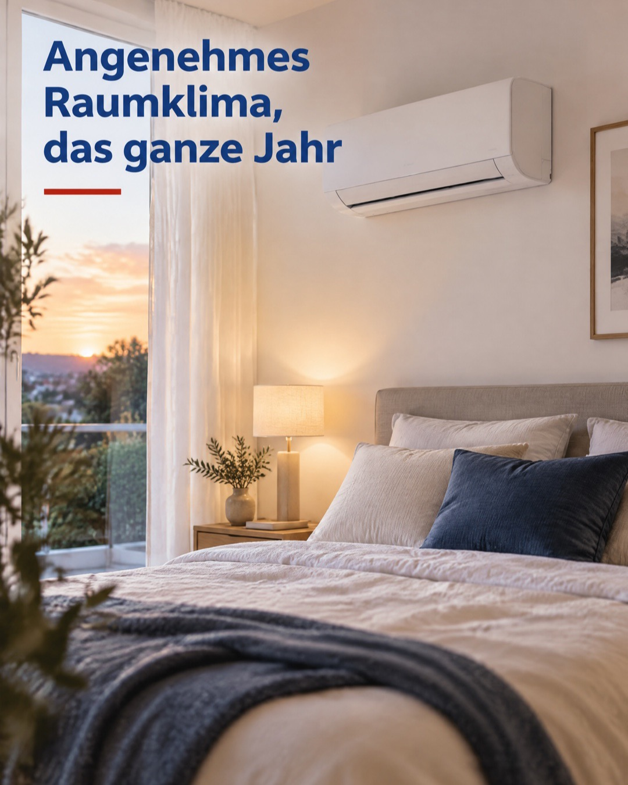 [BE-014](prompts.md#be-014) Raumklima | Klimageräte und Wohnraumlüftung sorgen für frische Luft und angenehme Temperaturen. Wir beraten Sie zu dezentralen und zentralen Lösungen. Symbolbild. | [BE-065](prompts.md#be-065) Story-Umfrage: Alter der Heizung ✋ |
| Do 05.11.2026 | 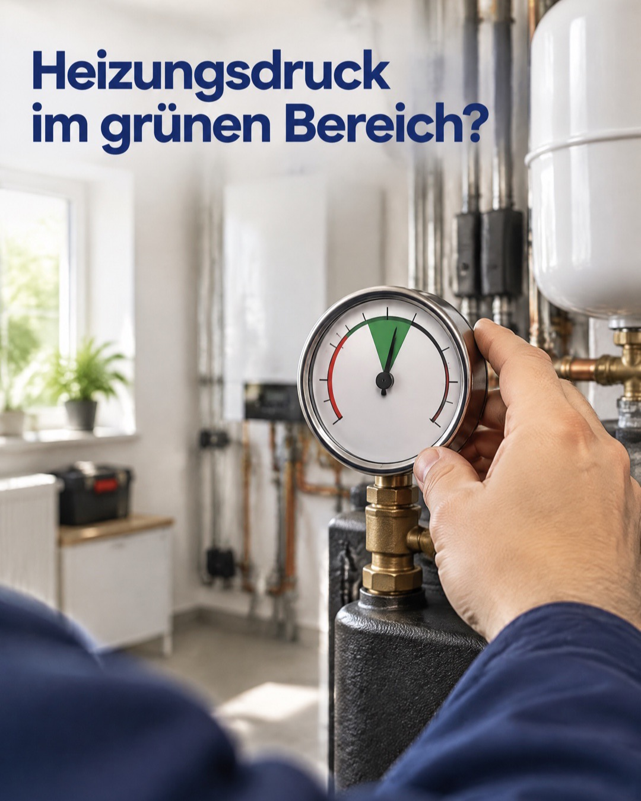 [BE-049](prompts.md#be-049) Heizungsdruck prüfen | Fällt der Druck oft ab, sollte ein Fachbetrieb nachsehen. Symbolbild. Termin anfragen: Link in Bio. |  |
| Fr 06.11.2026 | 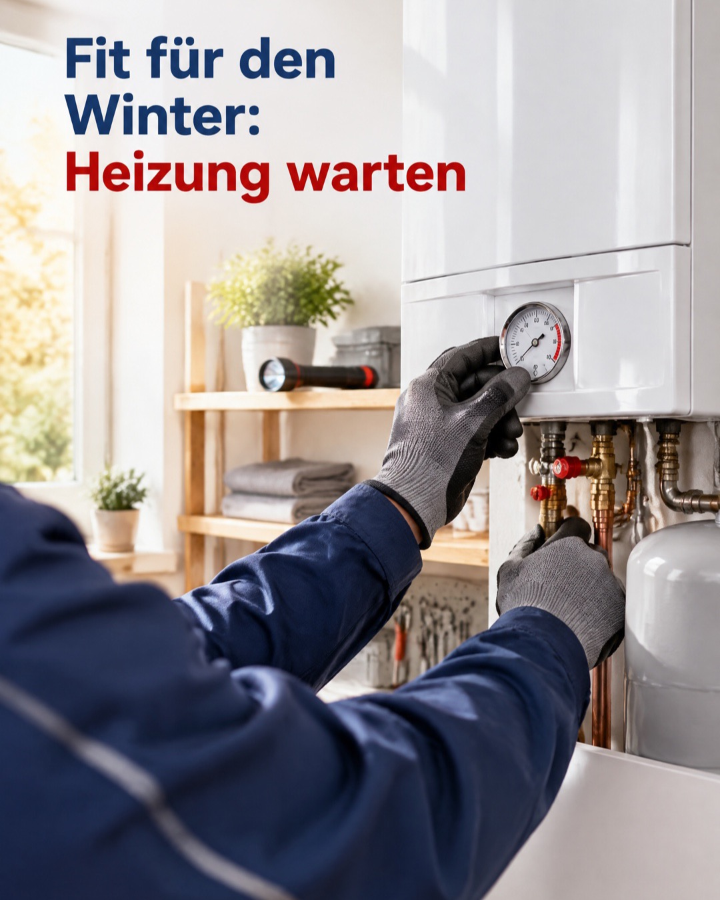 [BE-005](prompts.md#be-005) Heizungswartung | Eine regelmäßige Wartung hält Ihre Heizung effizient und beugt Ausfällen in der kalten Jahreszeit vor. Wir warten Ihre Anlage in Wetzlar und Umgebung. Symbolbild. Termin online anfragen: Link in Bio. | [BE-123](prompts.md#be-123) Story: Heizungswartung |
| Sa 07.11.2026 | 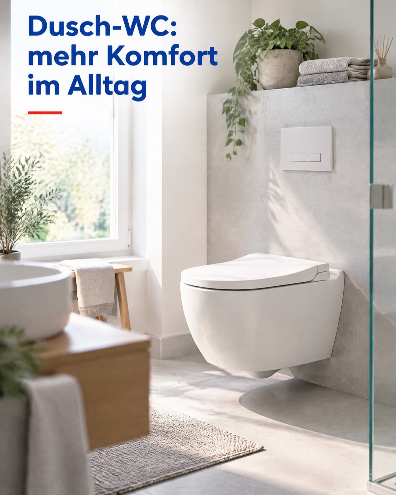 [BE-050](prompts.md#be-050) Dusch-WC | Wir beraten Sie zu Dusch-WCs und bauen sie ein. Symbolbild. Termin anfragen: Link in Bio. | [BE-066](prompts.md#be-066) Story-Umfrage: Wanne oder Dusche ✋ |
| So 08.11.2026 | 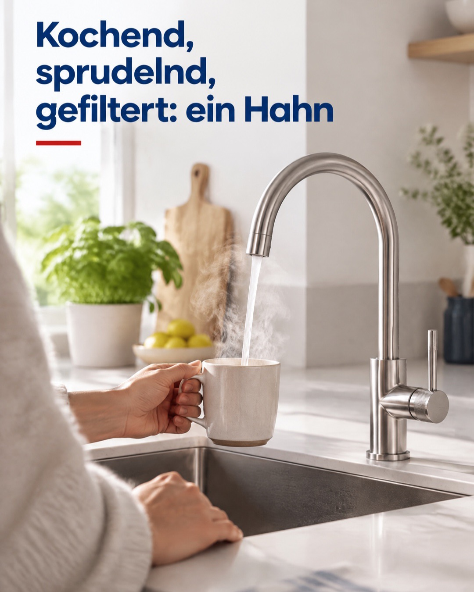 [BE-054](prompts.md#be-054) Multifunktionsarmatur Küche | Wir bieten Multifunktionsarmaturen für Ihre Küche an. Symbolbild. Termin anfragen: Link in Bio. |  |
| Mo 09.11.2026 | 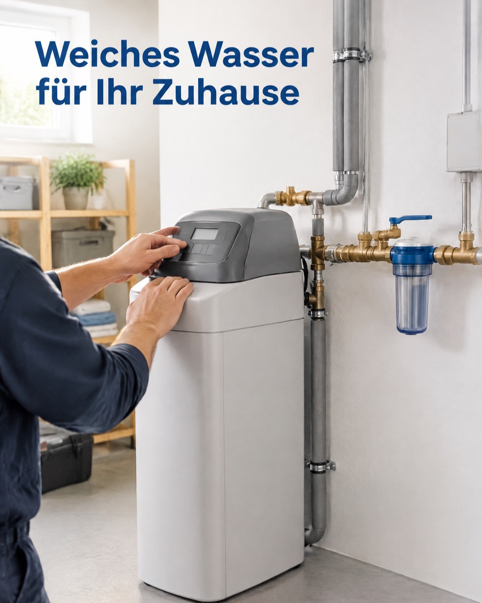 [BE-055](prompts.md#be-055) Weiches Wasser | Wir installieren Filter und Enthärtungsanlagen direkt am Hausanschluss. Symbolbild. Termin anfragen: Link in Bio. |  |
| Di 10.11.2026 | 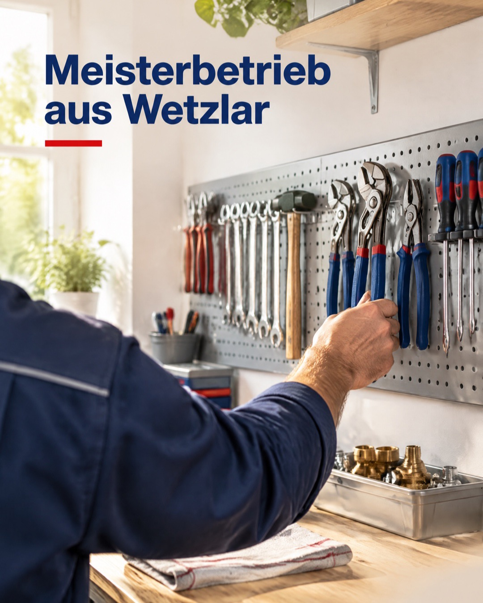 [BE-058](prompts.md#be-058) Meisterbetrieb aus Wetzlar | Wir sind anerkannter Fachbetrieb, Meisterbetrieb und Ausbildungsbetrieb. Symbolbild. Termin anfragen: Link in Bio. | [BE-067](prompts.md#be-067) Story: Termin anfragen ✋ |
| Mi 11.11.2026 | 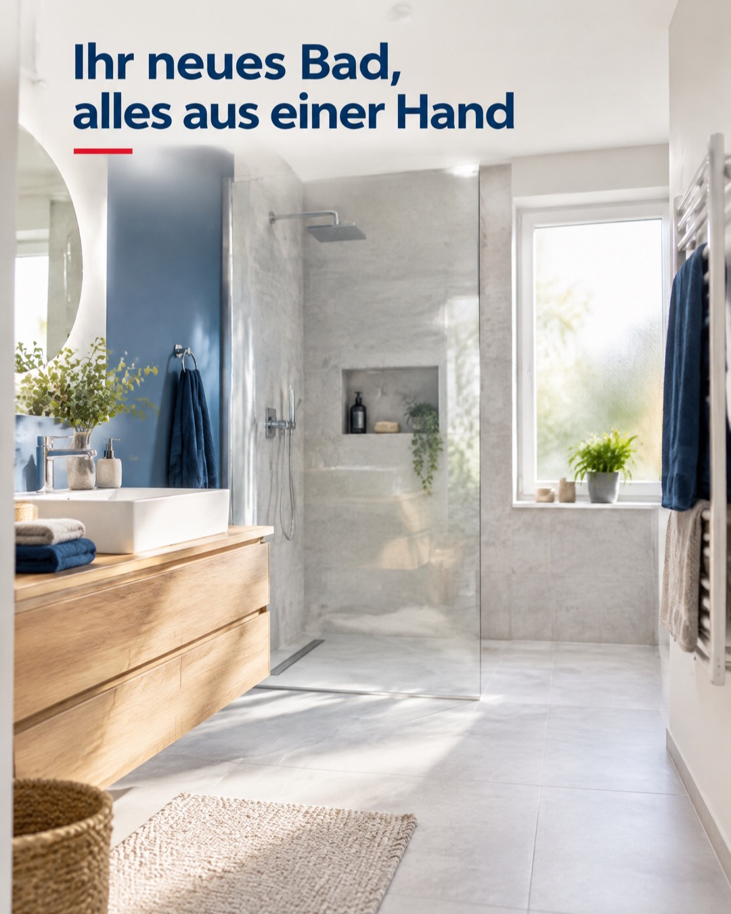 [BE-007](prompts.md#be-007) Bad aus einer Hand | Von der ersten Planung bis zur fertigen Umsetzung begleiten wir Ihr Badprojekt. Vorab bekommen Sie eine detaillierte Planung und eine transparente Kostenaufstellung. Symbolbild. Badanfrage starten: Link in Bio. | [BE-124](prompts.md#be-124) Story: Bad aus einer Hand |
| Do 12.11.2026 | 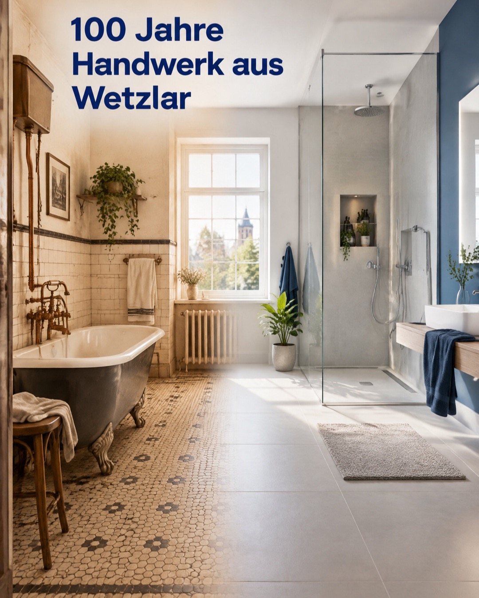 [BE-001](prompts.md#be-001) 100 Jahre: Hauptmotiv ⚠️ | 1926 gründete SHK-Meister Karl Schmidt in der Wetzlarer Hintergasse den Betrieb, aus dem die Bad & Energie GmbH Lahn-Dill wurde. 100 Jahre später planen und bauen wir Bäder und Heizungen für die ganze Region. Danke für Ihr Vertrauen! Symbolbild. Termin anfragen: Link in Bio. | [BE-120](prompts.md#be-120) Story: 100 Jahre: Hauptmotiv ⚠️ |
| Fr 13.11.2026 | 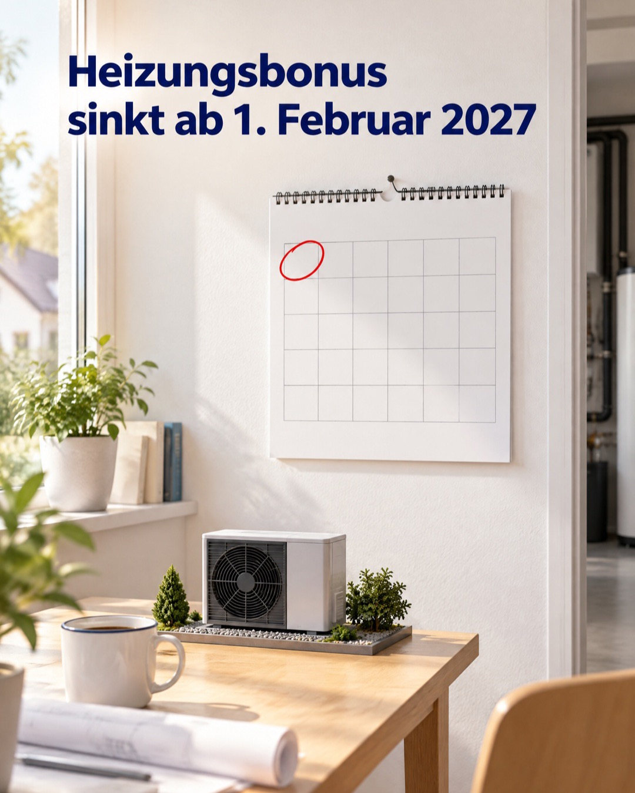 [BE-004](prompts.md#be-004) Stichtag Heizungsbonus ⚠️ | Wer seine Ölheizung, Nachtspeicherheizung oder eine mindestens 20 Jahre alte Gasheizung tauscht und selbst im Haus wohnt, kann bei der KfW aktuell 16 % Klimageschwindigkeitsbonus bekommen (Stand 29.10.2026). Für Anträge ab dem 1.2.2027 sinkt er auf 12 %, danach halbjährlich weiter. Jetzt planen, wir helfen beim Antrag. | [BE-122](prompts.md#be-122) Story: Stichtag Heizungsbonus ⚠️ |
| Sa 14.11.2026 | 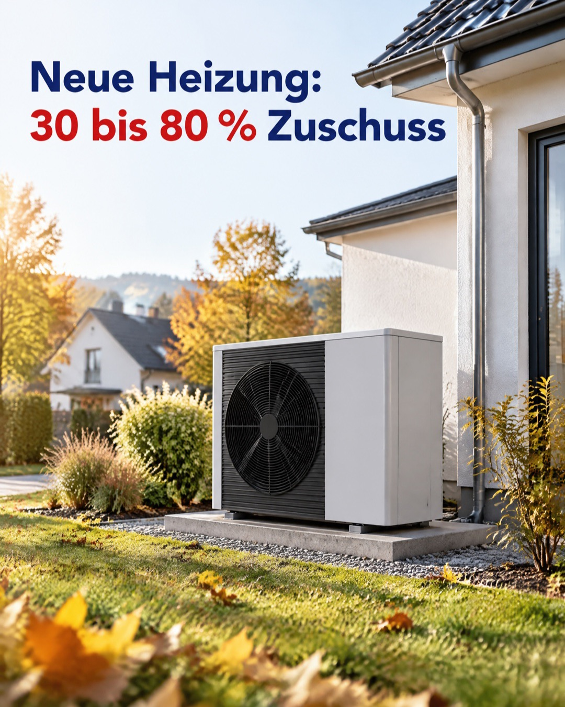 [BE-003](prompts.md#be-003) Heizungsförderung ⚠️ | Für eine neue klimafreundliche Heizung wie die Wärmepumpe zahlt die KfW (Programm 458) 30 % Grundförderung. Wer selbst im Haus wohnt, kann Boni bekommen, je nach Einkommen bis zu 80 % der förderfähigen Kosten (Stand 29.10.2026). Wichtig: Antrag vor Baubeginn. Wir beraten Sie und erstellen das Angebot. Symbolbild. | [BE-121](prompts.md#be-121) Story: Heizungsförderung ⚠️ |
| So 15.11.2026 | 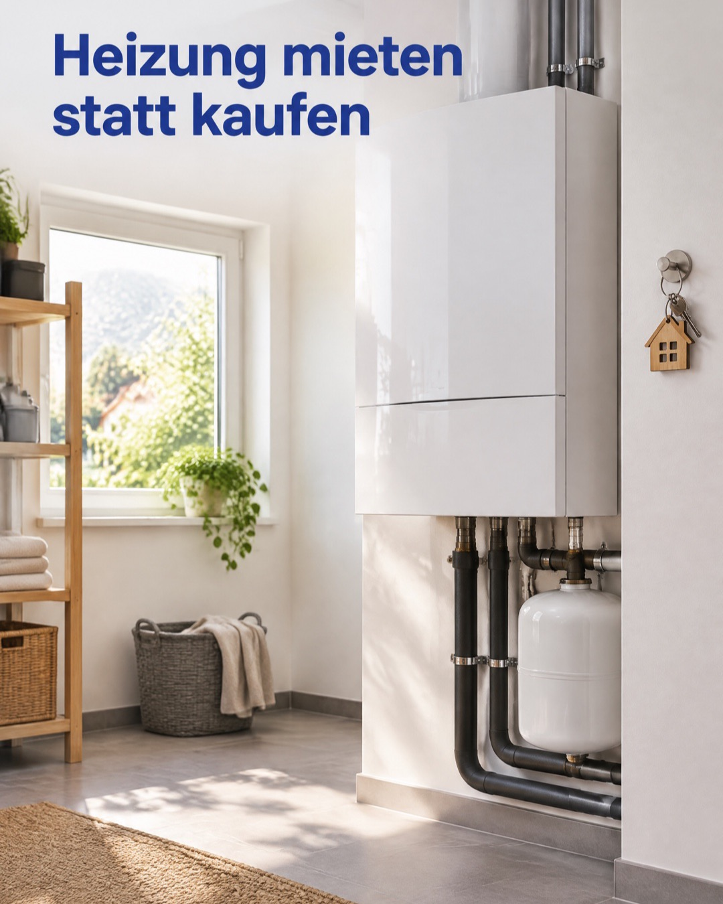 [BE-006](prompts.md#be-006) Heizung mieten ⚠️ | Mit dem Mietmodell bekommen Sie eine neue Heizung, ohne die Anschaffung auf einen Schlag zu bezahlen. Symbolbild. Wie das Modell funktioniert und was es enthält, erklären wir Ihnen persönlich: 06441-42956. | [BE-068](prompts.md#be-068) Story: 100 Jahre Bad & Energie ⚠️ ✋ |
| Mo 16.11.2026 | 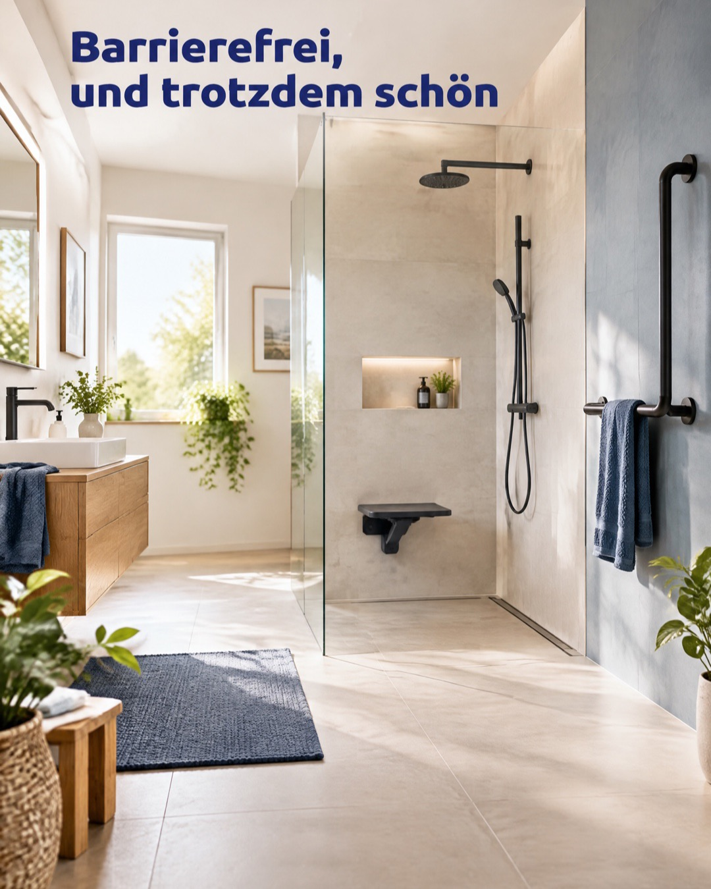 [BE-009](prompts.md#be-009) Barrierefrei und schön | Ein Bad ohne Stufen und Schwellen macht den Alltag sicherer, in jedem Alter. Wir planen barrierefreie Bäder, die nach Wohnraum aussehen und nicht nach Klinik. Symbolbild. | [BE-125](prompts.md#be-125) Story: Barrierefrei und schön |
| Di 17.11.2026 | 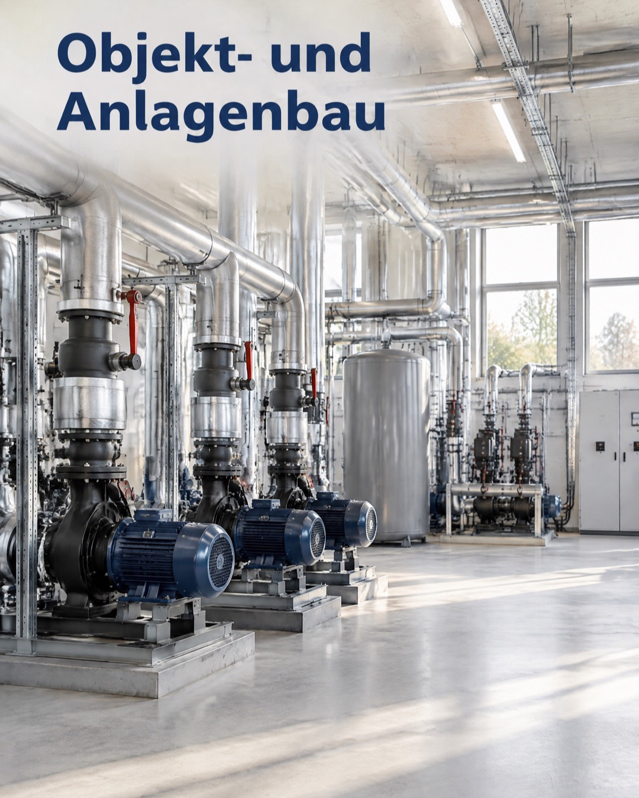 [BE-060](prompts.md#be-060) Objekt- und Anlagenbau | Wir bieten Objekt- und Anlagenbau für Industrie, Behörden und Kommunen an. Symbolbild. Termin anfragen: Link in Bio. |  |
| Mi 18.11.2026 | 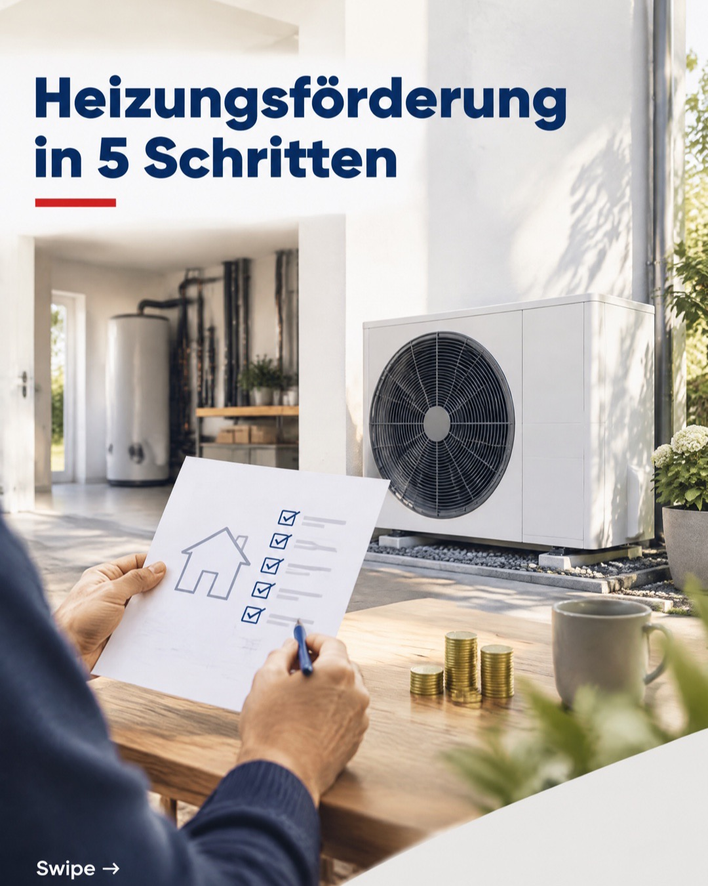 [BE-028](prompts.md#be-028) Heizungsförderung in 5 Schritten (Karussell, 7 Bilder) ⚠️ | So kommen Sie an die KfW-Heizungsförderung. Wichtig ist die Reihenfolge, denn der Antrag muss vor Baubeginn gestellt sein (Stand 29.10.2026). Wir erstellen Ihr Angebot und behalten die Fristen mit Ihnen im Blick. | [BE-089](prompts.md#be-089) Story-Quiz: Förderantrag vor Baubeginn ⚠️ ✋ |
| Do 19.11.2026 | 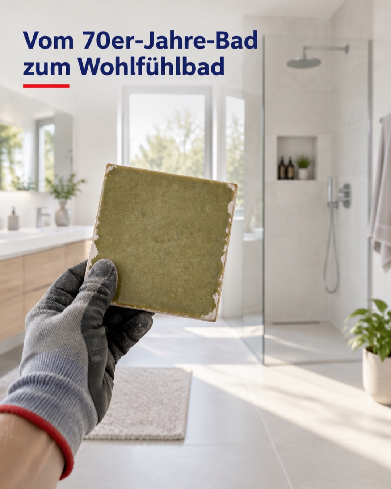 [BE-097](prompts.md#be-097) Vom 70er-Jahre-Bad zum Wohlfühlbad | Olivgrüne Fliesen und ein farbiges Waschbecken? Auch ein Bad aus den 70er-Jahren lässt sich in ein helles, modernes Bad verwandeln (Symbolbild). Gern planen wir mit Ihnen, wie Ihr neues Bad aussehen kann. Badanfrage starten: Link in Bio. |  |
| Fr 20.11.2026 | 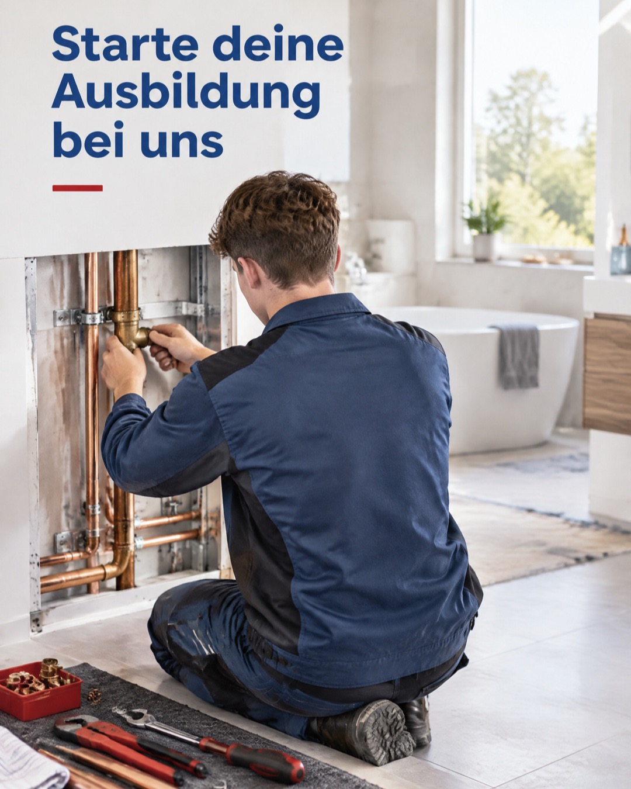 [BE-016](prompts.md#be-016) Ausbildung ⚠️ | Wir sind Ausbildungsbetrieb: Bad, Heizung, Wärmepumpe, ein Handwerk mit Zukunft in einem Betrieb mit 100 Jahren Erfahrung. Symbolbild. Alle Infos und Bewerbung: Link in Bio. | [BE-126](prompts.md#be-126) Story: Ausbildung ⚠️ |
| Sa 21.11.2026 | 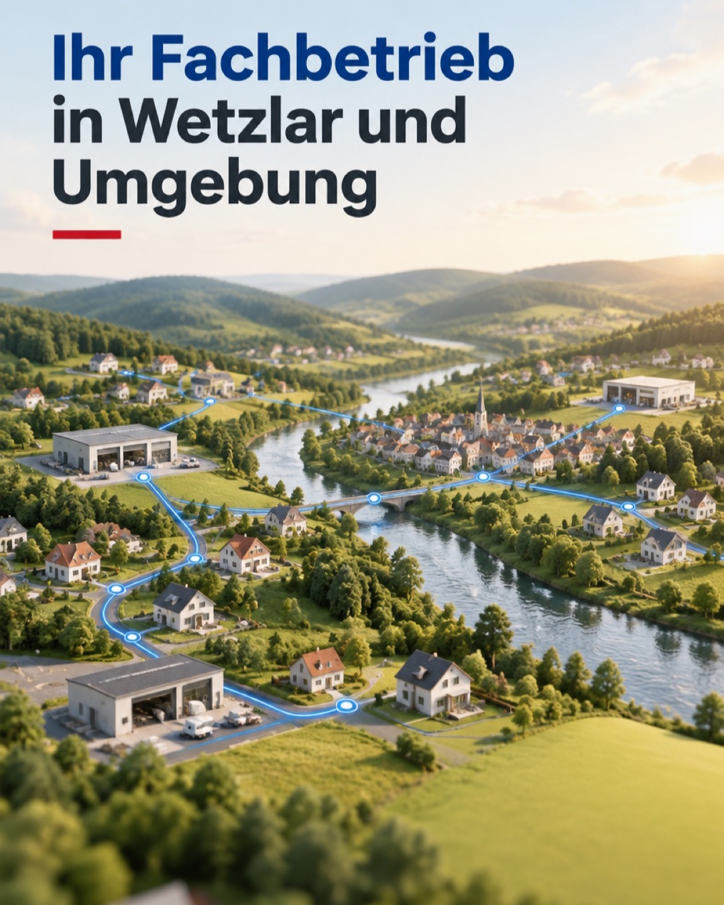 [BE-110](prompts.md#be-110) Fachbetrieb in Wetzlar und Umgebung | Ob Wetzlar, Solms, Hüttenberg, Aßlar oder Lahnau: Wir planen und bauen Bäder, Heizungen und Haustechnik für Ihr Zuhause in der Region (Symbolbild). Fragen Sie Ihren Termin online an, wir melden uns zeitnah bei Ihnen: Link in Bio. | [BE-099](prompts.md#be-099) Story-Umfrage: Fliesen hell oder dunkel ✋ |
| So 22.11.2026 | 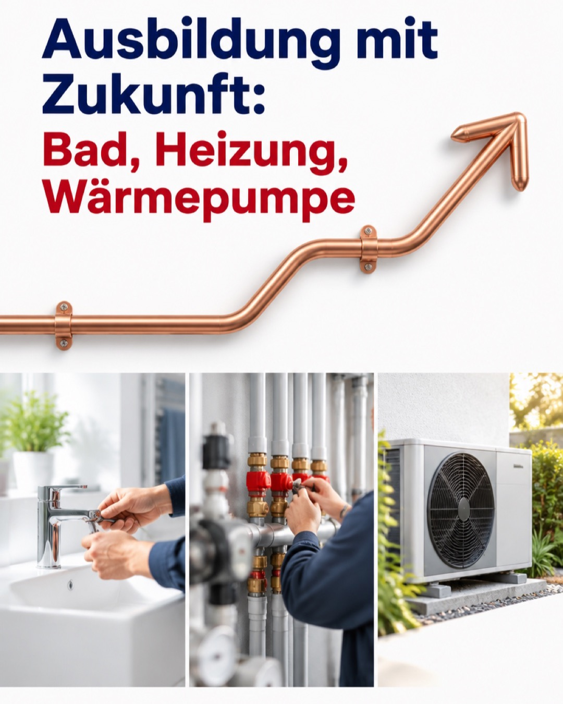 [BE-112](prompts.md#be-112) Ausbildung mit Zukunft ⚠️ | Bei uns lernst du das SHK-Handwerk in einem Betrieb mit 100 Jahren Erfahrung. Mit Bad, Heizung und Wärmepumpe sorgst du dafür, dass Häuser warm und Bäder schön werden. Alle Infos und Bewerbung: Link in Bio. |  |
| Mo 23.11.2026 | 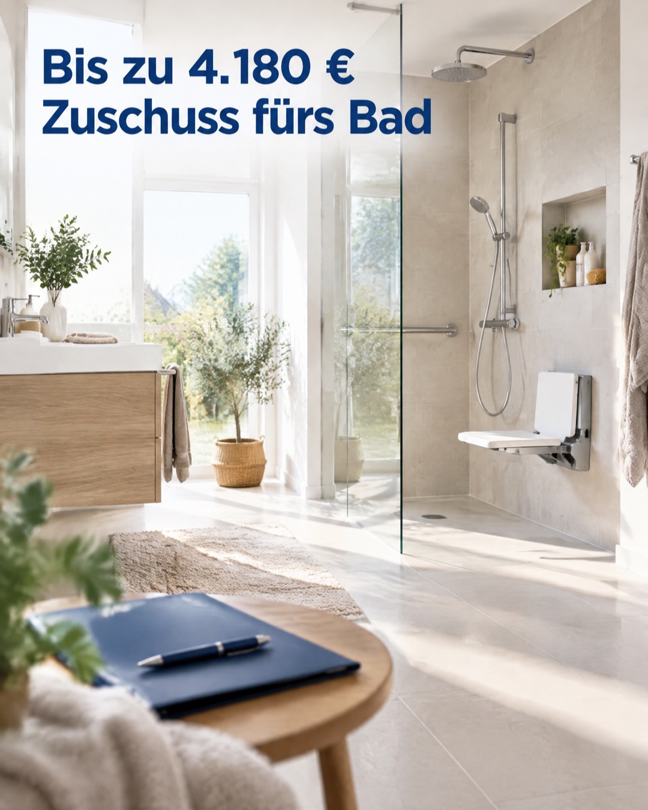 [BE-010](prompts.md#be-010) Zuschuss der Pflegekasse ⚠️ | Mit anerkanntem Pflegegrad (1–5) zahlt die Pflegekasse für wohnumfeldverbessernde Maßnahmen bis zu 4.180 € pro Person (Stand 29.10.2026), zum Beispiel für die bodengleiche Dusche statt Wanne. Stellen Sie den Antrag möglichst vor Beginn der Arbeiten, das Angebot dafür bekommen Sie von uns. Symbolbild. |  |
| Di 24.11.2026 | 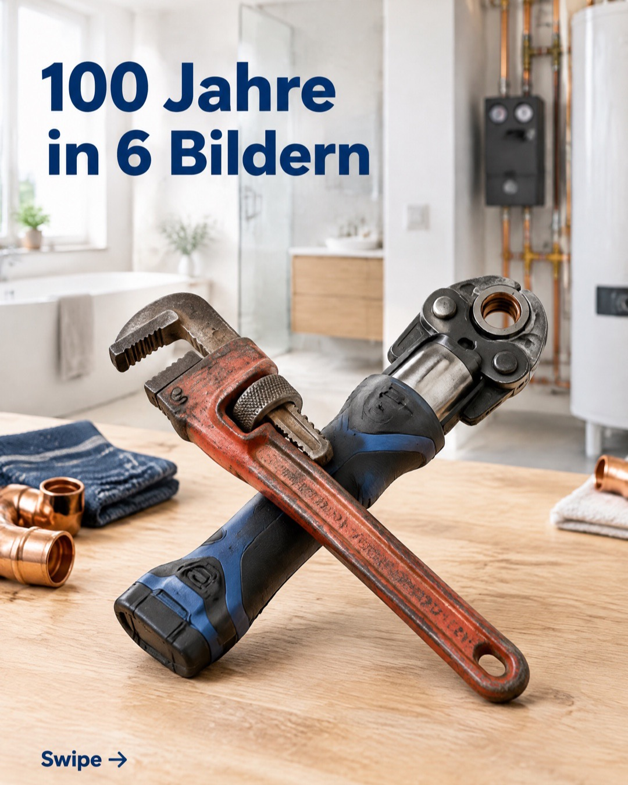 [BE-021](prompts.md#be-021) 100 Jahre in 6 Bildern (Karussell, 7 Bilder) ⚠️ | Von der Werkstatt in der Hintergasse bis zur Wärmepumpe: 100 Jahre Handwerk aus Wetzlar in sechs Bildern. Symbolbilder. Danke, dass Sie uns so lange begleiten! | [BE-100](prompts.md#be-100) Story: Zuschuss mit Pflegegrad ⚠️ ✋ |
| Mi 25.11.2026 | 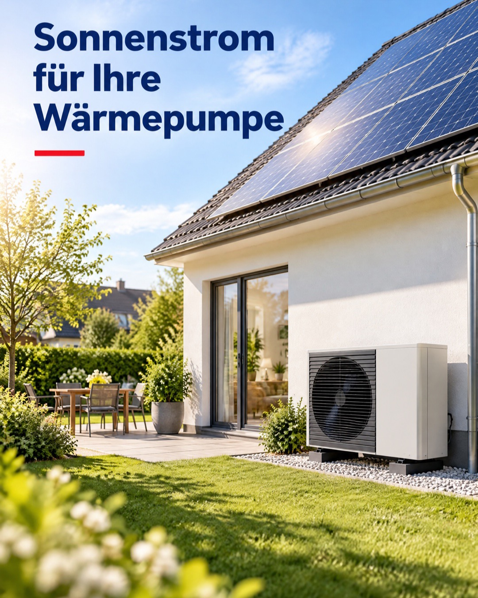 [BE-012](prompts.md#be-012) Wärmepumpe und Photovoltaik | Wer Photovoltaik und Wärmepumpe kombiniert, nutzt eigenen Strom fürs Heizen und für Warmwasser. Wir planen Haustechnik, die zusammenpasst. Symbolbild. |  |
| Do 26.11.2026 | 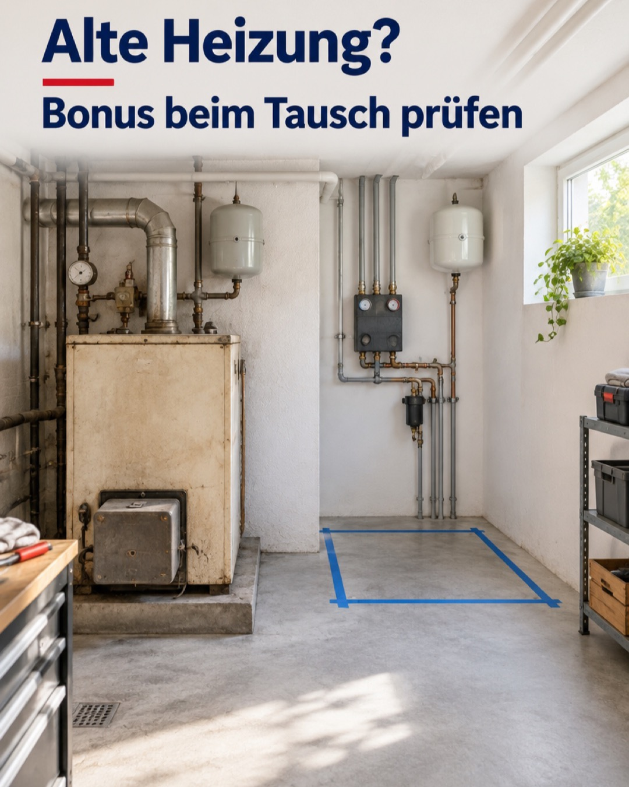 [BE-083](prompts.md#be-083) Klimageschwindigkeitsbonus: Wer ihn bekommt ⚠️ | Heizungstausch im Bestand (Symbolbild): Wer selbst im Haus wohnt und eine Ölheizung, eine Nachtspeicherheizung oder eine mindestens 20 Jahre alte Gasheizung tauscht, kann bei der KfW den Klimageschwindigkeitsbonus bekommen (Stand 29.10.2026). Ob das für Ihre Anlage gilt, prüfen wir gern mit Ihnen und erstellen das Angebot. Termin anfragen: Link in Bio. |  |
| Fr 27.11.2026 | 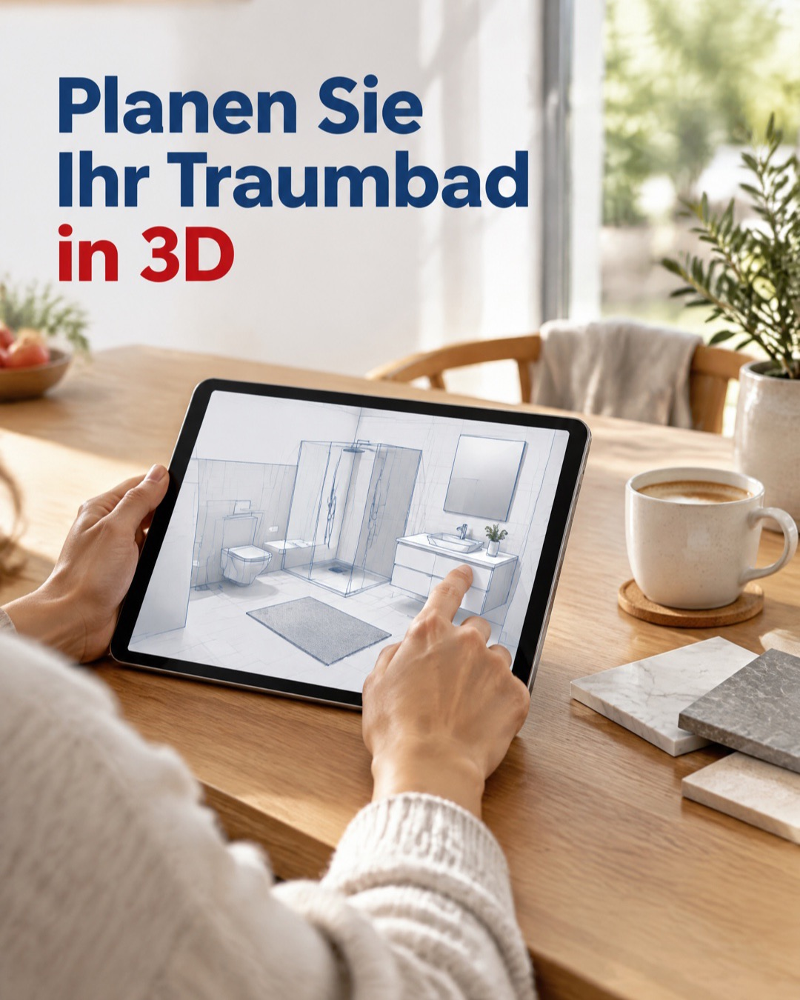 [BE-008](prompts.md#be-008) 3D-Badplaner | Mit dem 3D-Badplaner auf unserer Website gestalten Sie Ihr Bad am Bildschirm und bringen Ihre Ideen direkt ins Beratungsgespräch mit. Link in Bio. | [BE-105](prompts.md#be-105) Story-Umfrage: Photovoltaik ✋ |
| Sa 28.11.2026 | 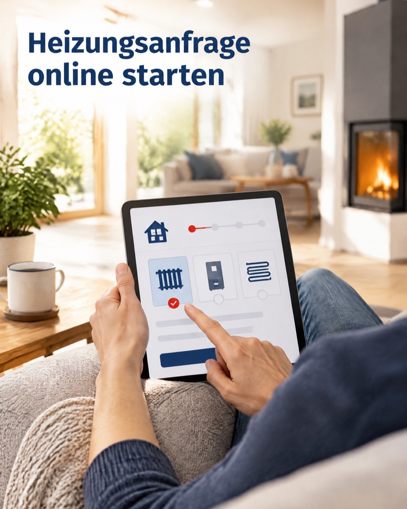 [BE-042](prompts.md#be-042) Heizungsanfrage online | Der Heizungsanfrage-Assistent auf unserer Website fragt die wichtigsten Punkte ab. Termin anfragen: Link in Bio. |  |
| So 29.11.2026 |  [BE-116](prompts.md#be-116) Erster Advent | Wir wünschen Ihnen einen gemütlichen ersten Advent und ein warmes Zuhause. Wird es bei Ihnen nicht richtig warm, rufen Sie uns an: 06441-42956. |  |
| Mo 30.11.2026 | 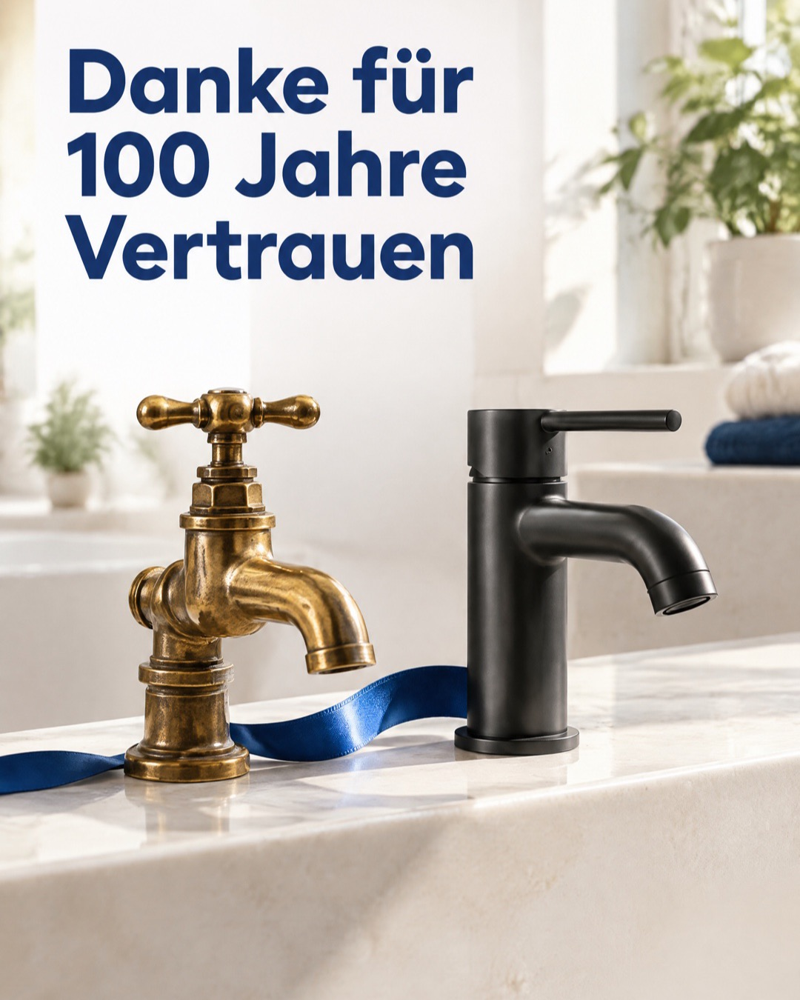 [BE-002](prompts.md#be-002) 100 Jahre: Danke ⚠️ | Seit 1926 lassen Familien in und um Wetzlar ihre Bäder und Heizungen von uns bauen. Dafür sagen wir Danke und freuen uns auf alles, was kommt. | [BE-108](prompts.md#be-108) Story-Quiz: Seit wann gibt es uns ⚠️ ✋ |
| Di 01.12.2026 | 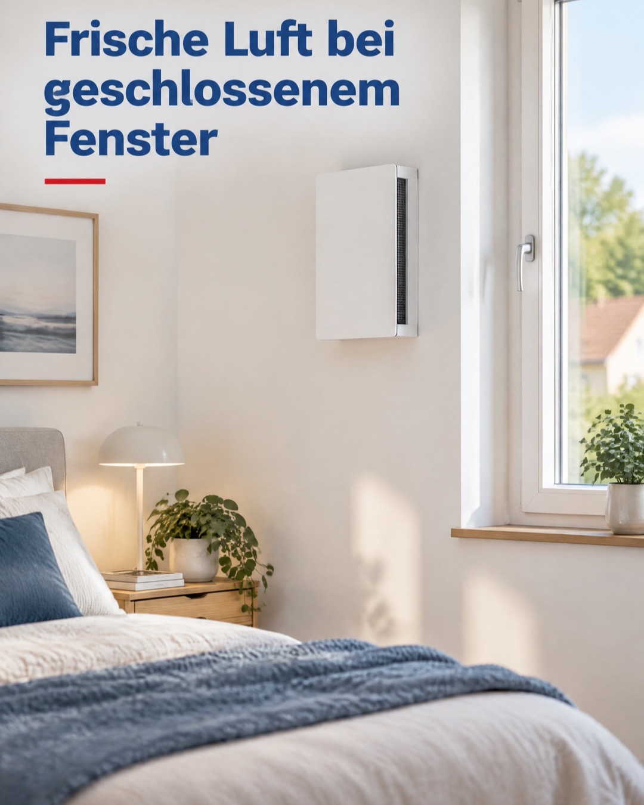 [BE-056](prompts.md#be-056) Dezentrale Lüftung | Dezentrale Wohnraumlüftung sorgt für Luftaustausch. Symbolbild. Termin anfragen: Link in Bio. |  |
| Mi 02.12.2026 | 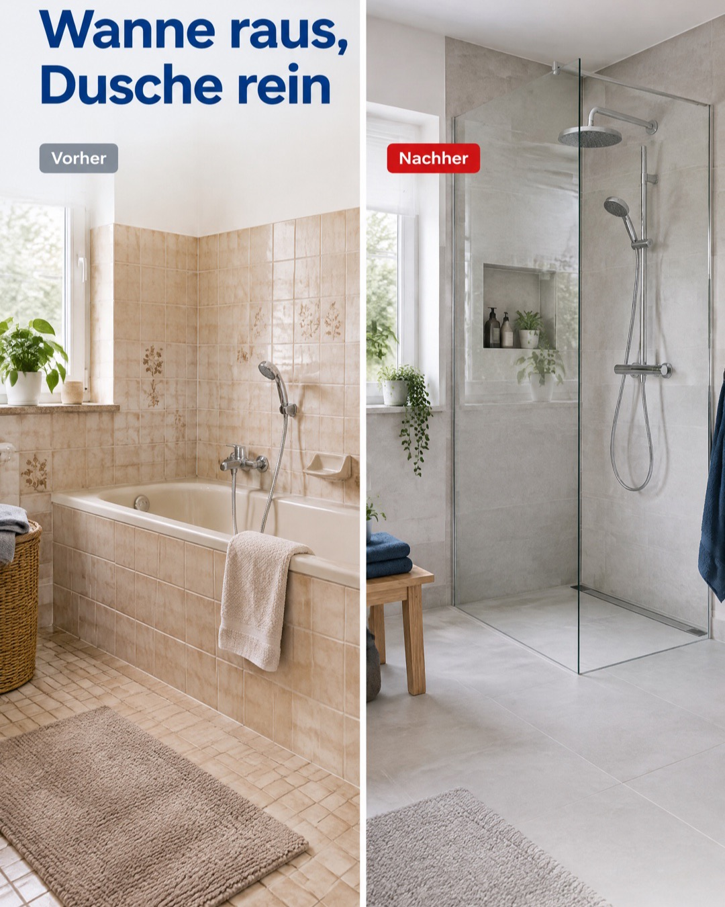 [BE-011](prompts.md#be-011) Wanne raus, Dusche rein | Symbolbild. Der Umbau von der Badewanne zur bodengleichen Dusche macht den Einstieg leichter und das Bad sicherer. Wir zeigen Ihnen, was in Ihrem Bad möglich ist. |  |
| Do 03.12.2026 | 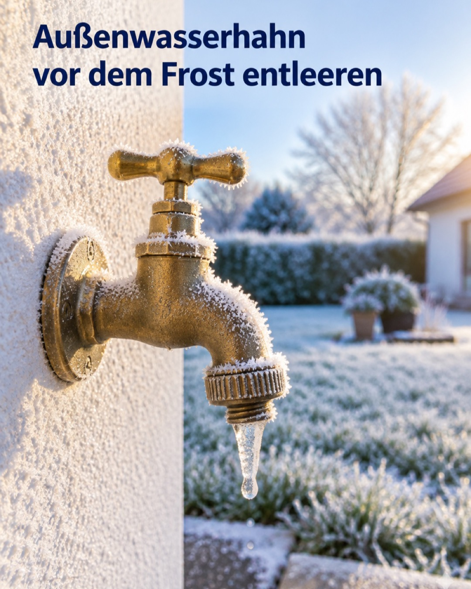 [BE-117](prompts.md#be-117) Außenwasserhahn winterfest machen | Schließen Sie vor dem ersten Frost das Absperrventil für den Außenwasserhahn im Haus und öffnen Sie den Hahn draußen, damit das Restwasser abläuft (Symbolbild). Das beugt Frostschäden an der Leitung vor. Bei Fragen erreichen Sie uns unter 06441-42956. | [BE-109](prompts.md#be-109) Story: Handwerk mit Zukunft ⚠️ ✋ |
| Fr 04.12.2026 | 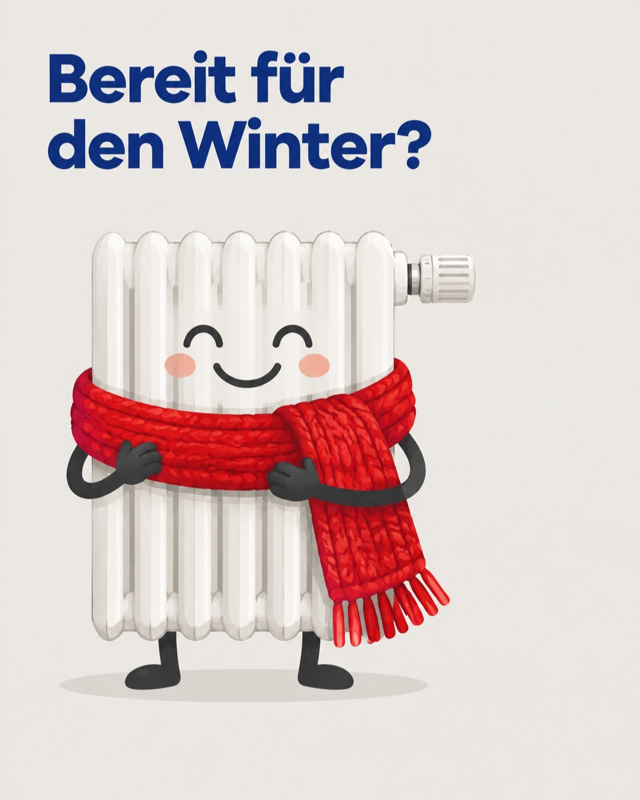 [BE-062](prompts.md#be-062) Bereit für den Winter? | Fragen Sie jetzt Ihren Wartungstermin an. Termin anfragen: Link in Bio. |  |
| Sa 05.12.2026 | 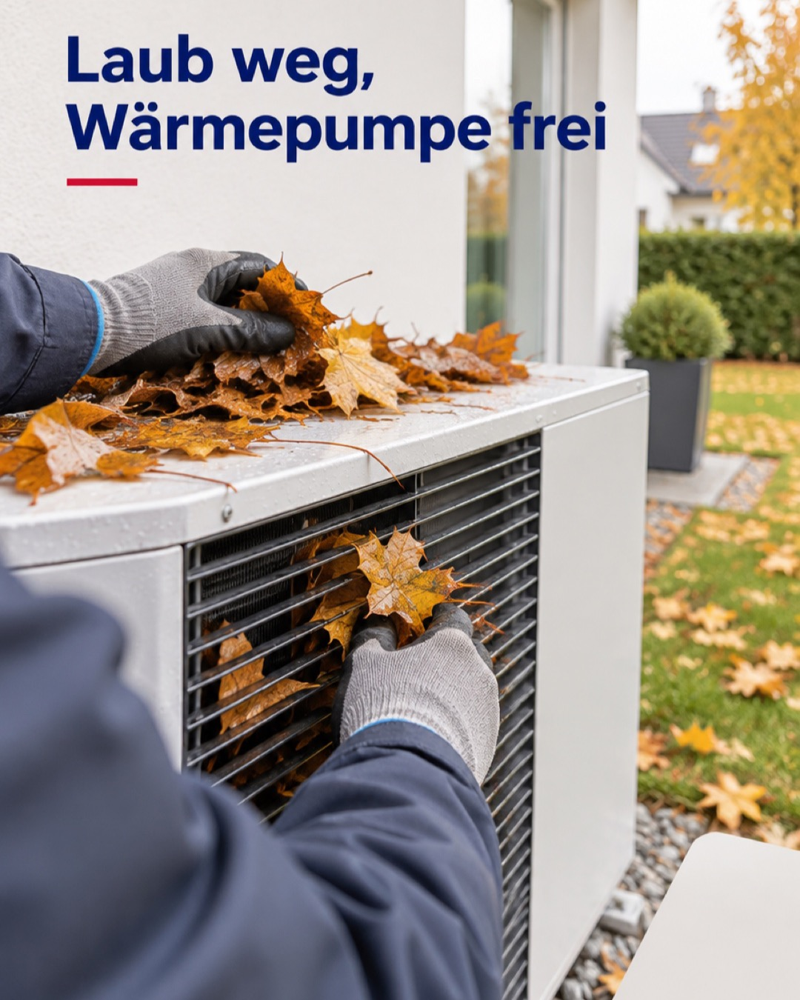 [BE-086](prompts.md#be-086) Laub weg, Wärmepumpe frei | Halten Sie die Außeneinheit Ihrer Wärmepumpe frei von Laub und Schnee, damit sie ungehindert Luft ansaugen kann (Symbolbild). Die regelmäßige Wartung Ihrer Anlage übernehmen wir. Termin anfragen: Link in Bio. |  |
| So 06.12.2026 | 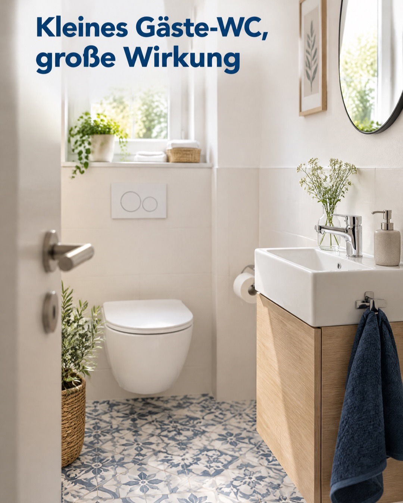 [BE-051](prompts.md#be-051) Kleines Gäste-WC | Auch kleine Räume lassen sich modern gestalten. Symbolbild. Termin anfragen: Link in Bio. |  |
| Mo 07.12.2026 | 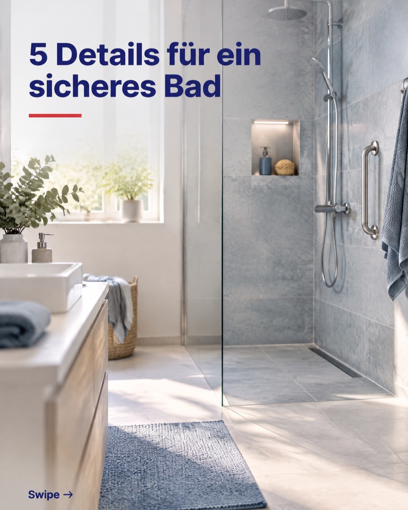 [BE-035](prompts.md#be-035) Barrierefreies Bad: 5 Details (Karussell, 7 Bilder) ⚠️ | Fünf Details, die ein Bad sicherer machen, ohne dass es nach Klinik aussieht. Mit Pflegegrad zahlt die Pflegekasse bis zu 4.180 € dazu (Stand 29.10.2026). Symbolbilder. |  |
| Di 08.12.2026 | 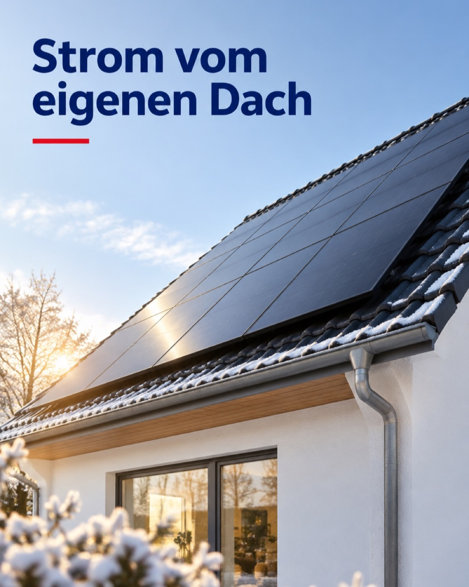 [BE-101](prompts.md#be-101) Photovoltaik auf dem eigenen Dach | Mit einer Photovoltaikanlage erzeugen Sie Strom auf Ihrem eigenen Dach (Symbolbild). Wir planen die Anlage so, dass sie zu Ihrer Haustechnik passt, etwa zur Wärmepumpe. Termin anfragen: Link in Bio. |  |
| Mi 09.12.2026 | 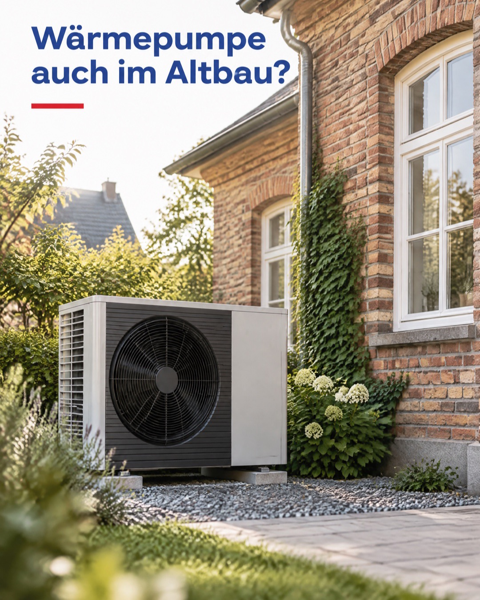 [BE-043](prompts.md#be-043) Wärmepumpe im Altbau | Ob Ihr Haus passt, prüfen wir vor Ort. Symbolbild. Termin anfragen: Link in Bio. |  |
| Do 10.12.2026 | 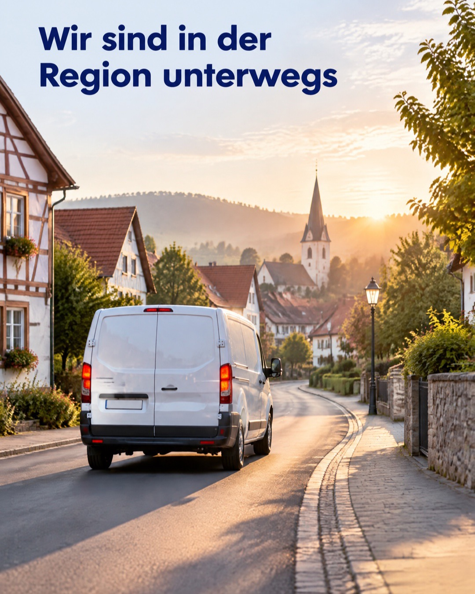 [BE-059](prompts.md#be-059) In der Region unterwegs | Wir sind für Sie in Wetzlar, Solms, Hüttenberg, Aßlar, Lahnau und Umgebung unterwegs. Symbolbild. Termin anfragen: Link in Bio. |  |
| Fr 11.12.2026 | 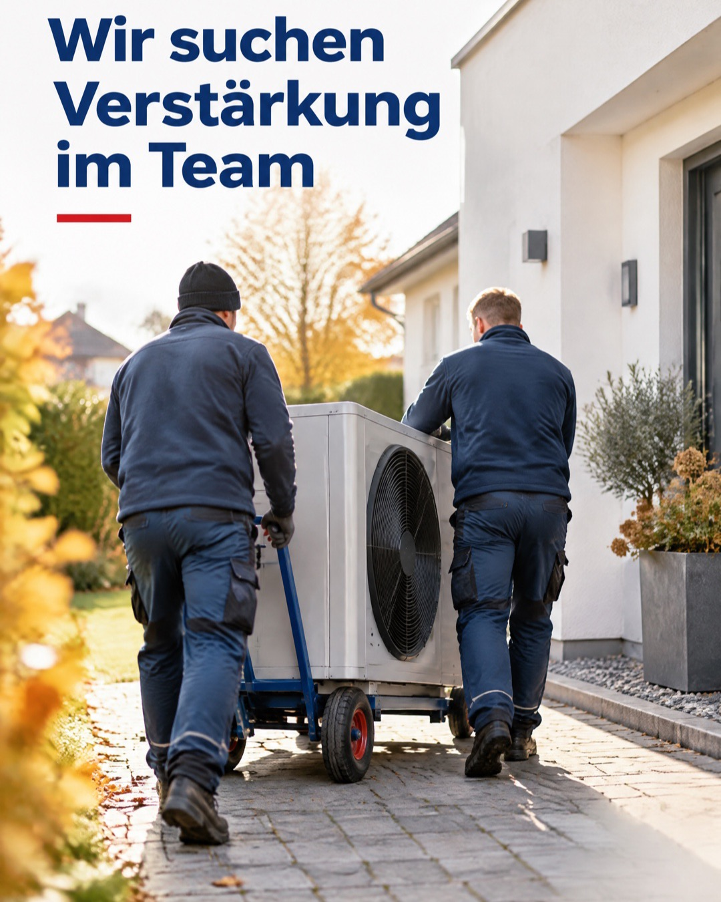 [BE-017](prompts.md#be-017) Verstärkung gesucht ⚠️ | Für Bad, Heizung und Haustechnik suchen wir Verstärkung in Wetzlar. Symbolbild. Alle offenen Stellen: Link in Bio. |  |
| Sa 12.12.2026 | 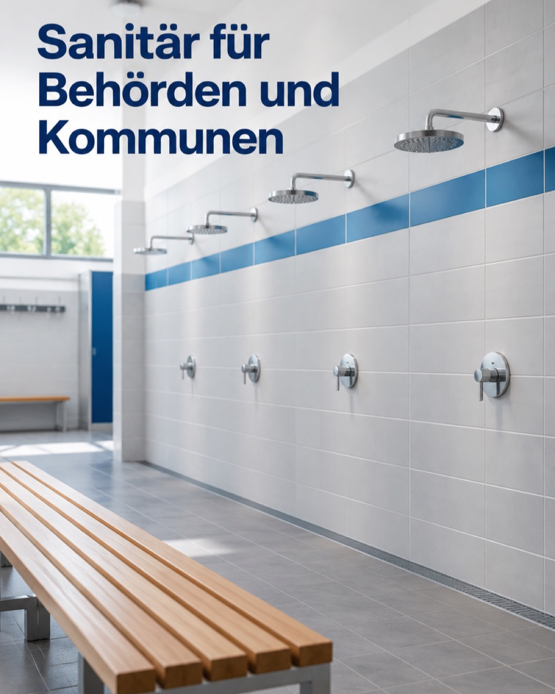 [BE-106](prompts.md#be-106) Sanitär für Behörden und Kommunen | Für Behörden und Kommunen planen und bauen wir Sanitär- und Heizsysteme in öffentlichen Gebäuden (Symbolbild). Gern besprechen wir Ihr Vorhaben persönlich. Telefon: 06441-42956. |  |
| So 13.12.2026 | 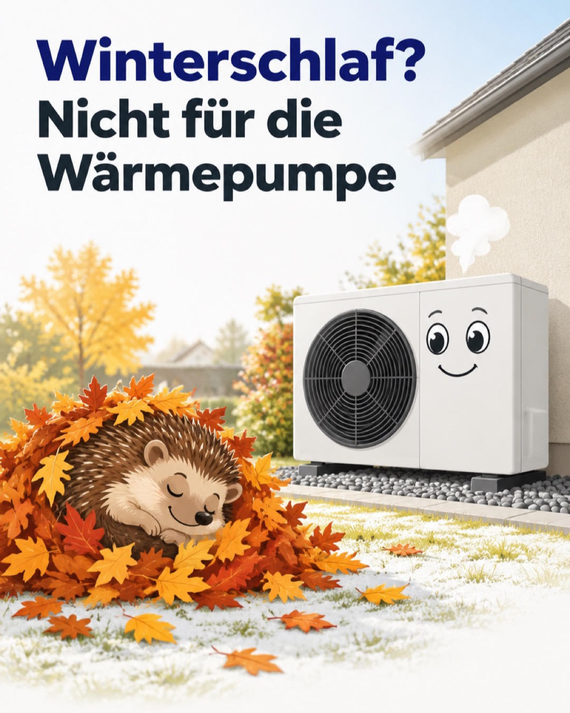 [BE-115](prompts.md#be-115) Wärmepumpe ohne Winterschlaf | Während der Igel den Winter verschläft, heizt Ihre Wärmepumpe Tag für Tag weiter. Mit regelmäßiger Wartung bleibt sie fit, wir kümmern uns darum. Termin anfragen: Link in Bio. |  |
| Mo 14.12.2026 | 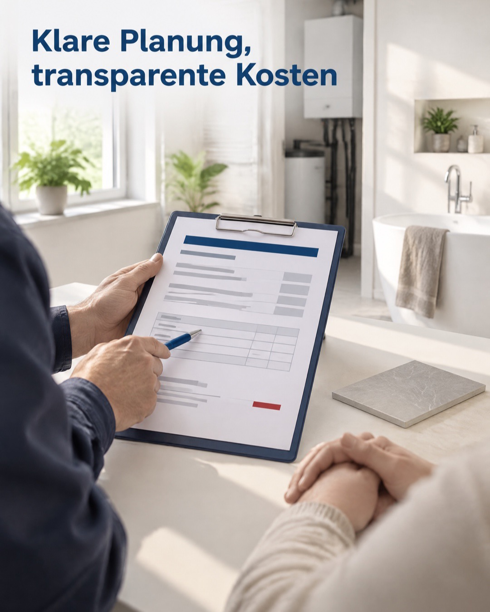 [BE-020](prompts.md#be-020) Transparente Kosten | Bevor es losgeht, erhalten Sie von uns eine detaillierte Planung und eine transparente Kostenaufstellung. So entscheiden Sie in Ruhe. |  |
| Di 15.12.2026 | 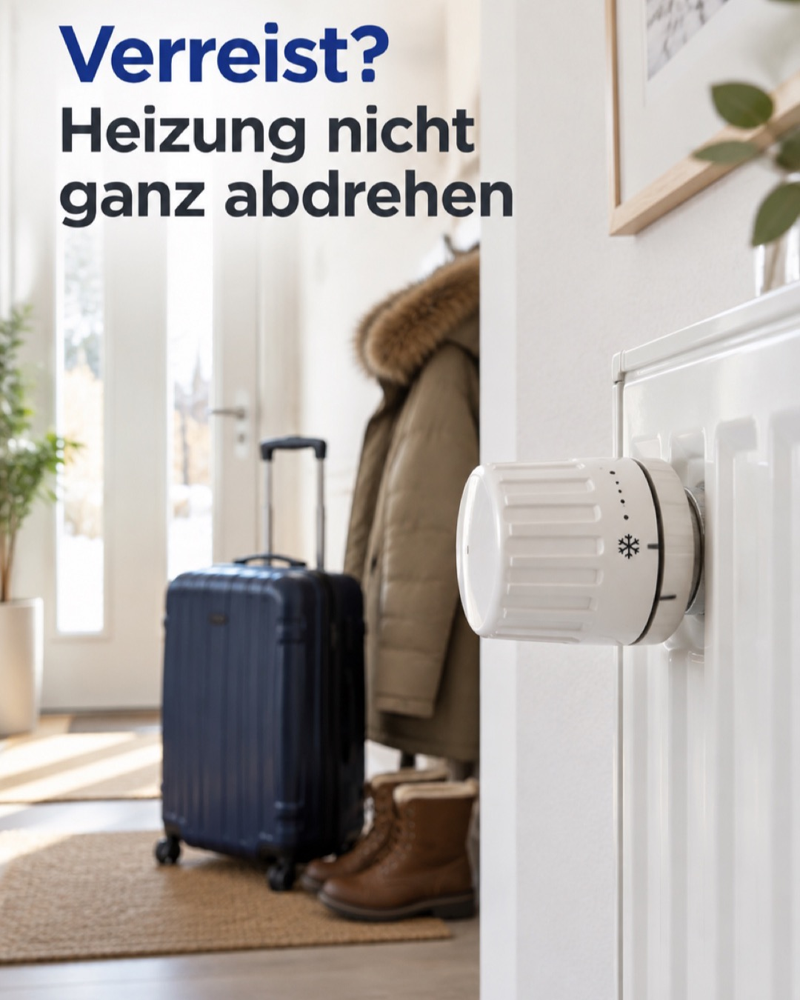 [BE-118](prompts.md#be-118) Heizung bei Abwesenheit | Wenn Sie über die Feiertage verreisen, drehen Sie die Heizung nicht ganz ab, sondern stellen Sie die Thermostate auf Frostschutz oder eine niedrige Stufe (Symbolbild). So kühlen Räume und Leitungen nicht zu stark aus. Fragen zur Heizung: 06441-42956. |  |
| Mi 16.12.2026 |  [BE-004](prompts.md#be-004) Stichtag Heizungsbonus ⚠️ (Wiederholung) | Wer seine Ölheizung, Nachtspeicherheizung oder eine mindestens 20 Jahre alte Gasheizung tauscht und selbst im Haus wohnt, kann bei der KfW aktuell 16 % Klimageschwindigkeitsbonus bekommen (Stand 29.10.2026). Für Anträge ab dem 1.2.2027 sinkt er auf 12 %, danach halbjährlich weiter. Jetzt planen, wir helfen beim Antrag. |  |
| Do 17.12.2026 | 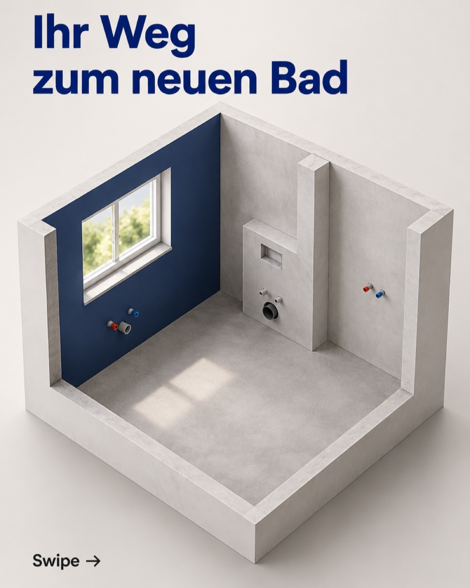 [BE-069](prompts.md#be-069) Ihr Weg zum neuen Bad (Karussell, 7 Bilder) | Vom ersten Entwurf im 3D-Badplaner bis zum fertigen Bad begleiten wir Ihr Projekt Schritt für Schritt (Symbolbilder). Vorab erhalten Sie eine detaillierte Planung und eine transparente Kostenaufstellung. Badanfrage starten: Link in Bio. |  |
| Fr 18.12.2026 | 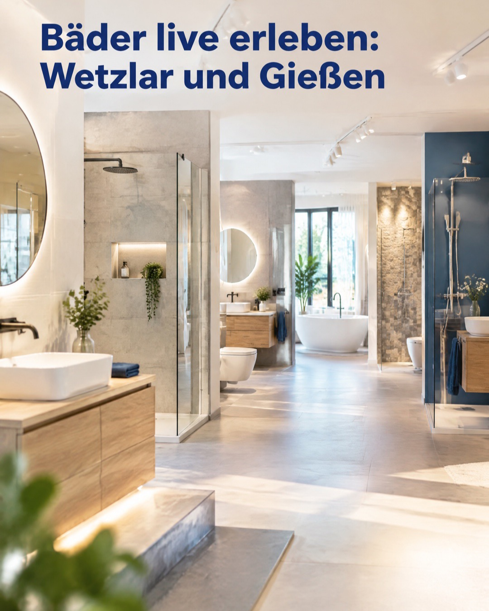 [BE-019](prompts.md#be-019) Badausstellung | In den Ausstellungen in Wetzlar und Gießen sehen Sie Bäder, Materialien und Armaturen vor Ort. Symbolbild. Vereinbaren Sie einen Termin, wir beraten Sie dort persönlich. |  |
| Sa 19.12.2026 | 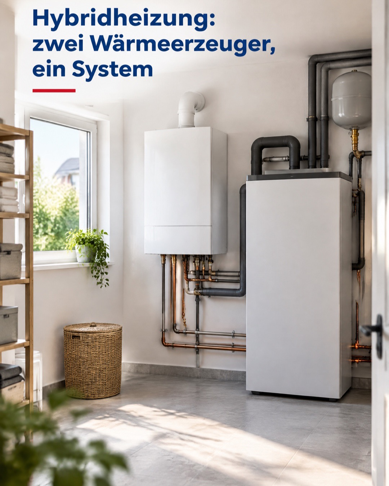 [BE-044](prompts.md#be-044) Hybridheizung | In Spitzenlastzeiten springt der Brennwertkessel ein. Symbolbild. Termin anfragen: Link in Bio. |  |
| So 20.12.2026 | 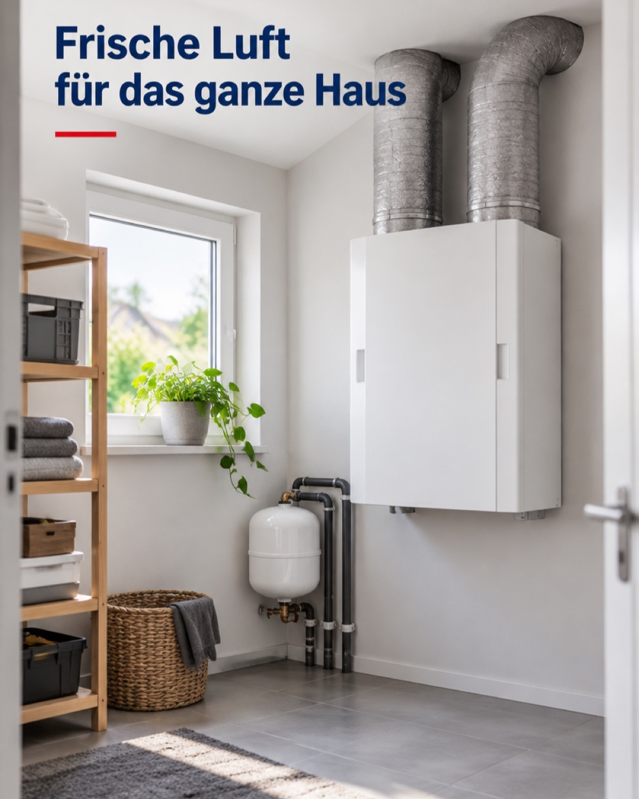 [BE-102](prompts.md#be-102) Zentrale Wohnraumlüftung | Eine zentrale Wohnraumlüftung tauscht die Luft im ganzen Haus aus, auch wenn die Fenster geschlossen bleiben (Symbolbild). Wir beraten Sie, ob eine zentrale oder dezentrale Lösung besser zu Ihrem Haus passt. Termin anfragen: Link in Bio. |  |
| Mo 21.12.2026 |  [BE-015](prompts.md#be-015) Online-Termin | Über unsere Website fragen Sie Ihren Termin bequem online an, wann es Ihnen passt. Wir melden uns zeitnah bei Ihnen. Link in Bio. |  |
| Di 22.12.2026 | 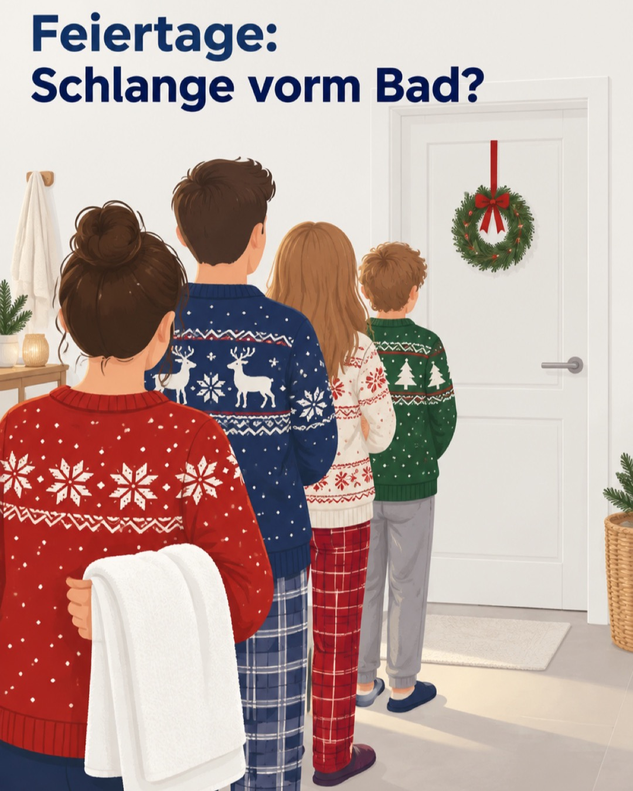 [BE-114](prompts.md#be-114) Feiertage: Schlange vorm Bad | Wenn über die Feiertage die ganze Familie zu Besuch ist, wird ein einziges Bad schnell knapp. Ein zusätzliches Gäste-WC oder ein zweites Bad planen wir gern mit Ihnen für das neue Jahr. Termin anfragen: Link in Bio. |  |
| Mi 23.12.2026 | 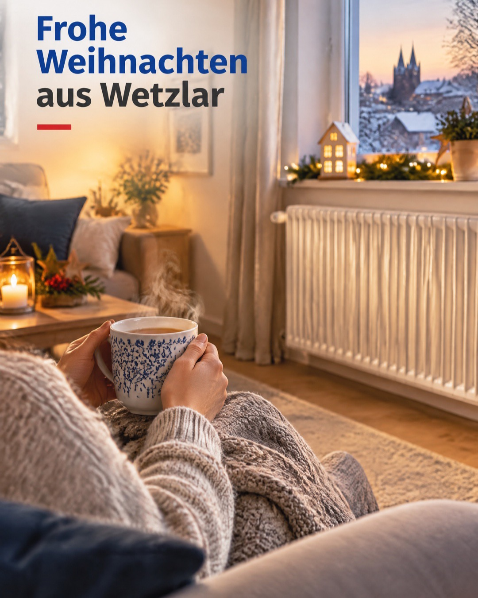 [BE-063](prompts.md#be-063) Frohe Weihnachten ⚠️ | Wir sagen Danke für 100 Jahre Vertrauen und wünschen Ihnen schöne Feiertage! Symbolbild. Termin anfragen: Link in Bio. |  |
| Do 24.12.2026 | 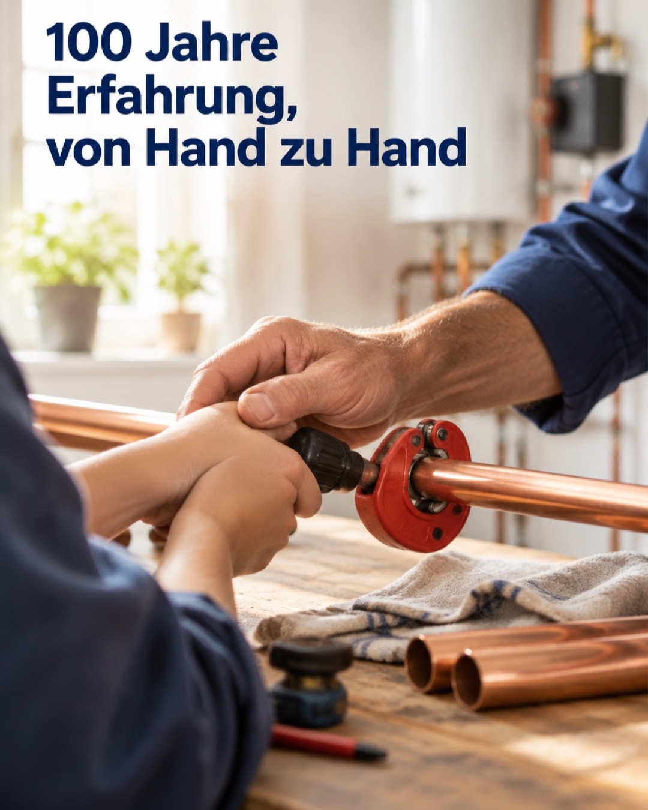 [BE-111](prompts.md#be-111) 100 Jahre Erfahrung ⚠️ | Als Meister- und Ausbildungsbetrieb geben wir unser Wissen an die nächste Generation weiter (Symbolbild). So verbinden wir die Erfahrung aus 100 Jahren mit der Haustechnik von heute. Termin anfragen: Link in Bio. |  |
| Sa 26.12.2026 | 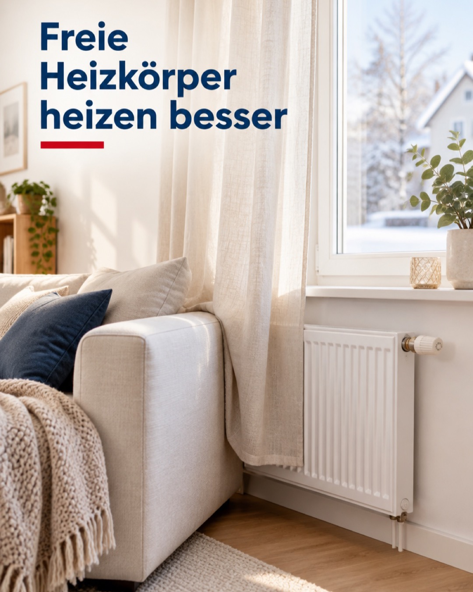 [BE-087](prompts.md#be-087) Heizkörper freihalten | Lange Vorhänge und Möbel direkt vor dem Heizkörper halten die Wärme zurück (Symbolbild). Lassen Sie etwas Abstand, damit sich die Wärme im Raum verteilen kann. Bei Fragen zu Ihrer Heizung erreichen Sie uns unter 06441-42956. |  |
| So 27.12.2026 | 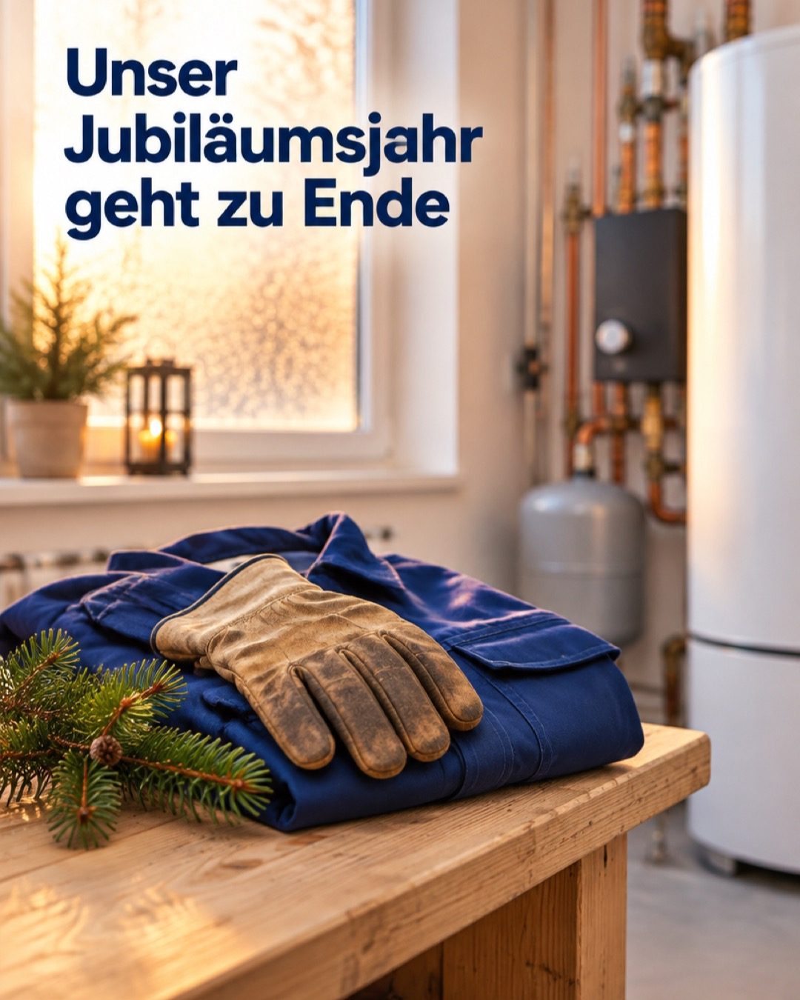 [BE-107](prompts.md#be-107) Jahresrückblick Jubiläumsjahr ⚠️ | 100 Jahre nach der Gründung 1926 in Wetzlar blicken wir dankbar auf unser Jubiläumsjahr zurück (Symbolbild). Danke an unsere Kundinnen und Kunden, unsere Partner und unser Team für das Vertrauen und die gute Zusammenarbeit. Termin für Ihr Projekt 2027 anfragen: Link in Bio. |  |
| Mo 28.12.2026 |  [BE-061](prompts.md#be-061) Dusche kalt? | Rufen Sie uns an: 06441-42956. Termin anfragen: Link in Bio. | [BE-119](prompts.md#be-119) Story-Umfrage: Vorsatz fürs neue Jahr ✋ |
| Di 29.12.2026 |  [BE-052](prompts.md#be-052) Kleines Bad, clever geplant | Mit kluger Planung entsteht viel Wirkung auf wenig Fläche. Symbolbild. Termin anfragen: Link in Bio. |  |
| Mi 30.12.2026 |  [BE-048](prompts.md#be-048) Heizkörper entlüften | Kurzer Wintertipp: Gluckert der Heizkörper, sollten Sie ihn entlüften. Hilft es nicht, rufen Sie uns an. Symbolbild. Termin anfragen: Link in Bio. |  |
| Do 31.12.2026 |  [BE-103](prompts.md#be-103) Kalk und hartes Wasser | Hartes Wasser hinterlässt Kalk an Duschköpfen, Armaturen und Geräten (Symbolbild). Eine Enthärtungsanlage direkt am Hausanschluss kann helfen, wir beraten Sie dazu. Termin anfragen: Link in Bio. |  |
| Fr 01.01.2027 |  [BE-064](prompts.md#be-064) Gutes neues Jahr | Wir wünschen Ihnen ein warmes neues Jahr. Termin anfragen: Link in Bio. |  |
| Sa 02.01.2027 |  [BE-113](prompts.md#be-113) Vom Einfamilienhaus bis zum Gewerbeobjekt | Ob Bad im Einfamilienhaus oder Sanitär- und Heizsysteme für Industrie, Gewerbe, Behörden und Kommunen: Wir planen und bauen Haustechnik, die zusammenpasst (Symbolbild). Sprechen Sie uns zu Ihrem Projekt an: 06441-42956. |  |
| So 03.01.2027 |  [BE-076](prompts.md#be-076) Wärmepumpe: Ihre Fragen, unsere Antworten (Karussell, 7 Bilder) ⚠️ | Wir beantworten typische Fragen zur Wärmepumpe, kurz und verständlich (Symbolbilder). Zur Förderung: Die KfW zahlt im Programm 458 für eine neue Wärmepumpe 30 % Grundförderung, der Antrag muss vor Baubeginn gestellt sein (Stand 29.10.2026). Termin anfragen: Link in Bio. |  |
| Mo 04.01.2027 |  [BE-004](prompts.md#be-004) Stichtag Heizungsbonus ⚠️ (Wiederholung) | Wer seine Ölheizung, Nachtspeicherheizung oder eine mindestens 20 Jahre alte Gasheizung tauscht und selbst im Haus wohnt, kann bei der KfW aktuell 16 % Klimageschwindigkeitsbonus bekommen (Stand 29.10.2026). Für Anträge ab dem 1.2.2027 sinkt er auf 12 %, danach halbjährlich weiter. Jetzt planen, wir helfen beim Antrag. |  |
| Di 05.01.2027 |  [BE-045](prompts.md#be-045) Brennstoffzellenheizung | Brennstoffzellenheizungen erzeugen Wärme und Strom im eigenen Haus. Symbolbild. Termin anfragen: Link in Bio. |  |
| Mi 06.01.2027 |  [BE-013](prompts.md#be-013) Trinkwasser | Filter, Enthärtung und hygienische Leitungen: Wir kümmern uns um die Trinkwasserinstallation in Ihrem Haus. Symbolbild. |  |
| Do 07.01.2027 |  [BE-104](prompts.md#be-104) Trinkwasser nach dem Urlaub | Waren Sie über die Feiertage verreist, lassen Sie das kalte Wasser an jeder Zapfstelle kurz laufen, bis es gleichmäßig kühl kommt (Symbolbild). Fragen zur Trinkwasserinstallation in Ihrem Haus beantworten wir gern. Telefon: 06441-42956. |  |
| Fr 08.01.2027 |  [BE-018](prompts.md#be-018) Gewerbekunden | Wir planen und bauen Sanitär- und Heizsysteme für Industrie, Gewerbe, Behörden und Kommunen. Symbolbild. Sprechen Sie uns an: 06441-42956. |  |
| Sa 09.01.2027 |  [BE-088](prompts.md#be-088) Stoßlüften im Winter | Öffnen Sie die Fenster mehrmals am Tag kurz und weit, statt sie dauerhaft zu kippen, so kühlen die Wände nicht unnötig aus (Symbolbild). Drehen Sie beim Lüften das Thermostatventil herunter. Fragen zur Heizung: 06441-42956. |  |
| So 10.01.2027 |  [BE-053](prompts.md#be-053) Ihr Bad, Ihr Stil | Holen Sie sich Inspiration aus unseren Musterbädern. Symbolbild. Termin anfragen: Link in Bio. |  |
| Mo 11.01.2027 |  [BE-046](prompts.md#be-046) BHKW fürs Gewerbe | Wir bieten Blockheizkraftwerke für Gewerbe und größere Gebäude an. Symbolbild. Termin anfragen: Link in Bio. | [BE-090](prompts.md#be-090) Story-Countdown: Bonus-Stichtag ⚠️ ✋ |
| Di 12.01.2027 |  [BE-098](prompts.md#be-098) Silikonfugen erneuern | Rissige oder dunkel verfärbte Silikonfugen sollten Sie erneuern lassen, bevor Feuchtigkeit dahinter gelangt (Symbolbild). Wir sehen uns die Fugen in Ihrem Bad gern an. Termin anfragen: Link in Bio. |  |
| Mi 13.01.2027 |  [BE-057](prompts.md#be-057) Sicherheit, die gut aussieht | Wir planen barrierefreie Details, die ins Design passen. Symbolbild. Termin anfragen: Link in Bio. |  |
| Do 14.01.2027 |  [BE-047](prompts.md#be-047) Wärme richtig verteilen | Fußbodenheizung, Heizkörper, hydraulischer Abgleich: Wir sorgen dafür, dass die Wärme ankommt. Symbolbild. Termin anfragen: Link in Bio. |  |
| Fr 15.01.2027 |  [BE-092](prompts.md#be-092) Fliesenarbeiten aus einer Hand | Auch die Fliesenarbeiten gehören bei uns zum Bad aus einer Hand (Symbolbild). So haben Sie von der Planung bis zur letzten Fuge einen Ansprechpartner. Badanfrage starten: Link in Bio. |  |
| Sa 16.01.2027 |  [BE-084](prompts.md#be-084) Heizungstausch in Ruhe planen ⚠️ | Wärmepumpe im Winter (Symbolbild): Wer seine Heizung tauschen möchte, plant am besten frühzeitig, denn der Förderantrag bei der KfW muss vor Baubeginn gestellt sein (Stand 29.10.2026). Wir beraten Sie in Ruhe und erstellen Ihr Angebot. Termin anfragen: Link in Bio. |  |
| So 17.01.2027 |  [BE-093](prompts.md#be-093) Bad für jede Lebensphase | Ein barrierefreies Bad ist bequem für Kinder, Eltern und Großeltern (Symbolbild). Wir planen es so, dass es heute gut aussieht und auch später noch passt. Beratung vor Ort: Link in Bio. |  |
| Mo 18.01.2027 |  [BE-085](prompts.md#be-085) Hydraulischer Abgleich | Ungleich warme Räume (Symbolbild): Werden manche Zimmer nicht richtig warm, während andere überheizt sind, kann ein hydraulischer Abgleich helfen. Wir prüfen Ihre Anlage vor Ort und beraten Sie dazu. Termin anfragen: Link in Bio. |  |
| Di 19.01.2027 |  [BE-094](prompts.md#be-094) Handtuchheizkörper im Winter | Ein Handtuchheizkörper wärmt an kalten Tagen nicht nur das Bad, sondern auch Ihre Handtücher (Symbolbild). Wir beraten Sie, welche Lösung zu Ihrem Bad und Ihrer Heizung passt. Termin anfragen: Link in Bio. |  |
| Mi 20.01.2027 |  [BE-091](prompts.md#be-091) Heizkurve einstellen | Eine passend eingestellte Heizkurve sorgt dafür, dass Ihre Heizung nur so warm läuft wie nötig (Symbolbild). Wir prüfen die Einstellungen gern bei Ihnen vor Ort. Termin anfragen: Link in Bio. |  |
| Do 21.01.2027 |  [BE-095](prompts.md#be-095) Duschnische | Eine eingeflieste Nische hält Shampoo und Duschgel griffbereit und das Bad aufgeräumt (Symbolbild). Solche Details planen wir von Anfang an mit ein. Badanfrage starten: Link in Bio. |  |
| Fr 22.01.2027 |  [BE-096](prompts.md#be-096) Licht im Bad | Indirektes Licht am Spiegel und unter dem Waschtisch macht das Bad am Abend gemütlich (Symbolbild). Sprechen Sie Ihre Lichtwünsche am besten schon bei der Badplanung an. Badanfrage starten: Link in Bio. |  |

## Wartet auf Freigabe

Zum Freigeben die ID in `posting/geprueft.txt` eintragen.

| ID | Grund |
| --- | --- |
| [BE-001](prompts.md#be-001) | Fakten prüfen: Faktencheck Firmengeschichte: Gründungsangaben (1926, SHK-Meister Karl Schmidt, Wetzlarer Hintergasse) stammen von bad-energie.de; vor dem Posten mit der Geschäftsführung abgleichen, Stand 29.10.2026. „Symbolbild“ in der |
| [BE-002](prompts.md#be-002) | Fakten prüfen: Faktencheck: Gründungsjahr 1926 vor dem Posten mit der Geschäftsführung abgleichen (Stand 29.10.2026). Posting-Plan: Woche 5, Mo 30.11.2026, gegen 18 Uhr. |
| [BE-003](prompts.md#be-003) | Fakten prüfen: Faktencheck: Förderzahlen (KfW 458: 30 % Grundförderung, mit Boni je nach Einkommen bis zu 80 %, Antrag vor Baubeginn) vor dem Posten tagesaktuell auf der KfW-Seite prüfen, Stand 29.10.2026; den Stand in der Caption auf |
| [BE-004](prompts.md#be-004) | Fakten prüfen: Faktencheck: Klimageschwindigkeitsbonus (aktuell 16 %, für Anträge ab 1.2.2027 12 %, danach halbjährlich weiter sinkend) vor jedem Posten auf der KfW-Seite prüfen, Stand 29.10.2026; den Stand in der Caption auf das Prüfd |
| [BE-006](prompts.md#be-006) | Offene Frage: Wird das Heizungs-Mietmodell (BE-006) aktuell angeboten? |
| [BE-010](prompts.md#be-010) | Fakten prüfen: Faktencheck: Zuschuss der Pflegekasse (bis zu 4.180 € pro Person, Pflegegrad 1–5) vor dem Posten prüfen, Stand 29.10.2026 (Quelle im Dokument: Stand 04/2026); den Stand in der Caption auf das Prüfdatum aktualisieren. „Sy |
| [BE-016](prompts.md#be-016) | Fakten prüfen: Recruiting-Post in Du-Form (Headline). Faktencheck: Ausbildungsberuf und Start vorher mit der Ausbildungsseite abgleichen (im Dokument als letzter Satz der Caption, hier in die Notizen verschoben); „100 Jahre“ (Gründung |
| [BE-017](prompts.md#be-017) | Offene Stellen mit der Stellenseite abgleichen |
| [BE-021](prompts.md#be-021) | Fakten prüfen: Caption und Hashtags gelten für das ganze Karussell (einmal posten). Faktencheck: Die Jahreszahlen (1926, 1945, 1950er, 2001) stammen von bad-energie.de; vor dem Posten mit der Geschäftsführung abgleichen (Stand 29.10.20 |
| [BE-022](prompts.md#be-022) | Fakten prüfen: Caption und Hashtags gelten für das ganze Karussell (einmal posten). Faktencheck: Die Jahreszahlen (1926, 1945, 1950er, 2001) stammen von bad-energie.de; vor dem Posten mit der Geschäftsführung abgleichen (Stand 29.10.20 |
| [BE-023](prompts.md#be-023) | Fakten prüfen: Caption und Hashtags gelten für das ganze Karussell (einmal posten). Faktencheck: Die Jahreszahlen (1926, 1945, 1950er, 2001) stammen von bad-energie.de; vor dem Posten mit der Geschäftsführung abgleichen (Stand 29.10.20 |
| [BE-024](prompts.md#be-024) | Fakten prüfen: Caption und Hashtags gelten für das ganze Karussell (einmal posten). Faktencheck: Die Jahreszahlen (1926, 1945, 1950er, 2001) stammen von bad-energie.de; vor dem Posten mit der Geschäftsführung abgleichen (Stand 29.10.20 |
| [BE-025](prompts.md#be-025) | Fakten prüfen: Caption und Hashtags gelten für das ganze Karussell (einmal posten). Faktencheck: Die Jahreszahlen (1926, 1945, 1950er, 2001) stammen von bad-energie.de; vor dem Posten mit der Geschäftsführung abgleichen (Stand 29.10.20 |
| [BE-026](prompts.md#be-026) | Fakten prüfen: Caption und Hashtags gelten für das ganze Karussell (einmal posten). Faktencheck: Die Jahreszahlen (1926, 1945, 1950er, 2001) stammen von bad-energie.de; vor dem Posten mit der Geschäftsführung abgleichen (Stand 29.10.20 |
| [BE-027](prompts.md#be-027) | Fakten prüfen: Caption und Hashtags gelten für das ganze Karussell (einmal posten). Faktencheck: Die Jahreszahlen (1926, 1945, 1950er, 2001) stammen von bad-energie.de; vor dem Posten mit der Geschäftsführung abgleichen (Stand 29.10.20 |
| [BE-028](prompts.md#be-028) | Fakten prüfen: Caption und Hashtags gelten für das ganze Karussell (einmal posten). Faktencheck: Förderablauf laut KfW vor dem Posten auf der KfW-Seite prüfen, Stand 29.10.2026; den Stand in der Caption auf das Prüfdatum aktualisieren. |
| [BE-029](prompts.md#be-029) | Fakten prüfen: Caption und Hashtags gelten für das ganze Karussell (einmal posten). Faktencheck: Förderablauf laut KfW vor dem Posten auf der KfW-Seite prüfen, Stand 29.10.2026; den Stand in der Caption auf das Prüfdatum aktualisieren. |
| [BE-030](prompts.md#be-030) | Fakten prüfen: Caption und Hashtags gelten für das ganze Karussell (einmal posten). Faktencheck: Förderablauf laut KfW vor dem Posten auf der KfW-Seite prüfen, Stand 29.10.2026; den Stand in der Caption auf das Prüfdatum aktualisieren. |
| [BE-031](prompts.md#be-031) | Fakten prüfen: Caption und Hashtags gelten für das ganze Karussell (einmal posten). Faktencheck: Förderablauf laut KfW vor dem Posten auf der KfW-Seite prüfen, Stand 29.10.2026; den Stand in der Caption auf das Prüfdatum aktualisieren. |
| [BE-032](prompts.md#be-032) | Fakten prüfen: Caption und Hashtags gelten für das ganze Karussell (einmal posten). Faktencheck: Förderablauf laut KfW vor dem Posten auf der KfW-Seite prüfen, Stand 29.10.2026; den Stand in der Caption auf das Prüfdatum aktualisieren. |
| [BE-033](prompts.md#be-033) | Fakten prüfen: Caption und Hashtags gelten für das ganze Karussell (einmal posten). Faktencheck: Förderablauf laut KfW vor dem Posten auf der KfW-Seite prüfen, Stand 29.10.2026; den Stand in der Caption auf das Prüfdatum aktualisieren. |
| [BE-034](prompts.md#be-034) | Fakten prüfen: Caption und Hashtags gelten für das ganze Karussell (einmal posten). Faktencheck: Förderablauf laut KfW vor dem Posten auf der KfW-Seite prüfen, Stand 29.10.2026; den Stand in der Caption auf das Prüfdatum aktualisieren. |
| [BE-035](prompts.md#be-035) | Fakten prüfen: Caption und Hashtags gelten für das ganze Karussell (einmal posten). Faktencheck: Zuschuss der Pflegekasse (bis zu 4.180 €) vor dem Posten prüfen, Stand 29.10.2026; „Stand 2026“ aus dem Dokument in der Caption auf „Stand |
| [BE-036](prompts.md#be-036) | Fakten prüfen: Caption und Hashtags gelten für das ganze Karussell (einmal posten). Faktencheck: Zuschuss der Pflegekasse (bis zu 4.180 €) vor dem Posten prüfen, Stand 29.10.2026; „Stand 2026“ aus dem Dokument in der Caption auf „Stand |
| [BE-037](prompts.md#be-037) | Fakten prüfen: Caption und Hashtags gelten für das ganze Karussell (einmal posten). Faktencheck: Zuschuss der Pflegekasse (bis zu 4.180 €) vor dem Posten prüfen, Stand 29.10.2026; „Stand 2026“ aus dem Dokument in der Caption auf „Stand |
| [BE-038](prompts.md#be-038) | Fakten prüfen: Caption und Hashtags gelten für das ganze Karussell (einmal posten). Faktencheck: Zuschuss der Pflegekasse (bis zu 4.180 €) vor dem Posten prüfen, Stand 29.10.2026; „Stand 2026“ aus dem Dokument in der Caption auf „Stand |
| [BE-039](prompts.md#be-039) | Fakten prüfen: Caption und Hashtags gelten für das ganze Karussell (einmal posten). Faktencheck: Zuschuss der Pflegekasse (bis zu 4.180 €) vor dem Posten prüfen, Stand 29.10.2026; „Stand 2026“ aus dem Dokument in der Caption auf „Stand |
| [BE-040](prompts.md#be-040) | Fakten prüfen: Caption und Hashtags gelten für das ganze Karussell (einmal posten). Faktencheck: Zuschuss der Pflegekasse (bis zu 4.180 €) vor dem Posten prüfen, Stand 29.10.2026; „Stand 2026“ aus dem Dokument in der Caption auf „Stand |
| [BE-041](prompts.md#be-041) | Fakten prüfen: Caption und Hashtags gelten für das ganze Karussell (einmal posten). Faktencheck: Zuschuss der Pflegekasse (bis zu 4.180 €) vor dem Posten prüfen, Stand 29.10.2026; „Stand 2026“ aus dem Dokument in der Caption auf „Stand |
| [BE-063](prompts.md#be-063) | Fakten prüfen: Faktencheck Firmengeschichte: „100 Jahre“ (Gründung 1926) vor dem Posten mit der Geschäftsführung abgleichen, Stand 29.10.2026. „Symbolbild“ in der Caption ergänzt (fotorealistischer Wohnraum). Posting-Plan: Woche 8, Mi |
| [BE-068](prompts.md#be-068) | Fakten prüfen: Story ohne Caption. Story-Sticker: Link-Sticker zur Unternehmensseite (bad-energie.de/ueber-uns/unternehmen). Faktencheck Firmengeschichte: „100 Jahre“ (Gründung 1926) vor dem Posten mit der Geschäftsführung abgleichen, |
| [BE-076](prompts.md#be-076) | Fakten prüfen: Caption und Hashtags gelten für das ganze Karussell (einmal posten). Faktencheck: KfW-Grundförderung 30 % (Programm 458) und Antrag vor Baubeginn vor dem Posten auf der KfW-Seite prüfen, Stand 29.10.2026; im 1. Quartal 2 |
| [BE-077](prompts.md#be-077) | Fakten prüfen: Caption und Hashtags gelten für das ganze Karussell (einmal posten). Faktencheck: KfW-Grundförderung 30 % (Programm 458) und Antrag vor Baubeginn vor dem Posten auf der KfW-Seite prüfen, Stand 29.10.2026; im 1. Quartal 2 |
| [BE-078](prompts.md#be-078) | Fakten prüfen: Caption und Hashtags gelten für das ganze Karussell (einmal posten). Faktencheck: KfW-Grundförderung 30 % (Programm 458) und Antrag vor Baubeginn vor dem Posten auf der KfW-Seite prüfen, Stand 29.10.2026; im 1. Quartal 2 |
| [BE-079](prompts.md#be-079) | Fakten prüfen: Caption und Hashtags gelten für das ganze Karussell (einmal posten). Faktencheck: KfW-Grundförderung 30 % (Programm 458) und Antrag vor Baubeginn vor dem Posten auf der KfW-Seite prüfen, Stand 29.10.2026; im 1. Quartal 2 |
| [BE-080](prompts.md#be-080) | Fakten prüfen: Caption und Hashtags gelten für das ganze Karussell (einmal posten). Faktencheck: KfW-Grundförderung 30 % (Programm 458) und Antrag vor Baubeginn vor dem Posten auf der KfW-Seite prüfen, Stand 29.10.2026; im 1. Quartal 2 |
| [BE-081](prompts.md#be-081) | Fakten prüfen: Caption und Hashtags gelten für das ganze Karussell (einmal posten). Faktencheck: KfW-Grundförderung 30 % (Programm 458) und Antrag vor Baubeginn vor dem Posten auf der KfW-Seite prüfen, Stand 29.10.2026; im 1. Quartal 2 |
| [BE-082](prompts.md#be-082) | Fakten prüfen: Caption und Hashtags gelten für das ganze Karussell (einmal posten). Faktencheck: KfW-Grundförderung 30 % (Programm 458) und Antrag vor Baubeginn vor dem Posten auf der KfW-Seite prüfen, Stand 29.10.2026; im 1. Quartal 2 |
| [BE-083](prompts.md#be-083) | Fakten prüfen: Kanal: auch für LinkedIn und Facebook geeignet, ruhiger Ton. Faktencheck: Klimageschwindigkeitsbonus und Voraussetzungen (selbst bewohnt; Öl-, Nachtspeicher- oder mindestens 20 Jahre alte Gasheizung) vor dem Posten auf d |
| [BE-084](prompts.md#be-084) | Fakten prüfen: Faktencheck: Antrag vor Baubeginn laut KfW vor dem Posten prüfen, Stand 29.10.2026. „Symbolbild“ in der Caption ist Pflicht (enthalten). Posting-Fenster: Dezember 2026 bis Mitte Januar 2027, passend zum Bonus-Stichtag 1. |
| [BE-089](prompts.md#be-089) | Fakten prüfen: Story-Sticker: Quiz-Sticker mit den Antworten „Vor Baubeginn“ (richtig) / „Nach dem Einbau“. Faktencheck: Antrag vor Baubeginn laut KfW vor dem Posten prüfen, Stand 29.10.2026. Caption als Auflösung in der nächsten Story |
| [BE-090](prompts.md#be-090) | Fakten prüfen: Story-Sticker: Countdown-Sticker bis 1.2.2027, 0:00 Uhr (Titel „Heizungsbonus sinkt“) und Link-Sticker zur Terminanfrage. Faktencheck: Klimageschwindigkeitsbonus 16 % bzw. 12 % für Anträge ab 1.2.2027 vor dem Posten auf |
| [BE-100](prompts.md#be-100) | Fakten prüfen: Story-Sticker: Umfrage-Sticker „Wusste ich schon / Neu für mich“, dazu Link-Sticker zur Terminanfrage. Faktencheck: Zuschuss der Pflegekasse bis zu 4.180 € pro Person vor dem Posten prüfen, Stand 29.10.2026 (Quelle Stand |
| [BE-107](prompts.md#be-107) | Fakten prüfen: Kanal: auch für LinkedIn und Facebook geeignet, ruhiger Ton. „Symbolbild“ in der Caption ist Pflicht (enthalten). Faktencheck Firmengeschichte: Gründungsjahr 1926 und „100 Jahre“ stammen von bad-energie.de; vor dem Poste |
| [BE-108](prompts.md#be-108) | Fakten prüfen: Story-Sticker: Quiz-Sticker mit den Antworten „1926“ (richtig) / „1945“ / „2001“; alle drei Jahreszahlen stammen aus der Firmengeschichte im Dokument (Gründung, zweite Generation, neuer Name). Faktencheck Firmengeschicht |
| [BE-109](prompts.md#be-109) | Offene Frage: Welche Ausbildungsberufe, welcher Start und welche offenen Stellen gelten? Welche URL bekommt der Link-Sticker der Karriere-Story BE-109? |
| [BE-111](prompts.md#be-111) | Fakten prüfen: Kanal: auch für LinkedIn und Facebook geeignet, ruhiger Ton. Faktencheck Firmengeschichte: „100 Jahre“ (Gründung 1926) vor dem Posten mit der Geschäftsführung abgleichen, Stand 29.10.2026. „Symbolbild“ in der Caption ist |
| [BE-112](prompts.md#be-112) | Fakten prüfen: Recruiting-Post in Du-Form. Faktencheck: Ausbildungsberuf und Start vorher mit der Ausbildungsseite abgleichen; „100 Jahre“ (Gründung 1926) mit der Geschäftsführung abgleichen, Stand 29.10.2026. Typografisches Motiv: Hea |
| [BE-120](prompts.md#be-120) | Fakten prüfen: Story-Version von BE-001 (gleiche Aussage im Format 9:16). Faktencheck Firmengeschichte: Gründungsangaben (1926, SHK-Meister Karl Schmidt, Wetzlarer Hintergasse) stammen von bad-energie.de; vor dem Posten mit der Geschäf |
| [BE-121](prompts.md#be-121) | Fakten prüfen: Story-Version von BE-003 (gleiche Aussage im Format 9:16). Faktencheck: Förderzahlen (KfW 458: 30 % Grundförderung, mit Boni je nach Einkommen bis zu 80 %, Antrag vor Baubeginn) vor dem Posten tagesaktuell auf der KfW-Se |
| [BE-122](prompts.md#be-122) | Fakten prüfen: Bildtext lokal korrigiert: die beim Erzeugen fast unsichtbare „1“ in „ab 1. Februar“ wurde nachgezeichnet. Story-Version von BE-004 (gleiche Aussage im Format 9:16). Faktencheck: Klimageschwindigkeitsbonus (aktuell 16 %, |
| [BE-126](prompts.md#be-126) | Fakten prüfen: Story-Version von BE-016 (gleiche Aussage im Format 9:16). Recruiting-Post in Du-Form (Headline). Faktencheck: Ausbildungsberuf und Start vorher mit der Ausbildungsseite abgleichen (im Dokument als letzter Satz der Capti |

## Nicht eingeplant

| Post | Titel | Grund |
| --- | --- | --- |
