# Coday: Prompt-Bibliothek (80 Bildprompts)

Modell: GPT Image 2.5, Variante Sunburst · 75 Feed-Posts (3:4, 1080 × 1440) · 5 Stories (9:16, 1080 × 1920)

Jeder Prompt unten ist komplett: Brand-Block, Szene und der Text im Bild. In Arena oder ChatGPT einfach den Codeblock kopieren und senden. Karussell-Slides ab Nr. 2: vorher die fertige Cover-Slide hochladen. Danach Text im Bild Wort für Wort prüfen und das echte Logo unten rechts einsetzen.

⚠️ = vor dem Posten Fakten prüfen (Stand steht in den Hinweisen).

## Übersicht

| ID | Titel | Kategorie | Format | Text im Bild | Bild |
| --- | --- | --- | --- | --- | --- |
| [CD-001](#cd-001) ⚠️ | PHP-Lücke: sachlicher Aufhänger | Security | 3:4 | PHP-Lücke: Ist deine Website aktualisiert? | [ansehen](bilder/instagram-3x4/CD-001.jpg) |
| [CD-002](#cd-002) ⚠️ | WordPress-Update reicht nicht | Security | 3:4 | Diesmal reicht ein WordPress-Update nicht. | [ansehen](bilder/instagram-3x4/CD-002.jpg) |
| [CD-003](#cd-003) | Kostenloser Website-Check (Haupt-CTA) | Security | 3:4 | Kostenloser Website-Check aus Wetzlar | [ansehen](bilder/instagram-3x4/CD-003.jpg) |
| [CD-004](#cd-004) ⚠️ | PHP 8.2 Support-Ende | Security | 3:4 | PHP 8.2: Sicherheits-Updates nur bis 31.12. | [ansehen](bilder/instagram-3x4/CD-004.jpg) |
| [CD-005](#cd-005) | Karussell-Cover: In 4 Schritten (K1 1/6) | Karussell | 3:4 | PHP-Version prüfen in 4 Schritten | [ansehen](bilder/instagram-3x4/CD-005.jpg) |
| [CD-006](#cd-006) | Frag zuerst deinen Hoster | Security | 3:4 | Erster Schritt: Frag deinen Hoster. | [ansehen](bilder/instagram-3x4/CD-006.jpg) |
| [CD-007](#cd-007) | Ich prüfe. Du entscheidest. | Security | 3:4 | Ich prüfe. Du entscheidest. | [ansehen](bilder/instagram-3x4/CD-007.jpg) |
| [CD-008](#cd-008) | Migration WordPress → Next.js | Leistung | 3:4 | Weniger Plugins. Weniger Baustellen. | [ansehen](bilder/instagram-3x4/CD-008.jpg) |
| [CD-009](#cd-009) | Wartung | Security | 3:4 | Updates, Backups, Monitoring: erledigt. | [ansehen](bilder/instagram-3x4/CD-009.jpg) |
| [CD-010](#cd-010) ⚠️ | GEO-Hook | GEO | 3:4 | Kennt ChatGPT deinen Betrieb? | [ansehen](bilder/instagram-3x4/CD-010.jpg) |
| [CD-011](#cd-011) | Karussell-Cover GEO (K2 1/6) | Karussell | 3:4 | GEO in 5 Slides erklärt | [ansehen](bilder/instagram-3x4/CD-011.jpg) |
| [CD-012](#cd-012) ⚠️ | Ladezeit | Leistung | 3:4 | Jede Sekunde Ladezeit kostet Anfragen. | [ansehen](bilder/instagram-3x4/CD-012.jpg) |
| [CD-013](#cd-013) | Festpreis | Leistung | 3:4 | Festpreis statt Stundenzettel. | [ansehen](bilder/instagram-3x4/CD-013.jpg) |
| [CD-014](#cd-014) | Ein Ansprechpartner | Leistung | 3:4 | Ein Ansprechpartner. Von Plan bis Code. | [ansehen](bilder/instagram-3x4/CD-014.jpg) |
| [CD-015](#cd-015) | Quellcode-Übergabe | Leistung | 3:4 | Dein Code gehört dir. | [ansehen](bilder/instagram-3x4/CD-015.jpg) |
| [CD-016](#cd-016) | Gastro | Branche | 3:4 | Speisekarte online, mit Allergenen. | [ansehen](bilder/instagram-3x4/CD-016.jpg) |
| [CD-017](#cd-017) | Handwerk | Branche | 3:4 | Mehr Anfragen vom Handy. | – |
| [CD-018](#cd-018) | Schlüsseldienst | Branche | 3:4 | Notfall? Ein Tippen bis zum Anruf. | – |
| [CD-019](#cd-019) | Friseur | Branche | 3:4 | Termine buchen, auch um 23 Uhr. | [ansehen](bilder/instagram-3x4/CD-019.jpg) |
| [CD-020](#cd-020) | Boutique | Branche | 3:4 | Dein Laden. Rund um die Uhr geöffnet. | [ansehen](bilder/instagram-3x4/CD-020.jpg) |
| [CD-021](#cd-021) | Kanzlei/Praxis | Branche | 3:4 | Vertrauen beginnt vor dem ersten Termin. | [ansehen](bilder/instagram-3x4/CD-021.jpg) |
| [CD-022](#cd-022) | Lokal | Lokal | 3:4 | Webdesign aus Wetzlar. Für Mittelhessen. | [ansehen](bilder/instagram-3x4/CD-022.jpg) |
| [CD-023](#cd-023) | Vorher/Nachher (Konzept) | Vorher/Nachher | 3:4 | Baukasten oder Maßarbeit? | [ansehen](bilder/instagram-3x4/CD-023.jpg) |
| [CD-024](#cd-024) | Mythen-Karussell-Cover (K3 1/6) | Karussell | 3:4 | 5 Website-Mythen, die dich Kunden kosten | [ansehen](bilder/instagram-3x4/CD-024.jpg) |
| [CD-025](#cd-025) | 3D begehbar | Leistung | 3:4 | Begehbar. Direkt im Browser. | [ansehen](bilder/instagram-3x4/CD-025.jpg) |
| [CD-026](#cd-026) | Meme: Plugin-Update | Humor | 3:4 | Freitag, 17:58: 14 Plugin-Updates. | [ansehen](bilder/instagram-3x4/CD-026.jpg) |
| [CD-027](#cd-027) | Behind the Scenes | BTS | 3:4 | Hier entsteht deine Website. | – |
| [CD-028](#cd-028) | Story: Website-Check | Story | 9:16 | Website-Check: kostenlos | [ansehen](bilder/story-9x16/CD-028.jpg) |
| [CD-029](#cd-029) | K1 PHP-Version prüfen: Hoster fragen (K1 2/6) | Karussell | 3:4 | 1. Frag deinen Hoster, ob PHP aktualisiert wurde. | – |
| [CD-030](#cd-030) | K1 PHP-Version prüfen: Version ablesen (K1 3/6) | Karussell | 3:4 | 2. PHP-Version im Hosting-Kundenbereich ablesen. | [ansehen](bilder/instagram-3x4/CD-030.jpg) |
| [CD-031](#cd-031) | K1 PHP-Version prüfen: Support-Tabelle (K1 4/6) | Karussell | 3:4 | 3. Version mit Support-Tabelle vergleichen. | [ansehen](bilder/instagram-3x4/CD-031.jpg) |
| [CD-032](#cd-032) | K1 PHP-Version prüfen: Update planen (K1 5/6) | Karussell | 3:4 | 4. PHP-Update planen, nicht nur WordPress. | – |
| [CD-033](#cd-033) | K1 PHP-Version prüfen: Check (K1 6/6) | Karussell | 3:4 | Unsicher? Kostenloser Check: Link in Bio | [ansehen](bilder/instagram-3x4/CD-033.jpg) |
| [CD-034](#cd-034) | K2 GEO: Was ist GEO (K2 2/6) | Karussell | 3:4 | GEO = Sichtbarkeit in KI-Antworten | [ansehen](bilder/instagram-3x4/CD-034.jpg) |
| [CD-035](#cd-035) | K2 GEO: Struktur (K2 3/6) | Karussell | 3:4 | KI liest Struktur, nicht Deko. | [ansehen](bilder/instagram-3x4/CD-035.jpg) |
| [CD-036](#cd-036) | K2 GEO: Klare Angaben (K2 4/6) | Karussell | 3:4 | Klare Angaben: Was, wo, für wen. | [ansehen](bilder/instagram-3x4/CD-036.jpg) |
| [CD-037](#cd-037) | K2 GEO: Tempo (K2 5/6) | Karussell | 3:4 | Schnelle, saubere Seiten helfen allen Suchen. | [ansehen](bilder/instagram-3x4/CD-037.jpg) |
| [CD-038](#cd-038) | K2 GEO: Check (K2 6/6) | Karussell | 3:4 | Wie sichtbar bist du? Check: Link in Bio | [ansehen](bilder/instagram-3x4/CD-038.jpg) |
| [CD-039](#cd-039) | K3 Mythos: Baukasten (K3 2/6) | Karussell | 3:4 | Mythos: Ein Baukasten reicht. | [ansehen](bilder/instagram-3x4/CD-039.jpg) |
| [CD-040](#cd-040) | K3 Mythos: Ruhe nach dem Launch (K3 3/6) | Karussell | 3:4 | Mythos: Nach dem Launch ist Ruhe. | [ansehen](bilder/instagram-3x4/CD-040.jpg) |
| [CD-041](#cd-041) | K3 Mythos: WordPress-Update (K3 4/6) | Karussell | 3:4 | Mythos: WordPress-Update = sicher. | [ansehen](bilder/instagram-3x4/CD-041.jpg) |
| [CD-042](#cd-042) | K3 Mythos: Ladezeit (K3 5/6) | Karussell | 3:4 | Mythos: Ladezeit ist egal. | [ansehen](bilder/instagram-3x4/CD-042.jpg) |
| [CD-043](#cd-043) | K3 Mythos: Nur eine Suche (K3 6/6) | Karussell | 3:4 | Mythos: Google ist die einzige Suche. | [ansehen](bilder/instagram-3x4/CD-043.jpg) |
| [CD-044](#cd-044) | Server aktuell? | Security | 3:4 | Server aktuell? Website sicher(er). | [ansehen](bilder/instagram-3x4/CD-044.jpg) |
| [CD-045](#cd-045) | Updates aufschieben | Security | 3:4 | Updates aufschieben kostet später mehr. | [ansehen](bilder/instagram-3x4/CD-045.jpg) |
| [CD-046](#cd-046) | Backup vor jedem Update | Security | 3:4 | Backup vor jedem Update. | [ansehen](bilder/instagram-3x4/CD-046.jpg) |
| [CD-047](#cd-047) | Notfall: Ruhe bewahren | Security | 3:4 | Website gehackt? Ruhe bewahren. | [ansehen](bilder/instagram-3x4/CD-047.jpg) |
| [CD-048](#cd-048) | 3 Fragen an deinen Hoster | Security | 3:4 | 3 Fragen an deinen Hoster | [ansehen](bilder/instagram-3x4/CD-048.jpg) |
| [CD-049](#cd-049) | Headless CMS | Leistung | 3:4 | Headless CMS: Inhalte pflegen, sicher bauen. | [ansehen](bilder/instagram-3x4/CD-049.jpg) |
| [CD-050](#cd-050) | Schnelle Shops | Leistung | 3:4 | Shops, die schnell laden. | [ansehen](bilder/instagram-3x4/CD-050.jpg) |
| [CD-051](#cd-051) | Lokal gefunden werden | Leistung | 3:4 | Lokal gefunden werden. | [ansehen](bilder/instagram-3x4/CD-051.jpg) |
| [CD-052](#cd-052) | Website und Profil im Einklang | Leistung | 3:4 | Website und Unternehmensprofil im Einklang. | [ansehen](bilder/instagram-3x4/CD-052.jpg) |
| [CD-053](#cd-053) | Jede Seite führt zur Anfrage | Leistung | 3:4 | Jede Seite führt zur Anfrage. | [ansehen](bilder/instagram-3x4/CD-053.jpg) |
| [CD-054](#cd-054) | Kontaktformular kaputt? | Problem | 3:4 | Kontaktformular kaputt? Merkst du nie. | [ansehen](bilder/instagram-3x4/CD-054.jpg) |
| [CD-055](#cd-055) | Auf dem Handy unlesbar? | Problem | 3:4 | Auf dem Handy unlesbar? | [ansehen](bilder/instagram-3x4/CD-055.jpg) |
| [CD-056](#cd-056) | Website von 2015? | Problem | 3:4 | Website von 2015? | [ansehen](bilder/instagram-3x4/CD-056.jpg) |
| [CD-057](#cd-057) | Button nicht gefunden | Problem | 3:4 | Kunden finden den Button nicht. | [ansehen](bilder/instagram-3x4/CD-057.jpg) |
| [CD-058](#cd-058) | Vorher warten, nachher da | Vorher/Nachher | 3:4 | Vorher: warten. Nachher: da. | [ansehen](bilder/instagram-3x4/CD-058.jpg) |
| [CD-059](#cd-059) | 30 Plugins zu 0 | Vorher/Nachher | 3:4 | Vorher: 30 Plugins. Nachher: 0. | [ansehen](bilder/instagram-3x4/CD-059.jpg) |
| [CD-060](#cd-060) | Branche Café | Branche | 3:4 | Dein Café, auf der Karte ganz oben. | [ansehen](bilder/instagram-3x4/CD-060.jpg) |
| [CD-061](#cd-061) | Branche Handwerk: Konfigurator | Branche | 3:4 | Konfigurator statt Rückruf-Chaos. | [ansehen](bilder/instagram-3x4/CD-061.jpg) |
| [CD-062](#cd-062) | Branche Makler | Branche | 3:4 | Exposés, die verkaufen. | [ansehen](bilder/instagram-3x4/CD-062.jpg) |
| [CD-063](#cd-063) | Branche Reinigung | Branche | 3:4 | Saubere Arbeit, saubere Website. | [ansehen](bilder/instagram-3x4/CD-063.jpg) |
| [CD-064](#cd-064) | Branche Kanzlei | Branche | 3:4 | Seriös. Schnell. Klar. | [ansehen](bilder/instagram-3x4/CD-064.jpg) |
| [CD-065](#cd-065) | Aus dem Lahntal | Lokal | 3:4 | Aus dem Lahntal für deinen Betrieb. | [ansehen](bilder/instagram-3x4/CD-065.jpg) |
| [CD-066](#cd-066) | Einzugsgebiet | Lokal | 3:4 | Wetzlar · Gießen · Marburg · Limburg | [ansehen](bilder/instagram-3x4/CD-066.jpg) |
| [CD-067](#cd-067) | Core Web Vitals | Wissen | 3:4 | Was sind Core Web Vitals? | [ansehen](bilder/instagram-3x4/CD-067.jpg) |
| [CD-068](#cd-068) | PHP-Version ≠ WordPress-Version | Wissen | 3:4 | PHP-Version ≠ WordPress-Version | [ansehen](bilder/instagram-3x4/CD-068.jpg) |
| [CD-069](#cd-069) | Was ist Next.js? | Wissen | 3:4 | Was ist eigentlich Next.js? | [ansehen](bilder/instagram-3x4/CD-069.jpg) |
| [CD-070](#cd-070) ⚠️ | Zahlen: Mobile Performance | Zahlen | 3:4 | 94 Mobile Performance (PageSpeed, 17.07.2026) | [ansehen](bilder/instagram-3x4/CD-070.jpg) |
| [CD-071](#cd-071) ⚠️ | Zahlen: Accessibility und SEO | Zahlen | 3:4 | 100 Accessibility · 100 SEO | [ansehen](bilder/instagram-3x4/CD-071.jpg) |
| [CD-072](#cd-072) | Erst Skizze, dann Code | BTS | 3:4 | Erst Skizze, dann Code. | [ansehen](bilder/instagram-3x4/CD-072.jpg) |
| [CD-073](#cd-073) | Montag, 8 Uhr | BTS | 3:4 | Montag, 8 Uhr, Wetzlar. | [ansehen](bilder/instagram-3x4/CD-073.jpg) |
| [CD-074](#cd-074) | Humor: kein Menü | Humor | 3:4 | Ich, wenn die Website kein Menü hat. | [ansehen](bilder/instagram-3x4/CD-074.jpg) |
| [CD-075](#cd-075) | Humor: statische Seiten | Humor | 3:4 | Statische Seiten schlafen gut. | [ansehen](bilder/instagram-3x4/CD-075.jpg) |
| [CD-076](#cd-076) ⚠️ | Humor: PHP 8.2 nach Silvester | Humor | 3:4 | PHP 8.2 nach Silvester: | [ansehen](bilder/instagram-3x4/CD-076.jpg) |
| [CD-077](#cd-077) | Story: PHP-Update | Story | 9:16 | PHP-Update? Ich übernehme das. | [ansehen](bilder/story-9x16/CD-077.jpg) |
| [CD-078](#cd-078) | Story: PHP-Version (Umfrage) | Story | 9:16 | Weißt du deine PHP-Version? | [ansehen](bilder/story-9x16/CD-078.jpg) |
| [CD-079](#cd-079) | Story: Wie schnell? | Story | 9:16 | Wie schnell ist deine Seite? | [ansehen](bilder/story-9x16/CD-079.jpg) |
| [CD-080](#cd-080) | Story: ChatGPT-Frage (Umfrage) | Story | 9:16 | Fragst du ChatGPT nach Betrieben? | [ansehen](bilder/story-9x16/CD-080.jpg) |

<a id="cd-001"></a>
## CD-001 · PHP-Lücke: sachlicher Aufhänger

Security · 3:4 · Dokument Nr. 1

```text
Brand style for a one-person web agency in Wetzlar, Germany. Premium, calm, technical-editorial look. Palette: deep near-black navy background (#0B1220), off-white (#F5F5F2), single accent colour teal (#14B8A6), thin grey hairlines. Typography: bold modern geometric sans-serif headline, left-aligned, generous whitespace, max two text sizes, high contrast. Imagery: clean minimal 3D objects or minimal photoreal scenes, soft studio light, subtle grain, no clutter. Layout: vertical 3:4 portrait format (1080x1440 proportions); keep all text and key objects inside the centre with an 8% safe margin on every edge; keep the bottom-right corner (12% of width) empty and clean for a logo added later. Do not draw any logo. Text rules: render ONLY the German text given in quotes, exactly once, verbatim, with correct umlauts (ä, ö, ü, ß); no other words, no fake UI text, no watermarks, no third-party logos or brand names, no real or recognisable people. A single glowing server rack in a dark room, one small module highlighted in the teal accent colour (#14B8A6) with a fresh update indicator, calm not alarming, headline in the top-left area. Headline: "PHP-Lücke: Ist deine Website aktualisiert?"
```

**Text im Bild:** „PHP-Lücke: Ist deine Website aktualisiert?“  
**Caption:** Am 21.10.2026 hat das PHP-Projekt Notfall-Updates für zwei kritische Lücken veröffentlicht („PHP2Shell“). Die Lücken stecken in PHP selbst, ein WordPress-Update schließt sie nicht. Frag zuerst deinen Hoster. Unsicher? Ich prüfe deine Seite kostenlos. Link in Bio.  
**Hashtags:** #websitesicherheit #phpsicherheit #wordpresssicherheit #itsicherheit #kmu #wetzlar #mittelhessen #lahndill #giessen #webdesignwetzlar  
**Hinweise:** ⚠️ Fakten prüfen. Fakten vor dem Posten prüfen (Stand 27.–29.10.2026): Datum 21.10.2026 und PHP2Shell-Angaben; die Lage entwickelt sich weiter, ein Nachtrag (CVE-2026-115560) ist angekündigt. Headline oben links platzieren. Posting-Plan: Woche 1, Mo. 2.11.2026, 7:30 oder 18:00 Uhr. Bonus: ohne Text im Format 16:9 als Blog-Header für codayweb.de; für LinkedIn.  
**Bilder:** [original](bilder/original/CD-001.jpg) · [instagram-3x4](bilder/instagram-3x4/CD-001.jpg) · [facebook-linkedin-4x5](bilder/facebook-linkedin-4x5/CD-001.jpg)

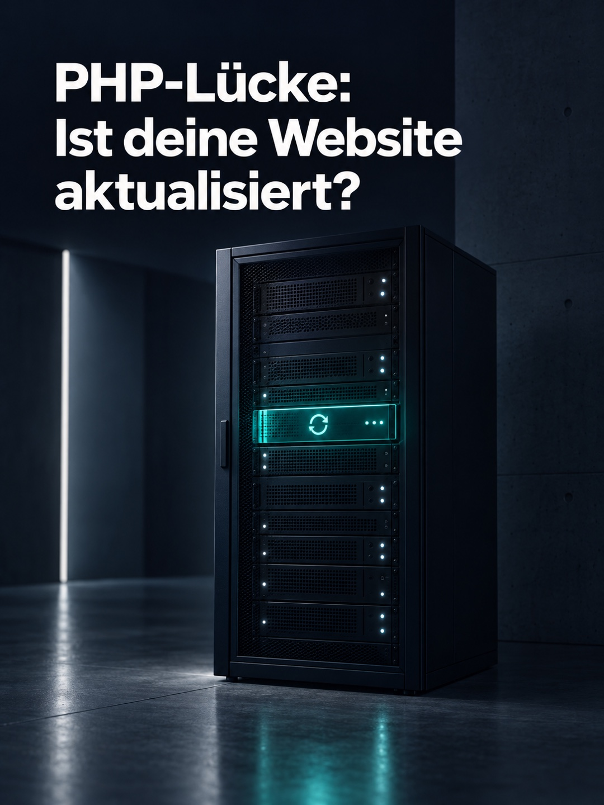

<a id="cd-002"></a>
## CD-002 · WordPress-Update reicht nicht

Security · 3:4 · Dokument Nr. 2

```text
Brand style for a one-person web agency in Wetzlar, Germany. Premium, calm, technical-editorial look. Palette: deep near-black navy background (#0B1220), off-white (#F5F5F2), single accent colour teal (#14B8A6), thin grey hairlines. Typography: bold modern geometric sans-serif headline, left-aligned, generous whitespace, max two text sizes, high contrast. Imagery: clean minimal 3D objects or minimal photoreal scenes, soft studio light, subtle grain, no clutter. Layout: vertical 3:4 portrait format (1080x1440 proportions); keep all text and key objects inside the centre with an 8% safe margin on every edge; keep the bottom-right corner (12% of width) empty and clean for a logo added later. Do not draw any logo. Text rules: render ONLY the German text given in quotes, exactly once, verbatim, with correct umlauts (ä, ö, ü, ß); no other words, no fake UI text, no watermarks, no third-party logos or brand names, no real or recognisable people. Two stacked translucent layers floating: lower layer identified by shape only (server foundation) glowing in the teal accent colour (#14B8A6), upper thin layer (website). An arrow points to the lower layer. Headline: "Diesmal reicht ein WordPress-Update nicht."
```

**Text im Bild:** „Diesmal reicht ein WordPress-Update nicht.“  
**Caption:** Die Oktober-Lücken sitzen in PHP auf dem Server, nicht in Theme oder Plugins. Laut BSI muss die PHP-Version aktualisiert werden. Kostenloser Check: Link in Bio.  
**Hashtags:** #websitesicherheit #phpsicherheit #wordpresssicherheit #itsicherheit #kmu #wordpress #wetzlar #mittelhessen #lahndill #giessen #webdesignwetzlar  
**Hinweise:** ⚠️ Fakten prüfen. Fakten vor dem Posten prüfen (Stand 27.–29.10.2026): Lücken in PHP statt in Theme/Plugins, BSI-Empfehlung zum PHP-Update. Posting-Plan: Woche 2, Mo. 9.11.2026, 7:30 oder 18:00 Uhr. Bonus: ohne Text im Format 16:9 als Blog-Header für codayweb.de; für LinkedIn.  
**Bilder:** [original](bilder/original/CD-002.jpg) · [instagram-3x4](bilder/instagram-3x4/CD-002.jpg) · [facebook-linkedin-4x5](bilder/facebook-linkedin-4x5/CD-002.jpg)

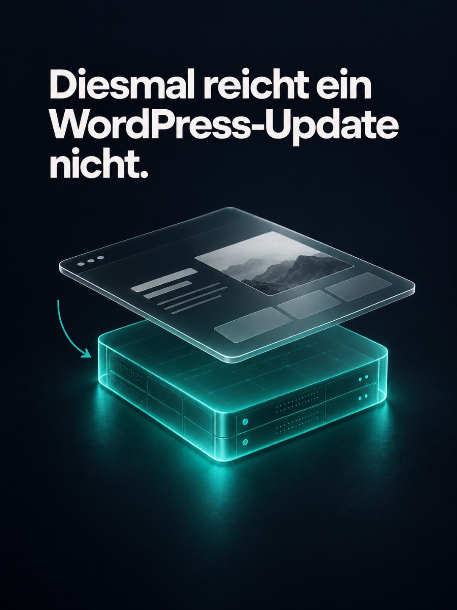

<a id="cd-003"></a>
## CD-003 · Kostenloser Website-Check (Haupt-CTA)

Security · 3:4 · Dokument Nr. 3

```text
Brand style for a one-person web agency in Wetzlar, Germany. Premium, calm, technical-editorial look. Palette: deep near-black navy background (#0B1220), off-white (#F5F5F2), single accent colour teal (#14B8A6), thin grey hairlines. Typography: bold modern geometric sans-serif headline, left-aligned, generous whitespace, max two text sizes, high contrast. Imagery: clean minimal 3D objects or minimal photoreal scenes, soft studio light, subtle grain, no clutter. Layout: vertical 3:4 portrait format (1080x1440 proportions); keep all text and key objects inside the centre with an 8% safe margin on every edge; keep the bottom-right corner (12% of width) empty and clean for a logo added later. Do not draw any logo. Text rules: render ONLY the German text given in quotes, exactly once, verbatim, with correct umlauts (ä, ö, ü, ß); no other words, no fake UI text, no watermarks, no third-party logos or brand names, no real or recognisable people. A large minimal magnifying glass made of glass and teal (#14B8A6) metal hovering over an abstract website wireframe, soft reflections. Headline: "Kostenloser Website-Check aus Wetzlar"
```

**Text im Bild:** „Kostenloser Website-Check aus Wetzlar“  
**Caption:** Ich schaue mir deine Website persönlich an: PHP-Version, Updates, Ladezeit, Sichtbarkeit. Kostenlos und unverbindlich. Schreib „CHECK“ per DM.  
**Hashtags:** #websitesicherheit #phpsicherheit #wordpresssicherheit #itsicherheit #kmu #wetzlar #mittelhessen #lahndill #giessen #webdesignwetzlar  
**Hinweise:** Posting-Plan: Woche 1, Fr. 6.11.2026; Woche 10, Fr. 8.1.2027 (laut Dokument „Jahresend-CTA“), 7:30 oder 18:00 Uhr. Woche 10 liegt rechnerisch im Januar 2027; für einen Jahresend-CTA den Termin in den Dezember legen. Bonus: als Seitenteiler in Akquise-Mails/Pitch-PDF.  
**Bilder:** [original](bilder/original/CD-003.jpg) · [instagram-3x4](bilder/instagram-3x4/CD-003.jpg) · [facebook-linkedin-4x5](bilder/facebook-linkedin-4x5/CD-003.jpg)

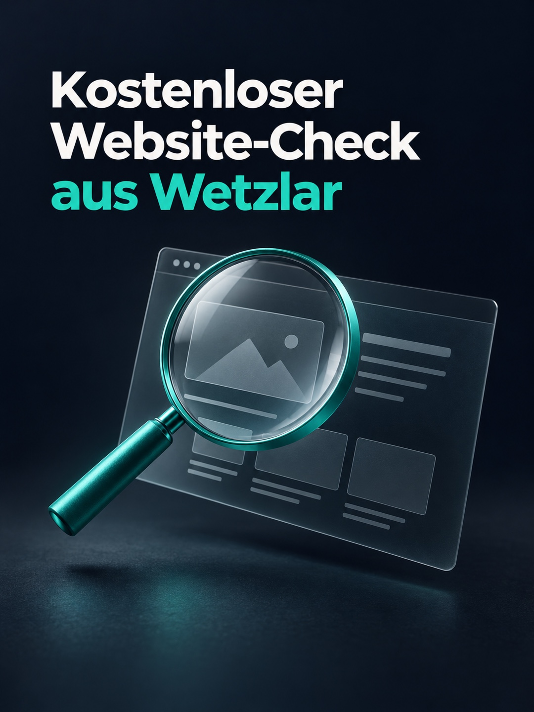

<a id="cd-004"></a>
## CD-004 · PHP 8.2 Support-Ende

Security · 3:4 · Dokument Nr. 4

```text
Brand style for a one-person web agency in Wetzlar, Germany. Premium, calm, technical-editorial look. Palette: deep near-black navy background (#0B1220), off-white (#F5F5F2), single accent colour teal (#14B8A6), thin grey hairlines. Typography: bold modern geometric sans-serif headline, left-aligned, generous whitespace, max two text sizes, high contrast. Imagery: clean minimal 3D objects or minimal photoreal scenes, soft studio light, subtle grain, no clutter. Layout: vertical 3:4 portrait format (1080x1440 proportions); keep all text and key objects inside the centre with an 8% safe margin on every edge; keep the bottom-right corner (12% of width) empty and clean for a logo added later. Do not draw any logo. Text rules: render ONLY the German text given in quotes, exactly once, verbatim, with correct umlauts (ä, ö, ü, ß); no other words, no fake UI text, no watermarks, no third-party logos or brand names, no real or recognisable people. Minimal wall calendar page showing the date 31 in large numerals, a small clock and a shield icon in the teal accent colour (#14B8A6). Headline: "PHP 8.2: Sicherheits-Updates nur bis 31.12."
```

**Text im Bild:** „PHP 8.2: Sicherheits-Updates nur bis 31.12.“  
**Caption:** Laut php.net endet der Sicherheits-Support für PHP 8.2 am 31.12.2026, danach gibt es keine Updates vom PHP-Projekt mehr. Update, Aufpreis beim Hoster oder Neubau? Ich helfe dir bei der Entscheidung.  
**Hashtags:** #websitesicherheit #phpsicherheit #wordpresssicherheit #itsicherheit #kmu #php #wetzlar #mittelhessen #lahndill #giessen #webdesignwetzlar  
**Hinweise:** ⚠️ Fakten prüfen. Fakten vor dem Posten prüfen (Stand 27.–29.10.2026): Sicherheits-Support für PHP 8.2 endet laut php.net am 31.12.2026. Posting-Plan: Woche 3, Mo. 16.11.2026; Woche 10, Mo. 4.1.2027 (laut Dokument „Reminder Dezember“), 7:30 oder 18:00 Uhr. Achtung: Woche 10 liegt rechnerisch im Januar 2027, also nach dem Support-Ende am 31.12.; den Reminder deshalb im Dezember posten. Bonus: ohne Text im Format 16:9 als Blog-Header für codayweb.de; für LinkedIn.  
**Bilder:** [original](bilder/original/CD-004.jpg) · [instagram-3x4](bilder/instagram-3x4/CD-004.jpg) · [facebook-linkedin-4x5](bilder/facebook-linkedin-4x5/CD-004.jpg)

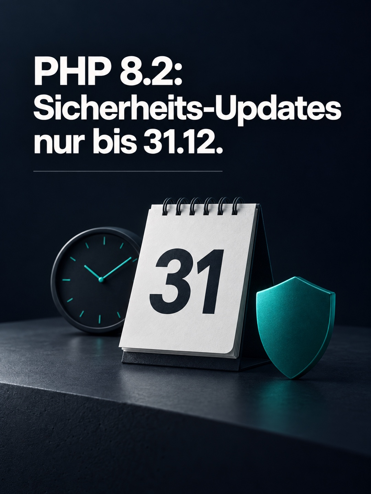

<a id="cd-005"></a>
## CD-005 · Karussell-Cover: In 4 Schritten

Karussell · 3:4 · Karussell K1 „PHP-Version prüfen“, Slide 1 von 6 · Dokument Nr. 5

```text
Brand style for a one-person web agency in Wetzlar, Germany. Premium, calm, technical-editorial look. Palette: deep near-black navy background (#0B1220), off-white (#F5F5F2), single accent colour teal (#14B8A6), thin grey hairlines. Typography: bold modern geometric sans-serif headline, left-aligned, generous whitespace, max two text sizes, high contrast. Imagery: clean minimal 3D objects or minimal photoreal scenes, soft studio light, subtle grain, no clutter. Layout: vertical 3:4 portrait format (1080x1440 proportions); keep all text and key objects inside the centre with an 8% safe margin on every edge; keep the bottom-right corner (12% of width) empty and clean for a logo added later. Do not draw any logo. Text rules: render ONLY the German text given in quotes, exactly once, verbatim, with correct umlauts (ä, ö, ü, ß); no other words, no fake UI text, no watermarks, no third-party logos or brand names, no real or recognisable people. Four numbered minimal tiles arranged vertically like steps, the first tile glowing in the teal accent colour (#14B8A6). Headline: "PHP-Version prüfen in 4 Schritten". Small label (bottom-left, small): "Swipe →".
```

**Text im Bild:** „PHP-Version prüfen in 4 Schritten“  
**Label:** „Swipe →“ (bottom-left, small)  
**Caption:** Speichern für später! Die vier Schritte stehen in den Slides.  
**Hashtags:** #websitesicherheit #phpsicherheit #wordpresssicherheit #itsicherheit #kmu #wetzlar #mittelhessen #lahndill #giessen #webdesignwetzlar  
**Hinweise:** Cover (Slide 1/6) von Karussell K1 „PHP-Version prüfen“; Slides 2–6: CD-029 bis CD-033. Den internen Verweis „(siehe Karussell K1)“ aus der Caption entfernt. Posting-Plan: Woche 1, Mi. 4.11.2026, 7:30 oder 18:00 Uhr. Bonus: Karussell K1 als PDF für LinkedIn.  
**Bilder:** [original](bilder/original/CD-005.jpg) · [instagram-3x4](bilder/instagram-3x4/CD-005.jpg) · [facebook-linkedin-4x5](bilder/facebook-linkedin-4x5/CD-005.jpg)

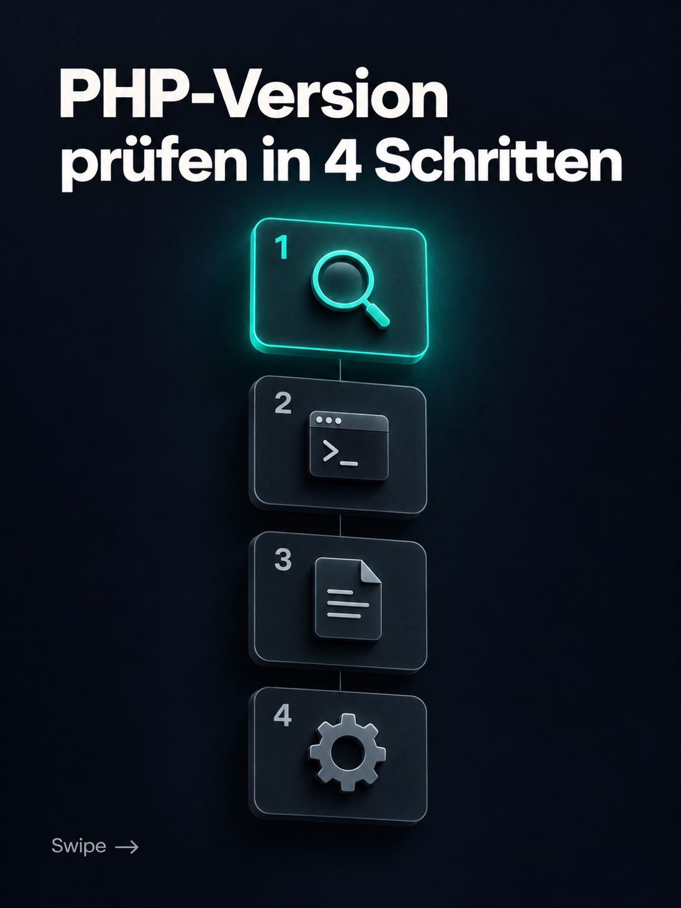

<a id="cd-006"></a>
## CD-006 · Frag zuerst deinen Hoster

Security · 3:4 · Dokument Nr. 6

```text
Brand style for a one-person web agency in Wetzlar, Germany. Premium, calm, technical-editorial look. Palette: deep near-black navy background (#0B1220), off-white (#F5F5F2), single accent colour teal (#14B8A6), thin grey hairlines. Typography: bold modern geometric sans-serif headline, left-aligned, generous whitespace, max two text sizes, high contrast. Imagery: clean minimal 3D objects or minimal photoreal scenes, soft studio light, subtle grain, no clutter. Layout: vertical 3:4 portrait format (1080x1440 proportions); keep all text and key objects inside the centre with an 8% safe margin on every edge; keep the bottom-right corner (12% of width) empty and clean for a logo added later. Do not draw any logo. Text rules: render ONLY the German text given in quotes, exactly once, verbatim, with correct umlauts (ä, ö, ü, ß); no other words, no fake UI text, no watermarks, no third-party logos or brand names, no real or recognisable people. A vintage-style desk phone in matte off-white beside a minimal server icon, a teal (#14B8A6) cable connecting them. Headline: "Erster Schritt: Frag deinen Hoster."
```

**Text im Bild:** „Erster Schritt: Frag deinen Hoster.“  
**Caption:** Bei Shared Hosting übernimmt meist der Provider das PHP-Update. Bei einem eigenen Server bist du selbst dran. Ich übernehme das zum Festpreis nach kostenlosem Check.  
**Hashtags:** #websitesicherheit #phpsicherheit #wordpresssicherheit #itsicherheit #kmu #hosting #wetzlar #mittelhessen #lahndill #giessen #webdesignwetzlar  
**Bilder:** [original](bilder/original/CD-006.jpg) · [instagram-3x4](bilder/instagram-3x4/CD-006.jpg) · [facebook-linkedin-4x5](bilder/facebook-linkedin-4x5/CD-006.jpg)

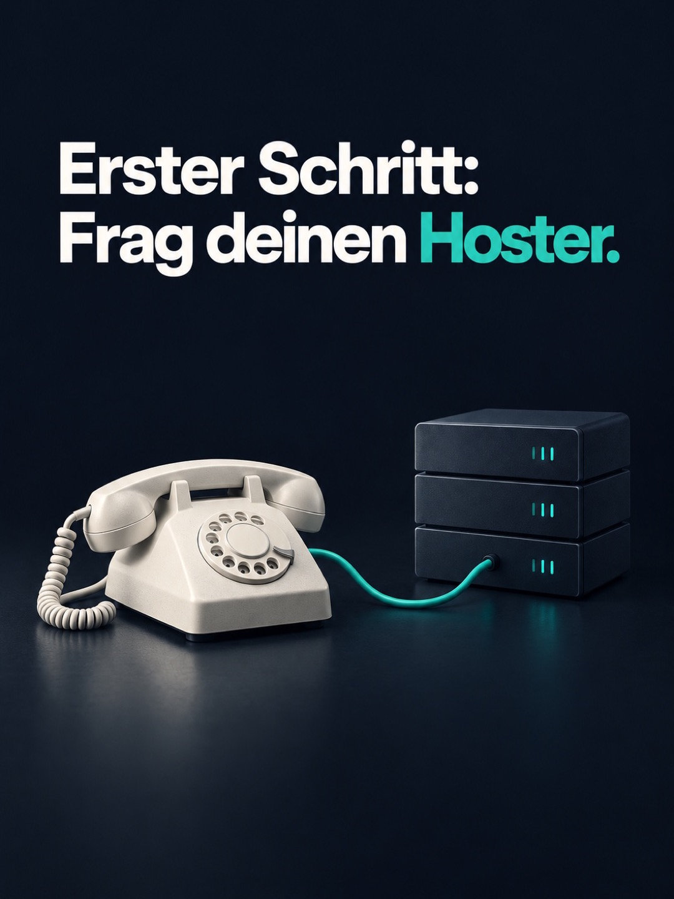

<a id="cd-007"></a>
## CD-007 · Ich prüfe. Du entscheidest.

Security · 3:4 · Dokument Nr. 7

```text
Brand style for a one-person web agency in Wetzlar, Germany. Premium, calm, technical-editorial look. Palette: deep near-black navy background (#0B1220), off-white (#F5F5F2), single accent colour teal (#14B8A6), thin grey hairlines. Typography: bold modern geometric sans-serif headline, left-aligned, generous whitespace, max two text sizes, high contrast. Imagery: clean minimal 3D objects or minimal photoreal scenes, soft studio light, subtle grain, no clutter. Layout: vertical 3:4 portrait format (1080x1440 proportions); keep all text and key objects inside the centre with an 8% safe margin on every edge; keep the bottom-right corner (12% of width) empty and clean for a logo added later. Do not draw any logo. Text rules: render ONLY the German text given in quotes, exactly once, verbatim, with correct umlauts (ä, ö, ü, ß); no other words, no fake UI text, no watermarks, no third-party logos or brand names, no real or recognisable people. A minimal 3D shield and a checklist card side by side on a dark surface, teal (#14B8A6) checkmarks. Headline: "Ich prüfe. Du entscheidest."
```

**Text im Bild:** „Ich prüfe. Du entscheidest.“  
**Caption:** Kein Verkaufsdruck: Erst der Check, dann ein Festpreis-Angebot. Und nur, wenn du willst.  
**Hashtags:** #websitesicherheit #phpsicherheit #wordpresssicherheit #itsicherheit #kmu #wetzlar #mittelhessen #lahndill #giessen #webdesignwetzlar #webdesign #nextjs #webentwicklung #websiterelaunch #selbststaendig  
**Hinweise:** Posting-Plan: Woche 8, Mo. 21.12.2026, 7:30 oder 18:00 Uhr.  
**Bilder:** [original](bilder/original/CD-007.jpg) · [instagram-3x4](bilder/instagram-3x4/CD-007.jpg) · [facebook-linkedin-4x5](bilder/facebook-linkedin-4x5/CD-007.jpg)

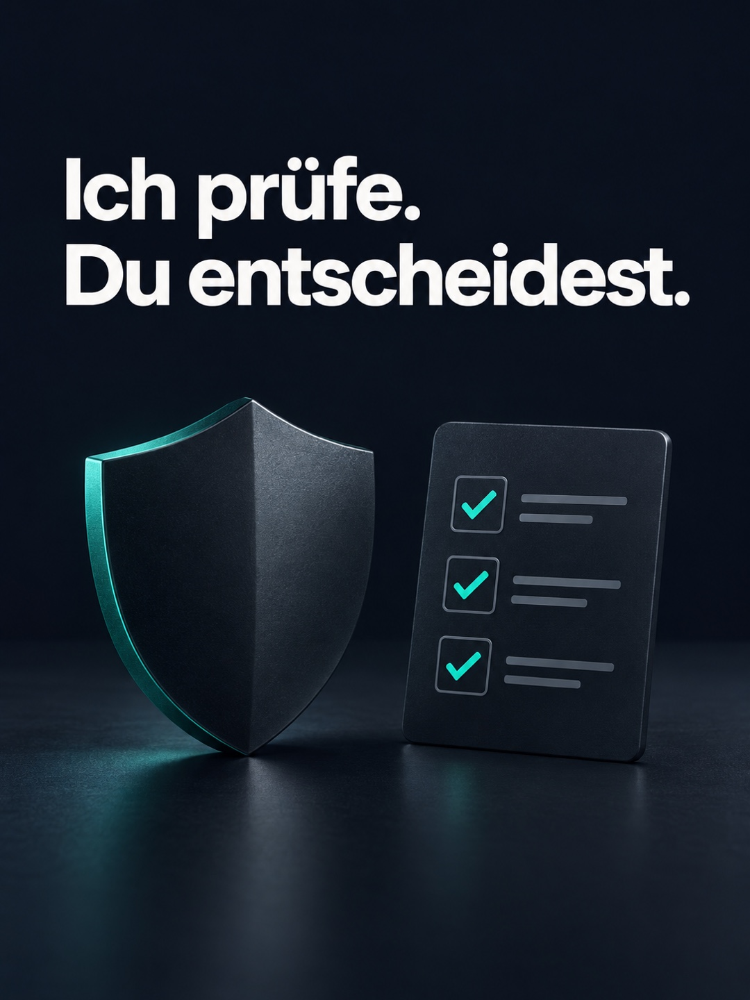

<a id="cd-008"></a>
## CD-008 · Migration WordPress → Next.js

Leistung · 3:4 · Dokument Nr. 8

```text
Brand style for a one-person web agency in Wetzlar, Germany. Premium, calm, technical-editorial look. Palette: deep near-black navy background (#0B1220), off-white (#F5F5F2), single accent colour teal (#14B8A6), thin grey hairlines. Typography: bold modern geometric sans-serif headline, left-aligned, generous whitespace, max two text sizes, high contrast. Imagery: clean minimal 3D objects or minimal photoreal scenes, soft studio light, subtle grain, no clutter. Layout: vertical 3:4 portrait format (1080x1440 proportions); keep all text and key objects inside the centre with an 8% safe margin on every edge; keep the bottom-right corner (12% of width) empty and clean for a logo added later. Do not draw any logo. Text rules: render ONLY the German text given in quotes, exactly once, verbatim, with correct umlauts (ä, ö, ü, ß); no other words, no fake UI text, no watermarks, no third-party logos or brand names, no real or recognisable people. A tangled bundle of grey cables on the left transforming into one clean straight teal (#14B8A6) line on the right. Headline: "Weniger Plugins. Weniger Baustellen."
```

**Text im Bild:** „Weniger Plugins. Weniger Baustellen.“  
**Caption:** Websites ohne Plugin-System bedeuten keine Plugin-Updates. Unhackbar ist keine Website, aber die Angriffsfläche wird kleiner. Relaunch-Gespräch: Link in Bio.  
**Hashtags:** #webdesign #nextjs #webentwicklung #websiterelaunch #selbststaendig #websitesicherheit #phpsicherheit #wordpresssicherheit #itsicherheit #kmu #wetzlar #mittelhessen #lahndill #giessen #webdesignwetzlar  
**Hinweise:** Posting-Plan: Woche 4, Mo. 23.11.2026, 7:30 oder 18:00 Uhr. Bonus: für LinkedIn.  
**Bilder:** [original](bilder/original/CD-008.jpg) · [instagram-3x4](bilder/instagram-3x4/CD-008.jpg) · [facebook-linkedin-4x5](bilder/facebook-linkedin-4x5/CD-008.jpg)

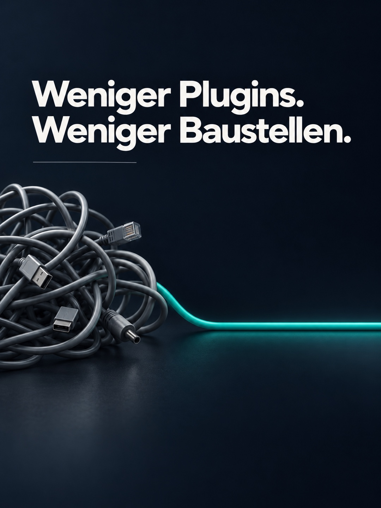

<a id="cd-009"></a>
## CD-009 · Wartung

Security · 3:4 · Dokument Nr. 9

```text
Brand style for a one-person web agency in Wetzlar, Germany. Premium, calm, technical-editorial look. Palette: deep near-black navy background (#0B1220), off-white (#F5F5F2), single accent colour teal (#14B8A6), thin grey hairlines. Typography: bold modern geometric sans-serif headline, left-aligned, generous whitespace, max two text sizes, high contrast. Imagery: clean minimal 3D objects or minimal photoreal scenes, soft studio light, subtle grain, no clutter. Layout: vertical 3:4 portrait format (1080x1440 proportions); keep all text and key objects inside the centre with an 8% safe margin on every edge; keep the bottom-right corner (12% of width) empty and clean for a logo added later. Do not draw any logo. Text rules: render ONLY the German text given in quotes, exactly once, verbatim, with correct umlauts (ä, ö, ü, ß); no other words, no fake UI text, no watermarks, no third-party logos or brand names, no real or recognisable people. A minimal wrench and a small calendar with recurring dots in the teal accent colour (#14B8A6), arranged like a still life. Headline: "Updates, Backups, Monitoring: erledigt."
```

**Text im Bild:** „Updates, Backups, Monitoring: erledigt.“  
**Caption:** WordPress-Wartung inklusive PHP-Version, Backup vor jedem Update und Erreichbarkeits-Monitoring. Monatspreis nach kostenlosem Check.  
**Hashtags:** #websitesicherheit #phpsicherheit #wordpresssicherheit #itsicherheit #kmu #wartung #wetzlar #mittelhessen #lahndill #giessen #webdesignwetzlar  
**Hinweise:** Posting-Plan: Woche 5, Mo. 30.11.2026, 7:30 oder 18:00 Uhr.  
**Bilder:** [original](bilder/original/CD-009.jpg) · [instagram-3x4](bilder/instagram-3x4/CD-009.jpg) · [facebook-linkedin-4x5](bilder/facebook-linkedin-4x5/CD-009.jpg)

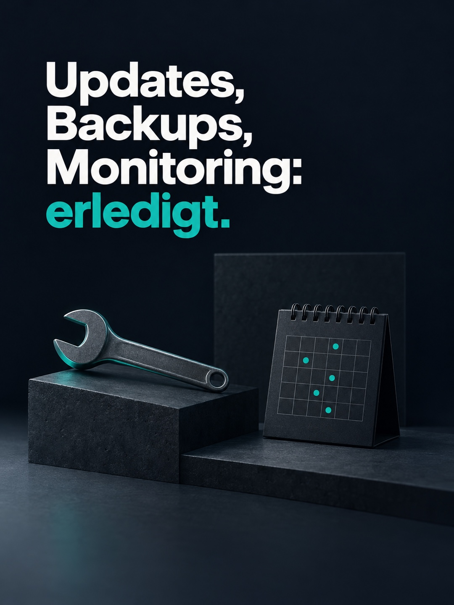

<a id="cd-010"></a>
## CD-010 · GEO-Hook

GEO · 3:4 · Dokument Nr. 10

```text
Brand style for a one-person web agency in Wetzlar, Germany. Premium, calm, technical-editorial look. Palette: deep near-black navy background (#0B1220), off-white (#F5F5F2), single accent colour teal (#14B8A6), thin grey hairlines. Typography: bold modern geometric sans-serif headline, left-aligned, generous whitespace, max two text sizes, high contrast. Imagery: clean minimal 3D objects or minimal photoreal scenes, soft studio light, subtle grain, no clutter. Layout: vertical 3:4 portrait format (1080x1440 proportions); keep all text and key objects inside the centre with an 8% safe margin on every edge; keep the bottom-right corner (12% of width) empty and clean for a logo added later. Do not draw any logo. Text rules: render ONLY the German text given in quotes, exactly once, verbatim, with correct umlauts (ä, ö, ü, ß); no other words, no fake UI text, no watermarks, no third-party logos or brand names, no real or recognisable people. An abstract chat bubble made of frosted glass floating above a tiny city map pin in the teal accent colour (#14B8A6). Headline: "Kennt ChatGPT deinen Betrieb?"
```

**Text im Bild:** „Kennt ChatGPT deinen Betrieb?“  
**Caption:** Laut Bitkom (11/2025) nutzen 50 % der Internetnutzer zumindest gelegentlich KI-Chats statt klassischer Suchmaschinen. GEO sorgt dafür, dass deine Website für diese Systeme lesbar ist. Wie? Siehe Karussell „GEO in 5 Slides erklärt“.  
**Hashtags:** #geo #kisichtbarkeit #lokaleseo #googleranking #chatgpt #wetzlar #mittelhessen #lahndill #giessen #webdesignwetzlar  
**Hinweise:** ⚠️ Fakten prüfen. Zahl vor dem Posten prüfen: Bitkom (11/2025), 50 % der Internetnutzer nutzen zumindest gelegentlich KI-Chats statt klassischer Suchmaschinen. „Siehe Karussell K2“ aus dem Dokument durch den Titel des GEO-Karussells ersetzt; erst posten, wenn dieses Karussell online ist. Posting-Plan: Woche 7, Mo. 14.12.2026, 7:30 oder 18:00 Uhr. Bonus: ohne Text im Format 16:9 als Blog-Header für codayweb.de.  
**Bilder:** [original](bilder/original/CD-010.jpg) · [instagram-3x4](bilder/instagram-3x4/CD-010.jpg) · [facebook-linkedin-4x5](bilder/facebook-linkedin-4x5/CD-010.jpg)

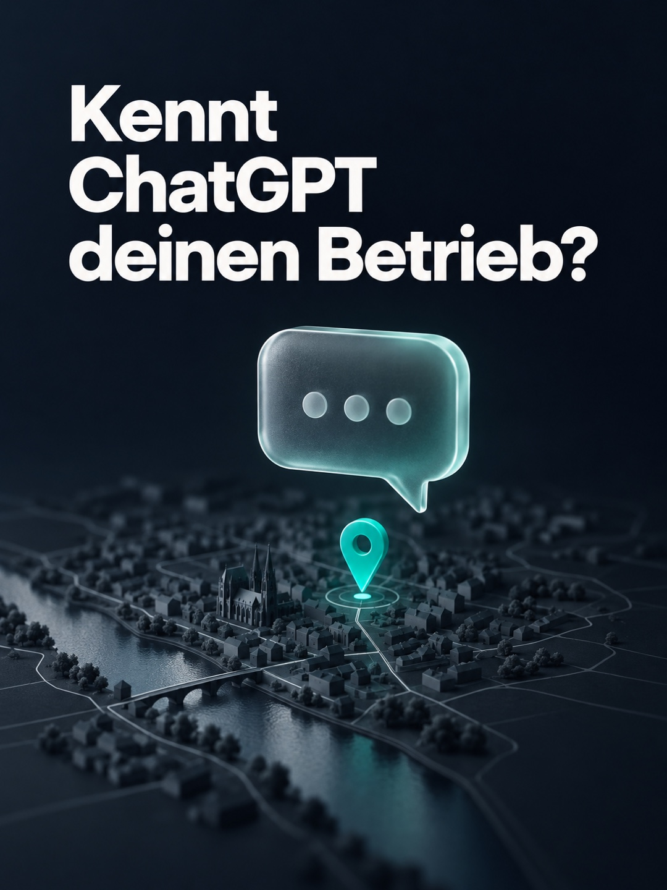

<a id="cd-011"></a>
## CD-011 · Karussell-Cover GEO

Karussell · 3:4 · Karussell K2 „GEO in 5 Slides“, Slide 1 von 6 · Dokument Nr. 11

```text
Brand style for a one-person web agency in Wetzlar, Germany. Premium, calm, technical-editorial look. Palette: deep near-black navy background (#0B1220), off-white (#F5F5F2), single accent colour teal (#14B8A6), thin grey hairlines. Typography: bold modern geometric sans-serif headline, left-aligned, generous whitespace, max two text sizes, high contrast. Imagery: clean minimal 3D objects or minimal photoreal scenes, soft studio light, subtle grain, no clutter. Layout: vertical 3:4 portrait format (1080x1440 proportions); keep all text and key objects inside the centre with an 8% safe margin on every edge; keep the bottom-right corner (12% of width) empty and clean for a logo added later. Do not draw any logo. Text rules: render ONLY the German text given in quotes, exactly once, verbatim, with correct umlauts (ä, ö, ü, ß); no other words, no fake UI text, no watermarks, no third-party logos or brand names, no real or recognisable people. Large typographic composition: the three letters "G", "E", "O" in outlined off-white, one of them filled in the teal accent colour (#14B8A6). Headline: "GEO in 5 Slides erklärt". Small label (bottom-left, small): "Swipe →".
```

**Text im Bild:** „GEO in 5 Slides erklärt“  
**Label:** „Swipe →“ (bottom-left, small)  
**Caption:** Speichern und an den Chef schicken 😉  
**Hashtags:** #geo #kisichtbarkeit #lokaleseo #googleranking #chatgpt #webdesign #nextjs #webentwicklung #websiterelaunch #selbststaendig  
**Hinweise:** Cover (Slide 1/6) von Karussell K2 „GEO in 5 Slides“; Slides 2–6: CD-034 bis CD-038. Position von „Swipe →“ im Dokument nicht angegeben; unten links wie bei Prompt 5. Posting-Plan: Woche 3, Mi. 18.11.2026, 7:30 oder 18:00 Uhr.  
**Bilder:** [original](bilder/original/CD-011.jpg) · [instagram-3x4](bilder/instagram-3x4/CD-011.jpg) · [facebook-linkedin-4x5](bilder/facebook-linkedin-4x5/CD-011.jpg)

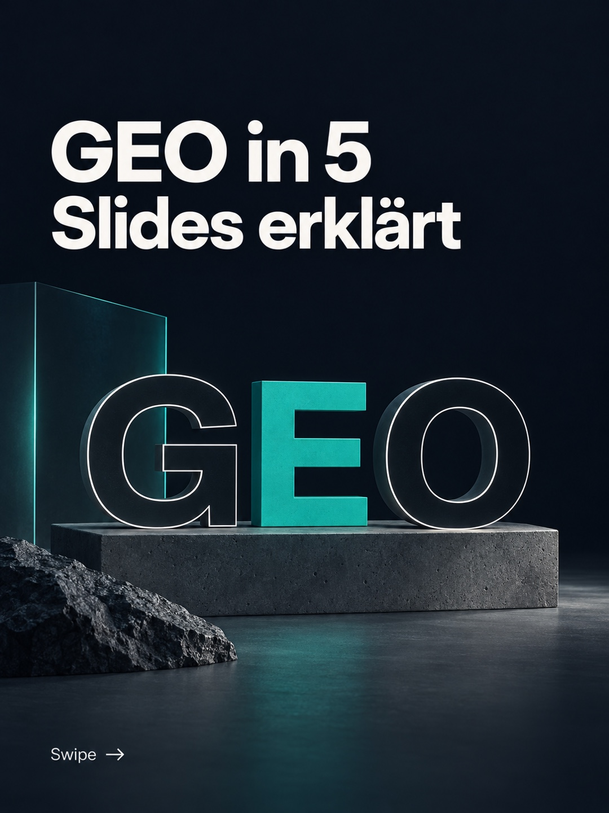

<a id="cd-012"></a>
## CD-012 · Ladezeit

Leistung · 3:4 · Dokument Nr. 12

```text
Brand style for a one-person web agency in Wetzlar, Germany. Premium, calm, technical-editorial look. Palette: deep near-black navy background (#0B1220), off-white (#F5F5F2), single accent colour teal (#14B8A6), thin grey hairlines. Typography: bold modern geometric sans-serif headline, left-aligned, generous whitespace, max two text sizes, high contrast. Imagery: clean minimal 3D objects or minimal photoreal scenes, soft studio light, subtle grain, no clutter. Layout: vertical 3:4 portrait format (1080x1440 proportions); keep all text and key objects inside the centre with an 8% safe margin on every edge; keep the bottom-right corner (12% of width) empty and clean for a logo added later. Do not draw any logo. Text rules: render ONLY the German text given in quotes, exactly once, verbatim, with correct umlauts (ä, ö, ü, ß); no other words, no fake UI text, no watermarks, no third-party logos or brand names, no real or recognisable people. A minimal stopwatch with the hand near zero, motion lines in the teal accent colour (#14B8A6). Headline: "Jede Sekunde Ladezeit kostet Anfragen."
```

**Text im Bild:** „Jede Sekunde Ladezeit kostet Anfragen.“  
**Caption:** In Googles Studie „Milliseconds Make Millions“ brachten schon 0,1 Sekunden schnellere mobile Ladezeit 8,4 % mehr Conversions im Handel. Ich messe Core Web Vitals als feste Größe, nicht erst nach dem Launch.  
**Hashtags:** #webdesign #nextjs #webentwicklung #websiterelaunch #selbststaendig #pagespeed #wetzlar #mittelhessen #lahndill #giessen #webdesignwetzlar  
**Hinweise:** ⚠️ Fakten prüfen. Studienwert vor dem Posten prüfen: Google-Studie „Milliseconds Make Millions“ (0,1 s schnellere mobile Ladezeit, 8,4 % mehr Conversions im Handel). Posting-Plan: Woche 9, Mo. 28.12.2026, 7:30 oder 18:00 Uhr. Bonus: ohne Text im Format 16:9 als Blog-Header für codayweb.de.  
**Bilder:** [original](bilder/original/CD-012.jpg) · [instagram-3x4](bilder/instagram-3x4/CD-012.jpg) · [facebook-linkedin-4x5](bilder/facebook-linkedin-4x5/CD-012.jpg)

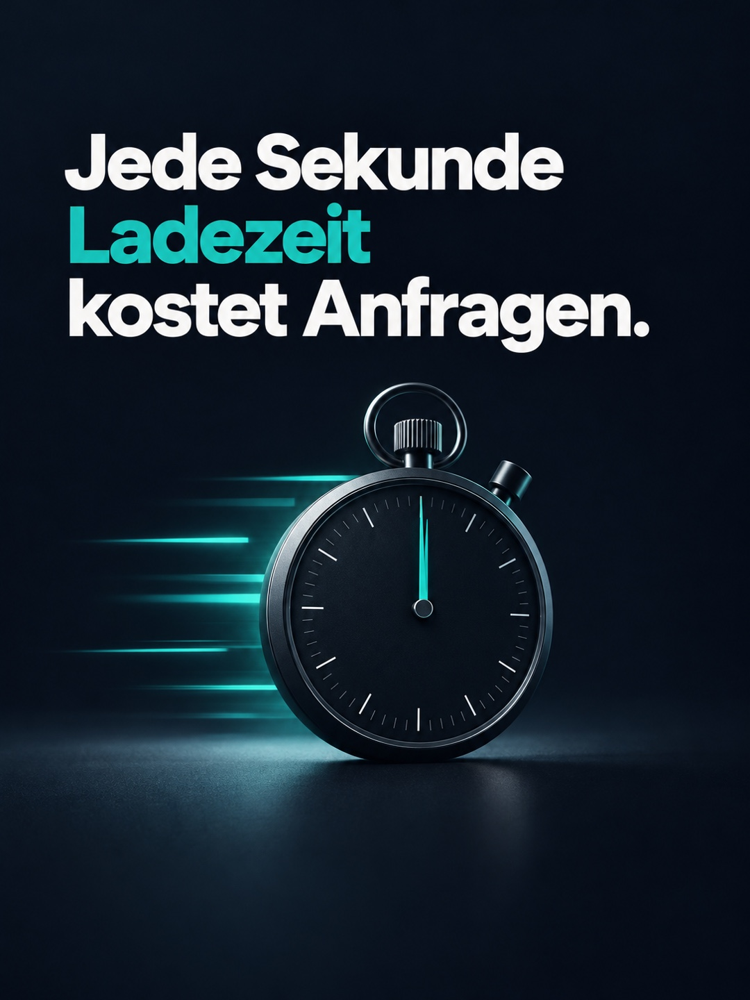

<a id="cd-013"></a>
## CD-013 · Festpreis

Leistung · 3:4 · Dokument Nr. 13

```text
Brand style for a one-person web agency in Wetzlar, Germany. Premium, calm, technical-editorial look. Palette: deep near-black navy background (#0B1220), off-white (#F5F5F2), single accent colour teal (#14B8A6), thin grey hairlines. Typography: bold modern geometric sans-serif headline, left-aligned, generous whitespace, max two text sizes, high contrast. Imagery: clean minimal 3D objects or minimal photoreal scenes, soft studio light, subtle grain, no clutter. Layout: vertical 3:4 portrait format (1080x1440 proportions); keep all text and key objects inside the centre with an 8% safe margin on every edge; keep the bottom-right corner (12% of width) empty and clean for a logo added later. Do not draw any logo. Text rules: render ONLY the German text given in quotes, exactly once, verbatim, with correct umlauts (ä, ö, ü, ß); no other words, no fake UI text, no watermarks, no third-party logos or brand names, no real or recognisable people. A sealed envelope with a teal (#14B8A6) wax-style seal on a dark desk, a pen beside it. Headline: "Festpreis statt Stundenzettel."
```

**Text im Bild:** „Festpreis statt Stundenzettel.“  
**Caption:** Nach dem kostenlosen Erstgespräch bekommst du ein Angebot mit verbindlichem Festpreis. Er ändert sich nur, wenn du mehr beauftragst.  
**Hashtags:** #webdesign #nextjs #webentwicklung #websiterelaunch #selbststaendig #wetzlar #mittelhessen #lahndill #giessen #webdesignwetzlar  
**Hinweise:** Wirkt das Bild fotorealistisch, „KI-generiertes Symbolbild“ in die Caption schreiben. Posting-Plan: Woche 6, Mo. 7.12.2026, 7:30 oder 18:00 Uhr. Bonus: für LinkedIn.  
**Bilder:** [original](bilder/original/CD-013.jpg) · [instagram-3x4](bilder/instagram-3x4/CD-013.jpg) · [facebook-linkedin-4x5](bilder/facebook-linkedin-4x5/CD-013.jpg)

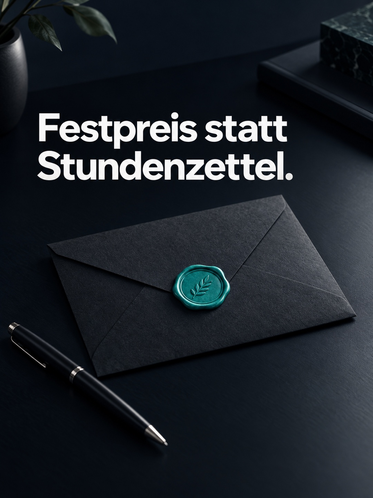

<a id="cd-014"></a>
## CD-014 · Ein Ansprechpartner

Leistung · 3:4 · Dokument Nr. 14

```text
Brand style for a one-person web agency in Wetzlar, Germany. Premium, calm, technical-editorial look. Palette: deep near-black navy background (#0B1220), off-white (#F5F5F2), single accent colour teal (#14B8A6), thin grey hairlines. Typography: bold modern geometric sans-serif headline, left-aligned, generous whitespace, max two text sizes, high contrast. Imagery: clean minimal 3D objects or minimal photoreal scenes, soft studio light, subtle grain, no clutter. Layout: vertical 3:4 portrait format (1080x1440 proportions); keep all text and key objects inside the centre with an 8% safe margin on every edge; keep the bottom-right corner (12% of width) empty and clean for a logo added later. Do not draw any logo. Text rules: render ONLY the German text given in quotes, exactly once, verbatim, with correct umlauts (ä, ö, ü, ß); no other words, no fake UI text, no watermarks, no third-party logos or brand names, no real or recognisable people. A single chair at a tidy desk with a laptop showing abstract code shapes, seen from behind, no person. Headline: "Ein Ansprechpartner. Von Plan bis Code."
```

**Text im Bild:** „Ein Ansprechpartner. Von Plan bis Code.“  
**Caption:** Bei Coday planst, besprichst und baust du mit derselben Person. Kein Weiterreichen an ein Team, das du nie kennengelernt hast.  
**Hashtags:** #webdesign #nextjs #webentwicklung #websiterelaunch #selbststaendig #wetzlar #mittelhessen #lahndill #giessen #webdesignwetzlar #solounternehmer  
**Hinweise:** Wirkt das Bild fotorealistisch, „KI-generiertes Symbolbild“ in die Caption schreiben. Posting-Plan: Woche 2, Mi. 11.11.2026, 7:30 oder 18:00 Uhr.  
**Bilder:** [original](bilder/original/CD-014.jpg) · [instagram-3x4](bilder/instagram-3x4/CD-014.jpg) · [facebook-linkedin-4x5](bilder/facebook-linkedin-4x5/CD-014.jpg)

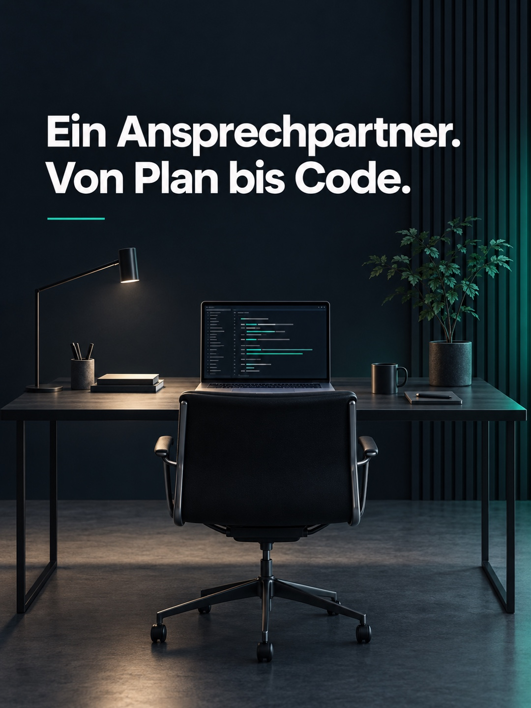

<a id="cd-015"></a>
## CD-015 · Quellcode-Übergabe

Leistung · 3:4 · Dokument Nr. 15

```text
Brand style for a one-person web agency in Wetzlar, Germany. Premium, calm, technical-editorial look. Palette: deep near-black navy background (#0B1220), off-white (#F5F5F2), single accent colour teal (#14B8A6), thin grey hairlines. Typography: bold modern geometric sans-serif headline, left-aligned, generous whitespace, max two text sizes, high contrast. Imagery: clean minimal 3D objects or minimal photoreal scenes, soft studio light, subtle grain, no clutter. Layout: vertical 3:4 portrait format (1080x1440 proportions); keep all text and key objects inside the centre with an 8% safe margin on every edge; keep the bottom-right corner (12% of width) empty and clean for a logo added later. Do not draw any logo. Text rules: render ONLY the German text given in quotes, exactly once, verbatim, with correct umlauts (ä, ö, ü, ß); no other words, no fake UI text, no watermarks, no third-party logos or brand names, no real or recognisable people. A minimal metal key resting on a folded sheet with abstract code lines, teal (#14B8A6) highlight. Headline: "Dein Code gehört dir."
```

**Text im Bild:** „Dein Code gehört dir.“  
**Caption:** Zum Projektabschluss bekommst du den Quellcode. Kein Lizenz-Abo, kein Lock-in.  
**Hashtags:** #webdesign #nextjs #webentwicklung #websiterelaunch #selbststaendig #wetzlar #mittelhessen #lahndill #giessen #webdesignwetzlar  
**Hinweise:** Posting-Plan: Woche 10, Mi. 6.1.2027, 7:30 oder 18:00 Uhr.  
**Bilder:** [original](bilder/original/CD-015.jpg) · [instagram-3x4](bilder/instagram-3x4/CD-015.jpg) · [facebook-linkedin-4x5](bilder/facebook-linkedin-4x5/CD-015.jpg)

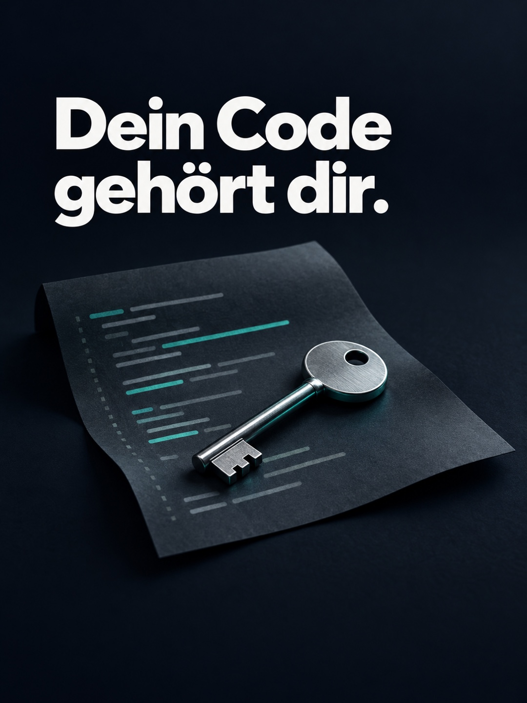

<a id="cd-016"></a>
## CD-016 · Gastro

Branche · 3:4 · Dokument Nr. 16

```text
Brand style for a one-person web agency in Wetzlar, Germany. Premium, calm, technical-editorial look. Palette: deep near-black navy background (#0B1220), off-white (#F5F5F2), single accent colour teal (#14B8A6), thin grey hairlines. Typography: bold modern geometric sans-serif headline, left-aligned, generous whitespace, max two text sizes, high contrast. Imagery: clean minimal 3D objects or minimal photoreal scenes, soft studio light, subtle grain, no clutter. Layout: vertical 3:4 portrait format (1080x1440 proportions); keep all text and key objects inside the centre with an 8% safe margin on every edge; keep the bottom-right corner (12% of width) empty and clean for a logo added later. Do not draw any logo. Text rules: render ONLY the German text given in quotes, exactly once, verbatim, with correct umlauts (ä, ö, ü, ß); no other words, no fake UI text, no watermarks, no third-party logos or brand names, no real or recognisable people. A smartphone on a rustic restaurant table showing an abstract clean menu layout (no readable text), warm candle light mixed with teal (#14B8A6) rim light. Headline: "Speisekarte online, mit Allergenen."
```

**Text im Bild:** „Speisekarte online, mit Allergenen.“  
**Caption:** Gäste schauen vorher aufs Handy: Karte, Preise, Allergene, Anfahrt. Websites für Gastro in Mittelhessen.  
**Hashtags:** #wetzlar #mittelhessen #lahndill #giessen #webdesignwetzlar #gastronomie #restaurantwebsite #webdesign #nextjs #webentwicklung #websiterelaunch #selbststaendig  
**Hinweise:** Wirkt das Bild fotorealistisch, „KI-generiertes Symbolbild“ in die Caption schreiben. Posting-Plan: Woche 2, Fr. 13.11.2026, 7:30 oder 18:00 Uhr.  
**Bilder:** [original](bilder/original/CD-016.jpg) · [instagram-3x4](bilder/instagram-3x4/CD-016.jpg) · [facebook-linkedin-4x5](bilder/facebook-linkedin-4x5/CD-016.jpg)

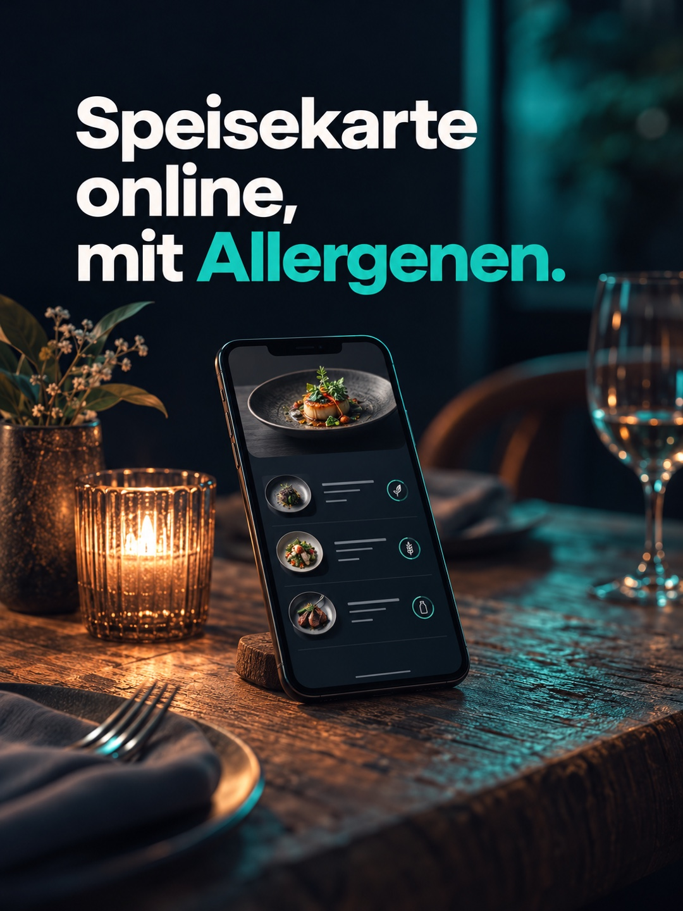

<a id="cd-017"></a>
## CD-017 · Handwerk

Branche · 3:4 · Dokument Nr. 17

```text
Brand style for a one-person web agency in Wetzlar, Germany. Premium, calm, technical-editorial look. Palette: deep near-black navy background (#0B1220), off-white (#F5F5F2), single accent colour teal (#14B8A6), thin grey hairlines. Typography: bold modern geometric sans-serif headline, left-aligned, generous whitespace, max two text sizes, high contrast. Imagery: clean minimal 3D objects or minimal photoreal scenes, soft studio light, subtle grain, no clutter. Layout: vertical 3:4 portrait format (1080x1440 proportions); keep all text and key objects inside the centre with an 8% safe margin on every edge; keep the bottom-right corner (12% of width) empty and clean for a logo added later. Do not draw any logo. Text rules: render ONLY the German text given in quotes, exactly once, verbatim, with correct umlauts (ä, ö, ü, ß); no other words, no fake UI text, no watermarks, no third-party logos or brand names, no real or recognisable people. A tradesperson's gloved hand (no face) holding a smartphone with an abstract booking calendar, workshop background softly blurred. Headline: "Mehr Anfragen vom Handy."
```

**Text im Bild:** „Mehr Anfragen vom Handy.“  
**Caption:** Termin für Aufmaß oder Beratung direkt online buchen, so wie bei Batherm in Wetzlar.  
**Hashtags:** #wetzlar #mittelhessen #lahndill #giessen #webdesignwetzlar #handwerk #webdesign #nextjs #webentwicklung #websiterelaunch #selbststaendig  
**Hinweise:** Kundenfreigabe nötig: Referenz Batherm nur nach schriftlicher Freigabe nennen, sonst „, so wie bei Batherm in Wetzlar“ aus der Caption streichen. Wirkt das Bild fotorealistisch, „KI-generiertes Symbolbild“ in die Caption schreiben. Posting-Plan: Woche 4, Fr. 27.11.2026, 7:30 oder 18:00 Uhr.  

<a id="cd-018"></a>
## CD-018 · Schlüsseldienst

Branche · 3:4 · Dokument Nr. 18

```text
Brand style for a one-person web agency in Wetzlar, Germany. Premium, calm, technical-editorial look. Palette: deep near-black navy background (#0B1220), off-white (#F5F5F2), single accent colour teal (#14B8A6), thin grey hairlines. Typography: bold modern geometric sans-serif headline, left-aligned, generous whitespace, max two text sizes, high contrast. Imagery: clean minimal 3D objects or minimal photoreal scenes, soft studio light, subtle grain, no clutter. Layout: vertical 3:4 portrait format (1080x1440 proportions); keep all text and key objects inside the centre with an 8% safe margin on every edge; keep the bottom-right corner (12% of width) empty and clean for a logo added later. Do not draw any logo. Text rules: render ONLY the German text given in quotes, exactly once, verbatim, with correct umlauts (ä, ö, ü, ß); no other words, no fake UI text, no watermarks, no third-party logos or brand names, no real or recognisable people. A front door at night with a smartphone glowing in the foreground showing one large round call button in the teal accent colour (#14B8A6). Headline: "Notfall? Ein Tippen bis zum Anruf."
```

**Text im Bild:** „Notfall? Ein Tippen bis zum Anruf.“  
**Caption:** Wer ausgesperrt ist, will nicht scrollen. Kurze Wege und ein Anruf-Button auf jeder Seite.  
**Hashtags:** #wetzlar #mittelhessen #lahndill #giessen #webdesignwetzlar #schlüsseldienst #webdesign #nextjs #webentwicklung #websiterelaunch #selbststaendig  
**Hinweise:** Wirkt das Bild fotorealistisch, „KI-generiertes Symbolbild“ in die Caption schreiben. Posting-Plan: Woche 3, Fr. 20.11.2026, 7:30 oder 18:00 Uhr.  

<a id="cd-019"></a>
## CD-019 · Friseur

Branche · 3:4 · Dokument Nr. 19

```text
Brand style for a one-person web agency in Wetzlar, Germany. Premium, calm, technical-editorial look. Palette: deep near-black navy background (#0B1220), off-white (#F5F5F2), single accent colour teal (#14B8A6), thin grey hairlines. Typography: bold modern geometric sans-serif headline, left-aligned, generous whitespace, max two text sizes, high contrast. Imagery: clean minimal 3D objects or minimal photoreal scenes, soft studio light, subtle grain, no clutter. Layout: vertical 3:4 portrait format (1080x1440 proportions); keep all text and key objects inside the centre with an 8% safe margin on every edge; keep the bottom-right corner (12% of width) empty and clean for a logo added later. Do not draw any logo. Text rules: render ONLY the German text given in quotes, exactly once, verbatim, with correct umlauts (ä, ö, ü, ß); no other words, no fake UI text, no watermarks, no third-party logos or brand names, no real or recognisable people. Empty modern salon chair, scissors and comb on a shelf, smartphone showing an abstract booking grid. Headline: "Termine buchen, auch um 23 Uhr."
```

**Text im Bild:** „Termine buchen, auch um 23 Uhr.“  
**Caption:** Deine Kundinnen buchen, wenn sie Zeit haben, nicht nur während der Öffnungszeiten.  
**Hashtags:** #wetzlar #mittelhessen #lahndill #giessen #webdesignwetzlar #friseur #webdesign #nextjs #webentwicklung #websiterelaunch #selbststaendig  
**Hinweise:** Wirkt das Bild fotorealistisch, „KI-generiertes Symbolbild“ in die Caption schreiben. Posting-Plan: Woche 6, Fr. 11.12.2026, 7:30 oder 18:00 Uhr.  
**Bilder:** [original](bilder/original/CD-019.jpg) · [instagram-3x4](bilder/instagram-3x4/CD-019.jpg) · [facebook-linkedin-4x5](bilder/facebook-linkedin-4x5/CD-019.jpg)

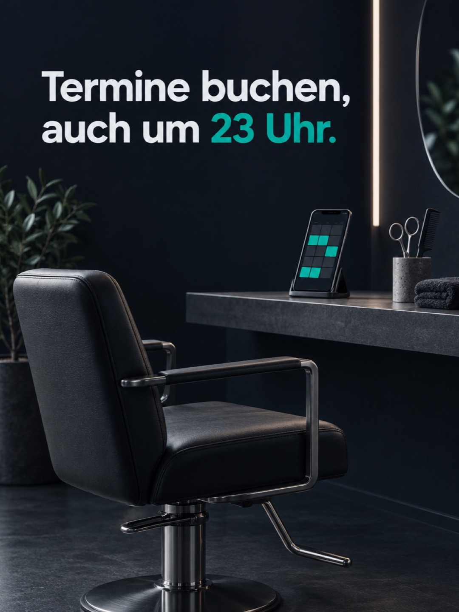

<a id="cd-020"></a>
## CD-020 · Boutique

Branche · 3:4 · Dokument Nr. 20

```text
Brand style for a one-person web agency in Wetzlar, Germany. Premium, calm, technical-editorial look. Palette: deep near-black navy background (#0B1220), off-white (#F5F5F2), single accent colour teal (#14B8A6), thin grey hairlines. Typography: bold modern geometric sans-serif headline, left-aligned, generous whitespace, max two text sizes, high contrast. Imagery: clean minimal 3D objects or minimal photoreal scenes, soft studio light, subtle grain, no clutter. Layout: vertical 3:4 portrait format (1080x1440 proportions); keep all text and key objects inside the centre with an 8% safe margin on every edge; keep the bottom-right corner (12% of width) empty and clean for a logo added later. Do not draw any logo. Text rules: render ONLY the German text given in quotes, exactly once, verbatim, with correct umlauts (ä, ö, ü, ß); no other words, no fake UI text, no watermarks, no third-party logos or brand names, no real or recognisable people. A minimalist clothing rail with three garments in neutral tones, a tablet leaning against it showing an abstract product grid. Headline: "Dein Laden. Rund um die Uhr geöffnet."
```

**Text im Bild:** „Dein Laden. Rund um die Uhr geöffnet.“  
**Caption:** Websites für Boutiquen und lokale Shops in Wetzlar und Umgebung.  
**Hashtags:** #wetzlar #mittelhessen #lahndill #giessen #webdesignwetzlar #boutique #webdesign #nextjs #webentwicklung #websiterelaunch #selbststaendig  
**Hinweise:** Wirkt das Bild fotorealistisch, „KI-generiertes Symbolbild“ in die Caption schreiben. Posting-Plan: Woche 8, Fr. 25.12.2026 (1. Weihnachtsfeiertag), 7:30 oder 18:00 Uhr.  
**Bilder:** [original](bilder/original/CD-020.jpg) · [instagram-3x4](bilder/instagram-3x4/CD-020.jpg) · [facebook-linkedin-4x5](bilder/facebook-linkedin-4x5/CD-020.jpg)

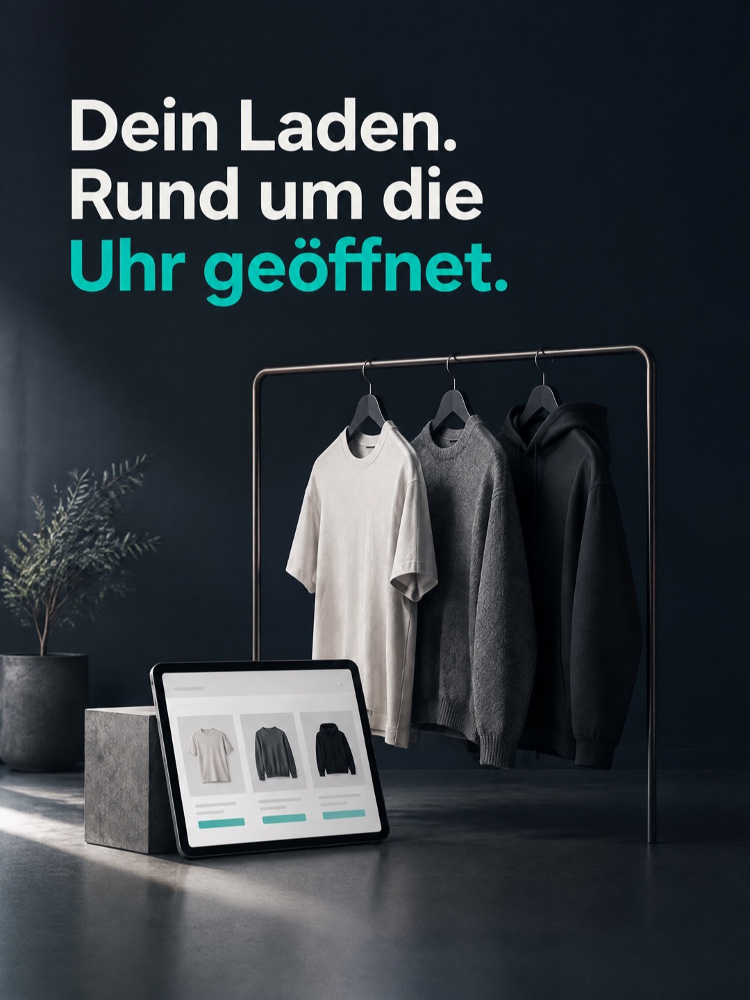

<a id="cd-021"></a>
## CD-021 · Kanzlei/Praxis

Branche · 3:4 · Dokument Nr. 21

```text
Brand style for a one-person web agency in Wetzlar, Germany. Premium, calm, technical-editorial look. Palette: deep near-black navy background (#0B1220), off-white (#F5F5F2), single accent colour teal (#14B8A6), thin grey hairlines. Typography: bold modern geometric sans-serif headline, left-aligned, generous whitespace, max two text sizes, high contrast. Imagery: clean minimal 3D objects or minimal photoreal scenes, soft studio light, subtle grain, no clutter. Layout: vertical 3:4 portrait format (1080x1440 proportions); keep all text and key objects inside the centre with an 8% safe margin on every edge; keep the bottom-right corner (12% of width) empty and clean for a logo added later. Do not draw any logo. Text rules: render ONLY the German text given in quotes, exactly once, verbatim, with correct umlauts (ä, ö, ü, ß); no other words, no fake UI text, no watermarks, no third-party logos or brand names, no real or recognisable people. A calm reception desk with a closed leather folder and a plant, laptop with abstract layout, very orderly. Headline: "Vertrauen beginnt vor dem ersten Termin."
```

**Text im Bild:** „Vertrauen beginnt vor dem ersten Termin.“  
**Caption:** Leistungen, Team, Öffnungszeiten und Kontakt an einem Ort, seriös und schnell.  
**Hashtags:** #wetzlar #mittelhessen #lahndill #giessen #webdesignwetzlar #kanzlei #praxis #webdesign #nextjs #webentwicklung #websiterelaunch #selbststaendig  
**Hinweise:** Wirkt das Bild fotorealistisch, „KI-generiertes Symbolbild“ in die Caption schreiben. Posting-Plan: Woche 7, Fr. 18.12.2026, 7:30 oder 18:00 Uhr.  
**Bilder:** [original](bilder/original/CD-021.jpg) · [instagram-3x4](bilder/instagram-3x4/CD-021.jpg) · [facebook-linkedin-4x5](bilder/facebook-linkedin-4x5/CD-021.jpg)

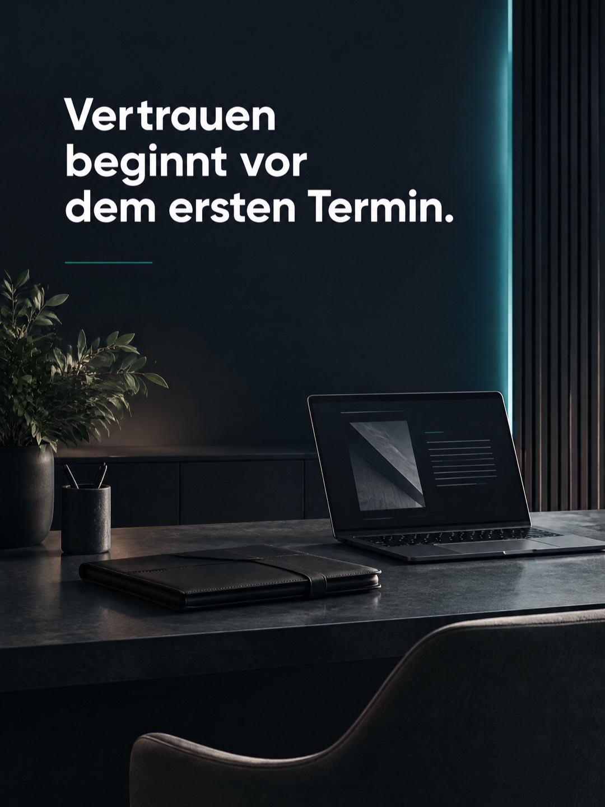

<a id="cd-022"></a>
## CD-022 · Lokal

Lokal · 3:4 · Dokument Nr. 22

```text
Brand style for a one-person web agency in Wetzlar, Germany. Premium, calm, technical-editorial look. Palette: deep near-black navy background (#0B1220), off-white (#F5F5F2), single accent colour teal (#14B8A6), thin grey hairlines. Typography: bold modern geometric sans-serif headline, left-aligned, generous whitespace, max two text sizes, high contrast. Imagery: clean minimal 3D objects or minimal photoreal scenes, soft studio light, subtle grain, no clutter. Layout: vertical 3:4 portrait format (1080x1440 proportions); keep all text and key objects inside the centre with an 8% safe margin on every edge; keep the bottom-right corner (12% of width) empty and clean for a logo added later. Do not draw any logo. Text rules: render ONLY the German text given in quotes, exactly once, verbatim, with correct umlauts (ä, ö, ü, ß); no other words, no fake UI text, no watermarks, no third-party logos or brand names, no real or recognisable people. Abstract topographic map lines of a river valley in off-white on dark navy, one pin in the teal accent colour (#14B8A6), no real landmarks or buildings. Headline: "Webdesign aus Wetzlar. Für Mittelhessen."
```

**Text im Bild:** „Webdesign aus Wetzlar. Für Mittelhessen.“  
**Caption:** Wetzlar, Gießen, Marburg, Limburg: Erstgespräch per Telefon, Video oder bei dir vor Ort.  
**Hashtags:** #wetzlar #mittelhessen #lahndill #giessen #webdesignwetzlar #marburg #limburg #webdesign #nextjs #webentwicklung #websiterelaunch #selbststaendig  
**Hinweise:** Posting-Plan: Woche 5, Fr. 4.12.2026, 7:30 oder 18:00 Uhr. Bonus: fürs Google-Unternehmensprofil (ohne Text-Overlay).  
**Bilder:** [original](bilder/original/CD-022.jpg) · [instagram-3x4](bilder/instagram-3x4/CD-022.jpg) · [facebook-linkedin-4x5](bilder/facebook-linkedin-4x5/CD-022.jpg)

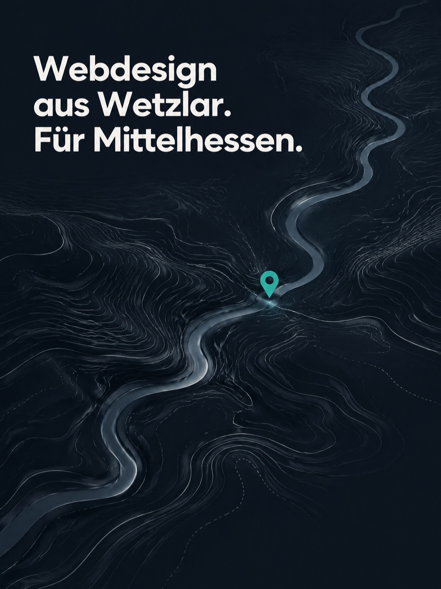

<a id="cd-023"></a>
## CD-023 · Vorher/Nachher (Konzept)

Vorher/Nachher · 3:4 · Dokument Nr. 23

```text
Brand style for a one-person web agency in Wetzlar, Germany. Premium, calm, technical-editorial look. Palette: deep near-black navy background (#0B1220), off-white (#F5F5F2), single accent colour teal (#14B8A6), thin grey hairlines. Typography: bold modern geometric sans-serif headline, left-aligned, generous whitespace, max two text sizes, high contrast. Imagery: clean minimal 3D objects or minimal photoreal scenes, soft studio light, subtle grain, no clutter. Layout: vertical 3:4 portrait format (1080x1440 proportions); keep all text and key objects inside the centre with an 8% safe margin on every edge; keep the bottom-right corner (12% of width) empty and clean for a logo added later. Do not draw any logo. Text rules: render ONLY the German text given in quotes, exactly once, verbatim, with correct umlauts (ä, ö, ü, ß); no other words, no fake UI text, no watermarks, no third-party logos or brand names, no real or recognisable people. Split composition: left half a cluttered, generic grey website wireframe; right half a clean, spacious wireframe with a teal (#14B8A6) button. Headline: "Baukasten oder Maßarbeit?". Small label (small label above the left half): "Vorher". Small label (small label above the right half): "Nachher".
```

**Text im Bild:** „Baukasten oder Maßarbeit?“  
**Label:** „Vorher“ (small label above the left half)  
**Label:** „Nachher“ (small label above the right half)  
**Caption:** Symbolbild, kein Kundenprojekt. Was du gewinnst: Klarheit, Tempo, einen Weg zur Anfrage auf jeder Seite.  
**Hashtags:** #webdesign #nextjs #webentwicklung #websiterelaunch #selbststaendig #wetzlar #mittelhessen #lahndill #giessen #webdesignwetzlar  
**Hinweise:** Der Hinweis „Symbolbild, kein Kundenprojekt.“ muss in der Caption bleiben. Posting-Plan: Woche 7, Mi. 16.12.2026, 7:30 oder 18:00 Uhr. Bonus: als Seitenteiler in Akquise-Mails/Pitch-PDF.  
**Bilder:** [original](bilder/original/CD-023.jpg) · [instagram-3x4](bilder/instagram-3x4/CD-023.jpg) · [facebook-linkedin-4x5](bilder/facebook-linkedin-4x5/CD-023.jpg)

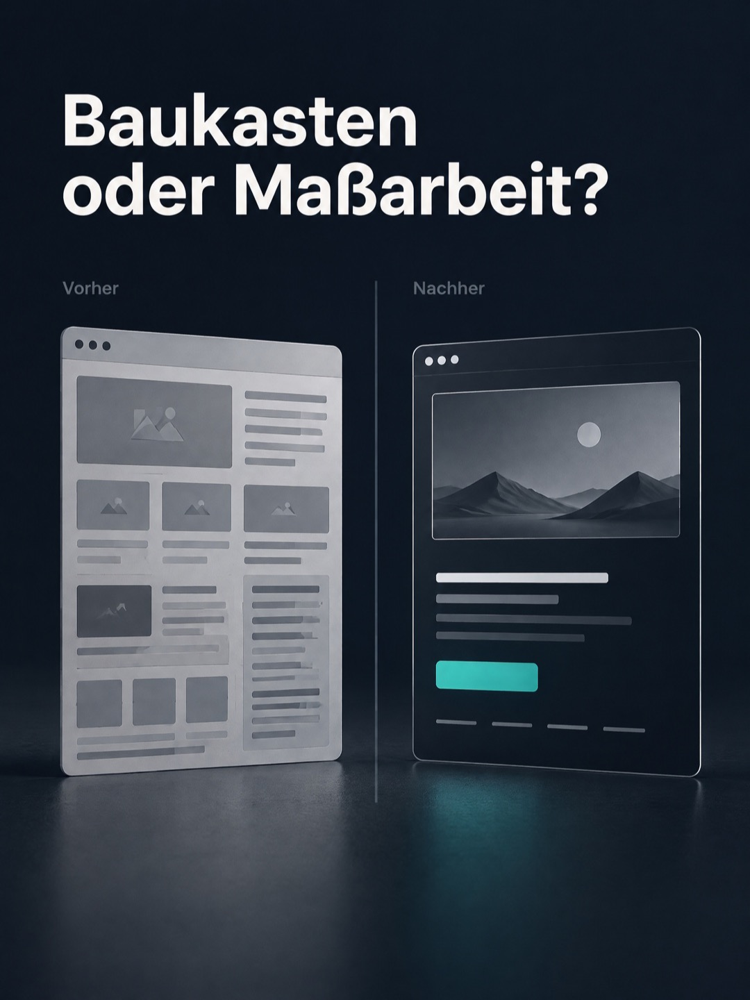

<a id="cd-024"></a>
## CD-024 · Mythen-Karussell-Cover

Karussell · 3:4 · Karussell K3 „5 Website-Mythen“, Slide 1 von 6 · Dokument Nr. 24

```text
Brand style for a one-person web agency in Wetzlar, Germany. Premium, calm, technical-editorial look. Palette: deep near-black navy background (#0B1220), off-white (#F5F5F2), single accent colour teal (#14B8A6), thin grey hairlines. Typography: bold modern geometric sans-serif headline, left-aligned, generous whitespace, max two text sizes, high contrast. Imagery: clean minimal 3D objects or minimal photoreal scenes, soft studio light, subtle grain, no clutter. Layout: vertical 3:4 portrait format (1080x1440 proportions); keep all text and key objects inside the centre with an 8% safe margin on every edge; keep the bottom-right corner (12% of width) empty and clean for a logo added later. Do not draw any logo. Text rules: render ONLY the German text given in quotes, exactly once, verbatim, with correct umlauts (ä, ö, ü, ß); no other words, no fake UI text, no watermarks, no third-party logos or brand names, no real or recognisable people. A large crossed-out speech bubble in off-white, small teal (#14B8A6) spark. Headline: "5 Website-Mythen, die dich Kunden kosten". Small label (bottom-left, small): "Swipe →".
```

**Text im Bild:** „5 Website-Mythen, die dich Kunden kosten“  
**Label:** „Swipe →“ (bottom-left, small)  
**Caption:** Welcher Mythos hält sich bei dir am hartnäckigsten? Kommentier die Nummer.  
**Hashtags:** #webdesign #nextjs #webentwicklung #websiterelaunch #selbststaendig #geo #kisichtbarkeit #lokaleseo #googleranking #chatgpt #wetzlar #mittelhessen #lahndill #giessen #webdesignwetzlar  
**Hinweise:** Cover (Slide 1/6) von Karussell K3 „5 Website-Mythen“; Slides 2–6: CD-039 bis CD-043. Position von „Swipe →“ im Dokument nicht angegeben; unten links wie bei Prompt 5. Posting-Plan: Woche 5, Mi. 2.12.2026, 7:30 oder 18:00 Uhr.  
**Bilder:** [original](bilder/original/CD-024.jpg) · [instagram-3x4](bilder/instagram-3x4/CD-024.jpg) · [facebook-linkedin-4x5](bilder/facebook-linkedin-4x5/CD-024.jpg)

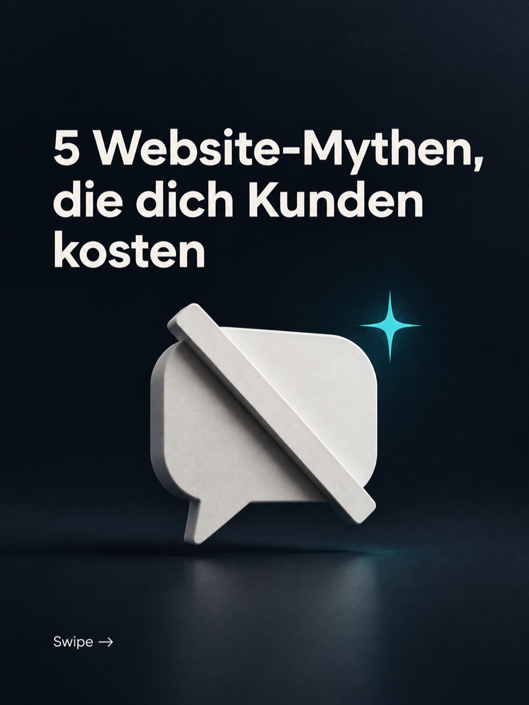

<a id="cd-025"></a>
## CD-025 · 3D begehbar

Leistung · 3:4 · Dokument Nr. 25

```text
Brand style for a one-person web agency in Wetzlar, Germany. Premium, calm, technical-editorial look. Palette: deep near-black navy background (#0B1220), off-white (#F5F5F2), single accent colour teal (#14B8A6), thin grey hairlines. Typography: bold modern geometric sans-serif headline, left-aligned, generous whitespace, max two text sizes, high contrast. Imagery: clean minimal 3D objects or minimal photoreal scenes, soft studio light, subtle grain, no clutter. Layout: vertical 3:4 portrait format (1080x1440 proportions); keep all text and key objects inside the centre with an 8% safe margin on every edge; keep the bottom-right corner (12% of width) empty and clean for a logo added later. Do not draw any logo. Text rules: render ONLY the German text given in quotes, exactly once, verbatim, with correct umlauts (ä, ö, ü, ß); no other words, no fake UI text, no watermarks, no third-party logos or brand names, no real or recognisable people. An isometric translucent 3D model of an industrial hall floating above a laptop, visible pipe routes in the teal accent colour (#14B8A6). Headline: "Begehbar. Direkt im Browser."
```

**Text im Bild:** „Begehbar. Direkt im Browser.“  
**Caption:** Hallen, Gebäude, Museumsräume als begehbares 3D, ohne App. Aus CAD oder Scan. Demo anfragen: DM.  
**Hashtags:** #3d #gaussiansplatting #digitalerrundgang #wetzlar #mittelhessen #lahndill #giessen #webdesignwetzlar  
**Hinweise:** Posting-Plan: Woche 8, Mi. 23.12.2026, 7:30 oder 18:00 Uhr. Bonus: als Seitenteiler in Akquise-Mails/Pitch-PDF.  
**Bilder:** [original](bilder/original/CD-025.jpg) · [instagram-3x4](bilder/instagram-3x4/CD-025.jpg) · [facebook-linkedin-4x5](bilder/facebook-linkedin-4x5/CD-025.jpg)

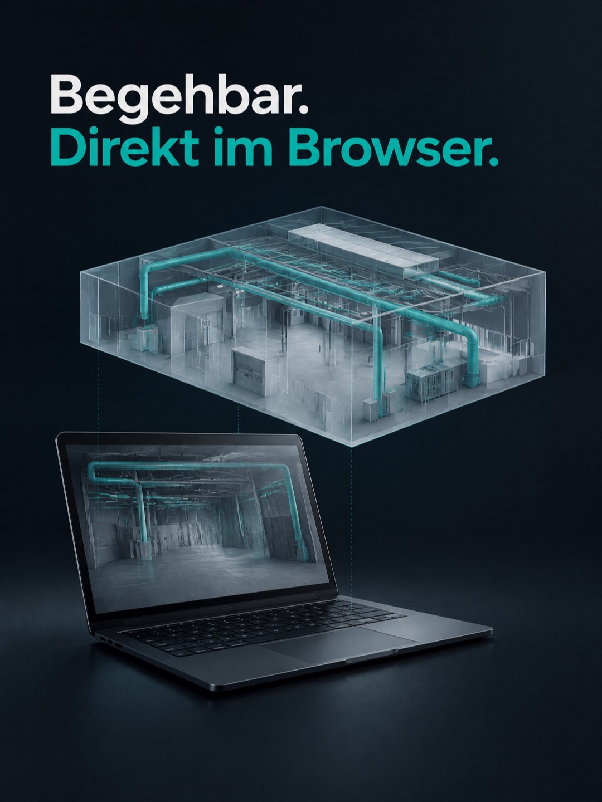

<a id="cd-026"></a>
## CD-026 · Meme: Plugin-Update

Humor · 3:4 · Dokument Nr. 26

```text
Brand style for a one-person web agency in Wetzlar, Germany. Premium, calm, technical-editorial look. Palette: deep near-black navy background (#0B1220), off-white (#F5F5F2), single accent colour teal (#14B8A6), thin grey hairlines. Typography: bold modern geometric sans-serif headline, left-aligned, generous whitespace, max two text sizes, high contrast. Imagery: clean minimal 3D objects or minimal photoreal scenes, soft studio light, subtle grain, no clutter. Layout: vertical 3:4 portrait format (1080x1440 proportions); keep all text and key objects inside the centre with an 8% safe margin on every edge; keep the bottom-right corner (12% of width) empty and clean for a logo added later. Do not draw any logo. Text rules: render ONLY the German text given in quotes, exactly once, verbatim, with correct umlauts (ä, ö, ü, ß); no other words, no fake UI text, no watermarks, no third-party logos or brand names, no real or recognisable people. Flat illustration style: a tiny cartoon laptop sweating nervously in front of a huge stack of notification cards. Headline: "Freitag, 17:58: 14 Plugin-Updates."
```

**Text im Bild:** „Freitag, 17:58: 14 Plugin-Updates.“  
**Caption:** Kennst du? 😅 Muss nicht sein. Wartung oder Website ohne Plugin-Zoo: Link in Bio.  
**Hashtags:** #webdesign #nextjs #webentwicklung #websiterelaunch #selbststaendig #websitesicherheit #phpsicherheit #wordpresssicherheit #itsicherheit #kmu #agenturleben  
**Hinweise:** Posting-Plan: Woche 4, Mi. 25.11.2026, 7:30 oder 18:00 Uhr.  
**Bilder:** [original](bilder/original/CD-026.jpg) · [instagram-3x4](bilder/instagram-3x4/CD-026.jpg) · [facebook-linkedin-4x5](bilder/facebook-linkedin-4x5/CD-026.jpg)

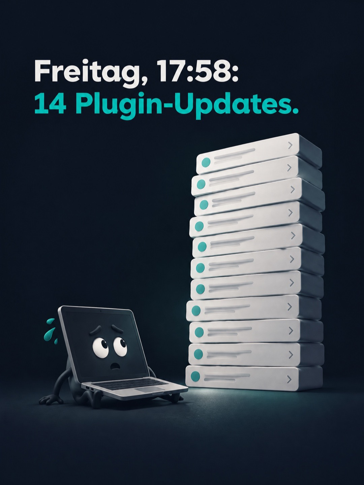

<a id="cd-027"></a>
## CD-027 · Behind the Scenes

BTS · 3:4 · Dokument Nr. 27

```text
Brand style for a one-person web agency in Wetzlar, Germany. Premium, calm, technical-editorial look. Palette: deep near-black navy background (#0B1220), off-white (#F5F5F2), single accent colour teal (#14B8A6), thin grey hairlines. Typography: bold modern geometric sans-serif headline, left-aligned, generous whitespace, max two text sizes, high contrast. Imagery: clean minimal 3D objects or minimal photoreal scenes, soft studio light, subtle grain, no clutter. Layout: vertical 3:4 portrait format (1080x1440 proportions); keep all text and key objects inside the centre with an 8% safe margin on every edge; keep the bottom-right corner (12% of width) empty and clean for a logo added later. Do not draw any logo. Text rules: render ONLY the German text given in quotes, exactly once, verbatim, with correct umlauts (ä, ö, ü, ß); no other words, no fake UI text, no watermarks, no third-party logos or brand names, no real or recognisable people. Overhead flat-lay of a desk: mechanical keyboard, notebook with wireframe sketches, coffee, laptop with abstract code; no people, no readable screen text. Headline: "Hier entsteht deine Website."
```

**Text im Bild:** „Hier entsteht deine Website.“  
**Caption:** Kein Page-Builder: Design und Code aus einer Hand, in Wetzlar.  
**Hashtags:** #webdesign #nextjs #webentwicklung #websiterelaunch #selbststaendig #wetzlar #mittelhessen #lahndill #giessen #webdesignwetzlar #behindthescenes  
**Hinweise:** Wirkt das Bild fotorealistisch, „KI-generiertes Symbolbild“ in die Caption schreiben. Posting-Plan: Woche 9, Mi. 30.12.2026, 7:30 oder 18:00 Uhr. Bonus: fürs Google-Unternehmensprofil (ohne Text-Overlay).  

<a id="cd-028"></a>
## CD-028 · Story: Website-Check

Story · 9:16 · Dokument Nr. 28

```text
Brand style for a one-person web agency in Wetzlar, Germany. Premium, calm, technical-editorial look. Palette: deep near-black navy background (#0B1220), off-white (#F5F5F2), single accent colour teal (#14B8A6), thin grey hairlines. Typography: bold modern geometric sans-serif headline, left-aligned, generous whitespace, max two text sizes, high contrast. Imagery: clean minimal 3D objects or minimal photoreal scenes, soft studio light, subtle grain, no clutter. Layout: vertical 9:16 format (1080x1920 proportions); keep the top 14% and bottom 20% free of text; keep all text and key objects inside the centre with an 8% safe margin on every edge; keep the bottom-right corner (12% of width) empty and clean for a logo added later. Do not draw any logo. Text rules: render ONLY the German text given in quotes, exactly once, verbatim, with correct umlauts (ä, ö, ü, ß); no other words, no fake UI text, no watermarks, no third-party logos or brand names, no real or recognisable people. Large magnifying glass over an abstract website, centre composition, headline in the middle third. Headline: "Website-Check: kostenlos". Small label (smaller line directly below the headline): "Link antippen".
```

**Text im Bild:** „Website-Check: kostenlos“  
**Label:** „Link antippen“ (smaller line directly below the headline)  
**Caption:**   
**Hashtags:**   
**Hinweise:** Story mit Link-Sticker zu codayweb.de/de/website-check (Story ohne Caption). Headline im mittleren Drittel platzieren.  
**Bilder:** [original](bilder/original/CD-028.jpg) · [story-9x16](bilder/story-9x16/CD-028.jpg)

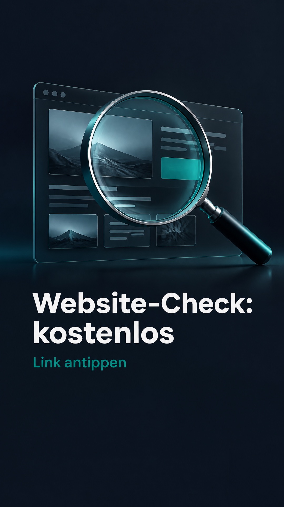

<a id="cd-029"></a>
## CD-029 · K1 PHP-Version prüfen: Hoster fragen

Karussell · 3:4 · Karussell K1 „PHP-Version prüfen“, Slide 2 von 6 · Dokument Nr. K1-2

Vorher die Cover-Slide dieser Serie hochladen (Stilreferenz).

```text
Use the uploaded image as the exact style reference: same background, colours, typography and layout. Create the next slide of this carousel. Brand style for a one-person web agency in Wetzlar, Germany. Premium, calm, technical-editorial look. Palette: deep near-black navy background (#0B1220), off-white (#F5F5F2), single accent colour teal (#14B8A6), thin grey hairlines. Typography: bold modern geometric sans-serif headline, left-aligned, generous whitespace, max two text sizes, high contrast. Imagery: clean minimal 3D objects or minimal photoreal scenes, soft studio light, subtle grain, no clutter. Layout: vertical 3:4 portrait format (1080x1440 proportions); keep all text and key objects inside the centre with an 8% safe margin on every edge; keep the bottom-right corner (12% of width) empty and clean for a logo added later. Do not draw any logo. Text rules: render ONLY the German text given in quotes, exactly once, verbatim, with correct umlauts (ä, ö, ü, ß); no other words, no fake UI text, no watermarks, no third-party logos or brand names, no real or recognisable people. A minimal phone icon in the teal accent colour (#14B8A6). Headline: "1. Frag deinen Hoster, ob PHP aktualisiert wurde."
```

**Text im Bild:** „1. Frag deinen Hoster, ob PHP aktualisiert wurde.“  
**Caption:**   
**Hashtags:**   
**Hinweise:** Slide 2/6 von Karussell K1 „PHP-Version prüfen“ (Cover: CD-005); Caption und Hashtags stehen beim Cover. Für einen einheitlichen Look optional das Cover als Stil-Referenz hochladen: „Use the uploaded image as the exact style reference; same background, typography and layout.“ Wird mit dem Cover als Karussell gepostet: Woche 1, Mi. 4.11.2026.  

<a id="cd-030"></a>
## CD-030 · K1 PHP-Version prüfen: Version ablesen

Karussell · 3:4 · Karussell K1 „PHP-Version prüfen“, Slide 3 von 6 · Dokument Nr. K1-3

Vorher die Cover-Slide dieser Serie hochladen (Stilreferenz).

```text
Use the uploaded image as the exact style reference: same background, colours, typography and layout. Create the next slide of this carousel. Brand style for a one-person web agency in Wetzlar, Germany. Premium, calm, technical-editorial look. Palette: deep near-black navy background (#0B1220), off-white (#F5F5F2), single accent colour teal (#14B8A6), thin grey hairlines. Typography: bold modern geometric sans-serif headline, left-aligned, generous whitespace, max two text sizes, high contrast. Imagery: clean minimal 3D objects or minimal photoreal scenes, soft studio light, subtle grain, no clutter. Layout: vertical 3:4 portrait format (1080x1440 proportions); keep all text and key objects inside the centre with an 8% safe margin on every edge; keep the bottom-right corner (12% of width) empty and clean for a logo added later. Do not draw any logo. Text rules: render ONLY the German text given in quotes, exactly once, verbatim, with correct umlauts (ä, ö, ü, ß); no other words, no fake UI text, no watermarks, no third-party logos or brand names, no real or recognisable people. A minimal gear icon. Headline: "2. PHP-Version im Hosting-Kundenbereich ablesen."
```

**Text im Bild:** „2. PHP-Version im Hosting-Kundenbereich ablesen.“  
**Caption:**   
**Hashtags:**   
**Hinweise:** Slide 3/6 von Karussell K1 „PHP-Version prüfen“ (Cover: CD-005); Caption und Hashtags stehen beim Cover. Für einen einheitlichen Look optional das Cover als Stil-Referenz hochladen: „Use the uploaded image as the exact style reference; same background, typography and layout.“ Wird mit dem Cover als Karussell gepostet: Woche 1, Mi. 4.11.2026.  
**Bilder:** [original](bilder/original/CD-030.jpg) · [instagram-3x4](bilder/instagram-3x4/CD-030.jpg) · [facebook-linkedin-4x5](bilder/facebook-linkedin-4x5/CD-030.jpg)

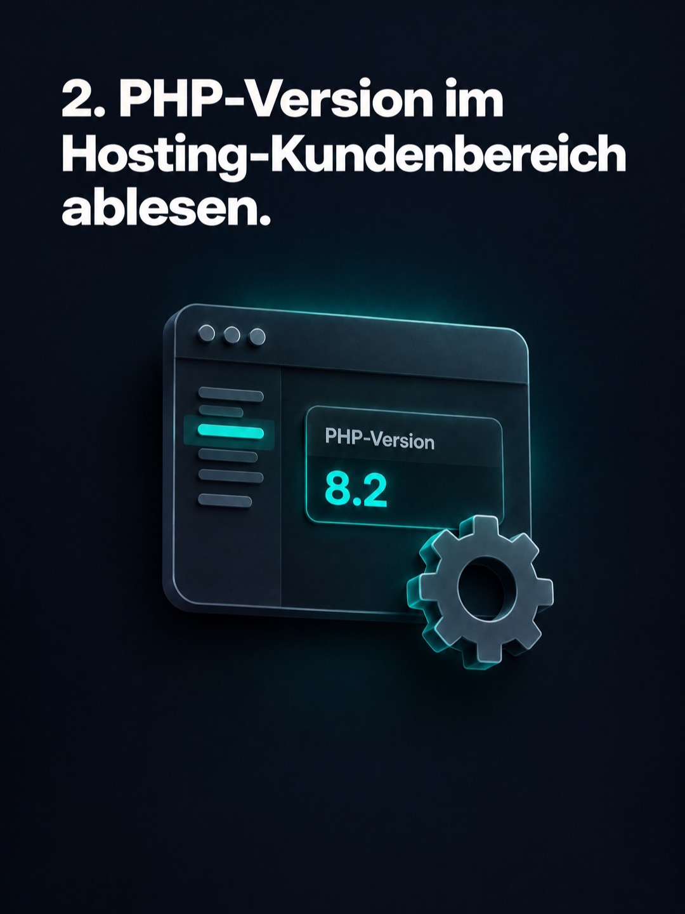

<a id="cd-031"></a>
## CD-031 · K1 PHP-Version prüfen: Support-Tabelle

Karussell · 3:4 · Karussell K1 „PHP-Version prüfen“, Slide 4 von 6 · Dokument Nr. K1-4

Vorher die Cover-Slide dieser Serie hochladen (Stilreferenz).

```text
Use the uploaded image as the exact style reference: same background, colours, typography and layout. Create the next slide of this carousel. Brand style for a one-person web agency in Wetzlar, Germany. Premium, calm, technical-editorial look. Palette: deep near-black navy background (#0B1220), off-white (#F5F5F2), single accent colour teal (#14B8A6), thin grey hairlines. Typography: bold modern geometric sans-serif headline, left-aligned, generous whitespace, max two text sizes, high contrast. Imagery: clean minimal 3D objects or minimal photoreal scenes, soft studio light, subtle grain, no clutter. Layout: vertical 3:4 portrait format (1080x1440 proportions); keep all text and key objects inside the centre with an 8% safe margin on every edge; keep the bottom-right corner (12% of width) empty and clean for a logo added later. Do not draw any logo. Text rules: render ONLY the German text given in quotes, exactly once, verbatim, with correct umlauts (ä, ö, ü, ß); no other words, no fake UI text, no watermarks, no third-party logos or brand names, no real or recognisable people. A minimal calendar icon. Headline: "3. Version mit Support-Tabelle vergleichen."
```

**Text im Bild:** „3. Version mit Support-Tabelle vergleichen.“  
**Caption:**   
**Hashtags:**   
**Hinweise:** Slide 4/6 von Karussell K1 „PHP-Version prüfen“ (Cover: CD-005); Caption und Hashtags stehen beim Cover. Für einen einheitlichen Look optional das Cover als Stil-Referenz hochladen: „Use the uploaded image as the exact style reference; same background, typography and layout.“ Wird mit dem Cover als Karussell gepostet: Woche 1, Mi. 4.11.2026.  
**Bilder:** [original](bilder/original/CD-031.jpg) · [instagram-3x4](bilder/instagram-3x4/CD-031.jpg) · [facebook-linkedin-4x5](bilder/facebook-linkedin-4x5/CD-031.jpg)

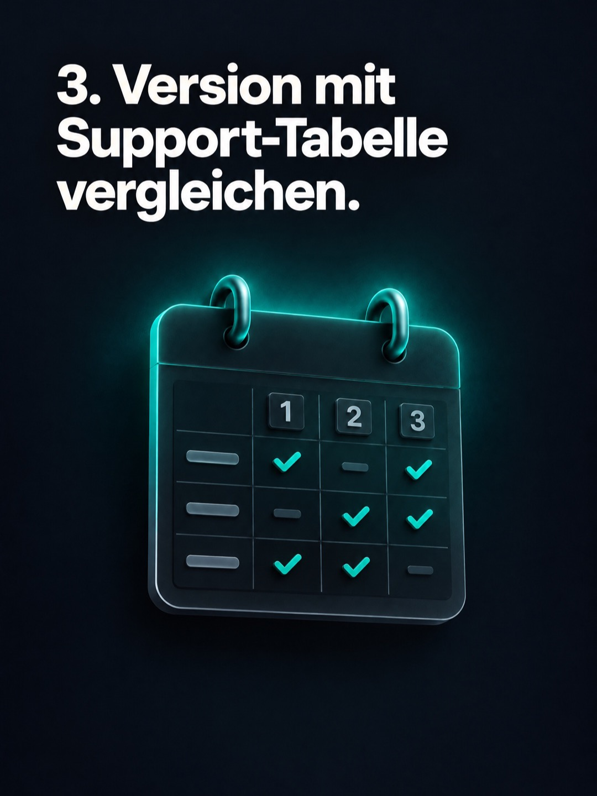

<a id="cd-032"></a>
## CD-032 · K1 PHP-Version prüfen: Update planen

Karussell · 3:4 · Karussell K1 „PHP-Version prüfen“, Slide 5 von 6 · Dokument Nr. K1-5

Vorher die Cover-Slide dieser Serie hochladen (Stilreferenz).

```text
Use the uploaded image as the exact style reference: same background, colours, typography and layout. Create the next slide of this carousel. Brand style for a one-person web agency in Wetzlar, Germany. Premium, calm, technical-editorial look. Palette: deep near-black navy background (#0B1220), off-white (#F5F5F2), single accent colour teal (#14B8A6), thin grey hairlines. Typography: bold modern geometric sans-serif headline, left-aligned, generous whitespace, max two text sizes, high contrast. Imagery: clean minimal 3D objects or minimal photoreal scenes, soft studio light, subtle grain, no clutter. Layout: vertical 3:4 portrait format (1080x1440 proportions); keep all text and key objects inside the centre with an 8% safe margin on every edge; keep the bottom-right corner (12% of width) empty and clean for a logo added later. Do not draw any logo. Text rules: render ONLY the German text given in quotes, exactly once, verbatim, with correct umlauts (ä, ö, ü, ß); no other words, no fake UI text, no watermarks, no third-party logos or brand names, no real or recognisable people. A minimal shield icon. Headline: "4. PHP-Update planen, nicht nur WordPress."
```

**Text im Bild:** „4. PHP-Update planen, nicht nur WordPress.“  
**Caption:**   
**Hashtags:**   
**Hinweise:** Slide 5/6 von Karussell K1 „PHP-Version prüfen“ (Cover: CD-005); Caption und Hashtags stehen beim Cover. Für einen einheitlichen Look optional das Cover als Stil-Referenz hochladen: „Use the uploaded image as the exact style reference; same background, typography and layout.“ Wird mit dem Cover als Karussell gepostet: Woche 1, Mi. 4.11.2026.  

<a id="cd-033"></a>
## CD-033 · K1 PHP-Version prüfen: Check

Karussell · 3:4 · Karussell K1 „PHP-Version prüfen“, Slide 6 von 6 · Dokument Nr. K1-6

Vorher die Cover-Slide dieser Serie hochladen (Stilreferenz).

```text
Use the uploaded image as the exact style reference: same background, colours, typography and layout. Create the next slide of this carousel. Brand style for a one-person web agency in Wetzlar, Germany. Premium, calm, technical-editorial look. Palette: deep near-black navy background (#0B1220), off-white (#F5F5F2), single accent colour teal (#14B8A6), thin grey hairlines. Typography: bold modern geometric sans-serif headline, left-aligned, generous whitespace, max two text sizes, high contrast. Imagery: clean minimal 3D objects or minimal photoreal scenes, soft studio light, subtle grain, no clutter. Layout: vertical 3:4 portrait format (1080x1440 proportions); keep all text and key objects inside the centre with an 8% safe margin on every edge; keep the bottom-right corner (12% of width) empty and clean for a logo added later. Do not draw any logo. Text rules: render ONLY the German text given in quotes, exactly once, verbatim, with correct umlauts (ä, ö, ü, ß); no other words, no fake UI text, no watermarks, no third-party logos or brand names, no real or recognisable people. A minimal magnifying glass icon. Headline: "Unsicher? Kostenloser Check: Link in Bio"
```

**Text im Bild:** „Unsicher? Kostenloser Check: Link in Bio“  
**Caption:**   
**Hashtags:**   
**Hinweise:** Slide 6/6 von Karussell K1 „PHP-Version prüfen“ (Cover: CD-005); Caption und Hashtags stehen beim Cover. Für einen einheitlichen Look optional das Cover als Stil-Referenz hochladen: „Use the uploaded image as the exact style reference; same background, typography and layout.“ Wird mit dem Cover als Karussell gepostet: Woche 1, Mi. 4.11.2026.  
**Bilder:** [original](bilder/original/CD-033.jpg) · [instagram-3x4](bilder/instagram-3x4/CD-033.jpg) · [facebook-linkedin-4x5](bilder/facebook-linkedin-4x5/CD-033.jpg)

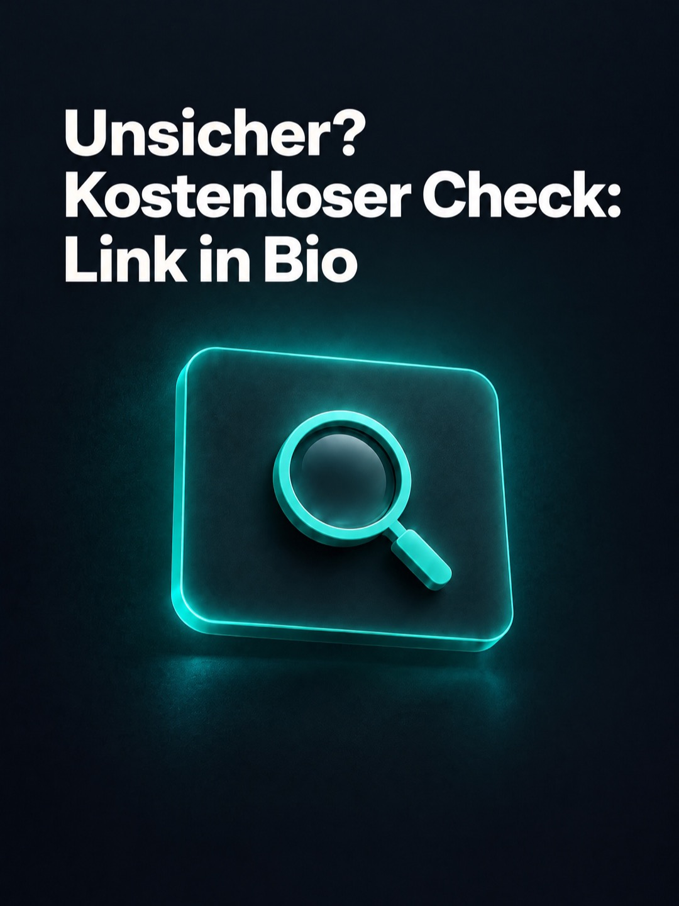

<a id="cd-034"></a>
## CD-034 · K2 GEO: Was ist GEO

Karussell · 3:4 · Karussell K2 „GEO in 5 Slides“, Slide 2 von 6 · Dokument Nr. K2-2

Vorher die Cover-Slide dieser Serie hochladen (Stilreferenz).

```text
Use the uploaded image as the exact style reference: same background, colours, typography and layout. Create the next slide of this carousel. Brand style for a one-person web agency in Wetzlar, Germany. Premium, calm, technical-editorial look. Palette: deep near-black navy background (#0B1220), off-white (#F5F5F2), single accent colour teal (#14B8A6), thin grey hairlines. Typography: bold modern geometric sans-serif headline, left-aligned, generous whitespace, max two text sizes, high contrast. Imagery: clean minimal 3D objects or minimal photoreal scenes, soft studio light, subtle grain, no clutter. Layout: vertical 3:4 portrait format (1080x1440 proportions); keep all text and key objects inside the centre with an 8% safe margin on every edge; keep the bottom-right corner (12% of width) empty and clean for a logo added later. Do not draw any logo. Text rules: render ONLY the German text given in quotes, exactly once, verbatim, with correct umlauts (ä, ö, ü, ß); no other words, no fake UI text, no watermarks, no third-party logos or brand names, no real or recognisable people. A minimal chat bubble icon. Headline: "GEO = Sichtbarkeit in KI-Antworten"
```

**Text im Bild:** „GEO = Sichtbarkeit in KI-Antworten“  
**Caption:**   
**Hashtags:**   
**Hinweise:** Slide 2/6 von Karussell K2 „GEO in 5 Slides“ (Cover: CD-011); Caption und Hashtags stehen beim Cover. Für einen einheitlichen Look optional das Cover als Stil-Referenz hochladen: „Use the uploaded image as the exact style reference; same background, typography and layout.“ Wird mit dem Cover als Karussell gepostet: Woche 3, Mi. 18.11.2026.  
**Bilder:** [original](bilder/original/CD-034.jpg) · [instagram-3x4](bilder/instagram-3x4/CD-034.jpg) · [facebook-linkedin-4x5](bilder/facebook-linkedin-4x5/CD-034.jpg)

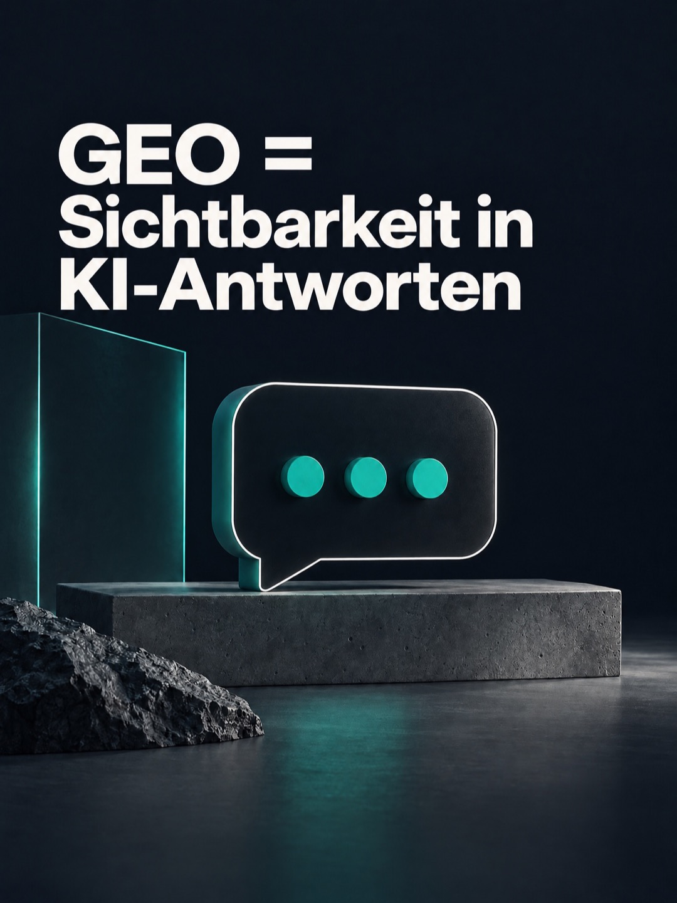

<a id="cd-035"></a>
## CD-035 · K2 GEO: Struktur

Karussell · 3:4 · Karussell K2 „GEO in 5 Slides“, Slide 3 von 6 · Dokument Nr. K2-3

Vorher die Cover-Slide dieser Serie hochladen (Stilreferenz).

```text
Use the uploaded image as the exact style reference: same background, colours, typography and layout. Create the next slide of this carousel. Brand style for a one-person web agency in Wetzlar, Germany. Premium, calm, technical-editorial look. Palette: deep near-black navy background (#0B1220), off-white (#F5F5F2), single accent colour teal (#14B8A6), thin grey hairlines. Typography: bold modern geometric sans-serif headline, left-aligned, generous whitespace, max two text sizes, high contrast. Imagery: clean minimal 3D objects or minimal photoreal scenes, soft studio light, subtle grain, no clutter. Layout: vertical 3:4 portrait format (1080x1440 proportions); keep all text and key objects inside the centre with an 8% safe margin on every edge; keep the bottom-right corner (12% of width) empty and clean for a logo added later. Do not draw any logo. Text rules: render ONLY the German text given in quotes, exactly once, verbatim, with correct umlauts (ä, ö, ü, ß); no other words, no fake UI text, no watermarks, no third-party logos or brand names, no real or recognisable people. A minimal document icon with clean structure lines. Headline: "KI liest Struktur, nicht Deko."
```

**Text im Bild:** „KI liest Struktur, nicht Deko.“  
**Caption:**   
**Hashtags:**   
**Hinweise:** Slide 3/6 von Karussell K2 „GEO in 5 Slides“ (Cover: CD-011); Caption und Hashtags stehen beim Cover. Für einen einheitlichen Look optional das Cover als Stil-Referenz hochladen: „Use the uploaded image as the exact style reference; same background, typography and layout.“ Wird mit dem Cover als Karussell gepostet: Woche 3, Mi. 18.11.2026.  
**Bilder:** [original](bilder/original/CD-035.jpg) · [instagram-3x4](bilder/instagram-3x4/CD-035.jpg) · [facebook-linkedin-4x5](bilder/facebook-linkedin-4x5/CD-035.jpg)

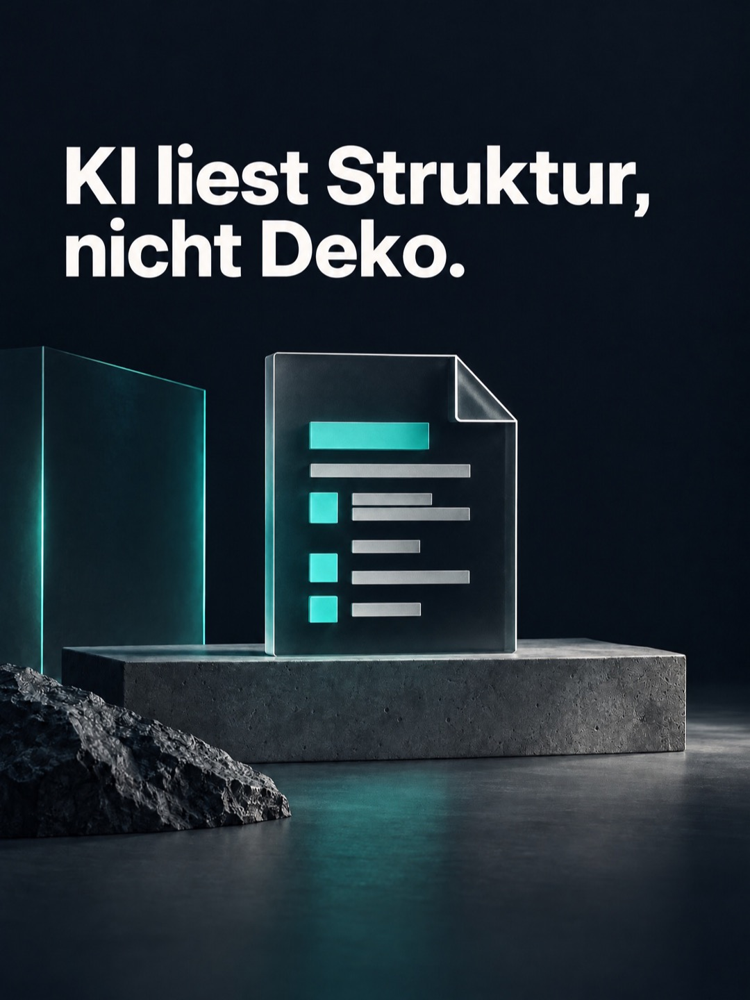

<a id="cd-036"></a>
## CD-036 · K2 GEO: Klare Angaben

Karussell · 3:4 · Karussell K2 „GEO in 5 Slides“, Slide 4 von 6 · Dokument Nr. K2-4

Vorher die Cover-Slide dieser Serie hochladen (Stilreferenz).

```text
Use the uploaded image as the exact style reference: same background, colours, typography and layout. Create the next slide of this carousel. Brand style for a one-person web agency in Wetzlar, Germany. Premium, calm, technical-editorial look. Palette: deep near-black navy background (#0B1220), off-white (#F5F5F2), single accent colour teal (#14B8A6), thin grey hairlines. Typography: bold modern geometric sans-serif headline, left-aligned, generous whitespace, max two text sizes, high contrast. Imagery: clean minimal 3D objects or minimal photoreal scenes, soft studio light, subtle grain, no clutter. Layout: vertical 3:4 portrait format (1080x1440 proportions); keep all text and key objects inside the centre with an 8% safe margin on every edge; keep the bottom-right corner (12% of width) empty and clean for a logo added later. Do not draw any logo. Text rules: render ONLY the German text given in quotes, exactly once, verbatim, with correct umlauts (ä, ö, ü, ß); no other words, no fake UI text, no watermarks, no third-party logos or brand names, no real or recognisable people. A minimal pin on an abstract map. Headline: "Klare Angaben: Was, wo, für wen."
```

**Text im Bild:** „Klare Angaben: Was, wo, für wen.“  
**Caption:**   
**Hashtags:**   
**Hinweise:** Slide 4/6 von Karussell K2 „GEO in 5 Slides“ (Cover: CD-011); Caption und Hashtags stehen beim Cover. Für einen einheitlichen Look optional das Cover als Stil-Referenz hochladen: „Use the uploaded image as the exact style reference; same background, typography and layout.“ Wird mit dem Cover als Karussell gepostet: Woche 3, Mi. 18.11.2026.  
**Bilder:** [original](bilder/original/CD-036.jpg) · [instagram-3x4](bilder/instagram-3x4/CD-036.jpg) · [facebook-linkedin-4x5](bilder/facebook-linkedin-4x5/CD-036.jpg)

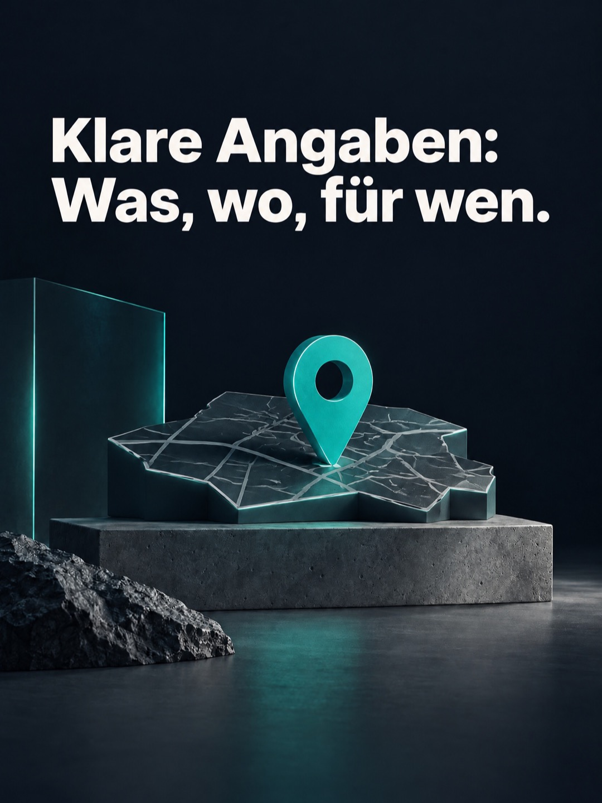

<a id="cd-037"></a>
## CD-037 · K2 GEO: Tempo

Karussell · 3:4 · Karussell K2 „GEO in 5 Slides“, Slide 5 von 6 · Dokument Nr. K2-5

Vorher die Cover-Slide dieser Serie hochladen (Stilreferenz).

```text
Use the uploaded image as the exact style reference: same background, colours, typography and layout. Create the next slide of this carousel. Brand style for a one-person web agency in Wetzlar, Germany. Premium, calm, technical-editorial look. Palette: deep near-black navy background (#0B1220), off-white (#F5F5F2), single accent colour teal (#14B8A6), thin grey hairlines. Typography: bold modern geometric sans-serif headline, left-aligned, generous whitespace, max two text sizes, high contrast. Imagery: clean minimal 3D objects or minimal photoreal scenes, soft studio light, subtle grain, no clutter. Layout: vertical 3:4 portrait format (1080x1440 proportions); keep all text and key objects inside the centre with an 8% safe margin on every edge; keep the bottom-right corner (12% of width) empty and clean for a logo added later. Do not draw any logo. Text rules: render ONLY the German text given in quotes, exactly once, verbatim, with correct umlauts (ä, ö, ü, ß); no other words, no fake UI text, no watermarks, no third-party logos or brand names, no real or recognisable people. A minimal stopwatch. Headline: "Schnelle, saubere Seiten helfen allen Suchen."
```

**Text im Bild:** „Schnelle, saubere Seiten helfen allen Suchen.“  
**Caption:**   
**Hashtags:**   
**Hinweise:** Slide 5/6 von Karussell K2 „GEO in 5 Slides“ (Cover: CD-011); Caption und Hashtags stehen beim Cover. Für einen einheitlichen Look optional das Cover als Stil-Referenz hochladen: „Use the uploaded image as the exact style reference; same background, typography and layout.“ Wird mit dem Cover als Karussell gepostet: Woche 3, Mi. 18.11.2026.  
**Bilder:** [original](bilder/original/CD-037.jpg) · [instagram-3x4](bilder/instagram-3x4/CD-037.jpg) · [facebook-linkedin-4x5](bilder/facebook-linkedin-4x5/CD-037.jpg)

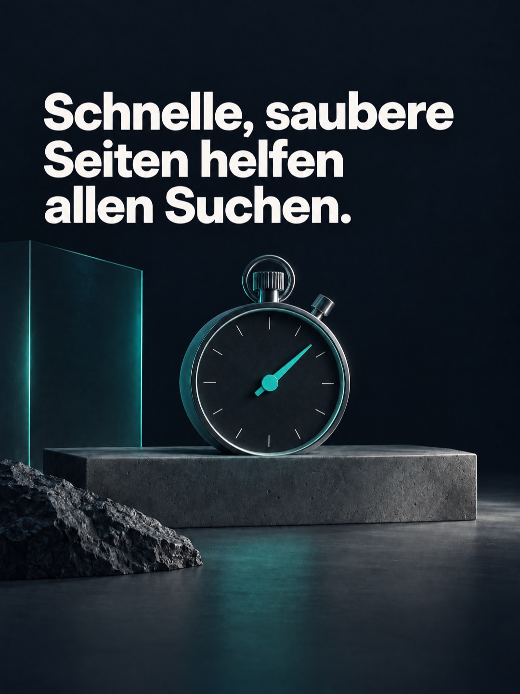

<a id="cd-038"></a>
## CD-038 · K2 GEO: Check

Karussell · 3:4 · Karussell K2 „GEO in 5 Slides“, Slide 6 von 6 · Dokument Nr. K2-6

Vorher die Cover-Slide dieser Serie hochladen (Stilreferenz).

```text
Use the uploaded image as the exact style reference: same background, colours, typography and layout. Create the next slide of this carousel. Brand style for a one-person web agency in Wetzlar, Germany. Premium, calm, technical-editorial look. Palette: deep near-black navy background (#0B1220), off-white (#F5F5F2), single accent colour teal (#14B8A6), thin grey hairlines. Typography: bold modern geometric sans-serif headline, left-aligned, generous whitespace, max two text sizes, high contrast. Imagery: clean minimal 3D objects or minimal photoreal scenes, soft studio light, subtle grain, no clutter. Layout: vertical 3:4 portrait format (1080x1440 proportions); keep all text and key objects inside the centre with an 8% safe margin on every edge; keep the bottom-right corner (12% of width) empty and clean for a logo added later. Do not draw any logo. Text rules: render ONLY the German text given in quotes, exactly once, verbatim, with correct umlauts (ä, ö, ü, ß); no other words, no fake UI text, no watermarks, no third-party logos or brand names, no real or recognisable people. A minimal magnifying glass. Headline: "Wie sichtbar bist du? Check: Link in Bio"
```

**Text im Bild:** „Wie sichtbar bist du? Check: Link in Bio“  
**Caption:**   
**Hashtags:**   
**Hinweise:** Slide 6/6 von Karussell K2 „GEO in 5 Slides“ (Cover: CD-011); Caption und Hashtags stehen beim Cover. Für einen einheitlichen Look optional das Cover als Stil-Referenz hochladen: „Use the uploaded image as the exact style reference; same background, typography and layout.“ Wird mit dem Cover als Karussell gepostet: Woche 3, Mi. 18.11.2026.  
**Bilder:** [original](bilder/original/CD-038.jpg) · [instagram-3x4](bilder/instagram-3x4/CD-038.jpg) · [facebook-linkedin-4x5](bilder/facebook-linkedin-4x5/CD-038.jpg)

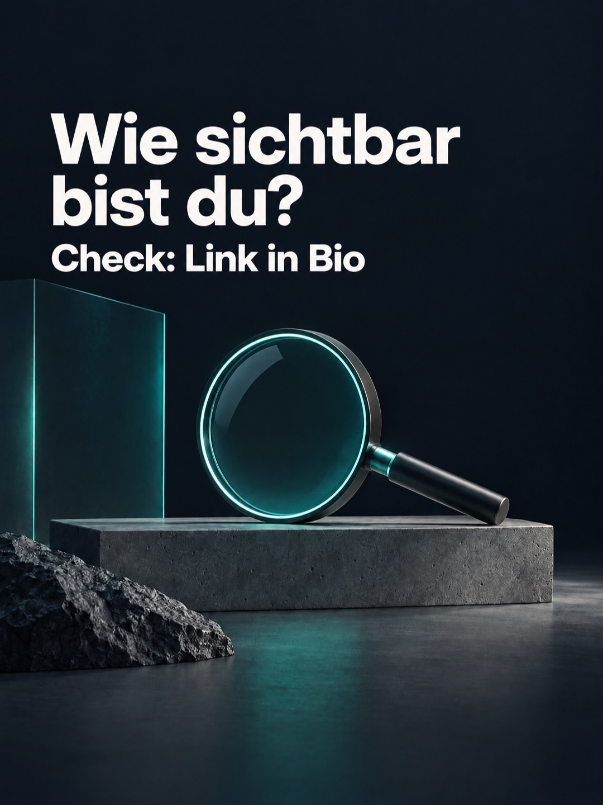

<a id="cd-039"></a>
## CD-039 · K3 Mythos: Baukasten

Karussell · 3:4 · Karussell K3 „5 Website-Mythen“, Slide 2 von 6 · Dokument Nr. K3-2

Vorher die Cover-Slide dieser Serie hochladen (Stilreferenz).

```text
Use the uploaded image as the exact style reference: same background, colours, typography and layout. Create the next slide of this carousel. Brand style for a one-person web agency in Wetzlar, Germany. Premium, calm, technical-editorial look. Palette: deep near-black navy background (#0B1220), off-white (#F5F5F2), single accent colour teal (#14B8A6), thin grey hairlines. Typography: bold modern geometric sans-serif headline, left-aligned, generous whitespace, max two text sizes, high contrast. Imagery: clean minimal 3D objects or minimal photoreal scenes, soft studio light, subtle grain, no clutter. Layout: vertical 3:4 portrait format (1080x1440 proportions); keep all text and key objects inside the centre with an 8% safe margin on every edge; keep the bottom-right corner (12% of width) empty and clean for a logo added later. Do not draw any logo. Text rules: render ONLY the German text given in quotes, exactly once, verbatim, with correct umlauts (ä, ö, ü, ß); no other words, no fake UI text, no watermarks, no third-party logos or brand names, no real or recognisable people. A minimal crossed-out icon of stacked toy building blocks. Headline: "Mythos: Ein Baukasten reicht."
```

**Text im Bild:** „Mythos: Ein Baukasten reicht.“  
**Caption:**   
**Hashtags:**   
**Hinweise:** Slide 2/6 von Karussell K3 „5 Website-Mythen“ (Cover: CD-024); Caption und Hashtags stehen beim Cover. Das Dokument nennt nur „ein durchgestrichenes Icon“; das Motiv ist passend zum Mythos gewählt. Für einen einheitlichen Look optional das Cover als Stil-Referenz hochladen: „Use the uploaded image as the exact style reference; same background, typography and layout.“ Wird mit dem Cover als Karussell gepostet: Woche 5, Mi. 2.12.2026.  
**Bilder:** [original](bilder/original/CD-039.jpg) · [instagram-3x4](bilder/instagram-3x4/CD-039.jpg) · [facebook-linkedin-4x5](bilder/facebook-linkedin-4x5/CD-039.jpg)

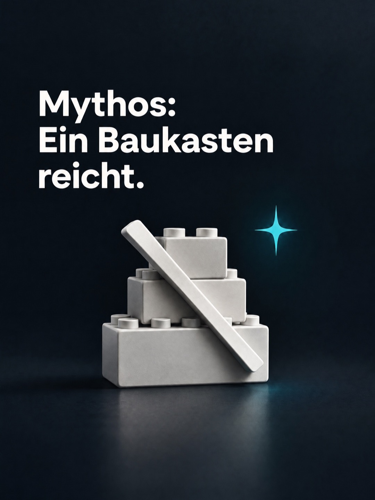

<a id="cd-040"></a>
## CD-040 · K3 Mythos: Ruhe nach dem Launch

Karussell · 3:4 · Karussell K3 „5 Website-Mythen“, Slide 3 von 6 · Dokument Nr. K3-3

Vorher die Cover-Slide dieser Serie hochladen (Stilreferenz).

```text
Use the uploaded image as the exact style reference: same background, colours, typography and layout. Create the next slide of this carousel. Brand style for a one-person web agency in Wetzlar, Germany. Premium, calm, technical-editorial look. Palette: deep near-black navy background (#0B1220), off-white (#F5F5F2), single accent colour teal (#14B8A6), thin grey hairlines. Typography: bold modern geometric sans-serif headline, left-aligned, generous whitespace, max two text sizes, high contrast. Imagery: clean minimal 3D objects or minimal photoreal scenes, soft studio light, subtle grain, no clutter. Layout: vertical 3:4 portrait format (1080x1440 proportions); keep all text and key objects inside the centre with an 8% safe margin on every edge; keep the bottom-right corner (12% of width) empty and clean for a logo added later. Do not draw any logo. Text rules: render ONLY the German text given in quotes, exactly once, verbatim, with correct umlauts (ä, ö, ü, ß); no other words, no fake UI text, no watermarks, no third-party logos or brand names, no real or recognisable people. A minimal crossed-out icon of a hammock. Headline: "Mythos: Nach dem Launch ist Ruhe."
```

**Text im Bild:** „Mythos: Nach dem Launch ist Ruhe.“  
**Caption:**   
**Hashtags:**   
**Hinweise:** Slide 3/6 von Karussell K3 „5 Website-Mythen“ (Cover: CD-024); Caption und Hashtags stehen beim Cover. Das Dokument nennt nur „ein durchgestrichenes Icon“; das Motiv ist passend zum Mythos gewählt. Für einen einheitlichen Look optional das Cover als Stil-Referenz hochladen: „Use the uploaded image as the exact style reference; same background, typography and layout.“ Wird mit dem Cover als Karussell gepostet: Woche 5, Mi. 2.12.2026.  
**Bilder:** [original](bilder/original/CD-040.jpg) · [instagram-3x4](bilder/instagram-3x4/CD-040.jpg) · [facebook-linkedin-4x5](bilder/facebook-linkedin-4x5/CD-040.jpg)

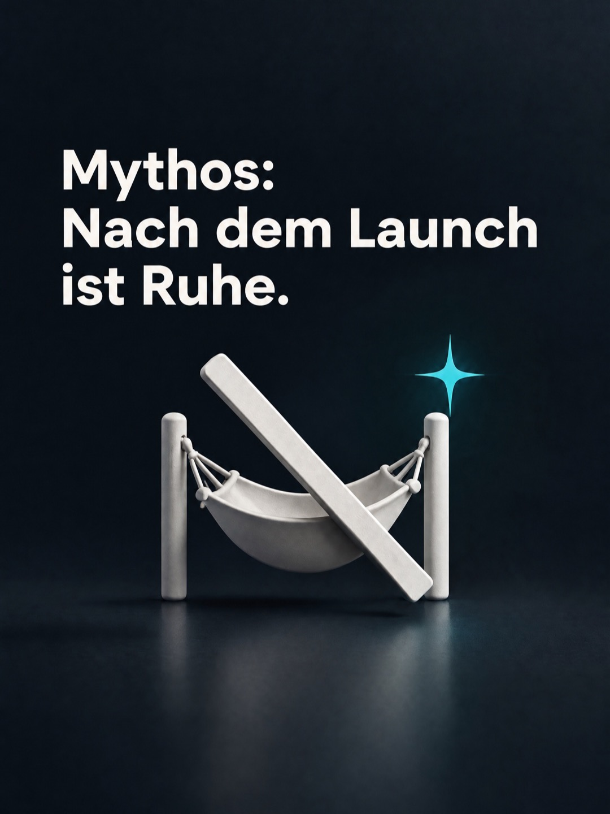

<a id="cd-041"></a>
## CD-041 · K3 Mythos: WordPress-Update

Karussell · 3:4 · Karussell K3 „5 Website-Mythen“, Slide 4 von 6 · Dokument Nr. K3-4

Vorher die Cover-Slide dieser Serie hochladen (Stilreferenz).

```text
Use the uploaded image as the exact style reference: same background, colours, typography and layout. Create the next slide of this carousel. Brand style for a one-person web agency in Wetzlar, Germany. Premium, calm, technical-editorial look. Palette: deep near-black navy background (#0B1220), off-white (#F5F5F2), single accent colour teal (#14B8A6), thin grey hairlines. Typography: bold modern geometric sans-serif headline, left-aligned, generous whitespace, max two text sizes, high contrast. Imagery: clean minimal 3D objects or minimal photoreal scenes, soft studio light, subtle grain, no clutter. Layout: vertical 3:4 portrait format (1080x1440 proportions); keep all text and key objects inside the centre with an 8% safe margin on every edge; keep the bottom-right corner (12% of width) empty and clean for a logo added later. Do not draw any logo. Text rules: render ONLY the German text given in quotes, exactly once, verbatim, with correct umlauts (ä, ö, ü, ß); no other words, no fake UI text, no watermarks, no third-party logos or brand names, no real or recognisable people. A minimal crossed-out icon of a circular refresh arrow around a small shield. Headline: "Mythos: WordPress-Update = sicher."
```

**Text im Bild:** „Mythos: WordPress-Update = sicher.“  
**Caption:**   
**Hashtags:**   
**Hinweise:** Slide 4/6 von Karussell K3 „5 Website-Mythen“ (Cover: CD-024); Caption und Hashtags stehen beim Cover. Das Dokument nennt nur „ein durchgestrichenes Icon“; das Motiv ist passend zum Mythos gewählt. Für einen einheitlichen Look optional das Cover als Stil-Referenz hochladen: „Use the uploaded image as the exact style reference; same background, typography and layout.“ Wird mit dem Cover als Karussell gepostet: Woche 5, Mi. 2.12.2026.  
**Bilder:** [original](bilder/original/CD-041.jpg) · [instagram-3x4](bilder/instagram-3x4/CD-041.jpg) · [facebook-linkedin-4x5](bilder/facebook-linkedin-4x5/CD-041.jpg)

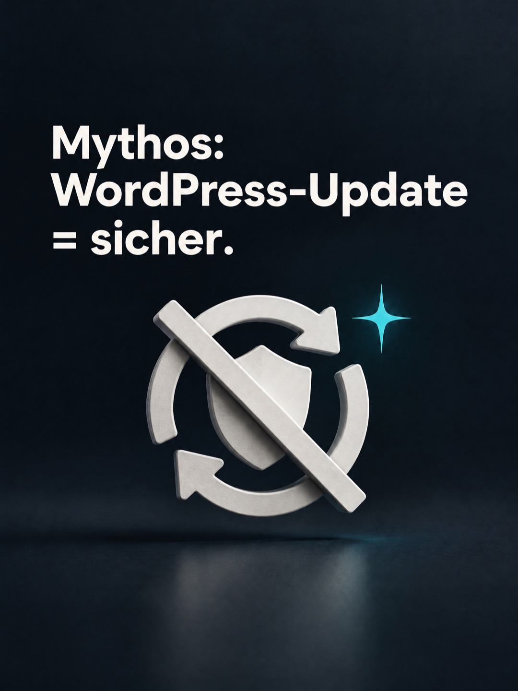

<a id="cd-042"></a>
## CD-042 · K3 Mythos: Ladezeit

Karussell · 3:4 · Karussell K3 „5 Website-Mythen“, Slide 5 von 6 · Dokument Nr. K3-5

Vorher die Cover-Slide dieser Serie hochladen (Stilreferenz).

```text
Use the uploaded image as the exact style reference: same background, colours, typography and layout. Create the next slide of this carousel. Brand style for a one-person web agency in Wetzlar, Germany. Premium, calm, technical-editorial look. Palette: deep near-black navy background (#0B1220), off-white (#F5F5F2), single accent colour teal (#14B8A6), thin grey hairlines. Typography: bold modern geometric sans-serif headline, left-aligned, generous whitespace, max two text sizes, high contrast. Imagery: clean minimal 3D objects or minimal photoreal scenes, soft studio light, subtle grain, no clutter. Layout: vertical 3:4 portrait format (1080x1440 proportions); keep all text and key objects inside the centre with an 8% safe margin on every edge; keep the bottom-right corner (12% of width) empty and clean for a logo added later. Do not draw any logo. Text rules: render ONLY the German text given in quotes, exactly once, verbatim, with correct umlauts (ä, ö, ü, ß); no other words, no fake UI text, no watermarks, no third-party logos or brand names, no real or recognisable people. A minimal crossed-out icon of a slow snail. Headline: "Mythos: Ladezeit ist egal."
```

**Text im Bild:** „Mythos: Ladezeit ist egal.“  
**Caption:**   
**Hashtags:**   
**Hinweise:** Slide 5/6 von Karussell K3 „5 Website-Mythen“ (Cover: CD-024); Caption und Hashtags stehen beim Cover. Das Dokument nennt nur „ein durchgestrichenes Icon“; das Motiv ist passend zum Mythos gewählt. Für einen einheitlichen Look optional das Cover als Stil-Referenz hochladen: „Use the uploaded image as the exact style reference; same background, typography and layout.“ Wird mit dem Cover als Karussell gepostet: Woche 5, Mi. 2.12.2026.  
**Bilder:** [original](bilder/original/CD-042.jpg) · [instagram-3x4](bilder/instagram-3x4/CD-042.jpg) · [facebook-linkedin-4x5](bilder/facebook-linkedin-4x5/CD-042.jpg)

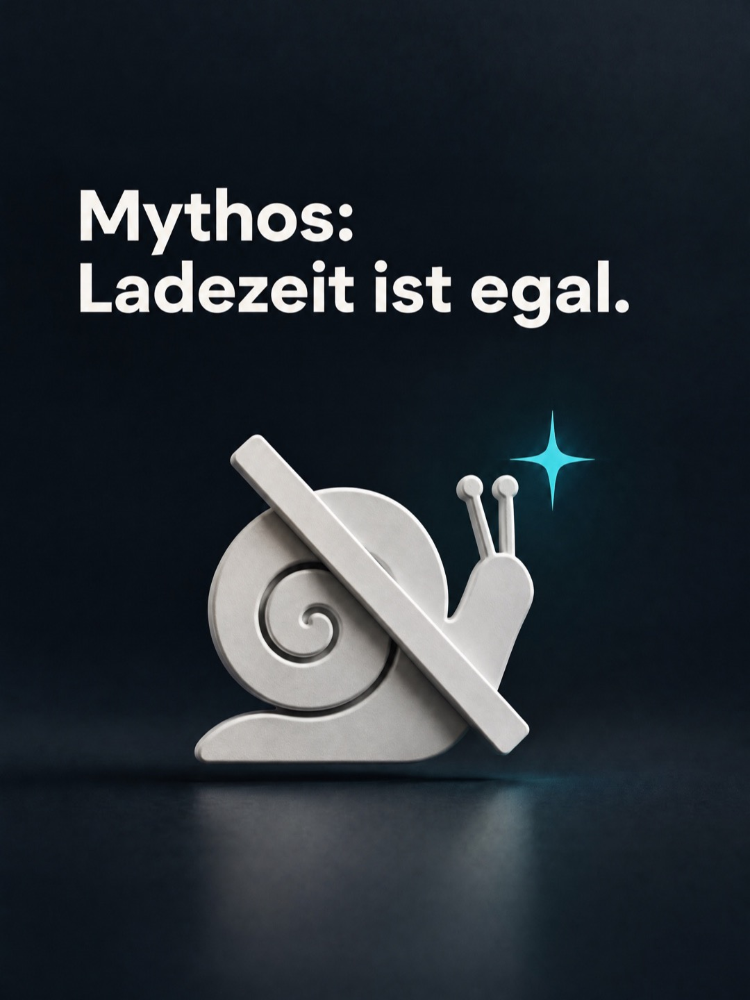

<a id="cd-043"></a>
## CD-043 · K3 Mythos: Nur eine Suche

Karussell · 3:4 · Karussell K3 „5 Website-Mythen“, Slide 6 von 6 · Dokument Nr. K3-6

Vorher die Cover-Slide dieser Serie hochladen (Stilreferenz).

```text
Use the uploaded image as the exact style reference: same background, colours, typography and layout. Create the next slide of this carousel. Brand style for a one-person web agency in Wetzlar, Germany. Premium, calm, technical-editorial look. Palette: deep near-black navy background (#0B1220), off-white (#F5F5F2), single accent colour teal (#14B8A6), thin grey hairlines. Typography: bold modern geometric sans-serif headline, left-aligned, generous whitespace, max two text sizes, high contrast. Imagery: clean minimal 3D objects or minimal photoreal scenes, soft studio light, subtle grain, no clutter. Layout: vertical 3:4 portrait format (1080x1440 proportions); keep all text and key objects inside the centre with an 8% safe margin on every edge; keep the bottom-right corner (12% of width) empty and clean for a logo added later. Do not draw any logo. Text rules: render ONLY the German text given in quotes, exactly once, verbatim, with correct umlauts (ä, ö, ü, ß); no other words, no fake UI text, no watermarks, no third-party logos or brand names, no real or recognisable people. A minimal crossed-out icon of a single magnifying glass, no logos. Headline: "Mythos: Google ist die einzige Suche."
```

**Text im Bild:** „Mythos: Google ist die einzige Suche.“  
**Caption:**   
**Hashtags:**   
**Hinweise:** Slide 6/6 von Karussell K3 „5 Website-Mythen“ (Cover: CD-024); Caption und Hashtags stehen beim Cover. Das Dokument nennt nur „ein durchgestrichenes Icon“; das Motiv ist passend zum Mythos gewählt. Für einen einheitlichen Look optional das Cover als Stil-Referenz hochladen: „Use the uploaded image as the exact style reference; same background, typography and layout.“ Wird mit dem Cover als Karussell gepostet: Woche 5, Mi. 2.12.2026.  
**Bilder:** [original](bilder/original/CD-043.jpg) · [instagram-3x4](bilder/instagram-3x4/CD-043.jpg) · [facebook-linkedin-4x5](bilder/facebook-linkedin-4x5/CD-043.jpg)

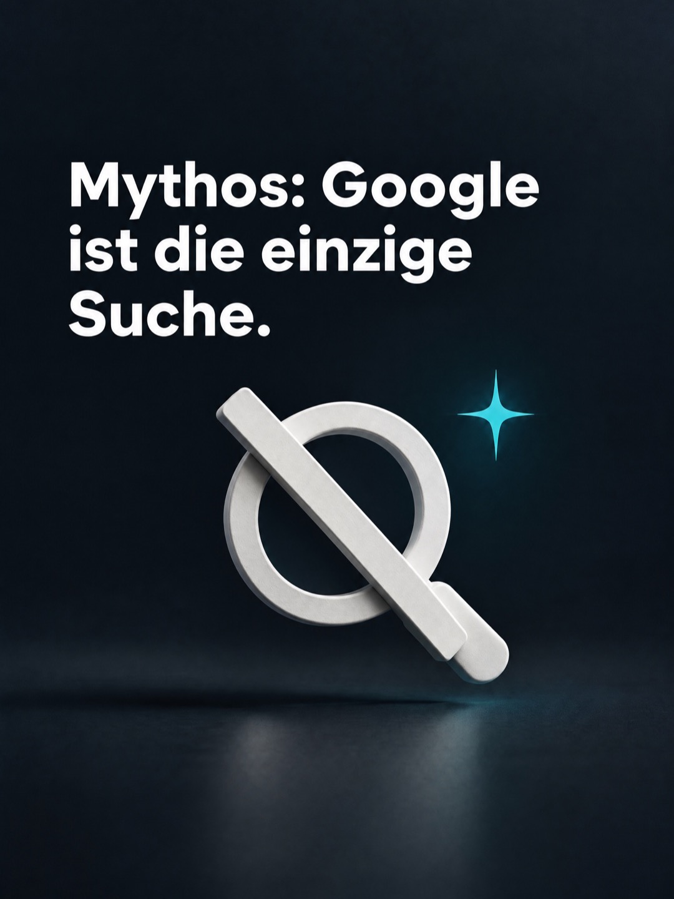

<a id="cd-044"></a>
## CD-044 · Server aktuell?

Security · 3:4 · Dokument Nr. 31

```text
Brand style for a one-person web agency in Wetzlar, Germany. Premium, calm, technical-editorial look. Palette: deep near-black navy background (#0B1220), off-white (#F5F5F2), single accent colour teal (#14B8A6), thin grey hairlines. Typography: bold modern geometric sans-serif headline, left-aligned, generous whitespace, max two text sizes, high contrast. Imagery: clean minimal 3D objects or minimal photoreal scenes, soft studio light, subtle grain, no clutter. Layout: vertical 3:4 portrait format (1080x1440 proportions); keep all text and key objects inside the centre with an 8% safe margin on every edge; keep the bottom-right corner (12% of width) empty and clean for a logo added later. Do not draw any logo. Text rules: render ONLY the German text given in quotes, exactly once, verbatim, with correct umlauts (ä, ö, ü, ß); no other words, no fake UI text, no watermarks, no third-party logos or brand names, no real or recognisable people. A padlock resting on an abstract server, soft teal (#14B8A6) glow. Headline: "Server aktuell? Website sicher(er)."
```

**Text im Bild:** „Server aktuell? Website sicher(er).“  
**Caption:** Die PHP-Version zählt mehr als das Theme. Kostenloser Check: Link in Bio.  
**Hashtags:** #websitesicherheit #phpsicherheit #wordpresssicherheit #itsicherheit #kmu #wetzlar #mittelhessen #lahndill #giessen #webdesignwetzlar  
**Bilder:** [original](bilder/original/CD-044.jpg) · [instagram-3x4](bilder/instagram-3x4/CD-044.jpg) · [facebook-linkedin-4x5](bilder/facebook-linkedin-4x5/CD-044.jpg)

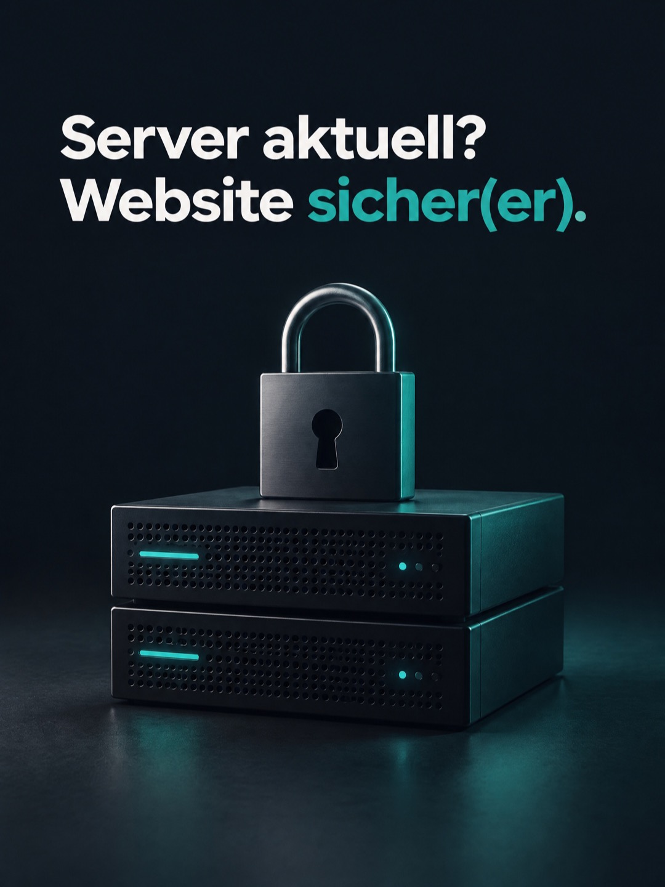

<a id="cd-045"></a>
## CD-045 · Updates aufschieben

Security · 3:4 · Dokument Nr. 32

```text
Brand style for a one-person web agency in Wetzlar, Germany. Premium, calm, technical-editorial look. Palette: deep near-black navy background (#0B1220), off-white (#F5F5F2), single accent colour teal (#14B8A6), thin grey hairlines. Typography: bold modern geometric sans-serif headline, left-aligned, generous whitespace, max two text sizes, high contrast. Imagery: clean minimal 3D objects or minimal photoreal scenes, soft studio light, subtle grain, no clutter. Layout: vertical 3:4 portrait format (1080x1440 proportions); keep all text and key objects inside the centre with an 8% safe margin on every edge; keep the bottom-right corner (12% of width) empty and clean for a logo added later. Do not draw any logo. Text rules: render ONLY the German text given in quotes, exactly once, verbatim, with correct umlauts (ä, ö, ü, ß); no other words, no fake UI text, no watermarks, no third-party logos or brand names, no real or recognisable people. An hourglass beside a minimal wall calendar. Headline: "Updates aufschieben kostet später mehr."
```

**Text im Bild:** „Updates aufschieben kostet später mehr.“  
**Caption:** Setz auf planbare Wartung statt auf den Notfall. Kostenloser Check: Link in Bio.  
**Hashtags:** #websitesicherheit #phpsicherheit #wordpresssicherheit #itsicherheit #kmu  
**Bilder:** [original](bilder/original/CD-045.jpg) · [instagram-3x4](bilder/instagram-3x4/CD-045.jpg) · [facebook-linkedin-4x5](bilder/facebook-linkedin-4x5/CD-045.jpg)

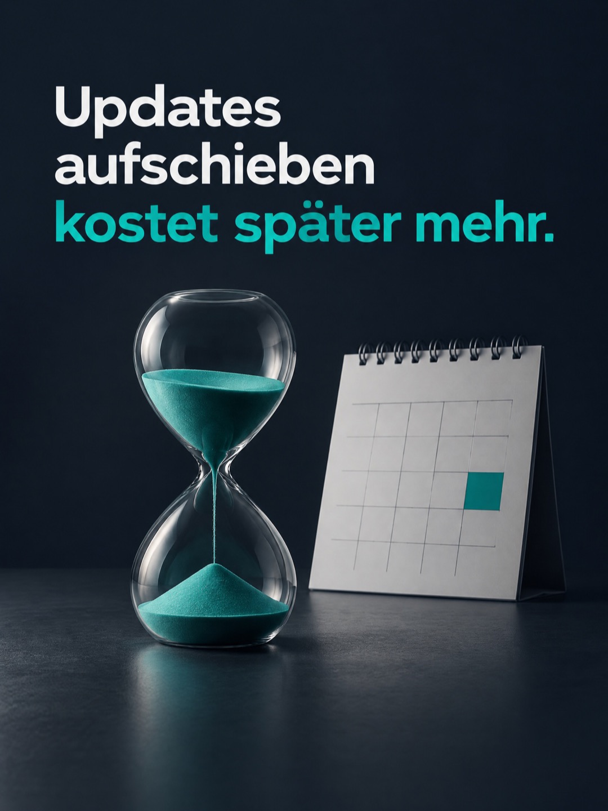

<a id="cd-046"></a>
## CD-046 · Backup vor jedem Update

Security · 3:4 · Dokument Nr. 33

```text
Brand style for a one-person web agency in Wetzlar, Germany. Premium, calm, technical-editorial look. Palette: deep near-black navy background (#0B1220), off-white (#F5F5F2), single accent colour teal (#14B8A6), thin grey hairlines. Typography: bold modern geometric sans-serif headline, left-aligned, generous whitespace, max two text sizes, high contrast. Imagery: clean minimal 3D objects or minimal photoreal scenes, soft studio light, subtle grain, no clutter. Layout: vertical 3:4 portrait format (1080x1440 proportions); keep all text and key objects inside the centre with an 8% safe margin on every edge; keep the bottom-right corner (12% of width) empty and clean for a logo added later. Do not draw any logo. Text rules: render ONLY the German text given in quotes, exactly once, verbatim, with correct umlauts (ä, ö, ü, ß); no other words, no fake UI text, no watermarks, no third-party logos or brand names, no real or recognisable people. A minimal external backup drive with a teal (#14B8A6) check mark. Headline: "Backup vor jedem Update."
```

**Text im Bild:** „Backup vor jedem Update.“  
**Caption:** So läuft Wartung bei Coday. Kostenloser Check: Link in Bio.  
**Hashtags:** #websitesicherheit #phpsicherheit #wordpresssicherheit #itsicherheit #kmu #webdesign #nextjs #webentwicklung #websiterelaunch #selbststaendig  
**Bilder:** [original](bilder/original/CD-046.jpg) · [instagram-3x4](bilder/instagram-3x4/CD-046.jpg) · [facebook-linkedin-4x5](bilder/facebook-linkedin-4x5/CD-046.jpg)

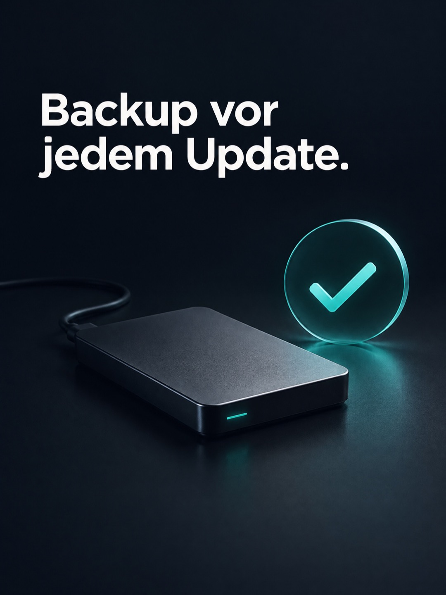

<a id="cd-047"></a>
## CD-047 · Notfall: Ruhe bewahren

Security · 3:4 · Dokument Nr. 34

```text
Brand style for a one-person web agency in Wetzlar, Germany. Premium, calm, technical-editorial look. Palette: deep near-black navy background (#0B1220), off-white (#F5F5F2), single accent colour teal (#14B8A6), thin grey hairlines. Typography: bold modern geometric sans-serif headline, left-aligned, generous whitespace, max two text sizes, high contrast. Imagery: clean minimal 3D objects or minimal photoreal scenes, soft studio light, subtle grain, no clutter. Layout: vertical 3:4 portrait format (1080x1440 proportions); keep all text and key objects inside the centre with an 8% safe margin on every edge; keep the bottom-right corner (12% of width) empty and clean for a logo added later. Do not draw any logo. Text rules: render ONLY the German text given in quotes, exactly once, verbatim, with correct umlauts (ä, ö, ü, ß); no other words, no fake UI text, no watermarks, no third-party logos or brand names, no real or recognisable people. A smartphone showing a minimal emergency icon in the teal accent colour (#14B8A6). Headline: "Website gehackt? Ruhe bewahren."
```

**Text im Bild:** „Website gehackt? Ruhe bewahren.“  
**Caption:** Über die Notfall-Hotline melde ich mich, sobald ich die Nachricht sehe. Kostenloser Check: Link in Bio.  
**Hashtags:** #websitesicherheit #phpsicherheit #wordpresssicherheit #itsicherheit #kmu #wetzlar #mittelhessen #lahndill #giessen #webdesignwetzlar  
**Hinweise:** „gehackt“ kann den Inhaltsfilter auslösen; dann ohne Text generieren und die Headline in Canva setzen.  
**Bilder:** [original](bilder/original/CD-047.jpg) · [instagram-3x4](bilder/instagram-3x4/CD-047.jpg) · [facebook-linkedin-4x5](bilder/facebook-linkedin-4x5/CD-047.jpg)

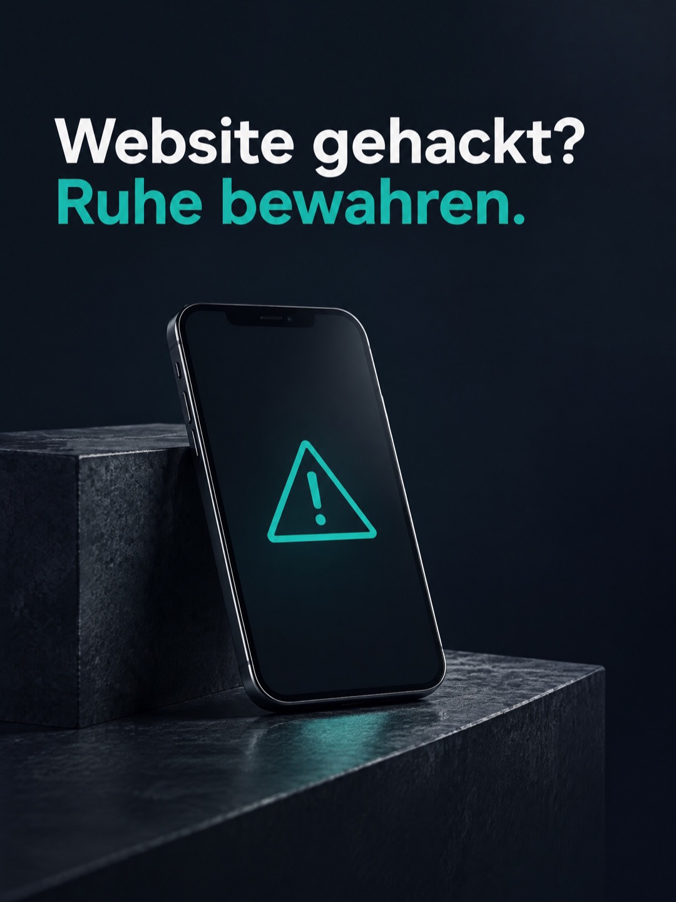

<a id="cd-048"></a>
## CD-048 · 3 Fragen an deinen Hoster

Security · 3:4 · Dokument Nr. 35

```text
Brand style for a one-person web agency in Wetzlar, Germany. Premium, calm, technical-editorial look. Palette: deep near-black navy background (#0B1220), off-white (#F5F5F2), single accent colour teal (#14B8A6), thin grey hairlines. Typography: bold modern geometric sans-serif headline, left-aligned, generous whitespace, max two text sizes, high contrast. Imagery: clean minimal 3D objects or minimal photoreal scenes, soft studio light, subtle grain, no clutter. Layout: vertical 3:4 portrait format (1080x1440 proportions); keep all text and key objects inside the centre with an 8% safe margin on every edge; keep the bottom-right corner (12% of width) empty and clean for a logo added later. Do not draw any logo. Text rules: render ONLY the German text given in quotes, exactly once, verbatim, with correct umlauts (ä, ö, ü, ß); no other words, no fake UI text, no watermarks, no third-party logos or brand names, no real or recognisable people. A minimal checklist card with three teal (#14B8A6) checkboxes. Headline: "3 Fragen an deinen Hoster"
```

**Text im Bild:** „3 Fragen an deinen Hoster“  
**Caption:** Frag deinen Hoster nach PHP-Version, Updates und Backups. Kostenloser Check: Link in Bio.  
**Hashtags:** #websitesicherheit #phpsicherheit #wordpresssicherheit #itsicherheit #kmu  
**Bilder:** [original](bilder/original/CD-048.jpg) · [instagram-3x4](bilder/instagram-3x4/CD-048.jpg) · [facebook-linkedin-4x5](bilder/facebook-linkedin-4x5/CD-048.jpg)

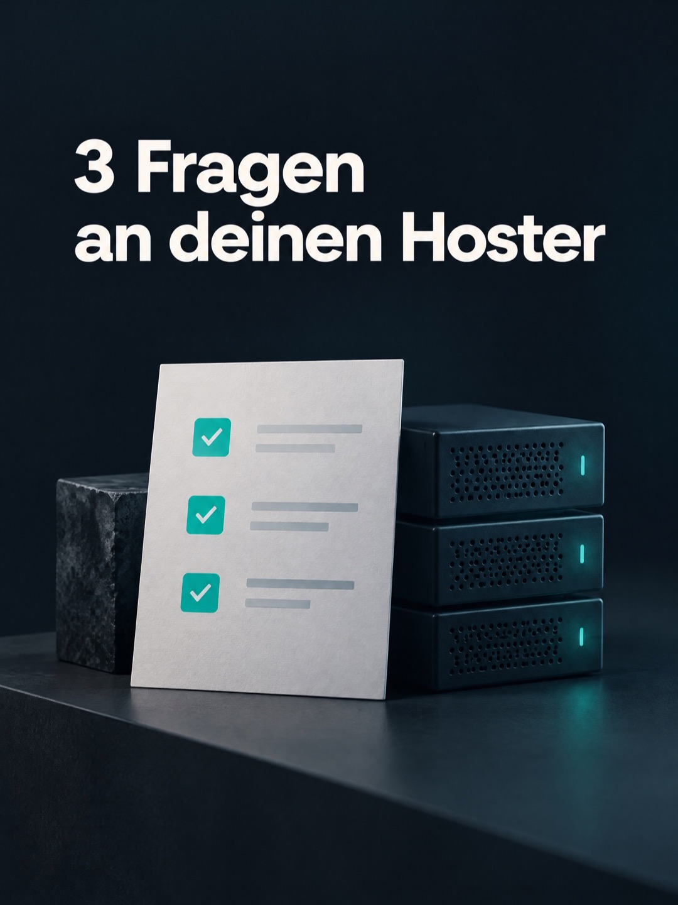

<a id="cd-049"></a>
## CD-049 · Headless CMS

Leistung · 3:4 · Dokument Nr. 36

```text
Brand style for a one-person web agency in Wetzlar, Germany. Premium, calm, technical-editorial look. Palette: deep near-black navy background (#0B1220), off-white (#F5F5F2), single accent colour teal (#14B8A6), thin grey hairlines. Typography: bold modern geometric sans-serif headline, left-aligned, generous whitespace, max two text sizes, high contrast. Imagery: clean minimal 3D objects or minimal photoreal scenes, soft studio light, subtle grain, no clutter. Layout: vertical 3:4 portrait format (1080x1440 proportions); keep all text and key objects inside the centre with an 8% safe margin on every edge; keep the bottom-right corner (12% of width) empty and clean for a logo added later. Do not draw any logo. Text rules: render ONLY the German text given in quotes, exactly once, verbatim, with correct umlauts (ä, ö, ü, ß); no other words, no fake UI text, no watermarks, no third-party logos or brand names, no real or recognisable people. A minimal diagram of stacked floating layers, one layer in the teal accent colour (#14B8A6). Headline: "Headless CMS: Inhalte pflegen, sicher bauen."
```

**Text im Bild:** „Headless CMS: Inhalte pflegen, sicher bauen.“  
**Caption:** Mit einem Headless CMS bearbeitest du Inhalte getrennt von der Website. Kostenloser Check: Link in Bio.  
**Hashtags:** #webdesign #nextjs #webentwicklung #websiterelaunch #selbststaendig  
**Bilder:** [original](bilder/original/CD-049.jpg) · [instagram-3x4](bilder/instagram-3x4/CD-049.jpg) · [facebook-linkedin-4x5](bilder/facebook-linkedin-4x5/CD-049.jpg)

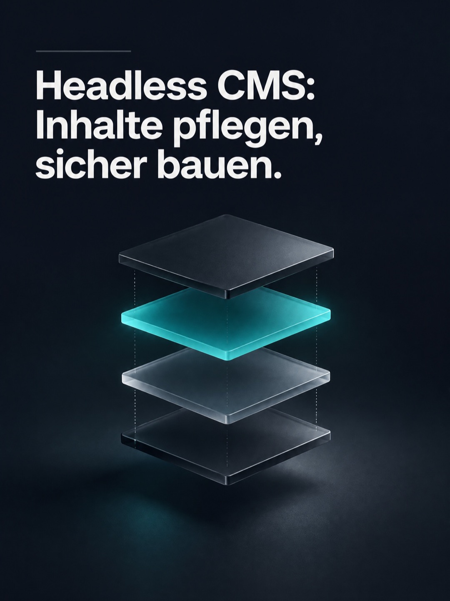

<a id="cd-050"></a>
## CD-050 · Schnelle Shops

Leistung · 3:4 · Dokument Nr. 37

```text
Brand style for a one-person web agency in Wetzlar, Germany. Premium, calm, technical-editorial look. Palette: deep near-black navy background (#0B1220), off-white (#F5F5F2), single accent colour teal (#14B8A6), thin grey hairlines. Typography: bold modern geometric sans-serif headline, left-aligned, generous whitespace, max two text sizes, high contrast. Imagery: clean minimal 3D objects or minimal photoreal scenes, soft studio light, subtle grain, no clutter. Layout: vertical 3:4 portrait format (1080x1440 proportions); keep all text and key objects inside the centre with an 8% safe margin on every edge; keep the bottom-right corner (12% of width) empty and clean for a logo added later. Do not draw any logo. Text rules: render ONLY the German text given in quotes, exactly once, verbatim, with correct umlauts (ä, ö, ü, ß); no other words, no fake UI text, no watermarks, no third-party logos or brand names, no real or recognisable people. A minimal shopping bag with fast motion lines in the teal accent colour (#14B8A6). Headline: "Shops, die schnell laden."
```

**Text im Bild:** „Shops, die schnell laden.“  
**Caption:** Ich baue E-Commerce ohne Plugin-Ballast. Kostenloser Check: Link in Bio.  
**Hashtags:** #webdesign #nextjs #webentwicklung #websiterelaunch #selbststaendig  
**Bilder:** [original](bilder/original/CD-050.jpg) · [instagram-3x4](bilder/instagram-3x4/CD-050.jpg) · [facebook-linkedin-4x5](bilder/facebook-linkedin-4x5/CD-050.jpg)

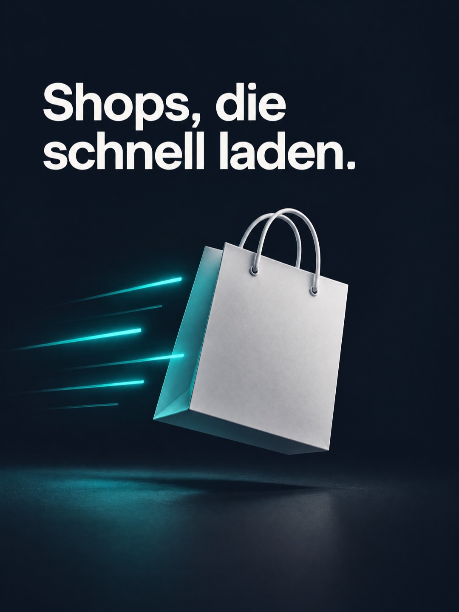

<a id="cd-051"></a>
## CD-051 · Lokal gefunden werden

Leistung · 3:4 · Dokument Nr. 38

```text
Brand style for a one-person web agency in Wetzlar, Germany. Premium, calm, technical-editorial look. Palette: deep near-black navy background (#0B1220), off-white (#F5F5F2), single accent colour teal (#14B8A6), thin grey hairlines. Typography: bold modern geometric sans-serif headline, left-aligned, generous whitespace, max two text sizes, high contrast. Imagery: clean minimal 3D objects or minimal photoreal scenes, soft studio light, subtle grain, no clutter. Layout: vertical 3:4 portrait format (1080x1440 proportions); keep all text and key objects inside the centre with an 8% safe margin on every edge; keep the bottom-right corner (12% of width) empty and clean for a logo added later. Do not draw any logo. Text rules: render ONLY the German text given in quotes, exactly once, verbatim, with correct umlauts (ä, ö, ü, ß); no other words, no fake UI text, no watermarks, no third-party logos or brand names, no real or recognisable people. A magnifying glass over a map pin in the teal accent colour (#14B8A6). Headline: "Lokal gefunden werden."
```

**Text im Bild:** „Lokal gefunden werden.“  
**Caption:** Ich biete lokale SEO für Betriebe in Mittelhessen. Kostenloser Check: Link in Bio.  
**Hashtags:** #geo #kisichtbarkeit #lokaleseo #googleranking #chatgpt #wetzlar #mittelhessen #lahndill #giessen #webdesignwetzlar  
**Bilder:** [original](bilder/original/CD-051.jpg) · [instagram-3x4](bilder/instagram-3x4/CD-051.jpg) · [facebook-linkedin-4x5](bilder/facebook-linkedin-4x5/CD-051.jpg)

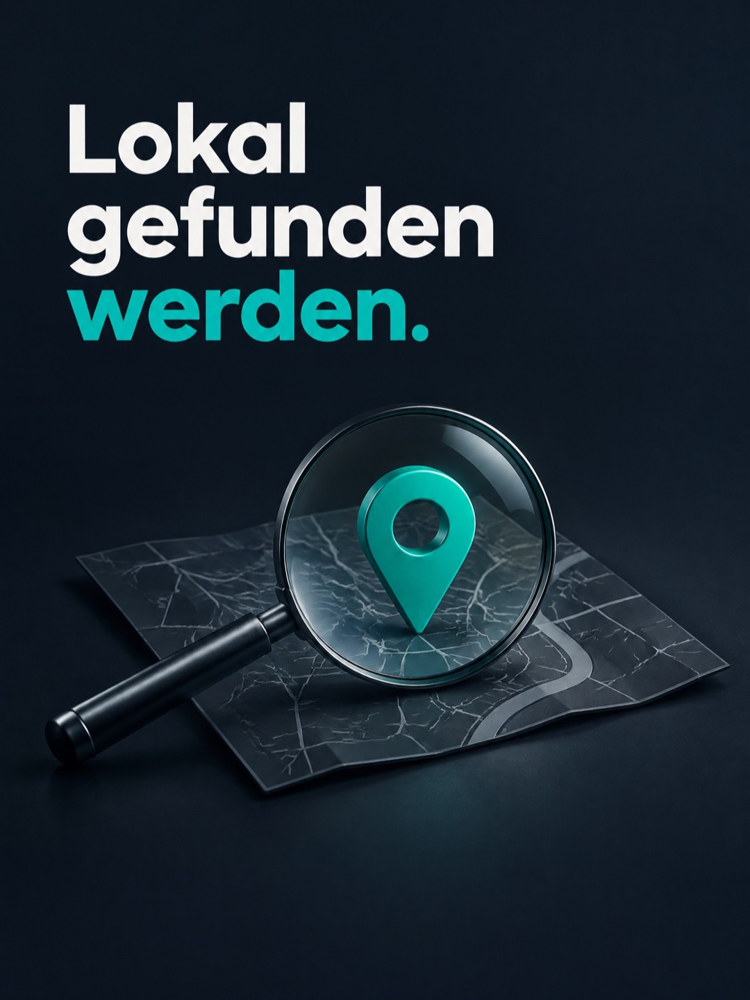

<a id="cd-052"></a>
## CD-052 · Website und Profil im Einklang

Leistung · 3:4 · Dokument Nr. 39

```text
Brand style for a one-person web agency in Wetzlar, Germany. Premium, calm, technical-editorial look. Palette: deep near-black navy background (#0B1220), off-white (#F5F5F2), single accent colour teal (#14B8A6), thin grey hairlines. Typography: bold modern geometric sans-serif headline, left-aligned, generous whitespace, max two text sizes, high contrast. Imagery: clean minimal 3D objects or minimal photoreal scenes, soft studio light, subtle grain, no clutter. Layout: vertical 3:4 portrait format (1080x1440 proportions); keep all text and key objects inside the centre with an 8% safe margin on every edge; keep the bottom-right corner (12% of width) empty and clean for a logo added later. Do not draw any logo. Text rules: render ONLY the German text given in quotes, exactly once, verbatim, with correct umlauts (ä, ö, ü, ß); no other words, no fake UI text, no watermarks, no third-party logos or brand names, no real or recognisable people. A generic business profile card icon without any third-party branding next to a minimal website frame, both showing matching abstract details. Headline: "Website und Unternehmensprofil im Einklang."
```

**Text im Bild:** „Website und Unternehmensprofil im Einklang.“  
**Caption:** Sorg für einheitliche Daten überall, auf der Website und im Unternehmensprofil. Kostenloser Check: Link in Bio.  
**Hashtags:** #geo #kisichtbarkeit #lokaleseo #googleranking #chatgpt #wetzlar #mittelhessen #lahndill #giessen #webdesignwetzlar  
**Bilder:** [original](bilder/original/CD-052.jpg) · [instagram-3x4](bilder/instagram-3x4/CD-052.jpg) · [facebook-linkedin-4x5](bilder/facebook-linkedin-4x5/CD-052.jpg)

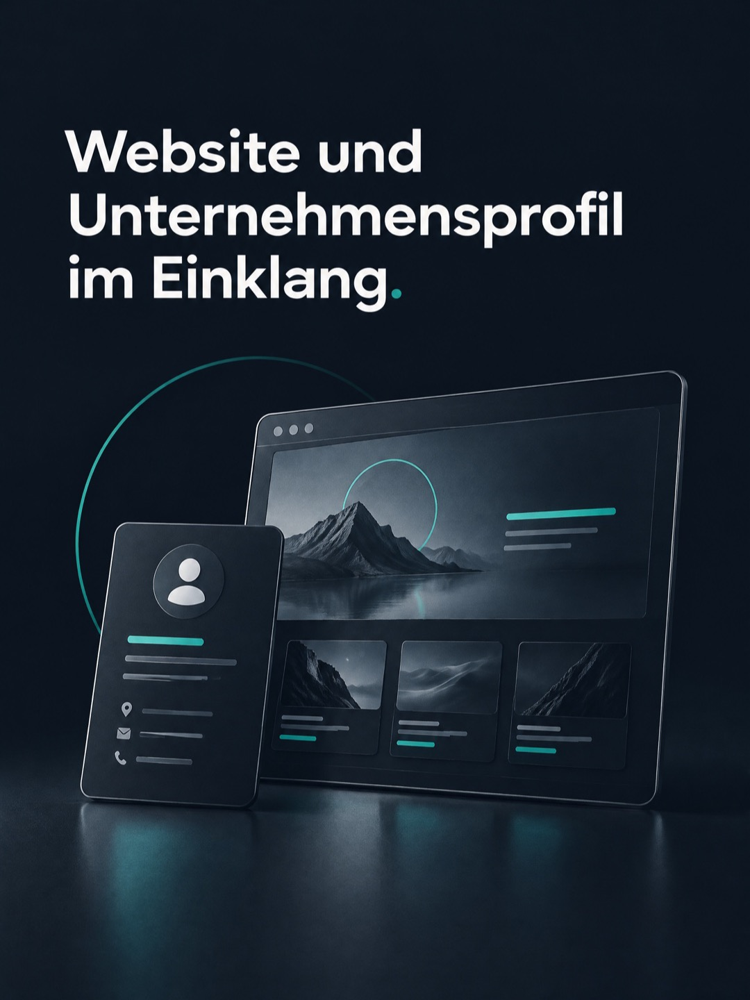

<a id="cd-053"></a>
## CD-053 · Jede Seite führt zur Anfrage

Leistung · 3:4 · Dokument Nr. 40

```text
Brand style for a one-person web agency in Wetzlar, Germany. Premium, calm, technical-editorial look. Palette: deep near-black navy background (#0B1220), off-white (#F5F5F2), single accent colour teal (#14B8A6), thin grey hairlines. Typography: bold modern geometric sans-serif headline, left-aligned, generous whitespace, max two text sizes, high contrast. Imagery: clean minimal 3D objects or minimal photoreal scenes, soft studio light, subtle grain, no clutter. Layout: vertical 3:4 portrait format (1080x1440 proportions); keep all text and key objects inside the centre with an 8% safe margin on every edge; keep the bottom-right corner (12% of width) empty and clean for a logo added later. Do not draw any logo. Text rules: render ONLY the German text given in quotes, exactly once, verbatim, with correct umlauts (ä, ö, ü, ß); no other words, no fake UI text, no watermarks, no third-party logos or brand names, no real or recognisable people. A website wireframe with flow arrows leading to one teal (#14B8A6) button. Headline: "Jede Seite führt zur Anfrage."
```

**Text im Bild:** „Jede Seite führt zur Anfrage.“  
**Caption:** Ich plane UX mit einem klaren Weg zur Anfrage. Kostenloser Check: Link in Bio.  
**Hashtags:** #webdesign #nextjs #webentwicklung #websiterelaunch #selbststaendig  
**Bilder:** [original](bilder/original/CD-053.jpg) · [instagram-3x4](bilder/instagram-3x4/CD-053.jpg) · [facebook-linkedin-4x5](bilder/facebook-linkedin-4x5/CD-053.jpg)

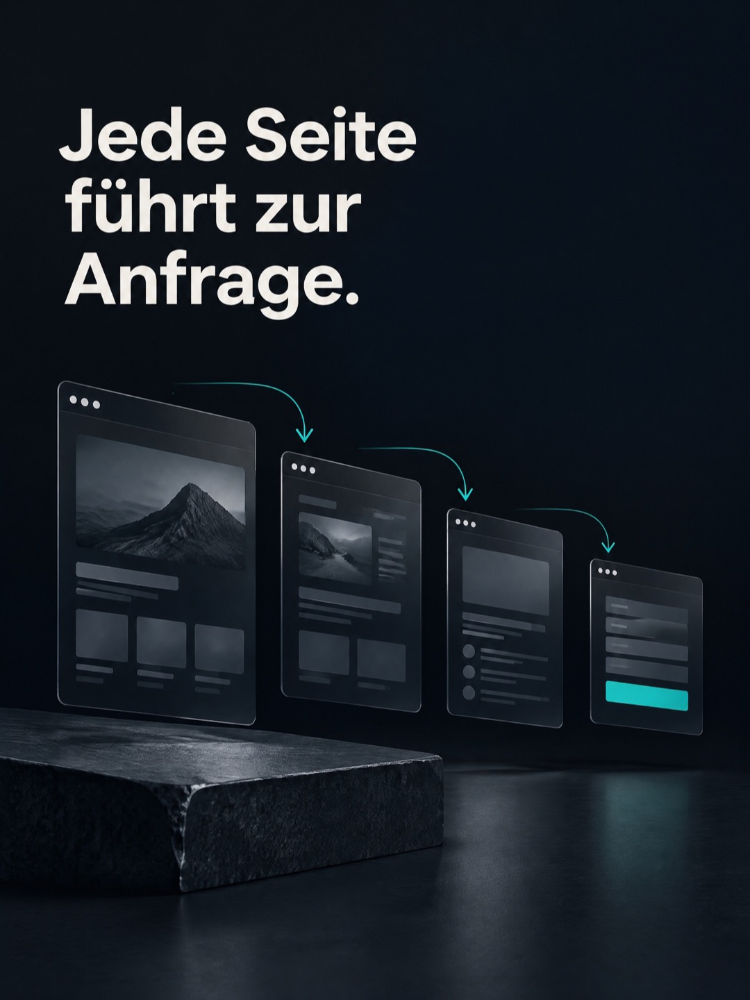

<a id="cd-054"></a>
## CD-054 · Kontaktformular kaputt?

Problem · 3:4 · Dokument Nr. 41

```text
Brand style for a one-person web agency in Wetzlar, Germany. Premium, calm, technical-editorial look. Palette: deep near-black navy background (#0B1220), off-white (#F5F5F2), single accent colour teal (#14B8A6), thin grey hairlines. Typography: bold modern geometric sans-serif headline, left-aligned, generous whitespace, max two text sizes, high contrast. Imagery: clean minimal 3D objects or minimal photoreal scenes, soft studio light, subtle grain, no clutter. Layout: vertical 3:4 portrait format (1080x1440 proportions); keep all text and key objects inside the centre with an 8% safe margin on every edge; keep the bottom-right corner (12% of width) empty and clean for a logo added later. Do not draw any logo. Text rules: render ONLY the German text given in quotes, exactly once, verbatim, with correct umlauts (ä, ö, ü, ß); no other words, no fake UI text, no watermarks, no third-party logos or brand names, no real or recognisable people. A minimal broken chain icon, one link in the teal accent colour (#14B8A6). Headline: "Kontaktformular kaputt? Merkst du nie."
```

**Text im Bild:** „Kontaktformular kaputt? Merkst du nie.“  
**Caption:** Monitoring hilft, solche Fehler früh zu bemerken. Kostenloser Check: Link in Bio.  
**Hashtags:** #websitesicherheit #phpsicherheit #wordpresssicherheit #itsicherheit #kmu #webdesign #nextjs #webentwicklung #websiterelaunch #selbststaendig  
**Bilder:** [original](bilder/original/CD-054.jpg) · [instagram-3x4](bilder/instagram-3x4/CD-054.jpg) · [facebook-linkedin-4x5](bilder/facebook-linkedin-4x5/CD-054.jpg)

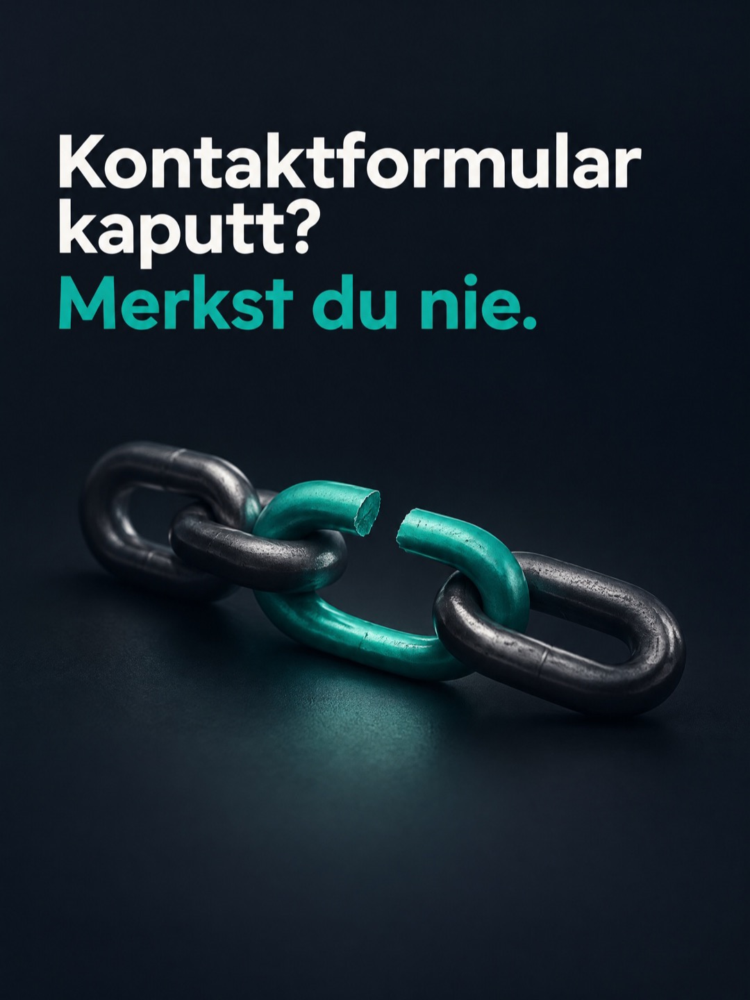

<a id="cd-055"></a>
## CD-055 · Auf dem Handy unlesbar?

Problem · 3:4 · Dokument Nr. 42

```text
Brand style for a one-person web agency in Wetzlar, Germany. Premium, calm, technical-editorial look. Palette: deep near-black navy background (#0B1220), off-white (#F5F5F2), single accent colour teal (#14B8A6), thin grey hairlines. Typography: bold modern geometric sans-serif headline, left-aligned, generous whitespace, max two text sizes, high contrast. Imagery: clean minimal 3D objects or minimal photoreal scenes, soft studio light, subtle grain, no clutter. Layout: vertical 3:4 portrait format (1080x1440 proportions); keep all text and key objects inside the centre with an 8% safe margin on every edge; keep the bottom-right corner (12% of width) empty and clean for a logo added later. Do not draw any logo. Text rules: render ONLY the German text given in quotes, exactly once, verbatim, with correct umlauts (ä, ö, ü, ß); no other words, no fake UI text, no watermarks, no third-party logos or brand names, no real or recognisable people. A smartphone showing a tiny, cramped, unreadable layout. Headline: "Auf dem Handy unlesbar?"
```

**Text im Bild:** „Auf dem Handy unlesbar?“  
**Caption:** Ich baue Websites mobile-first. Kostenloser Check: Link in Bio.  
**Hashtags:** #webdesign #nextjs #webentwicklung #websiterelaunch #selbststaendig  
**Bilder:** [original](bilder/original/CD-055.jpg) · [instagram-3x4](bilder/instagram-3x4/CD-055.jpg) · [facebook-linkedin-4x5](bilder/facebook-linkedin-4x5/CD-055.jpg)

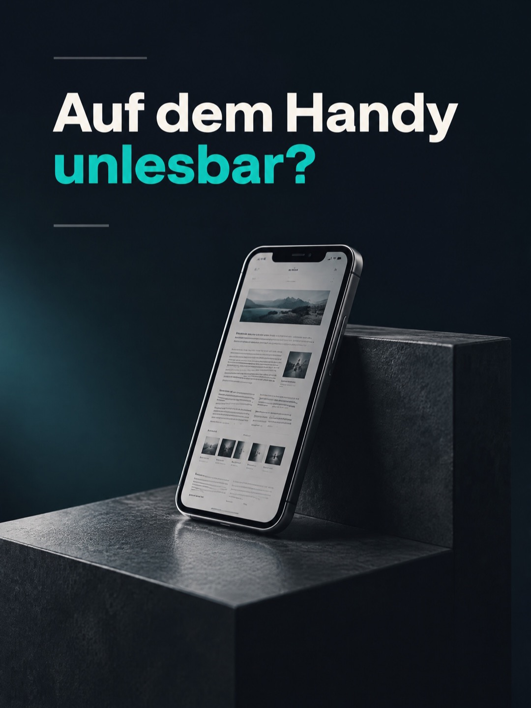

<a id="cd-056"></a>
## CD-056 · Website von 2015?

Problem · 3:4 · Dokument Nr. 43

```text
Brand style for a one-person web agency in Wetzlar, Germany. Premium, calm, technical-editorial look. Palette: deep near-black navy background (#0B1220), off-white (#F5F5F2), single accent colour teal (#14B8A6), thin grey hairlines. Typography: bold modern geometric sans-serif headline, left-aligned, generous whitespace, max two text sizes, high contrast. Imagery: clean minimal 3D objects or minimal photoreal scenes, soft studio light, subtle grain, no clutter. Layout: vertical 3:4 portrait format (1080x1440 proportions); keep all text and key objects inside the centre with an 8% safe margin on every edge; keep the bottom-right corner (12% of width) empty and clean for a logo added later. Do not draw any logo. Text rules: render ONLY the German text given in quotes, exactly once, verbatim, with correct umlauts (ä, ö, ü, ß); no other words, no fake UI text, no watermarks, no third-party logos or brand names, no real or recognisable people. A dusty abandoned desk with an old bulky monitor, faint cobwebs, muted light. Headline: "Website von 2015?"
```

**Text im Bild:** „Website von 2015?“  
**Caption:** Ich mache deinen Relaunch zum Festpreis. Kostenloser Check: Link in Bio.  
**Hashtags:** #webdesign #nextjs #webentwicklung #websiterelaunch #selbststaendig #wetzlar #mittelhessen #lahndill #giessen #webdesignwetzlar  
**Hinweise:** Wirkt das Bild fotorealistisch, „KI-generiertes Symbolbild“ in die Caption schreiben.  
**Bilder:** [original](bilder/original/CD-056.jpg) · [instagram-3x4](bilder/instagram-3x4/CD-056.jpg) · [facebook-linkedin-4x5](bilder/facebook-linkedin-4x5/CD-056.jpg)


<a id="cd-057"></a>
## CD-057 · Button nicht gefunden

Problem · 3:4 · Dokument Nr. 44

```text
Brand style for a one-person web agency in Wetzlar, Germany. Premium, calm, technical-editorial look. Palette: deep near-black navy background (#0B1220), off-white (#F5F5F2), single accent colour teal (#14B8A6), thin grey hairlines. Typography: bold modern geometric sans-serif headline, left-aligned, generous whitespace, max two text sizes, high contrast. Imagery: clean minimal 3D objects or minimal photoreal scenes, soft studio light, subtle grain, no clutter. Layout: vertical 3:4 portrait format (1080x1440 proportions); keep all text and key objects inside the centre with an 8% safe margin on every edge; keep the bottom-right corner (12% of width) empty and clean for a logo added later. Do not draw any logo. Text rules: render ONLY the German text given in quotes, exactly once, verbatim, with correct umlauts (ä, ö, ü, ß); no other words, no fake UI text, no watermarks, no third-party logos or brand names, no real or recognisable people. A minimal maze seen from above with one clear path in the teal accent colour (#14B8A6). Headline: "Kunden finden den Button nicht."
```

**Text im Bild:** „Kunden finden den Button nicht.“  
**Caption:** Ein UX-Audit zeigt, wo deine Besucher hängen bleiben. Kostenloser Check: Link in Bio.  
**Hashtags:** #webdesign #nextjs #webentwicklung #websiterelaunch #selbststaendig  
**Bilder:** [original](bilder/original/CD-057.jpg) · [instagram-3x4](bilder/instagram-3x4/CD-057.jpg) · [facebook-linkedin-4x5](bilder/facebook-linkedin-4x5/CD-057.jpg)


<a id="cd-058"></a>
## CD-058 · Vorher warten, nachher da

Vorher/Nachher · 3:4 · Dokument Nr. 45

```text
Brand style for a one-person web agency in Wetzlar, Germany. Premium, calm, technical-editorial look. Palette: deep near-black navy background (#0B1220), off-white (#F5F5F2), single accent colour teal (#14B8A6), thin grey hairlines. Typography: bold modern geometric sans-serif headline, left-aligned, generous whitespace, max two text sizes, high contrast. Imagery: clean minimal 3D objects or minimal photoreal scenes, soft studio light, subtle grain, no clutter. Layout: vertical 3:4 portrait format (1080x1440 proportions); keep all text and key objects inside the centre with an 8% safe margin on every edge; keep the bottom-right corner (12% of width) empty and clean for a logo added later. Do not draw any logo. Text rules: render ONLY the German text given in quotes, exactly once, verbatim, with correct umlauts (ä, ö, ü, ß); no other words, no fake UI text, no watermarks, no third-party logos or brand names, no real or recognisable people. Split composition: on the left a slow loading spinner on an empty page, on the right an instantly loaded clean page with teal (#14B8A6) accents. Headline: "Vorher: warten. Nachher: da."
```

**Text im Bild:** „Vorher: warten. Nachher: da.“  
**Caption:** Das ist ein Symbolbild, kein Kundenprojekt. Kostenloser Check: Link in Bio.  
**Hashtags:** #webdesign #nextjs #webentwicklung #websiterelaunch #selbststaendig  
**Hinweise:** Der Hinweis „Symbolbild“ muss in der Caption bleiben.  
**Bilder:** [original](bilder/original/CD-058.jpg) · [instagram-3x4](bilder/instagram-3x4/CD-058.jpg) · [facebook-linkedin-4x5](bilder/facebook-linkedin-4x5/CD-058.jpg)


<a id="cd-059"></a>
## CD-059 · 30 Plugins zu 0

Vorher/Nachher · 3:4 · Dokument Nr. 46

```text
Brand style for a one-person web agency in Wetzlar, Germany. Premium, calm, technical-editorial look. Palette: deep near-black navy background (#0B1220), off-white (#F5F5F2), single accent colour teal (#14B8A6), thin grey hairlines. Typography: bold modern geometric sans-serif headline, left-aligned, generous whitespace, max two text sizes, high contrast. Imagery: clean minimal 3D objects or minimal photoreal scenes, soft studio light, subtle grain, no clutter. Layout: vertical 3:4 portrait format (1080x1440 proportions); keep all text and key objects inside the centre with an 8% safe margin on every edge; keep the bottom-right corner (12% of width) empty and clean for a logo added later. Do not draw any logo. Text rules: render ONLY the German text given in quotes, exactly once, verbatim, with correct umlauts (ä, ö, ü, ß); no other words, no fake UI text, no watermarks, no third-party logos or brand names, no real or recognisable people. Split composition: on the left a messy pile of puzzle-piece plugins, on the right one clean solid block in the teal accent colour (#14B8A6). Headline: "Vorher: 30 Plugins. Nachher: 0."
```

**Text im Bild:** „Vorher: 30 Plugins. Nachher: 0.“  
**Caption:** Das ist ein Symbolbild. Kostenloser Check: Link in Bio.  
**Hashtags:** #webdesign #nextjs #webentwicklung #websiterelaunch #selbststaendig #websitesicherheit #phpsicherheit #wordpresssicherheit #itsicherheit #kmu  
**Hinweise:** Der Hinweis „Symbolbild“ muss in der Caption bleiben.  
**Bilder:** [original](bilder/original/CD-059.jpg) · [instagram-3x4](bilder/instagram-3x4/CD-059.jpg) · [facebook-linkedin-4x5](bilder/facebook-linkedin-4x5/CD-059.jpg)


<a id="cd-060"></a>
## CD-060 · Branche Café

Branche · 3:4 · Dokument Nr. 47

```text
Brand style for a one-person web agency in Wetzlar, Germany. Premium, calm, technical-editorial look. Palette: deep near-black navy background (#0B1220), off-white (#F5F5F2), single accent colour teal (#14B8A6), thin grey hairlines. Typography: bold modern geometric sans-serif headline, left-aligned, generous whitespace, max two text sizes, high contrast. Imagery: clean minimal 3D objects or minimal photoreal scenes, soft studio light, subtle grain, no clutter. Layout: vertical 3:4 portrait format (1080x1440 proportions); keep all text and key objects inside the centre with an 8% safe margin on every edge; keep the bottom-right corner (12% of width) empty and clean for a logo added later. Do not draw any logo. Text rules: render ONLY the German text given in quotes, exactly once, verbatim, with correct umlauts (ä, ö, ü, ß); no other words, no fake UI text, no watermarks, no third-party logos or brand names, no real or recognisable people. A latte on a marble table, a smartphone beside it showing an abstract map with one teal (#14B8A6) pin. Headline: "Dein Café, auf der Karte ganz oben."
```

**Text im Bild:** „Dein Café, auf der Karte ganz oben.“  
**Caption:** So wird dein Café für Spontangäste sichtbar. Kostenloser Check: Link in Bio.  
**Hashtags:** #wetzlar #mittelhessen #lahndill #giessen #webdesignwetzlar #cafe  
**Hinweise:** Wirkt das Bild fotorealistisch, „KI-generiertes Symbolbild“ in die Caption schreiben.  
**Bilder:** [original](bilder/original/CD-060.jpg) · [instagram-3x4](bilder/instagram-3x4/CD-060.jpg) · [facebook-linkedin-4x5](bilder/facebook-linkedin-4x5/CD-060.jpg)


<a id="cd-061"></a>
## CD-061 · Branche Handwerk: Konfigurator

Branche · 3:4 · Dokument Nr. 48

```text
Brand style for a one-person web agency in Wetzlar, Germany. Premium, calm, technical-editorial look. Palette: deep near-black navy background (#0B1220), off-white (#F5F5F2), single accent colour teal (#14B8A6), thin grey hairlines. Typography: bold modern geometric sans-serif headline, left-aligned, generous whitespace, max two text sizes, high contrast. Imagery: clean minimal 3D objects or minimal photoreal scenes, soft studio light, subtle grain, no clutter. Layout: vertical 3:4 portrait format (1080x1440 proportions); keep all text and key objects inside the centre with an 8% safe margin on every edge; keep the bottom-right corner (12% of width) empty and clean for a logo added later. Do not draw any logo. Text rules: render ONLY the German text given in quotes, exactly once, verbatim, with correct umlauts (ä, ö, ü, ß); no other words, no fake UI text, no watermarks, no third-party logos or brand names, no real or recognisable people. Tile samples on a workbench, a tablet showing abstract configurator shapes. Headline: "Konfigurator statt Rückruf-Chaos."
```

**Text im Bild:** „Konfigurator statt Rückruf-Chaos.“  
**Caption:** Mit einem Konfigurator kommen Anfragen gleich mit allen Infos. Kostenloser Check: Link in Bio.  
**Hashtags:** #wetzlar #mittelhessen #lahndill #giessen #webdesignwetzlar #handwerk  
**Hinweise:** Wirkt das Bild fotorealistisch, „KI-generiertes Symbolbild“ in die Caption schreiben.  
**Bilder:** [original](bilder/original/CD-061.jpg) · [instagram-3x4](bilder/instagram-3x4/CD-061.jpg) · [facebook-linkedin-4x5](bilder/facebook-linkedin-4x5/CD-061.jpg)


<a id="cd-062"></a>
## CD-062 · Branche Makler

Branche · 3:4 · Dokument Nr. 49

```text
Brand style for a one-person web agency in Wetzlar, Germany. Premium, calm, technical-editorial look. Palette: deep near-black navy background (#0B1220), off-white (#F5F5F2), single accent colour teal (#14B8A6), thin grey hairlines. Typography: bold modern geometric sans-serif headline, left-aligned, generous whitespace, max two text sizes, high contrast. Imagery: clean minimal 3D objects or minimal photoreal scenes, soft studio light, subtle grain, no clutter. Layout: vertical 3:4 portrait format (1080x1440 proportions); keep all text and key objects inside the centre with an 8% safe margin on every edge; keep the bottom-right corner (12% of width) empty and clean for a logo added later. Do not draw any logo. Text rules: render ONLY the German text given in quotes, exactly once, verbatim, with correct umlauts (ä, ö, ü, ß); no other words, no fake UI text, no watermarks, no third-party logos or brand names, no real or recognisable people. A house key lying on a floor plan drawing with no readable text. Headline: "Exposés, die verkaufen."
```

**Text im Bild:** „Exposés, die verkaufen.“  
**Caption:** Ich baue Immobilien-Websites mit Suchfunktion. Kostenloser Check: Link in Bio.  
**Hashtags:** #wetzlar #mittelhessen #lahndill #giessen #webdesignwetzlar #immobilien  
**Hinweise:** Wirkt das Bild fotorealistisch, „KI-generiertes Symbolbild“ in die Caption schreiben.  
**Bilder:** [original](bilder/original/CD-062.jpg) · [instagram-3x4](bilder/instagram-3x4/CD-062.jpg) · [facebook-linkedin-4x5](bilder/facebook-linkedin-4x5/CD-062.jpg)


<a id="cd-063"></a>
## CD-063 · Branche Reinigung

Branche · 3:4 · Dokument Nr. 50

```text
Brand style for a one-person web agency in Wetzlar, Germany. Premium, calm, technical-editorial look. Palette: deep near-black navy background (#0B1220), off-white (#F5F5F2), single accent colour teal (#14B8A6), thin grey hairlines. Typography: bold modern geometric sans-serif headline, left-aligned, generous whitespace, max two text sizes, high contrast. Imagery: clean minimal 3D objects or minimal photoreal scenes, soft studio light, subtle grain, no clutter. Layout: vertical 3:4 portrait format (1080x1440 proportions); keep all text and key objects inside the centre with an 8% safe margin on every edge; keep the bottom-right corner (12% of width) empty and clean for a logo added later. Do not draw any logo. Text rules: render ONLY the German text given in quotes, exactly once, verbatim, with correct umlauts (ä, ö, ü, ß); no other words, no fake UI text, no watermarks, no third-party logos or brand names, no real or recognisable people. A spotless surface with a soft shine and one gleaming reflection. Headline: "Saubere Arbeit, saubere Website."
```

**Text im Bild:** „Saubere Arbeit, saubere Website.“  
**Caption:** Ich baue Websites für Dienstleister wie Reinigungsfirmen. Kostenloser Check: Link in Bio.  
**Hashtags:** #wetzlar #mittelhessen #lahndill #giessen #webdesignwetzlar  
**Hinweise:** Wirkt das Bild fotorealistisch, „KI-generiertes Symbolbild“ in die Caption schreiben.  
**Bilder:** [original](bilder/original/CD-063.jpg) · [instagram-3x4](bilder/instagram-3x4/CD-063.jpg) · [facebook-linkedin-4x5](bilder/facebook-linkedin-4x5/CD-063.jpg)


<a id="cd-064"></a>
## CD-064 · Branche Kanzlei

Branche · 3:4 · Dokument Nr. 51

```text
Brand style for a one-person web agency in Wetzlar, Germany. Premium, calm, technical-editorial look. Palette: deep near-black navy background (#0B1220), off-white (#F5F5F2), single accent colour teal (#14B8A6), thin grey hairlines. Typography: bold modern geometric sans-serif headline, left-aligned, generous whitespace, max two text sizes, high contrast. Imagery: clean minimal 3D objects or minimal photoreal scenes, soft studio light, subtle grain, no clutter. Layout: vertical 3:4 portrait format (1080x1440 proportions); keep all text and key objects inside the centre with an 8% safe margin on every edge; keep the bottom-right corner (12% of width) empty and clean for a logo added later. Do not draw any logo. Text rules: render ONLY the German text given in quotes, exactly once, verbatim, with correct umlauts (ä, ö, ü, ß); no other words, no fake UI text, no watermarks, no third-party logos or brand names, no real or recognisable people. A minimal scales-of-justice icon in off-white with one detail in the teal accent colour (#14B8A6). Headline: "Seriös. Schnell. Klar."
```

**Text im Bild:** „Seriös. Schnell. Klar.“  
**Caption:** Ich baue Websites für Kanzleien. Kostenloser Check: Link in Bio.  
**Hashtags:** #wetzlar #mittelhessen #lahndill #giessen #webdesignwetzlar #kanzlei  
**Bilder:** [original](bilder/original/CD-064.jpg) · [instagram-3x4](bilder/instagram-3x4/CD-064.jpg) · [facebook-linkedin-4x5](bilder/facebook-linkedin-4x5/CD-064.jpg)


<a id="cd-065"></a>
## CD-065 · Aus dem Lahntal

Lokal · 3:4 · Dokument Nr. 52

```text
Brand style for a one-person web agency in Wetzlar, Germany. Premium, calm, technical-editorial look. Palette: deep near-black navy background (#0B1220), off-white (#F5F5F2), single accent colour teal (#14B8A6), thin grey hairlines. Typography: bold modern geometric sans-serif headline, left-aligned, generous whitespace, max two text sizes, high contrast. Imagery: clean minimal 3D objects or minimal photoreal scenes, soft studio light, subtle grain, no clutter. Layout: vertical 3:4 portrait format (1080x1440 proportions); keep all text and key objects inside the centre with an 8% safe margin on every edge; keep the bottom-right corner (12% of width) empty and clean for a logo added later. Do not draw any logo. Text rules: render ONLY the German text given in quotes, exactly once, verbatim, with correct umlauts (ä, ö, ü, ß); no other words, no fake UI text, no watermarks, no third-party logos or brand names, no real or recognisable people. An abstract river line winding between soft hills, drawn in thin off-white lines on dark navy. Headline: "Aus dem Lahntal für deinen Betrieb."
```

**Text im Bild:** „Aus dem Lahntal für deinen Betrieb.“  
**Caption:** Ich bin für dich vor Ort erreichbar. Kostenloser Check: Link in Bio.  
**Hashtags:** #wetzlar #mittelhessen #lahndill #giessen #webdesignwetzlar  
**Bilder:** [original](bilder/original/CD-065.jpg) · [instagram-3x4](bilder/instagram-3x4/CD-065.jpg) · [facebook-linkedin-4x5](bilder/facebook-linkedin-4x5/CD-065.jpg)


<a id="cd-066"></a>
## CD-066 · Einzugsgebiet

Lokal · 3:4 · Dokument Nr. 53

```text
Brand style for a one-person web agency in Wetzlar, Germany. Premium, calm, technical-editorial look. Palette: deep near-black navy background (#0B1220), off-white (#F5F5F2), single accent colour teal (#14B8A6), thin grey hairlines. Typography: bold modern geometric sans-serif headline, left-aligned, generous whitespace, max two text sizes, high contrast. Imagery: clean minimal 3D objects or minimal photoreal scenes, soft studio light, subtle grain, no clutter. Layout: vertical 3:4 portrait format (1080x1440 proportions); keep all text and key objects inside the centre with an 8% safe margin on every edge; keep the bottom-right corner (12% of width) empty and clean for a logo added later. Do not draw any logo. Text rules: render ONLY the German text given in quotes, exactly once, verbatim, with correct umlauts (ä, ö, ü, ß); no other words, no fake UI text, no watermarks, no third-party logos or brand names, no real or recognisable people. Four pins in the teal accent colour (#14B8A6) on an abstract map of thin off-white lines, no labels. Headline: "Wetzlar · Gießen · Marburg · Limburg"
```

**Text im Bild:** „Wetzlar · Gießen · Marburg · Limburg“  
**Caption:** Das ist mein Einzugsgebiet. Kostenloser Check: Link in Bio.  
**Hashtags:** #wetzlar #mittelhessen #lahndill #giessen #webdesignwetzlar  
**Bilder:** [original](bilder/original/CD-066.jpg) · [instagram-3x4](bilder/instagram-3x4/CD-066.jpg) · [facebook-linkedin-4x5](bilder/facebook-linkedin-4x5/CD-066.jpg)


<a id="cd-067"></a>
## CD-067 · Core Web Vitals

Wissen · 3:4 · Dokument Nr. 54

```text
Brand style for a one-person web agency in Wetzlar, Germany. Premium, calm, technical-editorial look. Palette: deep near-black navy background (#0B1220), off-white (#F5F5F2), single accent colour teal (#14B8A6), thin grey hairlines. Typography: bold modern geometric sans-serif headline, left-aligned, generous whitespace, max two text sizes, high contrast. Imagery: clean minimal 3D objects or minimal photoreal scenes, soft studio light, subtle grain, no clutter. Layout: vertical 3:4 portrait format (1080x1440 proportions); keep all text and key objects inside the centre with an 8% safe margin on every edge; keep the bottom-right corner (12% of width) empty and clean for a logo added later. Do not draw any logo. Text rules: render ONLY the German text given in quotes, exactly once, verbatim, with correct umlauts (ä, ö, ü, ß); no other words, no fake UI text, no watermarks, no third-party logos or brand names, no real or recognisable people. A ruler measuring a smartphone. Headline: "Was sind Core Web Vitals?"
```

**Text im Bild:** „Was sind Core Web Vitals?“  
**Caption:** Ich erkläre es kurz in den Kommentaren. Kostenloser Check: Link in Bio.  
**Hashtags:** #webdesign #nextjs #webentwicklung #websiterelaunch #selbststaendig  
**Hinweise:** Kurze Erklärung der Core Web Vitals als ersten Kommentar posten (die Caption verweist darauf). Bonus: ohne Text im Format 16:9 als Blog-Header für codayweb.de.  
**Bilder:** [original](bilder/original/CD-067.jpg) · [instagram-3x4](bilder/instagram-3x4/CD-067.jpg) · [facebook-linkedin-4x5](bilder/facebook-linkedin-4x5/CD-067.jpg)


<a id="cd-068"></a>
## CD-068 · PHP-Version ≠ WordPress-Version

Wissen · 3:4 · Dokument Nr. 55

```text
Brand style for a one-person web agency in Wetzlar, Germany. Premium, calm, technical-editorial look. Palette: deep near-black navy background (#0B1220), off-white (#F5F5F2), single accent colour teal (#14B8A6), thin grey hairlines. Typography: bold modern geometric sans-serif headline, left-aligned, generous whitespace, max two text sizes, high contrast. Imagery: clean minimal 3D objects or minimal photoreal scenes, soft studio light, subtle grain, no clutter. Layout: vertical 3:4 portrait format (1080x1440 proportions); keep all text and key objects inside the centre with an 8% safe margin on every edge; keep the bottom-right corner (12% of width) empty and clean for a logo added later. Do not draw any logo. Text rules: render ONLY the German text given in quotes, exactly once, verbatim, with correct umlauts (ä, ö, ü, ß); no other words, no fake UI text, no watermarks, no third-party logos or brand names, no real or recognisable people. Two solid blocks of different heights side by side, each carrying a small version label. Headline: "PHP-Version ≠ WordPress-Version". Small label (on the left block): "v8.2". Small label (on the right block): "v8.4".
```

**Text im Bild:** „PHP-Version ≠ WordPress-Version“  
**Label:** „v8.2“ (on the left block)  
**Label:** „v8.4“ (on the right block)  
**Caption:** Das ist der häufigste Irrtum. Kostenloser Check: Link in Bio.  
**Hashtags:** #websitesicherheit #phpsicherheit #wordpresssicherheit #itsicherheit #kmu  
**Hinweise:** Bonus: ohne Text im Format 16:9 als Blog-Header für codayweb.de.  
**Bilder:** [original](bilder/original/CD-068.jpg) · [instagram-3x4](bilder/instagram-3x4/CD-068.jpg) · [facebook-linkedin-4x5](bilder/facebook-linkedin-4x5/CD-068.jpg)


<a id="cd-069"></a>
## CD-069 · Was ist Next.js?

Wissen · 3:4 · Dokument Nr. 56

```text
Brand style for a one-person web agency in Wetzlar, Germany. Premium, calm, technical-editorial look. Palette: deep near-black navy background (#0B1220), off-white (#F5F5F2), single accent colour teal (#14B8A6), thin grey hairlines. Typography: bold modern geometric sans-serif headline, left-aligned, generous whitespace, max two text sizes, high contrast. Imagery: clean minimal 3D objects or minimal photoreal scenes, soft studio light, subtle grain, no clutter. Layout: vertical 3:4 portrait format (1080x1440 proportions); keep all text and key objects inside the centre with an 8% safe margin on every edge; keep the bottom-right corner (12% of width) empty and clean for a logo added later. Do not draw any logo. Text rules: render ONLY the German text given in quotes, exactly once, verbatim, with correct umlauts (ä, ö, ü, ß); no other words, no fake UI text, no watermarks, no third-party logos or brand names, no real or recognisable people. Puzzle pieces fitting together, one piece in the teal accent colour (#14B8A6). Headline: "Was ist eigentlich Next.js?"
```

**Text im Bild:** „Was ist eigentlich Next.js?“  
**Caption:** Ich erkläre es für Nicht-Techniker. Kostenloser Check: Link in Bio.  
**Hashtags:** #webdesign #nextjs #webentwicklung #websiterelaunch #selbststaendig  
**Hinweise:** Die eigentliche Erklärung steht nicht im Dokument: kurz in der Caption oder im ersten Kommentar ergänzen. Bonus: ohne Text im Format 16:9 als Blog-Header für codayweb.de.  
**Bilder:** [original](bilder/original/CD-069.jpg) · [instagram-3x4](bilder/instagram-3x4/CD-069.jpg) · [facebook-linkedin-4x5](bilder/facebook-linkedin-4x5/CD-069.jpg)


<a id="cd-070"></a>
## CD-070 · Zahlen: Mobile Performance

Zahlen · 3:4 · Dokument Nr. 57

```text
Brand style for a one-person web agency in Wetzlar, Germany. Premium, calm, technical-editorial look. Palette: deep near-black navy background (#0B1220), off-white (#F5F5F2), single accent colour teal (#14B8A6), thin grey hairlines. Typography: bold modern geometric sans-serif headline, left-aligned, generous whitespace, max two text sizes, high contrast. Imagery: clean minimal 3D objects or minimal photoreal scenes, soft studio light, subtle grain, no clutter. Layout: vertical 3:4 portrait format (1080x1440 proportions); keep all text and key objects inside the centre with an 8% safe margin on every edge; keep the bottom-right corner (12% of width) empty and clean for a logo added later. Do not draw any logo. Text rules: render ONLY the German text given in quotes, exactly once, verbatim, with correct umlauts (ä, ö, ü, ß); no other words, no fake UI text, no watermarks, no third-party logos or brand names, no real or recognisable people. A minimal gauge with the needle at 94, the arc in the teal accent colour (#14B8A6). Headline: "94 Mobile Performance (PageSpeed, 17.07.2026)"
```

**Text im Bild:** „94 Mobile Performance (PageSpeed, 17.07.2026)“  
**Caption:** Der Wert wurde auf codayweb.de gemessen. Kostenloser Check: Link in Bio.  
**Hashtags:** #webdesign #nextjs #webentwicklung #websiterelaunch #selbststaendig  
**Hinweise:** ⚠️ Fakten prüfen. Nur mit tagesaktueller Messung posten: PageSpeed auf codayweb.de neu messen und Wert und Datum in Headline und Caption anpassen (Stand im Dokument: 17.7.2026; ein älterer Report zeigte 91).  
**Bilder:** [original](bilder/original/CD-070.jpg) · [instagram-3x4](bilder/instagram-3x4/CD-070.jpg) · [facebook-linkedin-4x5](bilder/facebook-linkedin-4x5/CD-070.jpg)


<a id="cd-071"></a>
## CD-071 · Zahlen: Accessibility und SEO

Zahlen · 3:4 · Dokument Nr. 58

```text
Brand style for a one-person web agency in Wetzlar, Germany. Premium, calm, technical-editorial look. Palette: deep near-black navy background (#0B1220), off-white (#F5F5F2), single accent colour teal (#14B8A6), thin grey hairlines. Typography: bold modern geometric sans-serif headline, left-aligned, generous whitespace, max two text sizes, high contrast. Imagery: clean minimal 3D objects or minimal photoreal scenes, soft studio light, subtle grain, no clutter. Layout: vertical 3:4 portrait format (1080x1440 proportions); keep all text and key objects inside the centre with an 8% safe margin on every edge; keep the bottom-right corner (12% of width) empty and clean for a logo added later. Do not draw any logo. Text rules: render ONLY the German text given in quotes, exactly once, verbatim, with correct umlauts (ä, ö, ü, ß); no other words, no fake UI text, no watermarks, no third-party logos or brand names, no real or recognisable people. A minimal gauge with the needle at 100, the arc in the teal accent colour (#14B8A6). Headline: "100 Accessibility · 100 SEO"
```

**Text im Bild:** „100 Accessibility · 100 SEO“  
**Caption:** Die Werte stammen aus einem Lab-Test von codayweb.de mit PageSpeed vom 17.07.2026. Kostenloser Check: Link in Bio.  
**Hashtags:** #webdesign #nextjs #webentwicklung #websiterelaunch #selbststaendig #geo #kisichtbarkeit #lokaleseo #googleranking #chatgpt  
**Hinweise:** ⚠️ Fakten prüfen. Nur mit tagesaktueller Messung und Datum im Bild posten: PageSpeed neu messen, Werte und Datum in Bild und Caption anpassen (Stand im Dokument: 17.7.2026). Die Datumszeile im Bild ist ergänzt, weil das Dokument für Zahlen-Posts das Datum im Bild verlangt.  
**Bilder:** [original](bilder/original/CD-071.jpg) · [instagram-3x4](bilder/instagram-3x4/CD-071.jpg) · [facebook-linkedin-4x5](bilder/facebook-linkedin-4x5/CD-071.jpg)


<a id="cd-072"></a>
## CD-072 · Erst Skizze, dann Code

BTS · 3:4 · Dokument Nr. 59

```text
Brand style for a one-person web agency in Wetzlar, Germany. Premium, calm, technical-editorial look. Palette: deep near-black navy background (#0B1220), off-white (#F5F5F2), single accent colour teal (#14B8A6), thin grey hairlines. Typography: bold modern geometric sans-serif headline, left-aligned, generous whitespace, max two text sizes, high contrast. Imagery: clean minimal 3D objects or minimal photoreal scenes, soft studio light, subtle grain, no clutter. Layout: vertical 3:4 portrait format (1080x1440 proportions); keep all text and key objects inside the centre with an 8% safe margin on every edge; keep the bottom-right corner (12% of width) empty and clean for a logo added later. Do not draw any logo. Text rules: render ONLY the German text given in quotes, exactly once, verbatim, with correct umlauts (ä, ö, ü, ß); no other words, no fake UI text, no watermarks, no third-party logos or brand names, no real or recognisable people. A sketchbook with hand-drawn website wireframes and a pencil beside it. Headline: "Erst Skizze, dann Code."
```

**Text im Bild:** „Erst Skizze, dann Code.“  
**Caption:** So startet jedes Projekt. Kostenloser Check: Link in Bio.  
**Hashtags:** #webdesign #nextjs #webentwicklung #websiterelaunch #selbststaendig  
**Hinweise:** Wirkt das Bild fotorealistisch, „KI-generiertes Symbolbild“ in die Caption schreiben.  
**Bilder:** [original](bilder/original/CD-072.jpg) · [instagram-3x4](bilder/instagram-3x4/CD-072.jpg) · [facebook-linkedin-4x5](bilder/facebook-linkedin-4x5/CD-072.jpg)


<a id="cd-073"></a>
## CD-073 · Montag, 8 Uhr

BTS · 3:4 · Dokument Nr. 60

```text
Brand style for a one-person web agency in Wetzlar, Germany. Premium, calm, technical-editorial look. Palette: deep near-black navy background (#0B1220), off-white (#F5F5F2), single accent colour teal (#14B8A6), thin grey hairlines. Typography: bold modern geometric sans-serif headline, left-aligned, generous whitespace, max two text sizes, high contrast. Imagery: clean minimal 3D objects or minimal photoreal scenes, soft studio light, subtle grain, no clutter. Layout: vertical 3:4 portrait format (1080x1440 proportions); keep all text and key objects inside the centre with an 8% safe margin on every edge; keep the bottom-right corner (12% of width) empty and clean for a logo added later. Do not draw any logo. Text rules: render ONLY the German text given in quotes, exactly once, verbatim, with correct umlauts (ä, ö, ü, ß); no other words, no fake UI text, no watermarks, no third-party logos or brand names, no real or recognisable people. A coffee mug beside a keyboard at dawn, soft first light through a window. Headline: "Montag, 8 Uhr, Wetzlar."
```

**Text im Bild:** „Montag, 8 Uhr, Wetzlar.“  
**Caption:** Du erreichst mich Mo–Fr von 9 bis 18 Uhr. Kostenloser Check: Link in Bio.  
**Hashtags:** #wetzlar #mittelhessen #lahndill #giessen #webdesignwetzlar  
**Hinweise:** Wirkt das Bild fotorealistisch, „KI-generiertes Symbolbild“ in die Caption schreiben.  
**Bilder:** [original](bilder/original/CD-073.jpg) · [instagram-3x4](bilder/instagram-3x4/CD-073.jpg) · [facebook-linkedin-4x5](bilder/facebook-linkedin-4x5/CD-073.jpg)


<a id="cd-074"></a>
## CD-074 · Humor: kein Menü

Humor · 3:4 · Dokument Nr. 61

```text
Brand style for a one-person web agency in Wetzlar, Germany. Premium, calm, technical-editorial look. Palette: deep near-black navy background (#0B1220), off-white (#F5F5F2), single accent colour teal (#14B8A6), thin grey hairlines. Typography: bold modern geometric sans-serif headline, left-aligned, generous whitespace, max two text sizes, high contrast. Imagery: clean minimal 3D objects or minimal photoreal scenes, soft studio light, subtle grain, no clutter. Layout: vertical 3:4 portrait format (1080x1440 proportions); keep all text and key objects inside the centre with an 8% safe margin on every edge; keep the bottom-right corner (12% of width) empty and clean for a logo added later. Do not draw any logo. Text rules: render ONLY the German text given in quotes, exactly once, verbatim, with correct umlauts (ä, ö, ü, ß); no other words, no fake UI text, no watermarks, no third-party logos or brand names, no real or recognisable people. Flat cartoon illustration: a small mouse cursor lost in a maze. Headline: "Ich, wenn die Website kein Menü hat."
```

**Text im Bild:** „Ich, wenn die Website kein Menü hat.“  
**Caption:** Tag jemanden 😄 Kostenloser Check: Link in Bio.  
**Hashtags:** #webdesign #nextjs #webentwicklung #websiterelaunch #selbststaendig  
**Bilder:** [original](bilder/original/CD-074.jpg) · [instagram-3x4](bilder/instagram-3x4/CD-074.jpg) · [facebook-linkedin-4x5](bilder/facebook-linkedin-4x5/CD-074.jpg)


<a id="cd-075"></a>
## CD-075 · Humor: statische Seiten

Humor · 3:4 · Dokument Nr. 62

```text
Brand style for a one-person web agency in Wetzlar, Germany. Premium, calm, technical-editorial look. Palette: deep near-black navy background (#0B1220), off-white (#F5F5F2), single accent colour teal (#14B8A6), thin grey hairlines. Typography: bold modern geometric sans-serif headline, left-aligned, generous whitespace, max two text sizes, high contrast. Imagery: clean minimal 3D objects or minimal photoreal scenes, soft studio light, subtle grain, no clutter. Layout: vertical 3:4 portrait format (1080x1440 proportions); keep all text and key objects inside the centre with an 8% safe margin on every edge; keep the bottom-right corner (12% of width) empty and clean for a logo added later. Do not draw any logo. Text rules: render ONLY the German text given in quotes, exactly once, verbatim, with correct umlauts (ä, ö, ü, ß); no other words, no fake UI text, no watermarks, no third-party logos or brand names, no real or recognisable people. Flat cartoon illustration: a small server sleeping peacefully next to a cup of coffee. Headline: "Statische Seiten schlafen gut."
```

**Text im Bild:** „Statische Seiten schlafen gut.“  
**Caption:** Statische Seiten bieten weniger Angriffsfläche. Kostenloser Check: Link in Bio.  
**Hashtags:** #webdesign #nextjs #webentwicklung #websiterelaunch #selbststaendig #websitesicherheit #phpsicherheit #wordpresssicherheit #itsicherheit #kmu  
**Bilder:** [original](bilder/original/CD-075.jpg) · [instagram-3x4](bilder/instagram-3x4/CD-075.jpg) · [facebook-linkedin-4x5](bilder/facebook-linkedin-4x5/CD-075.jpg)


<a id="cd-076"></a>
## CD-076 · Humor: PHP 8.2 nach Silvester

Humor · 3:4 · Dokument Nr. 63

```text
Brand style for a one-person web agency in Wetzlar, Germany. Premium, calm, technical-editorial look. Palette: deep near-black navy background (#0B1220), off-white (#F5F5F2), single accent colour teal (#14B8A6), thin grey hairlines. Typography: bold modern geometric sans-serif headline, left-aligned, generous whitespace, max two text sizes, high contrast. Imagery: clean minimal 3D objects or minimal photoreal scenes, soft studio light, subtle grain, no clutter. Layout: vertical 3:4 portrait format (1080x1440 proportions); keep all text and key objects inside the centre with an 8% safe margin on every edge; keep the bottom-right corner (12% of width) empty and clean for a logo added later. Do not draw any logo. Text rules: render ONLY the German text given in quotes, exactly once, verbatim, with correct umlauts (ä, ö, ü, ß); no other words, no fake UI text, no watermarks, no third-party logos or brand names, no real or recognisable people. Flat cartoon illustration: a wall calendar page with one date circled in the teal accent colour (#14B8A6). Headline: "PHP 8.2 nach Silvester:". Small label (on the calendar page, circled): "31.12.".
```

**Text im Bild:** „PHP 8.2 nach Silvester:“  
**Label:** „31.12.“ (on the calendar page, circled)  
**Caption:** Plan dein PHP-Update rechtzeitig. Kostenloser Check: Link in Bio.  
**Hashtags:** #websitesicherheit #phpsicherheit #wordpresssicherheit #itsicherheit #kmu  
**Hinweise:** ⚠️ Fakten prüfen. Fakten vor dem Posten prüfen (Stand 27.–29.10.2026): Sicherheits-Support für PHP 8.2 endet laut php.net am 31.12.2026. Vor dem 31.12. posten.  
**Bilder:** [original](bilder/original/CD-076.jpg) · [instagram-3x4](bilder/instagram-3x4/CD-076.jpg) · [facebook-linkedin-4x5](bilder/facebook-linkedin-4x5/CD-076.jpg)


<a id="cd-077"></a>
## CD-077 · Story: PHP-Update

Story · 9:16 · Dokument Nr. 64

```text
Brand style for a one-person web agency in Wetzlar, Germany. Premium, calm, technical-editorial look. Palette: deep near-black navy background (#0B1220), off-white (#F5F5F2), single accent colour teal (#14B8A6), thin grey hairlines. Typography: bold modern geometric sans-serif headline, left-aligned, generous whitespace, max two text sizes, high contrast. Imagery: clean minimal 3D objects or minimal photoreal scenes, soft studio light, subtle grain, no clutter. Layout: vertical 9:16 format (1080x1920 proportions); keep the top 14% and bottom 20% free of text; keep all text and key objects inside the centre with an 8% safe margin on every edge; keep the bottom-right corner (12% of width) empty and clean for a logo added later. Do not draw any logo. Text rules: render ONLY the German text given in quotes, exactly once, verbatim, with correct umlauts (ä, ö, ü, ß); no other words, no fake UI text, no watermarks, no third-party logos or brand names, no real or recognisable people. A minimal 3D shield in the centre with a soft teal (#14B8A6) glow. Headline: "PHP-Update? Ich übernehme das."
```

**Text im Bild:** „PHP-Update? Ich übernehme das.“  
**Caption:**   
**Hashtags:**   
**Hinweise:** Story mit Link-Sticker (Linkziel im Dokument nicht angegeben). Die Story-Prompts 64–67 laufen wöchentlich rotierend.  
**Bilder:** [original](bilder/original/CD-077.jpg) · [story-9x16](bilder/story-9x16/CD-077.jpg)


<a id="cd-078"></a>
## CD-078 · Story: PHP-Version (Umfrage)

Story · 9:16 · Dokument Nr. 65

```text
Brand style for a one-person web agency in Wetzlar, Germany. Premium, calm, technical-editorial look. Palette: deep near-black navy background (#0B1220), off-white (#F5F5F2), single accent colour teal (#14B8A6), thin grey hairlines. Typography: bold modern geometric sans-serif headline, left-aligned, generous whitespace, max two text sizes, high contrast. Imagery: clean minimal 3D objects or minimal photoreal scenes, soft studio light, subtle grain, no clutter. Layout: vertical 9:16 format (1080x1920 proportions); keep the top 14% and bottom 20% free of text; keep all text and key objects inside the centre with an 8% safe margin on every edge; keep the bottom-right corner (12% of width) empty and clean for a logo added later. Do not draw any logo. Text rules: render ONLY the German text given in quotes, exactly once, verbatim, with correct umlauts (ä, ö, ü, ß); no other words, no fake UI text, no watermarks, no third-party logos or brand names, no real or recognisable people. A calm navy background with a minimal question-mark shape, the lower third left empty for a poll sticker. Headline: "Weißt du deine PHP-Version?"
```

**Text im Bild:** „Weißt du deine PHP-Version?“  
**Caption:**   
**Hashtags:**   
**Hinweise:** Story mit Umfrage-Sticker Ja/Nein im freien unteren Drittel. Die Story-Prompts 64–67 laufen wöchentlich rotierend; laut Posting-Plan folgt diese Umfrage in derselben Woche auf jeden Security-Post (Ziel: Nachfragen per DM).  
**Bilder:** [original](bilder/original/CD-078.jpg) · [story-9x16](bilder/story-9x16/CD-078.jpg)


<a id="cd-079"></a>
## CD-079 · Story: Wie schnell?

Story · 9:16 · Dokument Nr. 66

```text
Brand style for a one-person web agency in Wetzlar, Germany. Premium, calm, technical-editorial look. Palette: deep near-black navy background (#0B1220), off-white (#F5F5F2), single accent colour teal (#14B8A6), thin grey hairlines. Typography: bold modern geometric sans-serif headline, left-aligned, generous whitespace, max two text sizes, high contrast. Imagery: clean minimal 3D objects or minimal photoreal scenes, soft studio light, subtle grain, no clutter. Layout: vertical 9:16 format (1080x1920 proportions); keep the top 14% and bottom 20% free of text; keep all text and key objects inside the centre with an 8% safe margin on every edge; keep the bottom-right corner (12% of width) empty and clean for a logo added later. Do not draw any logo. Text rules: render ONLY the German text given in quotes, exactly once, verbatim, with correct umlauts (ä, ö, ü, ß); no other words, no fake UI text, no watermarks, no third-party logos or brand names, no real or recognisable people. A minimal stopwatch in the centre with motion lines in the teal accent colour (#14B8A6). Headline: "Wie schnell ist deine Seite?"
```

**Text im Bild:** „Wie schnell ist deine Seite?“  
**Caption:**   
**Hashtags:**   
**Hinweise:** Story mit Link-Sticker zum kostenlosen Website-Check (codayweb.de/de/website-check). Die Story-Prompts 64–67 laufen wöchentlich rotierend.  
**Bilder:** [original](bilder/original/CD-079.jpg) · [story-9x16](bilder/story-9x16/CD-079.jpg)


<a id="cd-080"></a>
## CD-080 · Story: ChatGPT-Frage (Umfrage)

Story · 9:16 · Dokument Nr. 67

```text
Brand style for a one-person web agency in Wetzlar, Germany. Premium, calm, technical-editorial look. Palette: deep near-black navy background (#0B1220), off-white (#F5F5F2), single accent colour teal (#14B8A6), thin grey hairlines. Typography: bold modern geometric sans-serif headline, left-aligned, generous whitespace, max two text sizes, high contrast. Imagery: clean minimal 3D objects or minimal photoreal scenes, soft studio light, subtle grain, no clutter. Layout: vertical 9:16 format (1080x1920 proportions); keep the top 14% and bottom 20% free of text; keep all text and key objects inside the centre with an 8% safe margin on every edge; keep the bottom-right corner (12% of width) empty and clean for a logo added later. Do not draw any logo. Text rules: render ONLY the German text given in quotes, exactly once, verbatim, with correct umlauts (ä, ö, ü, ß); no other words, no fake UI text, no watermarks, no third-party logos or brand names, no real or recognisable people. An abstract frosted-glass chat bubble in the centre. Headline: "Fragst du ChatGPT nach Betrieben?"
```

**Text im Bild:** „Fragst du ChatGPT nach Betrieben?“  
**Caption:**   
**Hashtags:**   
**Hinweise:** Story mit Umfrage-Sticker. Die Story-Prompts 64–67 laufen wöchentlich rotierend.  
**Bilder:** [original](bilder/original/CD-080.jpg) · [story-9x16](bilder/story-9x16/CD-080.jpg)


