# Tagesplan Coday

Stand 12.11.2026: höchstens 20 Veröffentlichungen pro Monat (Limit von Metricool, jedes Netzwerk zählt), also etwa 6 Feed-Posts im Monat, gleichmäßig verteilt, ohne Stories. Die geplante Aufgabe in Claude Code baut den Plan jeden Morgen neu und stellt die Posts eine Woche im Voraus in Metricool ein, siehe [posting/README.md](../posting/README.md).

⚠️ Wartet auf Freigabe (Gründe unten): Der Termin ist vorläufig. Der Post geht erst raus, wenn seine ID in `posting/geprueft.txt` steht, und rückt bis dahin jeden Tag nach.  
✋ Story mit Sticker (Umfrage, Quiz, Link): Metricool erinnert in der App, der Sticker kommt von Hand dazu.

| Datum | Feed-Post | Text | Story |
| --- | --- | --- | --- |
| Fr 13.11.2026 | 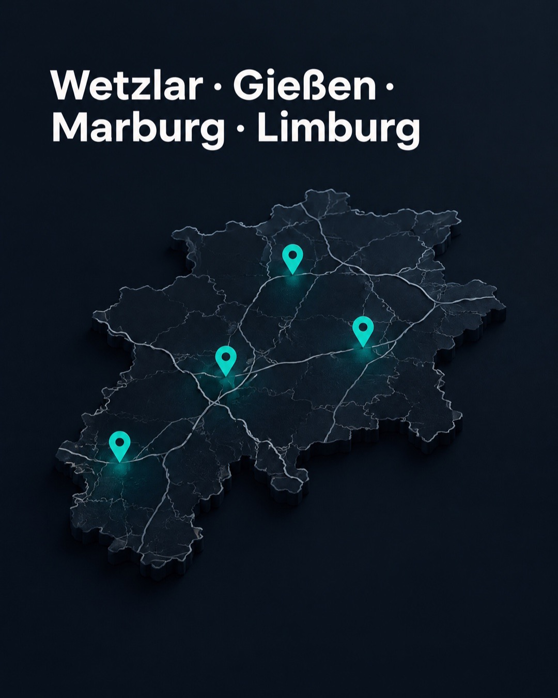 [CD-066](prompts.md#cd-066) Einzugsgebiet | Das ist mein Einzugsgebiet. Kostenloser Check: Link in Bio. |  |
| Sa 14.11.2026 |  [CD-051](prompts.md#cd-051) Lokal gefunden werden | Ich biete lokale SEO für Betriebe in Mittelhessen. Kostenloser Check: Link in Bio. | [CD-116](prompts.md#cd-116) Story: Umfrage Backup ✋ |
| So 15.11.2026 |  [CD-067](prompts.md#cd-067) Core Web Vitals | Ich erkläre es kurz in den Kommentaren. Kostenloser Check: Link in Bio. |  |
| So 15.11.2026 (2. Post) | 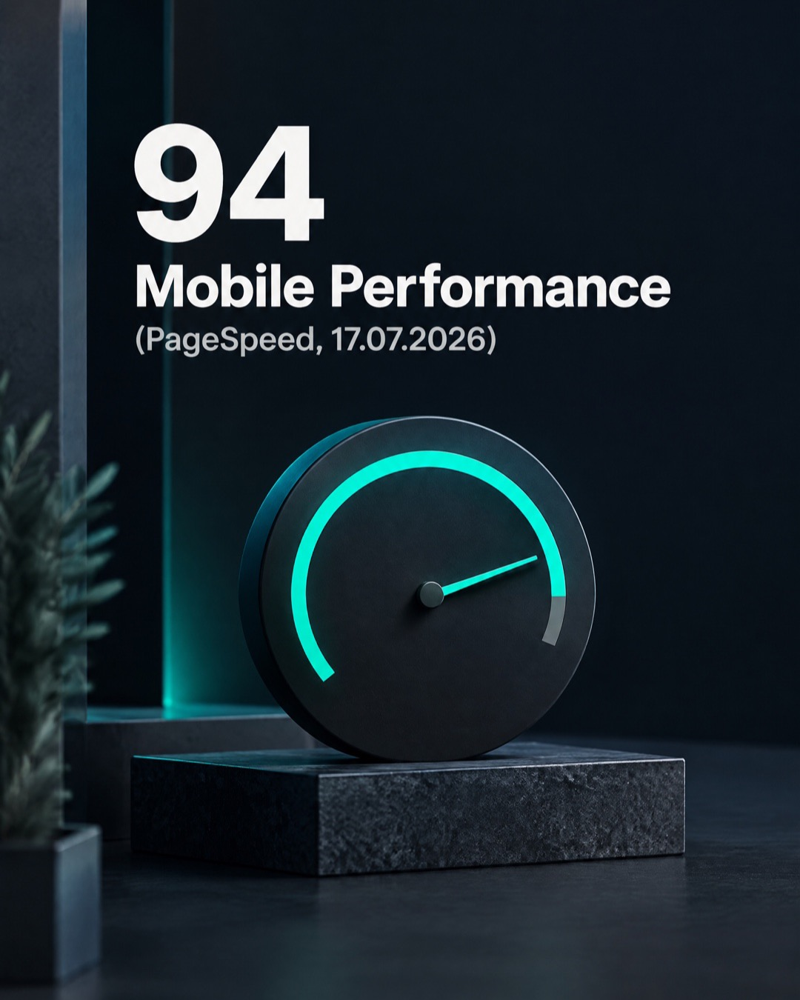 [CD-070](prompts.md#cd-070) Zahlen: Mobile Performance | Der Wert wurde auf codayweb.de gemessen. Kostenloser Check: Link in Bio. |  |
| Mo 16.11.2026 | 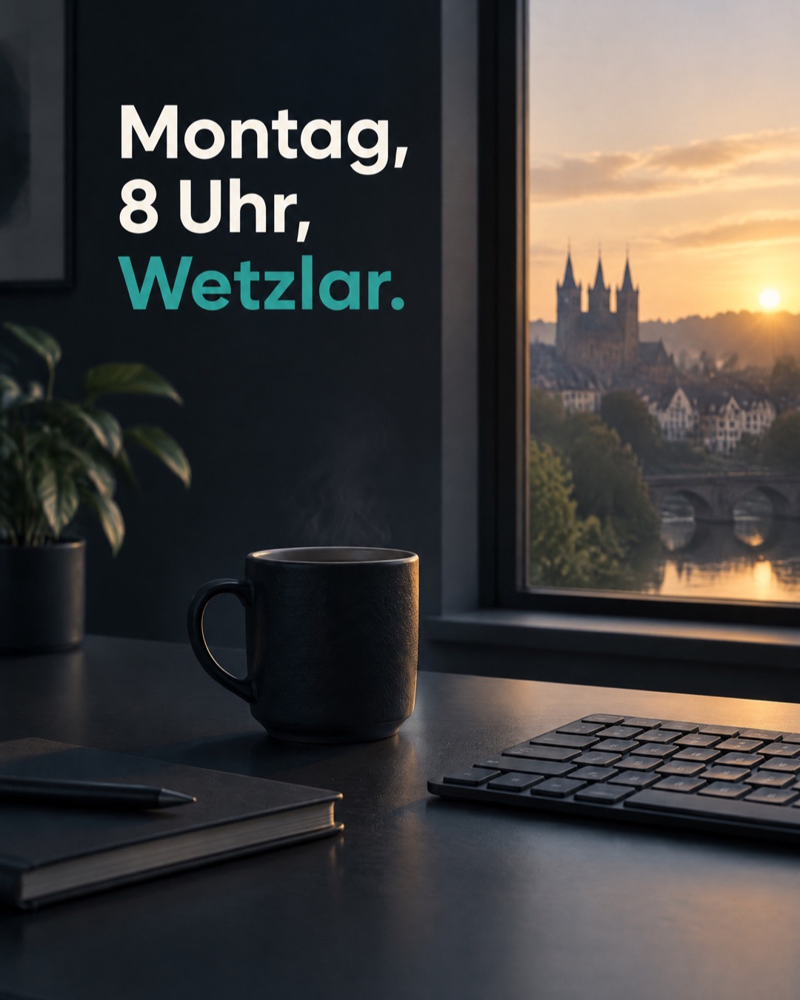 [CD-073](prompts.md#cd-073) Montag, 8 Uhr | Du erreichst mich Mo–Fr von 9 bis 18 Uhr. Kostenloser Check: Link in Bio. (KI-generiertes Symbolbild) |  |
| Do 03.12.2026 |  [CD-100](prompts.md#cd-100) Gastro: Weihnachtsfeier-Anfragen | Firmen planen ihre Weihnachtsfeier früh: Ein Anfrageformular mit Wunschtermin, Personenzahl und Menüwunsch spart dir Telefon-Pingpong mitten im Service (Symbolbild). Kostenloser Check: Link in Bio. |  |
| Di 08.12.2026 |  [CD-088](prompts.md#cd-088) Vor den Feiertagen (Karussell, 5 Bilder) | Speichern für die Woche vor dem Urlaub: drei kurze Punkte, damit deine Website ruhig durch die Feiertage kommt. Wenn du lieber prüfen lässt: Schreib CHECK per DM. |  |
| So 13.12.2026 |  [CD-105](prompts.md#cd-105) Pension: direkt buchen | Wenn Zimmer, Anreise und Verfügbarkeit klar auf deiner eigenen Website stehen, können Gäste direkt bei dir anfragen statt nur über Portale (KI-generiertes Symbolbild). Kostenloser Check: Link in Bio. |  |
| Sa 19.12.2026 | 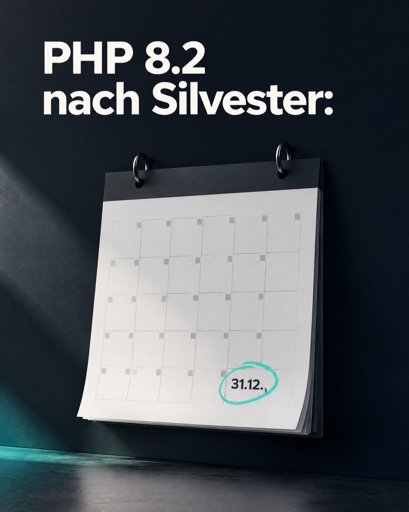 [CD-076](prompts.md#cd-076) Humor: PHP 8.2 nach Silvester | Plan dein PHP-Update rechtzeitig. Kostenloser Check: Link in Bio. |  |
| Do 24.12.2026 |  [CD-113](prompts.md#cd-113) Weihnachtsgruß aus Wetzlar | Danke für jedes Gespräch und jede Frage in diesem Jahr: Ich wünsche dir ruhige, erholsame Feiertage. Kostenloser Check fürs neue Jahr: Link in Bio. (KI-generiertes Symbolbild) |  |
| Di 29.12.2026 |  [CD-106](prompts.md#cd-106) Verein: neue Mitglieder im Januar | Gute Vorsätze, neuer Sport: Mit Trainingszeiten, Ansprechperson und Online-Anmeldung auf einer klaren Seite fällt Interessierten der erste Schritt in deinen Verein leichter (KI-generiertes Symbolbild). Kostenloser Check: Link in Bio. |  |
| So 03.01.2027 |  [CD-114](prompts.md#cd-114) Footer im neuen Jahr | Kleiner Check zum Jahresstart: Steht unten auf deiner Website noch das alte Jahr oder sogar eines von früher? 😅 Das wirkt schnell verlassen, auch wenn dein Betrieb gut läuft. Kostenloser Check: Link in Bio. |  |
| Fr 08.01.2027 | 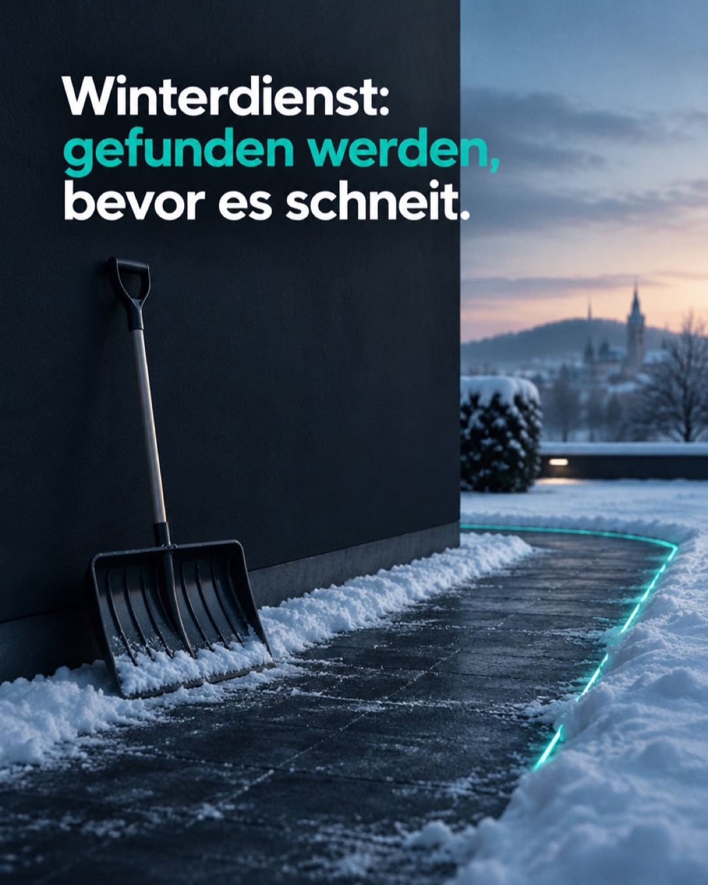 [CD-103](prompts.md#cd-103) Dienstleister: Winterdienst | Hausmeister- und Gartenbaubetriebe aufgepasst: Eine eigene Seite für deinen Winterdienst mit Einsatzgebiet und direktem Kontakt macht es Kundinnen und Kunden leicht, dich rechtzeitig zu finden (KI-generiertes Symbolbild). Kostenloser Check: Link in Bio. |  |
| Mi 13.01.2027 |  [CD-087](prompts.md#cd-087) PHP 8.2 ausgelaufen | Laut php.net endete der Sicherheits-Support für PHP 8.2 am 31.12.2026, seitdem gibt es vom PHP-Projekt keine Sicherheits-Updates mehr dafür. Update, Aufpreis beim Hoster oder Neubau? Im kostenlosen Check finden wir in Ruhe den passenden Weg für deine Website: Link in Bio. (KI-generiertes Symbolbild) |  |
| Di 19.01.2027 | 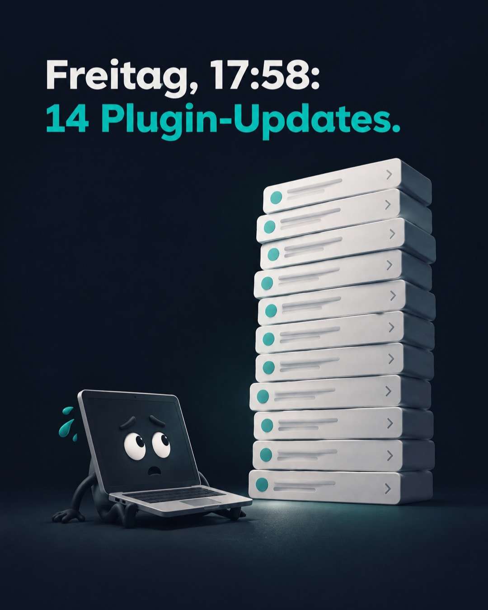 [CD-026](prompts.md#cd-026) Meme: Plugin-Update | Kennst du? 😅 Muss nicht sein. Wartung oder Website ohne Plugin-Zoo: Link in Bio. |  |
| So 24.01.2027 |  [CD-044](prompts.md#cd-044) Server aktuell? | Die PHP-Version zählt mehr als das Theme. Kostenloser Check: Link in Bio. |  |
| Fr 29.01.2027 |  [CD-024](prompts.md#cd-024) 5 Website-Mythen (Karussell, 6 Bilder) | Welcher Mythos hält sich bei dir am hartnäckigsten? Kommentier die Nummer. |  |
| Mi 03.02.2027 |  [CD-055](prompts.md#cd-055) Auf dem Handy unlesbar? | Ich baue Websites mobile-first. Kostenloser Check: Link in Bio. (KI-generiertes Symbolbild) |  |
| Mo 08.02.2027 | 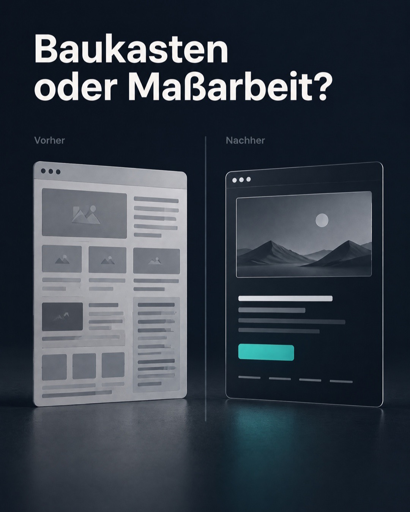 [CD-023](prompts.md#cd-023) Vorher/Nachher (Konzept) | Symbolbild, kein Kundenprojekt. Was du gewinnst: Klarheit, Tempo, einen Weg zur Anfrage auf jeder Seite. |  |
| Fr 12.02.2027 | 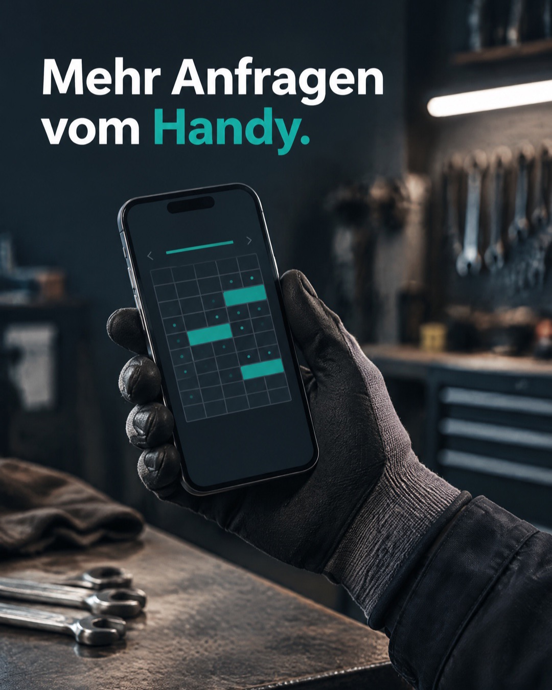 [CD-017](prompts.md#cd-017) Handwerk | Termin für Aufmaß oder Beratung direkt online buchen, so wie bei Batherm in Wetzlar. (KI-generiertes Symbolbild) |  |
| Mi 17.02.2027 | 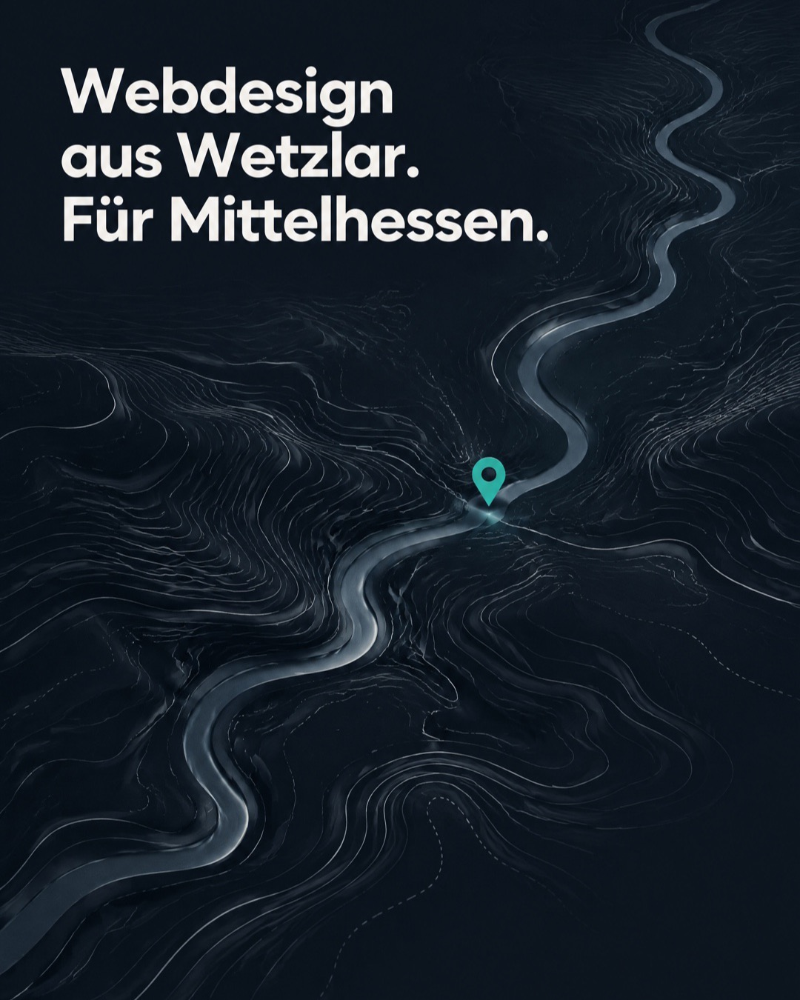 [CD-022](prompts.md#cd-022) Lokal | Wetzlar, Gießen, Marburg, Limburg: Erstgespräch per Telefon, Video oder bei dir vor Ort. |  |
| Mo 22.02.2027 |  [CD-025](prompts.md#cd-025) 3D begehbar | Hallen, Gebäude, Museumsräume als begehbares 3D, ohne App. Aus CAD oder Scan. Demo anfragen: DM. (KI-generiertes Symbolbild) |  |
| Fr 26.02.2027 | 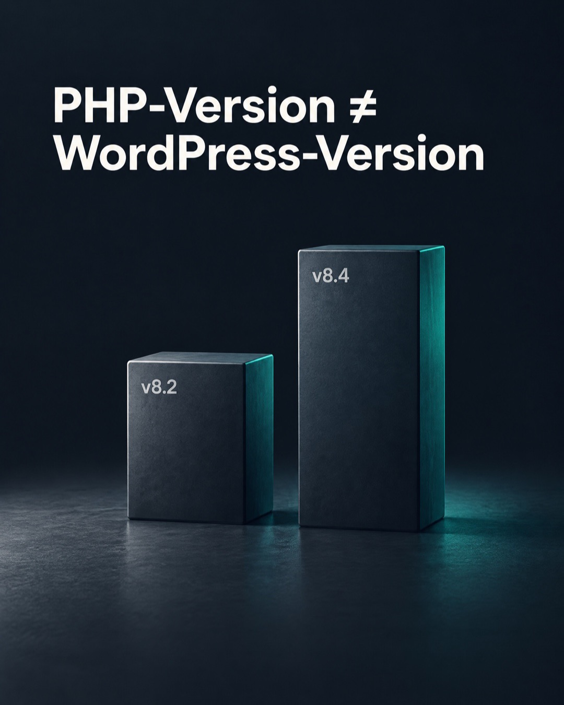 [CD-068](prompts.md#cd-068) PHP-Version ≠ WordPress-Version | Beides zu verwechseln ist ein häufiger Irrtum. Kostenloser Check: Link in Bio. |  |
| Mi 03.03.2027 | 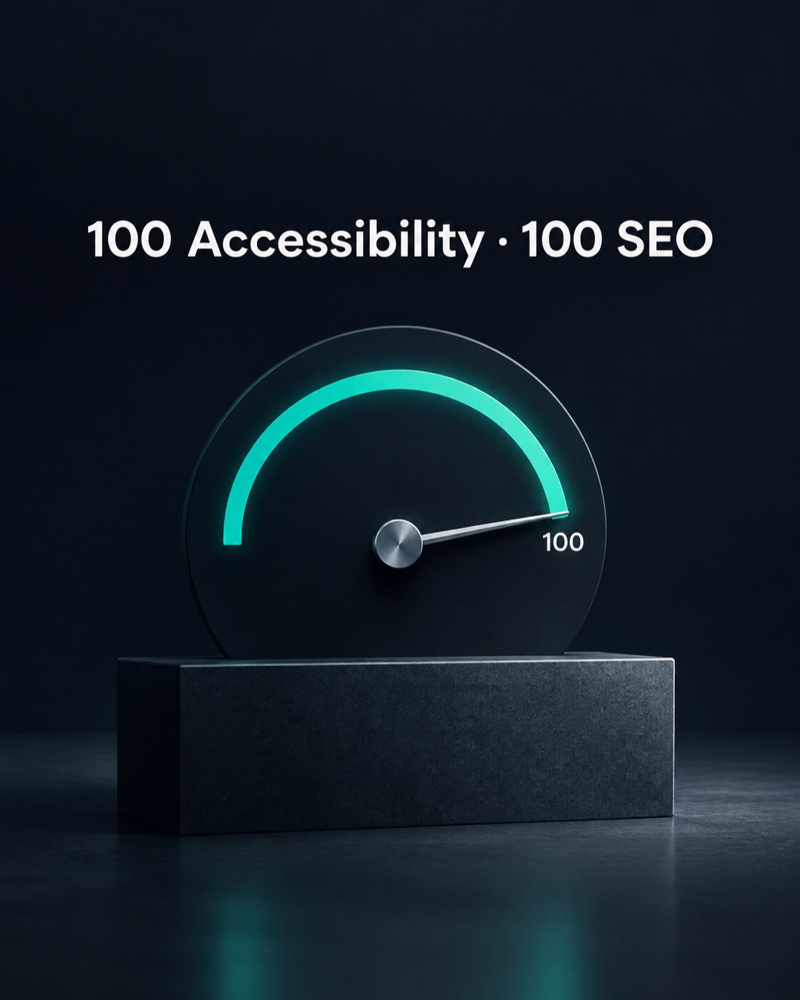 [CD-071](prompts.md#cd-071) Zahlen: Accessibility und SEO | Die Werte stammen aus einem Lab-Test von codayweb.de mit PageSpeed vom 17.07.2026. Kostenloser Check: Link in Bio. |  |
| Mo 08.03.2027 |  [CD-027](prompts.md#cd-027) Behind the Scenes | Kein Page-Builder: Design und Code aus einer Hand, in Wetzlar. (KI-generiertes Symbolbild) |  |
| Sa 13.03.2027 |  [CD-074](prompts.md#cd-074) Humor: kein Menü | Tag jemanden 😄 Kostenloser Check: Link in Bio. |  |
| Fr 19.03.2027 | 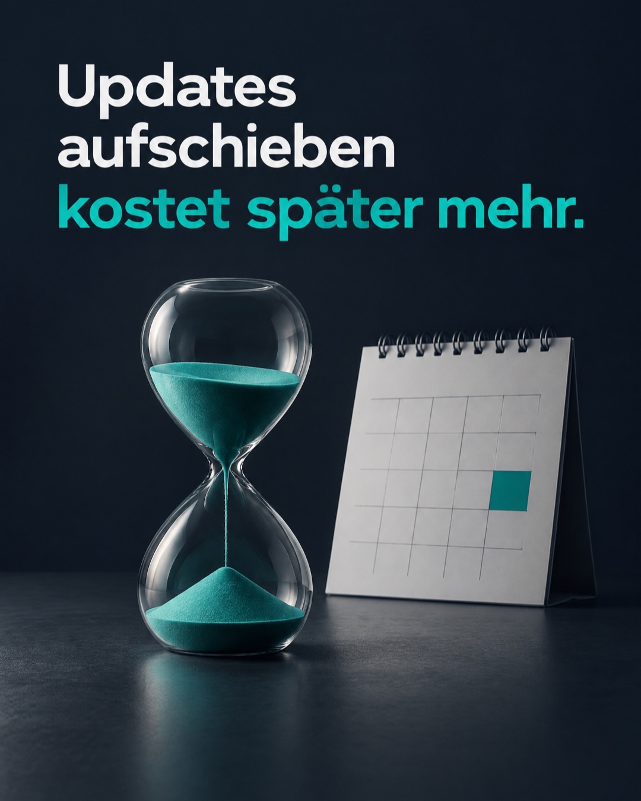 [CD-045](prompts.md#cd-045) Updates aufschieben | Setz auf planbare Wartung statt auf den Notfall. Kostenloser Check: Link in Bio. |  |
| Mi 24.03.2027 |  [CD-056](prompts.md#cd-056) Website von 2015? | Ich mache deinen Relaunch zum Festpreis. Kostenloser Check: Link in Bio. (KI-generiertes Symbolbild) |  |
| Mo 29.03.2027 | 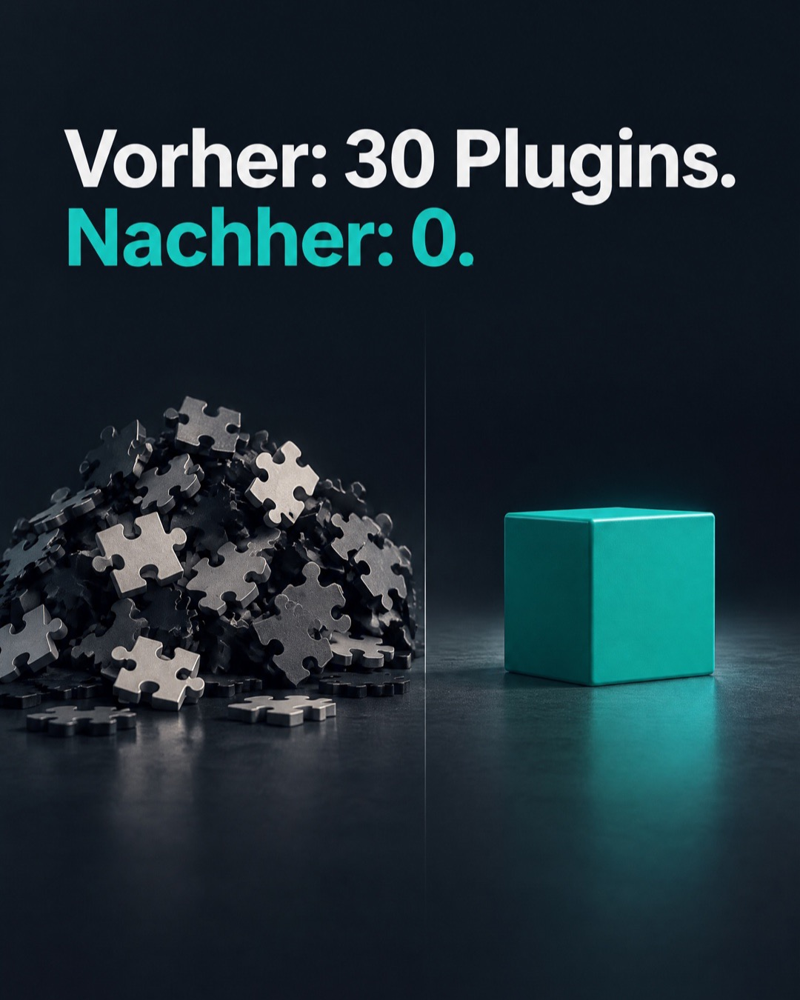 [CD-059](prompts.md#cd-059) 30 Plugins zu 0 | Das ist ein Symbolbild, kein Kundenprojekt; die Zahlen sind ein Beispiel. Kostenloser Check: Link in Bio. |  |
| Sa 03.04.2027 | 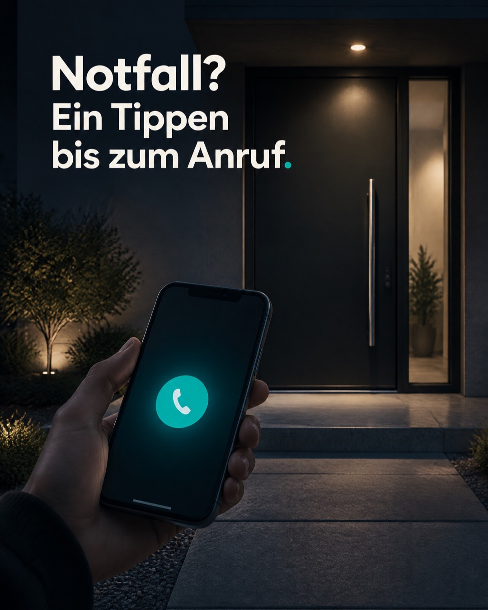 [CD-018](prompts.md#cd-018) Schlüsseldienst | Wer ausgesperrt ist, will nicht scrollen. Kurze Wege und ein Anruf-Button auf jeder Seite. (KI-generiertes Symbolbild) |  |
| Do 08.04.2027 |  [CD-050](prompts.md#cd-050) Schnelle Shops | Ich baue E-Commerce ohne Plugin-Ballast. Kostenloser Check: Link in Bio. |  |
| Di 13.04.2027 |  [CD-069](prompts.md#cd-069) Was ist Next.js? | Ich erkläre es für Nicht-Techniker. Kostenloser Check: Link in Bio. |  |
| So 18.04.2027 | 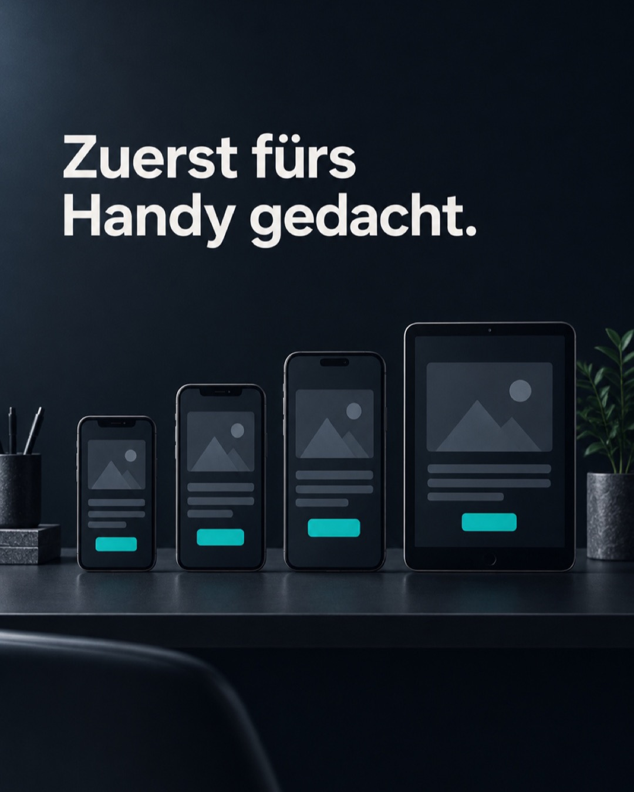 [CD-112](prompts.md#cd-112) Mobile first | Deine Website entsteht bei mir mobile-first, und die Ladezeit messe ich schon während der Entwicklung, nicht erst nach dem Launch (KI-generiertes Symbolbild). Kostenloser Check: Link in Bio. |  |
| Fr 23.04.2027 | 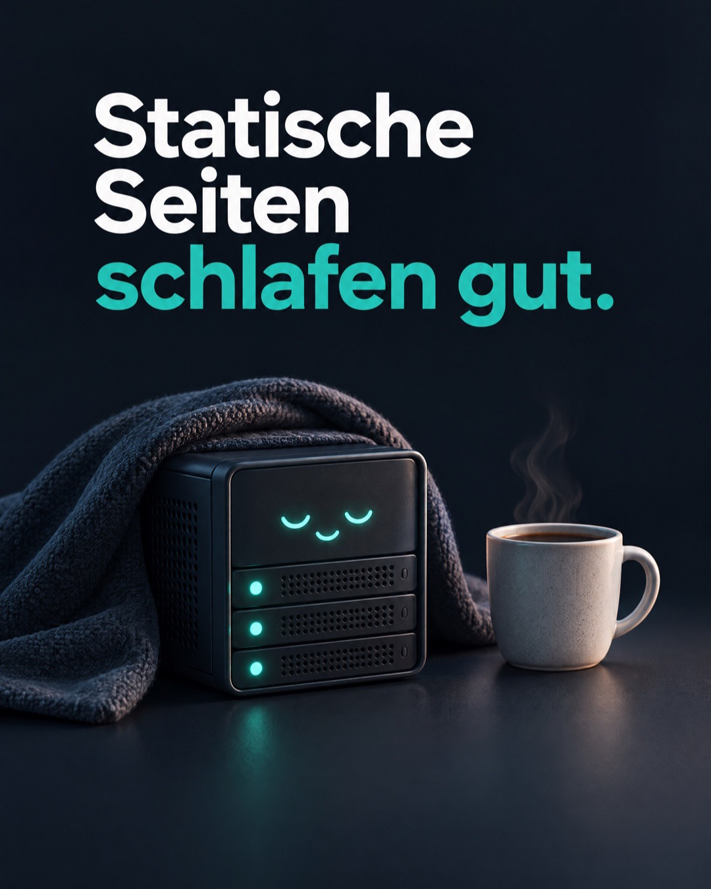 [CD-075](prompts.md#cd-075) Humor: statische Seiten | Statische Seiten bieten weniger Angriffsfläche. Kostenloser Check: Link in Bio. |  |
| Mi 28.04.2027 | 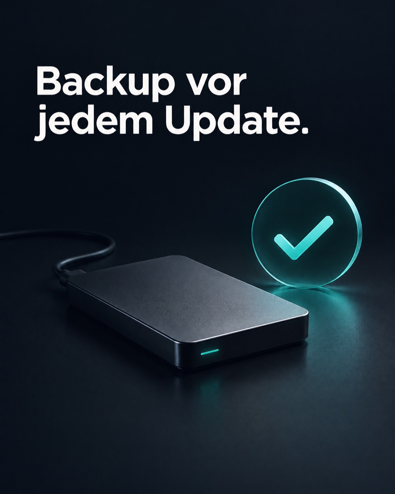 [CD-046](prompts.md#cd-046) Backup vor jedem Update | So läuft Wartung bei Coday. Kostenloser Check: Link in Bio. |  |
| Mo 03.05.2027 | 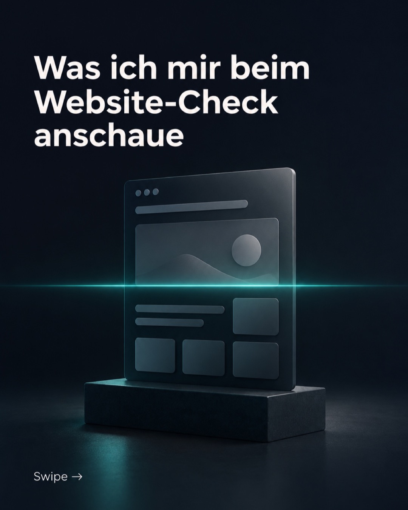 [CD-093](prompts.md#cd-093) Was der Website-Check prüft (Karussell, 5 Bilder) | PHP-Version, Updates, Ladezeit und Sichtbarkeit: Diese vier Punkte schaue ich mir bei deiner Website persönlich an, kostenlos und unverbindlich. Schreib CHECK per DM. |  |
| Sa 08.05.2027 |  [CD-057](prompts.md#cd-057) Button nicht gefunden | Ein UX-Audit zeigt, wo deine Besucher hängen bleiben. Kostenloser Check: Link in Bio. |  |
| Do 13.05.2027 | 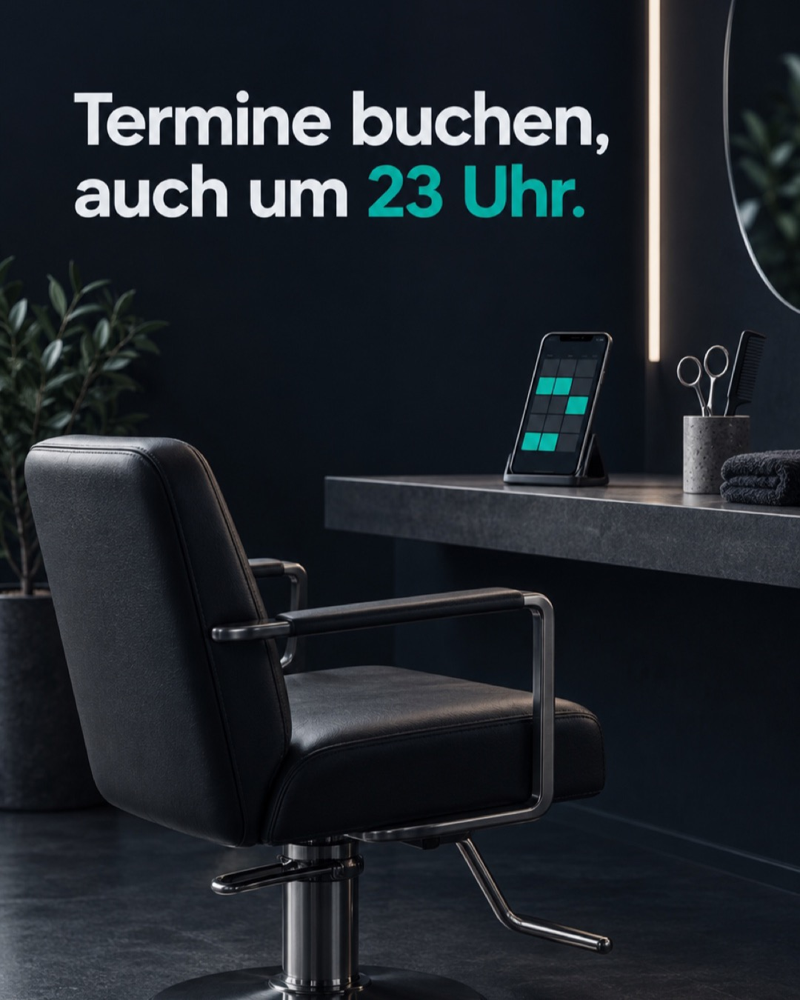 [CD-019](prompts.md#cd-019) Friseur | Deine Kundinnen buchen, wenn sie Zeit haben, nicht nur während der Öffnungszeiten. (KI-generiertes Symbolbild) |  |
| Mi 19.05.2027 |  [CD-052](prompts.md#cd-052) Website und Profil im Einklang | Sorg für einheitliche Daten überall, auf der Website und im Unternehmensprofil. Kostenloser Check: Link in Bio. |  |
| Mo 24.05.2027 | 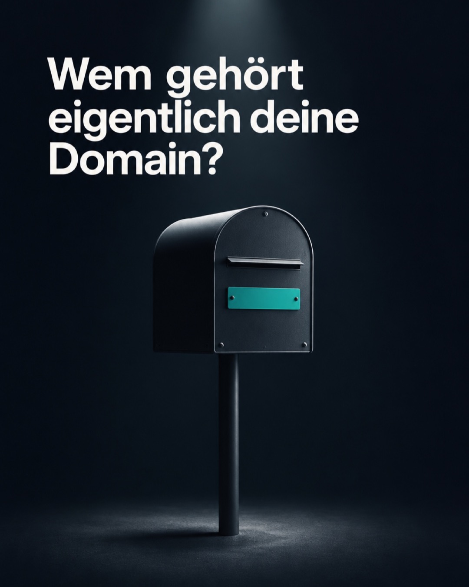 [CD-107](prompts.md#cd-107) Wem gehört deine Domain? | Ist deine Domain auf eine frühere Agentur oder einen Bekannten eingetragen, können Umzug und Änderungen schnell kompliziert werden. Prüf, wer als Inhaber eingetragen ist, oder lass es mich im kostenlosen Check ansehen: Link in Bio. |  |
| Sa 29.05.2027 | 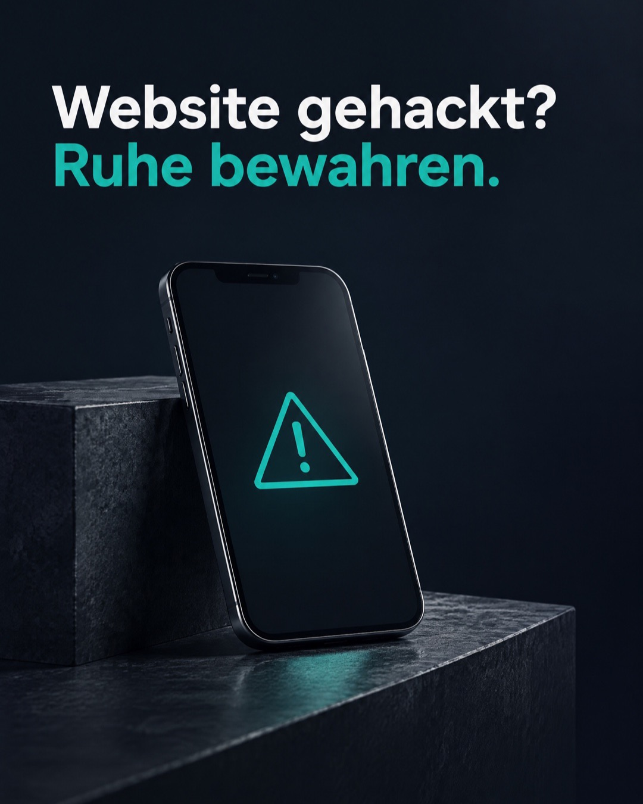 [CD-047](prompts.md#cd-047) Notfall: Ruhe bewahren | Über die Notfall-Hotline melde ich mich, sobald ich die Nachricht sehe. Kostenloser Check: Link in Bio. (KI-generiertes Symbolbild) |  |
| Do 03.06.2027 | 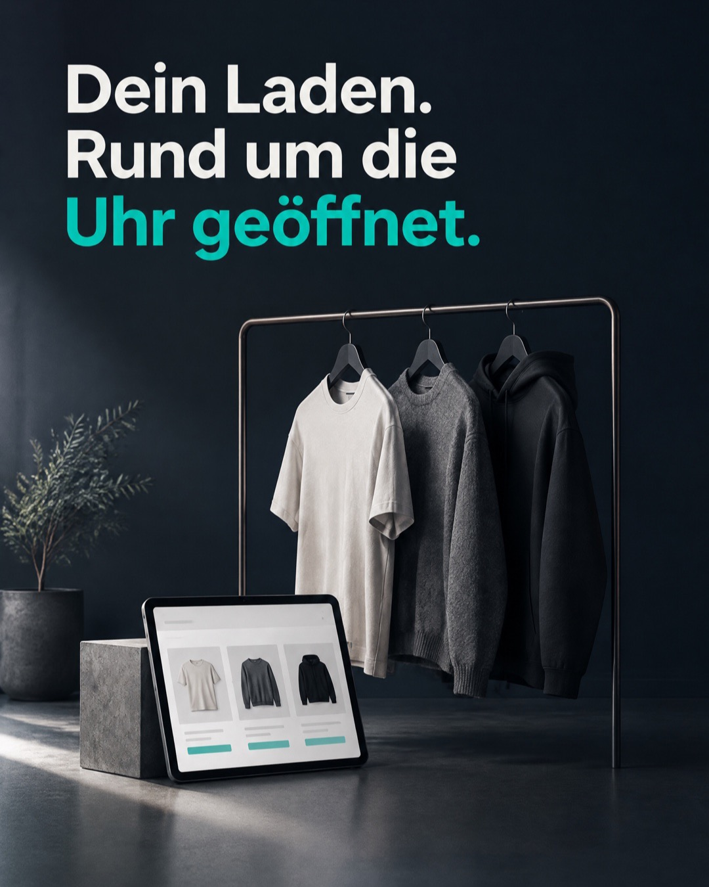 [CD-020](prompts.md#cd-020) Boutique | Websites für Boutiquen und lokale Shops in Wetzlar und Umgebung. (KI-generiertes Symbolbild) |  |
| Di 08.06.2027 | 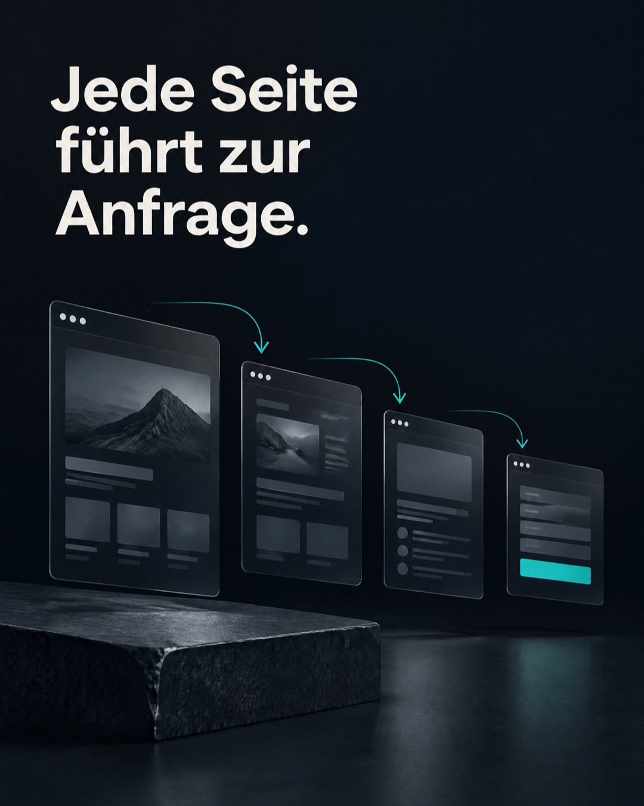 [CD-053](prompts.md#cd-053) Jede Seite führt zur Anfrage | Ich plane UX mit einem klaren Weg zur Anfrage. Kostenloser Check: Link in Bio. |  |
| So 13.06.2027 | 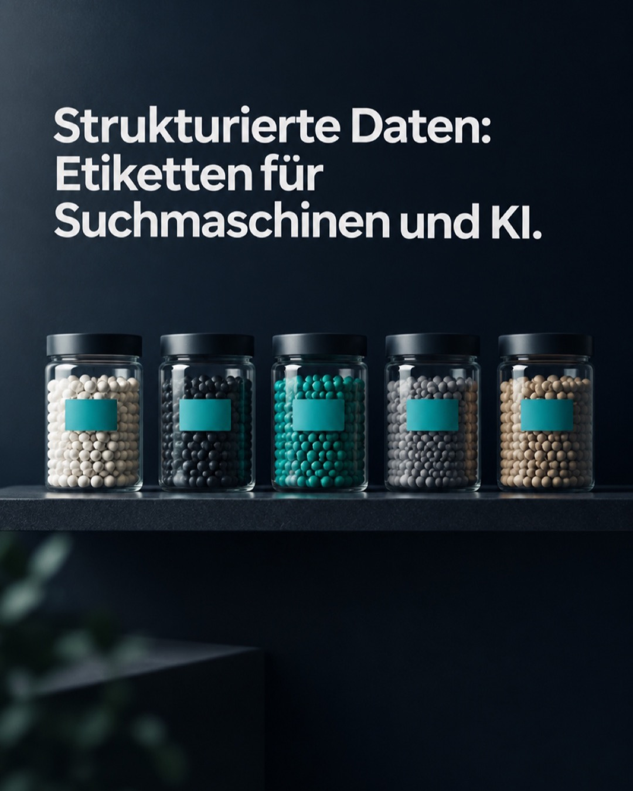 [CD-108](prompts.md#cd-108) Strukturierte Daten | Strukturierte Daten beschreiben Öffnungszeiten, Adresse und Leistungen so, dass Suchmaschinen und KI-Systeme sie eindeutig zuordnen können. Ob deine Website das schon macht, zeigt der kostenlose Check: Link in Bio. (KI-generiertes Symbolbild) |  |
| Fr 18.06.2027 |  [CD-048](prompts.md#cd-048) 3 Fragen an deinen Hoster | Frag deinen Hoster nach PHP-Version, Updates und Backups. Kostenloser Check: Link in Bio. |  |
| Mi 23.06.2027 |  [CD-021](prompts.md#cd-021) Kanzlei/Praxis | Leistungen, Team, Öffnungszeiten und Kontakt an einem Ort, seriös und schnell. (KI-generiertes Symbolbild) |  |
| Mo 28.06.2027 | 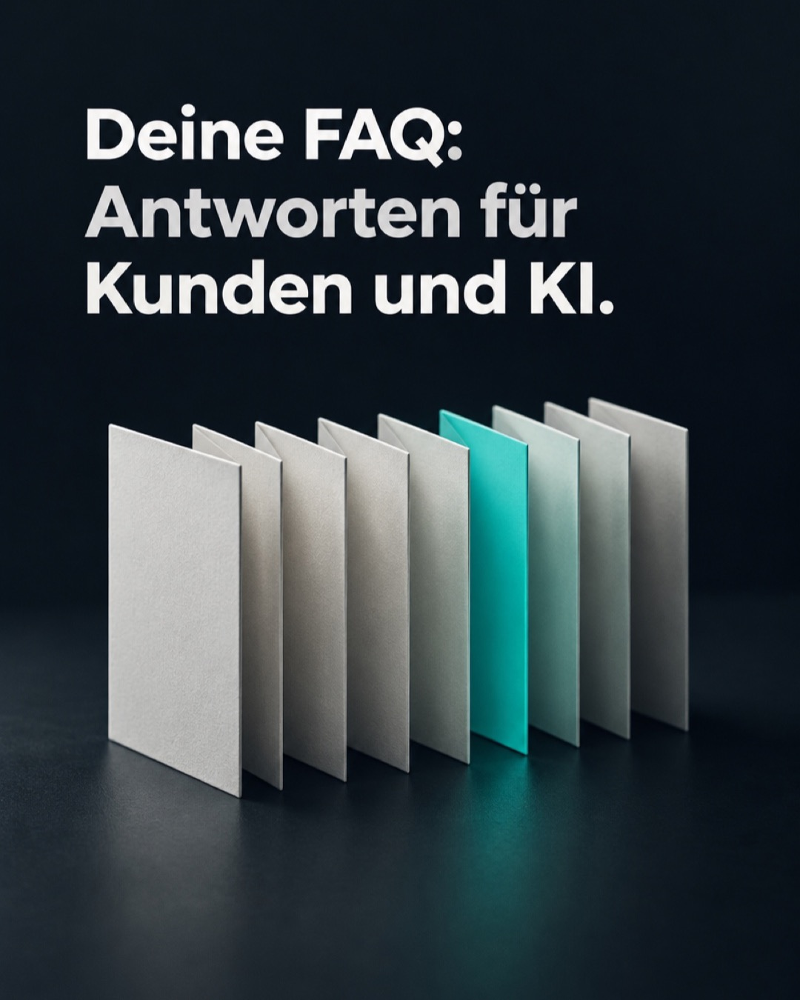 [CD-098](prompts.md#cd-098) FAQ für Kunden und KI | Wenn deine Website die Fragen beantwortet, die Kundinnen und Kunden wirklich stellen, können Suchmaschinen und KI-Assistenten dich leichter einordnen und nennen. Welche Fragen fehlen bei dir? Kostenloser Check: Link in Bio. |  |
| Sa 03.07.2027 |  [CD-109](prompts.md#cd-109) Zu große Fotos | Ein direkt hochgeladenes Handyfoto ist oft viel größer als nötig und bremst deine Seite, gerade mobil. Moderne Websites liefern Bilder automatisch in passender Größe aus. Kostenloser Check: Link in Bio. |  |
| Do 08.07.2027 | 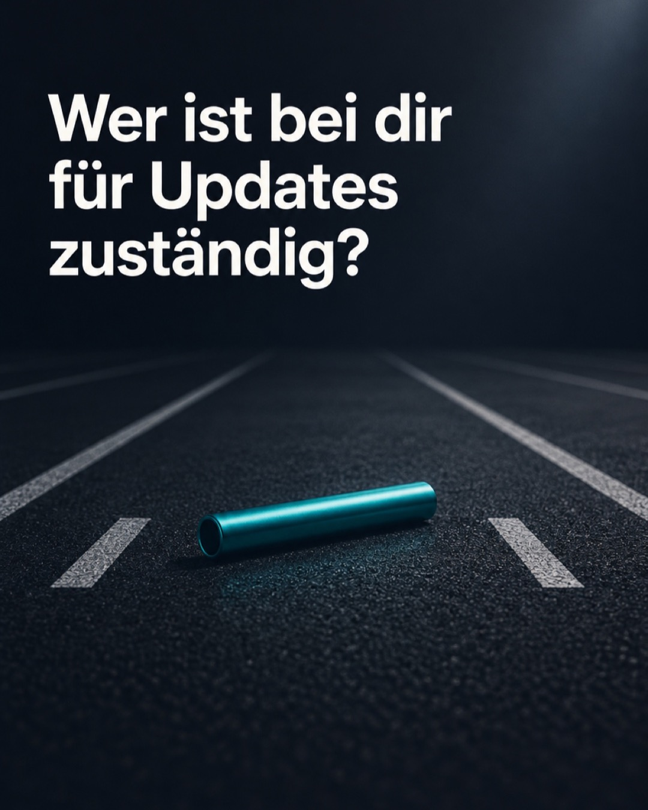 [CD-081](prompts.md#cd-081) Wer macht die Updates? | Agentur, Hoster, ein Bekannter oder du selbst: Oft fühlt sich niemand richtig verantwortlich, bis etwas nicht mehr läuft. Im kostenlosen Check klären wir, wer was übernimmt: Link in Bio. (KI-generiertes Symbolbild) |  |
| Di 13.07.2027 |  [CD-062](prompts.md#cd-062) Branche Makler | Ich baue Immobilien-Websites mit Suchfunktion. Kostenloser Check: Link in Bio. |  |
| Mo 19.07.2027 | 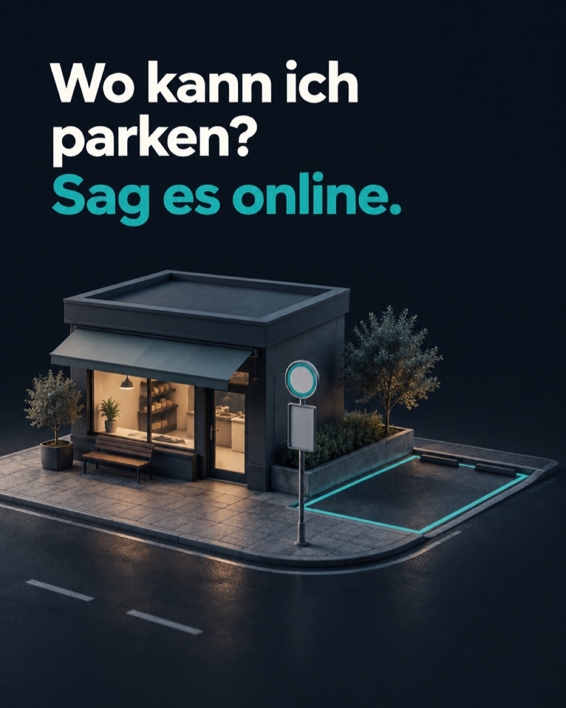 [CD-099](prompts.md#cd-099) Anfahrt und Parken | Anfahrt, Parkplätze und der richtige Eingang gehören auf deine Kontaktseite und ins Unternehmensprofil, denn genau das fragen sich viele kurz vor dem Besuch (Symbolbild). Kostenloser Check: Link in Bio. |  |
| Sa 24.07.2027 | 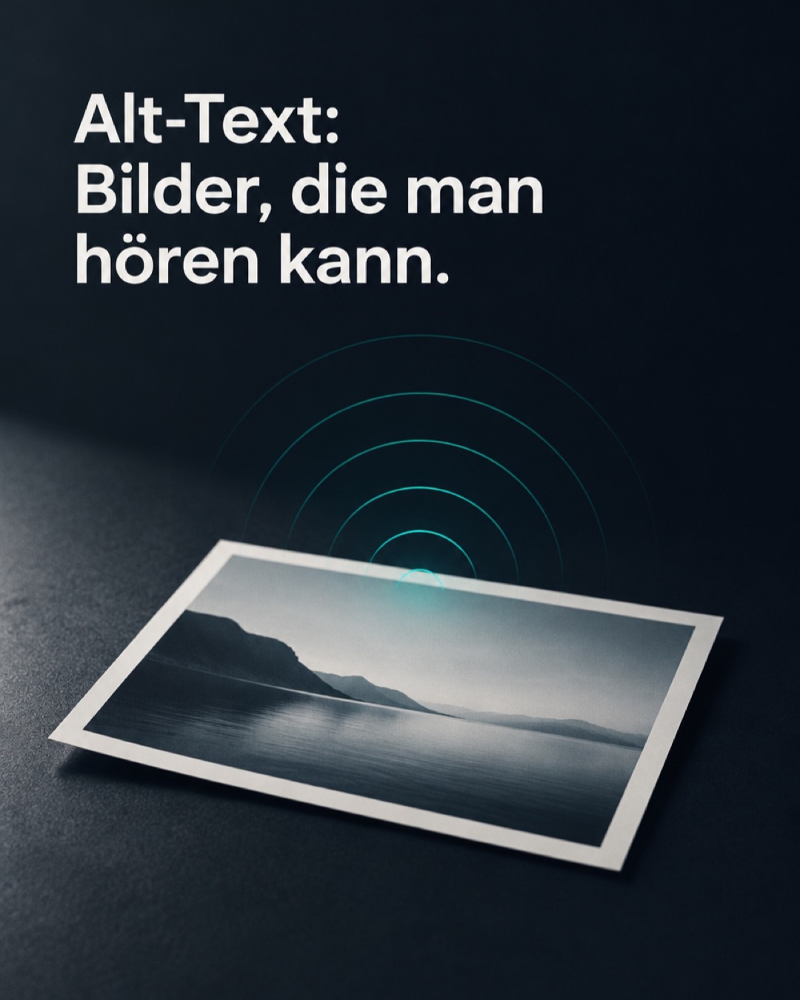 [CD-110](prompts.md#cd-110) Alt-Text erklärt | Alt-Texte beschreiben Bilder für Menschen, die sich Websites vorlesen lassen, und helfen Suchmaschinen, Inhalte zu verstehen. Fehlen sie bei dir? Kostenloser Check: Link in Bio. |  |
| Do 29.07.2027 | 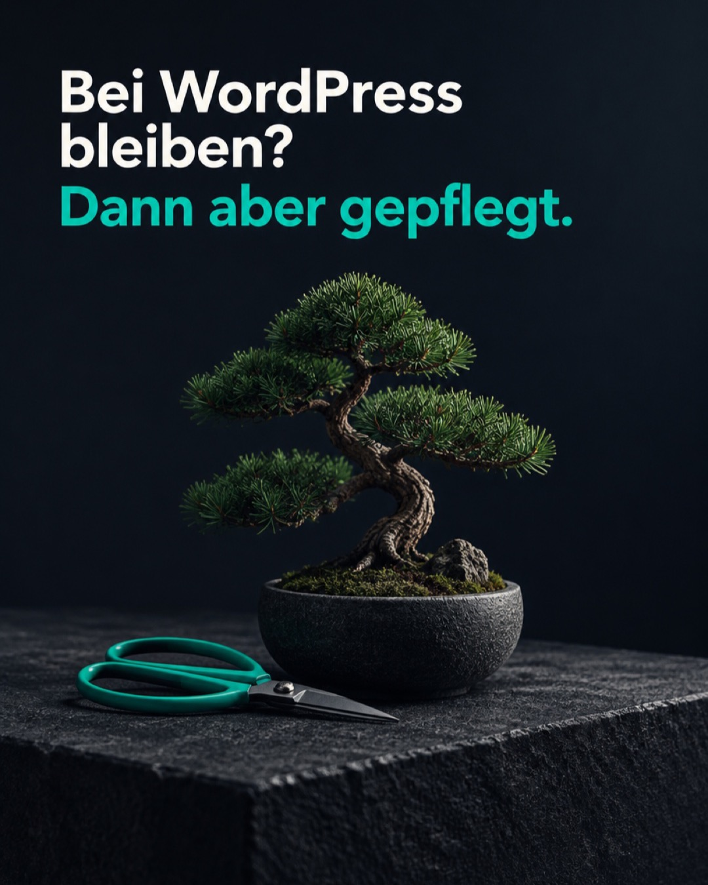 [CD-082](prompts.md#cd-082) WordPress gepflegt weiterbetreiben | Nicht jede Website muss neu gebaut werden. Wenn du bei WordPress bleibst, kümmere ich mich um PHP-Version, Updates mit Backup vorab und Erreichbarkeits-Monitoring, zum Monatspreis nach kostenlosem Check: Link in Bio. (KI-generiertes Symbolbild) |  |
| Di 03.08.2027 |  [CD-063](prompts.md#cd-063) Branche Reinigung | Ich baue Websites für Dienstleister wie Reinigungsfirmen. Kostenloser Check: Link in Bio. (KI-generiertes Symbolbild) |  |
| So 08.08.2027 | 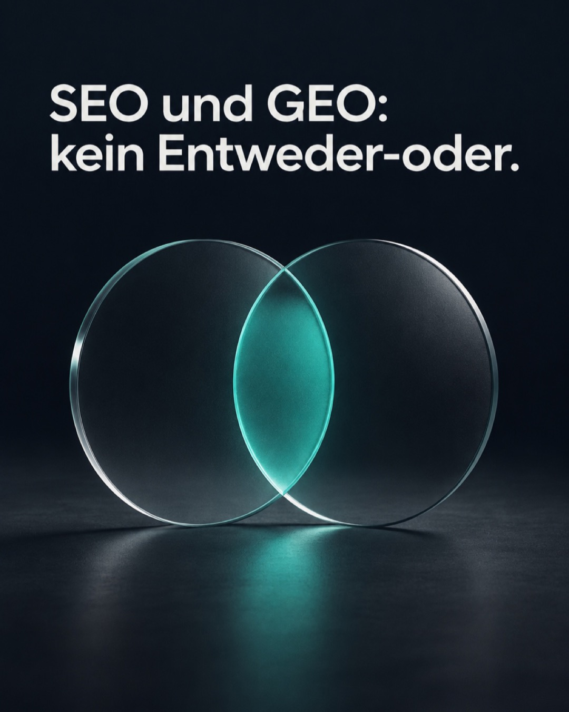 [CD-111](prompts.md#cd-111) SEO und GEO | SEO hilft dir, in Suchmaschinen gefunden zu werden, GEO hilft dir, in KI-Antworten genannt zu werden. Die Grundlage ist bei beidem gleich: klare, schnelle, gut strukturierte Seiten. Kostenloser Check: Link in Bio. |  |
| Fr 13.08.2027 |  [CD-083](prompts.md#cd-083) Backup zurückspielen | Ein Backup hilft nur, wenn es sich im Ernstfall auch wiederherstellen lässt. Frag deinen Hoster, wann das zuletzt getestet wurde, oder lass mich im kostenlosen Check draufschauen: Link in Bio. (KI-generiertes Symbolbild) |  |
| Do 19.08.2027 |  [CD-064](prompts.md#cd-064) Branche Kanzlei | Ich baue Websites für Kanzleien. Kostenloser Check: Link in Bio. |  |
| Di 24.08.2027 | 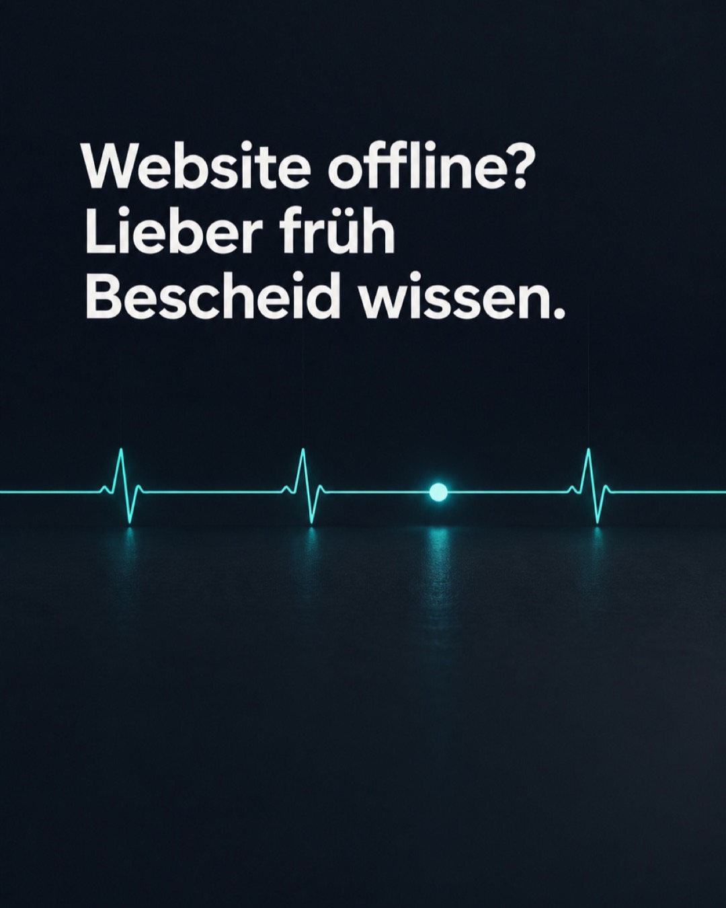 [CD-084](prompts.md#cd-084) Erreichbarkeits-Monitoring | Erreichbarkeits-Monitoring prüft regelmäßig, ob deine Website antwortet, und meldet sich, wenn nicht. Es ist Teil meiner Wartung, mehr dazu im kostenlosen Check: Link in Bio. |  |
| So 29.08.2027 | 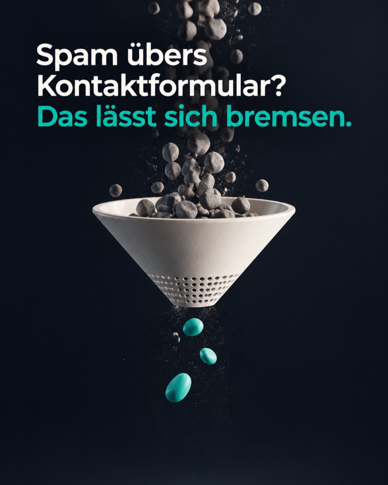 [CD-085](prompts.md#cd-085) Spam übers Kontaktformular | Ständiger Spam über dein Kontaktformular kostet Zeit und verdeckt echte Anfragen. Unauffällige Schutzfunktionen filtern viel davon heraus, ohne deine Kundschaft mit Rätseln zu nerven. Kostenloser Check: Link in Bio. |  |
| Fr 03.09.2027 |  [CD-086](prompts.md#cd-086) Zwei-Faktor-Anmeldung | Mit Zwei-Faktor-Anmeldung reicht ein erratenes oder gestohlenes Passwort allein nicht mehr, um in den Verwaltungsbereich deiner Website zu kommen. Ob dein Login das schon kann, schaue ich mir im kostenlosen Check an: Link in Bio. |  |
| Mi 08.09.2027 |  [CD-104](prompts.md#cd-104) Praxis: gut lesbar für alle | Große Schrift, klare Kontraste und einfache Wege helfen allen, die deine Praxis-Website besuchen, nicht nur Älteren (KI-generiertes Symbolbild). Kostenloser Check: Link in Bio. |  |

## Wartet auf Freigabe

Zum Freigeben die ID in `posting/geprueft.txt` eintragen.

| ID | Grund |
| --- | --- |

## Monatslimit

Monatslimit 20 Veröffentlichungen: 2026-11: 20 veröffentlicht, 18 in Metricool, 0 noch nicht in Metricool (Achtung: Metricool meldet das Limit als erreicht, in diesem Monat geht nichts mehr raus; 18 mehr als das Limit, die gehen nicht raus); 2026-12: 0 veröffentlicht, 0 in Metricool, 17 noch nicht in Metricool; 2027-01: 0 veröffentlicht, 0 in Metricool, 17 noch nicht in Metricool; 2027-02: 0 veröffentlicht, 0 in Metricool, 17 noch nicht in Metricool; 2027-03: 0 veröffentlicht, 0 in Metricool, 18 noch nicht in Metricool; 2027-04: 0 veröffentlicht, 0 in Metricool, 18 noch nicht in Metricool; 2027-05: 0 veröffentlicht, 0 in Metricool, 17 noch nicht in Metricool; 2027-06: 0 veröffentlicht, 0 in Metricool, 18 noch nicht in Metricool; 2027-07: 0 veröffentlicht, 0 in Metricool, 18 noch nicht in Metricool; 2027-08: 0 veröffentlicht, 0 in Metricool, 18 noch nicht in Metricool; 2027-09: 0 veröffentlicht, 0 in Metricool, 6 noch nicht in Metricool.

## Nicht eingeplant

| Post | Titel | Grund |
| --- | --- | --- |
| CD-001 | PHP-Lücke: sachlicher Aufhänger | Arena-Bild: ohne schriftliche Freigabe von Arena nicht für Werbung nutzen |
| CD-002 | WordPress-Update reicht nicht | Arena-Bild: ohne schriftliche Freigabe von Arena nicht für Werbung nutzen |
| CD-003 | Kostenloser Website-Check (Haupt-CTA) | Arena-Bild: ohne schriftliche Freigabe von Arena nicht für Werbung nutzen |
| CD-004 | PHP 8.2 Support-Ende | Arena-Bild: ohne schriftliche Freigabe von Arena nicht für Werbung nutzen |
| CD-006 | Frag zuerst deinen Hoster | Arena-Bild: ohne schriftliche Freigabe von Arena nicht für Werbung nutzen |
| CD-007 | Ich prüfe. Du entscheidest. | Arena-Bild: ohne schriftliche Freigabe von Arena nicht für Werbung nutzen |
| CD-008 | Migration WordPress → Next.js | Arena-Bild: ohne schriftliche Freigabe von Arena nicht für Werbung nutzen |
| CD-009 | Wartung | Arena-Bild: ohne schriftliche Freigabe von Arena nicht für Werbung nutzen |
| CD-010 | GEO-Hook | Arena-Bild: ohne schriftliche Freigabe von Arena nicht für Werbung nutzen |
| CD-012 | Ladezeit | Arena-Bild: ohne schriftliche Freigabe von Arena nicht für Werbung nutzen |
| CD-013 | Festpreis | Arena-Bild: ohne schriftliche Freigabe von Arena nicht für Werbung nutzen |
| CD-014 | Ein Ansprechpartner | Arena-Bild: ohne schriftliche Freigabe von Arena nicht für Werbung nutzen |
| CD-015 | Quellcode-Übergabe | Arena-Bild: ohne schriftliche Freigabe von Arena nicht für Werbung nutzen |
| CD-016 | Gastro | Arena-Bild: ohne schriftliche Freigabe von Arena nicht für Werbung nutzen |
| CD-K1 | PHP-Version prüfen | Arena-Bild: ohne schriftliche Freigabe von Arena nicht für Werbung nutzen |
| CD-K2 | GEO in 5 Slides | Arena-Bild: ohne schriftliche Freigabe von Arena nicht für Werbung nutzen |
| CD-U01 | Edit: Laptop-Mockup mit eigenem Screenshot (eigenes Foto) | eigenes Foto nötig |
| CD-U02 | Edit: Smartphone-Mockup Referenz (eigenes Foto) | eigenes Foto nötig |
| CD-077 | Story: PHP-Update | Stories aus |
| CD-079 | Story: Wie schnell? | Stories aus |
| CD-080 | Story: ChatGPT-Frage (Umfrage) | Stories aus |
| CD-115 | Story: Quiz PHP-Lücke | Stories aus |
| CD-117 | Story: In KI-Antworten genannt? | Stories aus |
| CD-118 | Story: Umfrage Branche | Stories aus |
| CD-119 | Story: Fragen zur Website | Stories aus |
| CD-120 | Story: Website-Vorsatz fürs neue Jahr | Stories aus |
| CD-121 | Story: PHP-Lücke: sachlicher Aufhänger | Stories aus |
| CD-122 | Story: Kostenloser Website-Check (Haupt-CTA) | Stories aus |
| CD-123 | Story: PHP 8.2 Support-Ende | Stories aus |
| CD-124 | Story: Migration WordPress → Next.js | Stories aus |
| CD-125 | Story: Festpreis | Stories aus |
| CD-126 | Story: Ein Ansprechpartner | Stories aus |
| CD-127 | Story: Gastro | Stories aus |
| CD-101 | Kfz-Werkstatt: Reifenwechsel | Zeitfenster bis 2026-11-30 verpasst |
| CD-102 | Blumenladen: Adventskranz vorbestellen | Zeitfenster bis 2026-11-27 verpasst |
