# Fliesenverlegung Tezgel: Prompt-Bibliothek (126 Bildprompts)

Modell: GPT Image 2.5, Variante Sunburst · 109 Feed-Posts (3:4, 1080 × 1440) · 17 Stories (9:16, 1080 × 1920)

Jeder Prompt unten ist komplett: Brand-Block, Szene und der Text im Bild. In Arena oder ChatGPT einfach den Codeblock kopieren und senden. Karussell-Slides ab Nr. 2: vorher die fertige Cover-Slide hochladen. Danach Text im Bild Wort für Wort prüfen und das echte Logo unten rechts einsetzen.

⚠️ = vor dem Posten Fakten prüfen (Stand steht in den Hinweisen).

## Übersicht

| ID | Titel | Kategorie | Format | Text im Bild | Bild |
| --- | --- | --- | --- | --- | --- |
| [TZ-001](#tz-001) ⚠️ | Termin vor Ort, fester Preis | Service | 3:4 | Erst ansehen, dann fester Preis | [ansehen](bilder/instagram-3x4/TZ-001.jpg) |
| [TZ-002](#tz-002) ⚠️ | Dusche ohne Stufe | Bad | 3:4 | Die Wanne soll raus? Dusche ohne Stufe. | [ansehen](bilder/instagram-3x4/TZ-002.jpg) |
| [TZ-003](#tz-003) ⚠️ | Große Fliesen | Böden | 3:4 | Große Fliesen. Wenige Fugen. Ruhige Flächen. | [ansehen](bilder/instagram-3x4/TZ-003.jpg) |
| [TZ-004](#tz-004) | Wasser auf dem Balkon | Draußen | 3:4 | Bleibt auf dem Balkon Wasser stehen? | [ansehen](bilder/instagram-3x4/TZ-004.jpg) |
| [TZ-005](#tz-005) | Platten auf Stelzen | Draußen | 3:4 | Platten auf Stelzen: Regen läuft unten ab | [ansehen](bilder/instagram-3x4/TZ-005.jpg) |
| [TZ-006](#tz-006) ⚠️ | Bewertungskarte (nur Hintergrund) | Betrieb | 3:4 | (ohne Text) | [ansehen](bilder/instagram-3x4/TZ-006.jpg) |
| [TZ-007](#tz-007) | Fugen erneuern | Reparatur | 3:4 | Alte Fugen? Wir machen sie neu. | [ansehen](bilder/instagram-3x4/TZ-007.jpg) |
| [TZ-008](#tz-008) | Gesprungene Fliese | Reparatur | 3:4 | Eine Fliese gesprungen? Wir reparieren. | [ansehen](bilder/instagram-3x4/TZ-008.jpg) |
| [TZ-009](#tz-009) | Außentreppe | Draußen | 3:4 | Die Treppe vor dem Haus, wieder sicher | [ansehen](bilder/instagram-3x4/TZ-009.jpg) |
| [TZ-010](#tz-010) | Holzoptik | Böden | 3:4 | Sieht aus wie Holz, ist eine Fliese | [ansehen](bilder/instagram-3x4/TZ-010.jpg) |
| [TZ-011](#tz-011) | Fußbodenheizung | Böden | 3:4 | Warme Füße auf Fliesen | [ansehen](bilder/instagram-3x4/TZ-011.jpg) |
| [TZ-012](#tz-012) | Küche | Küche | 3:4 | Der Hingucker hinter der Arbeitsfläche | [ansehen](bilder/instagram-3x4/TZ-012.jpg) |
| [TZ-013](#tz-013) | Naturstein | Naturstein | 3:4 | Naturstein, präzise verlegt | [ansehen](bilder/instagram-3x4/TZ-013.jpg) |
| [TZ-014](#tz-014) | Neubau | Neubau | 3:4 | Neubau? Wir fliesen das ganze Haus. | [ansehen](bilder/instagram-3x4/TZ-014.jpg) |
| [TZ-015](#tz-015) ⚠️ | Abdichtung nach DIN 18534 | Wissen | 3:4 | Was unter der Fliese passiert, zählt | [ansehen](bilder/instagram-3x4/TZ-015.jpg) |
| [TZ-016](#tz-016) | Staubschutz | Service | 3:4 | Saubere Baustelle, auch in bewohnten Räumen | [ansehen](bilder/instagram-3x4/TZ-016.jpg) |
| [TZ-017](#tz-017) ⚠️ | Zuschuss der Pflegekasse | Zuschüsse | 3:4 | Bis zu 4.180 € Zuschuss zur Dusche | [ansehen](bilder/instagram-3x4/TZ-017.jpg) |
| [TZ-018](#tz-018) ⚠️ | Handwerkerbonus 2026 | Zuschüsse | 3:4 | Handwerkerbonus: 2026 noch 20 % | [ansehen](bilder/instagram-3x4/TZ-018.jpg) |
| [TZ-019](#tz-019) | Fliesenberatung | Service | 3:4 | Fliesen in Ruhe aussuchen | [ansehen](bilder/instagram-3x4/TZ-019.jpg) |
| [TZ-020](#tz-020) | Ausbildung | Recruiting | 3:4 | Fliesenleger werden? Starte bei uns. | [ansehen](bilder/instagram-3x4/TZ-020.jpg) |
| [TZ-021](#tz-021) | Cover: Von der Wanne zur Dusche (K1 1/7) | Karussell | 3:4 | Von der Wanne zur Dusche | [ansehen](bilder/instagram-3x4/TZ-021.jpg) |
| [TZ-022](#tz-022) | Schritt 1: Termin vor Ort (K1 2/7) | Karussell | 3:4 | 1. Termin vor Ort, kostenfrei | [ansehen](bilder/instagram-3x4/TZ-022.jpg) |
| [TZ-023](#tz-023) | Schritt 2: Fliesen aussuchen (K1 3/7) | Karussell | 3:4 | 2. Fliesen aussuchen, fester Preis | [ansehen](bilder/instagram-3x4/TZ-023.jpg) |
| [TZ-024](#tz-024) ⚠️ | Schritt 3: Abdichten (K1 4/7) | Karussell | 3:4 | 3. Abdichten nach DIN 18534 | [ansehen](bilder/instagram-3x4/TZ-024.jpg) |
| [TZ-025](#tz-025) | Schritt 4: Verlegen und verfugen (K1 5/7) | Karussell | 3:4 | 4. Verlegen, verfugen, übergeben | [ansehen](bilder/instagram-3x4/TZ-025.jpg) |
| [TZ-026](#tz-026) | Fertig: Dusche ohne Stufe (K1 6/7) | Karussell | 3:4 | Fertig: Dusche ohne Stufe | [ansehen](bilder/instagram-3x4/TZ-026.jpg) |
| [TZ-027](#tz-027) | Abschluss: Termin anfragen (K1 7/7) | Karussell | 3:4 | Termin anfragen: Link in Bio | [ansehen](bilder/instagram-3x4/TZ-027.jpg) |
| [TZ-028](#tz-028) ⚠️ | Cover: 5 Fragen vor dem Fliesenkauf (K2 1/7) | Karussell | 3:4 | 5 Fragen vor dem Fliesenkauf | [ansehen](bilder/instagram-3x4/TZ-028.jpg) |
| [TZ-029](#tz-029) ⚠️ | Frage 1: Rutschfestigkeit (K2 2/7) | Karussell | 3:4 | 1. Wie rutschfest muss sie sein? | [ansehen](bilder/instagram-3x4/TZ-029.jpg) |
| [TZ-030](#tz-030) ⚠️ | Frage 2: Format (K2 3/7) | Karussell | 3:4 | 2. Welches Format passt zum Raum? | [ansehen](bilder/instagram-3x4/TZ-030.jpg) |
| [TZ-031](#tz-031) ⚠️ | Frage 3: Fugenfarbe (K2 4/7) | Karussell | 3:4 | 3. Welche Fugenfarbe? | [ansehen](bilder/instagram-3x4/TZ-031.jpg) |
| [TZ-032](#tz-032) ⚠️ | Frage 4: Fußbodenheizung (K2 5/7) | Karussell | 3:4 | 4. Passt sie zur Fußbodenheizung? | [ansehen](bilder/instagram-3x4/TZ-032.jpg) |
| [TZ-033](#tz-033) ⚠️ | Frage 5: Untergrund (K2 6/7) | Karussell | 3:4 | 5. Ist der Untergrund bereit? | [ansehen](bilder/instagram-3x4/TZ-033.jpg) |
| [TZ-034](#tz-034) ⚠️ | Abschluss: Beratung (K2 7/7) | Karussell | 3:4 | Beratung in Wetzlar und Gießen | [ansehen](bilder/instagram-3x4/TZ-034.jpg) |
| [TZ-035](#tz-035) | Cover: 4 Warnzeichen am Balkon (K3 1/6) | Karussell | 3:4 | 4 Zeichen: Ihr Balkon braucht Hilfe | [ansehen](bilder/instagram-3x4/TZ-035.jpg) |
| [TZ-036](#tz-036) | Zeichen 1: Wasser bleibt stehen (K3 2/6) | Karussell | 3:4 | 1. Wasser bleibt stehen | [ansehen](bilder/instagram-3x4/TZ-036.jpg) |
| [TZ-037](#tz-037) | Zeichen 2: Fliesen klingen hohl (K3 3/6) | Karussell | 3:4 | 2. Fliesen klingen hohl | [ansehen](bilder/instagram-3x4/TZ-037.jpg) |
| [TZ-038](#tz-038) | Zeichen 3: Risse (K3 4/6) | Karussell | 3:4 | 3. Risse in Fliesen und Fugen | [ansehen](bilder/instagram-3x4/TZ-038.jpg) |
| [TZ-039](#tz-039) | Zeichen 4: Weiße Flecken (K3 5/6) | Karussell | 3:4 | 4. Weiße Flecken an der Unterseite | [ansehen](bilder/instagram-3x4/TZ-039.jpg) |
| [TZ-040](#tz-040) | Abschluss: Wir schauen es uns an (K3 6/6) | Karussell | 3:4 | Wir schauen es uns an | [ansehen](bilder/instagram-3x4/TZ-040.jpg) |
| [TZ-041](#tz-041) | Kleines Gäste-WC | Bad | 3:4 | Auch kleine Räume können groß wirken | [ansehen](bilder/instagram-3x4/TZ-041.jpg) |
| [TZ-042](#tz-042) | Großes Bad | Bad | 3:4 | Großes Bad, ruhige Flächen | [ansehen](bilder/instagram-3x4/TZ-042.jpg) |
| [TZ-043](#tz-043) | Nischen statt Regal | Bad | 3:4 | Nischen statt Regal | [ansehen](bilder/instagram-3x4/TZ-043.jpg) |
| [TZ-044](#tz-044) | Sitzbank mit Mosaik | Bad | 3:4 | Sitzbank mit Mosaik | [ansehen](bilder/instagram-3x4/TZ-044.jpg) |
| [TZ-045](#tz-045) | Treppe innen | Treppe | 3:4 | Treppe innen, Stufe für Stufe präzise | [ansehen](bilder/instagram-3x4/TZ-045.jpg) |
| [TZ-046](#tz-046) | Treppenhaus | Treppe | 3:4 | Treppenhaus? Robust und pflegeleicht. | [ansehen](bilder/instagram-3x4/TZ-046.jpg) |
| [TZ-047](#tz-047) | Flur und Diele | Flur | 3:4 | Flur und Diele: robust für jeden Tag | [ansehen](bilder/instagram-3x4/TZ-047.jpg) |
| [TZ-048](#tz-048) | Verlegemuster | Wissen | 3:4 | Welches Verlegemuster passt? | [ansehen](bilder/instagram-3x4/TZ-048.jpg) |
| [TZ-049](#tz-049) ⚠️ | R10 oder R11 | Wissen | 3:4 | R10 oder R11? Je nach Raum. | [ansehen](bilder/instagram-3x4/TZ-049.jpg) |
| [TZ-050](#tz-050) | Fugenfarbe | Wissen | 3:4 | Fugenfarbe macht viel aus | [ansehen](bilder/instagram-3x4/TZ-050.jpg) |
| [TZ-051](#tz-051) | Fliesen auf Fliesen | Wissen | 3:4 | Fliesen auf Fliesen: geht das? | [ansehen](bilder/instagram-3x4/TZ-051.jpg) |
| [TZ-052](#tz-052) | Terrassenplatten aus Keramik | Draußen | 3:4 | Terrassenplatten aus Keramik | [ansehen](bilder/instagram-3x4/TZ-052.jpg) |
| [TZ-053](#tz-053) | Marmor und Kalkstein | Naturstein | 3:4 | Marmor und Kalkstein, mit Gefühl verlegt | [ansehen](bilder/instagram-3x4/TZ-053.jpg) |
| [TZ-054](#tz-054) | Erst messen, dann fliesen | Service | 3:4 | Erst messen, dann fliesen | [ansehen](bilder/instagram-3x4/TZ-054.jpg) |
| [TZ-055](#tz-055) ⚠️ | Projekt-Check | Service | 3:4 | Ihr Bad in 2 Minuten beschreiben | [ansehen](bilder/instagram-3x4/TZ-055.jpg) |
| [TZ-056](#tz-056) | Fliesen-Konfigurator | Service | 3:4 | Fliesen online zusammenstellen | [ansehen](bilder/instagram-3x4/TZ-056.jpg) |
| [TZ-057](#tz-057) ⚠️ | WhatsApp | Service | 3:4 | Fragen? Einfach per WhatsApp. | [ansehen](bilder/instagram-3x4/TZ-057.jpg) |
| [TZ-058](#tz-058) ⚠️ | Rückruf in 24 Stunden | Service | 3:4 | Rückruf innerhalb von 24 Stunden | [ansehen](bilder/instagram-3x4/TZ-058.jpg) |
| [TZ-059](#tz-059) ⚠️ | Seit 2008 in Aßlar | Betrieb | 3:4 | Seit 2008 in Aßlar | [ansehen](bilder/instagram-3x4/TZ-059.jpg) |
| [TZ-060](#tz-060) | Einsatzgebiet | Betrieb | 3:4 | Von Aßlar bis Gießen und Herborn | [ansehen](bilder/instagram-3x4/TZ-060.jpg) |
| [TZ-061](#tz-061) | Große Formate | Betrieb | 3:4 | Große Formate, sicher bewegt | [ansehen](bilder/instagram-3x4/TZ-061.jpg) |
| [TZ-062](#tz-062) | Wenn alles im Lot ist | Humor | 3:4 | Wenn alles im Lot ist | [ansehen](bilder/instagram-3x4/TZ-062.jpg) |
| [TZ-063](#tz-063) | Zeit für eine neue Dusche | Humor | 3:4 | Zeit für eine neue Dusche? | [ansehen](bilder/instagram-3x4/TZ-063.jpg) |
| [TZ-064](#tz-064) | Frohe Weihnachten | Saison | 3:4 | Frohe Weihnachten aus Aßlar | [ansehen](bilder/instagram-3x4/TZ-064.jpg) |
| [TZ-065](#tz-065) | Umfrage: Wanne oder Dusche | Story | 9:16 | Wanne oder Dusche? | [ansehen](bilder/story-9x16/TZ-065.jpg) |
| [TZ-066](#tz-066) | Umfrage: Fugenfarbe | Story | 9:16 | Fugen in Weiß, Grau oder Anthrazit? | [ansehen](bilder/story-9x16/TZ-066.jpg) |
| [TZ-067](#tz-067) | Termin vor Ort (Story) | Story | 9:16 | Wir kommen kostenfrei zu Ihnen | [ansehen](bilder/story-9x16/TZ-067.jpg) |
| [TZ-068](#tz-068) | Bad unter der Dachschräge | Bad | 3:4 | Bad unter der Dachschräge, gut geplant | [ansehen](bilder/instagram-3x4/TZ-068.jpg) |
| [TZ-069](#tz-069) | Bis unter die Decke gefliest | Bad | 3:4 | Bis unter die Decke gefliest | [ansehen](bilder/instagram-3x4/TZ-069.jpg) |
| [TZ-070](#tz-070) | Mosaik als Akzent | Bad | 3:4 | Mosaik als ruhiger Akzent | [ansehen](bilder/instagram-3x4/TZ-070.jpg) |
| [TZ-071](#tz-071) | Die Wanne bleibt | Bad | 3:4 | Die Wanne bleibt? Sauber eingefliest. | [ansehen](bilder/instagram-3x4/TZ-071.jpg) |
| [TZ-072](#tz-072) | Dusche ohne Stufe im Altbau | Bad | 3:4 | Dusche ohne Stufe, auch im Altbau? | [ansehen](bilder/instagram-3x4/TZ-072.jpg) |
| [TZ-073](#tz-073) ⚠️ | Keine Stolperkante | Bad | 3:4 | Keine Kante, über die man stolpert | [ansehen](bilder/instagram-3x4/TZ-073.jpg) |
| [TZ-074](#tz-074) | Betonoptik im Bad | Bad | 3:4 | Betonoptik, ganz ohne Beton | [ansehen](bilder/instagram-3x4/TZ-074.jpg) |
| [TZ-075](#tz-075) | Vorher/Nachher als Symbolbild | Vorher/Nachher | 3:4 | Gleicher Raum, keine Stufe mehr | [ansehen](bilder/instagram-3x4/TZ-075.jpg) |
| [TZ-076](#tz-076) | Cover: Dusche ohne Stufe im Detail (K4 1/6) | Karussell | 3:4 | Dusche ohne Stufe: Darauf kommt es an | [ansehen](bilder/instagram-3x4/TZ-076.jpg) |
| [TZ-077](#tz-077) | Detail 1: Bündige Rinne (K4 2/6) | Karussell | 3:4 | 1. Rinne bündig in der Fläche | [ansehen](bilder/instagram-3x4/TZ-077.jpg) |
| [TZ-078](#tz-078) | Detail 2: Gefälle (K4 3/6) | Karussell | 3:4 | 2. Gefälle zur Rinne | [ansehen](bilder/instagram-3x4/TZ-078.jpg) |
| [TZ-079](#tz-079) | Detail 3: Abdichtung (K4 4/6) | Karussell | 3:4 | 3. Ecken sauber abgedichtet | [ansehen](bilder/instagram-3x4/TZ-079.jpg) |
| [TZ-080](#tz-080) | Detail 4: Fugen in einer Linie (K4 5/6) | Karussell | 3:4 | 4. Fugen in einer Linie | [ansehen](bilder/instagram-3x4/TZ-080.jpg) |
| [TZ-081](#tz-081) | Abschluss: Ihre Dusche planen (K4 6/6) | Karussell | 3:4 | Ihre Dusche, gemeinsam geplant | [ansehen](bilder/instagram-3x4/TZ-081.jpg) |
| [TZ-082](#tz-082) | Die Stufenkante | Treppe | 3:4 | Auf die Kante kommt es an | [ansehen](bilder/instagram-3x4/TZ-082.jpg) |
| [TZ-083](#tz-083) | Naturstein als Unikat | Naturstein | 3:4 | Jede Natursteinplatte ist ein Unikat | [ansehen](bilder/instagram-3x4/TZ-083.jpg) |
| [TZ-084](#tz-084) | Großformat an der Wand | Leistung | 3:4 | Große Platten, auch an der Wand | [ansehen](bilder/instagram-3x4/TZ-084.jpg) |
| [TZ-085](#tz-085) | Sockel aus derselben Fliese | Böden | 3:4 | Sockel aus derselben Fliese | [ansehen](bilder/instagram-3x4/TZ-085.jpg) |
| [TZ-086](#tz-086) | Ohne Schwelle durch die Räume | Böden | 3:4 | Von Raum zu Raum ohne Schwelle | [ansehen](bilder/instagram-3x4/TZ-086.jpg) |
| [TZ-087](#tz-087) | Granit, Marmor oder Kalkstein | Naturstein | 3:4 | Granit, Marmor oder Kalkstein? | [ansehen](bilder/instagram-3x4/TZ-087.jpg) |
| [TZ-088](#tz-088) | Cover: So liegen große Fliesen eben (K5 1/6) | Karussell | 3:4 | So liegen große Fliesen eben | [ansehen](bilder/instagram-3x4/TZ-088.jpg) |
| [TZ-089](#tz-089) | Schritt 1: Untergrund (K5 2/6) | Karussell | 3:4 | 1. Untergrund eben machen | [ansehen](bilder/instagram-3x4/TZ-089.jpg) |
| [TZ-090](#tz-090) | Schritt 2: Entkopplung (K5 3/6) | Karussell | 3:4 | 2. Entkopplung zwischen Estrich und Fliese | [ansehen](bilder/instagram-3x4/TZ-090.jpg) |
| [TZ-091](#tz-091) | Schritt 3: Fugenbild (K5 4/6) | Karussell | 3:4 | 3. Fugenbild vorher planen | [ansehen](bilder/instagram-3x4/TZ-091.jpg) |
| [TZ-092](#tz-092) | Schritt 4: Nivelliersystem (K5 5/6) | Karussell | 3:4 | 4. Nivelliersystem für bündige Kanten | [ansehen](bilder/instagram-3x4/TZ-092.jpg) |
| [TZ-093](#tz-093) | Abschluss: Große Fläche geplant (K5 6/6) | Karussell | 3:4 | Große Fläche geplant? Wir beraten Sie. | [ansehen](bilder/instagram-3x4/TZ-093.jpg) |
| [TZ-094](#tz-094) | Drinnen und draußen, ein Boden | Draußen | 3:4 | Drinnen und draußen, ein Boden | [ansehen](bilder/instagram-3x4/TZ-094.jpg) |
| [TZ-095](#tz-095) | Balkon im Winter planen | Draußen | 3:4 | Im Winter planen, im Frühjahr genießen | [ansehen](bilder/instagram-3x4/TZ-095.jpg) |
| [TZ-096](#tz-096) | Frostfest und rutschhemmend | Draußen | 3:4 | Draußen zählt: frostfest und rutschhemmend | [ansehen](bilder/instagram-3x4/TZ-096.jpg) |
| [TZ-097](#tz-097) | Saubere Balkonkante | Draußen | 3:4 | Saubere Kante, das Wasser tropft ab | [ansehen](bilder/instagram-3x4/TZ-097.jpg) |
| [TZ-098](#tz-098) | Übergabe | Service | 3:4 | Übergabe: Wir gehen alles gemeinsam durch | [ansehen](bilder/instagram-3x4/TZ-098.jpg) |
| [TZ-099](#tz-099) | Was beim Termin vor Ort passiert | Service | 3:4 | Was beim Termin vor Ort passiert | [ansehen](bilder/instagram-3x4/TZ-099.jpg) |
| [TZ-100](#tz-100) | Ausschnitt ums Rohr | BTS | 3:4 | Sauber ausgeschnitten, auch ums Rohr | [ansehen](bilder/instagram-3x4/TZ-100.jpg) |
| [TZ-101](#tz-101) | Silikonfuge erneuern | Reparatur | 3:4 | Silikonfuge: frisch statt fleckig | [ansehen](bilder/instagram-3x4/TZ-101.jpg) |
| [TZ-102](#tz-102) ⚠️ | Kostenvoranschlag für die Pflegekasse | Zuschüsse | 3:4 | Kostenvoranschlag für die Pflegekasse | [ansehen](bilder/instagram-3x4/TZ-102.jpg) |
| [TZ-103](#tz-103) | Muster im eigenen Licht | Service | 3:4 | Die Fliese im eigenen Licht sehen | [ansehen](bilder/instagram-3x4/TZ-103.jpg) |
| [TZ-104](#tz-104) | Fliesenleger mit Erfahrung gesucht | Recruiting | 3:4 | Fliesenleger mit Erfahrung? Wir suchen dich. | [ansehen](bilder/instagram-3x4/TZ-104.jpg) |
| [TZ-105](#tz-105) | Was du als Fliesenleger lernst | Recruiting | 3:4 | Was du als Fliesenleger lernst | [ansehen](bilder/instagram-3x4/TZ-105.jpg) |
| [TZ-106](#tz-106) ⚠️ | Der Inhaber kommt selbst | Betrieb | 3:4 | Zum Termin kommt der Inhaber selbst | [ansehen](bilder/instagram-3x4/TZ-106.jpg) |
| [TZ-107](#tz-107) | Feinsteinzeug kurz erklärt | Wissen | 3:4 | Feinsteinzeug: dicht, hart, pflegeleicht | [ansehen](bilder/instagram-3x4/TZ-107.jpg) |
| [TZ-108](#tz-108) | Die Wanne zieht aus | Humor | 3:4 | Die Wanne zieht aus | [ansehen](bilder/instagram-3x4/TZ-108.jpg) |
| [TZ-109](#tz-109) | Guter Vorsatz | Humor | 3:4 | Guter Vorsatz: weniger Fugen schrubben | [ansehen](bilder/instagram-3x4/TZ-109.jpg) |
| [TZ-110](#tz-110) | Erster Advent | Saison | 3:4 | Einen schönen ersten Advent | [ansehen](bilder/instagram-3x4/TZ-110.jpg) |
| [TZ-111](#tz-111) | Gutes neues Jahr | Saison | 3:4 | Ein gutes neues Jahr aus Aßlar | [ansehen](bilder/instagram-3x4/TZ-111.jpg) |
| [TZ-112](#tz-112) | Nach dem Duschen abziehen | Tipp | 3:4 | Nach dem Duschen kurz abziehen | [ansehen](bilder/instagram-3x4/TZ-112.jpg) |
| [TZ-113](#tz-113) | Frage: Was stört Sie am Bad | Story | 9:16 | Was stört Sie an Ihrem Bad? | [ansehen](bilder/story-9x16/TZ-113.jpg) |
| [TZ-114](#tz-114) | Slider: Stufe zur Dusche | Story | 9:16 | Wie sehr nervt die Stufe zur Dusche? | [ansehen](bilder/story-9x16/TZ-114.jpg) |
| [TZ-115](#tz-115) | Umfrage: Matt oder glänzend | Story | 9:16 | Matt oder glänzend: Was gefällt Ihnen? | [ansehen](bilder/story-9x16/TZ-115.jpg) |
| [TZ-116](#tz-116) | Umfrage: Balkon oder Terrasse | Story | 9:16 | Was planen Sie: Balkon oder Terrasse? | [ansehen](bilder/story-9x16/TZ-116.jpg) |
| [TZ-117](#tz-117) | Fragen an den Fliesenleger | Story | 9:16 | Ihre Frage an den Fliesenleger? | [ansehen](bilder/story-9x16/TZ-117.jpg) |
| [TZ-118](#tz-118) | Echte Projekte ansehen | Story | 9:16 | Echte Projekte von uns ansehen? | [ansehen](bilder/story-9x16/TZ-118.jpg) |
| [TZ-119](#tz-119) ⚠️ | Handwerkerbonus: Zahlungszeitpunkt | Story | 9:16 | Handwerkerbonus: Entscheidend ist der Zahlungszeitpunkt | [ansehen](bilder/story-9x16/TZ-119.jpg) |
| [TZ-120](#tz-120) | Umfrage: Neues Bad im neuen Jahr | Story | 9:16 | Neues Bad im neuen Jahr? | [ansehen](bilder/story-9x16/TZ-120.jpg) |
| [TZ-121](#tz-121) ⚠️ | Story: Termin vor Ort, fester Preis | Story | 9:16 | Erst ansehen, dann fester Preis | [ansehen](bilder/story-9x16/TZ-121.jpg) |
| [TZ-122](#tz-122) ⚠️ | Story: Dusche ohne Stufe | Story | 9:16 | Die Wanne soll raus? Dusche ohne Stufe. | [ansehen](bilder/story-9x16/TZ-122.jpg) |
| [TZ-123](#tz-123) ⚠️ | Story: Große Fliesen | Story | 9:16 | Große Fliesen. Wenige Fugen. Ruhige Flächen. | [ansehen](bilder/story-9x16/TZ-123.jpg) |
| [TZ-124](#tz-124) | Story: Wasser auf dem Balkon | Story | 9:16 | Bleibt auf dem Balkon Wasser stehen? | [ansehen](bilder/story-9x16/TZ-124.jpg) |
| [TZ-125](#tz-125) ⚠️ | Story: Abdichtung nach DIN 18534 | Story | 9:16 | Was unter der Fliese passiert, zählt | [ansehen](bilder/story-9x16/TZ-125.jpg) |
| [TZ-126](#tz-126) ⚠️ | Story: Zuschuss der Pflegekasse | Story | 9:16 | Bis zu 4.180 € Zuschuss zur Dusche | [ansehen](bilder/story-9x16/TZ-126.jpg) |

<a id="tz-001"></a>
## TZ-001 · Termin vor Ort, fester Preis

Service · 3:4 · Dokument Nr. 1

```text
Brand style for an owner-run tiling company in Germany known for precise large-format tiles, walk-in showers without a step, balconies and stairs. Look: calm architectural interior photography; razor-straight joints; perfectly level surfaces; soft natural side light that reveals texture; realistic materials (porcelain stoneware, mosaic, natural stone); no clutter, no tools lying around. Palette: light zinc grey (#F4F4F5), anthracite text (#27272A), warm stone and greige tones, one accent colour red (#D82020) used sparingly. Typography: clean modern sans-serif headline, left-aligned, generous whitespace, at most two text sizes. People: only hands or figures from behind, never a recognisable face. Layout: vertical 3:4 portrait format (1080x1440 proportions); keep all text and key objects inside an 8% safe margin; keep the bottom-right corner (14% of the width) empty for a logo added later. Do not draw any logo, company name, brand name or watermark. Text rules: render ONLY the German text given in quotes, exactly once, verbatim, with correct umlauts (ä, ö, ü, ß); no other words or numbers. A tile sample board with several large-format porcelain tiles in grey and greige laid on a kitchen table, a folding rule and a notepad with a simple floor sketch beside it, soft daylight from the side. Headline: "Erst ansehen, dann fester Preis"
```

**Text im Bild:** „Erst ansehen, dann fester Preis“  
**Caption:** Deniz Tezgel kommt kostenfrei zu Ihnen, prüft Boden und Wände und bespricht mit Ihnen Fliesen und Fugenfarbe. Danach bekommen Sie ein Angebot mit festem Preis. Symbolbild. Termin anfragen: Link in Bio oder 06441 / 44 83 567.  
**Hashtags:** #fliesenleger #fliesen #fliesenverlegung #großformatfliesen #feinsteinzeug #aßlar #wetzlar #lahndill #mittelhessen #gießen  
**Hinweise:** ⚠️ Fakten prüfen. Vor dem Posten prüfen (Stand 29.10.2026): Telefonnummer 06441 / 44 83 567. „Symbolbild“ in der Caption stehen lassen (gegenüber der Vorlage ergänzt). Posting-Plan: Woche 1 (Mo 2.11.2026), gegen 18 Uhr.  
**Bilder:** [original](bilder/original/TZ-001.jpg) · [instagram-3x4](bilder/instagram-3x4/TZ-001.jpg) · [facebook-linkedin-4x5](bilder/facebook-linkedin-4x5/TZ-001.jpg)

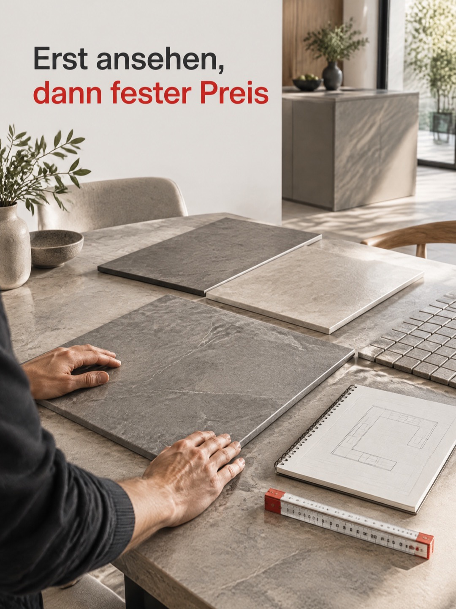

<a id="tz-002"></a>
## TZ-002 · Dusche ohne Stufe

Bad · 3:4 · Dokument Nr. 2

```text
Brand style for an owner-run tiling company in Germany known for precise large-format tiles, walk-in showers without a step, balconies and stairs. Look: calm architectural interior photography; razor-straight joints; perfectly level surfaces; soft natural side light that reveals texture; realistic materials (porcelain stoneware, mosaic, natural stone); no clutter, no tools lying around. Palette: light zinc grey (#F4F4F5), anthracite text (#27272A), warm stone and greige tones, one accent colour red (#D82020) used sparingly. Typography: clean modern sans-serif headline, left-aligned, generous whitespace, at most two text sizes. People: only hands or figures from behind, never a recognisable face. Layout: vertical 3:4 portrait format (1080x1440 proportions); keep all text and key objects inside an 8% safe margin; keep the bottom-right corner (14% of the width) empty for a logo added later. Do not draw any logo, company name, brand name or watermark. Text rules: render ONLY the German text given in quotes, exactly once, verbatim, with correct umlauts (ä, ö, ü, ß); no other words or numbers. A modern walk-in shower without any step, large grey porcelain tiles on floor and walls with very few joints, a frameless glass panel, a slim linear drain, soft light from a side window. Headline: "Die Wanne soll raus? Dusche ohne Stufe."
```

**Text im Bild:** „Die Wanne soll raus? Dusche ohne Stufe.“  
**Caption:** Sicher duschen ohne Stufe: Wir bauen Ihre Wanne zur bodengleichen Dusche um, mit Abdichtung nach DIN 18534 und rutschhemmenden Fliesen. Symbolbild. Termin vor Ort: kostenfrei.  
**Hashtags:** #badsanierung #duscheohnestufe #bodengleichedusche #walkindusche #badezimmer #aßlar #wetzlar #lahndill #mittelhessen #gießen  
**Hinweise:** ⚠️ Fakten prüfen. Vor dem Posten prüfen (Stand 29.10.2026): Angabe „Abdichtung nach DIN 18534“. „Symbolbild“ in der Caption stehen lassen. Posting-Plan: Woche 1 (Mi 4.11.2026), gegen 18 Uhr.  
**Bilder:** [original](bilder/original/TZ-002.jpg) · [instagram-3x4](bilder/instagram-3x4/TZ-002.jpg) · [facebook-linkedin-4x5](bilder/facebook-linkedin-4x5/TZ-002.jpg)

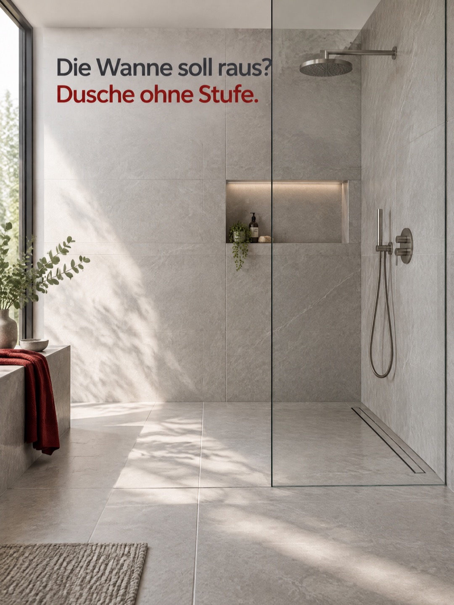

<a id="tz-003"></a>
## TZ-003 · Große Fliesen

Böden · 3:4 · Dokument Nr. 3

```text
Brand style for an owner-run tiling company in Germany known for precise large-format tiles, walk-in showers without a step, balconies and stairs. Look: calm architectural interior photography; razor-straight joints; perfectly level surfaces; soft natural side light that reveals texture; realistic materials (porcelain stoneware, mosaic, natural stone); no clutter, no tools lying around. Palette: light zinc grey (#F4F4F5), anthracite text (#27272A), warm stone and greige tones, one accent colour red (#D82020) used sparingly. Typography: clean modern sans-serif headline, left-aligned, generous whitespace, at most two text sizes. People: only hands or figures from behind, never a recognisable face. Layout: vertical 3:4 portrait format (1080x1440 proportions); keep all text and key objects inside an 8% safe margin; keep the bottom-right corner (14% of the width) empty for a logo added later. Do not draw any logo, company name, brand name or watermark. Text rules: render ONLY the German text given in quotes, exactly once, verbatim, with correct umlauts (ä, ö, ü, ß); no other words or numbers. A calm open living area with very large light-grey porcelain floor tiles and barely visible joints, low morning sun grazing across the surface to show it is perfectly flat, minimal furniture at the edge of the frame. Headline: "Große Fliesen. Wenige Fugen. Ruhige Flächen."
```

**Text im Bild:** „Große Fliesen. Wenige Fugen. Ruhige Flächen.“  
**Caption:** Seit 2014 ist das Verlegen großer Fliesen unser Schwerpunkt. Mit Vakuum-Hebern und Nivelliersystem liegen auch sehr große Formate millimetergenau. Symbolbild.  
**Hashtags:** #fliesenleger #fliesen #fliesenverlegung #großformatfliesen #feinsteinzeug #herborn #solms #braunfels #dillenburg #limburg  
**Hinweise:** ⚠️ Fakten prüfen. Vor dem Posten prüfen (Stand 29.10.2026): „Seit 2014“ Schwerpunkt große Fliesen. „Symbolbild“ in der Caption stehen lassen. Posting-Plan: Woche 1 (Fr 6.11.2026), gegen 18 Uhr.  
**Bilder:** [original](bilder/original/TZ-003.jpg) · [instagram-3x4](bilder/instagram-3x4/TZ-003.jpg) · [facebook-linkedin-4x5](bilder/facebook-linkedin-4x5/TZ-003.jpg)

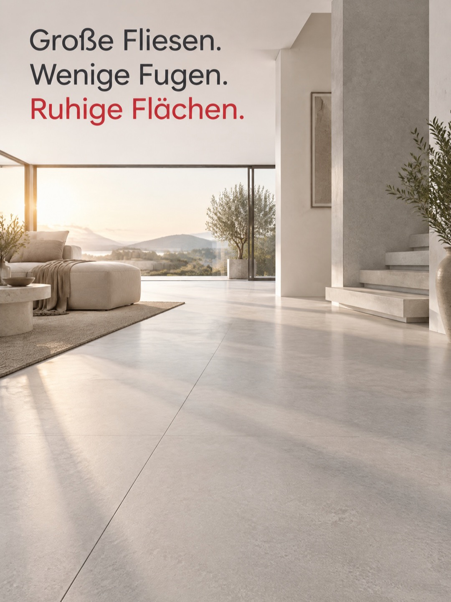

<a id="tz-004"></a>
## TZ-004 · Wasser auf dem Balkon

Draußen · 3:4 · Dokument Nr. 4

```text
Brand style for an owner-run tiling company in Germany known for precise large-format tiles, walk-in showers without a step, balconies and stairs. Look: calm architectural interior photography; razor-straight joints; perfectly level surfaces; soft natural side light that reveals texture; realistic materials (porcelain stoneware, mosaic, natural stone); no clutter, no tools lying around. Palette: light zinc grey (#F4F4F5), anthracite text (#27272A), warm stone and greige tones, one accent colour red (#D82020) used sparingly. Typography: clean modern sans-serif headline, left-aligned, generous whitespace, at most two text sizes. People: only hands or figures from behind, never a recognisable face. Layout: vertical 3:4 portrait format (1080x1440 proportions); keep all text and key objects inside an 8% safe margin; keep the bottom-right corner (14% of the width) empty for a logo added later. Do not draw any logo, company name, brand name or watermark. Text rules: render ONLY the German text given in quotes, exactly once, verbatim, with correct umlauts (ä, ö, ü, ß); no other words or numbers. Close view of an old balcony floor with cracked tiles and a puddle after rain, a grey sky reflected in the water, one fallen leaf, slightly melancholic light. Headline: "Bleibt auf dem Balkon Wasser stehen?"
```

**Text im Bild:** „Bleibt auf dem Balkon Wasser stehen?“  
**Caption:** Stehendes Wasser auf dem Balkon ist ein Warnzeichen, denn es kann in den Untergrund eindringen. Wir erneuern Balkone mit Gefälle und Abdichtung oder mit Platten auf Stelzen, unter denen der Regen abläuft. Symbolbild.  
**Hashtags:** #balkonsanierung #terrasse #terrassenplatten #außentreppe #stelzlager #aßlar #wetzlar #lahndill #mittelhessen #gießen  
**Hinweise:** „Symbolbild“ in der Caption stehen lassen (gegenüber der Vorlage ergänzt). Balkonthema: im Januar für die Frühjahrsplanung posten. Posting-Plan: Woche 10 (Mi 6.1.2027), gegen 18 Uhr.  
**Bilder:** [original](bilder/original/TZ-004.jpg) · [instagram-3x4](bilder/instagram-3x4/TZ-004.jpg) · [facebook-linkedin-4x5](bilder/facebook-linkedin-4x5/TZ-004.jpg)

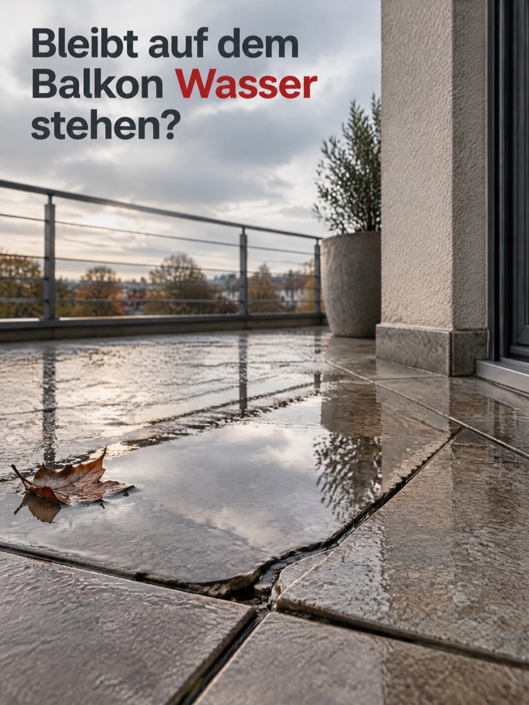

<a id="tz-005"></a>
## TZ-005 · Platten auf Stelzen

Draußen · 3:4 · Dokument Nr. 5

```text
Brand style for an owner-run tiling company in Germany known for precise large-format tiles, walk-in showers without a step, balconies and stairs. Look: calm architectural interior photography; razor-straight joints; perfectly level surfaces; soft natural side light that reveals texture; realistic materials (porcelain stoneware, mosaic, natural stone); no clutter, no tools lying around. Palette: light zinc grey (#F4F4F5), anthracite text (#27272A), warm stone and greige tones, one accent colour red (#D82020) used sparingly. Typography: clean modern sans-serif headline, left-aligned, generous whitespace, at most two text sizes. People: only hands or figures from behind, never a recognisable face. Layout: vertical 3:4 portrait format (1080x1440 proportions); keep all text and key objects inside an 8% safe margin; keep the bottom-right corner (14% of the width) empty for a logo added later. Do not draw any logo, company name, brand name or watermark. Text rules: render ONLY the German text given in quotes, exactly once, verbatim, with correct umlauts (ä, ö, ü, ß); no other words or numbers. Technical cutaway view of a balcony floor: large outdoor porcelain slabs resting on adjustable pedestals, rainwater visibly running off underneath, clean and precise, neutral daylight. Headline: "Platten auf Stelzen: Regen läuft unten ab"
```

**Text im Bild:** „Platten auf Stelzen: Regen läuft unten ab“  
**Caption:** Bei Stelzlagern liegen die Terrassenplatten auf höhenverstellbaren Füßen. Das Regenwasser läuft darunter ab, die Fläche bleibt eben. Wir beraten Sie, ob das für Ihren Balkon passt. Symbolbild.  
**Hashtags:** #balkonsanierung #terrasse #terrassenplatten #außentreppe #stelzlager #herborn #solms #braunfels #dillenburg #limburg  
**Hinweise:** Schnittbild, KI-Konzeptbild: „Symbolbild“ in der Caption stehen lassen (gegenüber der Vorlage ergänzt). Balkonthema: im Januar für die Frühjahrsplanung posten.  
**Bilder:** [original](bilder/original/TZ-005.jpg) · [instagram-3x4](bilder/instagram-3x4/TZ-005.jpg) · [facebook-linkedin-4x5](bilder/facebook-linkedin-4x5/TZ-005.jpg)

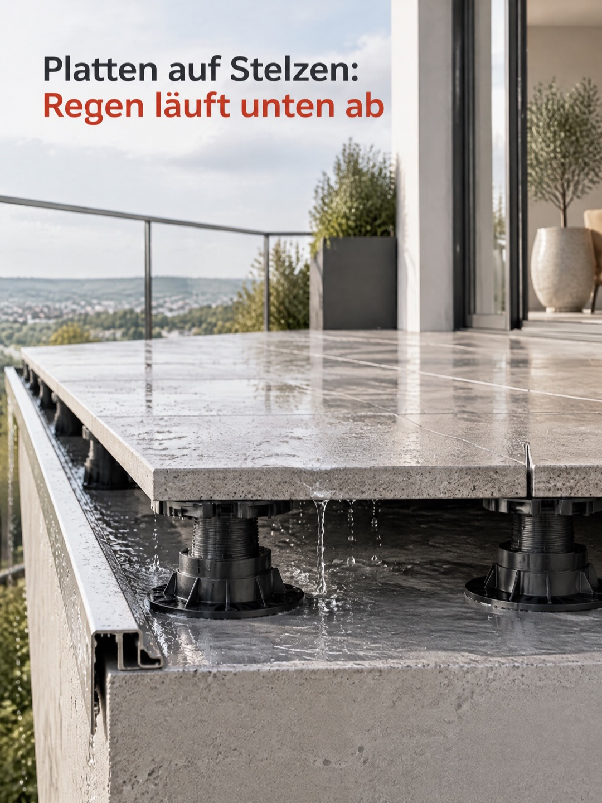

<a id="tz-006"></a>
## TZ-006 · Bewertungskarte (nur Hintergrund)

Betrieb · 3:4 · Dokument Nr. 6

```text
Brand style for an owner-run tiling company in Germany known for precise large-format tiles, walk-in showers without a step, balconies and stairs. Look: calm architectural interior photography; razor-straight joints; perfectly level surfaces; soft natural side light that reveals texture; realistic materials (porcelain stoneware, mosaic, natural stone); no clutter, no tools lying around. Palette: light zinc grey (#F4F4F5), anthracite text (#27272A), warm stone and greige tones, one accent colour red (#D82020) used sparingly. Typography: clean modern sans-serif headline, left-aligned, generous whitespace, at most two text sizes. People: only hands or figures from behind, never a recognisable face. Layout: vertical 3:4 portrait format (1080x1440 proportions); keep all text and key objects inside an 8% safe margin; keep the bottom-right corner (14% of the width) empty for a logo added later. Do not draw any logo, company name, brand name or watermark. Text rules: render ONLY the German text given in quotes, exactly once, verbatim, with correct umlauts (ä, ö, ü, ß); no other words or numbers. Softly blurred background of a finished light-grey tiled bathroom; in the centre a large empty off-white card with rounded corners for text added later; five small star shapes in the red accent colour (#D82020) above the card. No text at all.
```

**Caption:** Danke für Ihre Bewertungen! Was unsere Kunden schreiben, steht genau so bei Google. Hintergrund: Symbolbild. Termin vor Ort: Link in Bio.  
**Hashtags:** #handwerk #fliesenhandwerk #inhabergeführt #fachbetrieb #seit2008 #aßlar #wetzlar #lahndill #mittelhessen #gießen  
**Hinweise:** ⚠️ Fakten prüfen. Bild ohne jeden Text erzeugen. Text in Canva setzen: „5,0 von 5 Sternen · [Anzahl] Google-Bewertungen · Stand [Monat Jahr]“ plus ein echtes Kundenzitat, wörtlich von Google mit Initialen. Vor dem Posten prüfen (Stand 29.10.2026; laut Dokument 5,0 Sterne aus 27 Google-Bewertungen, Stand September 2026): Sterne und Anzahl bei Google prüfen und das Datum eintragen. Keine anderen Bewertungen, Zahlen oder Kundenstimmen verwenden. „Hintergrund: Symbolbild“ in der Caption stehen lassen (gegenüber der Vorlage ergänzt). Posting-Plan: Woche 2 (Mi 11.11.2026), gegen 18 Uhr.  
**Bilder:** [original](bilder/original/TZ-006.jpg) · [instagram-3x4](bilder/instagram-3x4/TZ-006.jpg) · [facebook-linkedin-4x5](bilder/facebook-linkedin-4x5/TZ-006.jpg)

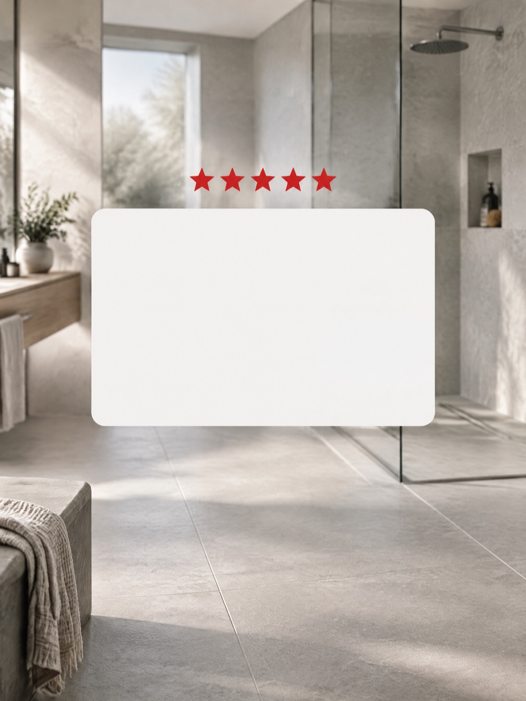

<a id="tz-007"></a>
## TZ-007 · Fugen erneuern

Reparatur · 3:4 · Dokument Nr. 7

```text
Brand style for an owner-run tiling company in Germany known for precise large-format tiles, walk-in showers without a step, balconies and stairs. Look: calm architectural interior photography; razor-straight joints; perfectly level surfaces; soft natural side light that reveals texture; realistic materials (porcelain stoneware, mosaic, natural stone); no clutter, no tools lying around. Palette: light zinc grey (#F4F4F5), anthracite text (#27272A), warm stone and greige tones, one accent colour red (#D82020) used sparingly. Typography: clean modern sans-serif headline, left-aligned, generous whitespace, at most two text sizes. People: only hands or figures from behind, never a recognisable face. Layout: vertical 3:4 portrait format (1080x1440 proportions); keep all text and key objects inside an 8% safe margin; keep the bottom-right corner (14% of the width) empty for a logo added later. Do not draw any logo, company name, brand name or watermark. Text rules: render ONLY the German text given in quotes, exactly once, verbatim, with correct umlauts (ä, ö, ü, ß); no other words or numbers. Macro view of a white tiled wall: the left half shows old, discoloured grout lines, the right half fresh, clean light-grey joints; a gloved hand with a rubber grout float at the dividing line. Headline: "Alte Fugen? Wir machen sie neu."
```

**Text im Bild:** „Alte Fugen? Wir machen sie neu.“  
**Caption:** Verfärbte oder bröselige Fugen lassen ein Bad schnell alt aussehen. Oft reicht es, die Fugen zu erneuern, statt alles neu zu fliesen. Symbolbild. Wir schauen es uns vor Ort an.  
**Hashtags:** #fliesenleger #fliesen #fliesenverlegung #großformatfliesen #feinsteinzeug #herborn #solms #braunfels #dillenburg #limburg  
**Hinweise:** „Symbolbild“ in der Caption stehen lassen (gegenüber der Vorlage ergänzt). Posting-Plan: Woche 4 (Fr 27.11.2026), gegen 18 Uhr.  
**Bilder:** [original](bilder/original/TZ-007.jpg) · [instagram-3x4](bilder/instagram-3x4/TZ-007.jpg) · [facebook-linkedin-4x5](bilder/facebook-linkedin-4x5/TZ-007.jpg)

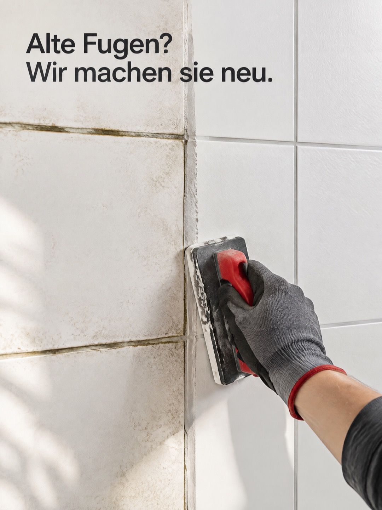

<a id="tz-008"></a>
## TZ-008 · Gesprungene Fliese

Reparatur · 3:4 · Dokument Nr. 8

```text
Brand style for an owner-run tiling company in Germany known for precise large-format tiles, walk-in showers without a step, balconies and stairs. Look: calm architectural interior photography; razor-straight joints; perfectly level surfaces; soft natural side light that reveals texture; realistic materials (porcelain stoneware, mosaic, natural stone); no clutter, no tools lying around. Palette: light zinc grey (#F4F4F5), anthracite text (#27272A), warm stone and greige tones, one accent colour red (#D82020) used sparingly. Typography: clean modern sans-serif headline, left-aligned, generous whitespace, at most two text sizes. People: only hands or figures from behind, never a recognisable face. Layout: vertical 3:4 portrait format (1080x1440 proportions); keep all text and key objects inside an 8% safe margin; keep the bottom-right corner (14% of the width) empty for a logo added later. Do not draw any logo, company name, brand name or watermark. Text rules: render ONLY the German text given in quotes, exactly once, verbatim, with correct umlauts (ä, ö, ü, ß); no other words or numbers. A kitchen floor of matching tiles with one single cracked tile in the centre, a replacement tile of the same kind lying next to it, top-down view, soft daylight. Headline: "Eine Fliese gesprungen? Wir reparieren."
```

**Text im Bild:** „Eine Fliese gesprungen? Wir reparieren.“  
**Caption:** Einzelne Fliesen lassen sich oft austauschen, wenn passende Fliesen vorhanden sind. Symbolbild. Wir prüfen vor Ort, was möglich ist.  
**Hashtags:** #fliesenleger #fliesen #fliesenverlegung #großformatfliesen #feinsteinzeug #aßlar #wetzlar #lahndill #mittelhessen #gießen  
**Hinweise:** „Symbolbild“ in der Caption stehen lassen (gegenüber der Vorlage ergänzt). Posting-Plan: Woche 9 (Mi 30.12.2026), gegen 18 Uhr.  
**Bilder:** [original](bilder/original/TZ-008.jpg) · [instagram-3x4](bilder/instagram-3x4/TZ-008.jpg) · [facebook-linkedin-4x5](bilder/facebook-linkedin-4x5/TZ-008.jpg)

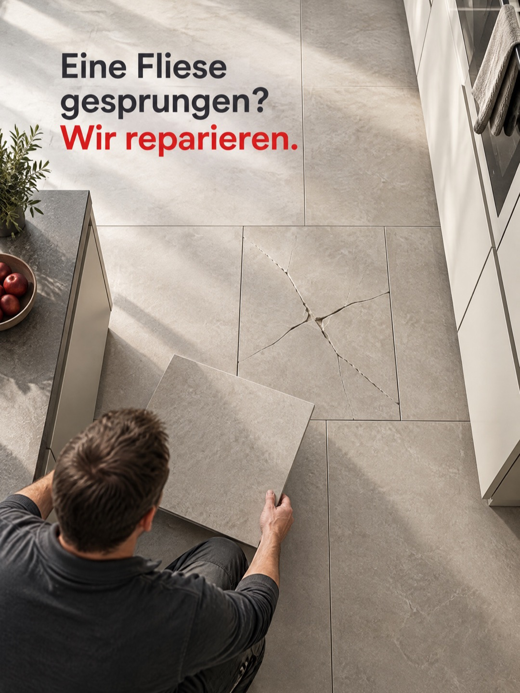

<a id="tz-009"></a>
## TZ-009 · Außentreppe

Draußen · 3:4 · Dokument Nr. 9

```text
Brand style for an owner-run tiling company in Germany known for precise large-format tiles, walk-in showers without a step, balconies and stairs. Look: calm architectural interior photography; razor-straight joints; perfectly level surfaces; soft natural side light that reveals texture; realistic materials (porcelain stoneware, mosaic, natural stone); no clutter, no tools lying around. Palette: light zinc grey (#F4F4F5), anthracite text (#27272A), warm stone and greige tones, one accent colour red (#D82020) used sparingly. Typography: clean modern sans-serif headline, left-aligned, generous whitespace, at most two text sizes. People: only hands or figures from behind, never a recognisable face. Layout: vertical 3:4 portrait format (1080x1440 proportions); keep all text and key objects inside an 8% safe margin; keep the bottom-right corner (14% of the width) empty for a logo added later. Do not draw any logo, company name, brand name or watermark. Text rules: render ONLY the German text given in quotes, exactly once, verbatim, with correct umlauts (ä, ö, ü, ß); no other words or numbers. An outdoor entrance staircase with anthracite porcelain tiles and crisp step edges, a stainless-steel handrail, leading up to a white front door, autumn light, no house number. Headline: "Die Treppe vor dem Haus, wieder sicher"
```

**Text im Bild:** „Die Treppe vor dem Haus, wieder sicher“  
**Caption:** Wir fliesen Außentreppen mit frostfesten, rutschhemmenden Platten und sauberen Kanten. Symbolbild. Termin vor Ort: kostenfrei.  
**Hashtags:** #balkonsanierung #terrasse #terrassenplatten #außentreppe #stelzlager #aßlar #wetzlar #lahndill #mittelhessen #gießen  
**Hinweise:** „Symbolbild“ in der Caption stehen lassen. Posting-Plan: Woche 10 (Fr 8.1.2027), gegen 18 Uhr.  
**Bilder:** [original](bilder/original/TZ-009.jpg) · [instagram-3x4](bilder/instagram-3x4/TZ-009.jpg) · [facebook-linkedin-4x5](bilder/facebook-linkedin-4x5/TZ-009.jpg)

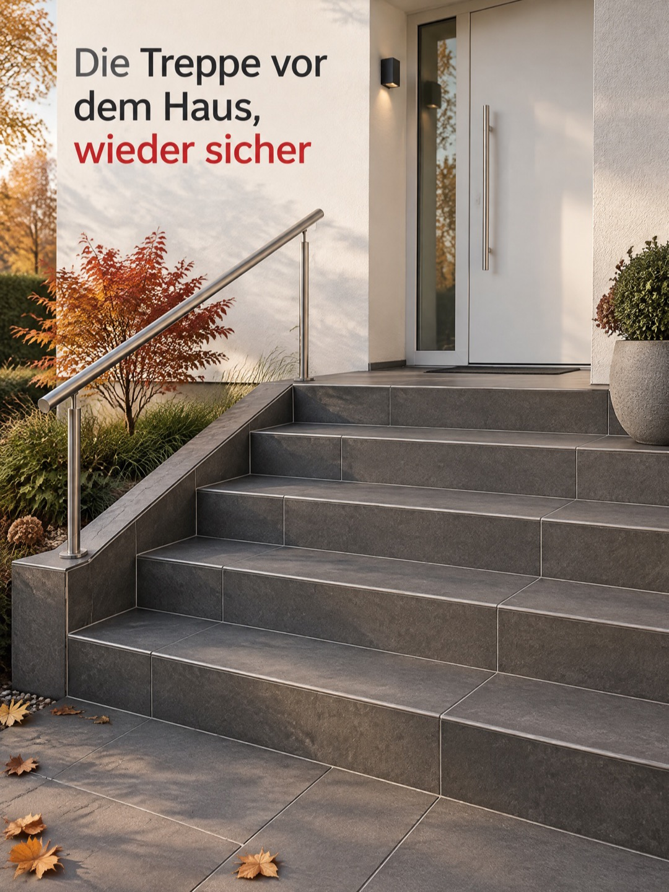

<a id="tz-010"></a>
## TZ-010 · Holzoptik

Böden · 3:4 · Dokument Nr. 10

```text
Brand style for an owner-run tiling company in Germany known for precise large-format tiles, walk-in showers without a step, balconies and stairs. Look: calm architectural interior photography; razor-straight joints; perfectly level surfaces; soft natural side light that reveals texture; realistic materials (porcelain stoneware, mosaic, natural stone); no clutter, no tools lying around. Palette: light zinc grey (#F4F4F5), anthracite text (#27272A), warm stone and greige tones, one accent colour red (#D82020) used sparingly. Typography: clean modern sans-serif headline, left-aligned, generous whitespace, at most two text sizes. People: only hands or figures from behind, never a recognisable face. Layout: vertical 3:4 portrait format (1080x1440 proportions); keep all text and key objects inside an 8% safe margin; keep the bottom-right corner (14% of the width) empty for a logo added later. Do not draw any logo, company name, brand name or watermark. Text rules: render ONLY the German text given in quotes, exactly once, verbatim, with correct umlauts (ä, ö, ü, ß); no other words or numbers. A bright living room with wood-look porcelain plank tiles laid in a herringbone pattern, part of a sofa at the edge of the frame, warm sunlight. Headline: "Sieht aus wie Holz, ist eine Fliese"
```

**Text im Bild:** „Sieht aus wie Holz, ist eine Fliese“  
**Caption:** Fliesen in Holzoptik sind pflegeleicht und passen gut zur Fußbodenheizung. Wir verlegen sie in verschiedenen Verlegemustern. Symbolbild.  
**Hashtags:** #fliesenleger #fliesen #fliesenverlegung #großformatfliesen #feinsteinzeug #herborn #solms #braunfels #dillenburg #limburg  
**Hinweise:** „Symbolbild“ in der Caption stehen lassen. Posting-Plan: Woche 6 (Mi 9.12.2026), gegen 18 Uhr.  
**Bilder:** [original](bilder/original/TZ-010.jpg) · [instagram-3x4](bilder/instagram-3x4/TZ-010.jpg) · [facebook-linkedin-4x5](bilder/facebook-linkedin-4x5/TZ-010.jpg)

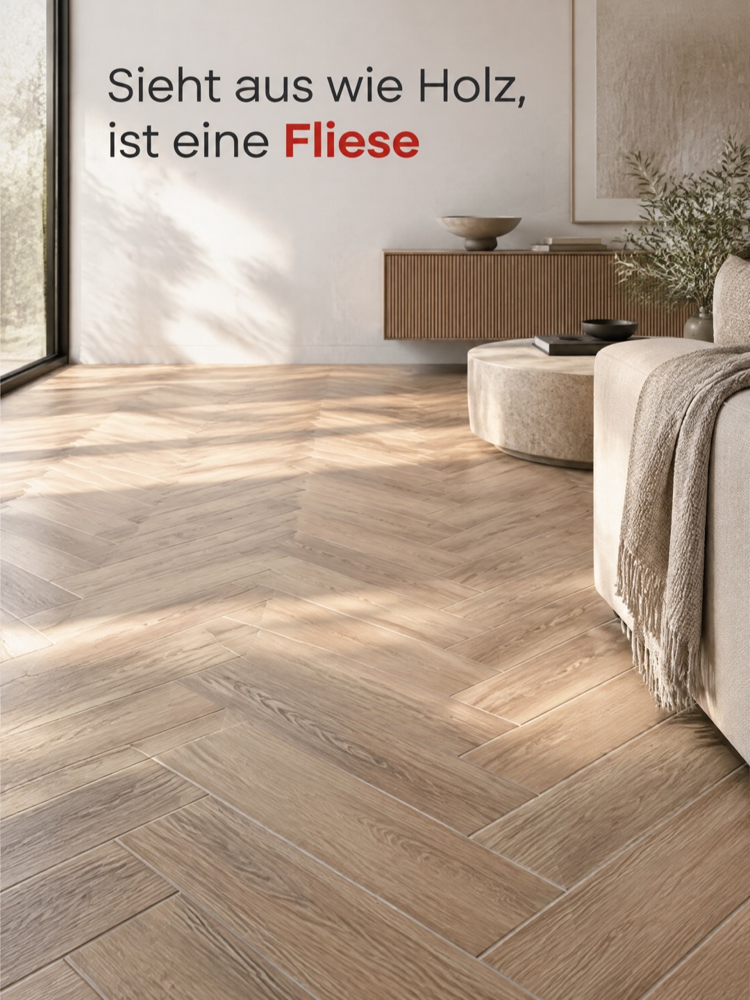

<a id="tz-011"></a>
## TZ-011 · Fußbodenheizung

Böden · 3:4 · Dokument Nr. 11

```text
Brand style for an owner-run tiling company in Germany known for precise large-format tiles, walk-in showers without a step, balconies and stairs. Look: calm architectural interior photography; razor-straight joints; perfectly level surfaces; soft natural side light that reveals texture; realistic materials (porcelain stoneware, mosaic, natural stone); no clutter, no tools lying around. Palette: light zinc grey (#F4F4F5), anthracite text (#27272A), warm stone and greige tones, one accent colour red (#D82020) used sparingly. Typography: clean modern sans-serif headline, left-aligned, generous whitespace, at most two text sizes. People: only hands or figures from behind, never a recognisable face. Layout: vertical 3:4 portrait format (1080x1440 proportions); keep all text and key objects inside an 8% safe margin; keep the bottom-right corner (14% of the width) empty for a logo added later. Do not draw any logo, company name, brand name or watermark. Text rules: render ONLY the German text given in quotes, exactly once, verbatim, with correct umlauts (ä, ö, ü, ß); no other words or numbers. Bare feet stepping onto a warm-toned large-format tile floor on a winter morning, steam rising from a mug in the soft-focus background. Headline: "Warme Füße auf Fliesen"
```

**Text im Bild:** „Warme Füße auf Fliesen“  
**Caption:** Fliesen leiten Wärme gut und passen ideal zur Fußbodenheizung. Wir achten auf die Belegreife des Estrichs und auf Entkopplung, damit die Fläche lange hält. Symbolbild.  
**Hashtags:** #fliesenleger #fliesen #fliesenverlegung #großformatfliesen #feinsteinzeug #aßlar #wetzlar #lahndill #mittelhessen #gießen  
**Hinweise:** „Symbolbild“ in der Caption stehen lassen (gegenüber der Vorlage ergänzt). Posting-Plan: Woche 4 (Mi 25.11.2026), gegen 18 Uhr.  
**Bilder:** [original](bilder/original/TZ-011.jpg) · [instagram-3x4](bilder/instagram-3x4/TZ-011.jpg) · [facebook-linkedin-4x5](bilder/facebook-linkedin-4x5/TZ-011.jpg)

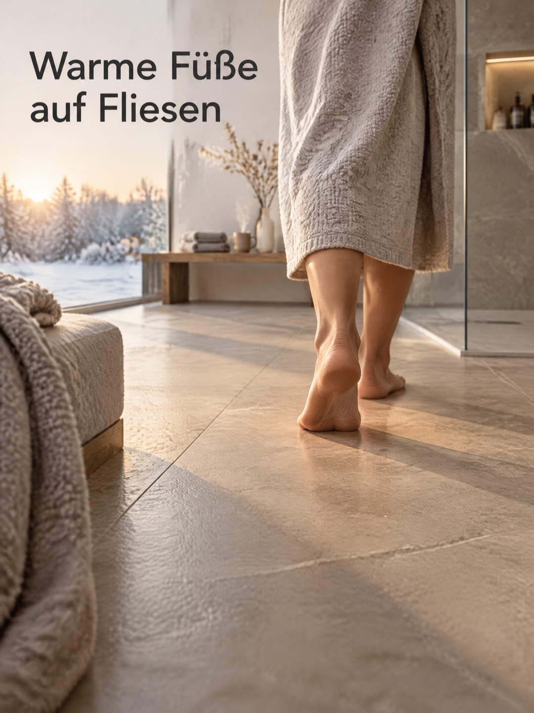

<a id="tz-012"></a>
## TZ-012 · Küche

Küche · 3:4 · Dokument Nr. 12

```text
Brand style for an owner-run tiling company in Germany known for precise large-format tiles, walk-in showers without a step, balconies and stairs. Look: calm architectural interior photography; razor-straight joints; perfectly level surfaces; soft natural side light that reveals texture; realistic materials (porcelain stoneware, mosaic, natural stone); no clutter, no tools lying around. Palette: light zinc grey (#F4F4F5), anthracite text (#27272A), warm stone and greige tones, one accent colour red (#D82020) used sparingly. Typography: clean modern sans-serif headline, left-aligned, generous whitespace, at most two text sizes. People: only hands or figures from behind, never a recognisable face. Layout: vertical 3:4 portrait format (1080x1440 proportions); keep all text and key objects inside an 8% safe margin; keep the bottom-right corner (14% of the width) empty for a logo added later. Do not draw any logo, company name, brand name or watermark. Text rules: render ONLY the German text given in quotes, exactly once, verbatim, with correct umlauts (ä, ö, ü, ß); no other words or numbers. A modern kitchen with a backsplash of glossy sage-green handmade-look tiles behind a wooden worktop, a few kitchen utensils, morning light. Headline: "Der Hingucker hinter der Arbeitsfläche"
```

**Text im Bild:** „Der Hingucker hinter der Arbeitsfläche“  
**Caption:** Eine geflieste Küchenwand ist pflegeleicht und setzt Akzente. Wir fliesen Boden und Wand in Ihrer Küche. Symbolbild.  
**Hashtags:** #fliesenleger #fliesen #fliesenverlegung #großformatfliesen #feinsteinzeug #herborn #solms #braunfels #dillenburg #limburg  
**Hinweise:** „Symbolbild“ in der Caption stehen lassen (gegenüber der Vorlage ergänzt). Posting-Plan: Woche 7 (Mo 14.12.2026), gegen 18 Uhr.  
**Bilder:** [original](bilder/original/TZ-012.jpg) · [instagram-3x4](bilder/instagram-3x4/TZ-012.jpg) · [facebook-linkedin-4x5](bilder/facebook-linkedin-4x5/TZ-012.jpg)

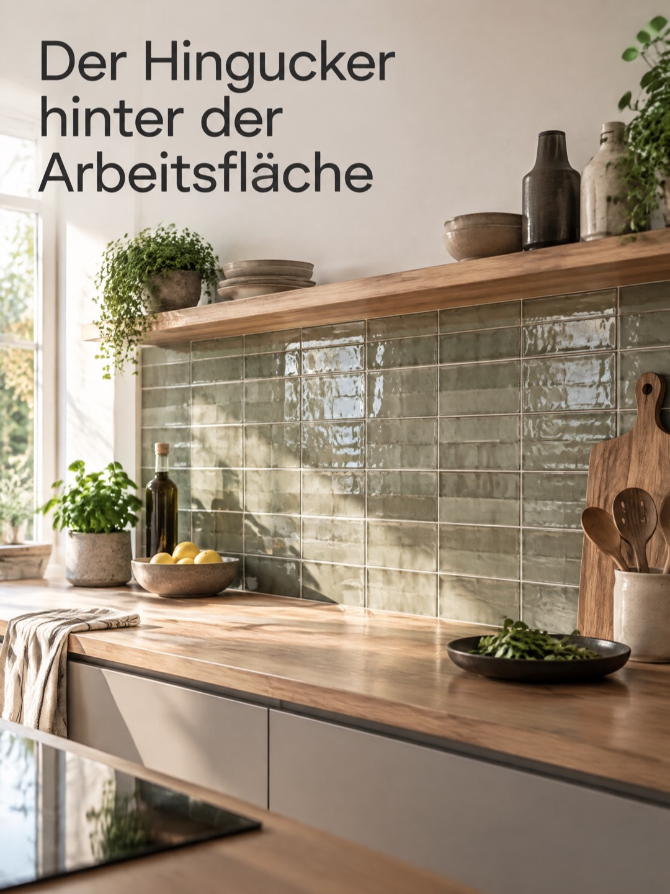

<a id="tz-013"></a>
## TZ-013 · Naturstein

Naturstein · 3:4 · Dokument Nr. 13

```text
Brand style for an owner-run tiling company in Germany known for precise large-format tiles, walk-in showers without a step, balconies and stairs. Look: calm architectural interior photography; razor-straight joints; perfectly level surfaces; soft natural side light that reveals texture; realistic materials (porcelain stoneware, mosaic, natural stone); no clutter, no tools lying around. Palette: light zinc grey (#F4F4F5), anthracite text (#27272A), warm stone and greige tones, one accent colour red (#D82020) used sparingly. Typography: clean modern sans-serif headline, left-aligned, generous whitespace, at most two text sizes. People: only hands or figures from behind, never a recognisable face. Layout: vertical 3:4 portrait format (1080x1440 proportions); keep all text and key objects inside an 8% safe margin; keep the bottom-right corner (14% of the width) empty for a logo added later. Do not draw any logo, company name, brand name or watermark. Text rules: render ONLY the German text given in quotes, exactly once, verbatim, with correct umlauts (ä, ö, ü, ß); no other words or numbers. An interior staircase clad in polished dark granite with precise edges, soft light falling from above, calm and elegant. Headline: "Naturstein, präzise verlegt"
```

**Text im Bild:** „Naturstein, präzise verlegt“  
**Caption:** Granit, Marmor und Kalkstein brauchen Erfahrung beim Verlegen. Wir arbeiten mit Naturstein an Treppen, Böden und Wänden. Symbolbild.  
**Hashtags:** #fliesenleger #fliesen #fliesenverlegung #großformatfliesen #feinsteinzeug #aßlar #wetzlar #lahndill #mittelhessen #gießen #naturstein  
**Hinweise:** „Symbolbild“ in der Caption stehen lassen (gegenüber der Vorlage ergänzt). Posting-Plan: Woche 7 (Fr 18.12.2026), gegen 18 Uhr.  
**Bilder:** [original](bilder/original/TZ-013.jpg) · [instagram-3x4](bilder/instagram-3x4/TZ-013.jpg) · [facebook-linkedin-4x5](bilder/facebook-linkedin-4x5/TZ-013.jpg)

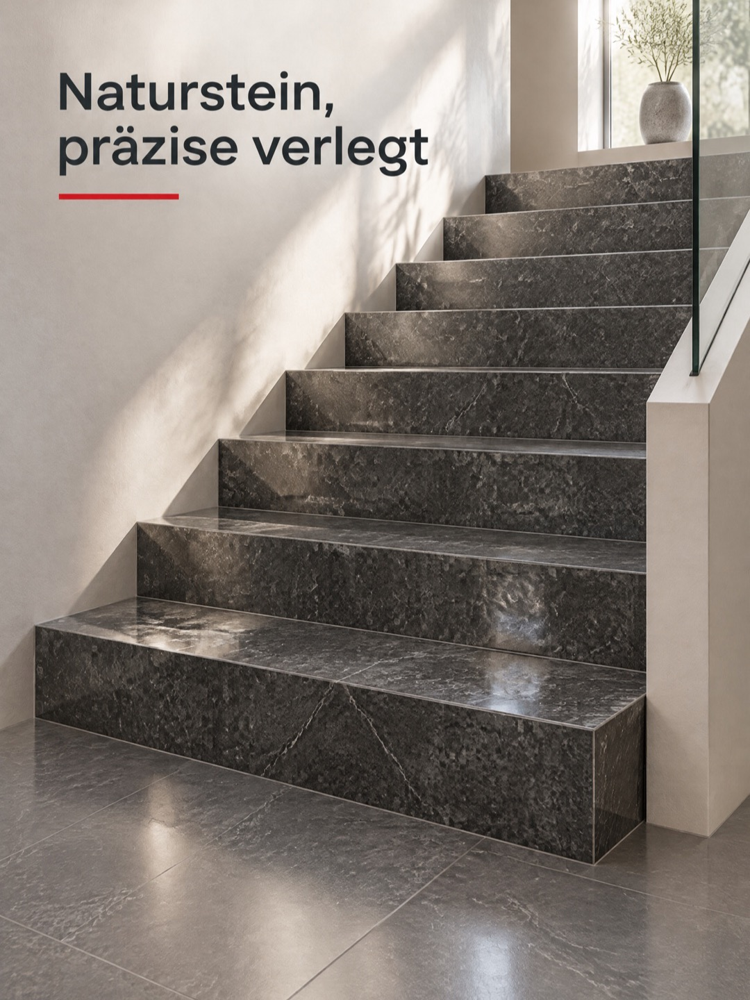

<a id="tz-014"></a>
## TZ-014 · Neubau

Neubau · 3:4 · Dokument Nr. 14

```text
Brand style for an owner-run tiling company in Germany known for precise large-format tiles, walk-in showers without a step, balconies and stairs. Look: calm architectural interior photography; razor-straight joints; perfectly level surfaces; soft natural side light that reveals texture; realistic materials (porcelain stoneware, mosaic, natural stone); no clutter, no tools lying around. Palette: light zinc grey (#F4F4F5), anthracite text (#27272A), warm stone and greige tones, one accent colour red (#D82020) used sparingly. Typography: clean modern sans-serif headline, left-aligned, generous whitespace, at most two text sizes. People: only hands or figures from behind, never a recognisable face. Layout: vertical 3:4 portrait format (1080x1440 proportions); keep all text and key objects inside an 8% safe margin; keep the bottom-right corner (14% of the width) empty for a logo added later. Do not draw any logo, company name, brand name or watermark. Text rules: render ONLY the German text given in quotes, exactly once, verbatim, with correct umlauts (ä, ö, ü, ß); no other words or numbers. An empty new-build open-plan interior with freshly laid large light tiles throughout, protective film still on the windows, clean daylight. Headline: "Neubau? Wir fliesen das ganze Haus."
```

**Text im Bild:** „Neubau? Wir fliesen das ganze Haus.“  
**Caption:** Im Neubau fliesen wir Böden und Wände im ganzen Haus, vom Bad bis zur Treppe. Ein Ansprechpartner von der ersten Skizze bis zur Übergabe. Symbolbild.  
**Hashtags:** #fliesenleger #fliesen #fliesenverlegung #großformatfliesen #feinsteinzeug #herborn #solms #braunfels #dillenburg #limburg #neubau  
**Hinweise:** „Symbolbild“ in der Caption stehen lassen (gegenüber der Vorlage ergänzt). Posting-Plan: Woche 9 (Mo 28.12.2026), gegen 18 Uhr.  
**Bilder:** [original](bilder/original/TZ-014.jpg) · [instagram-3x4](bilder/instagram-3x4/TZ-014.jpg) · [facebook-linkedin-4x5](bilder/facebook-linkedin-4x5/TZ-014.jpg)

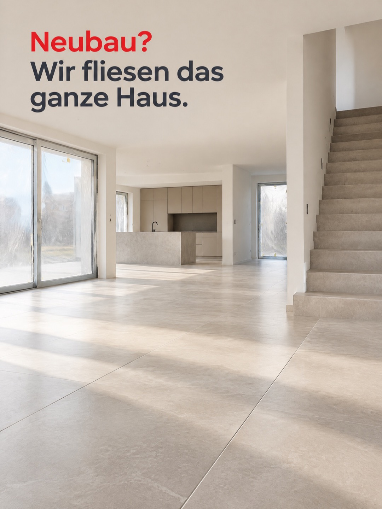

<a id="tz-015"></a>
## TZ-015 · Abdichtung nach DIN 18534

Wissen · 3:4 · Dokument Nr. 15

```text
Brand style for an owner-run tiling company in Germany known for precise large-format tiles, walk-in showers without a step, balconies and stairs. Look: calm architectural interior photography; razor-straight joints; perfectly level surfaces; soft natural side light that reveals texture; realistic materials (porcelain stoneware, mosaic, natural stone); no clutter, no tools lying around. Palette: light zinc grey (#F4F4F5), anthracite text (#27272A), warm stone and greige tones, one accent colour red (#D82020) used sparingly. Typography: clean modern sans-serif headline, left-aligned, generous whitespace, at most two text sizes. People: only hands or figures from behind, never a recognisable face. Layout: vertical 3:4 portrait format (1080x1440 proportions); keep all text and key objects inside an 8% safe margin; keep the bottom-right corner (14% of the width) empty for a logo added later. Do not draw any logo, company name, brand name or watermark. Text rules: render ONLY the German text given in quotes, exactly once, verbatim, with correct umlauts (ä, ö, ü, ß); no other words or numbers. A shower area under construction: walls and floor coated with a grey liquid waterproofing layer, blue sealing tape neatly in every corner, a sealing collar around the pipe outlet, everything precise and clean. Headline: "Was unter der Fliese passiert, zählt"
```

**Text im Bild:** „Was unter der Fliese passiert, zählt“  
**Caption:** Seit 2019 ist bei uns die Abdichtung nach DIN 18534 Standard: Dichtband in den Ecken, Manschetten an den Rohren, eine lückenlose Schicht. So schützen wir Wand und Boden vor eindringendem Wasser. Symbolbild.  
**Hashtags:** #badsanierung #duscheohnestufe #bodengleichedusche #walkindusche #badezimmer #fliesenleger #fliesen #fliesenverlegung #großformatfliesen #feinsteinzeug #abdichtung  
**Hinweise:** ⚠️ Fakten prüfen. Vor dem Posten prüfen (Stand 29.10.2026): „Seit 2019“ und Abdichtung nach DIN 18534. Letzten Satz ohne absolute Zusage formuliert (Vorlage: „So dringt kein Wasser in Wand und Boden.“). „Symbolbild“ in der Caption stehen lassen (gegenüber der Vorlage ergänzt). Posting-Plan: Woche 3 (Mo 16.11.2026), gegen 18 Uhr.  
**Bilder:** [original](bilder/original/TZ-015.jpg) · [instagram-3x4](bilder/instagram-3x4/TZ-015.jpg) · [facebook-linkedin-4x5](bilder/facebook-linkedin-4x5/TZ-015.jpg)

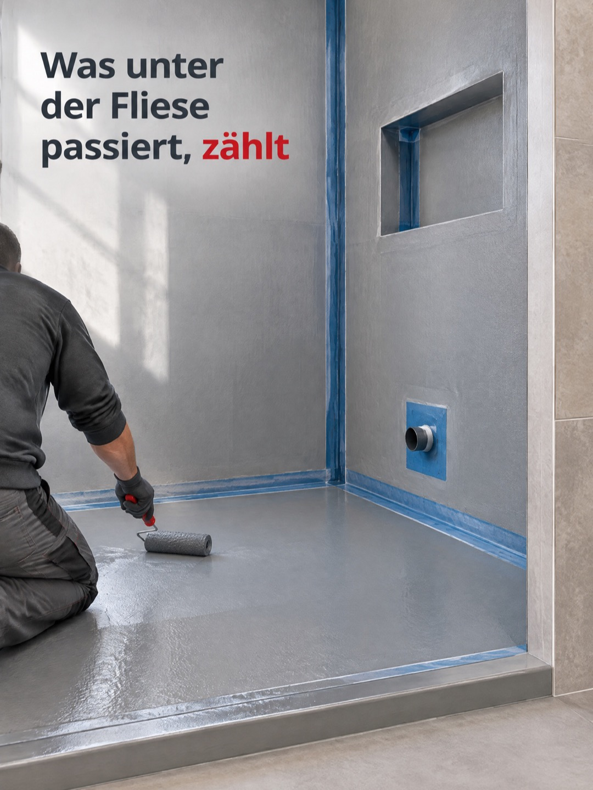

<a id="tz-016"></a>
## TZ-016 · Staubschutz

Service · 3:4 · Dokument Nr. 16

```text
Brand style for an owner-run tiling company in Germany known for precise large-format tiles, walk-in showers without a step, balconies and stairs. Look: calm architectural interior photography; razor-straight joints; perfectly level surfaces; soft natural side light that reveals texture; realistic materials (porcelain stoneware, mosaic, natural stone); no clutter, no tools lying around. Palette: light zinc grey (#F4F4F5), anthracite text (#27272A), warm stone and greige tones, one accent colour red (#D82020) used sparingly. Typography: clean modern sans-serif headline, left-aligned, generous whitespace, at most two text sizes. People: only hands or figures from behind, never a recognisable face. Layout: vertical 3:4 portrait format (1080x1440 proportions); keep all text and key objects inside an 8% safe margin; keep the bottom-right corner (14% of the width) empty for a logo added later. Do not draw any logo, company name, brand name or watermark. Text rules: render ONLY the German text given in quotes, exactly once, verbatim, with correct umlauts (ä, ö, ü, ß); no other words or numbers. A hallway in a lived-in home with a clean temporary dust protection wall (plastic sheeting on poles with a zipper door) closing off a bathroom renovation, the hallway floor spotless. Headline: "Saubere Baustelle, auch in bewohnten Räumen"
```

**Text im Bild:** „Saubere Baustelle, auch in bewohnten Räumen“  
**Caption:** Wir arbeiten mit Staubschutzwänden und Luftreinigern, damit Ihr Zuhause bewohnbar bleibt. Am Ende übergeben wir die Räume sauber gefegt und gehen alles gemeinsam durch. Symbolbild.  
**Hashtags:** #badsanierung #duscheohnestufe #bodengleichedusche #walkindusche #badezimmer #aßlar #wetzlar #lahndill #mittelhessen #gießen  
**Hinweise:** Den Begriff „Staubschutz-Garantie“ von tezgel.de bewusst weglassen: Eine in der Werbung genannte Garantie kann nach § 443 BGB verbindlich werden. „Symbolbild“ in der Caption stehen lassen (gegenüber der Vorlage ergänzt). Posting-Plan: Woche 5 (Mo 30.11.2026), gegen 18 Uhr.  
**Bilder:** [original](bilder/original/TZ-016.jpg) · [instagram-3x4](bilder/instagram-3x4/TZ-016.jpg) · [facebook-linkedin-4x5](bilder/facebook-linkedin-4x5/TZ-016.jpg)

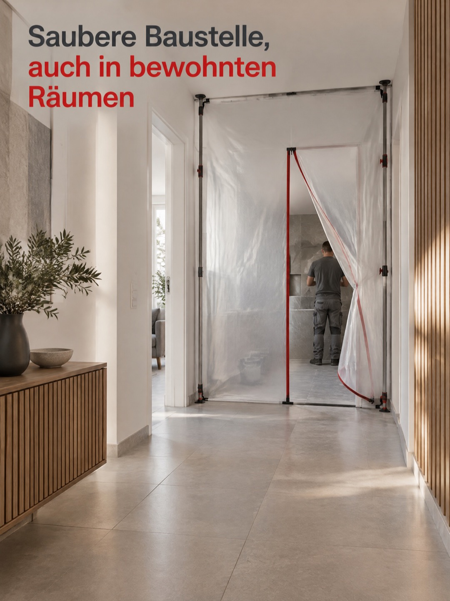

<a id="tz-017"></a>
## TZ-017 · Zuschuss der Pflegekasse

Zuschüsse · 3:4 · Dokument Nr. 17

```text
Brand style for an owner-run tiling company in Germany known for precise large-format tiles, walk-in showers without a step, balconies and stairs. Look: calm architectural interior photography; razor-straight joints; perfectly level surfaces; soft natural side light that reveals texture; realistic materials (porcelain stoneware, mosaic, natural stone); no clutter, no tools lying around. Palette: light zinc grey (#F4F4F5), anthracite text (#27272A), warm stone and greige tones, one accent colour red (#D82020) used sparingly. Typography: clean modern sans-serif headline, left-aligned, generous whitespace, at most two text sizes. People: only hands or figures from behind, never a recognisable face. Layout: vertical 3:4 portrait format (1080x1440 proportions); keep all text and key objects inside an 8% safe margin; keep the bottom-right corner (14% of the width) empty for a logo added later. Do not draw any logo, company name, brand name or watermark. Text rules: render ONLY the German text given in quotes, exactly once, verbatim, with correct umlauts (ä, ö, ü, ß); no other words or numbers. A bright barrier-free bathroom with a floor-level shower, a fold-down seat and a grab bar, slip-resistant tiles, calm light. Headline: "Bis zu 4.180 € Zuschuss zur Dusche"
```

**Text im Bild:** „Bis zu 4.180 € Zuschuss zur Dusche“  
**Caption:** Mit anerkanntem Pflegegrad (1–5) kann die Pflegekasse den Umbau zur bodengleichen Dusche mit bis zu 4.180 € pro pflegebedürftiger Person bezuschussen (Stand: Oktober 2026). Stellen Sie den Antrag möglichst vor Beginn der Arbeiten. Wir erstellen den prüffähigen Kostenvoranschlag. Symbolbild.  
**Hashtags:** #badsanierung #duscheohnestufe #bodengleichedusche #walkindusche #badezimmer #herborn #solms #braunfels #dillenburg #limburg  
**Hinweise:** ⚠️ Fakten prüfen. Vor dem Posten prüfen (Stand 29.10.2026): bis zu 4.180 € je Maßnahme und pflegebedürftiger Person, Pflegegrad 1–5 (mehrere Pflegebedürftige im Haushalt: bis zu 16.720 € je Maßnahme); Stand in der Caption beim Posten aktualisieren. Headline auf 7 Wörter gekürzt (Vorlage: „Bis zu 4.180 € Zuschuss für die Dusche“). Caption: „kann … bezuschussen“ statt „zahlt“, weil die Pflegekasse den Zuschuss erst auf Antrag bewilligt. „Symbolbild“ in der Caption stehen lassen (gegenüber der Vorlage ergänzt). Posting-Plan: Woche 3 (Fr 20.11.2026), gegen 18 Uhr.  
**Bilder:** [original](bilder/original/TZ-017.jpg) · [instagram-3x4](bilder/instagram-3x4/TZ-017.jpg) · [facebook-linkedin-4x5](bilder/facebook-linkedin-4x5/TZ-017.jpg)

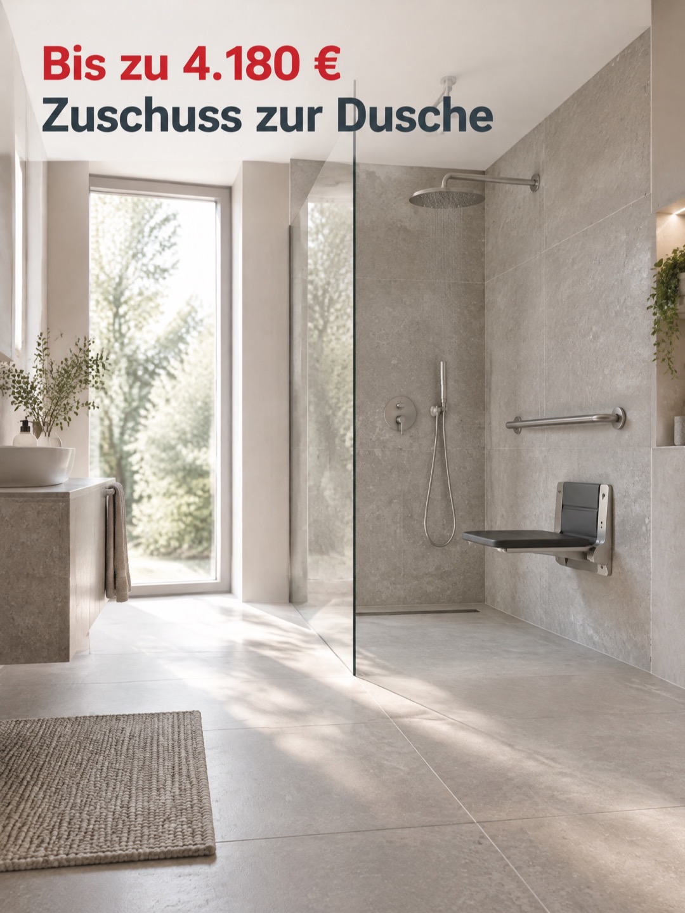

<a id="tz-018"></a>
## TZ-018 · Handwerkerbonus 2026

Zuschüsse · 3:4 · Dokument Nr. 18

```text
Brand style for an owner-run tiling company in Germany known for precise large-format tiles, walk-in showers without a step, balconies and stairs. Look: calm architectural interior photography; razor-straight joints; perfectly level surfaces; soft natural side light that reveals texture; realistic materials (porcelain stoneware, mosaic, natural stone); no clutter, no tools lying around. Palette: light zinc grey (#F4F4F5), anthracite text (#27272A), warm stone and greige tones, one accent colour red (#D82020) used sparingly. Typography: clean modern sans-serif headline, left-aligned, generous whitespace, at most two text sizes. People: only hands or figures from behind, never a recognisable face. Layout: vertical 3:4 portrait format (1080x1440 proportions); keep all text and key objects inside an 8% safe margin; keep the bottom-right corner (14% of the width) empty for a logo added later. Do not draw any logo, company name, brand name or watermark. Text rules: render ONLY the German text given in quotes, exactly once, verbatim, with correct umlauts (ä, ö, ü, ß); no other words or numbers. A wooden desk on a cosy December evening with a small tile sample, a closed plain grey folder, a pen and a fir sprig in a small glass, warm lamp light, calm and tidy. Headline: "Handwerkerbonus: 2026 noch 20 %"
```

**Text im Bild:** „Handwerkerbonus: 2026 noch 20 %“  
**Caption:** Für Arbeiten im bestehenden Zuhause können Sie 20 % der Arbeits- und Fahrtkosten von der Steuer abziehen, höchstens 1.200 € pro Jahr (§ 35a EStG, Zahlung per Überweisung). Nach dem Regierungsentwurf soll der Satz ab 2027 auf 15 % sinken. Stand: Oktober 2026. Keine Steuerberatung, fragen Sie Ihren Steuerberater.  
**Hashtags:** #aßlar #wetzlar #lahndill #mittelhessen #gießen #handwerkerbonus #steuertipp  
**Hinweise:** ⚠️ Fakten prüfen. Nur bis Mitte Dezember 2026 posten. Vor dem Posten prüfen (Stand 29.10.2026): 20 %, höchstens 1.200 € pro Jahr (§ 35a EStG); die Senkung auf 15 % und höchstens 900 € ab 2027 steht bisher nur im Regierungsentwurf; entscheidend ist der Zahlungszeitpunkt. Stand in der Caption beim Posten aktualisieren. Keine Steuerberatung (steht in der Caption). Szene ohne Kalenderblatt und Taschenrechner, damit keine Schrift oder Zahlen im Bild entstehen. Posting-Plan: Woche 2 (Fr 13.11.2026) und Woche 5 (Mi 2.12.2026) als Erinnerung, gegen 18 Uhr.  
**Bilder:** [original](bilder/original/TZ-018.jpg) · [instagram-3x4](bilder/instagram-3x4/TZ-018.jpg) · [facebook-linkedin-4x5](bilder/facebook-linkedin-4x5/TZ-018.jpg)

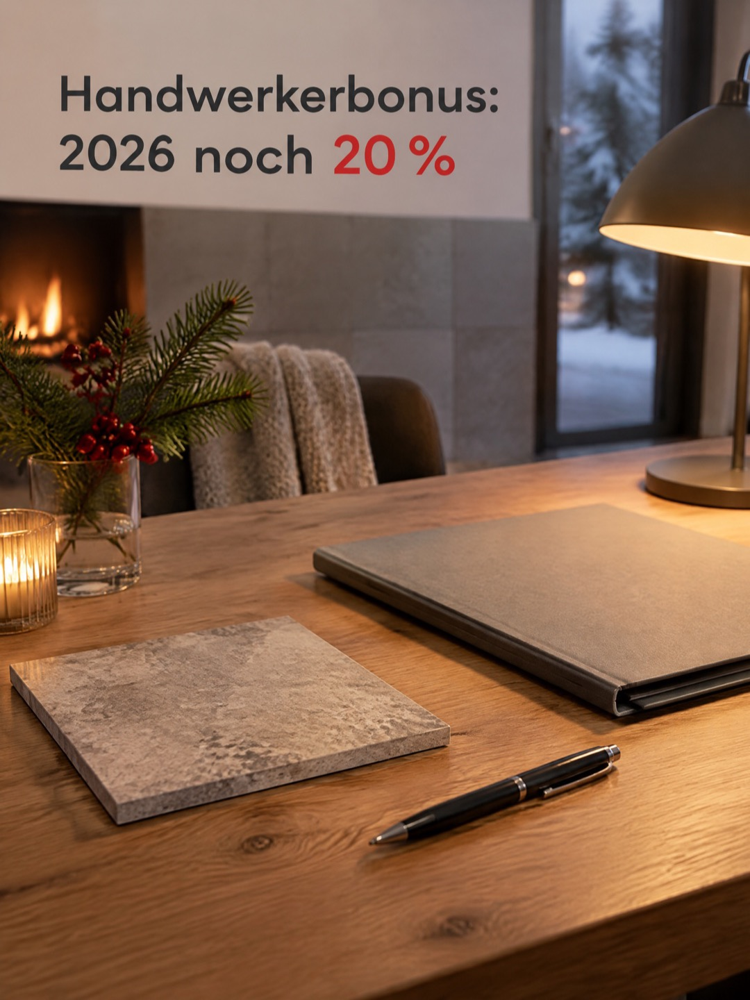

<a id="tz-019"></a>
## TZ-019 · Fliesenberatung

Service · 3:4 · Dokument Nr. 19

```text
Brand style for an owner-run tiling company in Germany known for precise large-format tiles, walk-in showers without a step, balconies and stairs. Look: calm architectural interior photography; razor-straight joints; perfectly level surfaces; soft natural side light that reveals texture; realistic materials (porcelain stoneware, mosaic, natural stone); no clutter, no tools lying around. Palette: light zinc grey (#F4F4F5), anthracite text (#27272A), warm stone and greige tones, one accent colour red (#D82020) used sparingly. Typography: clean modern sans-serif headline, left-aligned, generous whitespace, at most two text sizes. People: only hands or figures from behind, never a recognisable face. Layout: vertical 3:4 portrait format (1080x1440 proportions); keep all text and key objects inside an 8% safe margin; keep the bottom-right corner (14% of the width) empty for a logo added later. Do not draw any logo, company name, brand name or watermark. Text rules: render ONLY the German text given in quotes, exactly once, verbatim, with correct umlauts (ä, ö, ü, ß); no other words or numbers. A calm consultation table with tile samples fanned out, grout colour swatches and a small potted plant, warm light, no people. Headline: "Fliesen in Ruhe aussuchen"
```

**Text im Bild:** „Fliesen in Ruhe aussuchen“  
**Caption:** Möchten Sie vorher in Ruhe über Fliesen sprechen? Fliesenberatung in Wetzlar und Gießen nach Terminvereinbarung. Symbolbild.  
**Hashtags:** #fliesenleger #fliesen #fliesenverlegung #großformatfliesen #feinsteinzeug #aßlar #wetzlar #lahndill #mittelhessen #gießen  
**Hinweise:** „Symbolbild“ in der Caption stehen lassen (gegenüber der Vorlage ergänzt). Posting-Plan: Woche 7 (Mi 16.12.2026), gegen 18 Uhr.  
**Bilder:** [original](bilder/original/TZ-019.jpg) · [instagram-3x4](bilder/instagram-3x4/TZ-019.jpg) · [facebook-linkedin-4x5](bilder/facebook-linkedin-4x5/TZ-019.jpg)

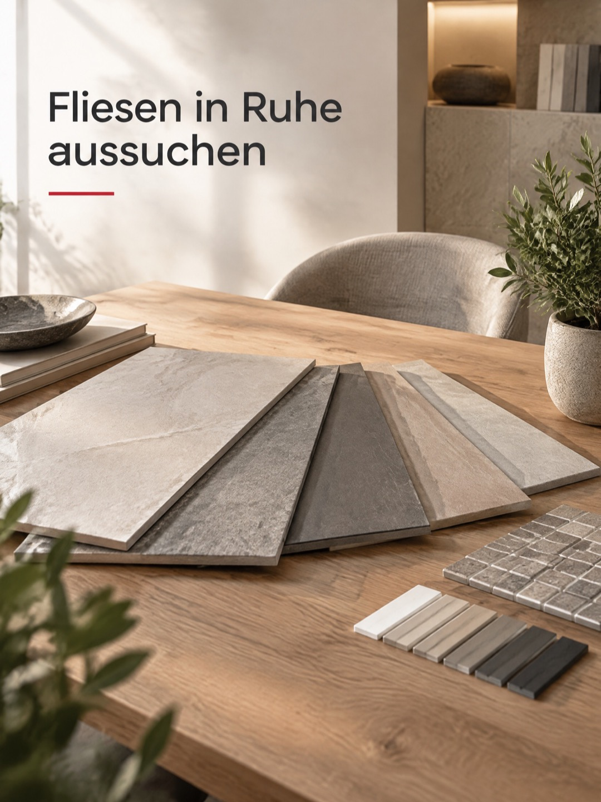

<a id="tz-020"></a>
## TZ-020 · Ausbildung

Recruiting · 3:4 · Dokument Nr. 20

```text
Brand style for an owner-run tiling company in Germany known for precise large-format tiles, walk-in showers without a step, balconies and stairs. Look: calm architectural interior photography; razor-straight joints; perfectly level surfaces; soft natural side light that reveals texture; realistic materials (porcelain stoneware, mosaic, natural stone); no clutter, no tools lying around. Palette: light zinc grey (#F4F4F5), anthracite text (#27272A), warm stone and greige tones, one accent colour red (#D82020) used sparingly. Typography: clean modern sans-serif headline, left-aligned, generous whitespace, at most two text sizes. People: only hands or figures from behind, never a recognisable face. Layout: vertical 3:4 portrait format (1080x1440 proportions); keep all text and key objects inside an 8% safe margin; keep the bottom-right corner (14% of the width) empty for a logo added later. Do not draw any logo, company name, brand name or watermark. Text rules: render ONLY the German text given in quotes, exactly once, verbatim, with correct umlauts (ä, ö, ü, ß); no other words or numbers. A young apprentice seen from behind, kneeling on a floor and spreading tile adhesive with a notched trowel, a red laser level line on the wall, clean site, natural light. Headline: "Fliesenleger werden? Starte bei uns."
```

**Text im Bild:** „Fliesenleger werden? Starte bei uns.“  
**Caption:** Wir bilden aus und suchen Verstärkung (m/w/d). Wenn du gern mit den Händen arbeitest und abends sehen willst, was du geschafft hast: Melde dich, Link in Bio. Symbolbild.  
**Hashtags:** #handwerk #fliesenhandwerk #inhabergeführt #fachbetrieb #seit2008 #aßlar #wetzlar #lahndill #mittelhessen #gießen #ausbildung  
**Hinweise:** Recruiting-Post in der Du-Form. Freigabe durch Deniz Tezgel einholen: Ist ein Ausbildungsplatz bzw. eine Stelle offen? „(m/w/d)“ für eine geschlechtsneutrale Stellenanzeige ergänzt (AGG). „Symbolbild“ in der Caption stehen lassen (gegenüber der Vorlage ergänzt). Posting-Plan: Woche 6 (Fr 11.12.2026), gegen 18 Uhr.  
**Bilder:** [original](bilder/original/TZ-020.jpg) · [instagram-3x4](bilder/instagram-3x4/TZ-020.jpg) · [facebook-linkedin-4x5](bilder/facebook-linkedin-4x5/TZ-020.jpg)

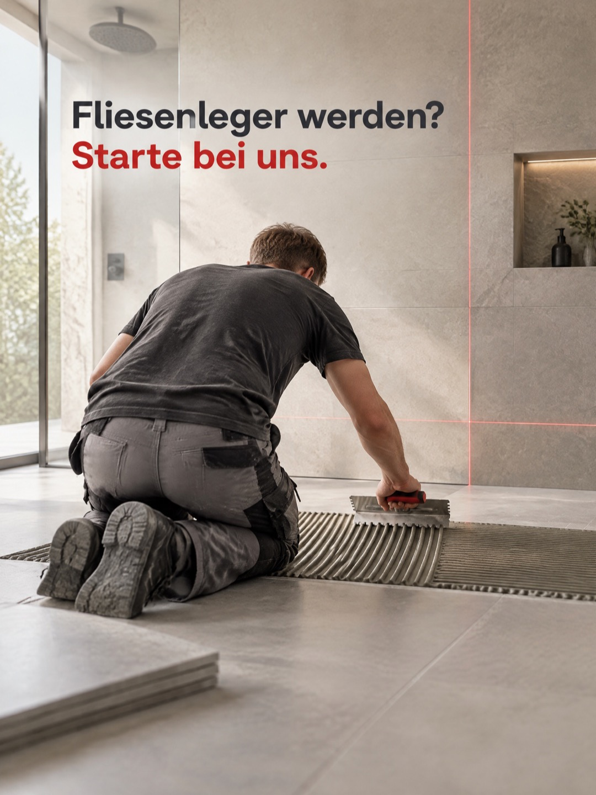

<a id="tz-021"></a>
## TZ-021 · Cover: Von der Wanne zur Dusche

Karussell · 3:4 · Karussell K1 „Von der Wanne zur Dusche“, Slide 1 von 7 · Dokument Nr. K1-1

```text
Brand style for an owner-run tiling company in Germany known for precise large-format tiles, walk-in showers without a step, balconies and stairs. Look: calm architectural interior photography; razor-straight joints; perfectly level surfaces; soft natural side light that reveals texture; realistic materials (porcelain stoneware, mosaic, natural stone); no clutter, no tools lying around. Palette: light zinc grey (#F4F4F5), anthracite text (#27272A), warm stone and greige tones, one accent colour red (#D82020) used sparingly. Typography: clean modern sans-serif headline, left-aligned, generous whitespace, at most two text sizes. People: only hands or figures from behind, never a recognisable face. Layout: vertical 3:4 portrait format (1080x1440 proportions); keep all text and key objects inside an 8% safe margin; keep the bottom-right corner (14% of the width) empty for a logo added later. Do not draw any logo, company name, brand name or watermark. Text rules: render ONLY the German text given in quotes, exactly once, verbatim, with correct umlauts (ä, ö, ü, ß); no other words or numbers. An old bathtub corner with dated beige tiles, soft light. Headline: "Von der Wanne zur Dusche". Small label (bottom-left, small): "Swipe →".
```

**Text im Bild:** „Von der Wanne zur Dusche“  
**Label:** „Swipe →“ (bottom-left, small)  
**Caption:** So läuft der Umbau bei uns ab, Schritt für Schritt. Symbolbilder, echte Fotos unserer Arbeit finden Sie auf tezgel.de.  
**Hashtags:** #badsanierung #duscheohnestufe #bodengleichedusche #walkindusche #badezimmer #aßlar #wetzlar #lahndill #mittelhessen #gießen  
**Hinweise:** Karussell K1 „Von der Wanne zur Dusche“, Slide 1 von 7; Caption und Hashtags gelten einmal für den ganzen Karussell-Post. „Symbolbilder“ in der Caption stehen lassen; wo es echte Fotos gibt, diese statt der Symbolbilder nehmen. Posting-Plan: Woche 2 (Mo 9.11.2026), gegen 18 Uhr.  
**Bilder:** [original](bilder/original/TZ-021.jpg) · [instagram-3x4](bilder/instagram-3x4/TZ-021.jpg) · [facebook-linkedin-4x5](bilder/facebook-linkedin-4x5/TZ-021.jpg)

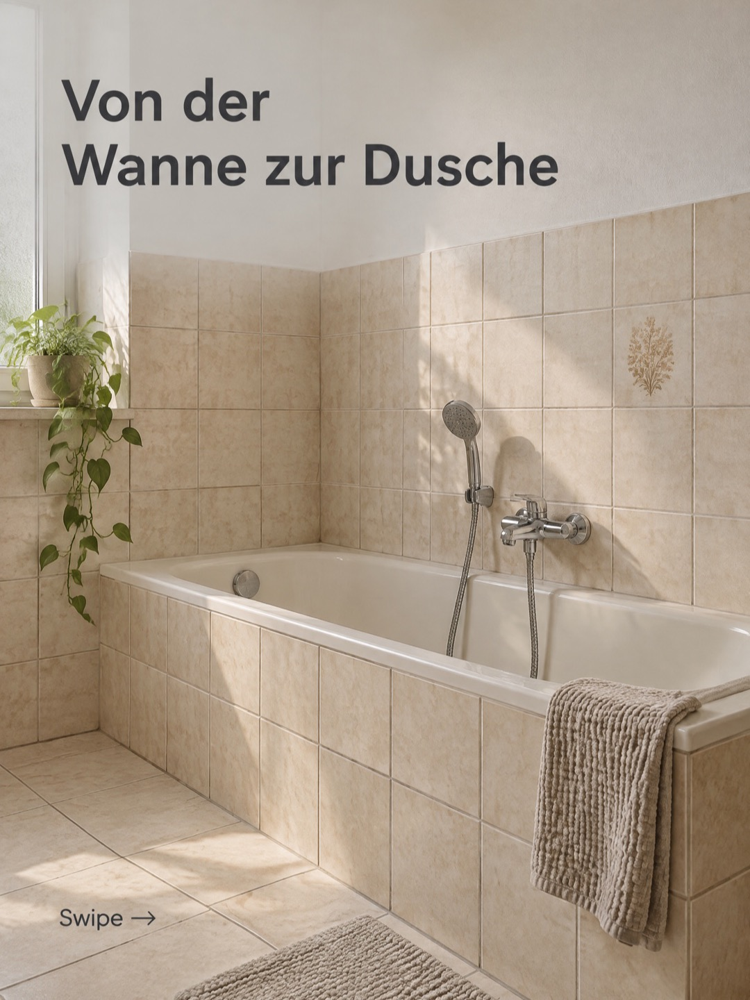

<a id="tz-022"></a>
## TZ-022 · Schritt 1: Termin vor Ort

Karussell · 3:4 · Karussell K1 „Von der Wanne zur Dusche“, Slide 2 von 7 · Dokument Nr. K1-2

Vorher die Cover-Slide dieser Serie hochladen (Stilreferenz).

```text
Use the uploaded image as the exact style reference: same background, colours, typography and layout. Create the next slide of this carousel. Brand style for an owner-run tiling company in Germany known for precise large-format tiles, walk-in showers without a step, balconies and stairs. Look: calm architectural interior photography; razor-straight joints; perfectly level surfaces; soft natural side light that reveals texture; realistic materials (porcelain stoneware, mosaic, natural stone); no clutter, no tools lying around. Palette: light zinc grey (#F4F4F5), anthracite text (#27272A), warm stone and greige tones, one accent colour red (#D82020) used sparingly. Typography: clean modern sans-serif headline, left-aligned, generous whitespace, at most two text sizes. People: only hands or figures from behind, never a recognisable face. Layout: vertical 3:4 portrait format (1080x1440 proportions); keep all text and key objects inside an 8% safe margin; keep the bottom-right corner (14% of the width) empty for a logo added later. Do not draw any logo, company name, brand name or watermark. Text rules: render ONLY the German text given in quotes, exactly once, verbatim, with correct umlauts (ä, ö, ü, ß); no other words or numbers. A folding rule and a switched-off moisture meter lying on a bathroom floor. Headline: "1. Termin vor Ort, kostenfrei"
```

**Text im Bild:** „1. Termin vor Ort, kostenfrei“  
**Caption:** So läuft der Umbau bei uns ab, Schritt für Schritt. Symbolbilder, echte Fotos unserer Arbeit finden Sie auf tezgel.de.  
**Hashtags:** #badsanierung #duscheohnestufe #bodengleichedusche #walkindusche #badezimmer #aßlar #wetzlar #lahndill #mittelhessen #gießen  
**Hinweise:** Karussell K1 „Von der Wanne zur Dusche“, Slide 2 von 7; Caption und Hashtags gelten einmal für den ganzen Karussell-Post. „Symbolbilder“ in der Caption stehen lassen; wo es echte Fotos gibt, diese statt der Symbolbilder nehmen. Für einheitlichen Look das fertige Cover hochladen und „Use the uploaded image as the exact style reference: same background, typography and layout.“ voranstellen (siehe E6). Messgerät ausgeschaltet, damit keine Ziffern im Bild entstehen. Posting-Plan: Woche 2 (Mo 9.11.2026), gegen 18 Uhr.  
**Bilder:** [original](bilder/original/TZ-022.jpg) · [instagram-3x4](bilder/instagram-3x4/TZ-022.jpg) · [facebook-linkedin-4x5](bilder/facebook-linkedin-4x5/TZ-022.jpg)

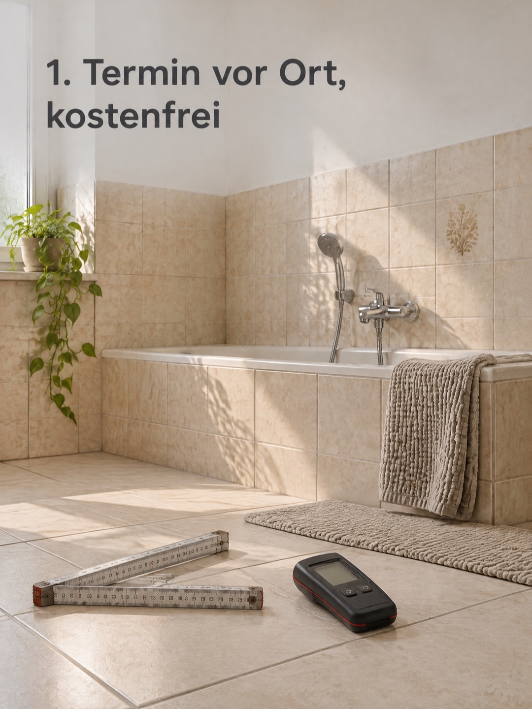

<a id="tz-023"></a>
## TZ-023 · Schritt 2: Fliesen aussuchen

Karussell · 3:4 · Karussell K1 „Von der Wanne zur Dusche“, Slide 3 von 7 · Dokument Nr. K1-3

Vorher die Cover-Slide dieser Serie hochladen (Stilreferenz).

```text
Use the uploaded image as the exact style reference: same background, colours, typography and layout. Create the next slide of this carousel. Brand style for an owner-run tiling company in Germany known for precise large-format tiles, walk-in showers without a step, balconies and stairs. Look: calm architectural interior photography; razor-straight joints; perfectly level surfaces; soft natural side light that reveals texture; realistic materials (porcelain stoneware, mosaic, natural stone); no clutter, no tools lying around. Palette: light zinc grey (#F4F4F5), anthracite text (#27272A), warm stone and greige tones, one accent colour red (#D82020) used sparingly. Typography: clean modern sans-serif headline, left-aligned, generous whitespace, at most two text sizes. People: only hands or figures from behind, never a recognisable face. Layout: vertical 3:4 portrait format (1080x1440 proportions); keep all text and key objects inside an 8% safe margin; keep the bottom-right corner (14% of the width) empty for a logo added later. Do not draw any logo, company name, brand name or watermark. Text rules: render ONLY the German text given in quotes, exactly once, verbatim, with correct umlauts (ä, ö, ü, ß); no other words or numbers. Four tile samples in grey and greige leaning in a row against a white wall on a wooden floor, a notepad and pencil lying in front of them, soft light. Headline: "2. Fliesen aussuchen, fester Preis"
```

**Text im Bild:** „2. Fliesen aussuchen, fester Preis“  
**Caption:** So läuft der Umbau bei uns ab, Schritt für Schritt. Symbolbilder, echte Fotos unserer Arbeit finden Sie auf tezgel.de.  
**Hashtags:** #badsanierung #duscheohnestufe #bodengleichedusche #walkindusche #badezimmer #aßlar #wetzlar #lahndill #mittelhessen #gießen  
**Hinweise:** Karussell K1 „Von der Wanne zur Dusche“, Slide 3 von 7; Caption und Hashtags gelten einmal für den ganzen Karussell-Post. „Symbolbilder“ in der Caption stehen lassen; wo es echte Fotos gibt, diese statt der Symbolbilder nehmen. Für einheitlichen Look das fertige Cover hochladen und „Use the uploaded image as the exact style reference: same background, typography and layout.“ voranstellen (siehe E6). Szene gegenüber der Vorlage variiert, damit sie sich von Prompt 1 unterscheidet. Posting-Plan: Woche 2 (Mo 9.11.2026), gegen 18 Uhr.  
**Bilder:** [original](bilder/original/TZ-023.jpg) · [instagram-3x4](bilder/instagram-3x4/TZ-023.jpg) · [facebook-linkedin-4x5](bilder/facebook-linkedin-4x5/TZ-023.jpg)

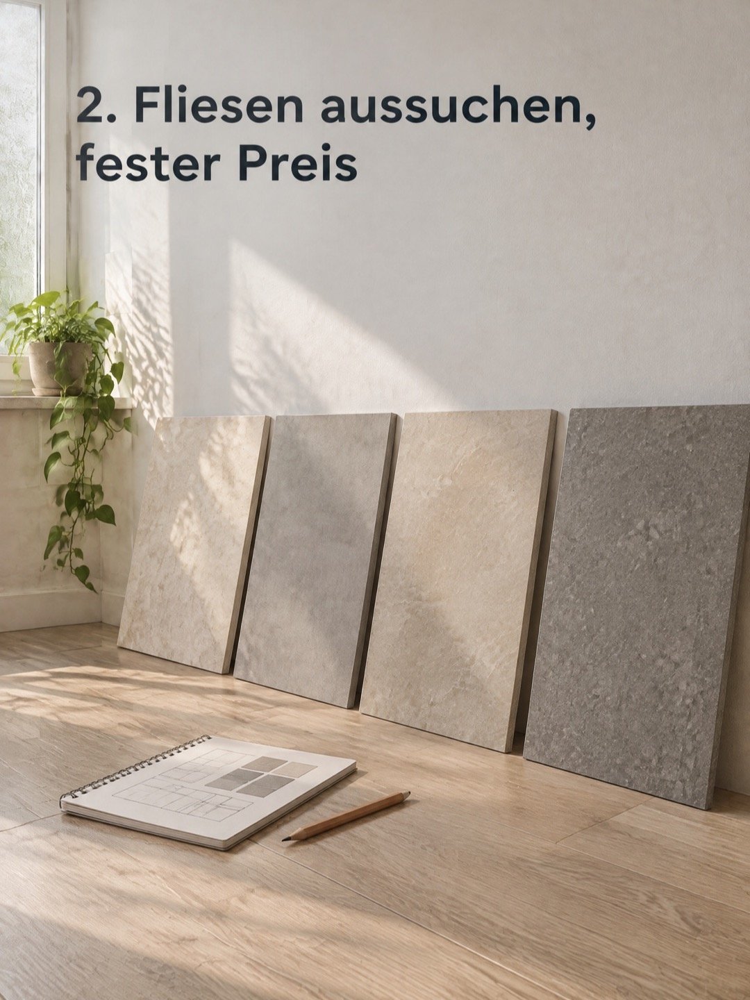

<a id="tz-024"></a>
## TZ-024 · Schritt 3: Abdichten

Karussell · 3:4 · Karussell K1 „Von der Wanne zur Dusche“, Slide 4 von 7 · Dokument Nr. K1-4

Vorher die Cover-Slide dieser Serie hochladen (Stilreferenz).

```text
Use the uploaded image as the exact style reference: same background, colours, typography and layout. Create the next slide of this carousel. Brand style for an owner-run tiling company in Germany known for precise large-format tiles, walk-in showers without a step, balconies and stairs. Look: calm architectural interior photography; razor-straight joints; perfectly level surfaces; soft natural side light that reveals texture; realistic materials (porcelain stoneware, mosaic, natural stone); no clutter, no tools lying around. Palette: light zinc grey (#F4F4F5), anthracite text (#27272A), warm stone and greige tones, one accent colour red (#D82020) used sparingly. Typography: clean modern sans-serif headline, left-aligned, generous whitespace, at most two text sizes. People: only hands or figures from behind, never a recognisable face. Layout: vertical 3:4 portrait format (1080x1440 proportions); keep all text and key objects inside an 8% safe margin; keep the bottom-right corner (14% of the width) empty for a logo added later. Do not draw any logo, company name, brand name or watermark. Text rules: render ONLY the German text given in quotes, exactly once, verbatim, with correct umlauts (ä, ö, ü, ß); no other words or numbers. A gloved hand pressing blue sealing tape into the corner of a shower wall coated with grey waterproofing, close view, soft side light. Headline: "3. Abdichten nach DIN 18534"
```

**Text im Bild:** „3. Abdichten nach DIN 18534“  
**Caption:** So läuft der Umbau bei uns ab, Schritt für Schritt. Symbolbilder, echte Fotos unserer Arbeit finden Sie auf tezgel.de.  
**Hashtags:** #badsanierung #duscheohnestufe #bodengleichedusche #walkindusche #badezimmer #aßlar #wetzlar #lahndill #mittelhessen #gießen  
**Hinweise:** ⚠️ Fakten prüfen. Karussell K1 „Von der Wanne zur Dusche“, Slide 4 von 7; Caption und Hashtags gelten einmal für den ganzen Karussell-Post. Vor dem Posten prüfen (Stand 29.10.2026): Angabe „DIN 18534“. „Symbolbilder“ in der Caption stehen lassen; wo es echte Fotos gibt, diese statt der Symbolbilder nehmen. Für einheitlichen Look das fertige Cover hochladen und „Use the uploaded image as the exact style reference: same background, typography and layout.“ voranstellen (siehe E6). Szene gegenüber der Vorlage variiert, damit sie sich von Prompt 15 unterscheidet. Posting-Plan: Woche 2 (Mo 9.11.2026), gegen 18 Uhr.  
**Bilder:** [original](bilder/original/TZ-024.jpg) · [instagram-3x4](bilder/instagram-3x4/TZ-024.jpg) · [facebook-linkedin-4x5](bilder/facebook-linkedin-4x5/TZ-024.jpg)

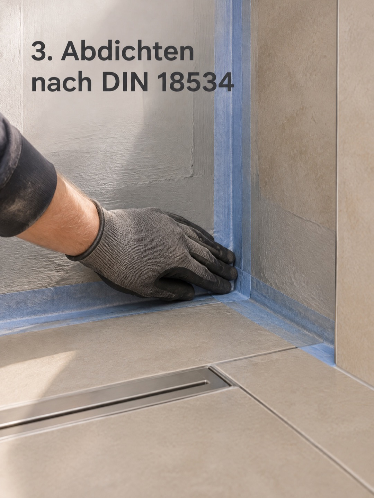

<a id="tz-025"></a>
## TZ-025 · Schritt 4: Verlegen und verfugen

Karussell · 3:4 · Karussell K1 „Von der Wanne zur Dusche“, Slide 5 von 7 · Dokument Nr. K1-5

Vorher die Cover-Slide dieser Serie hochladen (Stilreferenz).

```text
Use the uploaded image as the exact style reference: same background, colours, typography and layout. Create the next slide of this carousel. Brand style for an owner-run tiling company in Germany known for precise large-format tiles, walk-in showers without a step, balconies and stairs. Look: calm architectural interior photography; razor-straight joints; perfectly level surfaces; soft natural side light that reveals texture; realistic materials (porcelain stoneware, mosaic, natural stone); no clutter, no tools lying around. Palette: light zinc grey (#F4F4F5), anthracite text (#27272A), warm stone and greige tones, one accent colour red (#D82020) used sparingly. Typography: clean modern sans-serif headline, left-aligned, generous whitespace, at most two text sizes. People: only hands or figures from behind, never a recognisable face. Layout: vertical 3:4 portrait format (1080x1440 proportions); keep all text and key objects inside an 8% safe margin; keep the bottom-right corner (14% of the width) empty for a logo added later. Do not draw any logo, company name, brand name or watermark. Text rules: render ONLY the German text given in quotes, exactly once, verbatim, with correct umlauts (ä, ö, ü, ß); no other words or numbers. Gloved hands placing a large tile with a vacuum lifter. Headline: "4. Verlegen, verfugen, übergeben"
```

**Text im Bild:** „4. Verlegen, verfugen, übergeben“  
**Caption:** So läuft der Umbau bei uns ab, Schritt für Schritt. Symbolbilder, echte Fotos unserer Arbeit finden Sie auf tezgel.de.  
**Hashtags:** #badsanierung #duscheohnestufe #bodengleichedusche #walkindusche #badezimmer #aßlar #wetzlar #lahndill #mittelhessen #gießen  
**Hinweise:** Karussell K1 „Von der Wanne zur Dusche“, Slide 5 von 7; Caption und Hashtags gelten einmal für den ganzen Karussell-Post. „Symbolbilder“ in der Caption stehen lassen; wo es echte Fotos gibt, diese statt der Symbolbilder nehmen. Für einheitlichen Look das fertige Cover hochladen und „Use the uploaded image as the exact style reference: same background, typography and layout.“ voranstellen (siehe E6). Posting-Plan: Woche 2 (Mo 9.11.2026), gegen 18 Uhr.  
**Bilder:** [original](bilder/original/TZ-025.jpg) · [instagram-3x4](bilder/instagram-3x4/TZ-025.jpg) · [facebook-linkedin-4x5](bilder/facebook-linkedin-4x5/TZ-025.jpg)

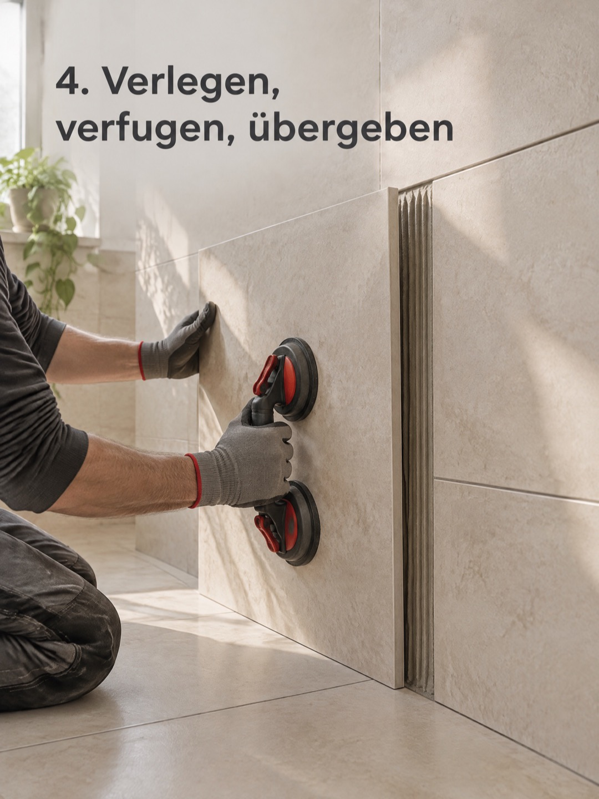

<a id="tz-026"></a>
## TZ-026 · Fertig: Dusche ohne Stufe

Karussell · 3:4 · Karussell K1 „Von der Wanne zur Dusche“, Slide 6 von 7 · Dokument Nr. K1-6

Vorher die Cover-Slide dieser Serie hochladen (Stilreferenz).

```text
Use the uploaded image as the exact style reference: same background, colours, typography and layout. Create the next slide of this carousel. Brand style for an owner-run tiling company in Germany known for precise large-format tiles, walk-in showers without a step, balconies and stairs. Look: calm architectural interior photography; razor-straight joints; perfectly level surfaces; soft natural side light that reveals texture; realistic materials (porcelain stoneware, mosaic, natural stone); no clutter, no tools lying around. Palette: light zinc grey (#F4F4F5), anthracite text (#27272A), warm stone and greige tones, one accent colour red (#D82020) used sparingly. Typography: clean modern sans-serif headline, left-aligned, generous whitespace, at most two text sizes. People: only hands or figures from behind, never a recognisable face. Layout: vertical 3:4 portrait format (1080x1440 proportions); keep all text and key objects inside an 8% safe margin; keep the bottom-right corner (14% of the width) empty for a logo added later. Do not draw any logo, company name, brand name or watermark. Text rules: render ONLY the German text given in quotes, exactly once, verbatim, with correct umlauts (ä, ö, ü, ß); no other words or numbers. A finished walk-in shower with large grey tiles, the rain shower running and water flowing across the level floor into a linear drain, light steam, soft warm light. Headline: "Fertig: Dusche ohne Stufe"
```

**Text im Bild:** „Fertig: Dusche ohne Stufe“  
**Caption:** So läuft der Umbau bei uns ab, Schritt für Schritt. Symbolbilder, echte Fotos unserer Arbeit finden Sie auf tezgel.de.  
**Hashtags:** #badsanierung #duscheohnestufe #bodengleichedusche #walkindusche #badezimmer #aßlar #wetzlar #lahndill #mittelhessen #gießen  
**Hinweise:** Karussell K1 „Von der Wanne zur Dusche“, Slide 6 von 7; Caption und Hashtags gelten einmal für den ganzen Karussell-Post. „Symbolbilder“ in der Caption stehen lassen; wo es echte Fotos gibt, diese statt der Symbolbilder nehmen. Für einheitlichen Look das fertige Cover hochladen und „Use the uploaded image as the exact style reference: same background, typography and layout.“ voranstellen (siehe E6). Szene gegenüber der Vorlage variiert, damit sie sich von Prompt 2 unterscheidet. Posting-Plan: Woche 2 (Mo 9.11.2026), gegen 18 Uhr.  
**Bilder:** [original](bilder/original/TZ-026.jpg) · [instagram-3x4](bilder/instagram-3x4/TZ-026.jpg) · [facebook-linkedin-4x5](bilder/facebook-linkedin-4x5/TZ-026.jpg)

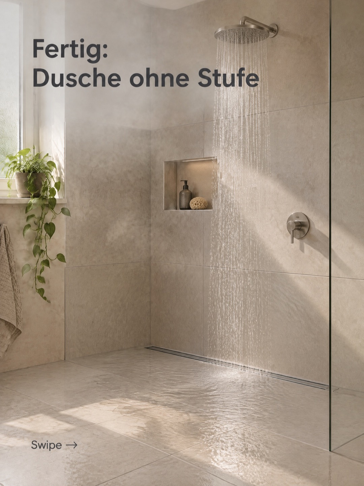

<a id="tz-027"></a>
## TZ-027 · Abschluss: Termin anfragen

Karussell · 3:4 · Karussell K1 „Von der Wanne zur Dusche“, Slide 7 von 7 · Dokument Nr. K1-7

Vorher die Cover-Slide dieser Serie hochladen (Stilreferenz).

```text
Use the uploaded image as the exact style reference: same background, colours, typography and layout. Create the next slide of this carousel. Brand style for an owner-run tiling company in Germany known for precise large-format tiles, walk-in showers without a step, balconies and stairs. Look: calm architectural interior photography; razor-straight joints; perfectly level surfaces; soft natural side light that reveals texture; realistic materials (porcelain stoneware, mosaic, natural stone); no clutter, no tools lying around. Palette: light zinc grey (#F4F4F5), anthracite text (#27272A), warm stone and greige tones, one accent colour red (#D82020) used sparingly. Typography: clean modern sans-serif headline, left-aligned, generous whitespace, at most two text sizes. People: only hands or figures from behind, never a recognisable face. Layout: vertical 3:4 portrait format (1080x1440 proportions); keep all text and key objects inside an 8% safe margin; keep the bottom-right corner (14% of the width) empty for a logo added later. Do not draw any logo, company name, brand name or watermark. Text rules: render ONLY the German text given in quotes, exactly once, verbatim, with correct umlauts (ä, ö, ü, ß); no other words or numbers. Plain light zinc background with one accent line. Headline: "Termin anfragen: Link in Bio"
```

**Text im Bild:** „Termin anfragen: Link in Bio“  
**Caption:** So läuft der Umbau bei uns ab, Schritt für Schritt. Symbolbilder, echte Fotos unserer Arbeit finden Sie auf tezgel.de.  
**Hashtags:** #badsanierung #duscheohnestufe #bodengleichedusche #walkindusche #badezimmer #aßlar #wetzlar #lahndill #mittelhessen #gießen  
**Hinweise:** Karussell K1 „Von der Wanne zur Dusche“, Slide 7 von 7; Caption und Hashtags gelten einmal für den ganzen Karussell-Post. „Symbolbilder“ in der Caption stehen lassen; wo es echte Fotos gibt, diese statt der Symbolbilder nehmen. Für einheitlichen Look das fertige Cover hochladen und „Use the uploaded image as the exact style reference: same background, typography and layout.“ voranstellen (siehe E6). Posting-Plan: Woche 2 (Mo 9.11.2026), gegen 18 Uhr.  
**Bilder:** [original](bilder/original/TZ-027.jpg) · [instagram-3x4](bilder/instagram-3x4/TZ-027.jpg) · [facebook-linkedin-4x5](bilder/facebook-linkedin-4x5/TZ-027.jpg)

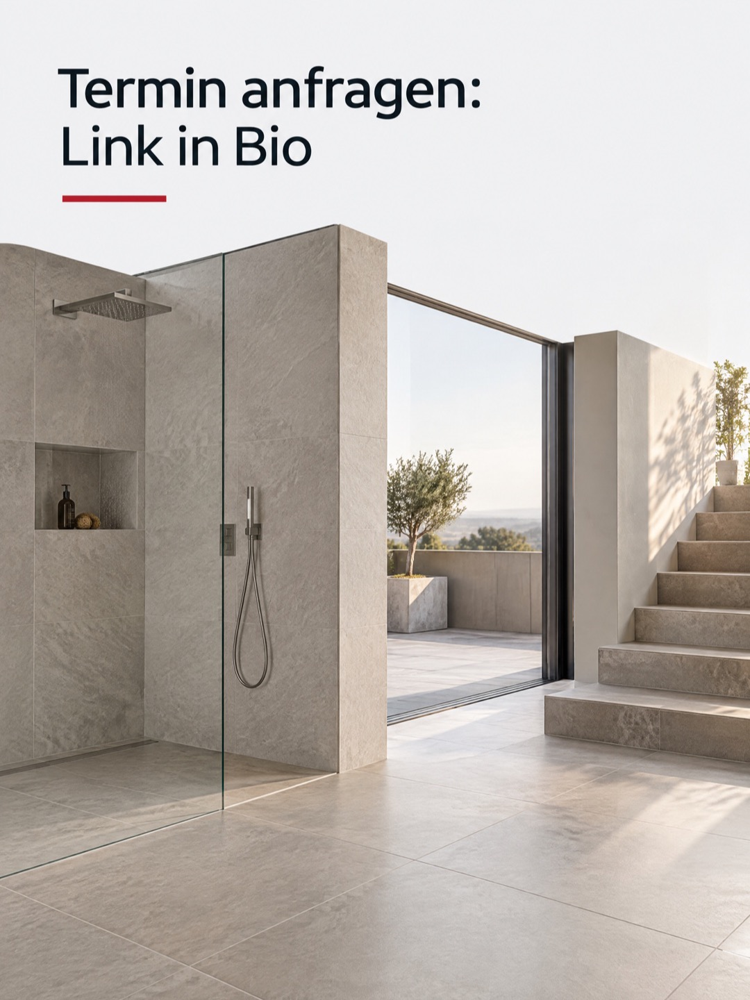

<a id="tz-028"></a>
## TZ-028 · Cover: 5 Fragen vor dem Fliesenkauf

Karussell · 3:4 · Karussell K2 „5 Fragen vor dem Fliesenkauf“, Slide 1 von 7 · Dokument Nr. K2-1

```text
Brand style for an owner-run tiling company in Germany known for precise large-format tiles, walk-in showers without a step, balconies and stairs. Look: calm architectural interior photography; razor-straight joints; perfectly level surfaces; soft natural side light that reveals texture; realistic materials (porcelain stoneware, mosaic, natural stone); no clutter, no tools lying around. Palette: light zinc grey (#F4F4F5), anthracite text (#27272A), warm stone and greige tones, one accent colour red (#D82020) used sparingly. Typography: clean modern sans-serif headline, left-aligned, generous whitespace, at most two text sizes. People: only hands or figures from behind, never a recognisable face. Layout: vertical 3:4 portrait format (1080x1440 proportions); keep all text and key objects inside an 8% safe margin; keep the bottom-right corner (14% of the width) empty for a logo added later. Do not draw any logo, company name, brand name or watermark. Text rules: render ONLY the German text given in quotes, exactly once, verbatim, with correct umlauts (ä, ö, ü, ß); no other words or numbers. Five tile samples in different sizes, colours and surfaces lined up in a neat row on a light table, low angle, soft side light. Headline: "5 Fragen vor dem Fliesenkauf". Small label (bottom-left, small): "Swipe →".
```

**Text im Bild:** „5 Fragen vor dem Fliesenkauf“  
**Label:** „Swipe →“ (bottom-left, small)  
**Caption:** Je nach Raum verlegen wir rutschhemmende Fliesen mit R10 oder R11. Format, Fugenfarbe und Untergrund klären wir beim kostenfreien Termin vor Ort. Symbolbilder.  
**Hashtags:** #fliesenleger #fliesen #fliesenverlegung #großformatfliesen #feinsteinzeug #herborn #solms #braunfels #dillenburg #limburg  
**Hinweise:** ⚠️ Fakten prüfen. Karussell K2 „5 Fragen vor dem Fliesenkauf“, Slide 1 von 7; Caption und Hashtags gelten einmal für den ganzen Karussell-Post. Vor dem Posten prüfen (Stand 29.10.2026): Die Caption nennt R10 bzw. R11 (R-Klassen gelten für Bereiche mit Schuhen; für Barfußbereiche wie Duschen gibt es die Klassen A, B und C). „Symbolbilder“ in der Caption stehen lassen (gegenüber der Vorlage ergänzt). Szene gegenüber der Vorlage variiert, damit sie sich von Prompt 19 unterscheidet. Posting-Plan: Woche 3 (Mi 18.11.2026), gegen 18 Uhr.  
**Bilder:** [original](bilder/original/TZ-028.jpg) · [instagram-3x4](bilder/instagram-3x4/TZ-028.jpg) · [facebook-linkedin-4x5](bilder/facebook-linkedin-4x5/TZ-028.jpg)

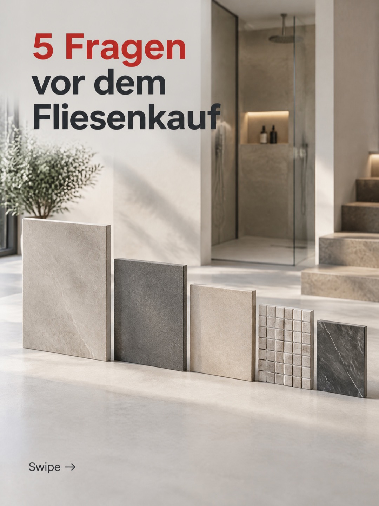

<a id="tz-029"></a>
## TZ-029 · Frage 1: Rutschfestigkeit

Karussell · 3:4 · Karussell K2 „5 Fragen vor dem Fliesenkauf“, Slide 2 von 7 · Dokument Nr. K2-2

Vorher die Cover-Slide dieser Serie hochladen (Stilreferenz).

```text
Use the uploaded image as the exact style reference: same background, colours, typography and layout. Create the next slide of this carousel. Brand style for an owner-run tiling company in Germany known for precise large-format tiles, walk-in showers without a step, balconies and stairs. Look: calm architectural interior photography; razor-straight joints; perfectly level surfaces; soft natural side light that reveals texture; realistic materials (porcelain stoneware, mosaic, natural stone); no clutter, no tools lying around. Palette: light zinc grey (#F4F4F5), anthracite text (#27272A), warm stone and greige tones, one accent colour red (#D82020) used sparingly. Typography: clean modern sans-serif headline, left-aligned, generous whitespace, at most two text sizes. People: only hands or figures from behind, never a recognisable face. Layout: vertical 3:4 portrait format (1080x1440 proportions); keep all text and key objects inside an 8% safe margin; keep the bottom-right corner (14% of the width) empty for a logo added later. Do not draw any logo, company name, brand name or watermark. Text rules: render ONLY the German text given in quotes, exactly once, verbatim, with correct umlauts (ä, ö, ü, ß); no other words or numbers. A wet tile with a shoe sole about to step on it. Headline: "1. Wie rutschfest muss sie sein?"
```

**Text im Bild:** „1. Wie rutschfest muss sie sein?“  
**Caption:** Je nach Raum verlegen wir rutschhemmende Fliesen mit R10 oder R11. Format, Fugenfarbe und Untergrund klären wir beim kostenfreien Termin vor Ort. Symbolbilder.  
**Hashtags:** #fliesenleger #fliesen #fliesenverlegung #großformatfliesen #feinsteinzeug #herborn #solms #braunfels #dillenburg #limburg  
**Hinweise:** ⚠️ Fakten prüfen. Karussell K2 „5 Fragen vor dem Fliesenkauf“, Slide 2 von 7; Caption und Hashtags gelten einmal für den ganzen Karussell-Post. Vor dem Posten prüfen (Stand 29.10.2026): Die Caption nennt R10 bzw. R11 (R-Klassen gelten für Bereiche mit Schuhen; für Barfußbereiche wie Duschen gibt es die Klassen A, B und C). Für einheitlichen Look das fertige Cover hochladen und „Use the uploaded image as the exact style reference: same background, typography and layout.“ voranstellen (siehe E6). „Symbolbilder“ in der Caption stehen lassen (gegenüber der Vorlage ergänzt). Posting-Plan: Woche 3 (Mi 18.11.2026), gegen 18 Uhr.  
**Bilder:** [original](bilder/original/TZ-029.jpg) · [instagram-3x4](bilder/instagram-3x4/TZ-029.jpg) · [facebook-linkedin-4x5](bilder/facebook-linkedin-4x5/TZ-029.jpg)

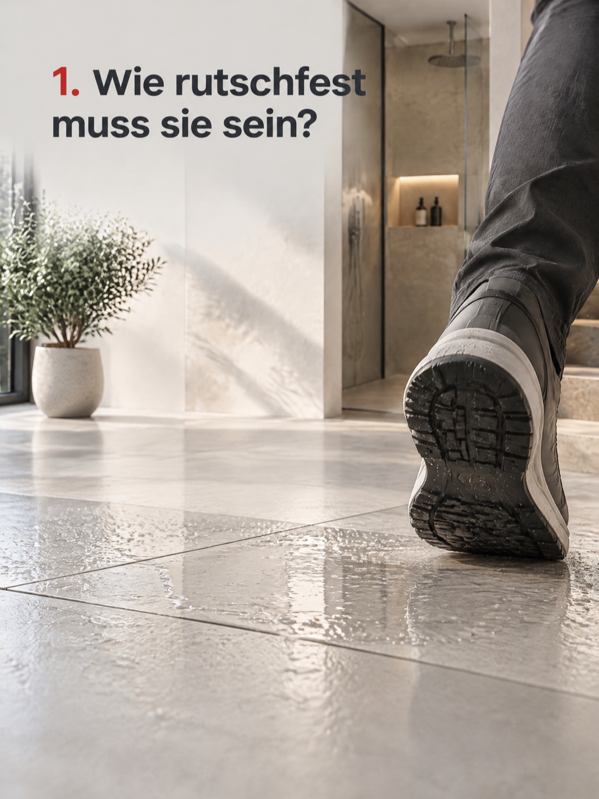

<a id="tz-030"></a>
## TZ-030 · Frage 2: Format

Karussell · 3:4 · Karussell K2 „5 Fragen vor dem Fliesenkauf“, Slide 3 von 7 · Dokument Nr. K2-3

Vorher die Cover-Slide dieser Serie hochladen (Stilreferenz).

```text
Use the uploaded image as the exact style reference: same background, colours, typography and layout. Create the next slide of this carousel. Brand style for an owner-run tiling company in Germany known for precise large-format tiles, walk-in showers without a step, balconies and stairs. Look: calm architectural interior photography; razor-straight joints; perfectly level surfaces; soft natural side light that reveals texture; realistic materials (porcelain stoneware, mosaic, natural stone); no clutter, no tools lying around. Palette: light zinc grey (#F4F4F5), anthracite text (#27272A), warm stone and greige tones, one accent colour red (#D82020) used sparingly. Typography: clean modern sans-serif headline, left-aligned, generous whitespace, at most two text sizes. People: only hands or figures from behind, never a recognisable face. Layout: vertical 3:4 portrait format (1080x1440 proportions); keep all text and key objects inside an 8% safe margin; keep the bottom-right corner (14% of the width) empty for a logo added later. Do not draw any logo, company name, brand name or watermark. Text rules: render ONLY the German text given in quotes, exactly once, verbatim, with correct umlauts (ä, ö, ü, ß); no other words or numbers. Small and very large tiles side by side. Headline: "2. Welches Format passt zum Raum?"
```

**Text im Bild:** „2. Welches Format passt zum Raum?“  
**Caption:** Je nach Raum verlegen wir rutschhemmende Fliesen mit R10 oder R11. Format, Fugenfarbe und Untergrund klären wir beim kostenfreien Termin vor Ort. Symbolbilder.  
**Hashtags:** #fliesenleger #fliesen #fliesenverlegung #großformatfliesen #feinsteinzeug #herborn #solms #braunfels #dillenburg #limburg  
**Hinweise:** ⚠️ Fakten prüfen. Karussell K2 „5 Fragen vor dem Fliesenkauf“, Slide 3 von 7; Caption und Hashtags gelten einmal für den ganzen Karussell-Post. Vor dem Posten prüfen (Stand 29.10.2026): Die Caption nennt R10 bzw. R11 (R-Klassen gelten für Bereiche mit Schuhen; für Barfußbereiche wie Duschen gibt es die Klassen A, B und C). Für einheitlichen Look das fertige Cover hochladen und „Use the uploaded image as the exact style reference: same background, typography and layout.“ voranstellen (siehe E6). „Symbolbilder“ in der Caption stehen lassen (gegenüber der Vorlage ergänzt). Posting-Plan: Woche 3 (Mi 18.11.2026), gegen 18 Uhr.  
**Bilder:** [original](bilder/original/TZ-030.jpg) · [instagram-3x4](bilder/instagram-3x4/TZ-030.jpg) · [facebook-linkedin-4x5](bilder/facebook-linkedin-4x5/TZ-030.jpg)

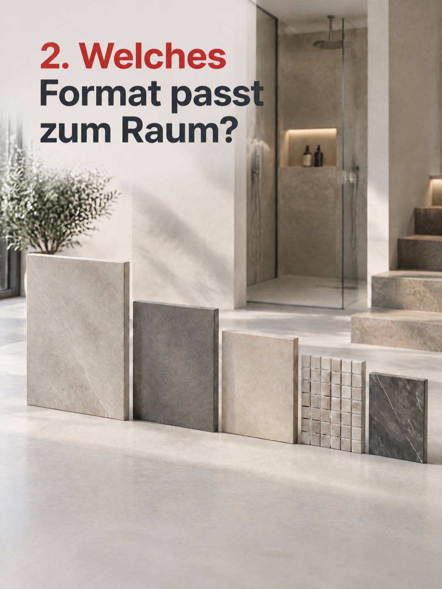

<a id="tz-031"></a>
## TZ-031 · Frage 3: Fugenfarbe

Karussell · 3:4 · Karussell K2 „5 Fragen vor dem Fliesenkauf“, Slide 4 von 7 · Dokument Nr. K2-4

Vorher die Cover-Slide dieser Serie hochladen (Stilreferenz).

```text
Use the uploaded image as the exact style reference: same background, colours, typography and layout. Create the next slide of this carousel. Brand style for an owner-run tiling company in Germany known for precise large-format tiles, walk-in showers without a step, balconies and stairs. Look: calm architectural interior photography; razor-straight joints; perfectly level surfaces; soft natural side light that reveals texture; realistic materials (porcelain stoneware, mosaic, natural stone); no clutter, no tools lying around. Palette: light zinc grey (#F4F4F5), anthracite text (#27272A), warm stone and greige tones, one accent colour red (#D82020) used sparingly. Typography: clean modern sans-serif headline, left-aligned, generous whitespace, at most two text sizes. People: only hands or figures from behind, never a recognisable face. Layout: vertical 3:4 portrait format (1080x1440 proportions); keep all text and key objects inside an 8% safe margin; keep the bottom-right corner (14% of the width) empty for a logo added later. Do not draw any logo, company name, brand name or watermark. Text rules: render ONLY the German text given in quotes, exactly once, verbatim, with correct umlauts (ä, ö, ü, ß); no other words or numbers. Grout colour swatches next to a tile. Headline: "3. Welche Fugenfarbe?"
```

**Text im Bild:** „3. Welche Fugenfarbe?“  
**Caption:** Je nach Raum verlegen wir rutschhemmende Fliesen mit R10 oder R11. Format, Fugenfarbe und Untergrund klären wir beim kostenfreien Termin vor Ort. Symbolbilder.  
**Hashtags:** #fliesenleger #fliesen #fliesenverlegung #großformatfliesen #feinsteinzeug #herborn #solms #braunfels #dillenburg #limburg  
**Hinweise:** ⚠️ Fakten prüfen. Karussell K2 „5 Fragen vor dem Fliesenkauf“, Slide 4 von 7; Caption und Hashtags gelten einmal für den ganzen Karussell-Post. Vor dem Posten prüfen (Stand 29.10.2026): Die Caption nennt R10 bzw. R11 (R-Klassen gelten für Bereiche mit Schuhen; für Barfußbereiche wie Duschen gibt es die Klassen A, B und C). Für einheitlichen Look das fertige Cover hochladen und „Use the uploaded image as the exact style reference: same background, typography and layout.“ voranstellen (siehe E6). „Symbolbilder“ in der Caption stehen lassen (gegenüber der Vorlage ergänzt). Posting-Plan: Woche 3 (Mi 18.11.2026), gegen 18 Uhr.  
**Bilder:** [original](bilder/original/TZ-031.jpg) · [instagram-3x4](bilder/instagram-3x4/TZ-031.jpg) · [facebook-linkedin-4x5](bilder/facebook-linkedin-4x5/TZ-031.jpg)

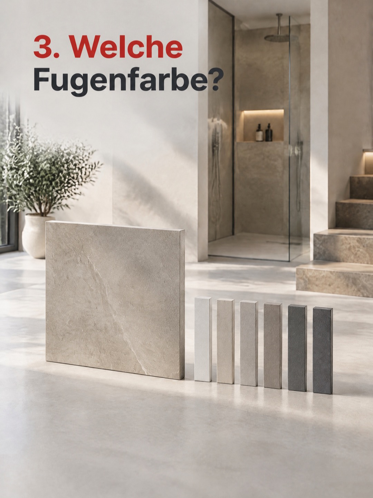

<a id="tz-032"></a>
## TZ-032 · Frage 4: Fußbodenheizung

Karussell · 3:4 · Karussell K2 „5 Fragen vor dem Fliesenkauf“, Slide 5 von 7 · Dokument Nr. K2-5

Vorher die Cover-Slide dieser Serie hochladen (Stilreferenz).

```text
Use the uploaded image as the exact style reference: same background, colours, typography and layout. Create the next slide of this carousel. Brand style for an owner-run tiling company in Germany known for precise large-format tiles, walk-in showers without a step, balconies and stairs. Look: calm architectural interior photography; razor-straight joints; perfectly level surfaces; soft natural side light that reveals texture; realistic materials (porcelain stoneware, mosaic, natural stone); no clutter, no tools lying around. Palette: light zinc grey (#F4F4F5), anthracite text (#27272A), warm stone and greige tones, one accent colour red (#D82020) used sparingly. Typography: clean modern sans-serif headline, left-aligned, generous whitespace, at most two text sizes. People: only hands or figures from behind, never a recognisable face. Layout: vertical 3:4 portrait format (1080x1440 proportions); keep all text and key objects inside an 8% safe margin; keep the bottom-right corner (14% of the width) empty for a logo added later. Do not draw any logo, company name, brand name or watermark. Text rules: render ONLY the German text given in quotes, exactly once, verbatim, with correct umlauts (ä, ö, ü, ß); no other words or numbers. Cutaway of underfloor heating pipes under a tiled floor. Headline: "4. Passt sie zur Fußbodenheizung?"
```

**Text im Bild:** „4. Passt sie zur Fußbodenheizung?“  
**Caption:** Je nach Raum verlegen wir rutschhemmende Fliesen mit R10 oder R11. Format, Fugenfarbe und Untergrund klären wir beim kostenfreien Termin vor Ort. Symbolbilder.  
**Hashtags:** #fliesenleger #fliesen #fliesenverlegung #großformatfliesen #feinsteinzeug #herborn #solms #braunfels #dillenburg #limburg  
**Hinweise:** ⚠️ Fakten prüfen. Karussell K2 „5 Fragen vor dem Fliesenkauf“, Slide 5 von 7; Caption und Hashtags gelten einmal für den ganzen Karussell-Post. Vor dem Posten prüfen (Stand 29.10.2026): Die Caption nennt R10 bzw. R11 (R-Klassen gelten für Bereiche mit Schuhen; für Barfußbereiche wie Duschen gibt es die Klassen A, B und C). Für einheitlichen Look das fertige Cover hochladen und „Use the uploaded image as the exact style reference: same background, typography and layout.“ voranstellen (siehe E6). „Symbolbilder“ in der Caption stehen lassen (gegenüber der Vorlage ergänzt). Posting-Plan: Woche 3 (Mi 18.11.2026), gegen 18 Uhr.  
**Bilder:** [original](bilder/original/TZ-032.jpg) · [instagram-3x4](bilder/instagram-3x4/TZ-032.jpg) · [facebook-linkedin-4x5](bilder/facebook-linkedin-4x5/TZ-032.jpg)

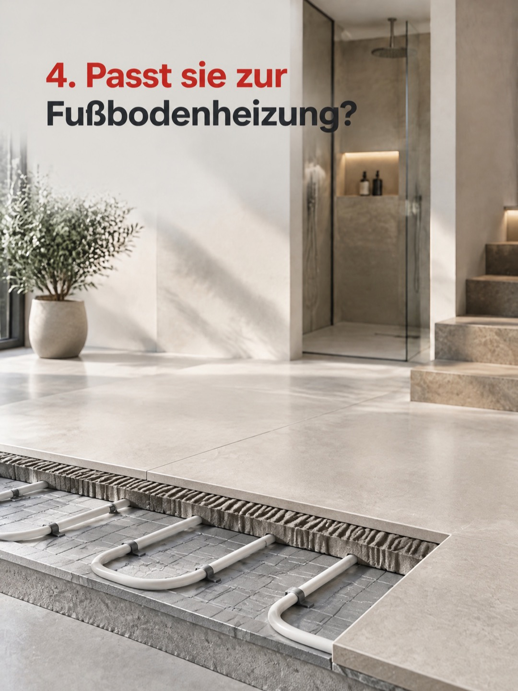

<a id="tz-033"></a>
## TZ-033 · Frage 5: Untergrund

Karussell · 3:4 · Karussell K2 „5 Fragen vor dem Fliesenkauf“, Slide 6 von 7 · Dokument Nr. K2-6

Vorher die Cover-Slide dieser Serie hochladen (Stilreferenz).

```text
Use the uploaded image as the exact style reference: same background, colours, typography and layout. Create the next slide of this carousel. Brand style for an owner-run tiling company in Germany known for precise large-format tiles, walk-in showers without a step, balconies and stairs. Look: calm architectural interior photography; razor-straight joints; perfectly level surfaces; soft natural side light that reveals texture; realistic materials (porcelain stoneware, mosaic, natural stone); no clutter, no tools lying around. Palette: light zinc grey (#F4F4F5), anthracite text (#27272A), warm stone and greige tones, one accent colour red (#D82020) used sparingly. Typography: clean modern sans-serif headline, left-aligned, generous whitespace, at most two text sizes. People: only hands or figures from behind, never a recognisable face. Layout: vertical 3:4 portrait format (1080x1440 proportions); keep all text and key objects inside an 8% safe margin; keep the bottom-right corner (14% of the width) empty for a logo added later. Do not draw any logo, company name, brand name or watermark. Text rules: render ONLY the German text given in quotes, exactly once, verbatim, with correct umlauts (ä, ö, ü, ß); no other words or numbers. A hand testing a screed floor with a moisture meter, its display turned away from the camera. Headline: "5. Ist der Untergrund bereit?"
```

**Text im Bild:** „5. Ist der Untergrund bereit?“  
**Caption:** Je nach Raum verlegen wir rutschhemmende Fliesen mit R10 oder R11. Format, Fugenfarbe und Untergrund klären wir beim kostenfreien Termin vor Ort. Symbolbilder.  
**Hashtags:** #fliesenleger #fliesen #fliesenverlegung #großformatfliesen #feinsteinzeug #herborn #solms #braunfels #dillenburg #limburg  
**Hinweise:** ⚠️ Fakten prüfen. Karussell K2 „5 Fragen vor dem Fliesenkauf“, Slide 6 von 7; Caption und Hashtags gelten einmal für den ganzen Karussell-Post. Vor dem Posten prüfen (Stand 29.10.2026): Die Caption nennt R10 bzw. R11 (R-Klassen gelten für Bereiche mit Schuhen; für Barfußbereiche wie Duschen gibt es die Klassen A, B und C). Für einheitlichen Look das fertige Cover hochladen und „Use the uploaded image as the exact style reference: same background, typography and layout.“ voranstellen (siehe E6). „Symbolbilder“ in der Caption stehen lassen (gegenüber der Vorlage ergänzt). Display vom Betrachter abgewandt, damit keine Ziffern im Bild entstehen. Posting-Plan: Woche 3 (Mi 18.11.2026), gegen 18 Uhr.  
**Bilder:** [original](bilder/original/TZ-033.jpg) · [instagram-3x4](bilder/instagram-3x4/TZ-033.jpg) · [facebook-linkedin-4x5](bilder/facebook-linkedin-4x5/TZ-033.jpg)

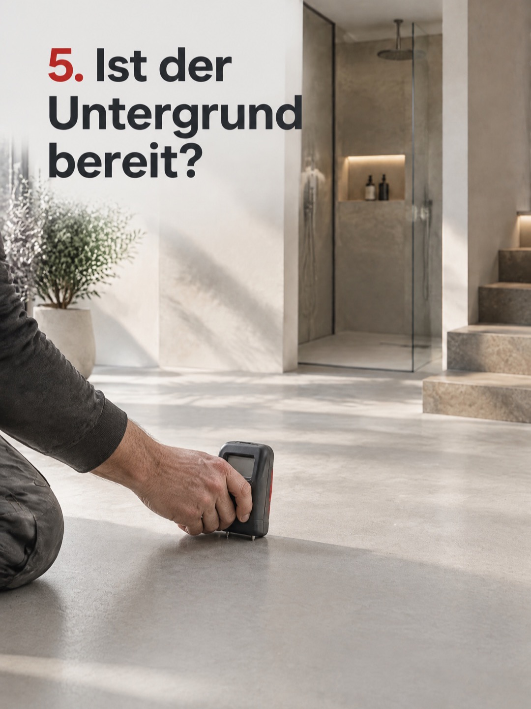

<a id="tz-034"></a>
## TZ-034 · Abschluss: Beratung

Karussell · 3:4 · Karussell K2 „5 Fragen vor dem Fliesenkauf“, Slide 7 von 7 · Dokument Nr. K2-7

Vorher die Cover-Slide dieser Serie hochladen (Stilreferenz).

```text
Use the uploaded image as the exact style reference: same background, colours, typography and layout. Create the next slide of this carousel. Brand style for an owner-run tiling company in Germany known for precise large-format tiles, walk-in showers without a step, balconies and stairs. Look: calm architectural interior photography; razor-straight joints; perfectly level surfaces; soft natural side light that reveals texture; realistic materials (porcelain stoneware, mosaic, natural stone); no clutter, no tools lying around. Palette: light zinc grey (#F4F4F5), anthracite text (#27272A), warm stone and greige tones, one accent colour red (#D82020) used sparingly. Typography: clean modern sans-serif headline, left-aligned, generous whitespace, at most two text sizes. People: only hands or figures from behind, never a recognisable face. Layout: vertical 3:4 portrait format (1080x1440 proportions); keep all text and key objects inside an 8% safe margin; keep the bottom-right corner (14% of the width) empty for a logo added later. Do not draw any logo, company name, brand name or watermark. Text rules: render ONLY the German text given in quotes, exactly once, verbatim, with correct umlauts (ä, ö, ü, ß); no other words or numbers. A small stack of three tile samples at the left edge of an otherwise empty light zinc-grey background. Headline: "Beratung in Wetzlar und Gießen"
```

**Text im Bild:** „Beratung in Wetzlar und Gießen“  
**Caption:** Je nach Raum verlegen wir rutschhemmende Fliesen mit R10 oder R11. Format, Fugenfarbe und Untergrund klären wir beim kostenfreien Termin vor Ort. Symbolbilder.  
**Hashtags:** #fliesenleger #fliesen #fliesenverlegung #großformatfliesen #feinsteinzeug #herborn #solms #braunfels #dillenburg #limburg  
**Hinweise:** ⚠️ Fakten prüfen. Karussell K2 „5 Fragen vor dem Fliesenkauf“, Slide 7 von 7; Caption und Hashtags gelten einmal für den ganzen Karussell-Post. Vor dem Posten prüfen (Stand 29.10.2026): Die Caption nennt R10 bzw. R11 (R-Klassen gelten für Bereiche mit Schuhen; für Barfußbereiche wie Duschen gibt es die Klassen A, B und C). Für einheitlichen Look das fertige Cover hochladen und „Use the uploaded image as the exact style reference: same background, typography and layout.“ voranstellen (siehe E6). „Symbolbilder“ in der Caption stehen lassen (gegenüber der Vorlage ergänzt). Szene gegenüber der Vorlage ergänzt, damit sie sich von K1-7 unterscheidet. Posting-Plan: Woche 3 (Mi 18.11.2026), gegen 18 Uhr.  
**Bilder:** [original](bilder/original/TZ-034.jpg) · [instagram-3x4](bilder/instagram-3x4/TZ-034.jpg) · [facebook-linkedin-4x5](bilder/facebook-linkedin-4x5/TZ-034.jpg)

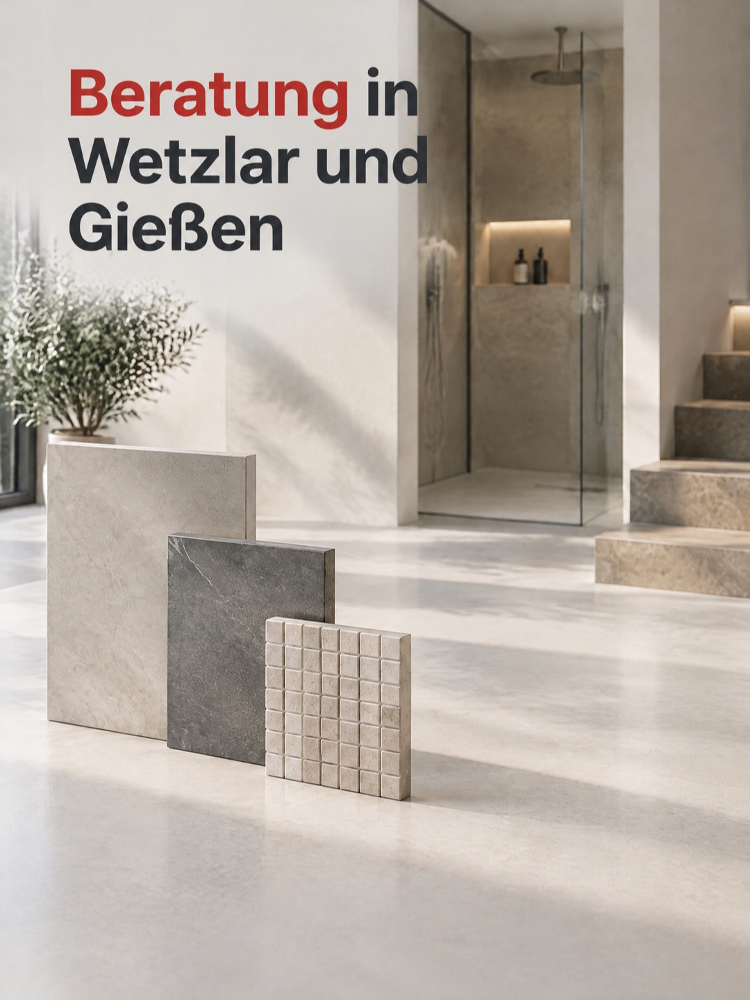

<a id="tz-035"></a>
## TZ-035 · Cover: 4 Warnzeichen am Balkon

Karussell · 3:4 · Karussell K3 „Balkon: 4 Warnzeichen“, Slide 1 von 6 · Dokument Nr. K3-1

```text
Brand style for an owner-run tiling company in Germany known for precise large-format tiles, walk-in showers without a step, balconies and stairs. Look: calm architectural interior photography; razor-straight joints; perfectly level surfaces; soft natural side light that reveals texture; realistic materials (porcelain stoneware, mosaic, natural stone); no clutter, no tools lying around. Palette: light zinc grey (#F4F4F5), anthracite text (#27272A), warm stone and greige tones, one accent colour red (#D82020) used sparingly. Typography: clean modern sans-serif headline, left-aligned, generous whitespace, at most two text sizes. People: only hands or figures from behind, never a recognisable face. Layout: vertical 3:4 portrait format (1080x1440 proportions); keep all text and key objects inside an 8% safe margin; keep the bottom-right corner (14% of the width) empty for a logo added later. Do not draw any logo, company name, brand name or watermark. Text rules: render ONLY the German text given in quotes, exactly once, verbatim, with correct umlauts (ä, ö, ü, ß); no other words or numbers. A balcony after rain under a grey sky. Headline: "4 Zeichen: Ihr Balkon braucht Hilfe". Small label (bottom-left, small): "Swipe →".
```

**Text im Bild:** „4 Zeichen: Ihr Balkon braucht Hilfe“  
**Label:** „Swipe →“ (bottom-left, small)  
**Caption:** Diese Zeichen können darauf hinweisen, dass Wasser eindringt. Lassen Sie es frühzeitig prüfen, der Termin vor Ort ist kostenfrei. Symbolbilder.  
**Hashtags:** #balkonsanierung #terrasse #terrassenplatten #außentreppe #stelzlager #aßlar #wetzlar #lahndill #mittelhessen #gießen  
**Hinweise:** Karussell K3 „Balkon: 4 Warnzeichen“, Slide 1 von 6; Caption und Hashtags gelten einmal für den ganzen Karussell-Post. „Symbolbilder“ in der Caption stehen lassen; wo es echte Fotos gibt, diese statt der Symbolbilder nehmen. Balkonthema: im Januar für die Frühjahrsplanung posten. Posting-Plan: Woche 10 (Mo 4.1.2027), gegen 18 Uhr.  
**Bilder:** [original](bilder/original/TZ-035.jpg) · [instagram-3x4](bilder/instagram-3x4/TZ-035.jpg) · [facebook-linkedin-4x5](bilder/facebook-linkedin-4x5/TZ-035.jpg)

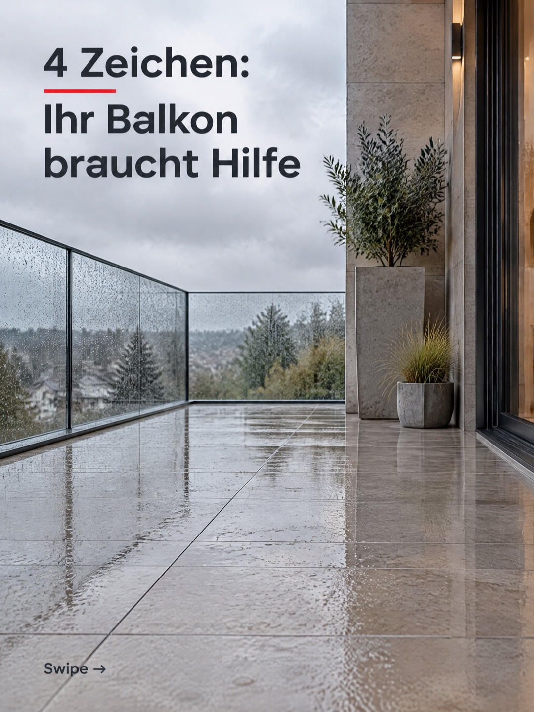

<a id="tz-036"></a>
## TZ-036 · Zeichen 1: Wasser bleibt stehen

Karussell · 3:4 · Karussell K3 „Balkon: 4 Warnzeichen“, Slide 2 von 6 · Dokument Nr. K3-2

Vorher die Cover-Slide dieser Serie hochladen (Stilreferenz).

```text
Use the uploaded image as the exact style reference: same background, colours, typography and layout. Create the next slide of this carousel. Brand style for an owner-run tiling company in Germany known for precise large-format tiles, walk-in showers without a step, balconies and stairs. Look: calm architectural interior photography; razor-straight joints; perfectly level surfaces; soft natural side light that reveals texture; realistic materials (porcelain stoneware, mosaic, natural stone); no clutter, no tools lying around. Palette: light zinc grey (#F4F4F5), anthracite text (#27272A), warm stone and greige tones, one accent colour red (#D82020) used sparingly. Typography: clean modern sans-serif headline, left-aligned, generous whitespace, at most two text sizes. People: only hands or figures from behind, never a recognisable face. Layout: vertical 3:4 portrait format (1080x1440 proportions); keep all text and key objects inside an 8% safe margin; keep the bottom-right corner (14% of the width) empty for a logo added later. Do not draw any logo, company name, brand name or watermark. Text rules: render ONLY the German text given in quotes, exactly once, verbatim, with correct umlauts (ä, ö, ü, ß); no other words or numbers. Low side view across balcony tiles where a wide, shallow puddle stands along the wall while the rest of the floor is dry, overcast light. Headline: "1. Wasser bleibt stehen"
```

**Text im Bild:** „1. Wasser bleibt stehen“  
**Caption:** Diese Zeichen können darauf hinweisen, dass Wasser eindringt. Lassen Sie es frühzeitig prüfen, der Termin vor Ort ist kostenfrei. Symbolbilder.  
**Hashtags:** #balkonsanierung #terrasse #terrassenplatten #außentreppe #stelzlager #aßlar #wetzlar #lahndill #mittelhessen #gießen  
**Hinweise:** Karussell K3 „Balkon: 4 Warnzeichen“, Slide 2 von 6; Caption und Hashtags gelten einmal für den ganzen Karussell-Post. „Symbolbilder“ in der Caption stehen lassen; wo es echte Fotos gibt, diese statt der Symbolbilder nehmen. Für einheitlichen Look das fertige Cover hochladen und „Use the uploaded image as the exact style reference: same background, typography and layout.“ voranstellen (siehe E6). Szene gegenüber der Vorlage variiert, damit sie sich von Prompt 4 unterscheidet. Balkonthema: im Januar für die Frühjahrsplanung posten. Posting-Plan: Woche 10 (Mo 4.1.2027), gegen 18 Uhr.  
**Bilder:** [original](bilder/original/TZ-036.jpg) · [instagram-3x4](bilder/instagram-3x4/TZ-036.jpg) · [facebook-linkedin-4x5](bilder/facebook-linkedin-4x5/TZ-036.jpg)

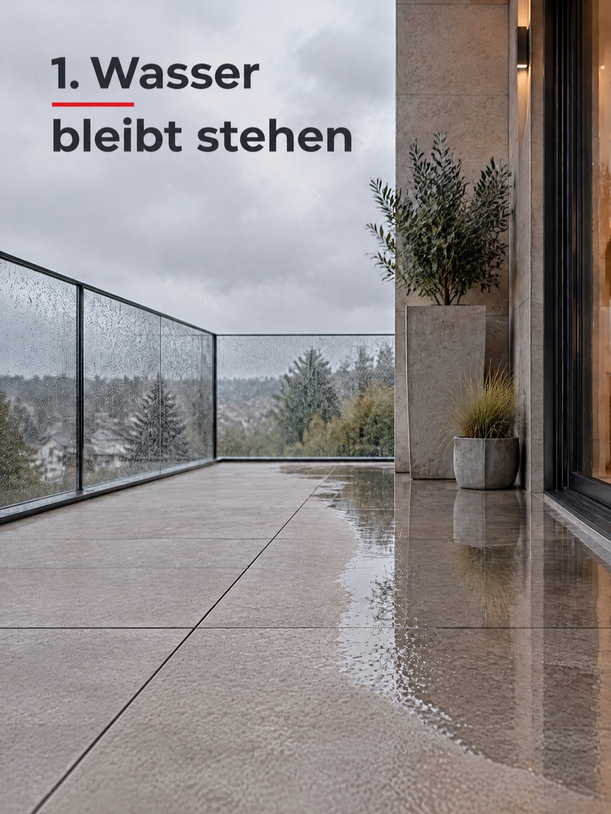

<a id="tz-037"></a>
## TZ-037 · Zeichen 2: Fliesen klingen hohl

Karussell · 3:4 · Karussell K3 „Balkon: 4 Warnzeichen“, Slide 3 von 6 · Dokument Nr. K3-3

Vorher die Cover-Slide dieser Serie hochladen (Stilreferenz).

```text
Use the uploaded image as the exact style reference: same background, colours, typography and layout. Create the next slide of this carousel. Brand style for an owner-run tiling company in Germany known for precise large-format tiles, walk-in showers without a step, balconies and stairs. Look: calm architectural interior photography; razor-straight joints; perfectly level surfaces; soft natural side light that reveals texture; realistic materials (porcelain stoneware, mosaic, natural stone); no clutter, no tools lying around. Palette: light zinc grey (#F4F4F5), anthracite text (#27272A), warm stone and greige tones, one accent colour red (#D82020) used sparingly. Typography: clean modern sans-serif headline, left-aligned, generous whitespace, at most two text sizes. People: only hands or figures from behind, never a recognisable face. Layout: vertical 3:4 portrait format (1080x1440 proportions); keep all text and key objects inside an 8% safe margin; keep the bottom-right corner (14% of the width) empty for a logo added later. Do not draw any logo, company name, brand name or watermark. Text rules: render ONLY the German text given in quotes, exactly once, verbatim, with correct umlauts (ä, ö, ü, ß); no other words or numbers. A knuckle knocking on a balcony tile. Headline: "2. Fliesen klingen hohl"
```

**Text im Bild:** „2. Fliesen klingen hohl“  
**Caption:** Diese Zeichen können darauf hinweisen, dass Wasser eindringt. Lassen Sie es frühzeitig prüfen, der Termin vor Ort ist kostenfrei. Symbolbilder.  
**Hashtags:** #balkonsanierung #terrasse #terrassenplatten #außentreppe #stelzlager #aßlar #wetzlar #lahndill #mittelhessen #gießen  
**Hinweise:** Karussell K3 „Balkon: 4 Warnzeichen“, Slide 3 von 6; Caption und Hashtags gelten einmal für den ganzen Karussell-Post. „Symbolbilder“ in der Caption stehen lassen; wo es echte Fotos gibt, diese statt der Symbolbilder nehmen. Für einheitlichen Look das fertige Cover hochladen und „Use the uploaded image as the exact style reference: same background, typography and layout.“ voranstellen (siehe E6). Balkonthema: im Januar für die Frühjahrsplanung posten. Posting-Plan: Woche 10 (Mo 4.1.2027), gegen 18 Uhr.  
**Bilder:** [original](bilder/original/TZ-037.jpg) · [instagram-3x4](bilder/instagram-3x4/TZ-037.jpg) · [facebook-linkedin-4x5](bilder/facebook-linkedin-4x5/TZ-037.jpg)

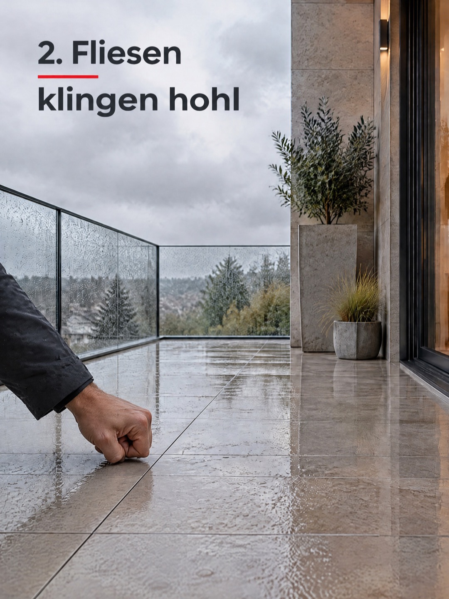

<a id="tz-038"></a>
## TZ-038 · Zeichen 3: Risse

Karussell · 3:4 · Karussell K3 „Balkon: 4 Warnzeichen“, Slide 4 von 6 · Dokument Nr. K3-4

Vorher die Cover-Slide dieser Serie hochladen (Stilreferenz).

```text
Use the uploaded image as the exact style reference: same background, colours, typography and layout. Create the next slide of this carousel. Brand style for an owner-run tiling company in Germany known for precise large-format tiles, walk-in showers without a step, balconies and stairs. Look: calm architectural interior photography; razor-straight joints; perfectly level surfaces; soft natural side light that reveals texture; realistic materials (porcelain stoneware, mosaic, natural stone); no clutter, no tools lying around. Palette: light zinc grey (#F4F4F5), anthracite text (#27272A), warm stone and greige tones, one accent colour red (#D82020) used sparingly. Typography: clean modern sans-serif headline, left-aligned, generous whitespace, at most two text sizes. People: only hands or figures from behind, never a recognisable face. Layout: vertical 3:4 portrait format (1080x1440 proportions); keep all text and key objects inside an 8% safe margin; keep the bottom-right corner (14% of the width) empty for a logo added later. Do not draw any logo, company name, brand name or watermark. Text rules: render ONLY the German text given in quotes, exactly once, verbatim, with correct umlauts (ä, ö, ü, ß); no other words or numbers. Close-up of a balcony tile with a long hairline crack running into a crumbling grout joint, dry surface, flat overcast light. Headline: "3. Risse in Fliesen und Fugen"
```

**Text im Bild:** „3. Risse in Fliesen und Fugen“  
**Caption:** Diese Zeichen können darauf hinweisen, dass Wasser eindringt. Lassen Sie es frühzeitig prüfen, der Termin vor Ort ist kostenfrei. Symbolbilder.  
**Hashtags:** #balkonsanierung #terrasse #terrassenplatten #außentreppe #stelzlager #aßlar #wetzlar #lahndill #mittelhessen #gießen  
**Hinweise:** Karussell K3 „Balkon: 4 Warnzeichen“, Slide 4 von 6; Caption und Hashtags gelten einmal für den ganzen Karussell-Post. „Symbolbilder“ in der Caption stehen lassen; wo es echte Fotos gibt, diese statt der Symbolbilder nehmen. Für einheitlichen Look das fertige Cover hochladen und „Use the uploaded image as the exact style reference: same background, typography and layout.“ voranstellen (siehe E6). Szene gegenüber der Vorlage variiert, damit sie sich von Prompt 4 und 8 unterscheidet. Balkonthema: im Januar für die Frühjahrsplanung posten. Posting-Plan: Woche 10 (Mo 4.1.2027), gegen 18 Uhr.  
**Bilder:** [original](bilder/original/TZ-038.jpg) · [instagram-3x4](bilder/instagram-3x4/TZ-038.jpg) · [facebook-linkedin-4x5](bilder/facebook-linkedin-4x5/TZ-038.jpg)

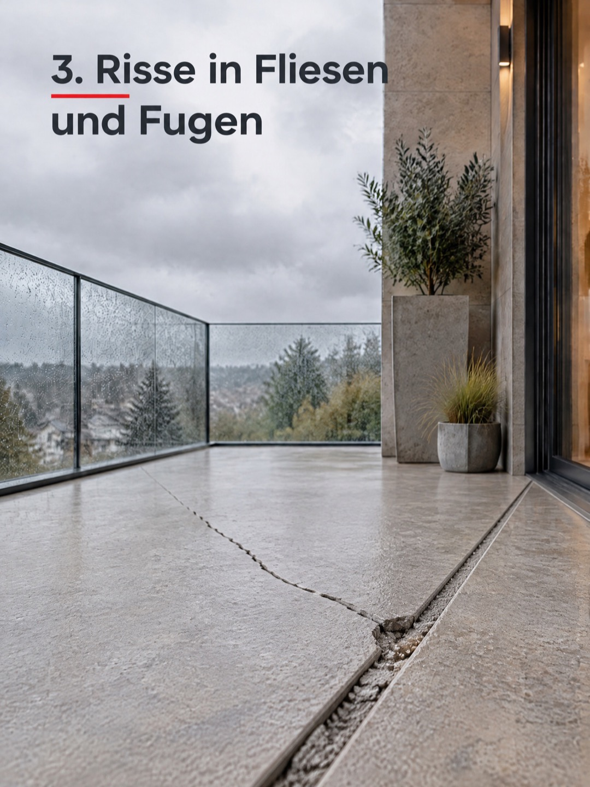

<a id="tz-039"></a>
## TZ-039 · Zeichen 4: Weiße Flecken

Karussell · 3:4 · Karussell K3 „Balkon: 4 Warnzeichen“, Slide 5 von 6 · Dokument Nr. K3-5

Vorher die Cover-Slide dieser Serie hochladen (Stilreferenz).

```text
Use the uploaded image as the exact style reference: same background, colours, typography and layout. Create the next slide of this carousel. Brand style for an owner-run tiling company in Germany known for precise large-format tiles, walk-in showers without a step, balconies and stairs. Look: calm architectural interior photography; razor-straight joints; perfectly level surfaces; soft natural side light that reveals texture; realistic materials (porcelain stoneware, mosaic, natural stone); no clutter, no tools lying around. Palette: light zinc grey (#F4F4F5), anthracite text (#27272A), warm stone and greige tones, one accent colour red (#D82020) used sparingly. Typography: clean modern sans-serif headline, left-aligned, generous whitespace, at most two text sizes. People: only hands or figures from behind, never a recognisable face. Layout: vertical 3:4 portrait format (1080x1440 proportions); keep all text and key objects inside an 8% safe margin; keep the bottom-right corner (14% of the width) empty for a logo added later. Do not draw any logo, company name, brand name or watermark. Text rules: render ONLY the German text given in quotes, exactly once, verbatim, with correct umlauts (ä, ö, ü, ß); no other words or numbers. White efflorescence stains on the underside of a balcony slab. Headline: "4. Weiße Flecken an der Unterseite"
```

**Text im Bild:** „4. Weiße Flecken an der Unterseite“  
**Caption:** Diese Zeichen können darauf hinweisen, dass Wasser eindringt. Lassen Sie es frühzeitig prüfen, der Termin vor Ort ist kostenfrei. Symbolbilder.  
**Hashtags:** #balkonsanierung #terrasse #terrassenplatten #außentreppe #stelzlager #aßlar #wetzlar #lahndill #mittelhessen #gießen  
**Hinweise:** Karussell K3 „Balkon: 4 Warnzeichen“, Slide 5 von 6; Caption und Hashtags gelten einmal für den ganzen Karussell-Post. „Symbolbilder“ in der Caption stehen lassen; wo es echte Fotos gibt, diese statt der Symbolbilder nehmen. Für einheitlichen Look das fertige Cover hochladen und „Use the uploaded image as the exact style reference: same background, typography and layout.“ voranstellen (siehe E6). Balkonthema: im Januar für die Frühjahrsplanung posten. Posting-Plan: Woche 10 (Mo 4.1.2027), gegen 18 Uhr.  
**Bilder:** [original](bilder/original/TZ-039.jpg) · [instagram-3x4](bilder/instagram-3x4/TZ-039.jpg) · [facebook-linkedin-4x5](bilder/facebook-linkedin-4x5/TZ-039.jpg)

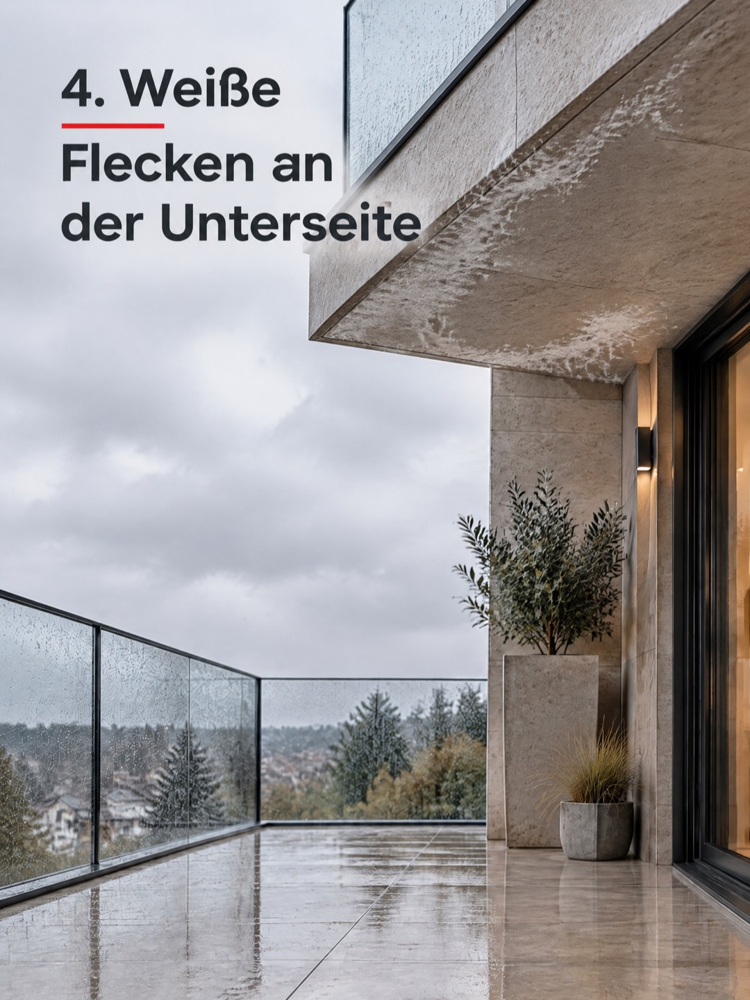

<a id="tz-040"></a>
## TZ-040 · Abschluss: Wir schauen es uns an

Karussell · 3:4 · Karussell K3 „Balkon: 4 Warnzeichen“, Slide 6 von 6 · Dokument Nr. K3-6

Vorher die Cover-Slide dieser Serie hochladen (Stilreferenz).

```text
Use the uploaded image as the exact style reference: same background, colours, typography and layout. Create the next slide of this carousel. Brand style for an owner-run tiling company in Germany known for precise large-format tiles, walk-in showers without a step, balconies and stairs. Look: calm architectural interior photography; razor-straight joints; perfectly level surfaces; soft natural side light that reveals texture; realistic materials (porcelain stoneware, mosaic, natural stone); no clutter, no tools lying around. Palette: light zinc grey (#F4F4F5), anthracite text (#27272A), warm stone and greige tones, one accent colour red (#D82020) used sparingly. Typography: clean modern sans-serif headline, left-aligned, generous whitespace, at most two text sizes. People: only hands or figures from behind, never a recognisable face. Layout: vertical 3:4 portrait format (1080x1440 proportions); keep all text and key objects inside an 8% safe margin; keep the bottom-right corner (14% of the width) empty for a logo added later. Do not draw any logo, company name, brand name or watermark. Text rules: render ONLY the German text given in quotes, exactly once, verbatim, with correct umlauts (ä, ö, ü, ß); no other words or numbers. A renovated balcony with large outdoor porcelain slabs. Headline: "Wir schauen es uns an". Small label (below the headline, small): "Link in Bio".
```

**Text im Bild:** „Wir schauen es uns an“  
**Label:** „Link in Bio“ (below the headline, small)  
**Caption:** Diese Zeichen können darauf hinweisen, dass Wasser eindringt. Lassen Sie es frühzeitig prüfen, der Termin vor Ort ist kostenfrei. Symbolbilder.  
**Hashtags:** #balkonsanierung #terrasse #terrassenplatten #außentreppe #stelzlager #aßlar #wetzlar #lahndill #mittelhessen #gießen  
**Hinweise:** Karussell K3 „Balkon: 4 Warnzeichen“, Slide 6 von 6; Caption und Hashtags gelten einmal für den ganzen Karussell-Post. „Symbolbilder“ in der Caption stehen lassen; wo es echte Fotos gibt, diese statt der Symbolbilder nehmen. Für einheitlichen Look das fertige Cover hochladen und „Use the uploaded image as the exact style reference: same background, typography and layout.“ voranstellen (siehe E6). Vorlage „Wir schauen es uns an: Link in Bio“ hat 8 Wörter: „Link in Bio“ steht deshalb klein unter der Headline. Balkonthema: im Januar für die Frühjahrsplanung posten. Posting-Plan: Woche 10 (Mo 4.1.2027), gegen 18 Uhr.  
**Bilder:** [original](bilder/original/TZ-040.jpg) · [instagram-3x4](bilder/instagram-3x4/TZ-040.jpg) · [facebook-linkedin-4x5](bilder/facebook-linkedin-4x5/TZ-040.jpg)

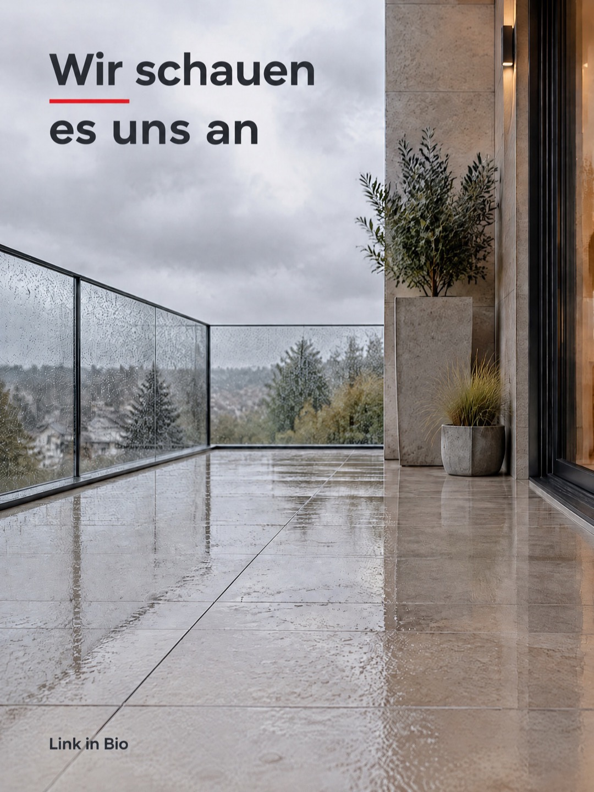

<a id="tz-041"></a>
## TZ-041 · Kleines Gäste-WC

Bad · 3:4 · Dokument Nr. 21

```text
Brand style for an owner-run tiling company in Germany known for precise large-format tiles, walk-in showers without a step, balconies and stairs. Look: calm architectural interior photography; razor-straight joints; perfectly level surfaces; soft natural side light that reveals texture; realistic materials (porcelain stoneware, mosaic, natural stone); no clutter, no tools lying around. Palette: light zinc grey (#F4F4F5), anthracite text (#27272A), warm stone and greige tones, one accent colour red (#D82020) used sparingly. Typography: clean modern sans-serif headline, left-aligned, generous whitespace, at most two text sizes. People: only hands or figures from behind, never a recognisable face. Layout: vertical 3:4 portrait format (1080x1440 proportions); keep all text and key objects inside an 8% safe margin; keep the bottom-right corner (14% of the width) empty for a logo added later. Do not draw any logo, company name, brand name or watermark. Text rules: render ONLY the German text given in quotes, exactly once, verbatim, with correct umlauts (ä, ö, ü, ß); no other words or numbers. A small guest WC with a wall-hung toilet, large-format wall tiles and a compact basin, bright and uncluttered, soft natural light from the side. Headline: "Auch kleine Räume können groß wirken"
```

**Text im Bild:** „Auch kleine Räume können groß wirken“  
**Caption:** Wir haben Ideen für jede Badgröße, vom Gäste-WC bis zum großen Bad. Symbolbild. Termin vor Ort, kostenfrei: Link in Bio.  
**Hashtags:** #badsanierung #duscheohnestufe #bodengleichedusche #walkindusche #badezimmer  
**Hinweise:** „Symbolbild“ in der Caption stehen lassen (gegenüber der Vorlage ergänzt).  
**Bilder:** [original](bilder/original/TZ-041.jpg) · [instagram-3x4](bilder/instagram-3x4/TZ-041.jpg) · [facebook-linkedin-4x5](bilder/facebook-linkedin-4x5/TZ-041.jpg)

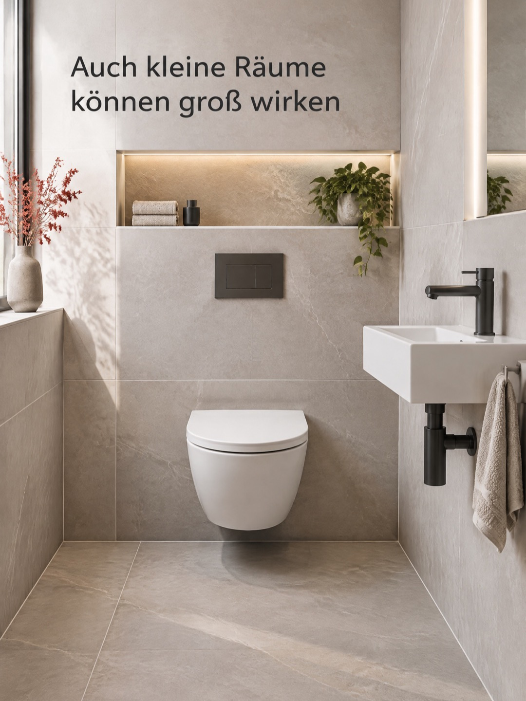

<a id="tz-042"></a>
## TZ-042 · Großes Bad

Bad · 3:4 · Dokument Nr. 22

```text
Brand style for an owner-run tiling company in Germany known for precise large-format tiles, walk-in showers without a step, balconies and stairs. Look: calm architectural interior photography; razor-straight joints; perfectly level surfaces; soft natural side light that reveals texture; realistic materials (porcelain stoneware, mosaic, natural stone); no clutter, no tools lying around. Palette: light zinc grey (#F4F4F5), anthracite text (#27272A), warm stone and greige tones, one accent colour red (#D82020) used sparingly. Typography: clean modern sans-serif headline, left-aligned, generous whitespace, at most two text sizes. People: only hands or figures from behind, never a recognisable face. Layout: vertical 3:4 portrait format (1080x1440 proportions); keep all text and key objects inside an 8% safe margin; keep the bottom-right corner (14% of the width) empty for a logo added later. Do not draw any logo, company name, brand name or watermark. Text rules: render ONLY the German text given in quotes, exactly once, verbatim, with correct umlauts (ä, ö, ü, ß); no other words or numbers. A spacious bathroom with a freestanding tub, a walk-in shower and large stone-look tiles with very few joints, calm and uncluttered, soft natural light from a side window. Headline: "Großes Bad, ruhige Flächen"
```

**Text im Bild:** „Großes Bad, ruhige Flächen“  
**Caption:** Wenige Fugen bringen viel Ruhe ins Bad. Symbolbild. Termin vor Ort, kostenfrei: Link in Bio.  
**Hashtags:** #badsanierung #duscheohnestufe #bodengleichedusche #walkindusche #badezimmer  
**Hinweise:** „Symbolbild“ in der Caption stehen lassen.  
**Bilder:** [original](bilder/original/TZ-042.jpg) · [instagram-3x4](bilder/instagram-3x4/TZ-042.jpg) · [facebook-linkedin-4x5](bilder/facebook-linkedin-4x5/TZ-042.jpg)

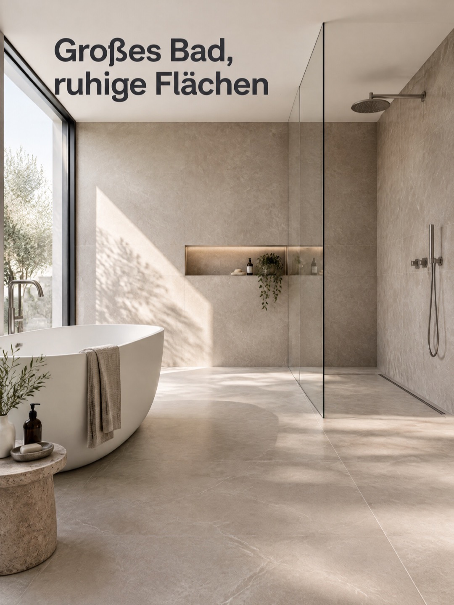

<a id="tz-043"></a>
## TZ-043 · Nischen statt Regal

Bad · 3:4 · Dokument Nr. 23

```text
Brand style for an owner-run tiling company in Germany known for precise large-format tiles, walk-in showers without a step, balconies and stairs. Look: calm architectural interior photography; razor-straight joints; perfectly level surfaces; soft natural side light that reveals texture; realistic materials (porcelain stoneware, mosaic, natural stone); no clutter, no tools lying around. Palette: light zinc grey (#F4F4F5), anthracite text (#27272A), warm stone and greige tones, one accent colour red (#D82020) used sparingly. Typography: clean modern sans-serif headline, left-aligned, generous whitespace, at most two text sizes. People: only hands or figures from behind, never a recognisable face. Layout: vertical 3:4 portrait format (1080x1440 proportions); keep all text and key objects inside an 8% safe margin; keep the bottom-right corner (14% of the width) empty for a logo added later. Do not draw any logo, company name, brand name or watermark. Text rules: render ONLY the German text given in quotes, exactly once, verbatim, with correct umlauts (ä, ö, ü, ß); no other words or numbers. A shower niche built into a tiled wall with neatly mitred edges, close view, soft side light revealing the clean lines. Headline: "Nischen statt Regal"
```

**Text im Bild:** „Nischen statt Regal“  
**Caption:** Ablagen setzen wir direkt in die Wand, sauber eingefliest. Symbolbild. Termin vor Ort, kostenfrei: Link in Bio.  
**Hashtags:** #badsanierung #duscheohnestufe #bodengleichedusche #walkindusche #badezimmer  
**Hinweise:** „Symbolbild“ in der Caption stehen lassen (gegenüber der Vorlage ergänzt).  
**Bilder:** [original](bilder/original/TZ-043.jpg) · [instagram-3x4](bilder/instagram-3x4/TZ-043.jpg) · [facebook-linkedin-4x5](bilder/facebook-linkedin-4x5/TZ-043.jpg)

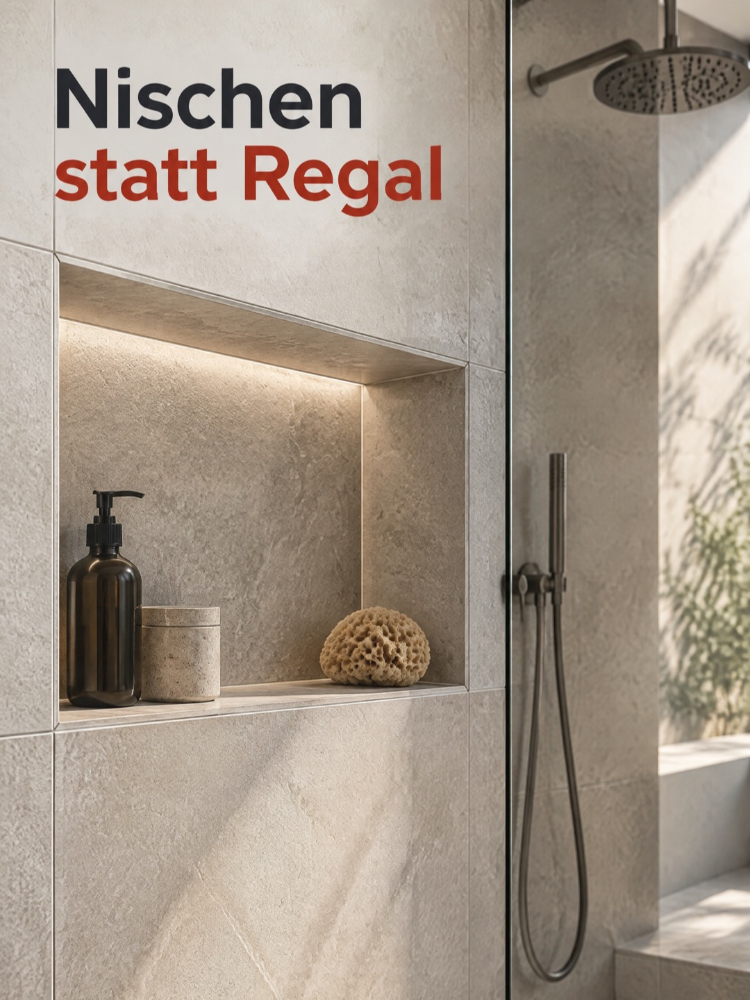

<a id="tz-044"></a>
## TZ-044 · Sitzbank mit Mosaik

Bad · 3:4 · Dokument Nr. 24

```text
Brand style for an owner-run tiling company in Germany known for precise large-format tiles, walk-in showers without a step, balconies and stairs. Look: calm architectural interior photography; razor-straight joints; perfectly level surfaces; soft natural side light that reveals texture; realistic materials (porcelain stoneware, mosaic, natural stone); no clutter, no tools lying around. Palette: light zinc grey (#F4F4F5), anthracite text (#27272A), warm stone and greige tones, one accent colour red (#D82020) used sparingly. Typography: clean modern sans-serif headline, left-aligned, generous whitespace, at most two text sizes. People: only hands or figures from behind, never a recognisable face. Layout: vertical 3:4 portrait format (1080x1440 proportions); keep all text and key objects inside an 8% safe margin; keep the bottom-right corner (14% of the width) empty for a logo added later. Do not draw any logo, company name, brand name or watermark. Text rules: render ONLY the German text given in quotes, exactly once, verbatim, with correct umlauts (ä, ö, ü, ß); no other words or numbers. A shower bench covered in small mosaic tiles with neat, even joints, warm light. Headline: "Sitzbank mit Mosaik"
```

**Text im Bild:** „Sitzbank mit Mosaik“  
**Caption:** Symbolbild, echte Beispiele finden Sie auf tezgel.de. Termin vor Ort, kostenfrei: Link in Bio.  
**Hashtags:** #badsanierung #duscheohnestufe #bodengleichedusche #walkindusche #badezimmer  
**Hinweise:** „Symbolbild“ in der Caption stehen lassen.  
**Bilder:** [original](bilder/original/TZ-044.jpg) · [instagram-3x4](bilder/instagram-3x4/TZ-044.jpg) · [facebook-linkedin-4x5](bilder/facebook-linkedin-4x5/TZ-044.jpg)

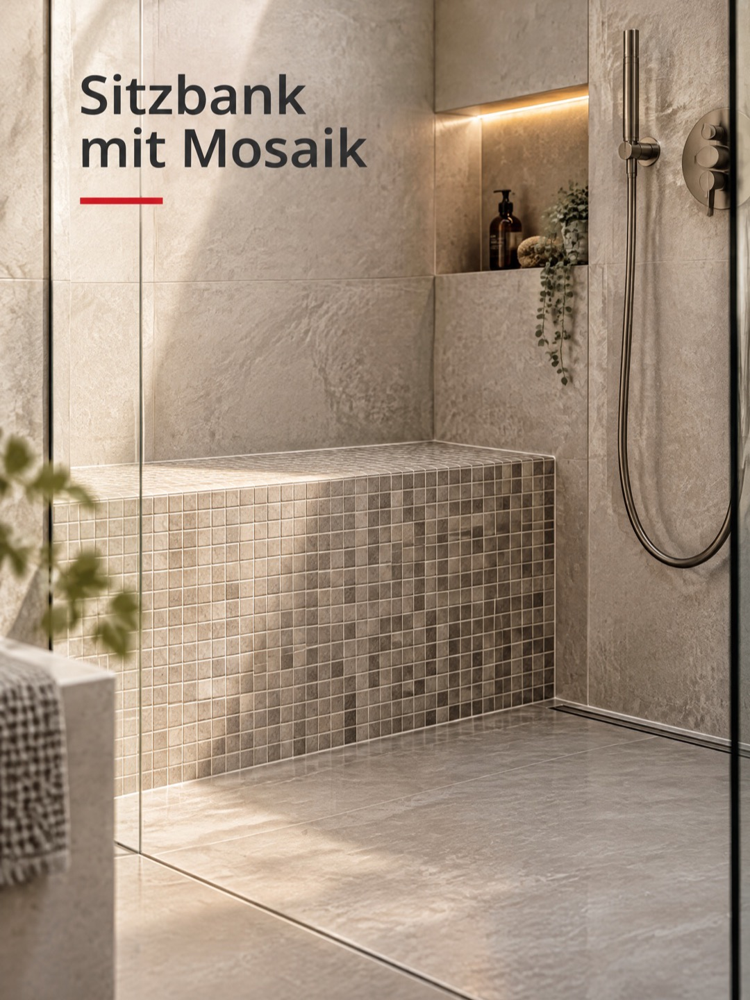

<a id="tz-045"></a>
## TZ-045 · Treppe innen

Treppe · 3:4 · Dokument Nr. 25

```text
Brand style for an owner-run tiling company in Germany known for precise large-format tiles, walk-in showers without a step, balconies and stairs. Look: calm architectural interior photography; razor-straight joints; perfectly level surfaces; soft natural side light that reveals texture; realistic materials (porcelain stoneware, mosaic, natural stone); no clutter, no tools lying around. Palette: light zinc grey (#F4F4F5), anthracite text (#27272A), warm stone and greige tones, one accent colour red (#D82020) used sparingly. Typography: clean modern sans-serif headline, left-aligned, generous whitespace, at most two text sizes. People: only hands or figures from behind, never a recognisable face. Layout: vertical 3:4 portrait format (1080x1440 proportions); keep all text and key objects inside an 8% safe margin; keep the bottom-right corner (14% of the width) empty for a logo added later. Do not draw any logo, company name, brand name or watermark. Text rules: render ONLY the German text given in quotes, exactly once, verbatim, with correct umlauts (ä, ö, ü, ß); no other words or numbers. View down an open interior staircase with light wood-look tiles on every tread, clean precise step edges, a white wall and soft daylight from a side window. Headline: "Treppe innen, Stufe für Stufe präzise"
```

**Text im Bild:** „Treppe innen, Stufe für Stufe präzise“  
**Caption:** Wir fliesen Treppen innen, außen und im Treppenhaus. Symbolbild. Termin vor Ort, kostenfrei: Link in Bio.  
**Hashtags:** #fliesenleger #fliesen #fliesenverlegung #großformatfliesen #feinsteinzeug  
**Hinweise:** Szene variiert, damit sie sich von Prompt 13 unterscheidet. „Symbolbild“ in der Caption stehen lassen (gegenüber der Vorlage ergänzt).  
**Bilder:** [original](bilder/original/TZ-045.jpg) · [instagram-3x4](bilder/instagram-3x4/TZ-045.jpg) · [facebook-linkedin-4x5](bilder/facebook-linkedin-4x5/TZ-045.jpg)

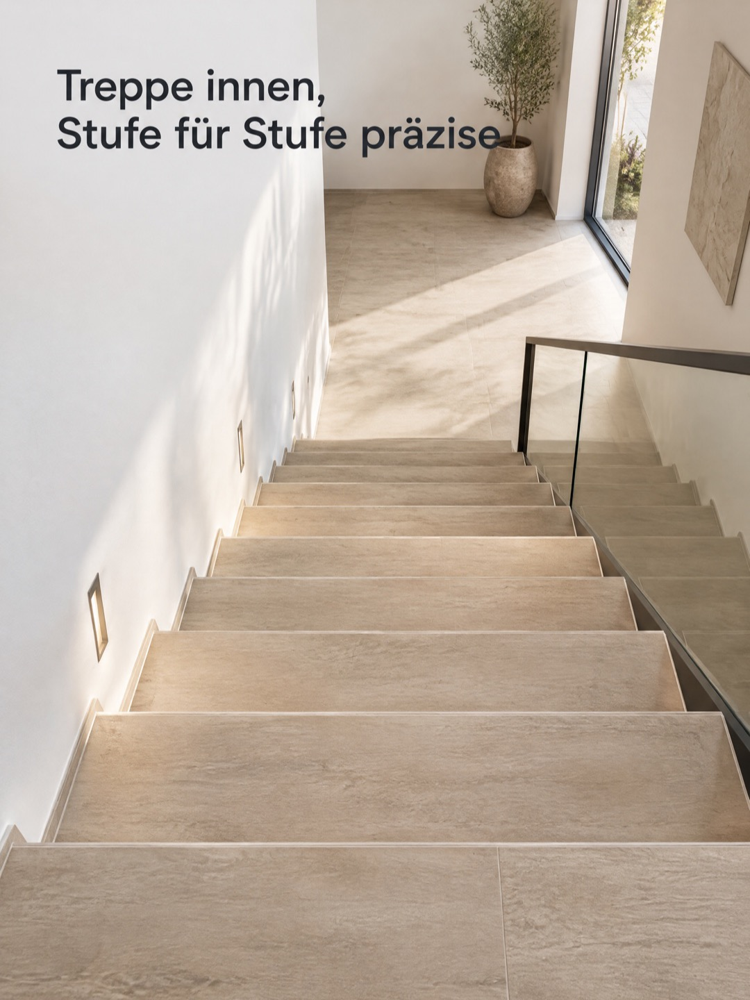

<a id="tz-046"></a>
## TZ-046 · Treppenhaus

Treppe · 3:4 · Dokument Nr. 26

```text
Brand style for an owner-run tiling company in Germany known for precise large-format tiles, walk-in showers without a step, balconies and stairs. Look: calm architectural interior photography; razor-straight joints; perfectly level surfaces; soft natural side light that reveals texture; realistic materials (porcelain stoneware, mosaic, natural stone); no clutter, no tools lying around. Palette: light zinc grey (#F4F4F5), anthracite text (#27272A), warm stone and greige tones, one accent colour red (#D82020) used sparingly. Typography: clean modern sans-serif headline, left-aligned, generous whitespace, at most two text sizes. People: only hands or figures from behind, never a recognisable face. Layout: vertical 3:4 portrait format (1080x1440 proportions); keep all text and key objects inside an 8% safe margin; keep the bottom-right corner (14% of the width) empty for a logo added later. Do not draw any logo, company name, brand name or watermark. Text rules: render ONLY the German text given in quotes, exactly once, verbatim, with correct umlauts (ä, ö, ü, ß); no other words or numbers. A clean stairwell in an apartment building with grey stone-look tiles on steps and landing, crisp edges, neutral daylight. Headline: "Treppenhaus? Robust und pflegeleicht."
```

**Text im Bild:** „Treppenhaus? Robust und pflegeleicht.“  
**Caption:** Im Treppenhaus braucht es Fliesen, die viel aushalten. Symbolbild. Termin vor Ort, kostenfrei: Link in Bio.  
**Hashtags:** #fliesenleger #fliesen #fliesenverlegung #großformatfliesen #feinsteinzeug  
**Hinweise:** „Symbolbild“ in der Caption stehen lassen (gegenüber der Vorlage ergänzt).  
**Bilder:** [original](bilder/original/TZ-046.jpg) · [instagram-3x4](bilder/instagram-3x4/TZ-046.jpg) · [facebook-linkedin-4x5](bilder/facebook-linkedin-4x5/TZ-046.jpg)

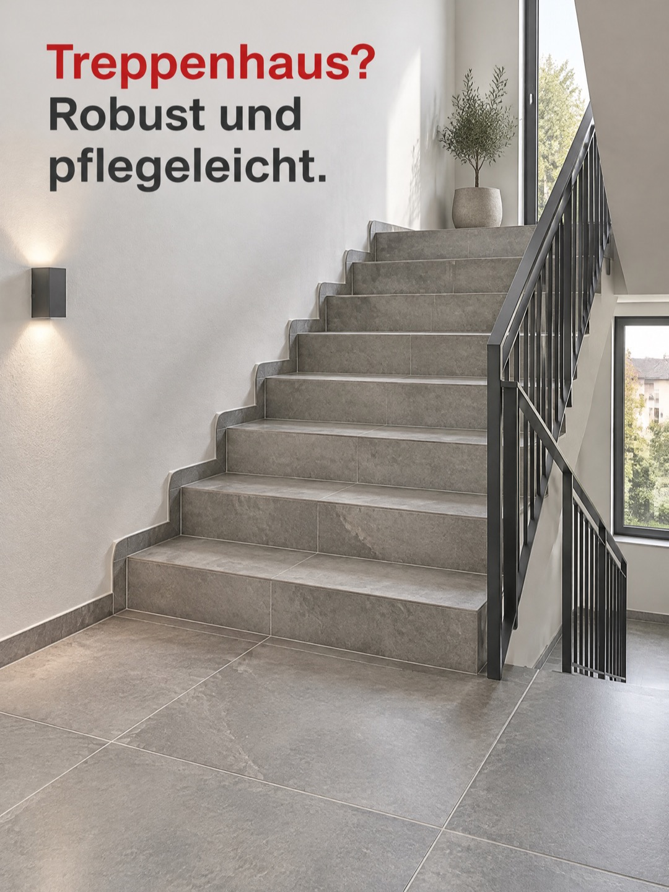

<a id="tz-047"></a>
## TZ-047 · Flur und Diele

Flur · 3:4 · Dokument Nr. 27

```text
Brand style for an owner-run tiling company in Germany known for precise large-format tiles, walk-in showers without a step, balconies and stairs. Look: calm architectural interior photography; razor-straight joints; perfectly level surfaces; soft natural side light that reveals texture; realistic materials (porcelain stoneware, mosaic, natural stone); no clutter, no tools lying around. Palette: light zinc grey (#F4F4F5), anthracite text (#27272A), warm stone and greige tones, one accent colour red (#D82020) used sparingly. Typography: clean modern sans-serif headline, left-aligned, generous whitespace, at most two text sizes. People: only hands or figures from behind, never a recognisable face. Layout: vertical 3:4 portrait format (1080x1440 proportions); keep all text and key objects inside an 8% safe margin; keep the bottom-right corner (14% of the width) empty for a logo added later. Do not draw any logo, company name, brand name or watermark. Text rules: render ONLY the German text given in quotes, exactly once, verbatim, with correct umlauts (ä, ö, ü, ß); no other words or numbers. An entrance hall with dark large-format tiles, a doormat and a pair of boots, tidy and calm, soft natural light. Headline: "Flur und Diele: robust für jeden Tag"
```

**Text im Bild:** „Flur und Diele: robust für jeden Tag“  
**Caption:** Wir verlegen Fliesen für Räume, die viel abbekommen. Symbolbild. Termin vor Ort, kostenfrei: Link in Bio.  
**Hashtags:** #fliesenleger #fliesen #fliesenverlegung #großformatfliesen #feinsteinzeug  
**Hinweise:** „Symbolbild“ in der Caption stehen lassen (gegenüber der Vorlage ergänzt).  
**Bilder:** [original](bilder/original/TZ-047.jpg) · [instagram-3x4](bilder/instagram-3x4/TZ-047.jpg) · [facebook-linkedin-4x5](bilder/facebook-linkedin-4x5/TZ-047.jpg)

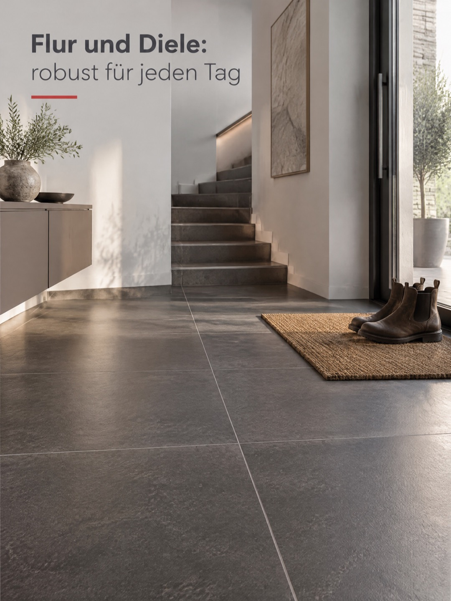

<a id="tz-048"></a>
## TZ-048 · Verlegemuster

Wissen · 3:4 · Dokument Nr. 28

```text
Brand style for an owner-run tiling company in Germany known for precise large-format tiles, walk-in showers without a step, balconies and stairs. Look: calm architectural interior photography; razor-straight joints; perfectly level surfaces; soft natural side light that reveals texture; realistic materials (porcelain stoneware, mosaic, natural stone); no clutter, no tools lying around. Palette: light zinc grey (#F4F4F5), anthracite text (#27272A), warm stone and greige tones, one accent colour red (#D82020) used sparingly. Typography: clean modern sans-serif headline, left-aligned, generous whitespace, at most two text sizes. People: only hands or figures from behind, never a recognisable face. Layout: vertical 3:4 portrait format (1080x1440 proportions); keep all text and key objects inside an 8% safe margin; keep the bottom-right corner (14% of the width) empty for a logo added later. Do not draw any logo, company name, brand name or watermark. Text rules: render ONLY the German text given in quotes, exactly once, verbatim, with correct umlauts (ä, ö, ü, ß); no other words or numbers. Three tile panels side by side, laid straight, offset and in herringbone, top-down view, soft even daylight. Headline: "Welches Verlegemuster passt?"
```

**Text im Bild:** „Welches Verlegemuster passt?“  
**Caption:** Wir beraten Sie, was zu Ihrem Raum passt. Symbolbild. Termin vor Ort, kostenfrei: Link in Bio.  
**Hashtags:** #fliesenleger #fliesen #fliesenverlegung #großformatfliesen #feinsteinzeug  
**Hinweise:** „Symbolbild“ in der Caption stehen lassen (gegenüber der Vorlage ergänzt).  
**Bilder:** [original](bilder/original/TZ-048.jpg) · [instagram-3x4](bilder/instagram-3x4/TZ-048.jpg) · [facebook-linkedin-4x5](bilder/facebook-linkedin-4x5/TZ-048.jpg)

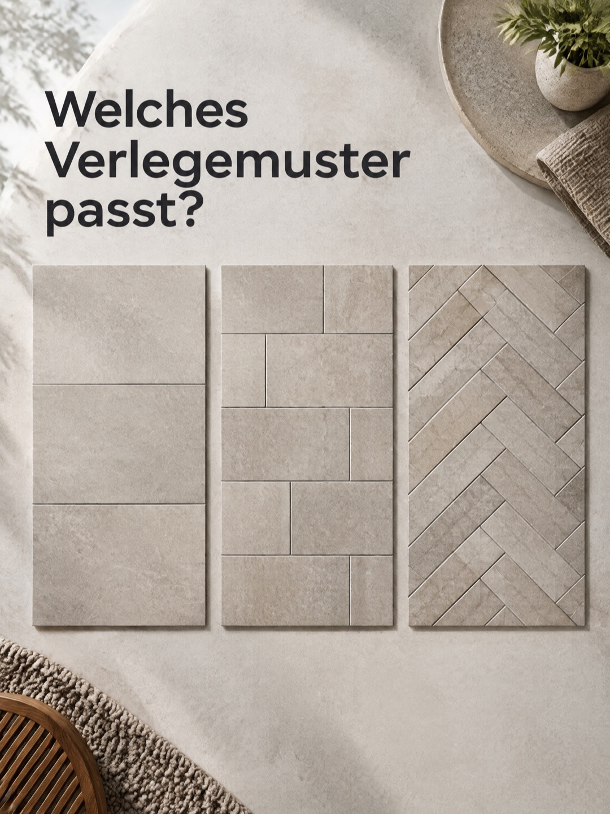

<a id="tz-049"></a>
## TZ-049 · R10 oder R11

Wissen · 3:4 · Dokument Nr. 29

```text
Brand style for an owner-run tiling company in Germany known for precise large-format tiles, walk-in showers without a step, balconies and stairs. Look: calm architectural interior photography; razor-straight joints; perfectly level surfaces; soft natural side light that reveals texture; realistic materials (porcelain stoneware, mosaic, natural stone); no clutter, no tools lying around. Palette: light zinc grey (#F4F4F5), anthracite text (#27272A), warm stone and greige tones, one accent colour red (#D82020) used sparingly. Typography: clean modern sans-serif headline, left-aligned, generous whitespace, at most two text sizes. People: only hands or figures from behind, never a recognisable face. Layout: vertical 3:4 portrait format (1080x1440 proportions); keep all text and key objects inside an 8% safe margin; keep the bottom-right corner (14% of the width) empty for a logo added later. Do not draw any logo, company name, brand name or watermark. Text rules: render ONLY the German text given in quotes, exactly once, verbatim, with correct umlauts (ä, ö, ü, ß); no other words or numbers. Wet footprints of a shoe tread crossing matt grey bathroom floor tiles, a slight reflection on the surface, low side light. Headline: "R10 oder R11? Je nach Raum."
```

**Text im Bild:** „R10 oder R11? Je nach Raum.“  
**Caption:** Rutschhemmende Fliesen sorgen für mehr Sicherheit. Symbolbild. Termin vor Ort, kostenfrei: Link in Bio.  
**Hashtags:** #badsanierung #duscheohnestufe #bodengleichedusche #walkindusche #badezimmer  
**Hinweise:** ⚠️ Fakten prüfen. Vor dem Posten prüfen (Stand 29.10.2026): Rutschhemmklassen R10 bzw. R11 je nach Raum (R-Klassen gelten für Bereiche mit Schuhen; für Barfußbereiche wie Duschen gibt es die Klassen A, B und C). Szene variiert, damit sie sich von K2-2 unterscheidet. „Symbolbild“ in der Caption stehen lassen (gegenüber der Vorlage ergänzt).  
**Bilder:** [original](bilder/original/TZ-049.jpg) · [instagram-3x4](bilder/instagram-3x4/TZ-049.jpg) · [facebook-linkedin-4x5](bilder/facebook-linkedin-4x5/TZ-049.jpg)

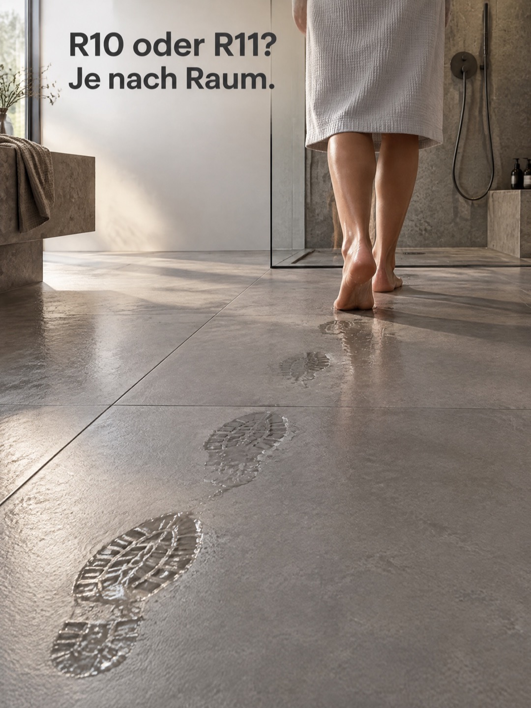

<a id="tz-050"></a>
## TZ-050 · Fugenfarbe

Wissen · 3:4 · Dokument Nr. 30

```text
Brand style for an owner-run tiling company in Germany known for precise large-format tiles, walk-in showers without a step, balconies and stairs. Look: calm architectural interior photography; razor-straight joints; perfectly level surfaces; soft natural side light that reveals texture; realistic materials (porcelain stoneware, mosaic, natural stone); no clutter, no tools lying around. Palette: light zinc grey (#F4F4F5), anthracite text (#27272A), warm stone and greige tones, one accent colour red (#D82020) used sparingly. Typography: clean modern sans-serif headline, left-aligned, generous whitespace, at most two text sizes. People: only hands or figures from behind, never a recognisable face. Layout: vertical 3:4 portrait format (1080x1440 proportions); keep all text and key objects inside an 8% safe margin; keep the bottom-right corner (14% of the width) empty for a logo added later. Do not draw any logo, company name, brand name or watermark. Text rules: render ONLY the German text given in quotes, exactly once, verbatim, with correct umlauts (ä, ö, ü, ß); no other words or numbers. One wall of identical light-grey tiles divided into three vertical sections grouted in white, grey and anthracite, straight-on view, soft side light. Headline: "Fugenfarbe macht viel aus"
```

**Text im Bild:** „Fugenfarbe macht viel aus“  
**Caption:** Wir zeigen Ihnen die Wirkung vorher. Symbolbild. Termin vor Ort, kostenfrei: Link in Bio.  
**Hashtags:** #fliesenleger #fliesen #fliesenverlegung #großformatfliesen #feinsteinzeug  
**Hinweise:** Headline ohne absolute Aussage formuliert (Vorlage: „Fugenfarbe verändert alles“). Szene variiert, damit sie sich von Prompt 28 und Story 46 unterscheidet. „Symbolbild“ in der Caption stehen lassen (gegenüber der Vorlage ergänzt).  
**Bilder:** [original](bilder/original/TZ-050.jpg) · [instagram-3x4](bilder/instagram-3x4/TZ-050.jpg) · [facebook-linkedin-4x5](bilder/facebook-linkedin-4x5/TZ-050.jpg)

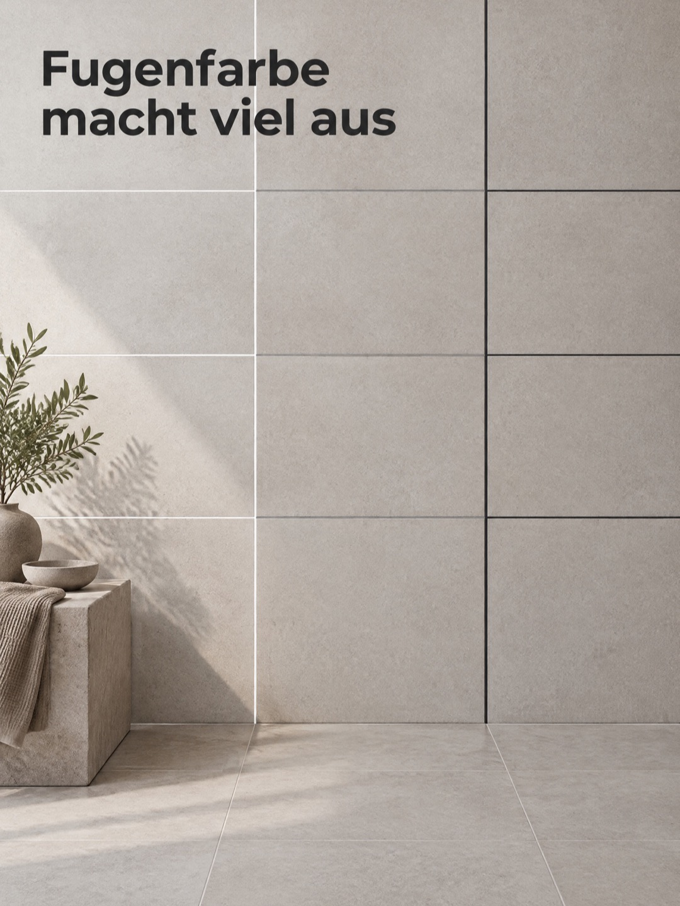

<a id="tz-051"></a>
## TZ-051 · Fliesen auf Fliesen

Wissen · 3:4 · Dokument Nr. 31

```text
Brand style for an owner-run tiling company in Germany known for precise large-format tiles, walk-in showers without a step, balconies and stairs. Look: calm architectural interior photography; razor-straight joints; perfectly level surfaces; soft natural side light that reveals texture; realistic materials (porcelain stoneware, mosaic, natural stone); no clutter, no tools lying around. Palette: light zinc grey (#F4F4F5), anthracite text (#27272A), warm stone and greige tones, one accent colour red (#D82020) used sparingly. Typography: clean modern sans-serif headline, left-aligned, generous whitespace, at most two text sizes. People: only hands or figures from behind, never a recognisable face. Layout: vertical 3:4 portrait format (1080x1440 proportions); keep all text and key objects inside an 8% safe margin; keep the bottom-right corner (14% of the width) empty for a logo added later. Do not draw any logo, company name, brand name or watermark. Text rules: render ONLY the German text given in quotes, exactly once, verbatim, with correct umlauts (ä, ö, ü, ß); no other words or numbers. Old wall tiles with a new tile layer partly placed over them, the edge between old and new clearly visible, soft side light. Headline: "Fliesen auf Fliesen: geht das?"
```

**Text im Bild:** „Fliesen auf Fliesen: geht das?“  
**Caption:** Manchmal geht das, manchmal nicht. Wir prüfen den Untergrund vor Ort. Symbolbild. Termin vor Ort, kostenfrei: Link in Bio.  
**Hashtags:** #fliesenleger #fliesen #fliesenverlegung #großformatfliesen #feinsteinzeug  
**Hinweise:** „Symbolbild“ in der Caption stehen lassen (gegenüber der Vorlage ergänzt).  
**Bilder:** [original](bilder/original/TZ-051.jpg) · [instagram-3x4](bilder/instagram-3x4/TZ-051.jpg) · [facebook-linkedin-4x5](bilder/facebook-linkedin-4x5/TZ-051.jpg)


<a id="tz-052"></a>
## TZ-052 · Terrassenplatten aus Keramik

Draußen · 3:4 · Dokument Nr. 32

```text
Brand style for an owner-run tiling company in Germany known for precise large-format tiles, walk-in showers without a step, balconies and stairs. Look: calm architectural interior photography; razor-straight joints; perfectly level surfaces; soft natural side light that reveals texture; realistic materials (porcelain stoneware, mosaic, natural stone); no clutter, no tools lying around. Palette: light zinc grey (#F4F4F5), anthracite text (#27272A), warm stone and greige tones, one accent colour red (#D82020) used sparingly. Typography: clean modern sans-serif headline, left-aligned, generous whitespace, at most two text sizes. People: only hands or figures from behind, never a recognisable face. Layout: vertical 3:4 portrait format (1080x1440 proportions); keep all text and key objects inside an 8% safe margin; keep the bottom-right corner (14% of the width) empty for a logo added later. Do not draw any logo, company name, brand name or watermark. Text rules: render ONLY the German text given in quotes, exactly once, verbatim, with correct umlauts (ä, ö, ü, ß); no other words or numbers. A terrace with blue-grey outdoor porcelain slabs in front of a glass door with a wooden frame, straight clean joints, soft daylight. Headline: "Terrassenplatten aus Keramik"
```

**Text im Bild:** „Terrassenplatten aus Keramik“  
**Caption:** Wir verlegen frostfeste Platten für draußen. Symbolbild. Termin vor Ort, kostenfrei: Link in Bio.  
**Hashtags:** #balkonsanierung #terrasse #terrassenplatten #außentreppe #stelzlager  
**Hinweise:** „Symbolbild“ in der Caption stehen lassen.  
**Bilder:** [original](bilder/original/TZ-052.jpg) · [instagram-3x4](bilder/instagram-3x4/TZ-052.jpg) · [facebook-linkedin-4x5](bilder/facebook-linkedin-4x5/TZ-052.jpg)


<a id="tz-053"></a>
## TZ-053 · Marmor und Kalkstein

Naturstein · 3:4 · Dokument Nr. 33

```text
Brand style for an owner-run tiling company in Germany known for precise large-format tiles, walk-in showers without a step, balconies and stairs. Look: calm architectural interior photography; razor-straight joints; perfectly level surfaces; soft natural side light that reveals texture; realistic materials (porcelain stoneware, mosaic, natural stone); no clutter, no tools lying around. Palette: light zinc grey (#F4F4F5), anthracite text (#27272A), warm stone and greige tones, one accent colour red (#D82020) used sparingly. Typography: clean modern sans-serif headline, left-aligned, generous whitespace, at most two text sizes. People: only hands or figures from behind, never a recognisable face. Layout: vertical 3:4 portrait format (1080x1440 proportions); keep all text and key objects inside an 8% safe margin; keep the bottom-right corner (14% of the width) empty for a logo added later. Do not draw any logo, company name, brand name or watermark. Text rules: render ONLY the German text given in quotes, exactly once, verbatim, with correct umlauts (ä, ö, ü, ß); no other words or numbers. A marble bathroom wall and vanity top in soft white veined stone, precisely joined, calm soft side light. Headline: "Marmor und Kalkstein, mit Gefühl verlegt"
```

**Text im Bild:** „Marmor und Kalkstein, mit Gefühl verlegt“  
**Caption:** Naturstein braucht Erfahrung. Symbolbild. Termin vor Ort, kostenfrei: Link in Bio.  
**Hashtags:** #fliesenleger #fliesen #fliesenverlegung #großformatfliesen #feinsteinzeug  
**Hinweise:** „Symbolbild“ in der Caption stehen lassen (gegenüber der Vorlage ergänzt).  
**Bilder:** [original](bilder/original/TZ-053.jpg) · [instagram-3x4](bilder/instagram-3x4/TZ-053.jpg) · [facebook-linkedin-4x5](bilder/facebook-linkedin-4x5/TZ-053.jpg)


<a id="tz-054"></a>
## TZ-054 · Erst messen, dann fliesen

Service · 3:4 · Dokument Nr. 34

```text
Brand style for an owner-run tiling company in Germany known for precise large-format tiles, walk-in showers without a step, balconies and stairs. Look: calm architectural interior photography; razor-straight joints; perfectly level surfaces; soft natural side light that reveals texture; realistic materials (porcelain stoneware, mosaic, natural stone); no clutter, no tools lying around. Palette: light zinc grey (#F4F4F5), anthracite text (#27272A), warm stone and greige tones, one accent colour red (#D82020) used sparingly. Typography: clean modern sans-serif headline, left-aligned, generous whitespace, at most two text sizes. People: only hands or figures from behind, never a recognisable face. Layout: vertical 3:4 portrait format (1080x1440 proportions); keep all text and key objects inside an 8% safe margin; keep the bottom-right corner (14% of the width) empty for a logo added later. Do not draw any logo, company name, brand name or watermark. Text rules: render ONLY the German text given in quotes, exactly once, verbatim, with correct umlauts (ä, ö, ü, ß); no other words or numbers. Wide view of an empty room with a bare, freshly dried screed floor, a kneeling figure seen from behind holding a moisture meter to the floor, soft window light. Headline: "Erst messen, dann fliesen"
```

**Text im Bild:** „Erst messen, dann fliesen“  
**Caption:** Die Restfeuchte im Estrich messen wir direkt bei Ihnen. Symbolbild. Termin vor Ort, kostenfrei: Link in Bio.  
**Hashtags:** #fliesenleger #fliesen #fliesenverlegung #großformatfliesen #feinsteinzeug  
**Hinweise:** Szene variiert, damit sie sich von K2-6 unterscheidet. „Symbolbild“ in der Caption stehen lassen (gegenüber der Vorlage ergänzt).  
**Bilder:** [original](bilder/original/TZ-054.jpg) · [instagram-3x4](bilder/instagram-3x4/TZ-054.jpg) · [facebook-linkedin-4x5](bilder/facebook-linkedin-4x5/TZ-054.jpg)


<a id="tz-055"></a>
## TZ-055 · Projekt-Check

Service · 3:4 · Dokument Nr. 35

```text
Brand style for an owner-run tiling company in Germany known for precise large-format tiles, walk-in showers without a step, balconies and stairs. Look: calm architectural interior photography; razor-straight joints; perfectly level surfaces; soft natural side light that reveals texture; realistic materials (porcelain stoneware, mosaic, natural stone); no clutter, no tools lying around. Palette: light zinc grey (#F4F4F5), anthracite text (#27272A), warm stone and greige tones, one accent colour red (#D82020) used sparingly. Typography: clean modern sans-serif headline, left-aligned, generous whitespace, at most two text sizes. People: only hands or figures from behind, never a recognisable face. Layout: vertical 3:4 portrait format (1080x1440 proportions); keep all text and key objects inside an 8% safe margin; keep the bottom-right corner (14% of the width) empty for a logo added later. Do not draw any logo, company name, brand name or watermark. Text rules: render ONLY the German text given in quotes, exactly once, verbatim, with correct umlauts (ä, ö, ü, ß); no other words or numbers. A hand holding a smartphone in front of a plain light wall, its screen showing a simplified form made of plain grey bars and a small bathroom icon, soft daylight. Headline: "Ihr Bad in 2 Minuten beschreiben"
```

**Text im Bild:** „Ihr Bad in 2 Minuten beschreiben“  
**Caption:** Beschreiben Sie Ihr Bad im Projekt-Check auf tezgel.de. Termin vor Ort, kostenfrei: Link in Bio.  
**Hashtags:** #badsanierung #duscheohnestufe #bodengleichedusche #walkindusche #badezimmer  
**Hinweise:** ⚠️ Fakten prüfen. Vor dem Posten prüfen (Stand 29.10.2026): Projekt-Check auf tezgel.de erreichbar und in etwa 2 Minuten auszufüllen. Bildschirm nur mit abstrakten Formen, ohne lesbaren Text.  
**Bilder:** [original](bilder/original/TZ-055.jpg) · [instagram-3x4](bilder/instagram-3x4/TZ-055.jpg) · [facebook-linkedin-4x5](bilder/facebook-linkedin-4x5/TZ-055.jpg)


<a id="tz-056"></a>
## TZ-056 · Fliesen-Konfigurator

Service · 3:4 · Dokument Nr. 36

```text
Brand style for an owner-run tiling company in Germany known for precise large-format tiles, walk-in showers without a step, balconies and stairs. Look: calm architectural interior photography; razor-straight joints; perfectly level surfaces; soft natural side light that reveals texture; realistic materials (porcelain stoneware, mosaic, natural stone); no clutter, no tools lying around. Palette: light zinc grey (#F4F4F5), anthracite text (#27272A), warm stone and greige tones, one accent colour red (#D82020) used sparingly. Typography: clean modern sans-serif headline, left-aligned, generous whitespace, at most two text sizes. People: only hands or figures from behind, never a recognisable face. Layout: vertical 3:4 portrait format (1080x1440 proportions); keep all text and key objects inside an 8% safe margin; keep the bottom-right corner (14% of the width) empty for a logo added later. Do not draw any logo, company name, brand name or watermark. Text rules: render ONLY the German text given in quotes, exactly once, verbatim, with correct umlauts (ä, ö, ü, ß); no other words or numbers. A tablet propped up on a stack of large tile samples, its screen showing a simple grid of plain coloured squares like a tile configurator, warm morning light. Headline: "Fliesen online zusammenstellen"
```

**Text im Bild:** „Fliesen online zusammenstellen“  
**Caption:** Stellen Sie Ihre Fliesen im Fliesen-Konfigurator auf tezgel.de zusammen. Termin vor Ort, kostenfrei: Link in Bio.  
**Hashtags:** #fliesenleger #fliesen #fliesenverlegung #großformatfliesen #feinsteinzeug  
**Hinweise:** Bildschirm nur mit abstrakten Formen, ohne lesbaren Text.  
**Bilder:** [original](bilder/original/TZ-056.jpg) · [instagram-3x4](bilder/instagram-3x4/TZ-056.jpg) · [facebook-linkedin-4x5](bilder/facebook-linkedin-4x5/TZ-056.jpg)


<a id="tz-057"></a>
## TZ-057 · WhatsApp

Service · 3:4 · Dokument Nr. 37

```text
Brand style for an owner-run tiling company in Germany known for precise large-format tiles, walk-in showers without a step, balconies and stairs. Look: calm architectural interior photography; razor-straight joints; perfectly level surfaces; soft natural side light that reveals texture; realistic materials (porcelain stoneware, mosaic, natural stone); no clutter, no tools lying around. Palette: light zinc grey (#F4F4F5), anthracite text (#27272A), warm stone and greige tones, one accent colour red (#D82020) used sparingly. Typography: clean modern sans-serif headline, left-aligned, generous whitespace, at most two text sizes. People: only hands or figures from behind, never a recognisable face. Layout: vertical 3:4 portrait format (1080x1440 proportions); keep all text and key objects inside an 8% safe margin; keep the bottom-right corner (14% of the width) empty for a logo added later. Do not draw any logo, company name, brand name or watermark. Text rules: render ONLY the German text given in quotes, exactly once, verbatim, with correct umlauts (ä, ö, ü, ß); no other words or numbers. A smartphone lying screen up on a dark wooden table beside a coffee cup, its screen showing only plain coloured chat bubbles, soft side light. Headline: "Fragen? Einfach per WhatsApp."
```

**Text im Bild:** „Fragen? Einfach per WhatsApp.“  
**Caption:** Sie erreichen uns mobil und per WhatsApp unter 0172 / 67 28 504. Termin vor Ort, kostenfrei: Link in Bio.  
**Hashtags:** #aßlar #wetzlar #lahndill #mittelhessen #gießen  
**Hinweise:** ⚠️ Fakten prüfen. Vor dem Posten prüfen (Stand 29.10.2026): Mobil- und WhatsApp-Nummer 0172 / 67 28 504. Bildschirm nur mit abstrakten Formen, ohne lesbaren Text und ohne App-Logo. „WhatsApp“ steht nur als Wort in der Headline; malt das Modell ein Logo, ohne Text neu erzeugen und die Headline in Canva setzen.  
**Bilder:** [original](bilder/original/TZ-057.jpg) · [instagram-3x4](bilder/instagram-3x4/TZ-057.jpg) · [facebook-linkedin-4x5](bilder/facebook-linkedin-4x5/TZ-057.jpg)


<a id="tz-058"></a>
## TZ-058 · Rückruf in 24 Stunden

Service · 3:4 · Dokument Nr. 38

```text
Brand style for an owner-run tiling company in Germany known for precise large-format tiles, walk-in showers without a step, balconies and stairs. Look: calm architectural interior photography; razor-straight joints; perfectly level surfaces; soft natural side light that reveals texture; realistic materials (porcelain stoneware, mosaic, natural stone); no clutter, no tools lying around. Palette: light zinc grey (#F4F4F5), anthracite text (#27272A), warm stone and greige tones, one accent colour red (#D82020) used sparingly. Typography: clean modern sans-serif headline, left-aligned, generous whitespace, at most two text sizes. People: only hands or figures from behind, never a recognisable face. Layout: vertical 3:4 portrait format (1080x1440 proportions); keep all text and key objects inside an 8% safe margin; keep the bottom-right corner (14% of the width) empty for a logo added later. Do not draw any logo, company name, brand name or watermark. Text rules: render ONLY the German text given in quotes, exactly once, verbatim, with correct umlauts (ä, ö, ü, ß); no other words or numbers. A simple white desk phone seen from the side with its keypad out of view, next to a small analogue clock with a plain dial without numerals, its hands at a morning hour, soft early daylight. Headline: "Rückruf innerhalb von 24 Stunden"
```

**Text im Bild:** „Rückruf innerhalb von 24 Stunden“  
**Caption:** Deniz Tezgel ruft Sie zurück und macht einen Termin aus. Termin vor Ort, kostenfrei: Link in Bio.  
**Hashtags:** #herborn #solms #braunfels #dillenburg #limburg  
**Hinweise:** ⚠️ Fakten prüfen. Vor dem Posten prüfen (Stand 29.10.2026): Zusage „Rückruf innerhalb von 24 Stunden“. Telefon und Uhr ohne Ziffern, damit keine Zahlen im Bild entstehen. Freigabe durch Deniz Tezgel einholen, da die Zusage verbindlich wirkt.  
**Bilder:** [original](bilder/original/TZ-058.jpg) · [instagram-3x4](bilder/instagram-3x4/TZ-058.jpg) · [facebook-linkedin-4x5](bilder/facebook-linkedin-4x5/TZ-058.jpg)


<a id="tz-059"></a>
## TZ-059 · Seit 2008 in Aßlar

Betrieb · 3:4 · Dokument Nr. 39

```text
Brand style for an owner-run tiling company in Germany known for precise large-format tiles, walk-in showers without a step, balconies and stairs. Look: calm architectural interior photography; razor-straight joints; perfectly level surfaces; soft natural side light that reveals texture; realistic materials (porcelain stoneware, mosaic, natural stone); no clutter, no tools lying around. Palette: light zinc grey (#F4F4F5), anthracite text (#27272A), warm stone and greige tones, one accent colour red (#D82020) used sparingly. Typography: clean modern sans-serif headline, left-aligned, generous whitespace, at most two text sizes. People: only hands or figures from behind, never a recognisable face. Layout: vertical 3:4 portrait format (1080x1440 proportions); keep all text and key objects inside an 8% safe margin; keep the bottom-right corner (14% of the width) empty for a logo added later. Do not draw any logo, company name, brand name or watermark. Text rules: render ONLY the German text given in quotes, exactly once, verbatim, with correct umlauts (ä, ö, ü, ß); no other words or numbers. A calm workshop shelf with neatly stacked tiles and tools, everything in order, warm light. Headline: "Seit 2008 in Aßlar"
```

**Text im Bild:** „Seit 2008 in Aßlar“  
**Caption:** Wir sind ein Fachbetrieb, eingetragen bei der Handwerkskammer Wiesbaden. Symbolbild. Termin vor Ort, kostenfrei: Link in Bio.  
**Hashtags:** #handwerk #fliesenhandwerk #inhabergeführt #fachbetrieb #seit2008  
**Hinweise:** ⚠️ Fakten prüfen. Vor dem Posten prüfen (Stand 29.10.2026): „Seit 2008“ und Eintrag bei der Handwerkskammer Wiesbaden. „Symbolbild“ in der Caption stehen lassen (gegenüber der Vorlage ergänzt), damit das KI-Bild nicht als echte Werkstatt gilt. Posting-Plan: Woche 9 (Fr 1.1.2027), gegen 18 Uhr.  
**Bilder:** [original](bilder/original/TZ-059.jpg) · [instagram-3x4](bilder/instagram-3x4/TZ-059.jpg) · [facebook-linkedin-4x5](bilder/facebook-linkedin-4x5/TZ-059.jpg)


<a id="tz-060"></a>
## TZ-060 · Einsatzgebiet

Betrieb · 3:4 · Dokument Nr. 40

```text
Brand style for an owner-run tiling company in Germany known for precise large-format tiles, walk-in showers without a step, balconies and stairs. Look: calm architectural interior photography; razor-straight joints; perfectly level surfaces; soft natural side light that reveals texture; realistic materials (porcelain stoneware, mosaic, natural stone); no clutter, no tools lying around. Palette: light zinc grey (#F4F4F5), anthracite text (#27272A), warm stone and greige tones, one accent colour red (#D82020) used sparingly. Typography: clean modern sans-serif headline, left-aligned, generous whitespace, at most two text sizes. People: only hands or figures from behind, never a recognisable face. Layout: vertical 3:4 portrait format (1080x1440 proportions); keep all text and key objects inside an 8% safe margin; keep the bottom-right corner (14% of the width) empty for a logo added later. Do not draw any logo, company name, brand name or watermark. Text rules: render ONLY the German text given in quotes, exactly once, verbatim, with correct umlauts (ä, ö, ü, ß); no other words or numbers. An abstract map of a river valley with one pin and soft rings around it, no labels, clean and minimal. Headline: "Von Aßlar bis Gießen und Herborn"
```

**Text im Bild:** „Von Aßlar bis Gießen und Herborn“  
**Caption:** Wir fliesen in Wetzlar, Gießen, Herborn und den Orten rundherum. Termin vor Ort, kostenfrei: Link in Bio.  
**Hashtags:** #aßlar #wetzlar #lahndill #mittelhessen #gießen #herborn #solms #braunfels #dillenburg #limburg  
**Bilder:** [original](bilder/original/TZ-060.jpg) · [instagram-3x4](bilder/instagram-3x4/TZ-060.jpg) · [facebook-linkedin-4x5](bilder/facebook-linkedin-4x5/TZ-060.jpg)


<a id="tz-061"></a>
## TZ-061 · Große Formate

Betrieb · 3:4 · Dokument Nr. 41

```text
Brand style for an owner-run tiling company in Germany known for precise large-format tiles, walk-in showers without a step, balconies and stairs. Look: calm architectural interior photography; razor-straight joints; perfectly level surfaces; soft natural side light that reveals texture; realistic materials (porcelain stoneware, mosaic, natural stone); no clutter, no tools lying around. Palette: light zinc grey (#F4F4F5), anthracite text (#27272A), warm stone and greige tones, one accent colour red (#D82020) used sparingly. Typography: clean modern sans-serif headline, left-aligned, generous whitespace, at most two text sizes. People: only hands or figures from behind, never a recognisable face. Layout: vertical 3:4 portrait format (1080x1440 proportions); keep all text and key objects inside an 8% safe margin; keep the bottom-right corner (14% of the width) empty for a logo added later. Do not draw any logo, company name, brand name or watermark. Text rules: render ONLY the German text given in quotes, exactly once, verbatim, with correct umlauts (ä, ö, ü, ß); no other words or numbers. Low-angle view of gloved hands lifting a very large porcelain slab upright with two vacuum lifters, the slab towering above them, clean bright site, soft natural light. Headline: "Große Formate, sicher bewegt"
```

**Text im Bild:** „Große Formate, sicher bewegt“  
**Caption:** Wir arbeiten mit Vakuum-Hebern und Nivelliersystem für millimetergenaue Flächen. Symbolbild. Termin vor Ort, kostenfrei: Link in Bio.  
**Hashtags:** #fliesenleger #fliesen #fliesenverlegung #großformatfliesen #feinsteinzeug  
**Hinweise:** Szene variiert, damit sie sich von K1-5 unterscheidet. „Symbolbild“ in der Caption stehen lassen (gegenüber der Vorlage ergänzt).  
**Bilder:** [original](bilder/original/TZ-061.jpg) · [instagram-3x4](bilder/instagram-3x4/TZ-061.jpg) · [facebook-linkedin-4x5](bilder/facebook-linkedin-4x5/TZ-061.jpg)


<a id="tz-062"></a>
## TZ-062 · Wenn alles im Lot ist

Humor · 3:4 · Dokument Nr. 42

```text
Brand style for an owner-run tiling company in Germany known for precise large-format tiles, walk-in showers without a step, balconies and stairs. Look: calm architectural interior photography; razor-straight joints; perfectly level surfaces; soft natural side light that reveals texture; realistic materials (porcelain stoneware, mosaic, natural stone); no clutter, no tools lying around. Palette: light zinc grey (#F4F4F5), anthracite text (#27272A), warm stone and greige tones, one accent colour red (#D82020) used sparingly. Typography: clean modern sans-serif headline, left-aligned, generous whitespace, at most two text sizes. People: only hands or figures from behind, never a recognisable face. Layout: vertical 3:4 portrait format (1080x1440 proportions); keep all text and key objects inside an 8% safe margin; keep the bottom-right corner (14% of the width) empty for a logo added later. Do not draw any logo, company name, brand name or watermark. Text rules: render ONLY the German text given in quotes, exactly once, verbatim, with correct umlauts (ä, ö, ü, ß); no other words or numbers. Flat cartoon: a smiling tile with a spirit level bubble perfectly centred, simple shapes, plenty of calm empty space. Headline: "Wenn alles im Lot ist"
```

**Text im Bild:** „Wenn alles im Lot ist“  
**Caption:** Präzision macht uns glücklich. Termin vor Ort, kostenfrei: Link in Bio.  
**Hashtags:** #fliesenleger #fliesen #fliesenverlegung #großformatfliesen #feinsteinzeug  
**Hinweise:** Posting-Plan: Woche 5 (Fr 4.12.2026), gegen 18 Uhr.  
**Bilder:** [original](bilder/original/TZ-062.jpg) · [instagram-3x4](bilder/instagram-3x4/TZ-062.jpg) · [facebook-linkedin-4x5](bilder/facebook-linkedin-4x5/TZ-062.jpg)


<a id="tz-063"></a>
## TZ-063 · Zeit für eine neue Dusche

Humor · 3:4 · Dokument Nr. 43

```text
Brand style for an owner-run tiling company in Germany known for precise large-format tiles, walk-in showers without a step, balconies and stairs. Look: calm architectural interior photography; razor-straight joints; perfectly level surfaces; soft natural side light that reveals texture; realistic materials (porcelain stoneware, mosaic, natural stone); no clutter, no tools lying around. Palette: light zinc grey (#F4F4F5), anthracite text (#27272A), warm stone and greige tones, one accent colour red (#D82020) used sparingly. Typography: clean modern sans-serif headline, left-aligned, generous whitespace, at most two text sizes. People: only hands or figures from behind, never a recognisable face. Layout: vertical 3:4 portrait format (1080x1440 proportions); keep all text and key objects inside an 8% safe margin; keep the bottom-right corner (14% of the width) empty for a logo added later. Do not draw any logo, company name, brand name or watermark. Text rules: render ONLY the German text given in quotes, exactly once, verbatim, with correct umlauts (ä, ö, ü, ß); no other words or numbers. Flat cartoon: a sad rubber duck sitting in an old cracked bathtub, simple shapes, muted colours. Headline: "Zeit für eine neue Dusche?"
```

**Text im Bild:** „Zeit für eine neue Dusche?“  
**Caption:** Wir bauen um, Sie duschen ohne Stufe. Termin vor Ort, kostenfrei: Link in Bio.  
**Hashtags:** #badsanierung #duscheohnestufe #bodengleichedusche #walkindusche #badezimmer  
**Bilder:** [original](bilder/original/TZ-063.jpg) · [instagram-3x4](bilder/instagram-3x4/TZ-063.jpg) · [facebook-linkedin-4x5](bilder/facebook-linkedin-4x5/TZ-063.jpg)


<a id="tz-064"></a>
## TZ-064 · Frohe Weihnachten

Saison · 3:4 · Dokument Nr. 44

```text
Brand style for an owner-run tiling company in Germany known for precise large-format tiles, walk-in showers without a step, balconies and stairs. Look: calm architectural interior photography; razor-straight joints; perfectly level surfaces; soft natural side light that reveals texture; realistic materials (porcelain stoneware, mosaic, natural stone); no clutter, no tools lying around. Palette: light zinc grey (#F4F4F5), anthracite text (#27272A), warm stone and greige tones, one accent colour red (#D82020) used sparingly. Typography: clean modern sans-serif headline, left-aligned, generous whitespace, at most two text sizes. People: only hands or figures from behind, never a recognisable face. Layout: vertical 3:4 portrait format (1080x1440 proportions); keep all text and key objects inside an 8% safe margin; keep the bottom-right corner (14% of the width) empty for a logo added later. Do not draw any logo, company name, brand name or watermark. Text rules: render ONLY the German text given in quotes, exactly once, verbatim, with correct umlauts (ä, ö, ü, ß); no other words or numbers. A cosy winter bathroom with warm floor tiles, a few candles and a rolled towel, soft warm evening light. Headline: "Frohe Weihnachten aus Aßlar"
```

**Text im Bild:** „Frohe Weihnachten aus Aßlar“  
**Caption:** Danke für Ihr Vertrauen und schöne Feiertage! Symbolbild. Termin vor Ort, kostenfrei: Link in Bio.  
**Hashtags:** #handwerk #fliesenhandwerk #inhabergeführt #fachbetrieb #seit2008  
**Hinweise:** Saisonpost: nur zu Weihnachten posten. „Symbolbild“ in der Caption stehen lassen (gegenüber der Vorlage ergänzt). Posting-Plan: Woche 8 (Mi 23.12.2026), gegen 18 Uhr.  
**Bilder:** [original](bilder/original/TZ-064.jpg) · [instagram-3x4](bilder/instagram-3x4/TZ-064.jpg) · [facebook-linkedin-4x5](bilder/facebook-linkedin-4x5/TZ-064.jpg)


<a id="tz-065"></a>
## TZ-065 · Umfrage: Wanne oder Dusche

Story · 9:16 · Dokument Nr. 45

```text
Brand style for an owner-run tiling company in Germany known for precise large-format tiles, walk-in showers without a step, balconies and stairs. Look: calm architectural interior photography; razor-straight joints; perfectly level surfaces; soft natural side light that reveals texture; realistic materials (porcelain stoneware, mosaic, natural stone); no clutter, no tools lying around. Palette: light zinc grey (#F4F4F5), anthracite text (#27272A), warm stone and greige tones, one accent colour red (#D82020) used sparingly. Typography: clean modern sans-serif headline, left-aligned, generous whitespace, at most two text sizes. People: only hands or figures from behind, never a recognisable face. Layout: vertical 9:16 format (1080x1920 proportions); keep the top 14% and bottom 20% free of text; keep all text and key objects inside an 8% safe margin; keep the bottom-right corner (14% of the width) empty for a logo added later. Do not draw any logo, company name, brand name or watermark. Text rules: render ONLY the German text given in quotes, exactly once, verbatim, with correct umlauts (ä, ö, ü, ß); no other words or numbers. Split view in two stacked halves: above, a white bathtub against light tiles; below, a walk-in shower without a step in large grey tiles, both calm, soft natural light. Headline: "Wanne oder Dusche?". Small label (lower left, small, above the bottom 20%): "Symbolbild".
```

**Text im Bild:** „Wanne oder Dusche?“  
**Label:** „Symbolbild“ (lower left, small, above the bottom 20%)  
**Caption:**   
**Hashtags:**   
**Hinweise:** Story mit Umfrage-Sticker (z. B. „Wanne“ / „Dusche“), Sticker in Instagram ergänzen; keine Caption. „Symbolbild“ steht klein im Bild (Story ohne Caption). Posting-Plan: drei bis fünf Stories pro Woche aus den Prompts 45–47.  
**Bilder:** [original](bilder/original/TZ-065.jpg) · [story-9x16](bilder/story-9x16/TZ-065.jpg)


<a id="tz-066"></a>
## TZ-066 · Umfrage: Fugenfarbe

Story · 9:16 · Dokument Nr. 46

```text
Brand style for an owner-run tiling company in Germany known for precise large-format tiles, walk-in showers without a step, balconies and stairs. Look: calm architectural interior photography; razor-straight joints; perfectly level surfaces; soft natural side light that reveals texture; realistic materials (porcelain stoneware, mosaic, natural stone); no clutter, no tools lying around. Palette: light zinc grey (#F4F4F5), anthracite text (#27272A), warm stone and greige tones, one accent colour red (#D82020) used sparingly. Typography: clean modern sans-serif headline, left-aligned, generous whitespace, at most two text sizes. People: only hands or figures from behind, never a recognisable face. Layout: vertical 9:16 format (1080x1920 proportions); keep the top 14% and bottom 20% free of text; keep all text and key objects inside an 8% safe margin; keep the bottom-right corner (14% of the width) empty for a logo added later. Do not draw any logo, company name, brand name or watermark. Text rules: render ONLY the German text given in quotes, exactly once, verbatim, with correct umlauts (ä, ö, ü, ß); no other words or numbers. Three short sample strips of cured grout in white, grey and anthracite standing upright in a row on a pale stone shelf, eye-level view, soft daylight. Headline: "Fugen in Weiß, Grau oder Anthrazit?"
```

**Text im Bild:** „Fugen in Weiß, Grau oder Anthrazit?“  
**Caption:**   
**Hashtags:**   
**Hinweise:** Story mit Umfrage-Sticker (Weiß / Grau / Anthrazit), Sticker in Instagram ergänzen; keine Caption. Headline und Szene geändert, damit sie sich von K2-4 („3. Welche Fugenfarbe?“) unterscheiden (Vorlage: „Welche Fugenfarbe gefällt Ihnen?“). Posting-Plan: drei bis fünf Stories pro Woche aus den Prompts 45–47.  
**Bilder:** [original](bilder/original/TZ-066.jpg) · [story-9x16](bilder/story-9x16/TZ-066.jpg)


<a id="tz-067"></a>
## TZ-067 · Termin vor Ort (Story)

Story · 9:16 · Dokument Nr. 47

```text
Brand style for an owner-run tiling company in Germany known for precise large-format tiles, walk-in showers without a step, balconies and stairs. Look: calm architectural interior photography; razor-straight joints; perfectly level surfaces; soft natural side light that reveals texture; realistic materials (porcelain stoneware, mosaic, natural stone); no clutter, no tools lying around. Palette: light zinc grey (#F4F4F5), anthracite text (#27272A), warm stone and greige tones, one accent colour red (#D82020) used sparingly. Typography: clean modern sans-serif headline, left-aligned, generous whitespace, at most two text sizes. People: only hands or figures from behind, never a recognisable face. Layout: vertical 9:16 format (1080x1920 proportions); keep the top 14% and bottom 20% free of text; keep all text and key objects inside an 8% safe margin; keep the bottom-right corner (14% of the width) empty for a logo added later. Do not draw any logo, company name, brand name or watermark. Text rules: render ONLY the German text given in quotes, exactly once, verbatim, with correct umlauts (ä, ö, ü, ß); no other words or numbers. A hand unfolding a wooden folding rule across very large light-grey floor tiles, seen from above, one straight joint crossing the frame, soft side light. Headline: "Wir kommen kostenfrei zu Ihnen". Small label (lower left, small, above the bottom 20%): "Symbolbild".
```

**Text im Bild:** „Wir kommen kostenfrei zu Ihnen“  
**Label:** „Symbolbild“ (lower left, small, above the bottom 20%)  
**Caption:**   
**Hashtags:**   
**Hinweise:** Story mit Link-Sticker zur Terminanfrage (https://www.tezgel.de/termin), Sticker in Instagram ergänzen; keine Caption. Headline und Szene geändert, damit sie sich von K1-2 („1. Termin vor Ort, kostenfrei“) unterscheiden (Vorlage: „Termin vor Ort, kostenfrei“). „Symbolbild“ steht klein im Bild. Posting-Plan: drei bis fünf Stories pro Woche aus den Prompts 45–47.  
**Bilder:** [original](bilder/original/TZ-067.jpg) · [story-9x16](bilder/story-9x16/TZ-067.jpg)


<a id="tz-068"></a>
## TZ-068 · Bad unter der Dachschräge

Bad · 3:4

```text
Brand style for an owner-run tiling company in Germany known for precise large-format tiles, walk-in showers without a step, balconies and stairs. Look: calm architectural interior photography; razor-straight joints; perfectly level surfaces; soft natural side light that reveals texture; realistic materials (porcelain stoneware, mosaic, natural stone); no clutter, no tools lying around. Palette: light zinc grey (#F4F4F5), anthracite text (#27272A), warm stone and greige tones, one accent colour red (#D82020) used sparingly. Typography: clean modern sans-serif headline, left-aligned, generous whitespace, at most two text sizes. People: only hands or figures from behind, never a recognisable face. Layout: vertical 3:4 portrait format (1080x1440 proportions); keep all text and key objects inside an 8% safe margin; keep the bottom-right corner (14% of the width) empty for a logo added later. Do not draw any logo, company name, brand name or watermark. Text rules: render ONLY the German text given in quotes, exactly once, verbatim, with correct umlauts (ä, ö, ü, ß); no other words or numbers. An attic bathroom under a sloping ceiling with a skylight, large light-grey porcelain tiles on floor and walls, a walk-in shower without a step placed at the full-height wall, frameless glass, soft daylight falling from above. Headline: "Bad unter der Dachschräge, gut geplant"
```

**Text im Bild:** „Bad unter der Dachschräge, gut geplant“  
**Caption:** Auch unter einer Dachschräge lässt sich ein ruhiges Bad mit Dusche ohne Stufe oft gut planen (Symbolbild). Wir sehen uns Raumhöhe, Fenster und Abfluss bei Ihnen vor Ort an. Termin vor Ort, kostenfrei: Link in Bio.  
**Hashtags:** #badsanierung #duscheohnestufe #bodengleichedusche #walkindusche #badezimmer #aßlar #wetzlar #gießen  
**Hinweise:** „Symbolbild“ in der Caption stehen lassen.  
**Bilder:** [original](bilder/original/TZ-068.jpg) · [instagram-3x4](bilder/instagram-3x4/TZ-068.jpg) · [facebook-linkedin-4x5](bilder/facebook-linkedin-4x5/TZ-068.jpg)


<a id="tz-069"></a>
## TZ-069 · Bis unter die Decke gefliest

Bad · 3:4

```text
Brand style for an owner-run tiling company in Germany known for precise large-format tiles, walk-in showers without a step, balconies and stairs. Look: calm architectural interior photography; razor-straight joints; perfectly level surfaces; soft natural side light that reveals texture; realistic materials (porcelain stoneware, mosaic, natural stone); no clutter, no tools lying around. Palette: light zinc grey (#F4F4F5), anthracite text (#27272A), warm stone and greige tones, one accent colour red (#D82020) used sparingly. Typography: clean modern sans-serif headline, left-aligned, generous whitespace, at most two text sizes. People: only hands or figures from behind, never a recognisable face. Layout: vertical 3:4 portrait format (1080x1440 proportions); keep all text and key objects inside an 8% safe margin; keep the bottom-right corner (14% of the width) empty for a logo added later. Do not draw any logo, company name, brand name or watermark. Text rules: render ONLY the German text given in quotes, exactly once, verbatim, with correct umlauts (ä, ö, ü, ß); no other words or numbers. Low-angle view up a bathroom wall clad floor to ceiling in very large light-grey porcelain tiles, few perfectly straight joints, a clean shadow gap where the tiles meet the ceiling, soft side light grazing the surface. Headline: "Bis unter die Decke gefliest"
```

**Text im Bild:** „Bis unter die Decke gefliest“  
**Caption:** Raumhohe Wandfliesen in großem Format lassen ein Bad ruhiger und höher wirken (Symbolbild). Wir planen das Fugenbild vorher, damit oben und unten saubere Abschlüsse entstehen. Termin vor Ort, kostenfrei: Link in Bio.  
**Hashtags:** #badsanierung #duscheohnestufe #bodengleichedusche #walkindusche #badezimmer #großformatfliesen #herborn #solms  
**Hinweise:** „Symbolbild“ in der Caption stehen lassen.  
**Bilder:** [original](bilder/original/TZ-069.jpg) · [instagram-3x4](bilder/instagram-3x4/TZ-069.jpg) · [facebook-linkedin-4x5](bilder/facebook-linkedin-4x5/TZ-069.jpg)


<a id="tz-070"></a>
## TZ-070 · Mosaik als Akzent

Bad · 3:4

```text
Brand style for an owner-run tiling company in Germany known for precise large-format tiles, walk-in showers without a step, balconies and stairs. Look: calm architectural interior photography; razor-straight joints; perfectly level surfaces; soft natural side light that reveals texture; realistic materials (porcelain stoneware, mosaic, natural stone); no clutter, no tools lying around. Palette: light zinc grey (#F4F4F5), anthracite text (#27272A), warm stone and greige tones, one accent colour red (#D82020) used sparingly. Typography: clean modern sans-serif headline, left-aligned, generous whitespace, at most two text sizes. People: only hands or figures from behind, never a recognisable face. Layout: vertical 3:4 portrait format (1080x1440 proportions); keep all text and key objects inside an 8% safe margin; keep the bottom-right corner (14% of the width) empty for a logo added later. Do not draw any logo, company name, brand name or watermark. Text rules: render ONLY the German text given in quotes, exactly once, verbatim, with correct umlauts (ä, ö, ü, ß); no other words or numbers. A calm bathroom wall behind a floating washbasin covered in small hexagonal greige mosaic tiles with even, fine joints, framed by large plain light-grey wall tiles, soft natural side light revealing the mosaic texture. Headline: "Mosaik als ruhiger Akzent"
```

**Text im Bild:** „Mosaik als ruhiger Akzent“  
**Caption:** Eine Wand mit Mosaik setzt einen Akzent, die großen Fliesen drumherum halten das Bad ruhig (Symbolbild). Wir verlegen Mosaik mit gleichmäßigen, feinen Fugen. Termin vor Ort, kostenfrei: Link in Bio.  
**Hashtags:** #badsanierung #duscheohnestufe #bodengleichedusche #walkindusche #badezimmer #fliesen #wetzlar #gießen  
**Hinweise:** „Symbolbild“ in der Caption stehen lassen.  
**Bilder:** [original](bilder/original/TZ-070.jpg) · [instagram-3x4](bilder/instagram-3x4/TZ-070.jpg) · [facebook-linkedin-4x5](bilder/facebook-linkedin-4x5/TZ-070.jpg)


<a id="tz-071"></a>
## TZ-071 · Die Wanne bleibt

Bad · 3:4

```text
Brand style for an owner-run tiling company in Germany known for precise large-format tiles, walk-in showers without a step, balconies and stairs. Look: calm architectural interior photography; razor-straight joints; perfectly level surfaces; soft natural side light that reveals texture; realistic materials (porcelain stoneware, mosaic, natural stone); no clutter, no tools lying around. Palette: light zinc grey (#F4F4F5), anthracite text (#27272A), warm stone and greige tones, one accent colour red (#D82020) used sparingly. Typography: clean modern sans-serif headline, left-aligned, generous whitespace, at most two text sizes. People: only hands or figures from behind, never a recognisable face. Layout: vertical 3:4 portrait format (1080x1440 proportions); keep all text and key objects inside an 8% safe margin; keep the bottom-right corner (14% of the width) empty for a logo added later. Do not draw any logo, company name, brand name or watermark. Text rules: render ONLY the German text given in quotes, exactly once, verbatim, with correct umlauts (ä, ö, ü, ß); no other words or numbers. A built-in bathtub with a tiled front panel in large warm-greige porcelain tiles, precisely mitred outer corners, a slim recessed toe kick, a matching tiled ledge, soft daylight from a side window, no clutter. Headline: "Die Wanne bleibt? Sauber eingefliest."
```

**Text im Bild:** „Die Wanne bleibt? Sauber eingefliest.“  
**Caption:** Nicht jeder möchte auf die Badewanne verzichten. Wir fliesen die Wannenverkleidung passend zum Bad, mit sauber gearbeiteten Kanten (Symbolbild). Termin vor Ort, kostenfrei: Link in Bio.  
**Hashtags:** #badsanierung #badezimmer #fliesenleger #fliesen #feinsteinzeug #aßlar #wetzlar  
**Hinweise:** „Symbolbild“ in der Caption stehen lassen.  
**Bilder:** [original](bilder/original/TZ-071.jpg) · [instagram-3x4](bilder/instagram-3x4/TZ-071.jpg) · [facebook-linkedin-4x5](bilder/facebook-linkedin-4x5/TZ-071.jpg)


<a id="tz-072"></a>
## TZ-072 · Dusche ohne Stufe im Altbau

Bad · 3:4

```text
Brand style for an owner-run tiling company in Germany known for precise large-format tiles, walk-in showers without a step, balconies and stairs. Look: calm architectural interior photography; razor-straight joints; perfectly level surfaces; soft natural side light that reveals texture; realistic materials (porcelain stoneware, mosaic, natural stone); no clutter, no tools lying around. Palette: light zinc grey (#F4F4F5), anthracite text (#27272A), warm stone and greige tones, one accent colour red (#D82020) used sparingly. Typography: clean modern sans-serif headline, left-aligned, generous whitespace, at most two text sizes. People: only hands or figures from behind, never a recognisable face. Layout: vertical 3:4 portrait format (1080x1440 proportions); keep all text and key objects inside an 8% safe margin; keep the bottom-right corner (14% of the width) empty for a logo added later. Do not draw any logo, company name, brand name or watermark. Text rules: render ONLY the German text given in quotes, exactly once, verbatim, with correct umlauts (ä, ö, ü, ß); no other words or numbers. An old-building bathroom with a high ceiling, a tall wooden window with a deep reveal and a simple plaster cornice, a new walk-in shower without a step in large light-grey tiles, frameless glass, soft daylight. Headline: "Dusche ohne Stufe, auch im Altbau?"
```

**Text im Bild:** „Dusche ohne Stufe, auch im Altbau?“  
**Caption:** Symbolbild: So kann eine Dusche ohne Stufe in einem Altbau-Bad aussehen. Ob das bei Ihnen geht, hängt vor allem von Abfluss und Bodenaufbau ab. Wir prüfen es beim Termin vor Ort, kostenfrei: Link in Bio.  
**Hashtags:** #badsanierung #duscheohnestufe #bodengleichedusche #walkindusche #badezimmer #altbau #mittelhessen #wetzlar  
**Hinweise:** „Symbolbild“ in der Caption stehen lassen.  
**Bilder:** [original](bilder/original/TZ-072.jpg) · [instagram-3x4](bilder/instagram-3x4/TZ-072.jpg) · [facebook-linkedin-4x5](bilder/facebook-linkedin-4x5/TZ-072.jpg)


<a id="tz-073"></a>
## TZ-073 · Keine Stolperkante

Bad · 3:4

```text
Brand style for an owner-run tiling company in Germany known for precise large-format tiles, walk-in showers without a step, balconies and stairs. Look: calm architectural interior photography; razor-straight joints; perfectly level surfaces; soft natural side light that reveals texture; realistic materials (porcelain stoneware, mosaic, natural stone); no clutter, no tools lying around. Palette: light zinc grey (#F4F4F5), anthracite text (#27272A), warm stone and greige tones, one accent colour red (#D82020) used sparingly. Typography: clean modern sans-serif headline, left-aligned, generous whitespace, at most two text sizes. People: only hands or figures from behind, never a recognisable face. Layout: vertical 3:4 portrait format (1080x1440 proportions); keep all text and key objects inside an 8% safe margin; keep the bottom-right corner (14% of the width) empty for a logo added later. Do not draw any logo, company name, brand name or watermark. Text rules: render ONLY the German text given in quotes, exactly once, verbatim, with correct umlauts (ä, ö, ü, ß); no other words or numbers. Floor-level view across a bathroom whose large slip-resistant light-grey tiles run continuously into the shower area without any edge or tray, a slim linear drain, a walking stick leaning against the wall, calm soft light. Headline: "Keine Kante, über die man stolpert"
```

**Text im Bild:** „Keine Kante, über die man stolpert“  
**Caption:** Ohne Duschwanne gibt es keine Kante mehr, über die man steigen muss (Symbolbild). Mit anerkanntem Pflegegrad kann die Pflegekasse den Umbau bezuschussen, mehr dazu auf tezgel.de/foerderung. Termin vor Ort, kostenfrei: Link in Bio.  
**Hashtags:** #badsanierung #duscheohnestufe #bodengleichedusche #walkindusche #badezimmer #barrierefrei #aßlar #gießen  
**Hinweise:** ⚠️ Fakten prüfen. Vor dem Posten prüfen (Stand 29.10.2026): Zuschuss der Pflegekasse bei anerkanntem Pflegegrad 1–5 (bis zu 4.180 € je Maßnahme und pflegebedürftiger Person, Betrag hier bewusst nicht genannt) und Seite tezgel.de/foerderung erreichbar. „Symbolbild“ in der Caption stehen lassen.  
**Bilder:** [original](bilder/original/TZ-073.jpg) · [instagram-3x4](bilder/instagram-3x4/TZ-073.jpg) · [facebook-linkedin-4x5](bilder/facebook-linkedin-4x5/TZ-073.jpg)


<a id="tz-074"></a>
## TZ-074 · Betonoptik im Bad

Bad · 3:4

```text
Brand style for an owner-run tiling company in Germany known for precise large-format tiles, walk-in showers without a step, balconies and stairs. Look: calm architectural interior photography; razor-straight joints; perfectly level surfaces; soft natural side light that reveals texture; realistic materials (porcelain stoneware, mosaic, natural stone); no clutter, no tools lying around. Palette: light zinc grey (#F4F4F5), anthracite text (#27272A), warm stone and greige tones, one accent colour red (#D82020) used sparingly. Typography: clean modern sans-serif headline, left-aligned, generous whitespace, at most two text sizes. People: only hands or figures from behind, never a recognisable face. Layout: vertical 3:4 portrait format (1080x1440 proportions); keep all text and key objects inside an 8% safe margin; keep the bottom-right corner (14% of the width) empty for a logo added later. Do not draw any logo, company name, brand name or watermark. Text rules: render ONLY the German text given in quotes, exactly once, verbatim, with correct umlauts (ä, ö, ü, ß); no other words or numbers. A minimalist bathroom with very large concrete-look porcelain tiles in soft warm grey on floor and walls, barely visible joints, a light oak vanity, low side light revealing the fine cement-like texture. Headline: "Betonoptik, ganz ohne Beton"
```

**Text im Bild:** „Betonoptik, ganz ohne Beton“  
**Caption:** Fliesen in Betonoptik wirken ruhig und modern und sind pflegeleicht (Symbolbild). Wir verlegen sie großformatig mit wenigen Fugen. Termin vor Ort, kostenfrei: Link in Bio.  
**Hashtags:** #badsanierung #duscheohnestufe #bodengleichedusche #walkindusche #badezimmer #großformatfliesen #feinsteinzeug #limburg  
**Hinweise:** „Symbolbild“ in der Caption stehen lassen.  
**Bilder:** [original](bilder/original/TZ-074.jpg) · [instagram-3x4](bilder/instagram-3x4/TZ-074.jpg) · [facebook-linkedin-4x5](bilder/facebook-linkedin-4x5/TZ-074.jpg)


<a id="tz-075"></a>
## TZ-075 · Vorher/Nachher als Symbolbild

Vorher/Nachher · 3:4

```text
Brand style for an owner-run tiling company in Germany known for precise large-format tiles, walk-in showers without a step, balconies and stairs. Look: calm architectural interior photography; razor-straight joints; perfectly level surfaces; soft natural side light that reveals texture; realistic materials (porcelain stoneware, mosaic, natural stone); no clutter, no tools lying around. Palette: light zinc grey (#F4F4F5), anthracite text (#27272A), warm stone and greige tones, one accent colour red (#D82020) used sparingly. Typography: clean modern sans-serif headline, left-aligned, generous whitespace, at most two text sizes. People: only hands or figures from behind, never a recognisable face. Layout: vertical 3:4 portrait format (1080x1440 proportions); keep all text and key objects inside an 8% safe margin; keep the bottom-right corner (14% of the width) empty for a logo added later. Do not draw any logo, company name, brand name or watermark. Text rules: render ONLY the German text given in quotes, exactly once, verbatim, with correct umlauts (ä, ö, ü, ß); no other words or numbers. Split-concept image of one shower corner divided by a clean vertical line: left half dated, with a high shower tray step and small brown patterned tiles; right half rebuilt without a step in large greige tiles, identical perspective and light. Headline: "Gleicher Raum, keine Stufe mehr". Small label (bottom-left, small): "Symbolbild".
```

**Text im Bild:** „Gleicher Raum, keine Stufe mehr“  
**Label:** „Symbolbild“ (bottom-left, small)  
**Caption:** Symbolbild: So kann aus einer Duschwanne mit hoher Stufe eine ebene Dusche werden. Echte Beispiele unserer Arbeit finden Sie auf tezgel.de. Termin vor Ort, kostenfrei: Link in Bio.  
**Hashtags:** #badsanierung #duscheohnestufe #bodengleichedusche #walkindusche #badezimmer #vorhernachher #wetzlar #herborn  
**Hinweise:** KI-Split, kein echtes Projekt: „Symbolbild“ in Caption und Bild stehen lassen und nie als Vorher/Nachher eines Kunden ausgeben. Für echte Vorher/Nachher-Paare den Edit-Prompt E2 mit echten Fotos nutzen.  
**Bilder:** [original](bilder/original/TZ-075.jpg) · [instagram-3x4](bilder/instagram-3x4/TZ-075.jpg) · [facebook-linkedin-4x5](bilder/facebook-linkedin-4x5/TZ-075.jpg)


<a id="tz-076"></a>
## TZ-076 · Cover: Dusche ohne Stufe im Detail

Karussell · 3:4 · Karussell K4 „Dusche ohne Stufe im Detail“, Slide 1 von 6

```text
Brand style for an owner-run tiling company in Germany known for precise large-format tiles, walk-in showers without a step, balconies and stairs. Look: calm architectural interior photography; razor-straight joints; perfectly level surfaces; soft natural side light that reveals texture; realistic materials (porcelain stoneware, mosaic, natural stone); no clutter, no tools lying around. Palette: light zinc grey (#F4F4F5), anthracite text (#27272A), warm stone and greige tones, one accent colour red (#D82020) used sparingly. Typography: clean modern sans-serif headline, left-aligned, generous whitespace, at most two text sizes. People: only hands or figures from behind, never a recognisable face. Layout: vertical 3:4 portrait format (1080x1440 proportions); keep all text and key objects inside an 8% safe margin; keep the bottom-right corner (14% of the width) empty for a logo added later. Do not draw any logo, company name, brand name or watermark. Text rules: render ONLY the German text given in quotes, exactly once, verbatim, with correct umlauts (ä, ö, ü, ß); no other words or numbers. Top-down view of a walk-in shower floor in large warm-greige stone-look porcelain tiles, a slim linear drain along the wall, the glass panel visible only as a thin line, dry and spotless, raking side light. Headline: "Dusche ohne Stufe: Darauf kommt es an". Small label (bottom-left, small): "Swipe →".
```

**Text im Bild:** „Dusche ohne Stufe: Darauf kommt es an“  
**Label:** „Swipe →“ (bottom-left, small)  
**Caption:** Bündige Rinne, sauberes Gefälle, Abdichtung bis in die Ecken und Fugen in einer Linie: Darauf achten wir bei der Dusche ohne Stufe (Symbolbilder). Termin vor Ort, kostenfrei: Link in Bio.  
**Hashtags:** #badsanierung #duscheohnestufe #bodengleichedusche #walkindusche #badezimmer #fliesenleger #aßlar #wetzlar  
**Hinweise:** Karussell K4 „Dusche ohne Stufe im Detail“, Slide 1 von 6; Caption und Hashtags gelten einmal für den ganzen Karussell-Post. „Symbolbilder“ in der Caption stehen lassen; wo es echte Detailfotos gibt, diese statt der Symbolbilder nehmen. Einheitliche Bildidee: Makro-Details derselben Dusche in warmem Greige, Licht flach von der Seite. Posting-Vorschlag: November 2026, zum Beispiel als Zusatzpost.  
**Bilder:** [original](bilder/original/TZ-076.jpg) · [instagram-3x4](bilder/instagram-3x4/TZ-076.jpg) · [facebook-linkedin-4x5](bilder/facebook-linkedin-4x5/TZ-076.jpg)


<a id="tz-077"></a>
## TZ-077 · Detail 1: Bündige Rinne

Karussell · 3:4 · Karussell K4 „Dusche ohne Stufe im Detail“, Slide 2 von 6

Vorher die Cover-Slide dieser Serie hochladen (Stilreferenz).

```text
Use the uploaded image as the exact style reference: same background, colours, typography and layout. Create the next slide of this carousel. Brand style for an owner-run tiling company in Germany known for precise large-format tiles, walk-in showers without a step, balconies and stairs. Look: calm architectural interior photography; razor-straight joints; perfectly level surfaces; soft natural side light that reveals texture; realistic materials (porcelain stoneware, mosaic, natural stone); no clutter, no tools lying around. Palette: light zinc grey (#F4F4F5), anthracite text (#27272A), warm stone and greige tones, one accent colour red (#D82020) used sparingly. Typography: clean modern sans-serif headline, left-aligned, generous whitespace, at most two text sizes. People: only hands or figures from behind, never a recognisable face. Layout: vertical 3:4 portrait format (1080x1440 proportions); keep all text and key objects inside an 8% safe margin; keep the bottom-right corner (14% of the width) empty for a logo added later. Do not draw any logo, company name, brand name or watermark. Text rules: render ONLY the German text given in quotes, exactly once, verbatim, with correct umlauts (ä, ö, ü, ß); no other words or numbers. Top-down macro of a slim linear shower drain set perfectly flush into warm-greige stone-look tiles, its cover inlaid with a strip of the same tile, crisp straight cuts, raking side light. Headline: "1. Rinne bündig in der Fläche"
```

**Text im Bild:** „1. Rinne bündig in der Fläche“  
**Caption:** Bündige Rinne, sauberes Gefälle, Abdichtung bis in die Ecken und Fugen in einer Linie: Darauf achten wir bei der Dusche ohne Stufe (Symbolbilder). Termin vor Ort, kostenfrei: Link in Bio.  
**Hashtags:** #badsanierung #duscheohnestufe #bodengleichedusche #walkindusche #badezimmer #fliesenleger #aßlar #wetzlar  
**Hinweise:** Karussell K4 „Dusche ohne Stufe im Detail“, Slide 2 von 6; Caption und Hashtags gelten einmal für den ganzen Karussell-Post. Für einheitlichen Look das fertige Cover hochladen und „Use the uploaded image as the exact style reference: same background, typography and layout.“ voranstellen (siehe E6). „Symbolbilder“ in der Caption stehen lassen; wo es echte Detailfotos gibt, diese statt der Symbolbilder nehmen. Einheitliche Bildidee: Makro-Details derselben Dusche in warmem Greige, Licht flach von der Seite. Posting-Vorschlag: November 2026, zum Beispiel als Zusatzpost.  
**Bilder:** [original](bilder/original/TZ-077.jpg) · [instagram-3x4](bilder/instagram-3x4/TZ-077.jpg) · [facebook-linkedin-4x5](bilder/facebook-linkedin-4x5/TZ-077.jpg)


<a id="tz-078"></a>
## TZ-078 · Detail 2: Gefälle

Karussell · 3:4 · Karussell K4 „Dusche ohne Stufe im Detail“, Slide 3 von 6

Vorher die Cover-Slide dieser Serie hochladen (Stilreferenz).

```text
Use the uploaded image as the exact style reference: same background, colours, typography and layout. Create the next slide of this carousel. Brand style for an owner-run tiling company in Germany known for precise large-format tiles, walk-in showers without a step, balconies and stairs. Look: calm architectural interior photography; razor-straight joints; perfectly level surfaces; soft natural side light that reveals texture; realistic materials (porcelain stoneware, mosaic, natural stone); no clutter, no tools lying around. Palette: light zinc grey (#F4F4F5), anthracite text (#27272A), warm stone and greige tones, one accent colour red (#D82020) used sparingly. Typography: clean modern sans-serif headline, left-aligned, generous whitespace, at most two text sizes. People: only hands or figures from behind, never a recognisable face. Layout: vertical 3:4 portrait format (1080x1440 proportions); keep all text and key objects inside an 8% safe margin; keep the bottom-right corner (14% of the width) empty for a logo added later. Do not draw any logo, company name, brand name or watermark. Text rules: render ONLY the German text given in quotes, exactly once, verbatim, with correct umlauts (ä, ö, ü, ß); no other words or numbers. Top-down macro of the same warm-greige shower floor with fine water droplets and thin rivulets all running in one direction towards the linear drain, showing the gentle slope, raking side light. Headline: "2. Gefälle zur Rinne"
```

**Text im Bild:** „2. Gefälle zur Rinne“  
**Caption:** Bündige Rinne, sauberes Gefälle, Abdichtung bis in die Ecken und Fugen in einer Linie: Darauf achten wir bei der Dusche ohne Stufe (Symbolbilder). Termin vor Ort, kostenfrei: Link in Bio.  
**Hashtags:** #badsanierung #duscheohnestufe #bodengleichedusche #walkindusche #badezimmer #fliesenleger #aßlar #wetzlar  
**Hinweise:** Karussell K4 „Dusche ohne Stufe im Detail“, Slide 3 von 6; Caption und Hashtags gelten einmal für den ganzen Karussell-Post. Für einheitlichen Look das fertige Cover hochladen und „Use the uploaded image as the exact style reference: same background, typography and layout.“ voranstellen (siehe E6). „Symbolbilder“ in der Caption stehen lassen; wo es echte Detailfotos gibt, diese statt der Symbolbilder nehmen. Einheitliche Bildidee: Makro-Details derselben Dusche in warmem Greige, Licht flach von der Seite. Posting-Vorschlag: November 2026, zum Beispiel als Zusatzpost.  
**Bilder:** [original](bilder/original/TZ-078.jpg) · [instagram-3x4](bilder/instagram-3x4/TZ-078.jpg) · [facebook-linkedin-4x5](bilder/facebook-linkedin-4x5/TZ-078.jpg)


<a id="tz-079"></a>
## TZ-079 · Detail 3: Abdichtung

Karussell · 3:4 · Karussell K4 „Dusche ohne Stufe im Detail“, Slide 4 von 6

Vorher die Cover-Slide dieser Serie hochladen (Stilreferenz).

```text
Use the uploaded image as the exact style reference: same background, colours, typography and layout. Create the next slide of this carousel. Brand style for an owner-run tiling company in Germany known for precise large-format tiles, walk-in showers without a step, balconies and stairs. Look: calm architectural interior photography; razor-straight joints; perfectly level surfaces; soft natural side light that reveals texture; realistic materials (porcelain stoneware, mosaic, natural stone); no clutter, no tools lying around. Palette: light zinc grey (#F4F4F5), anthracite text (#27272A), warm stone and greige tones, one accent colour red (#D82020) used sparingly. Typography: clean modern sans-serif headline, left-aligned, generous whitespace, at most two text sizes. People: only hands or figures from behind, never a recognisable face. Layout: vertical 3:4 portrait format (1080x1440 proportions); keep all text and key objects inside an 8% safe margin; keep the bottom-right corner (14% of the width) empty for a logo added later. Do not draw any logo, company name, brand name or watermark. Text rules: render ONLY the German text given in quotes, exactly once, verbatim, with correct umlauts (ä, ö, ü, ß); no other words or numbers. Close-up of the inner corner where a shower wall meets the shower floor before tiling: a smooth grey waterproofing coat on wall and floor, flexible sealing tape folded neatly into the corner, everything flat and level, no step, raking side light. Headline: "3. Ecken sauber abgedichtet"
```

**Text im Bild:** „3. Ecken sauber abgedichtet“  
**Caption:** Bündige Rinne, sauberes Gefälle, Abdichtung bis in die Ecken und Fugen in einer Linie: Darauf achten wir bei der Dusche ohne Stufe (Symbolbilder). Termin vor Ort, kostenfrei: Link in Bio.  
**Hashtags:** #badsanierung #duscheohnestufe #bodengleichedusche #walkindusche #badezimmer #fliesenleger #aßlar #wetzlar  
**Hinweise:** Karussell K4 „Dusche ohne Stufe im Detail“, Slide 4 von 6; Caption und Hashtags gelten einmal für den ganzen Karussell-Post. Für einheitlichen Look das fertige Cover hochladen und „Use the uploaded image as the exact style reference: same background, typography and layout.“ voranstellen (siehe E6). „Symbolbilder“ in der Caption stehen lassen; wo es echte Detailfotos gibt, diese statt der Symbolbilder nehmen. Einheitliche Bildidee: Makro-Details derselben Dusche in warmem Greige, Licht flach von der Seite. Posting-Vorschlag: November 2026, zum Beispiel als Zusatzpost.  
**Bilder:** [original](bilder/original/TZ-079.jpg) · [instagram-3x4](bilder/instagram-3x4/TZ-079.jpg) · [facebook-linkedin-4x5](bilder/facebook-linkedin-4x5/TZ-079.jpg)


<a id="tz-080"></a>
## TZ-080 · Detail 4: Fugen in einer Linie

Karussell · 3:4 · Karussell K4 „Dusche ohne Stufe im Detail“, Slide 5 von 6

Vorher die Cover-Slide dieser Serie hochladen (Stilreferenz).

```text
Use the uploaded image as the exact style reference: same background, colours, typography and layout. Create the next slide of this carousel. Brand style for an owner-run tiling company in Germany known for precise large-format tiles, walk-in showers without a step, balconies and stairs. Look: calm architectural interior photography; razor-straight joints; perfectly level surfaces; soft natural side light that reveals texture; realistic materials (porcelain stoneware, mosaic, natural stone); no clutter, no tools lying around. Palette: light zinc grey (#F4F4F5), anthracite text (#27272A), warm stone and greige tones, one accent colour red (#D82020) used sparingly. Typography: clean modern sans-serif headline, left-aligned, generous whitespace, at most two text sizes. People: only hands or figures from behind, never a recognisable face. Layout: vertical 3:4 portrait format (1080x1440 proportions); keep all text and key objects inside an 8% safe margin; keep the bottom-right corner (14% of the width) empty for a logo added later. Do not draw any logo, company name, brand name or watermark. Text rules: render ONLY the German text given in quotes, exactly once, verbatim, with correct umlauts (ä, ö, ü, ß); no other words or numbers. Macro of the inside corner where the warm-greige floor tiles meet the wall tiles, every floor joint continuing exactly into a wall joint, a neat silicone corner joint, raking side light. Headline: "4. Fugen in einer Linie"
```

**Text im Bild:** „4. Fugen in einer Linie“  
**Caption:** Bündige Rinne, sauberes Gefälle, Abdichtung bis in die Ecken und Fugen in einer Linie: Darauf achten wir bei der Dusche ohne Stufe (Symbolbilder). Termin vor Ort, kostenfrei: Link in Bio.  
**Hashtags:** #badsanierung #duscheohnestufe #bodengleichedusche #walkindusche #badezimmer #fliesenleger #aßlar #wetzlar  
**Hinweise:** Karussell K4 „Dusche ohne Stufe im Detail“, Slide 5 von 6; Caption und Hashtags gelten einmal für den ganzen Karussell-Post. Für einheitlichen Look das fertige Cover hochladen und „Use the uploaded image as the exact style reference: same background, typography and layout.“ voranstellen (siehe E6). „Symbolbilder“ in der Caption stehen lassen; wo es echte Detailfotos gibt, diese statt der Symbolbilder nehmen. Einheitliche Bildidee: Makro-Details derselben Dusche in warmem Greige, Licht flach von der Seite. Posting-Vorschlag: November 2026, zum Beispiel als Zusatzpost.  
**Bilder:** [original](bilder/original/TZ-080.jpg) · [instagram-3x4](bilder/instagram-3x4/TZ-080.jpg) · [facebook-linkedin-4x5](bilder/facebook-linkedin-4x5/TZ-080.jpg)


<a id="tz-081"></a>
## TZ-081 · Abschluss: Ihre Dusche planen

Karussell · 3:4 · Karussell K4 „Dusche ohne Stufe im Detail“, Slide 6 von 6

Vorher die Cover-Slide dieser Serie hochladen (Stilreferenz).

```text
Use the uploaded image as the exact style reference: same background, colours, typography and layout. Create the next slide of this carousel. Brand style for an owner-run tiling company in Germany known for precise large-format tiles, walk-in showers without a step, balconies and stairs. Look: calm architectural interior photography; razor-straight joints; perfectly level surfaces; soft natural side light that reveals texture; realistic materials (porcelain stoneware, mosaic, natural stone); no clutter, no tools lying around. Palette: light zinc grey (#F4F4F5), anthracite text (#27272A), warm stone and greige tones, one accent colour red (#D82020) used sparingly. Typography: clean modern sans-serif headline, left-aligned, generous whitespace, at most two text sizes. People: only hands or figures from behind, never a recognisable face. Layout: vertical 3:4 portrait format (1080x1440 proportions); keep all text and key objects inside an 8% safe margin; keep the bottom-right corner (14% of the width) empty for a logo added later. Do not draw any logo, company name, brand name or watermark. Text rules: render ONLY the German text given in quotes, exactly once, verbatim, with correct umlauts (ä, ö, ü, ß); no other words or numbers. Close-up of a single warm-greige stone-look tile surface filling the frame, one straight joint crossing it diagonally, a soft band of raking light, plenty of calm empty space. Headline: "Ihre Dusche, gemeinsam geplant". Small label (below the headline, small): "Link in Bio".
```

**Text im Bild:** „Ihre Dusche, gemeinsam geplant“  
**Label:** „Link in Bio“ (below the headline, small)  
**Caption:** Bündige Rinne, sauberes Gefälle, Abdichtung bis in die Ecken und Fugen in einer Linie: Darauf achten wir bei der Dusche ohne Stufe (Symbolbilder). Termin vor Ort, kostenfrei: Link in Bio.  
**Hashtags:** #badsanierung #duscheohnestufe #bodengleichedusche #walkindusche #badezimmer #fliesenleger #aßlar #wetzlar  
**Hinweise:** Karussell K4 „Dusche ohne Stufe im Detail“, Slide 6 von 6; Caption und Hashtags gelten einmal für den ganzen Karussell-Post. Für einheitlichen Look das fertige Cover hochladen und „Use the uploaded image as the exact style reference: same background, typography and layout.“ voranstellen (siehe E6). „Symbolbilder“ in der Caption stehen lassen; wo es echte Detailfotos gibt, diese statt der Symbolbilder nehmen. Einheitliche Bildidee: Makro-Details derselben Dusche in warmem Greige, Licht flach von der Seite. Posting-Vorschlag: November 2026, zum Beispiel als Zusatzpost.  
**Bilder:** [original](bilder/original/TZ-081.jpg) · [instagram-3x4](bilder/instagram-3x4/TZ-081.jpg) · [facebook-linkedin-4x5](bilder/facebook-linkedin-4x5/TZ-081.jpg)


<a id="tz-082"></a>
## TZ-082 · Die Stufenkante

Treppe · 3:4

```text
Brand style for an owner-run tiling company in Germany known for precise large-format tiles, walk-in showers without a step, balconies and stairs. Look: calm architectural interior photography; razor-straight joints; perfectly level surfaces; soft natural side light that reveals texture; realistic materials (porcelain stoneware, mosaic, natural stone); no clutter, no tools lying around. Palette: light zinc grey (#F4F4F5), anthracite text (#27272A), warm stone and greige tones, one accent colour red (#D82020) used sparingly. Typography: clean modern sans-serif headline, left-aligned, generous whitespace, at most two text sizes. People: only hands or figures from behind, never a recognisable face. Layout: vertical 3:4 portrait format (1080x1440 proportions); keep all text and key objects inside an 8% safe margin; keep the bottom-right corner (14% of the width) empty for a logo added later. Do not draw any logo, company name, brand name or watermark. Text rules: render ONLY the German text given in quotes, exactly once, verbatim, with correct umlauts (ä, ö, ü, ß); no other words or numbers. Macro detail of a single stair step clad in light stone-look porcelain, tread and riser meeting in a crisp mitred edge, joints exactly aligned, soft side light tracing the sharp line. Headline: "Auf die Kante kommt es an"
```

**Text im Bild:** „Auf die Kante kommt es an“  
**Caption:** An der Stufenkante sieht man, wie genau gearbeitet wurde (Symbolbild). Wir schneiden Tritt- und Setzstufen passgenau und richten die Fugen aufeinander aus. Termin vor Ort, kostenfrei: Link in Bio.  
**Hashtags:** #fliesenleger #fliesen #fliesenverlegung #großformatfliesen #feinsteinzeug #treppe #aßlar #wetzlar  
**Hinweise:** „Symbolbild“ in der Caption stehen lassen.  
**Bilder:** [original](bilder/original/TZ-082.jpg) · [instagram-3x4](bilder/instagram-3x4/TZ-082.jpg) · [facebook-linkedin-4x5](bilder/facebook-linkedin-4x5/TZ-082.jpg)


<a id="tz-083"></a>
## TZ-083 · Naturstein als Unikat

Naturstein · 3:4

```text
Brand style for an owner-run tiling company in Germany known for precise large-format tiles, walk-in showers without a step, balconies and stairs. Look: calm architectural interior photography; razor-straight joints; perfectly level surfaces; soft natural side light that reveals texture; realistic materials (porcelain stoneware, mosaic, natural stone); no clutter, no tools lying around. Palette: light zinc grey (#F4F4F5), anthracite text (#27272A), warm stone and greige tones, one accent colour red (#D82020) used sparingly. Typography: clean modern sans-serif headline, left-aligned, generous whitespace, at most two text sizes. People: only hands or figures from behind, never a recognisable face. Layout: vertical 3:4 portrait format (1080x1440 proportions); keep all text and key objects inside an 8% safe margin; keep the bottom-right corner (14% of the width) empty for a logo added later. Do not draw any logo, company name, brand name or watermark. Text rules: render ONLY the German text given in quotes, exactly once, verbatim, with correct umlauts (ä, ö, ü, ß); no other words or numbers. Top-down view of several polished limestone slabs laid out side by side on a clean floor before installation, their soft veining arranged to flow from slab to slab, gentle daylight from the side. Headline: "Jede Natursteinplatte ist ein Unikat"
```

**Text im Bild:** „Jede Natursteinplatte ist ein Unikat“  
**Caption:** Farbe und Maserung ändern sich bei Naturstein von Platte zu Platte (Symbolbild). Beim Verlegen achten wir darauf, dass die Platten stimmig zueinander passen. Termin vor Ort, kostenfrei: Link in Bio.  
**Hashtags:** #fliesenleger #fliesen #fliesenverlegung #großformatfliesen #feinsteinzeug #naturstein #gießen #herborn  
**Hinweise:** „Symbolbild“ in der Caption stehen lassen.  
**Bilder:** [original](bilder/original/TZ-083.jpg) · [instagram-3x4](bilder/instagram-3x4/TZ-083.jpg) · [facebook-linkedin-4x5](bilder/facebook-linkedin-4x5/TZ-083.jpg)


<a id="tz-084"></a>
## TZ-084 · Großformat an der Wand

Leistung · 3:4

```text
Brand style for an owner-run tiling company in Germany known for precise large-format tiles, walk-in showers without a step, balconies and stairs. Look: calm architectural interior photography; razor-straight joints; perfectly level surfaces; soft natural side light that reveals texture; realistic materials (porcelain stoneware, mosaic, natural stone); no clutter, no tools lying around. Palette: light zinc grey (#F4F4F5), anthracite text (#27272A), warm stone and greige tones, one accent colour red (#D82020) used sparingly. Typography: clean modern sans-serif headline, left-aligned, generous whitespace, at most two text sizes. People: only hands or figures from behind, never a recognisable face. Layout: vertical 3:4 portrait format (1080x1440 proportions); keep all text and key objects inside an 8% safe margin; keep the bottom-right corner (14% of the width) empty for a logo added later. Do not draw any logo, company name, brand name or watermark. Text rules: render ONLY the German text given in quotes, exactly once, verbatim, with correct umlauts (ä, ö, ü, ß); no other words or numbers. A calm living room wall clad in very large marble-look porcelain slabs with soft grey veining and hairline joints, a low wooden sideboard at the left edge of the frame, soft natural side light. Headline: "Große Platten, auch an der Wand"
```

**Text im Bild:** „Große Platten, auch an der Wand“  
**Caption:** Großformatige Fliesen machen auch Wohnzimmer- und Flurwände zu einer ruhigen Fläche (Symbolbild). Mit Vakuum-Hebern bringen wir auch sehr große Formate sauber an die Wand. Termin vor Ort, kostenfrei: Link in Bio.  
**Hashtags:** #fliesenleger #fliesen #fliesenverlegung #großformatfliesen #feinsteinzeug #wandfliesen #solms #braunfels  
**Hinweise:** „Symbolbild“ in der Caption stehen lassen.  
**Bilder:** [original](bilder/original/TZ-084.jpg) · [instagram-3x4](bilder/instagram-3x4/TZ-084.jpg) · [facebook-linkedin-4x5](bilder/facebook-linkedin-4x5/TZ-084.jpg)


<a id="tz-085"></a>
## TZ-085 · Sockel aus derselben Fliese

Böden · 3:4

```text
Brand style for an owner-run tiling company in Germany known for precise large-format tiles, walk-in showers without a step, balconies and stairs. Look: calm architectural interior photography; razor-straight joints; perfectly level surfaces; soft natural side light that reveals texture; realistic materials (porcelain stoneware, mosaic, natural stone); no clutter, no tools lying around. Palette: light zinc grey (#F4F4F5), anthracite text (#27272A), warm stone and greige tones, one accent colour red (#D82020) used sparingly. Typography: clean modern sans-serif headline, left-aligned, generous whitespace, at most two text sizes. People: only hands or figures from behind, never a recognisable face. Layout: vertical 3:4 portrait format (1080x1440 proportions); keep all text and key objects inside an 8% safe margin; keep the bottom-right corner (14% of the width) empty for a logo added later. Do not draw any logo, company name, brand name or watermark. Text rules: render ONLY the German text given in quotes, exactly once, verbatim, with correct umlauts (ä, ö, ü, ß); no other words or numbers. Low eye-level view along a long hallway wall: a skirting strip cut from the same light-greige floor tile runs straight into the distance, its joints lining up with the floor joints, soft grazing light. Headline: "Sockel aus derselben Fliese"
```

**Text im Bild:** „Sockel aus derselben Fliese“  
**Caption:** Sockelleisten aus derselben Fliese wie der Boden lassen Farbe und Fugen genau zusammenpassen (Symbolbild). Ein kleines Detail, das den ganzen Raum ruhiger macht. Termin vor Ort, kostenfrei: Link in Bio.  
**Hashtags:** #fliesenleger #fliesen #fliesenverlegung #großformatfliesen #feinsteinzeug #wetzlar #mittelhessen  
**Hinweise:** „Symbolbild“ in der Caption stehen lassen.  
**Bilder:** [original](bilder/original/TZ-085.jpg) · [instagram-3x4](bilder/instagram-3x4/TZ-085.jpg) · [facebook-linkedin-4x5](bilder/facebook-linkedin-4x5/TZ-085.jpg)


<a id="tz-086"></a>
## TZ-086 · Ohne Schwelle durch die Räume

Böden · 3:4

```text
Brand style for an owner-run tiling company in Germany known for precise large-format tiles, walk-in showers without a step, balconies and stairs. Look: calm architectural interior photography; razor-straight joints; perfectly level surfaces; soft natural side light that reveals texture; realistic materials (porcelain stoneware, mosaic, natural stone); no clutter, no tools lying around. Palette: light zinc grey (#F4F4F5), anthracite text (#27272A), warm stone and greige tones, one accent colour red (#D82020) used sparingly. Typography: clean modern sans-serif headline, left-aligned, generous whitespace, at most two text sizes. People: only hands or figures from behind, never a recognisable face. Layout: vertical 3:4 portrait format (1080x1440 proportions); keep all text and key objects inside an 8% safe margin; keep the bottom-right corner (14% of the width) empty for a logo added later. Do not draw any logo, company name, brand name or watermark. Text rules: render ONLY the German text given in quotes, exactly once, verbatim, with correct umlauts (ä, ö, ü, ß); no other words or numbers. View through an open interior doorway: the same large light-greige porcelain tiles run from the hallway into the living room without any threshold or transition strip, joints continuing straight through, soft morning side light. Headline: "Von Raum zu Raum ohne Schwelle"
```

**Text im Bild:** „Von Raum zu Raum ohne Schwelle“  
**Caption:** Laufen die Fliesen ohne Schwelle durch mehrere Räume, wirkt die Wohnung größer und ruhiger (Symbolbild). Wir planen das Fugenbild über alle Räume hinweg. Termin vor Ort, kostenfrei: Link in Bio.  
**Hashtags:** #fliesenleger #fliesen #fliesenverlegung #großformatfliesen #feinsteinzeug #aßlar #gießen #herborn  
**Hinweise:** „Symbolbild“ in der Caption stehen lassen.  
**Bilder:** [original](bilder/original/TZ-086.jpg) · [instagram-3x4](bilder/instagram-3x4/TZ-086.jpg) · [facebook-linkedin-4x5](bilder/facebook-linkedin-4x5/TZ-086.jpg)


<a id="tz-087"></a>
## TZ-087 · Granit, Marmor oder Kalkstein

Naturstein · 3:4

```text
Brand style for an owner-run tiling company in Germany known for precise large-format tiles, walk-in showers without a step, balconies and stairs. Look: calm architectural interior photography; razor-straight joints; perfectly level surfaces; soft natural side light that reveals texture; realistic materials (porcelain stoneware, mosaic, natural stone); no clutter, no tools lying around. Palette: light zinc grey (#F4F4F5), anthracite text (#27272A), warm stone and greige tones, one accent colour red (#D82020) used sparingly. Typography: clean modern sans-serif headline, left-aligned, generous whitespace, at most two text sizes. People: only hands or figures from behind, never a recognisable face. Layout: vertical 3:4 portrait format (1080x1440 proportions); keep all text and key objects inside an 8% safe margin; keep the bottom-right corner (14% of the width) empty for a logo added later. Do not draw any logo, company name, brand name or watermark. Text rules: render ONLY the German text given in quotes, exactly once, verbatim, with correct umlauts (ä, ö, ü, ß); no other words or numbers. Three natural stone samples stacked in a loose staircase arrangement on a light surface: dark speckled granite, white veined marble and warm beige limestone, their edges and textures revealed by soft side light. Headline: "Granit, Marmor oder Kalkstein?"
```

**Text im Bild:** „Granit, Marmor oder Kalkstein?“  
**Caption:** Jeder Naturstein hat seinen eigenen Charakter, in Farbe, Oberfläche und Pflege (Symbolbild). Wir beraten Sie, welcher Stein zu Ihrem Raum passt. Termin vor Ort, kostenfrei: Link in Bio.  
**Hashtags:** #naturstein #granit #marmor #kalkstein #fliesenleger #fliesenverlegung #wetzlar #gießen  
**Hinweise:** „Symbolbild“ in der Caption stehen lassen.  
**Bilder:** [original](bilder/original/TZ-087.jpg) · [instagram-3x4](bilder/instagram-3x4/TZ-087.jpg) · [facebook-linkedin-4x5](bilder/facebook-linkedin-4x5/TZ-087.jpg)


<a id="tz-088"></a>
## TZ-088 · Cover: So liegen große Fliesen eben

Karussell · 3:4 · Karussell K5 „So liegen große Fliesen eben“, Slide 1 von 6

```text
Brand style for an owner-run tiling company in Germany known for precise large-format tiles, walk-in showers without a step, balconies and stairs. Look: calm architectural interior photography; razor-straight joints; perfectly level surfaces; soft natural side light that reveals texture; realistic materials (porcelain stoneware, mosaic, natural stone); no clutter, no tools lying around. Palette: light zinc grey (#F4F4F5), anthracite text (#27272A), warm stone and greige tones, one accent colour red (#D82020) used sparingly. Typography: clean modern sans-serif headline, left-aligned, generous whitespace, at most two text sizes. People: only hands or figures from behind, never a recognisable face. Layout: vertical 3:4 portrait format (1080x1440 proportions); keep all text and key objects inside an 8% safe margin; keep the bottom-right corner (14% of the width) empty for a logo added later. Do not draw any logo, company name, brand name or watermark. Text rules: render ONLY the German text given in quotes, exactly once, verbatim, with correct umlauts (ä, ö, ü, ß); no other words or numbers. Isometric 3D illustration of a floor block cut out like an architectural model: very large light-grey tiles in a perfectly level grid, one tile hovering just above its place, soft shadows, plain light background. Headline: "So liegen große Fliesen eben". Small label (bottom-left, small): "Swipe →".
```

**Text im Bild:** „So liegen große Fliesen eben“  
**Label:** „Swipe →“ (bottom-left, small)  
**Caption:** Damit große Fliesen eben liegen, achten wir auf Untergrund, Entkopplung, Fugenbild und Nivelliersystem (Symbolbilder). Beim kostenfreien Termin vor Ort zeigen wir Ihnen, was Ihr Boden braucht: Link in Bio.  
**Hashtags:** #fliesenleger #fliesen #fliesenverlegung #großformatfliesen #feinsteinzeug #aßlar #wetzlar #lahndill  
**Hinweise:** Karussell K5 „So liegen große Fliesen eben“, Slide 1 von 6; Caption und Hashtags gelten einmal für den ganzen Karussell-Post. Einheitliche Bildidee: isometrische 3D-Illustration desselben Bodenblocks, pro Slide ein Element in der Akzentfarbe; Erklär-Illustrationen: „Symbolbilder“ in der Caption stehen lassen. Posting-Vorschlag: Dezember 2026 oder Januar 2027.  
**Bilder:** [original](bilder/original/TZ-088.jpg) · [instagram-3x4](bilder/instagram-3x4/TZ-088.jpg) · [facebook-linkedin-4x5](bilder/facebook-linkedin-4x5/TZ-088.jpg)


<a id="tz-089"></a>
## TZ-089 · Schritt 1: Untergrund

Karussell · 3:4 · Karussell K5 „So liegen große Fliesen eben“, Slide 2 von 6

Vorher die Cover-Slide dieser Serie hochladen (Stilreferenz).

```text
Use the uploaded image as the exact style reference: same background, colours, typography and layout. Create the next slide of this carousel. Brand style for an owner-run tiling company in Germany known for precise large-format tiles, walk-in showers without a step, balconies and stairs. Look: calm architectural interior photography; razor-straight joints; perfectly level surfaces; soft natural side light that reveals texture; realistic materials (porcelain stoneware, mosaic, natural stone); no clutter, no tools lying around. Palette: light zinc grey (#F4F4F5), anthracite text (#27272A), warm stone and greige tones, one accent colour red (#D82020) used sparingly. Typography: clean modern sans-serif headline, left-aligned, generous whitespace, at most two text sizes. People: only hands or figures from behind, never a recognisable face. Layout: vertical 3:4 portrait format (1080x1440 proportions); keep all text and key objects inside an 8% safe margin; keep the bottom-right corner (14% of the width) empty for a logo added later. Do not draw any logo, company name, brand name or watermark. Text rules: render ONLY the German text given in quotes, exactly once, verbatim, with correct umlauts (ä, ö, ü, ß); no other words or numbers. The same isometric floor block without tiles, showing bare screed; a long straightedge lies across it, and one shallow dip beneath it is highlighted in the accent colour and being filled with levelling compound. Headline: "1. Untergrund eben machen"
```

**Text im Bild:** „1. Untergrund eben machen“  
**Caption:** Damit große Fliesen eben liegen, achten wir auf Untergrund, Entkopplung, Fugenbild und Nivelliersystem (Symbolbilder). Beim kostenfreien Termin vor Ort zeigen wir Ihnen, was Ihr Boden braucht: Link in Bio.  
**Hashtags:** #fliesenleger #fliesen #fliesenverlegung #großformatfliesen #feinsteinzeug #aßlar #wetzlar #lahndill  
**Hinweise:** Karussell K5 „So liegen große Fliesen eben“, Slide 2 von 6; Caption und Hashtags gelten einmal für den ganzen Karussell-Post. Für einheitlichen Look das fertige Cover hochladen und „Use the uploaded image as the exact style reference: same background, typography and layout.“ voranstellen (siehe E6). Einheitliche Bildidee: isometrische 3D-Illustration desselben Bodenblocks, pro Slide ein Element in der Akzentfarbe; Erklär-Illustrationen: „Symbolbilder“ in der Caption stehen lassen. Posting-Vorschlag: Dezember 2026 oder Januar 2027.  
**Bilder:** [original](bilder/original/TZ-089.jpg) · [instagram-3x4](bilder/instagram-3x4/TZ-089.jpg) · [facebook-linkedin-4x5](bilder/facebook-linkedin-4x5/TZ-089.jpg)


<a id="tz-090"></a>
## TZ-090 · Schritt 2: Entkopplung

Karussell · 3:4 · Karussell K5 „So liegen große Fliesen eben“, Slide 3 von 6

Vorher die Cover-Slide dieser Serie hochladen (Stilreferenz).

```text
Use the uploaded image as the exact style reference: same background, colours, typography and layout. Create the next slide of this carousel. Brand style for an owner-run tiling company in Germany known for precise large-format tiles, walk-in showers without a step, balconies and stairs. Look: calm architectural interior photography; razor-straight joints; perfectly level surfaces; soft natural side light that reveals texture; realistic materials (porcelain stoneware, mosaic, natural stone); no clutter, no tools lying around. Palette: light zinc grey (#F4F4F5), anthracite text (#27272A), warm stone and greige tones, one accent colour red (#D82020) used sparingly. Typography: clean modern sans-serif headline, left-aligned, generous whitespace, at most two text sizes. People: only hands or figures from behind, never a recognisable face. Layout: vertical 3:4 portrait format (1080x1440 proportions); keep all text and key objects inside an 8% safe margin; keep the bottom-right corner (14% of the width) empty for a logo added later. Do not draw any logo, company name, brand name or watermark. Text rules: render ONLY the German text given in quotes, exactly once, verbatim, with correct umlauts (ä, ö, ü, ß); no other words or numbers. The same isometric floor block as an exploded view: screed at the bottom, a thin decoupling mat highlighted in the accent colour floating above it, and the large light-grey tiles above that, soft shadows. Headline: "2. Entkopplung zwischen Estrich und Fliese"
```

**Text im Bild:** „2. Entkopplung zwischen Estrich und Fliese“  
**Caption:** Damit große Fliesen eben liegen, achten wir auf Untergrund, Entkopplung, Fugenbild und Nivelliersystem (Symbolbilder). Beim kostenfreien Termin vor Ort zeigen wir Ihnen, was Ihr Boden braucht: Link in Bio.  
**Hashtags:** #fliesenleger #fliesen #fliesenverlegung #großformatfliesen #feinsteinzeug #aßlar #wetzlar #lahndill  
**Hinweise:** Karussell K5 „So liegen große Fliesen eben“, Slide 3 von 6; Caption und Hashtags gelten einmal für den ganzen Karussell-Post. Für einheitlichen Look das fertige Cover hochladen und „Use the uploaded image as the exact style reference: same background, typography and layout.“ voranstellen (siehe E6). Einheitliche Bildidee: isometrische 3D-Illustration desselben Bodenblocks, pro Slide ein Element in der Akzentfarbe; Erklär-Illustrationen: „Symbolbilder“ in der Caption stehen lassen. Posting-Vorschlag: Dezember 2026 oder Januar 2027.  
**Bilder:** [original](bilder/original/TZ-090.jpg) · [instagram-3x4](bilder/instagram-3x4/TZ-090.jpg) · [facebook-linkedin-4x5](bilder/facebook-linkedin-4x5/TZ-090.jpg)


<a id="tz-091"></a>
## TZ-091 · Schritt 3: Fugenbild

Karussell · 3:4 · Karussell K5 „So liegen große Fliesen eben“, Slide 4 von 6

Vorher die Cover-Slide dieser Serie hochladen (Stilreferenz).

```text
Use the uploaded image as the exact style reference: same background, colours, typography and layout. Create the next slide of this carousel. Brand style for an owner-run tiling company in Germany known for precise large-format tiles, walk-in showers without a step, balconies and stairs. Look: calm architectural interior photography; razor-straight joints; perfectly level surfaces; soft natural side light that reveals texture; realistic materials (porcelain stoneware, mosaic, natural stone); no clutter, no tools lying around. Palette: light zinc grey (#F4F4F5), anthracite text (#27272A), warm stone and greige tones, one accent colour red (#D82020) used sparingly. Typography: clean modern sans-serif headline, left-aligned, generous whitespace, at most two text sizes. People: only hands or figures from behind, never a recognisable face. Layout: vertical 3:4 portrait format (1080x1440 proportions); keep all text and key objects inside an 8% safe margin; keep the bottom-right corner (14% of the width) empty for a logo added later. Do not draw any logo, company name, brand name or watermark. Text rules: render ONLY the German text given in quotes, exactly once, verbatim, with correct umlauts (ä, ö, ü, ß); no other words or numbers. The same isometric screed block with thin chalk lines marking the planned tile grid from the centre of the room, two large tiles already placed exactly on the lines, the grid highlighted in the accent colour. Headline: "3. Fugenbild vorher planen"
```

**Text im Bild:** „3. Fugenbild vorher planen“  
**Caption:** Damit große Fliesen eben liegen, achten wir auf Untergrund, Entkopplung, Fugenbild und Nivelliersystem (Symbolbilder). Beim kostenfreien Termin vor Ort zeigen wir Ihnen, was Ihr Boden braucht: Link in Bio.  
**Hashtags:** #fliesenleger #fliesen #fliesenverlegung #großformatfliesen #feinsteinzeug #aßlar #wetzlar #lahndill  
**Hinweise:** Karussell K5 „So liegen große Fliesen eben“, Slide 4 von 6; Caption und Hashtags gelten einmal für den ganzen Karussell-Post. Für einheitlichen Look das fertige Cover hochladen und „Use the uploaded image as the exact style reference: same background, typography and layout.“ voranstellen (siehe E6). Einheitliche Bildidee: isometrische 3D-Illustration desselben Bodenblocks, pro Slide ein Element in der Akzentfarbe; Erklär-Illustrationen: „Symbolbilder“ in der Caption stehen lassen. Posting-Vorschlag: Dezember 2026 oder Januar 2027.  
**Bilder:** [original](bilder/original/TZ-091.jpg) · [instagram-3x4](bilder/instagram-3x4/TZ-091.jpg) · [facebook-linkedin-4x5](bilder/facebook-linkedin-4x5/TZ-091.jpg)


<a id="tz-092"></a>
## TZ-092 · Schritt 4: Nivelliersystem

Karussell · 3:4 · Karussell K5 „So liegen große Fliesen eben“, Slide 5 von 6

Vorher die Cover-Slide dieser Serie hochladen (Stilreferenz).

```text
Use the uploaded image as the exact style reference: same background, colours, typography and layout. Create the next slide of this carousel. Brand style for an owner-run tiling company in Germany known for precise large-format tiles, walk-in showers without a step, balconies and stairs. Look: calm architectural interior photography; razor-straight joints; perfectly level surfaces; soft natural side light that reveals texture; realistic materials (porcelain stoneware, mosaic, natural stone); no clutter, no tools lying around. Palette: light zinc grey (#F4F4F5), anthracite text (#27272A), warm stone and greige tones, one accent colour red (#D82020) used sparingly. Typography: clean modern sans-serif headline, left-aligned, generous whitespace, at most two text sizes. People: only hands or figures from behind, never a recognisable face. Layout: vertical 3:4 portrait format (1080x1440 proportions); keep all text and key objects inside an 8% safe margin; keep the bottom-right corner (14% of the width) empty for a logo added later. Do not draw any logo, company name, brand name or watermark. Text rules: render ONLY the German text given in quotes, exactly once, verbatim, with correct umlauts (ä, ö, ü, ß); no other words or numbers. Close isometric view of four large light-grey tile corners meeting, small levelling clips and wedges in the accent colour holding the edges perfectly flush, soft shadows, plain light background. Headline: "4. Nivelliersystem für bündige Kanten"
```

**Text im Bild:** „4. Nivelliersystem für bündige Kanten“  
**Caption:** Damit große Fliesen eben liegen, achten wir auf Untergrund, Entkopplung, Fugenbild und Nivelliersystem (Symbolbilder). Beim kostenfreien Termin vor Ort zeigen wir Ihnen, was Ihr Boden braucht: Link in Bio.  
**Hashtags:** #fliesenleger #fliesen #fliesenverlegung #großformatfliesen #feinsteinzeug #aßlar #wetzlar #lahndill  
**Hinweise:** Karussell K5 „So liegen große Fliesen eben“, Slide 5 von 6; Caption und Hashtags gelten einmal für den ganzen Karussell-Post. Für einheitlichen Look das fertige Cover hochladen und „Use the uploaded image as the exact style reference: same background, typography and layout.“ voranstellen (siehe E6). Einheitliche Bildidee: isometrische 3D-Illustration desselben Bodenblocks, pro Slide ein Element in der Akzentfarbe; Erklär-Illustrationen: „Symbolbilder“ in der Caption stehen lassen. Posting-Vorschlag: Dezember 2026 oder Januar 2027.  
**Bilder:** [original](bilder/original/TZ-092.jpg) · [instagram-3x4](bilder/instagram-3x4/TZ-092.jpg) · [facebook-linkedin-4x5](bilder/facebook-linkedin-4x5/TZ-092.jpg)


<a id="tz-093"></a>
## TZ-093 · Abschluss: Große Fläche geplant

Karussell · 3:4 · Karussell K5 „So liegen große Fliesen eben“, Slide 6 von 6

Vorher die Cover-Slide dieser Serie hochladen (Stilreferenz).

```text
Use the uploaded image as the exact style reference: same background, colours, typography and layout. Create the next slide of this carousel. Brand style for an owner-run tiling company in Germany known for precise large-format tiles, walk-in showers without a step, balconies and stairs. Look: calm architectural interior photography; razor-straight joints; perfectly level surfaces; soft natural side light that reveals texture; realistic materials (porcelain stoneware, mosaic, natural stone); no clutter, no tools lying around. Palette: light zinc grey (#F4F4F5), anthracite text (#27272A), warm stone and greige tones, one accent colour red (#D82020) used sparingly. Typography: clean modern sans-serif headline, left-aligned, generous whitespace, at most two text sizes. People: only hands or figures from behind, never a recognisable face. Layout: vertical 3:4 portrait format (1080x1440 proportions); keep all text and key objects inside an 8% safe margin; keep the bottom-right corner (14% of the width) empty for a logo added later. Do not draw any logo, company name, brand name or watermark. Text rules: render ONLY the German text given in quotes, exactly once, verbatim, with correct umlauts (ä, ö, ü, ß); no other words or numbers. The same isometric floor block, finished and furnished with one minimal armchair and a floor lamp, its very large light-grey tiles perfectly level with hairline joints, plain light background. Headline: "Große Fläche geplant? Wir beraten Sie."
```

**Text im Bild:** „Große Fläche geplant? Wir beraten Sie.“  
**Caption:** Damit große Fliesen eben liegen, achten wir auf Untergrund, Entkopplung, Fugenbild und Nivelliersystem (Symbolbilder). Beim kostenfreien Termin vor Ort zeigen wir Ihnen, was Ihr Boden braucht: Link in Bio.  
**Hashtags:** #fliesenleger #fliesen #fliesenverlegung #großformatfliesen #feinsteinzeug #aßlar #wetzlar #lahndill  
**Hinweise:** Karussell K5 „So liegen große Fliesen eben“, Slide 6 von 6; Caption und Hashtags gelten einmal für den ganzen Karussell-Post. Für einheitlichen Look das fertige Cover hochladen und „Use the uploaded image as the exact style reference: same background, typography and layout.“ voranstellen (siehe E6). Einheitliche Bildidee: isometrische 3D-Illustration desselben Bodenblocks, pro Slide ein Element in der Akzentfarbe; Erklär-Illustrationen: „Symbolbilder“ in der Caption stehen lassen. Posting-Vorschlag: Dezember 2026 oder Januar 2027.  
**Bilder:** [original](bilder/original/TZ-093.jpg) · [instagram-3x4](bilder/instagram-3x4/TZ-093.jpg) · [facebook-linkedin-4x5](bilder/facebook-linkedin-4x5/TZ-093.jpg)


<a id="tz-094"></a>
## TZ-094 · Drinnen und draußen, ein Boden

Draußen · 3:4

```text
Brand style for an owner-run tiling company in Germany known for precise large-format tiles, walk-in showers without a step, balconies and stairs. Look: calm architectural interior photography; razor-straight joints; perfectly level surfaces; soft natural side light that reveals texture; realistic materials (porcelain stoneware, mosaic, natural stone); no clutter, no tools lying around. Palette: light zinc grey (#F4F4F5), anthracite text (#27272A), warm stone and greige tones, one accent colour red (#D82020) used sparingly. Typography: clean modern sans-serif headline, left-aligned, generous whitespace, at most two text sizes. People: only hands or figures from behind, never a recognisable face. Layout: vertical 3:4 portrait format (1080x1440 proportions); keep all text and key objects inside an 8% safe margin; keep the bottom-right corner (14% of the width) empty for a logo added later. Do not draw any logo, company name, brand name or watermark. Text rules: render ONLY the German text given in quotes, exactly once, verbatim, with correct umlauts (ä, ö, ü, ß); no other words or numbers. View from inside a living room through a wide open glass sliding door: the same very large light-greige tiles continue outside onto the terrace, joints aligned across a level threshold with a slim drainage channel, soft late-morning light. Headline: "Drinnen und draußen, ein Boden"
```

**Text im Bild:** „Drinnen und draußen, ein Boden“  
**Caption:** Passende Fliesen innen und Terrassenplatten außen verbinden Wohnraum und Terrasse zu einer Fläche (Symbolbild). Wir beraten Sie, welche frostfesten Platten und welcher Übergang zu Ihrem Haus passen. Termin vor Ort, kostenfrei: Link in Bio.  
**Hashtags:** #balkonsanierung #terrasse #terrassenplatten #außentreppe #stelzlager #fliesen #großformatfliesen #wetzlar  
**Hinweise:** „Symbolbild“ in der Caption stehen lassen. Draußen-Thema: im Januar 2027 für die Frühjahrsplanung posten.  
**Bilder:** [original](bilder/original/TZ-094.jpg) · [instagram-3x4](bilder/instagram-3x4/TZ-094.jpg) · [facebook-linkedin-4x5](bilder/facebook-linkedin-4x5/TZ-094.jpg)


<a id="tz-095"></a>
## TZ-095 · Balkon im Winter planen

Draußen · 3:4

```text
Brand style for an owner-run tiling company in Germany known for precise large-format tiles, walk-in showers without a step, balconies and stairs. Look: calm architectural interior photography; razor-straight joints; perfectly level surfaces; soft natural side light that reveals texture; realistic materials (porcelain stoneware, mosaic, natural stone); no clutter, no tools lying around. Palette: light zinc grey (#F4F4F5), anthracite text (#27272A), warm stone and greige tones, one accent colour red (#D82020) used sparingly. Typography: clean modern sans-serif headline, left-aligned, generous whitespace, at most two text sizes. People: only hands or figures from behind, never a recognisable face. Layout: vertical 3:4 portrait format (1080x1440 proportions); keep all text and key objects inside an 8% safe margin; keep the bottom-right corner (14% of the width) empty for a logo added later. Do not draw any logo, company name, brand name or watermark. Text rules: render ONLY the German text given in quotes, exactly once, verbatim, with correct umlauts (ä, ö, ü, ß); no other words or numbers. Fresh snow lying in a thin, even layer on a renovated balcony floor of large anthracite outdoor porcelain slabs, straight joints faintly visible, a bare potted shrub in the far left corner, quiet winter morning light. Headline: "Im Winter planen, im Frühjahr genießen"
```

**Text im Bild:** „Im Winter planen, im Frühjahr genießen“  
**Caption:** Die ruhigen Wochen im Winter sind eine gute Zeit, die Balkonsanierung fürs Frühjahr zu planen (Symbolbild). Wir sehen uns Ihren Balkon an und beraten Sie zu Gefälle, Abdichtung oder Platten auf Stelzen. Termin vor Ort, kostenfrei: Link in Bio.  
**Hashtags:** #balkonsanierung #terrasse #terrassenplatten #außentreppe #stelzlager #balkon #aßlar #wetzlar  
**Hinweise:** Saison Winter: im Januar 2027 posten (Balkonthemen für die Frühjahrsplanung). „Symbolbild“ in der Caption stehen lassen.  
**Bilder:** [original](bilder/original/TZ-095.jpg) · [instagram-3x4](bilder/instagram-3x4/TZ-095.jpg) · [facebook-linkedin-4x5](bilder/facebook-linkedin-4x5/TZ-095.jpg)


<a id="tz-096"></a>
## TZ-096 · Frostfest und rutschhemmend

Draußen · 3:4

```text
Brand style for an owner-run tiling company in Germany known for precise large-format tiles, walk-in showers without a step, balconies and stairs. Look: calm architectural interior photography; razor-straight joints; perfectly level surfaces; soft natural side light that reveals texture; realistic materials (porcelain stoneware, mosaic, natural stone); no clutter, no tools lying around. Palette: light zinc grey (#F4F4F5), anthracite text (#27272A), warm stone and greige tones, one accent colour red (#D82020) used sparingly. Typography: clean modern sans-serif headline, left-aligned, generous whitespace, at most two text sizes. People: only hands or figures from behind, never a recognisable face. Layout: vertical 3:4 portrait format (1080x1440 proportions); keep all text and key objects inside an 8% safe margin; keep the bottom-right corner (14% of the width) empty for a logo added later. Do not draw any logo, company name, brand name or watermark. Text rules: render ONLY the German text given in quotes, exactly once, verbatim, with correct umlauts (ä, ö, ü, ß); no other words or numbers. Macro of the edge of a thick outdoor porcelain slab covered in fine frost crystals, its subtly textured slip-resistant surface visible, a thin straight joint beside the next slab, cold morning side light. Headline: "Draußen zählt: frostfest und rutschhemmend"
```

**Text im Bild:** „Draußen zählt: frostfest und rutschhemmend“  
**Caption:** Für Balkon, Terrasse und Außentreppe verlegen wir frostfeste, rutschhemmende Platten (Symbolbild). Welche Platte zu Ihrer Fläche passt, klären wir gemeinsam mit Ihnen. Termin vor Ort, kostenfrei: Link in Bio.  
**Hashtags:** #balkonsanierung #terrasse #terrassenplatten #außentreppe #stelzlager #frostfest #gießen #herborn  
**Hinweise:** „Symbolbild“ in der Caption stehen lassen. Passt in den Winter (Dezember 2026 oder Januar 2027).  
**Bilder:** [original](bilder/original/TZ-096.jpg) · [instagram-3x4](bilder/instagram-3x4/TZ-096.jpg) · [facebook-linkedin-4x5](bilder/facebook-linkedin-4x5/TZ-096.jpg)


<a id="tz-097"></a>
## TZ-097 · Saubere Balkonkante

Draußen · 3:4

```text
Brand style for an owner-run tiling company in Germany known for precise large-format tiles, walk-in showers without a step, balconies and stairs. Look: calm architectural interior photography; razor-straight joints; perfectly level surfaces; soft natural side light that reveals texture; realistic materials (porcelain stoneware, mosaic, natural stone); no clutter, no tools lying around. Palette: light zinc grey (#F4F4F5), anthracite text (#27272A), warm stone and greige tones, one accent colour red (#D82020) used sparingly. Typography: clean modern sans-serif headline, left-aligned, generous whitespace, at most two text sizes. People: only hands or figures from behind, never a recognisable face. Layout: vertical 3:4 portrait format (1080x1440 proportions); keep all text and key objects inside an 8% safe margin; keep the bottom-right corner (14% of the width) empty for a logo added later. Do not draw any logo, company name, brand name or watermark. Text rules: render ONLY the German text given in quotes, exactly once, verbatim, with correct umlauts (ä, ö, ü, ß); no other words or numbers. Side view of a balcony edge after rain: large light-grey outdoor slabs end at a slim metal drip-edge profile, water droplets falling cleanly off the edge into the air, the front of the slab below dry, soft overcast light. Headline: "Saubere Kante, das Wasser tropft ab"
```

**Text im Bild:** „Saubere Kante, das Wasser tropft ab“  
**Caption:** Ein Abschlussprofil mit Tropfkante leitet Regenwasser vom Balkon weg, statt es an der Stirnseite herunterlaufen zu lassen (Symbolbild). Wir planen Gefälle, Abdichtung und Kante als Ganzes. Termin vor Ort, kostenfrei: Link in Bio.  
**Hashtags:** #balkonsanierung #terrasse #terrassenplatten #außentreppe #stelzlager #balkon #aßlar #solms  
**Hinweise:** „Symbolbild“ in der Caption stehen lassen. Balkonthema: im Januar 2027 für die Frühjahrsplanung posten.  
**Bilder:** [original](bilder/original/TZ-097.jpg) · [instagram-3x4](bilder/instagram-3x4/TZ-097.jpg) · [facebook-linkedin-4x5](bilder/facebook-linkedin-4x5/TZ-097.jpg)


<a id="tz-098"></a>
## TZ-098 · Übergabe

Service · 3:4

```text
Brand style for an owner-run tiling company in Germany known for precise large-format tiles, walk-in showers without a step, balconies and stairs. Look: calm architectural interior photography; razor-straight joints; perfectly level surfaces; soft natural side light that reveals texture; realistic materials (porcelain stoneware, mosaic, natural stone); no clutter, no tools lying around. Palette: light zinc grey (#F4F4F5), anthracite text (#27272A), warm stone and greige tones, one accent colour red (#D82020) used sparingly. Typography: clean modern sans-serif headline, left-aligned, generous whitespace, at most two text sizes. People: only hands or figures from behind, never a recognisable face. Layout: vertical 3:4 portrait format (1080x1440 proportions); keep all text and key objects inside an 8% safe margin; keep the bottom-right corner (14% of the width) empty for a logo added later. Do not draw any logo, company name, brand name or watermark. Text rules: render ONLY the German text given in quotes, exactly once, verbatim, with correct umlauts (ä, ö, ü, ß); no other words or numbers. Two people seen from behind standing in the doorway of a freshly finished bathroom with large light-grey tiles, one gesturing towards the walk-in shower, the room spotless, soft daylight. Headline: "Übergabe: Wir gehen alles gemeinsam durch"
```

**Text im Bild:** „Übergabe: Wir gehen alles gemeinsam durch“  
**Caption:** Zum Schluss übergeben wir die Räume sauber gefegt und gehen alles gemeinsam mit Ihnen durch (Symbolbild). So bleibt Zeit für Ihre Fragen, bevor wir uns verabschieden. Termin vor Ort, kostenfrei: Link in Bio.  
**Hashtags:** #handwerk #fliesenhandwerk #inhabergeführt #fachbetrieb #seit2008 #badsanierung #wetzlar #gießen  
**Hinweise:** Auch für LinkedIn und Facebook geeignet (ruhiger, sachlicher Ton, Format 3:4 bleibt). „Symbolbild“ in der Caption stehen lassen.  
**Bilder:** [original](bilder/original/TZ-098.jpg) · [instagram-3x4](bilder/instagram-3x4/TZ-098.jpg) · [facebook-linkedin-4x5](bilder/facebook-linkedin-4x5/TZ-098.jpg)


<a id="tz-099"></a>
## TZ-099 · Was beim Termin vor Ort passiert

Service · 3:4

```text
Brand style for an owner-run tiling company in Germany known for precise large-format tiles, walk-in showers without a step, balconies and stairs. Look: calm architectural interior photography; razor-straight joints; perfectly level surfaces; soft natural side light that reveals texture; realistic materials (porcelain stoneware, mosaic, natural stone); no clutter, no tools lying around. Palette: light zinc grey (#F4F4F5), anthracite text (#27272A), warm stone and greige tones, one accent colour red (#D82020) used sparingly. Typography: clean modern sans-serif headline, left-aligned, generous whitespace, at most two text sizes. People: only hands or figures from behind, never a recognisable face. Layout: vertical 3:4 portrait format (1080x1440 proportions); keep all text and key objects inside an 8% safe margin; keep the bottom-right corner (14% of the width) empty for a logo added later. Do not draw any logo, company name, brand name or watermark. Text rules: render ONLY the German text given in quotes, exactly once, verbatim, with correct umlauts (ä, ö, ü, ß); no other words or numbers. Close view of two hands holding a compact laser distance meter against a dated tiled bathroom wall, its display facing away from the camera, a small red laser dot on the opposite wall, soft daylight. Headline: "Was beim Termin vor Ort passiert"
```

**Text im Bild:** „Was beim Termin vor Ort passiert“  
**Caption:** Beim Termin vor Ort messen wir aus, prüfen Boden und Wände und sprechen mit Ihnen über Fliesen und Fugenfarbe (Symbolbild). Danach bekommen Sie ein Angebot mit festem Preis. Termin vor Ort, kostenfrei: Link in Bio.  
**Hashtags:** #fliesenleger #fliesen #fliesenverlegung #großformatfliesen #feinsteinzeug #badsanierung #aßlar #wetzlar  
**Hinweise:** „Symbolbild“ in der Caption stehen lassen.  
**Bilder:** [original](bilder/original/TZ-099.jpg) · [instagram-3x4](bilder/instagram-3x4/TZ-099.jpg) · [facebook-linkedin-4x5](bilder/facebook-linkedin-4x5/TZ-099.jpg)


<a id="tz-100"></a>
## TZ-100 · Ausschnitt ums Rohr

BTS · 3:4

```text
Brand style for an owner-run tiling company in Germany known for precise large-format tiles, walk-in showers without a step, balconies and stairs. Look: calm architectural interior photography; razor-straight joints; perfectly level surfaces; soft natural side light that reveals texture; realistic materials (porcelain stoneware, mosaic, natural stone); no clutter, no tools lying around. Palette: light zinc grey (#F4F4F5), anthracite text (#27272A), warm stone and greige tones, one accent colour red (#D82020) used sparingly. Typography: clean modern sans-serif headline, left-aligned, generous whitespace, at most two text sizes. People: only hands or figures from behind, never a recognisable face. Layout: vertical 3:4 portrait format (1080x1440 proportions); keep all text and key objects inside an 8% safe margin; keep the bottom-right corner (14% of the width) empty for a logo added later. Do not draw any logo, company name, brand name or watermark. Text rules: render ONLY the German text given in quotes, exactly once, verbatim, with correct umlauts (ä, ö, ü, ß); no other words or numbers. Macro of a large light-grey wall tile with a perfectly round, clean-edged hole cut around a pipe outlet, a sealing collar visible beneath, gloved fingertips at the left edge of the frame, soft side light. The tile surface is flawless, with no cracks or chips anywhere. Headline: "Sauber ausgeschnitten, auch ums Rohr"
```

**Text im Bild:** „Sauber ausgeschnitten, auch ums Rohr“  
**Caption:** Ausschnitte für Rohre und Armaturen setzen wir genau, damit die Abdeckung später sauber aufliegt (Symbolbild). Darunter sitzt die Dichtmanschette, die das Wasser von der Wand fernhält. Termin vor Ort, kostenfrei: Link in Bio.  
**Hashtags:** #fliesenleger #fliesen #fliesenverlegung #großformatfliesen #feinsteinzeug #handwerk #herborn #wetzlar  
**Hinweise:** Prozessbild, Hände nur angeschnitten. „Symbolbild“ in der Caption stehen lassen.  
**Bilder:** [original](bilder/original/TZ-100.jpg) · [instagram-3x4](bilder/instagram-3x4/TZ-100.jpg) · [facebook-linkedin-4x5](bilder/facebook-linkedin-4x5/TZ-100.jpg)


<a id="tz-101"></a>
## TZ-101 · Silikonfuge erneuern

Reparatur · 3:4

```text
Brand style for an owner-run tiling company in Germany known for precise large-format tiles, walk-in showers without a step, balconies and stairs. Look: calm architectural interior photography; razor-straight joints; perfectly level surfaces; soft natural side light that reveals texture; realistic materials (porcelain stoneware, mosaic, natural stone); no clutter, no tools lying around. Palette: light zinc grey (#F4F4F5), anthracite text (#27272A), warm stone and greige tones, one accent colour red (#D82020) used sparingly. Typography: clean modern sans-serif headline, left-aligned, generous whitespace, at most two text sizes. People: only hands or figures from behind, never a recognisable face. Layout: vertical 3:4 portrait format (1080x1440 proportions); keep all text and key objects inside an 8% safe margin; keep the bottom-right corner (14% of the width) empty for a logo added later. Do not draw any logo, company name, brand name or watermark. Text rules: render ONLY the German text given in quotes, exactly once, verbatim, with correct umlauts (ä, ö, ü, ß); no other words or numbers. Macro of the joint where a white bathtub rim meets light-grey wall tiles: a fresh, perfectly smooth silicone bead running straight along it, a few water droplets on the tiles, soft side light. Headline: "Silikonfuge: frisch statt fleckig"
```

**Text im Bild:** „Silikonfuge: frisch statt fleckig“  
**Caption:** Silikonfugen an Wanne und Dusche werden mit der Zeit dunkel oder lösen sich. Wir entfernen das alte Silikon gründlich und ziehen die Fuge sauber neu (Symbolbild). Termin vor Ort, kostenfrei: Link in Bio.  
**Hashtags:** #badezimmer #badsanierung #fliesen #fliesenleger #fliesenverlegung #aßlar #wetzlar #gießen  
**Hinweise:** „Symbolbild“ in der Caption stehen lassen.  
**Bilder:** [original](bilder/original/TZ-101.jpg) · [instagram-3x4](bilder/instagram-3x4/TZ-101.jpg) · [facebook-linkedin-4x5](bilder/facebook-linkedin-4x5/TZ-101.jpg)


<a id="tz-102"></a>
## TZ-102 · Kostenvoranschlag für die Pflegekasse

Zuschüsse · 3:4

```text
Brand style for an owner-run tiling company in Germany known for precise large-format tiles, walk-in showers without a step, balconies and stairs. Look: calm architectural interior photography; razor-straight joints; perfectly level surfaces; soft natural side light that reveals texture; realistic materials (porcelain stoneware, mosaic, natural stone); no clutter, no tools lying around. Palette: light zinc grey (#F4F4F5), anthracite text (#27272A), warm stone and greige tones, one accent colour red (#D82020) used sparingly. Typography: clean modern sans-serif headline, left-aligned, generous whitespace, at most two text sizes. People: only hands or figures from behind, never a recognisable face. Layout: vertical 3:4 portrait format (1080x1440 proportions); keep all text and key objects inside an 8% safe margin; keep the bottom-right corner (14% of the width) empty for a logo added later. Do not draw any logo, company name, brand name or watermark. Text rules: render ONLY the German text given in quotes, exactly once, verbatim, with correct umlauts (ä, ö, ü, ß); no other words or numbers. Top-down flat lay on a light table: a closed plain grey folder, a paper clip, a small light-grey tile sample, reading glasses and a pen, soft even daylight. Headline: "Kostenvoranschlag für die Pflegekasse"
```

**Text im Bild:** „Kostenvoranschlag für die Pflegekasse“  
**Caption:** Für den Zuschuss der Pflegekasse zum Badumbau stellen Sie den Antrag möglichst vor Beginn der Arbeiten. Den prüffähigen Kostenvoranschlag dafür erstellen wir Ihnen. Termin vor Ort, kostenfrei: Link in Bio.  
**Hashtags:** #badsanierung #duscheohnestufe #bodengleichedusche #walkindusche #badezimmer #pflegekasse #barrierefrei #wetzlar  
**Hinweise:** ⚠️ Fakten prüfen. Auch für LinkedIn und Facebook geeignet (sachlicher Ton, Format 3:4 bleibt). Vor dem Posten prüfen (Stand 29.10.2026): Zuschuss der Pflegekasse bei anerkanntem Pflegegrad 1–5, Antrag möglichst vor Beginn der Arbeiten; bis zu 4.180 € je Maßnahme und pflegebedürftiger Person (Betrag hier bewusst nicht genannt).  
**Bilder:** [original](bilder/original/TZ-102.jpg) · [instagram-3x4](bilder/instagram-3x4/TZ-102.jpg) · [facebook-linkedin-4x5](bilder/facebook-linkedin-4x5/TZ-102.jpg)


<a id="tz-103"></a>
## TZ-103 · Muster im eigenen Licht

Service · 3:4

```text
Brand style for an owner-run tiling company in Germany known for precise large-format tiles, walk-in showers without a step, balconies and stairs. Look: calm architectural interior photography; razor-straight joints; perfectly level surfaces; soft natural side light that reveals texture; realistic materials (porcelain stoneware, mosaic, natural stone); no clutter, no tools lying around. Palette: light zinc grey (#F4F4F5), anthracite text (#27272A), warm stone and greige tones, one accent colour red (#D82020) used sparingly. Typography: clean modern sans-serif headline, left-aligned, generous whitespace, at most two text sizes. People: only hands or figures from behind, never a recognisable face. Layout: vertical 3:4 portrait format (1080x1440 proportions); keep all text and key objects inside an 8% safe margin; keep the bottom-right corner (14% of the width) empty for a logo added later. Do not draw any logo, company name, brand name or watermark. Text rules: render ONLY the German text given in quotes, exactly once, verbatim, with correct umlauts (ä, ö, ü, ß); no other words or numbers. A hand holding a large light-greige tile sample flat against an old bathroom wall beside a window, daylight falling across both surfaces so colour and texture can be compared, everything else calm and out of focus. Headline: "Die Fliese im eigenen Licht sehen"
```

**Text im Bild:** „Die Fliese im eigenen Licht sehen“  
**Caption:** Im Ausstellungsraum wirkt eine Fliese oft anders als bei Ihnen zu Hause (Symbolbild). Beim Termin vor Ort halten wir Muster direkt an Ihre Wand, damit Sie Farbe und Oberfläche in Ihrem Licht sehen. Termin vor Ort, kostenfrei: Link in Bio.  
**Hashtags:** #fliesenleger #fliesen #fliesenverlegung #großformatfliesen #feinsteinzeug #fliesenberatung #aßlar #wetzlar  
**Hinweise:** Freigabe durch Deniz Tezgel einholen: Bringt er zum Termin vor Ort Muster mit? „Symbolbild“ in der Caption stehen lassen.  
**Bilder:** [original](bilder/original/TZ-103.jpg) · [instagram-3x4](bilder/instagram-3x4/TZ-103.jpg) · [facebook-linkedin-4x5](bilder/facebook-linkedin-4x5/TZ-103.jpg)


<a id="tz-104"></a>
## TZ-104 · Fliesenleger mit Erfahrung gesucht

Recruiting · 3:4

```text
Brand style for an owner-run tiling company in Germany known for precise large-format tiles, walk-in showers without a step, balconies and stairs. Look: calm architectural interior photography; razor-straight joints; perfectly level surfaces; soft natural side light that reveals texture; realistic materials (porcelain stoneware, mosaic, natural stone); no clutter, no tools lying around. Palette: light zinc grey (#F4F4F5), anthracite text (#27272A), warm stone and greige tones, one accent colour red (#D82020) used sparingly. Typography: clean modern sans-serif headline, left-aligned, generous whitespace, at most two text sizes. People: only hands or figures from behind, never a recognisable face. Layout: vertical 3:4 portrait format (1080x1440 proportions); keep all text and key objects inside an 8% safe margin; keep the bottom-right corner (14% of the width) empty for a logo added later. Do not draw any logo, company name, brand name or watermark. Text rules: render ONLY the German text given in quotes, exactly once, verbatim, with correct umlauts (ä, ö, ü, ß); no other words or numbers. A tiler seen from behind at dusk, standing in a doorway with a work bag over one shoulder, looking at a freshly laid floor of very large tiles glowing in warm low light, the room empty and tidy. Headline: "Fliesenleger mit Erfahrung? Wir suchen dich."
```

**Text im Bild:** „Fliesenleger mit Erfahrung? Wir suchen dich.“  
**Caption:** Symbolbild. Du verlegst gern große Formate und legst Wert auf gerade Fugen? Wir suchen erfahrene Fliesenleger (m/w/d) für unser Team in Aßlar, melde dich: Link in Bio.  
**Hashtags:** #handwerk #fliesenhandwerk #inhabergeführt #fachbetrieb #seit2008 #fliesenleger #aßlar #wetzlar  
**Hinweise:** Recruiting-Post in der Du-Form, auch für LinkedIn und Facebook geeignet. Freigabe durch Deniz Tezgel einholen: Ist eine Stelle offen, und wie sollen sich Bewerber melden? „(m/w/d)“ für eine geschlechtsneutrale Stellenanzeige (AGG). „Symbolbild“ in der Caption stehen lassen.  
**Bilder:** [original](bilder/original/TZ-104.jpg) · [instagram-3x4](bilder/instagram-3x4/TZ-104.jpg) · [facebook-linkedin-4x5](bilder/facebook-linkedin-4x5/TZ-104.jpg)


<a id="tz-105"></a>
## TZ-105 · Was du als Fliesenleger lernst

Recruiting · 3:4

```text
Brand style for an owner-run tiling company in Germany known for precise large-format tiles, walk-in showers without a step, balconies and stairs. Look: calm architectural interior photography; razor-straight joints; perfectly level surfaces; soft natural side light that reveals texture; realistic materials (porcelain stoneware, mosaic, natural stone); no clutter, no tools lying around. Palette: light zinc grey (#F4F4F5), anthracite text (#27272A), warm stone and greige tones, one accent colour red (#D82020) used sparingly. Typography: clean modern sans-serif headline, left-aligned, generous whitespace, at most two text sizes. People: only hands or figures from behind, never a recognisable face. Layout: vertical 3:4 portrait format (1080x1440 proportions); keep all text and key objects inside an 8% safe margin; keep the bottom-right corner (14% of the width) empty for a logo added later. Do not draw any logo, company name, brand name or watermark. Text rules: render ONLY the German text given in quotes, exactly once, verbatim, with correct umlauts (ä, ö, ü, ß); no other words or numbers. Clean flat vector illustration on a pale background: four simple line icons arranged in a calm vertical column, a tile cutter, a notched trowel, a spirit level and a grout float, thin dark strokes, no characters. Headline: "Was du als Fliesenleger lernst"
```

**Text im Bild:** „Was du als Fliesenleger lernst“  
**Caption:** Schneiden, verlegen, ausrichten, verfugen: Im Fliesenhandwerk siehst du abends, was du geschafft hast. Wir bilden Fliesenleger (m/w/d) aus und freuen uns auf deine Nachricht: Link in Bio.  
**Hashtags:** #handwerk #fliesenhandwerk #inhabergeführt #fachbetrieb #seit2008 #ausbildung #aßlar #wetzlar  
**Hinweise:** Recruiting-Post in der Du-Form. Freigabe durch Deniz Tezgel einholen: Ist ein Ausbildungsplatz offen? „(m/w/d)“ für eine geschlechtsneutrale Stellenanzeige (AGG). Illustration, kein Symbolbild-Hinweis nötig.  
**Bilder:** [original](bilder/original/TZ-105.jpg) · [instagram-3x4](bilder/instagram-3x4/TZ-105.jpg) · [facebook-linkedin-4x5](bilder/facebook-linkedin-4x5/TZ-105.jpg)


<a id="tz-106"></a>
## TZ-106 · Der Inhaber kommt selbst

Betrieb · 3:4

```text
Brand style for an owner-run tiling company in Germany known for precise large-format tiles, walk-in showers without a step, balconies and stairs. Look: calm architectural interior photography; razor-straight joints; perfectly level surfaces; soft natural side light that reveals texture; realistic materials (porcelain stoneware, mosaic, natural stone); no clutter, no tools lying around. Palette: light zinc grey (#F4F4F5), anthracite text (#27272A), warm stone and greige tones, one accent colour red (#D82020) used sparingly. Typography: clean modern sans-serif headline, left-aligned, generous whitespace, at most two text sizes. People: only hands or figures from behind, never a recognisable face. Layout: vertical 3:4 portrait format (1080x1440 proportions); keep all text and key objects inside an 8% safe margin; keep the bottom-right corner (14% of the width) empty for a logo added later. Do not draw any logo, company name, brand name or watermark. Text rules: render ONLY the German text given in quotes, exactly once, verbatim, with correct umlauts (ä, ö, ü, ß); no other words or numbers. Two hands shaking in the open doorway of a bright hallway with a light-greige tiled floor, cropped at the wrists, one sleeve in simple dark workwear, soft morning daylight, calm and uncluttered. Headline: "Zum Termin kommt der Inhaber selbst"
```

**Text im Bild:** „Zum Termin kommt der Inhaber selbst“  
**Caption:** Symbolbild. Zu Ihnen kommt Inhaber Deniz Tezgel selbst und bespricht mit Ihnen Boden, Wände und Fliesen. Fachbetrieb in Aßlar seit 2008. Termin vor Ort, kostenfrei: Link in Bio.  
**Hashtags:** #handwerk #fliesenhandwerk #inhabergeführt #fachbetrieb #seit2008 #aßlar #wetzlar #gießen  
**Hinweise:** ⚠️ Fakten prüfen. Auch für LinkedIn und Facebook geeignet. Vor dem Posten prüfen (Stand 29.10.2026): „Fachbetrieb seit 2008“. Freigabe durch Deniz Tezgel einholen, weil der Post ihn namentlich nennt und zusagt, dass er selbst kommt. „Symbolbild“ in der Caption stehen lassen.  
**Bilder:** [original](bilder/original/TZ-106.jpg) · [instagram-3x4](bilder/instagram-3x4/TZ-106.jpg) · [facebook-linkedin-4x5](bilder/facebook-linkedin-4x5/TZ-106.jpg)


<a id="tz-107"></a>
## TZ-107 · Feinsteinzeug kurz erklärt

Wissen · 3:4

```text
Brand style for an owner-run tiling company in Germany known for precise large-format tiles, walk-in showers without a step, balconies and stairs. Look: calm architectural interior photography; razor-straight joints; perfectly level surfaces; soft natural side light that reveals texture; realistic materials (porcelain stoneware, mosaic, natural stone); no clutter, no tools lying around. Palette: light zinc grey (#F4F4F5), anthracite text (#27272A), warm stone and greige tones, one accent colour red (#D82020) used sparingly. Typography: clean modern sans-serif headline, left-aligned, generous whitespace, at most two text sizes. People: only hands or figures from behind, never a recognisable face. Layout: vertical 3:4 portrait format (1080x1440 proportions); keep all text and key objects inside an 8% safe margin; keep the bottom-right corner (14% of the width) empty for a logo added later. Do not draw any logo, company name, brand name or watermark. Text rules: render ONLY the German text given in quotes, exactly once, verbatim, with correct umlauts (ä, ö, ü, ß); no other words or numbers. Macro of the broken edge of a porcelain stoneware tile on a pale surface, showing its dense, fine-grained body coloured right through, a few water droplets beading on its top surface, soft side light. Headline: "Feinsteinzeug: dicht, hart, pflegeleicht"
```

**Text im Bild:** „Feinsteinzeug: dicht, hart, pflegeleicht“  
**Caption:** Feinsteinzeug ist sehr dicht gebrannt und nimmt kaum Wasser auf, deshalb passt es in Bad, Küche und Wohnraum (Symbolbild). Wir beraten Sie, welche Fliese zu Ihrem Raum passt. Termin vor Ort, kostenfrei: Link in Bio.  
**Hashtags:** #fliesenleger #fliesen #fliesenverlegung #großformatfliesen #feinsteinzeug #fliesenwissen #aßlar #wetzlar  
**Hinweise:** „Symbolbild“ in der Caption stehen lassen.  
**Bilder:** [original](bilder/original/TZ-107.jpg) · [instagram-3x4](bilder/instagram-3x4/TZ-107.jpg) · [facebook-linkedin-4x5](bilder/facebook-linkedin-4x5/TZ-107.jpg)


<a id="tz-108"></a>
## TZ-108 · Die Wanne zieht aus

Humor · 3:4

```text
Brand style for an owner-run tiling company in Germany known for precise large-format tiles, walk-in showers without a step, balconies and stairs. Look: calm architectural interior photography; razor-straight joints; perfectly level surfaces; soft natural side light that reveals texture; realistic materials (porcelain stoneware, mosaic, natural stone); no clutter, no tools lying around. Palette: light zinc grey (#F4F4F5), anthracite text (#27272A), warm stone and greige tones, one accent colour red (#D82020) used sparingly. Typography: clean modern sans-serif headline, left-aligned, generous whitespace, at most two text sizes. People: only hands or figures from behind, never a recognisable face. Layout: vertical 3:4 portrait format (1080x1440 proportions); keep all text and key objects inside an 8% safe margin; keep the bottom-right corner (14% of the width) empty for a logo added later. Do not draw any logo, company name, brand name or watermark. Text rules: render ONLY the German text given in quotes, exactly once, verbatim, with correct umlauts (ä, ö, ü, ß); no other words or numbers. Flat cartoon: an old bathtub with a small suitcase walking out of a bathroom door, waving goodbye, while a cheerful walk-in shower without a step waits inside on clean large tiles, simple shapes, muted colours. Headline: "Die Wanne zieht aus"
```

**Text im Bild:** „Die Wanne zieht aus“  
**Caption:** Und die Dusche ohne Stufe zieht ein. Wir planen den Umbau mit Ihnen, vom ersten Termin bis zur Übergabe. Termin vor Ort, kostenfrei: Link in Bio.  
**Hashtags:** #badsanierung #duscheohnestufe #bodengleichedusche #walkindusche #badezimmer #fliesenleger #aßlar #wetzlar  
**Bilder:** [original](bilder/original/TZ-108.jpg) · [instagram-3x4](bilder/instagram-3x4/TZ-108.jpg) · [facebook-linkedin-4x5](bilder/facebook-linkedin-4x5/TZ-108.jpg)


<a id="tz-109"></a>
## TZ-109 · Guter Vorsatz

Humor · 3:4

```text
Brand style for an owner-run tiling company in Germany known for precise large-format tiles, walk-in showers without a step, balconies and stairs. Look: calm architectural interior photography; razor-straight joints; perfectly level surfaces; soft natural side light that reveals texture; realistic materials (porcelain stoneware, mosaic, natural stone); no clutter, no tools lying around. Palette: light zinc grey (#F4F4F5), anthracite text (#27272A), warm stone and greige tones, one accent colour red (#D82020) used sparingly. Typography: clean modern sans-serif headline, left-aligned, generous whitespace, at most two text sizes. People: only hands or figures from behind, never a recognisable face. Layout: vertical 3:4 portrait format (1080x1440 proportions); keep all text and key objects inside an 8% safe margin; keep the bottom-right corner (14% of the width) empty for a logo added later. Do not draw any logo, company name, brand name or watermark. Text rules: render ONLY the German text given in quotes, exactly once, verbatim, with correct umlauts (ä, ö, ü, ß); no other words or numbers. Flat cartoon: a happy scrubbing brush lounging in a tiny hammock with a party hat on its handle, above a floor of very large tiles with only a few joints, a little confetti, simple shapes, muted colours. Headline: "Guter Vorsatz: weniger Fugen schrubben"
```

**Text im Bild:** „Guter Vorsatz: weniger Fugen schrubben“  
**Caption:** Große Fliesen haben weniger Fugen, also gibt es auch weniger zu putzen. Wir beraten Sie zu Formaten und Fugenfarben für Ihr neues Bad. Termin vor Ort, kostenfrei: Link in Bio.  
**Hashtags:** #fliesenleger #fliesen #fliesenverlegung #großformatfliesen #feinsteinzeug #neujahr #aßlar #wetzlar  
**Hinweise:** Saison Jahreswechsel: zwischen Mo 28.12.2026 und Fr 8.1.2027 posten.  
**Bilder:** [original](bilder/original/TZ-109.jpg) · [instagram-3x4](bilder/instagram-3x4/TZ-109.jpg) · [facebook-linkedin-4x5](bilder/facebook-linkedin-4x5/TZ-109.jpg)


<a id="tz-110"></a>
## TZ-110 · Erster Advent

Saison · 3:4

```text
Brand style for an owner-run tiling company in Germany known for precise large-format tiles, walk-in showers without a step, balconies and stairs. Look: calm architectural interior photography; razor-straight joints; perfectly level surfaces; soft natural side light that reveals texture; realistic materials (porcelain stoneware, mosaic, natural stone); no clutter, no tools lying around. Palette: light zinc grey (#F4F4F5), anthracite text (#27272A), warm stone and greige tones, one accent colour red (#D82020) used sparingly. Typography: clean modern sans-serif headline, left-aligned, generous whitespace, at most two text sizes. People: only hands or figures from behind, never a recognisable face. Layout: vertical 3:4 portrait format (1080x1440 proportions); keep all text and key objects inside an 8% safe margin; keep the bottom-right corner (14% of the width) empty for a logo added later. Do not draw any logo, company name, brand name or watermark. Text rules: render ONLY the German text given in quotes, exactly once, verbatim, with correct umlauts (ä, ö, ü, ß); no other words or numbers. Still life on a pale grey surface: four small hexagonal tiles in greige and stone tones arranged in a circle like an Advent wreath, a tea light on each, only the first one lit, fir sprigs between them, soft warm light. Headline: "Einen schönen ersten Advent"
```

**Text im Bild:** „Einen schönen ersten Advent“  
**Caption:** Wir wünschen Ihnen eine ruhige Adventszeit. Wer im neuen Jahr ein neues Bad plant, kann schon jetzt einen Termin vor Ort vereinbaren, kostenfrei: Link in Bio.  
**Hashtags:** #handwerk #fliesenhandwerk #inhabergeführt #fachbetrieb #seit2008 #advent #aßlar #wetzlar  
**Hinweise:** Saison Advent: am 1. Advent (So 29.11.2026) oder am Mo 30.11.2026 posten.  
**Bilder:** [original](bilder/original/TZ-110.jpg) · [instagram-3x4](bilder/instagram-3x4/TZ-110.jpg) · [facebook-linkedin-4x5](bilder/facebook-linkedin-4x5/TZ-110.jpg)


<a id="tz-111"></a>
## TZ-111 · Gutes neues Jahr

Saison · 3:4

```text
Brand style for an owner-run tiling company in Germany known for precise large-format tiles, walk-in showers without a step, balconies and stairs. Look: calm architectural interior photography; razor-straight joints; perfectly level surfaces; soft natural side light that reveals texture; realistic materials (porcelain stoneware, mosaic, natural stone); no clutter, no tools lying around. Palette: light zinc grey (#F4F4F5), anthracite text (#27272A), warm stone and greige tones, one accent colour red (#D82020) used sparingly. Typography: clean modern sans-serif headline, left-aligned, generous whitespace, at most two text sizes. People: only hands or figures from behind, never a recognisable face. Layout: vertical 3:4 portrait format (1080x1440 proportions); keep all text and key objects inside an 8% safe margin; keep the bottom-right corner (14% of the width) empty for a logo added later. Do not draw any logo, company name, brand name or watermark. Text rules: render ONLY the German text given in quotes, exactly once, verbatim, with correct umlauts (ä, ö, ü, ß); no other words or numbers. Typographic composition on a pale tile surface with razor-straight hairline joints, a few pieces of paper confetti in greige and the accent colour scattered near the top-right corner, calm empty space for the headline, soft even light. Headline: "Ein gutes neues Jahr aus Aßlar"
```

**Text im Bild:** „Ein gutes neues Jahr aus Aßlar“  
**Caption:** Danke für die gute Zusammenarbeit im vergangenen Jahr. Wir freuen uns auf Ihre Projekte im neuen Jahr und wünschen Ihnen einen guten Start. Termin vor Ort, kostenfrei: Link in Bio.  
**Hashtags:** #handwerk #fliesenhandwerk #inhabergeführt #fachbetrieb #seit2008 #neujahr #aßlar #mittelhessen  
**Hinweise:** Saison Jahreswechsel: am Fr 1.1.2027 oder an den Tagen davor posten; der Posting-Plan hat am Fr 1.1.2027 schon Post 39, dann einen der beiden verschieben. Auch für LinkedIn und Facebook geeignet.  
**Bilder:** [original](bilder/original/TZ-111.jpg) · [instagram-3x4](bilder/instagram-3x4/TZ-111.jpg) · [facebook-linkedin-4x5](bilder/facebook-linkedin-4x5/TZ-111.jpg)


<a id="tz-112"></a>
## TZ-112 · Nach dem Duschen abziehen

Tipp · 3:4

```text
Brand style for an owner-run tiling company in Germany known for precise large-format tiles, walk-in showers without a step, balconies and stairs. Look: calm architectural interior photography; razor-straight joints; perfectly level surfaces; soft natural side light that reveals texture; realistic materials (porcelain stoneware, mosaic, natural stone); no clutter, no tools lying around. Palette: light zinc grey (#F4F4F5), anthracite text (#27272A), warm stone and greige tones, one accent colour red (#D82020) used sparingly. Typography: clean modern sans-serif headline, left-aligned, generous whitespace, at most two text sizes. People: only hands or figures from behind, never a recognisable face. Layout: vertical 3:4 portrait format (1080x1440 proportions); keep all text and key objects inside an 8% safe margin; keep the bottom-right corner (14% of the width) empty for a logo added later. Do not draw any logo, company name, brand name or watermark. Text rules: render ONLY the German text given in quotes, exactly once, verbatim, with correct umlauts (ä, ö, ü, ß); no other words or numbers. Macro of a hand drawing a squeegee down a misted frameless glass shower panel, leaving one perfectly clear vertical stripe that reveals large light-grey tiles behind, fine droplets on the glass, soft side light. Headline: "Nach dem Duschen kurz abziehen"
```

**Text im Bild:** „Nach dem Duschen kurz abziehen“  
**Caption:** Wasser kurz abziehen und gut lüften: So bleiben Fliesen, Fugen und Silikon länger schön (Symbolbild). Bei Fragen zur Pflege beraten wir Sie gern. Termin vor Ort, kostenfrei: Link in Bio.  
**Hashtags:** #badsanierung #duscheohnestufe #bodengleichedusche #walkindusche #badezimmer #putztipp #aßlar #gießen  
**Hinweise:** „Symbolbild“ in der Caption stehen lassen.  
**Bilder:** [original](bilder/original/TZ-112.jpg) · [instagram-3x4](bilder/instagram-3x4/TZ-112.jpg) · [facebook-linkedin-4x5](bilder/facebook-linkedin-4x5/TZ-112.jpg)


<a id="tz-113"></a>
## TZ-113 · Frage: Was stört Sie am Bad

Story · 9:16

```text
Brand style for an owner-run tiling company in Germany known for precise large-format tiles, walk-in showers without a step, balconies and stairs. Look: calm architectural interior photography; razor-straight joints; perfectly level surfaces; soft natural side light that reveals texture; realistic materials (porcelain stoneware, mosaic, natural stone); no clutter, no tools lying around. Palette: light zinc grey (#F4F4F5), anthracite text (#27272A), warm stone and greige tones, one accent colour red (#D82020) used sparingly. Typography: clean modern sans-serif headline, left-aligned, generous whitespace, at most two text sizes. People: only hands or figures from behind, never a recognisable face. Layout: vertical 9:16 format (1080x1920 proportions); keep the top 14% and bottom 20% free of text; keep all text and key objects inside an 8% safe margin; keep the bottom-right corner (14% of the width) empty for a logo added later. Do not draw any logo, company name, brand name or watermark. Text rules: render ONLY the German text given in quotes, exactly once, verbatim, with correct umlauts (ä, ö, ü, ß); no other words or numbers. Typographic composition on a pale background: a fine grid of thin tile-joint lines filling the frame, one single tile in the grid drawn slightly tilted and cracked as simple line art, generous empty space for the question. Headline: "Was stört Sie an Ihrem Bad?"
```

**Text im Bild:** „Was stört Sie an Ihrem Bad?“  
**Caption:**   
**Hashtags:**   
**Hinweise:** Story mit Fragen-Sticker („Was stört Sie an Ihrem Bad?“), Sticker in Instagram in der freien Bildmitte ergänzen; keine Caption, keine Hashtags. Antworten nur mit Zustimmung der Absender öffentlich zeigen.  
**Bilder:** [original](bilder/original/TZ-113.jpg) · [story-9x16](bilder/story-9x16/TZ-113.jpg)


<a id="tz-114"></a>
## TZ-114 · Slider: Stufe zur Dusche

Story · 9:16

```text
Brand style for an owner-run tiling company in Germany known for precise large-format tiles, walk-in showers without a step, balconies and stairs. Look: calm architectural interior photography; razor-straight joints; perfectly level surfaces; soft natural side light that reveals texture; realistic materials (porcelain stoneware, mosaic, natural stone); no clutter, no tools lying around. Palette: light zinc grey (#F4F4F5), anthracite text (#27272A), warm stone and greige tones, one accent colour red (#D82020) used sparingly. Typography: clean modern sans-serif headline, left-aligned, generous whitespace, at most two text sizes. People: only hands or figures from behind, never a recognisable face. Layout: vertical 9:16 format (1080x1920 proportions); keep the top 14% and bottom 20% free of text; keep all text and key objects inside an 8% safe margin; keep the bottom-right corner (14% of the width) empty for a logo added later. Do not draw any logo, company name, brand name or watermark. Text rules: render ONLY the German text given in quotes, exactly once, verbatim, with correct umlauts (ä, ö, ü, ß); no other words or numbers. Flat cartoon: a foot in a fluffy slipper lifting awkwardly over the high edge of an old shower tray, small motion lines, simple shapes, muted colours, plenty of empty space in the upper half. Headline: "Wie sehr nervt die Stufe zur Dusche?"
```

**Text im Bild:** „Wie sehr nervt die Stufe zur Dusche?“  
**Caption:**   
**Hashtags:**   
**Hinweise:** Humor-Story mit Emoji-Slider-Sticker (Emoji nach Wahl), Sticker in Instagram ergänzen; keine Caption, keine Hashtags.  
**Bilder:** [original](bilder/original/TZ-114.jpg) · [story-9x16](bilder/story-9x16/TZ-114.jpg)


<a id="tz-115"></a>
## TZ-115 · Umfrage: Matt oder glänzend

Story · 9:16

```text
Brand style for an owner-run tiling company in Germany known for precise large-format tiles, walk-in showers without a step, balconies and stairs. Look: calm architectural interior photography; razor-straight joints; perfectly level surfaces; soft natural side light that reveals texture; realistic materials (porcelain stoneware, mosaic, natural stone); no clutter, no tools lying around. Palette: light zinc grey (#F4F4F5), anthracite text (#27272A), warm stone and greige tones, one accent colour red (#D82020) used sparingly. Typography: clean modern sans-serif headline, left-aligned, generous whitespace, at most two text sizes. People: only hands or figures from behind, never a recognisable face. Layout: vertical 9:16 format (1080x1920 proportions); keep the top 14% and bottom 20% free of text; keep all text and key objects inside an 8% safe margin; keep the bottom-right corner (14% of the width) empty for a logo added later. Do not draw any logo, company name, brand name or watermark. Text rules: render ONLY the German text given in quotes, exactly once, verbatim, with correct umlauts (ä, ö, ü, ß); no other words or numbers. Two large tile samples, one above the other on a pale surface: the upper one matt with a soft stone texture, the lower one glossy and clearly reflecting window light, top-down view, soft daylight from the side. Headline: "Matt oder glänzend: Was gefällt Ihnen?"
```

**Text im Bild:** „Matt oder glänzend: Was gefällt Ihnen?“  
**Caption:**   
**Hashtags:**   
**Hinweise:** Story mit Umfrage-Sticker: Matt / Glänzend, Sticker in Instagram ergänzen; keine Caption, keine Hashtags.  
**Bilder:** [original](bilder/original/TZ-115.jpg) · [story-9x16](bilder/story-9x16/TZ-115.jpg)


<a id="tz-116"></a>
## TZ-116 · Umfrage: Balkon oder Terrasse

Story · 9:16

```text
Brand style for an owner-run tiling company in Germany known for precise large-format tiles, walk-in showers without a step, balconies and stairs. Look: calm architectural interior photography; razor-straight joints; perfectly level surfaces; soft natural side light that reveals texture; realistic materials (porcelain stoneware, mosaic, natural stone); no clutter, no tools lying around. Palette: light zinc grey (#F4F4F5), anthracite text (#27272A), warm stone and greige tones, one accent colour red (#D82020) used sparingly. Typography: clean modern sans-serif headline, left-aligned, generous whitespace, at most two text sizes. People: only hands or figures from behind, never a recognisable face. Layout: vertical 9:16 format (1080x1920 proportions); keep the top 14% and bottom 20% free of text; keep all text and key objects inside an 8% safe margin; keep the bottom-right corner (14% of the width) empty for a logo added later. Do not draw any logo, company name, brand name or watermark. Text rules: render ONLY the German text given in quotes, exactly once, verbatim, with correct umlauts (ä, ö, ü, ß); no other words or numbers. Clean flat vector illustration, two simple scenes stacked: above, a small balcony seen from the side with large outdoor slabs; below, a ground-level terrace with the same slabs and a potted plant, muted stone tones. Headline: "Was planen Sie: Balkon oder Terrasse?"
```

**Text im Bild:** „Was planen Sie: Balkon oder Terrasse?“  
**Caption:**   
**Hashtags:**   
**Hinweise:** Story mit Umfrage-Sticker: Balkon / Terrasse, Sticker in Instagram ergänzen; keine Caption, keine Hashtags. Balkonthema: im Januar 2027 für die Frühjahrsplanung posten.  
**Bilder:** [original](bilder/original/TZ-116.jpg) · [story-9x16](bilder/story-9x16/TZ-116.jpg)


<a id="tz-117"></a>
## TZ-117 · Fragen an den Fliesenleger

Story · 9:16

```text
Brand style for an owner-run tiling company in Germany known for precise large-format tiles, walk-in showers without a step, balconies and stairs. Look: calm architectural interior photography; razor-straight joints; perfectly level surfaces; soft natural side light that reveals texture; realistic materials (porcelain stoneware, mosaic, natural stone); no clutter, no tools lying around. Palette: light zinc grey (#F4F4F5), anthracite text (#27272A), warm stone and greige tones, one accent colour red (#D82020) used sparingly. Typography: clean modern sans-serif headline, left-aligned, generous whitespace, at most two text sizes. People: only hands or figures from behind, never a recognisable face. Layout: vertical 9:16 format (1080x1920 proportions); keep the top 14% and bottom 20% free of text; keep all text and key objects inside an 8% safe margin; keep the bottom-right corner (14% of the width) empty for a logo added later. Do not draw any logo, company name, brand name or watermark. Text rules: render ONLY the German text given in quotes, exactly once, verbatim, with correct umlauts (ä, ö, ü, ß); no other words or numbers. Typographic composition: a large question mark formed from small square mosaic tiles in greige and stone tones with perfectly even joints, set on a pale background, plenty of empty space around it. Headline: "Ihre Frage an den Fliesenleger?"
```

**Text im Bild:** „Ihre Frage an den Fliesenleger?“  
**Caption:**   
**Hashtags:**   
**Hinweise:** Story mit Fragen-Sticker, Sticker in Instagram ergänzen; Antworten in eigenen Stories geben, Fragende nur mit deren Zustimmung zeigen; keine Caption, keine Hashtags.  
**Bilder:** [original](bilder/original/TZ-117.jpg) · [story-9x16](bilder/story-9x16/TZ-117.jpg)


<a id="tz-118"></a>
## TZ-118 · Echte Projekte ansehen

Story · 9:16

```text
Brand style for an owner-run tiling company in Germany known for precise large-format tiles, walk-in showers without a step, balconies and stairs. Look: calm architectural interior photography; razor-straight joints; perfectly level surfaces; soft natural side light that reveals texture; realistic materials (porcelain stoneware, mosaic, natural stone); no clutter, no tools lying around. Palette: light zinc grey (#F4F4F5), anthracite text (#27272A), warm stone and greige tones, one accent colour red (#D82020) used sparingly. Typography: clean modern sans-serif headline, left-aligned, generous whitespace, at most two text sizes. People: only hands or figures from behind, never a recognisable face. Layout: vertical 9:16 format (1080x1920 proportions); keep the top 14% and bottom 20% free of text; keep all text and key objects inside an 8% safe margin; keep the bottom-right corner (14% of the width) empty for a logo added later. Do not draw any logo, company name, brand name or watermark. Text rules: render ONLY the German text given in quotes, exactly once, verbatim, with correct umlauts (ä, ö, ü, ß); no other words or numbers. Three empty picture frames with thin greige borders hanging in a loose row on a pale wall, one frame outlined in the accent colour, generous empty space above them, soft light. The frames are completely empty: plain blank light-grey mats inside, no photos or pictures in them. Headline: "Echte Projekte von uns ansehen?"
```

**Text im Bild:** „Echte Projekte von uns ansehen?“  
**Caption:**   
**Hashtags:**   
**Hinweise:** Story mit Link-Sticker zu https://www.tezgel.de/referenzen, Sticker in Instagram ergänzen; keine Caption, keine Hashtags. Vorher prüfen, ob die Referenzseite nur echte, freigegebene Fotos zeigt.  
**Bilder:** [original](bilder/original/TZ-118.jpg) · [story-9x16](bilder/story-9x16/TZ-118.jpg)


<a id="tz-119"></a>
## TZ-119 · Handwerkerbonus: Zahlungszeitpunkt

Story · 9:16

```text
Brand style for an owner-run tiling company in Germany known for precise large-format tiles, walk-in showers without a step, balconies and stairs. Look: calm architectural interior photography; razor-straight joints; perfectly level surfaces; soft natural side light that reveals texture; realistic materials (porcelain stoneware, mosaic, natural stone); no clutter, no tools lying around. Palette: light zinc grey (#F4F4F5), anthracite text (#27272A), warm stone and greige tones, one accent colour red (#D82020) used sparingly. Typography: clean modern sans-serif headline, left-aligned, generous whitespace, at most two text sizes. People: only hands or figures from behind, never a recognisable face. Layout: vertical 9:16 format (1080x1920 proportions); keep the top 14% and bottom 20% free of text; keep all text and key objects inside an 8% safe margin; keep the bottom-right corner (14% of the width) empty for a logo added later. Do not draw any logo, company name, brand name or watermark. Text rules: render ONLY the German text given in quotes, exactly once, verbatim, with correct umlauts (ä, ö, ü, ß); no other words or numbers. Typographic composition: a simple hourglass drawn in thin lines, its sand in warm greige, beside a single light-grey tile, pale background, calm empty space for the headline. Headline: "Handwerkerbonus: Entscheidend ist der Zahlungszeitpunkt". Small label (below the headline, small, outside the top 14% and bottom 20%): "Keine Steuerberatung".
```

**Text im Bild:** „Handwerkerbonus: Entscheidend ist der Zahlungszeitpunkt“  
**Label:** „Keine Steuerberatung“ (below the headline, small, outside the top 14% and bottom 20%)  
**Caption:**   
**Hashtags:**   
**Hinweise:** ⚠️ Fakten prüfen. Nur bis Mitte Dezember 2026 posten (spätestens Di 15.12.2026). Vor dem Posten prüfen (Stand 29.10.2026): Beim Handwerkerbonus (§ 35a EStG) ist der Zahlungszeitpunkt entscheidend; die Senkung auf 15 % und höchstens 900 € ab 2027 steht bisher nur im Regierungsentwurf; Vorsicht bei Vorauszahlungen ohne Rechnung und erbrachte Leistung. Keine Steuerberatung (steht klein im Bild). Story mit Link-Sticker zur Terminseite https://www.tezgel.de/termin oder als Hinweis auf Feed-Post 18; keine Caption, keine Hashtags.  
**Bilder:** [original](bilder/original/TZ-119.jpg) · [story-9x16](bilder/story-9x16/TZ-119.jpg)


<a id="tz-120"></a>
## TZ-120 · Umfrage: Neues Bad im neuen Jahr

Story · 9:16

```text
Brand style for an owner-run tiling company in Germany known for precise large-format tiles, walk-in showers without a step, balconies and stairs. Look: calm architectural interior photography; razor-straight joints; perfectly level surfaces; soft natural side light that reveals texture; realistic materials (porcelain stoneware, mosaic, natural stone); no clutter, no tools lying around. Palette: light zinc grey (#F4F4F5), anthracite text (#27272A), warm stone and greige tones, one accent colour red (#D82020) used sparingly. Typography: clean modern sans-serif headline, left-aligned, generous whitespace, at most two text sizes. People: only hands or figures from behind, never a recognisable face. Layout: vertical 9:16 format (1080x1920 proportions); keep the top 14% and bottom 20% free of text; keep all text and key objects inside an 8% safe margin; keep the bottom-right corner (14% of the width) empty for a logo added later. Do not draw any logo, company name, brand name or watermark. Text rules: render ONLY the German text given in quotes, exactly once, verbatim, with correct umlauts (ä, ö, ü, ß); no other words or numbers. A frosted windowpane with delicate ice crystals, soft winter light glowing through it, a small greige tile sample leaning on the white window sill below, calm empty space in the middle of the frame. Headline: "Neues Bad im neuen Jahr?"
```

**Text im Bild:** „Neues Bad im neuen Jahr?“  
**Caption:**   
**Hashtags:**   
**Hinweise:** Saison-Story (Advent bis Jahreswechsel, ab Mo 30.11.2026 bis Anfang Januar 2027) mit Umfrage-Sticker: „Ja, geplant“ / „Noch nicht“, Sticker in Instagram ergänzen; keine Caption, keine Hashtags.  
**Bilder:** [original](bilder/original/TZ-120.jpg) · [story-9x16](bilder/story-9x16/TZ-120.jpg)


<a id="tz-121"></a>
## TZ-121 · Story: Termin vor Ort, fester Preis

Story · 9:16 · Dokument Nr. TZ-001

```text
Brand style for an owner-run tiling company in Germany known for precise large-format tiles, walk-in showers without a step, balconies and stairs. Look: calm architectural interior photography; razor-straight joints; perfectly level surfaces; soft natural side light that reveals texture; realistic materials (porcelain stoneware, mosaic, natural stone); no clutter, no tools lying around. Palette: light zinc grey (#F4F4F5), anthracite text (#27272A), warm stone and greige tones, one accent colour red (#D82020) used sparingly. Typography: clean modern sans-serif headline, left-aligned, generous whitespace, at most two text sizes. People: only hands or figures from behind, never a recognisable face. Layout: vertical 9:16 format (1080x1920 proportions); keep the top 14% and bottom 20% free of text; keep all text and key objects inside an 8% safe margin; keep the bottom-right corner (14% of the width) empty for a logo added later. Do not draw any logo, company name, brand name or watermark. Text rules: render ONLY the German text given in quotes, exactly once, verbatim, with correct umlauts (ä, ö, ü, ß); no other words or numbers. A tile sample board with several large-format porcelain tiles in grey and greige laid on a kitchen table, a folding rule and a notepad with a simple floor sketch beside it, soft daylight from the side. Vertical story composition: main motif in the centre, headline in the middle third. Headline: "Erst ansehen, dann fester Preis"
```

**Text im Bild:** „Erst ansehen, dann fester Preis“  
**Caption:** Deniz Tezgel kommt kostenfrei zu Ihnen, prüft Boden und Wände und bespricht mit Ihnen Fliesen und Fugenfarbe. Danach bekommen Sie ein Angebot mit festem Preis. Symbolbild. Termin anfragen: Link in Bio oder 06441 / 44 83 567.  
**Hashtags:** #fliesenleger #fliesen #fliesenverlegung #großformatfliesen #feinsteinzeug #aßlar #wetzlar #lahndill #mittelhessen #gießen  
**Hinweise:** ⚠️ Fakten prüfen. Story-Version von TZ-001 (gleiche Aussage im Format 9:16). Vor dem Posten prüfen (Stand 29.10.2026): Telefonnummer 06441 / 44 83 567. „Symbolbild“ in der Caption stehen lassen (gegenüber der Vorlage ergänzt). Posting-Plan: Woche 1 (Mo 2.11.2026), gegen 18 Uhr.  
**Bilder:** [original](bilder/original/TZ-121.jpg) · [story-9x16](bilder/story-9x16/TZ-121.jpg)


<a id="tz-122"></a>
## TZ-122 · Story: Dusche ohne Stufe

Story · 9:16 · Dokument Nr. TZ-002

```text
Brand style for an owner-run tiling company in Germany known for precise large-format tiles, walk-in showers without a step, balconies and stairs. Look: calm architectural interior photography; razor-straight joints; perfectly level surfaces; soft natural side light that reveals texture; realistic materials (porcelain stoneware, mosaic, natural stone); no clutter, no tools lying around. Palette: light zinc grey (#F4F4F5), anthracite text (#27272A), warm stone and greige tones, one accent colour red (#D82020) used sparingly. Typography: clean modern sans-serif headline, left-aligned, generous whitespace, at most two text sizes. People: only hands or figures from behind, never a recognisable face. Layout: vertical 9:16 format (1080x1920 proportions); keep the top 14% and bottom 20% free of text; keep all text and key objects inside an 8% safe margin; keep the bottom-right corner (14% of the width) empty for a logo added later. Do not draw any logo, company name, brand name or watermark. Text rules: render ONLY the German text given in quotes, exactly once, verbatim, with correct umlauts (ä, ö, ü, ß); no other words or numbers. A modern walk-in shower without any step, large grey porcelain tiles on floor and walls with very few joints, a frameless glass panel, a slim linear drain, soft light from a side window. Vertical story composition: main motif in the centre, headline in the middle third. Headline: "Die Wanne soll raus? Dusche ohne Stufe."
```

**Text im Bild:** „Die Wanne soll raus? Dusche ohne Stufe.“  
**Caption:** Sicher duschen ohne Stufe: Wir bauen Ihre Wanne zur bodengleichen Dusche um, mit Abdichtung nach DIN 18534 und rutschhemmenden Fliesen. Symbolbild. Termin vor Ort: kostenfrei.  
**Hashtags:** #badsanierung #duscheohnestufe #bodengleichedusche #walkindusche #badezimmer #aßlar #wetzlar #lahndill #mittelhessen #gießen  
**Hinweise:** ⚠️ Fakten prüfen. Story-Version von TZ-002 (gleiche Aussage im Format 9:16). Vor dem Posten prüfen (Stand 29.10.2026): Angabe „Abdichtung nach DIN 18534“. „Symbolbild“ in der Caption stehen lassen. Posting-Plan: Woche 1 (Mi 4.11.2026), gegen 18 Uhr.  
**Bilder:** [original](bilder/original/TZ-122.jpg) · [story-9x16](bilder/story-9x16/TZ-122.jpg)


<a id="tz-123"></a>
## TZ-123 · Story: Große Fliesen

Story · 9:16 · Dokument Nr. TZ-003

```text
Brand style for an owner-run tiling company in Germany known for precise large-format tiles, walk-in showers without a step, balconies and stairs. Look: calm architectural interior photography; razor-straight joints; perfectly level surfaces; soft natural side light that reveals texture; realistic materials (porcelain stoneware, mosaic, natural stone); no clutter, no tools lying around. Palette: light zinc grey (#F4F4F5), anthracite text (#27272A), warm stone and greige tones, one accent colour red (#D82020) used sparingly. Typography: clean modern sans-serif headline, left-aligned, generous whitespace, at most two text sizes. People: only hands or figures from behind, never a recognisable face. Layout: vertical 9:16 format (1080x1920 proportions); keep the top 14% and bottom 20% free of text; keep all text and key objects inside an 8% safe margin; keep the bottom-right corner (14% of the width) empty for a logo added later. Do not draw any logo, company name, brand name or watermark. Text rules: render ONLY the German text given in quotes, exactly once, verbatim, with correct umlauts (ä, ö, ü, ß); no other words or numbers. A calm open living area with very large light-grey porcelain floor tiles and barely visible joints, low morning sun grazing across the surface to show it is perfectly flat, minimal furniture at the edge of the frame. Vertical story composition: main motif in the centre, headline in the middle third. Headline: "Große Fliesen. Wenige Fugen. Ruhige Flächen."
```

**Text im Bild:** „Große Fliesen. Wenige Fugen. Ruhige Flächen.“  
**Caption:** Seit 2014 ist das Verlegen großer Fliesen unser Schwerpunkt. Mit Vakuum-Hebern und Nivelliersystem liegen auch sehr große Formate millimetergenau. Symbolbild.  
**Hashtags:** #fliesenleger #fliesen #fliesenverlegung #großformatfliesen #feinsteinzeug #herborn #solms #braunfels #dillenburg #limburg  
**Hinweise:** ⚠️ Fakten prüfen. Story-Version von TZ-003 (gleiche Aussage im Format 9:16). Vor dem Posten prüfen (Stand 29.10.2026): „Seit 2014“ Schwerpunkt große Fliesen. „Symbolbild“ in der Caption stehen lassen. Posting-Plan: Woche 1 (Fr 6.11.2026), gegen 18 Uhr.  
**Bilder:** [original](bilder/original/TZ-123.jpg) · [story-9x16](bilder/story-9x16/TZ-123.jpg)


<a id="tz-124"></a>
## TZ-124 · Story: Wasser auf dem Balkon

Story · 9:16 · Dokument Nr. TZ-004

```text
Brand style for an owner-run tiling company in Germany known for precise large-format tiles, walk-in showers without a step, balconies and stairs. Look: calm architectural interior photography; razor-straight joints; perfectly level surfaces; soft natural side light that reveals texture; realistic materials (porcelain stoneware, mosaic, natural stone); no clutter, no tools lying around. Palette: light zinc grey (#F4F4F5), anthracite text (#27272A), warm stone and greige tones, one accent colour red (#D82020) used sparingly. Typography: clean modern sans-serif headline, left-aligned, generous whitespace, at most two text sizes. People: only hands or figures from behind, never a recognisable face. Layout: vertical 9:16 format (1080x1920 proportions); keep the top 14% and bottom 20% free of text; keep all text and key objects inside an 8% safe margin; keep the bottom-right corner (14% of the width) empty for a logo added later. Do not draw any logo, company name, brand name or watermark. Text rules: render ONLY the German text given in quotes, exactly once, verbatim, with correct umlauts (ä, ö, ü, ß); no other words or numbers. Close view of an old balcony floor with cracked tiles and a puddle after rain, a grey sky reflected in the water, one fallen leaf, slightly melancholic light. Vertical story composition: main motif in the centre, headline in the middle third. Headline: "Bleibt auf dem Balkon Wasser stehen?"
```

**Text im Bild:** „Bleibt auf dem Balkon Wasser stehen?“  
**Caption:** Stehendes Wasser auf dem Balkon ist ein Warnzeichen, denn es kann in den Untergrund eindringen. Wir erneuern Balkone mit Gefälle und Abdichtung oder mit Platten auf Stelzen, unter denen der Regen abläuft. Symbolbild.  
**Hashtags:** #balkonsanierung #terrasse #terrassenplatten #außentreppe #stelzlager #aßlar #wetzlar #lahndill #mittelhessen #gießen  
**Hinweise:** Story-Version von TZ-004 (gleiche Aussage im Format 9:16). „Symbolbild“ in der Caption stehen lassen (gegenüber der Vorlage ergänzt). Balkonthema: im Januar für die Frühjahrsplanung posten. Posting-Plan: Woche 10 (Mi 6.1.2027), gegen 18 Uhr.  
**Bilder:** [original](bilder/original/TZ-124.jpg) · [story-9x16](bilder/story-9x16/TZ-124.jpg)


<a id="tz-125"></a>
## TZ-125 · Story: Abdichtung nach DIN 18534

Story · 9:16 · Dokument Nr. TZ-015

```text
Brand style for an owner-run tiling company in Germany known for precise large-format tiles, walk-in showers without a step, balconies and stairs. Look: calm architectural interior photography; razor-straight joints; perfectly level surfaces; soft natural side light that reveals texture; realistic materials (porcelain stoneware, mosaic, natural stone); no clutter, no tools lying around. Palette: light zinc grey (#F4F4F5), anthracite text (#27272A), warm stone and greige tones, one accent colour red (#D82020) used sparingly. Typography: clean modern sans-serif headline, left-aligned, generous whitespace, at most two text sizes. People: only hands or figures from behind, never a recognisable face. Layout: vertical 9:16 format (1080x1920 proportions); keep the top 14% and bottom 20% free of text; keep all text and key objects inside an 8% safe margin; keep the bottom-right corner (14% of the width) empty for a logo added later. Do not draw any logo, company name, brand name or watermark. Text rules: render ONLY the German text given in quotes, exactly once, verbatim, with correct umlauts (ä, ö, ü, ß); no other words or numbers. A shower area under construction: walls and floor coated with a grey liquid waterproofing layer, blue sealing tape neatly in every corner, a sealing collar around the pipe outlet, everything precise and clean. Vertical story composition: main motif in the centre, headline in the middle third. Headline: "Was unter der Fliese passiert, zählt"
```

**Text im Bild:** „Was unter der Fliese passiert, zählt“  
**Caption:** Seit 2019 ist bei uns die Abdichtung nach DIN 18534 Standard: Dichtband in den Ecken, Manschetten an den Rohren, eine lückenlose Schicht. So schützen wir Wand und Boden vor eindringendem Wasser. Symbolbild.  
**Hashtags:** #badsanierung #duscheohnestufe #bodengleichedusche #walkindusche #badezimmer #fliesenleger #fliesen #fliesenverlegung #großformatfliesen #feinsteinzeug #abdichtung  
**Hinweise:** ⚠️ Fakten prüfen. Story-Version von TZ-015 (gleiche Aussage im Format 9:16). Vor dem Posten prüfen (Stand 29.10.2026): „Seit 2019“ und Abdichtung nach DIN 18534. Letzten Satz ohne absolute Zusage formuliert (Vorlage: „So dringt kein Wasser in Wand und Boden.“). „Symbolbild“ in der Caption stehen lassen (gegenüber der Vorlage ergänzt). Posting-Plan: Woche 3 (Mo 16.11.2026), gegen 18 Uhr.  
**Bilder:** [original](bilder/original/TZ-125.jpg) · [story-9x16](bilder/story-9x16/TZ-125.jpg)


<a id="tz-126"></a>
## TZ-126 · Story: Zuschuss der Pflegekasse

Story · 9:16 · Dokument Nr. TZ-017

```text
Brand style for an owner-run tiling company in Germany known for precise large-format tiles, walk-in showers without a step, balconies and stairs. Look: calm architectural interior photography; razor-straight joints; perfectly level surfaces; soft natural side light that reveals texture; realistic materials (porcelain stoneware, mosaic, natural stone); no clutter, no tools lying around. Palette: light zinc grey (#F4F4F5), anthracite text (#27272A), warm stone and greige tones, one accent colour red (#D82020) used sparingly. Typography: clean modern sans-serif headline, left-aligned, generous whitespace, at most two text sizes. People: only hands or figures from behind, never a recognisable face. Layout: vertical 9:16 format (1080x1920 proportions); keep the top 14% and bottom 20% free of text; keep all text and key objects inside an 8% safe margin; keep the bottom-right corner (14% of the width) empty for a logo added later. Do not draw any logo, company name, brand name or watermark. Text rules: render ONLY the German text given in quotes, exactly once, verbatim, with correct umlauts (ä, ö, ü, ß); no other words or numbers. A bright barrier-free bathroom with a floor-level shower, a fold-down seat and a grab bar, slip-resistant tiles, calm light. Vertical story composition: main motif in the centre, headline in the middle third. Headline: "Bis zu 4.180 € Zuschuss zur Dusche"
```

**Text im Bild:** „Bis zu 4.180 € Zuschuss zur Dusche“  
**Caption:** Mit anerkanntem Pflegegrad (1–5) kann die Pflegekasse den Umbau zur bodengleichen Dusche mit bis zu 4.180 € pro pflegebedürftiger Person bezuschussen (Stand: Oktober 2026). Stellen Sie den Antrag möglichst vor Beginn der Arbeiten. Wir erstellen den prüffähigen Kostenvoranschlag. Symbolbild.  
**Hashtags:** #badsanierung #duscheohnestufe #bodengleichedusche #walkindusche #badezimmer #herborn #solms #braunfels #dillenburg #limburg  
**Hinweise:** ⚠️ Fakten prüfen. Story-Version von TZ-017 (gleiche Aussage im Format 9:16). Vor dem Posten prüfen (Stand 29.10.2026): bis zu 4.180 € je Maßnahme und pflegebedürftiger Person, Pflegegrad 1–5 (mehrere Pflegebedürftige im Haushalt: bis zu 16.720 € je Maßnahme); Stand in der Caption beim Posten aktualisieren. Headline auf 7 Wörter gekürzt (Vorlage: „Bis zu 4.180 € Zuschuss für die Dusche“). Caption: „kann … bezuschussen“ statt „zahlt“, weil die Pflegekasse den Zuschuss erst auf Antrag bewilligt. „Symbolbild“ in der Caption stehen lassen (gegenüber der Vorlage ergänzt). Posting-Plan: Woche 3 (Fr 20.11.2026), gegen 18 Uhr.  
**Bilder:** [original](bilder/original/TZ-126.jpg) · [story-9x16](bilder/story-9x16/TZ-126.jpg)


