# Tagesplan Fliesenverlegung Tezgel

Stand 03.11.2026: ein Feed-Post pro Tag, dazu Stories. Die geplante Aufgabe in Claude Code baut den Plan jeden Morgen neu und stellt die Posts eine Woche im Voraus in Metricool ein, siehe [posting/README.md](../posting/README.md).

⚠️ Wartet auf Freigabe (Gründe unten): Der Termin ist vorläufig. Der Post geht erst raus, wenn seine ID in `posting/geprueft.txt` steht, und rückt bis dahin jeden Tag nach.  
✋ Story mit Sticker (Umfrage, Quiz, Link): Metricool erinnert in der App, der Sticker kommt von Hand dazu.

| Datum | Feed-Post | Text | Story |
| --- | --- | --- | --- |
| Mi 04.11.2026 | 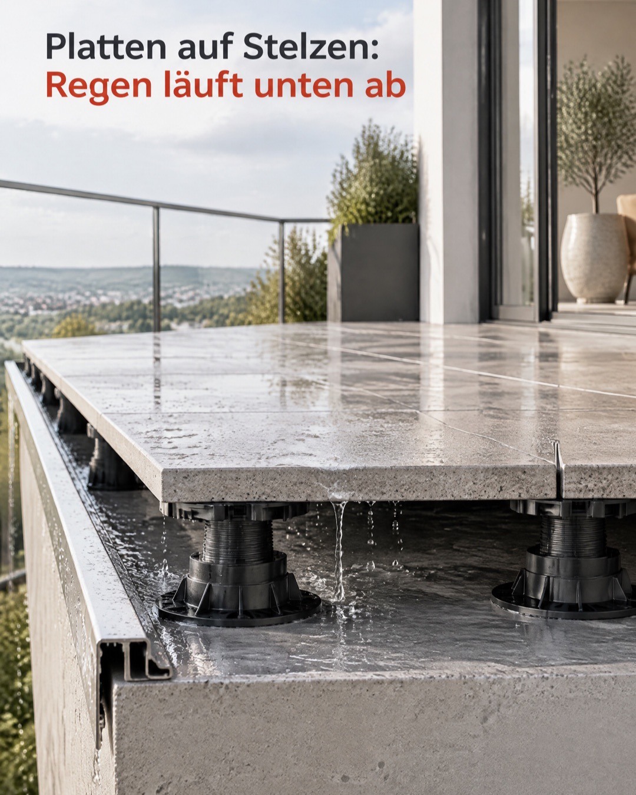 [TZ-005](prompts.md#tz-005) Platten auf Stelzen | Bei Stelzlagern liegen die Terrassenplatten auf höhenverstellbaren Füßen. Das Regenwasser läuft darunter ab, die Fläche bleibt eben. Wir beraten Sie, ob das für Ihren Balkon passt. Symbolbild. | [TZ-065](prompts.md#tz-065) Umfrage: Wanne oder Dusche ✋ |
| Do 05.11.2026 | 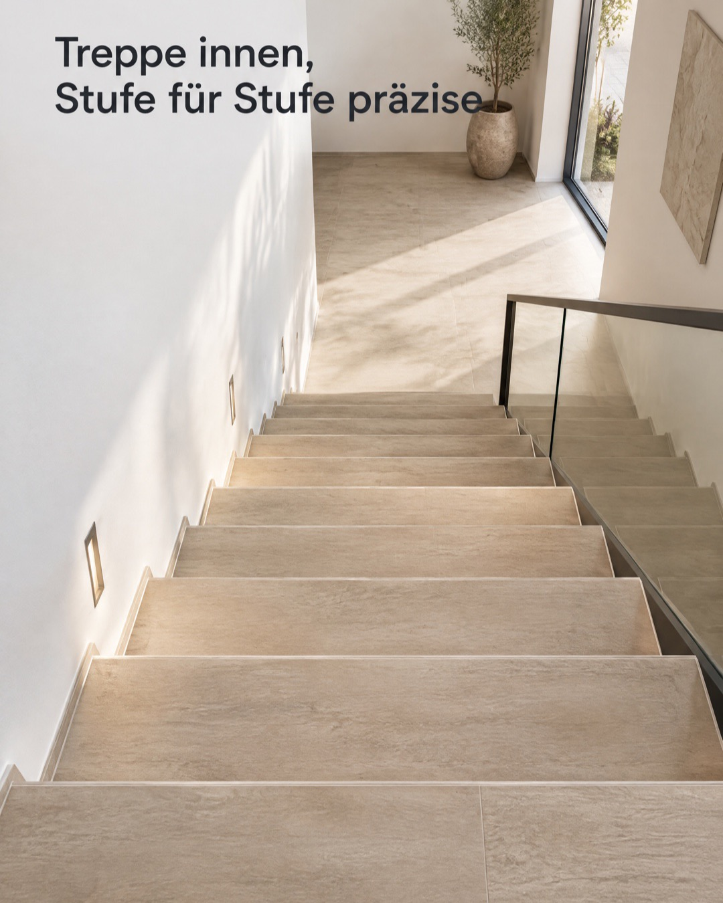 [TZ-045](prompts.md#tz-045) Treppe innen | Wir fliesen Treppen innen, außen und im Treppenhaus. Symbolbild. Termin vor Ort, kostenfrei: Link in Bio. |  |
| Fr 06.11.2026 | 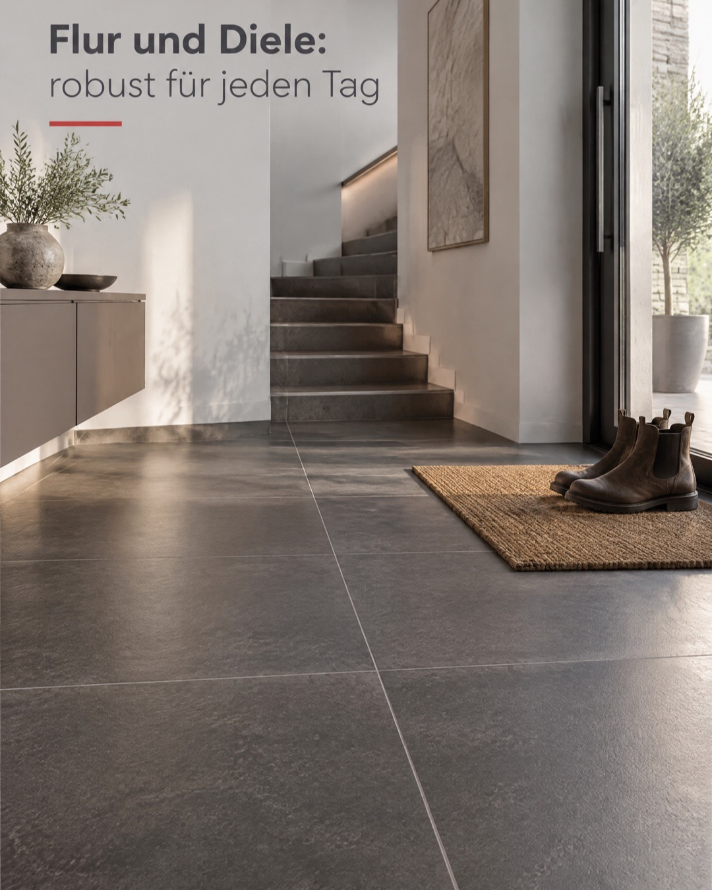 [TZ-047](prompts.md#tz-047) Flur und Diele | Wir verlegen Fliesen für Räume, die viel abbekommen. Symbolbild. Termin vor Ort, kostenfrei: Link in Bio. |  |
| Sa 07.11.2026 | 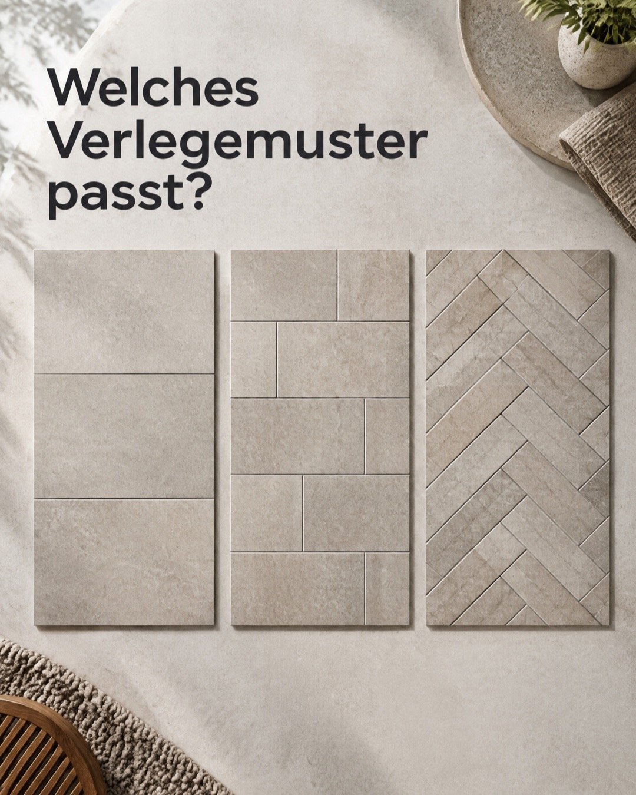 [TZ-048](prompts.md#tz-048) Verlegemuster | Wir beraten Sie, was zu Ihrem Raum passt. Symbolbild. Termin vor Ort, kostenfrei: Link in Bio. | [TZ-113](prompts.md#tz-113) Frage: Was stört Sie am Bad ✋ |
| So 08.11.2026 | 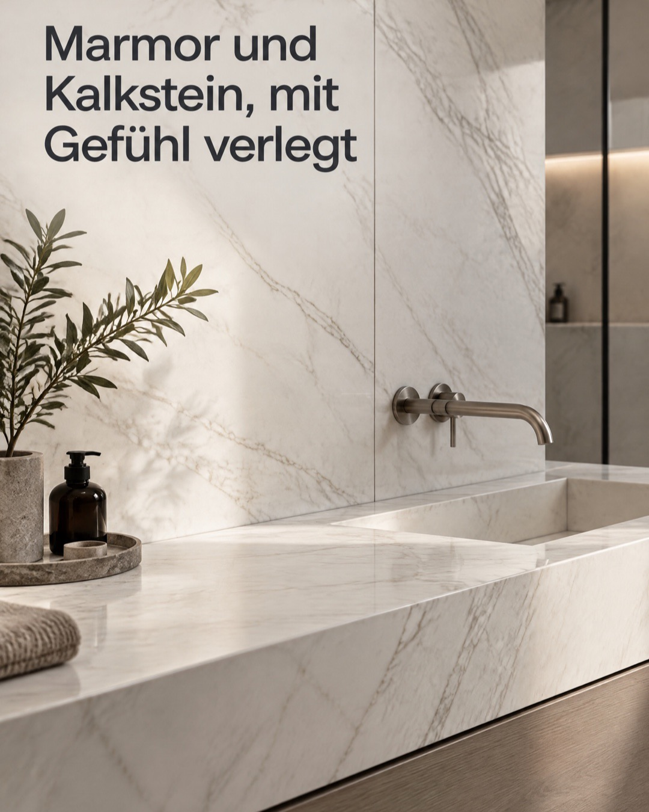 [TZ-053](prompts.md#tz-053) Marmor und Kalkstein | Naturstein braucht Erfahrung. Symbolbild. Termin vor Ort, kostenfrei: Link in Bio. |  |
| Mo 09.11.2026 | 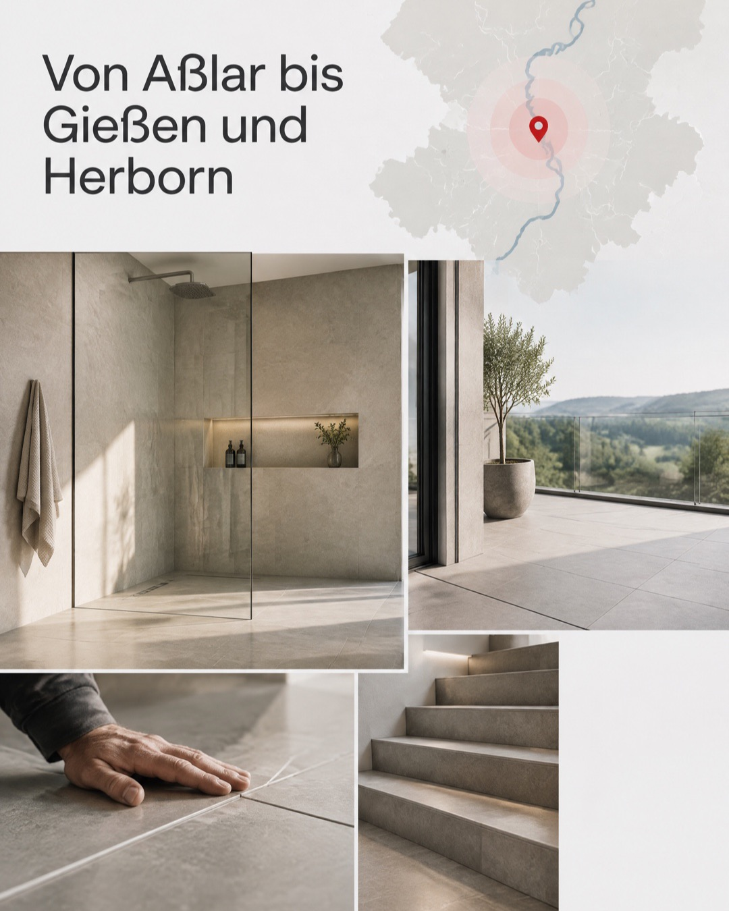 [TZ-060](prompts.md#tz-060) Einsatzgebiet | Wir fliesen in Wetzlar, Gießen, Herborn und den Orten rundherum. Termin vor Ort, kostenfrei: Link in Bio. |  |
| Di 10.11.2026 | 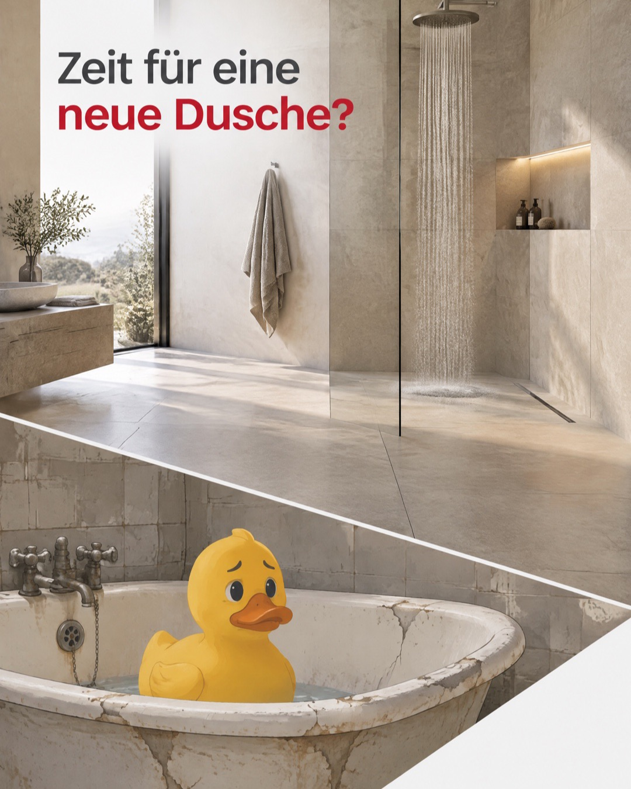 [TZ-063](prompts.md#tz-063) Zeit für eine neue Dusche | Wir bauen um, Sie duschen ohne Stufe. Termin vor Ort, kostenfrei: Link in Bio. | [TZ-114](prompts.md#tz-114) Slider: Stufe zur Dusche ✋ |
| Mi 11.11.2026 | 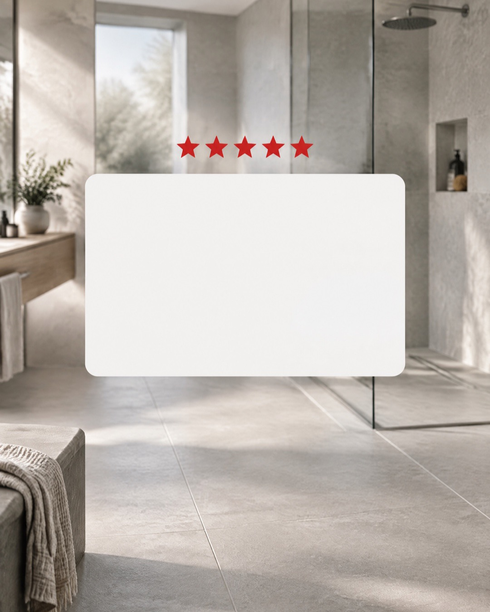 [TZ-006](prompts.md#tz-006) Bewertungskarte (nur Hintergrund) ⚠️ | Danke für Ihre Bewertungen! Was unsere Kunden schreiben, steht genau so bei Google. Hintergrund: Symbolbild. Termin vor Ort: Link in Bio. |  |
| Do 12.11.2026 | 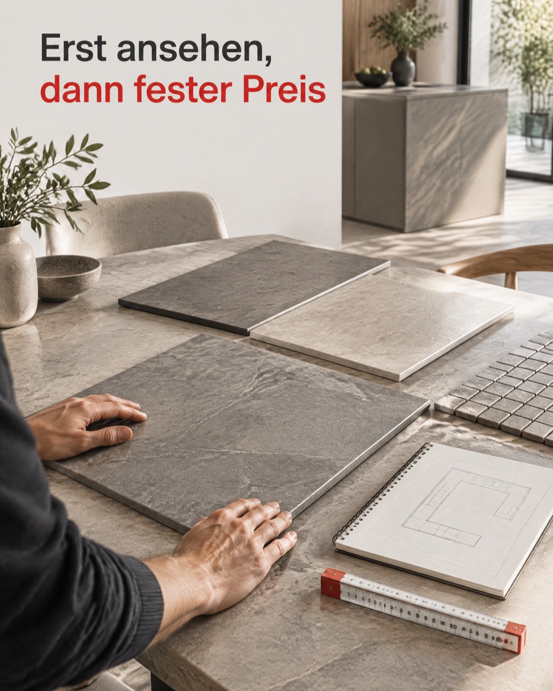 [TZ-001](prompts.md#tz-001) Termin vor Ort, fester Preis ⚠️ | Deniz Tezgel kommt kostenfrei zu Ihnen, prüft Boden und Wände und bespricht mit Ihnen Fliesen und Fugenfarbe. Danach bekommen Sie ein Angebot mit festem Preis. Symbolbild. Termin anfragen: Link in Bio oder 06441 / 44 83 567. | [TZ-121](prompts.md#tz-121) Story: Termin vor Ort, fester Preis ⚠️ |
| Fr 13.11.2026 |  [TZ-018](prompts.md#tz-018) Handwerkerbonus 2026 ⚠️ | Für Arbeiten im bestehenden Zuhause können Sie 20 % der Arbeits- und Fahrtkosten von der Steuer abziehen, höchstens 1.200 € pro Jahr (§ 35a EStG, Zahlung per Überweisung). Nach dem Regierungsentwurf soll der Satz ab 2027 auf 15 % sinken. Stand: Oktober 2026. Keine Steuerberatung, fragen Sie Ihren Steuerberater. | [TZ-066](prompts.md#tz-066) Umfrage: Fugenfarbe ⚠️ ✋ |
| Sa 14.11.2026 | 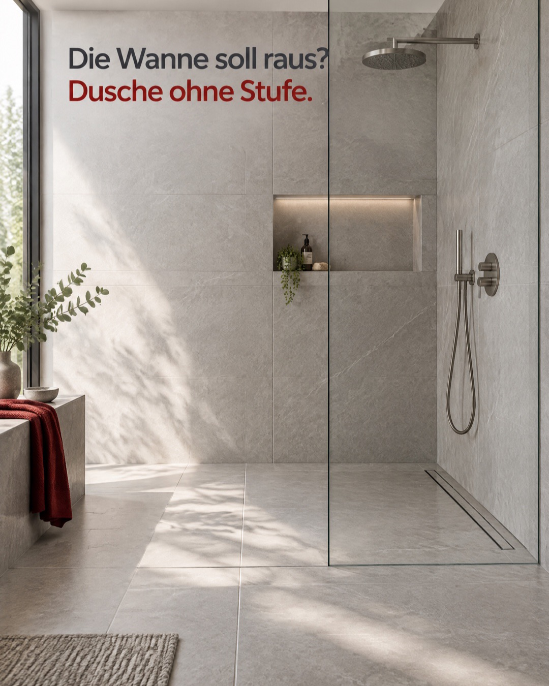 [TZ-002](prompts.md#tz-002) Dusche ohne Stufe ⚠️ | Sicher duschen ohne Stufe: Wir bauen Ihre Wanne zur bodengleichen Dusche um, mit Abdichtung nach DIN 18534 und rutschhemmenden Fliesen. Symbolbild. Termin vor Ort: kostenfrei. | [TZ-122](prompts.md#tz-122) Story: Dusche ohne Stufe ⚠️ |
| So 15.11.2026 | 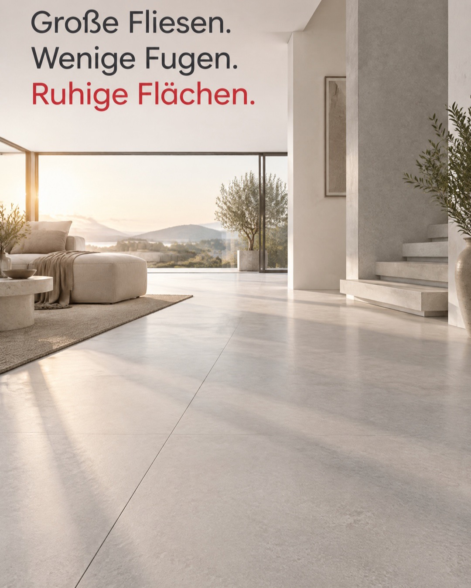 [TZ-003](prompts.md#tz-003) Große Fliesen ⚠️ | Seit 2014 ist das Verlegen großer Fliesen unser Schwerpunkt. Mit Vakuum-Hebern und Nivelliersystem liegen auch sehr große Formate millimetergenau. Symbolbild. | [TZ-123](prompts.md#tz-123) Story: Große Fliesen ⚠️ |
| Mo 16.11.2026 | 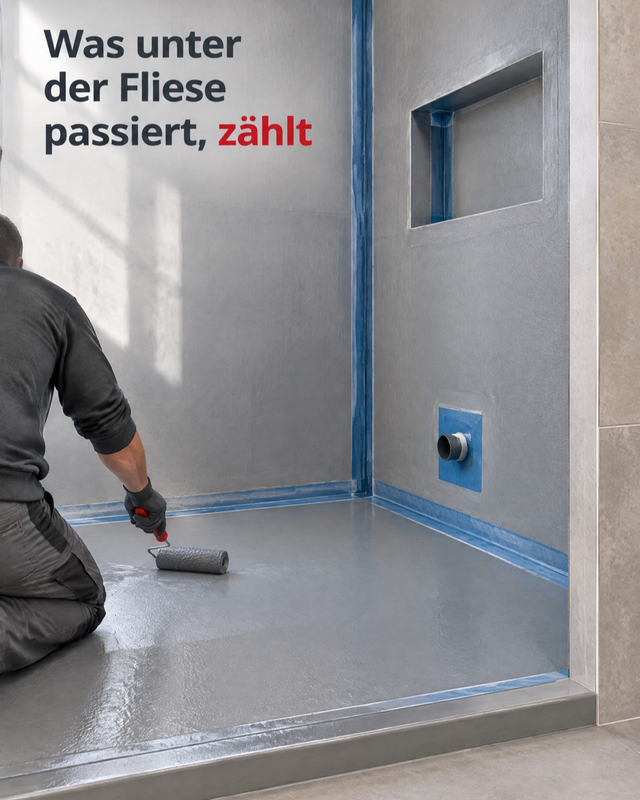 [TZ-015](prompts.md#tz-015) Abdichtung nach DIN 18534 ⚠️ | Seit 2019 ist bei uns die Abdichtung nach DIN 18534 Standard: Dichtband in den Ecken, Manschetten an den Rohren, eine lückenlose Schicht. So schützen wir Wand und Boden vor eindringendem Wasser. Symbolbild. | [TZ-125](prompts.md#tz-125) Story: Abdichtung nach DIN 18534 ⚠️ |
| Di 17.11.2026 | 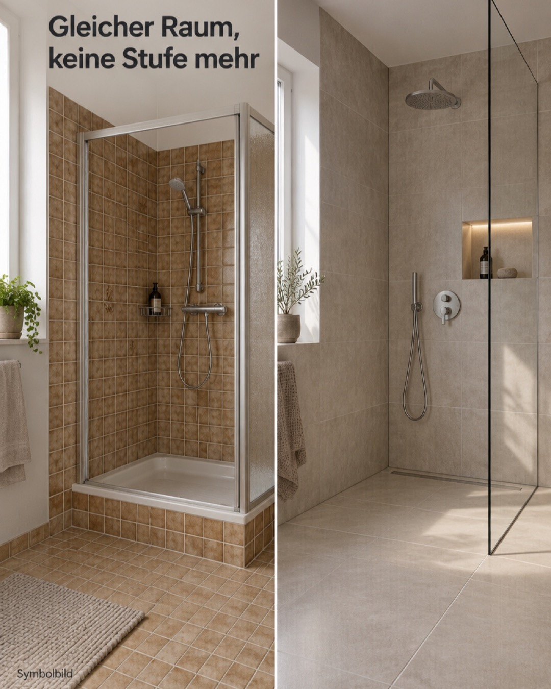 [TZ-075](prompts.md#tz-075) Vorher/Nachher als Symbolbild | Symbolbild: So kann aus einer Duschwanne mit hoher Stufe eine ebene Dusche werden. Echte Beispiele unserer Arbeit finden Sie auf tezgel.de. Termin vor Ort, kostenfrei: Link in Bio. | [TZ-067](prompts.md#tz-067) Termin vor Ort (Story) ⚠️ ✋ |
| Mi 18.11.2026 | 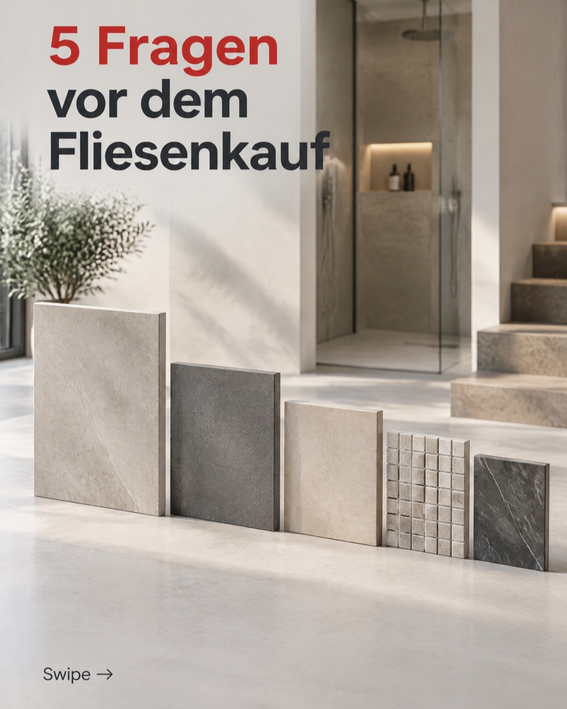 [TZ-028](prompts.md#tz-028) 5 Fragen vor dem Fliesenkauf (Karussell, 7 Bilder) ⚠️ | Je nach Raum verlegen wir rutschhemmende Fliesen mit R10 oder R11. Format, Fugenfarbe und Untergrund klären wir beim kostenfreien Termin vor Ort. Symbolbilder. |  |
| Do 19.11.2026 | 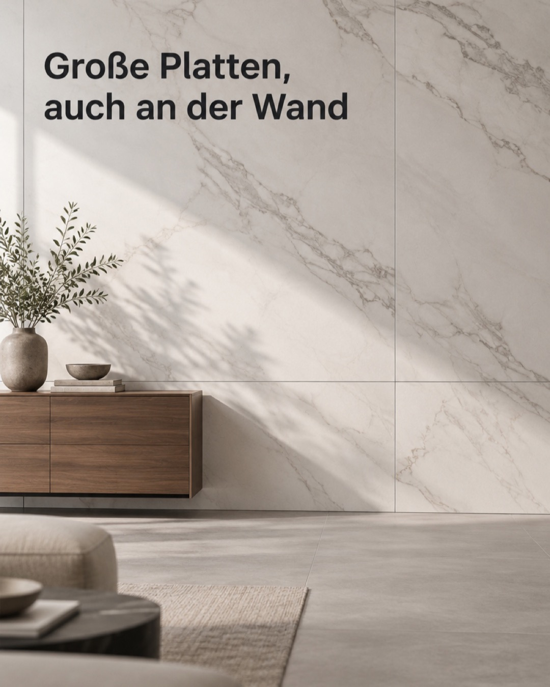 [TZ-084](prompts.md#tz-084) Großformat an der Wand | Großformatige Fliesen machen auch Wohnzimmer- und Flurwände zu einer ruhigen Fläche (Symbolbild). Mit Vakuum-Hebern bringen wir auch sehr große Formate sauber an die Wand. Termin vor Ort, kostenfrei: Link in Bio. |  |
| Fr 20.11.2026 | 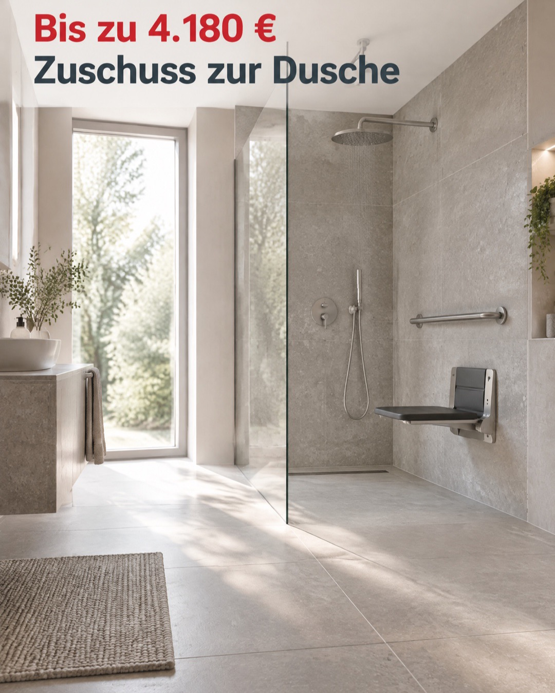 [TZ-017](prompts.md#tz-017) Zuschuss der Pflegekasse ⚠️ | Mit anerkanntem Pflegegrad (1–5) kann die Pflegekasse den Umbau zur bodengleichen Dusche mit bis zu 4.180 € pro pflegebedürftiger Person bezuschussen (Stand: Oktober 2026). Stellen Sie den Antrag möglichst vor Beginn der Arbeiten. Wir erstellen den prüffähigen Kostenvoranschlag. Symbolbild. | [TZ-126](prompts.md#tz-126) Story: Zuschuss der Pflegekasse ⚠️ |
| Sa 21.11.2026 | 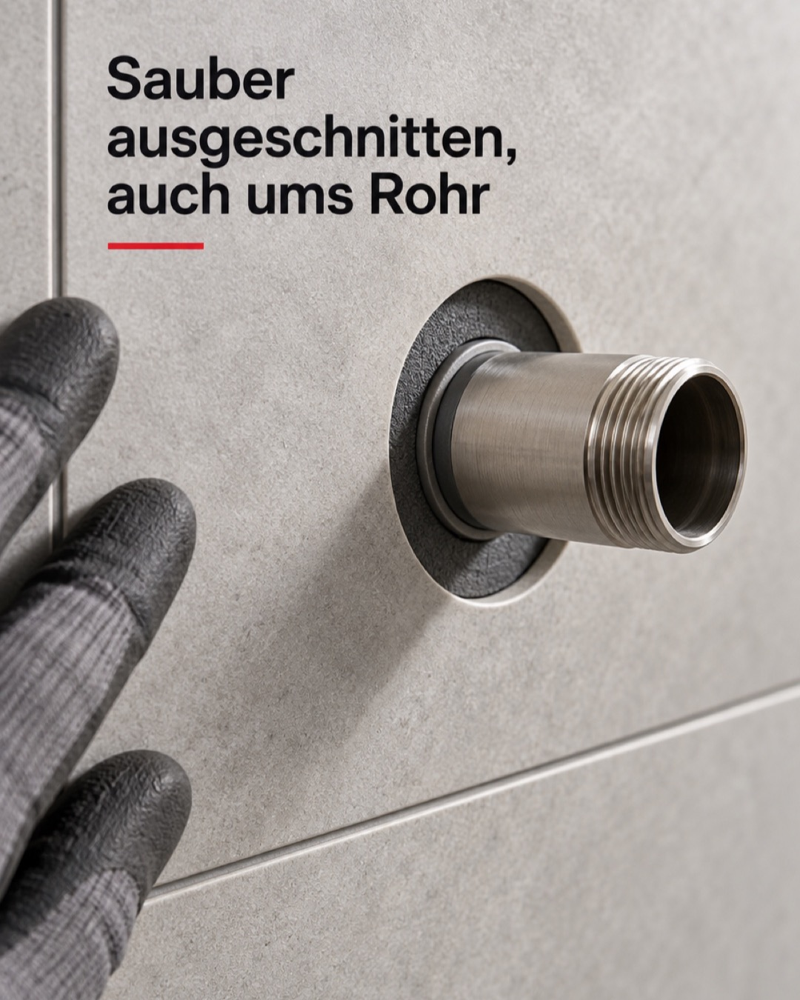 [TZ-100](prompts.md#tz-100) Ausschnitt ums Rohr | Ausschnitte für Rohre und Armaturen setzen wir genau, damit die Abdeckung später sauber aufliegt (Symbolbild). Darunter sitzt die Dichtmanschette, die das Wasser von der Wand fernhält. Termin vor Ort, kostenfrei: Link in Bio. | [TZ-115](prompts.md#tz-115) Umfrage: Matt oder glänzend ✋ |
| So 22.11.2026 | 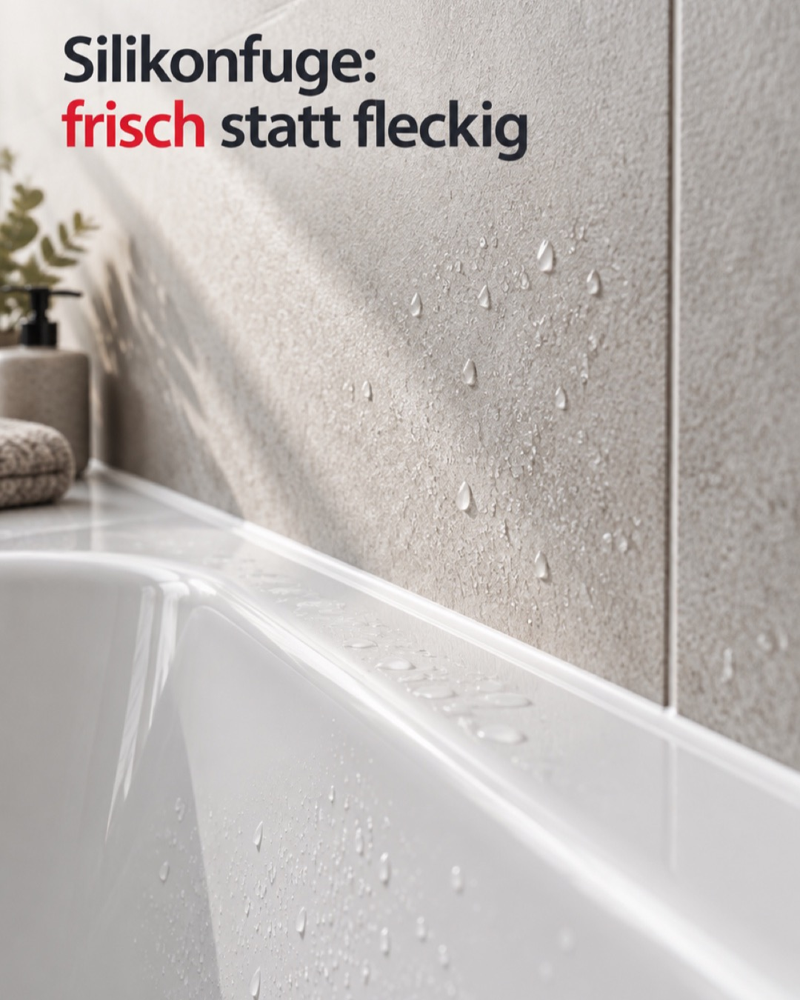 [TZ-101](prompts.md#tz-101) Silikonfuge erneuern | Silikonfugen an Wanne und Dusche werden mit der Zeit dunkel oder lösen sich. Wir entfernen das alte Silikon gründlich und ziehen die Fuge sauber neu (Symbolbild). Termin vor Ort, kostenfrei: Link in Bio. |  |
| Mo 23.11.2026 |  [TZ-102](prompts.md#tz-102) Kostenvoranschlag für die Pflegekasse ⚠️ | Für den Zuschuss der Pflegekasse zum Badumbau stellen Sie den Antrag möglichst vor Beginn der Arbeiten. Den prüffähigen Kostenvoranschlag dafür erstellen wir Ihnen. Termin vor Ort, kostenfrei: Link in Bio. |  |
| Di 24.11.2026 | 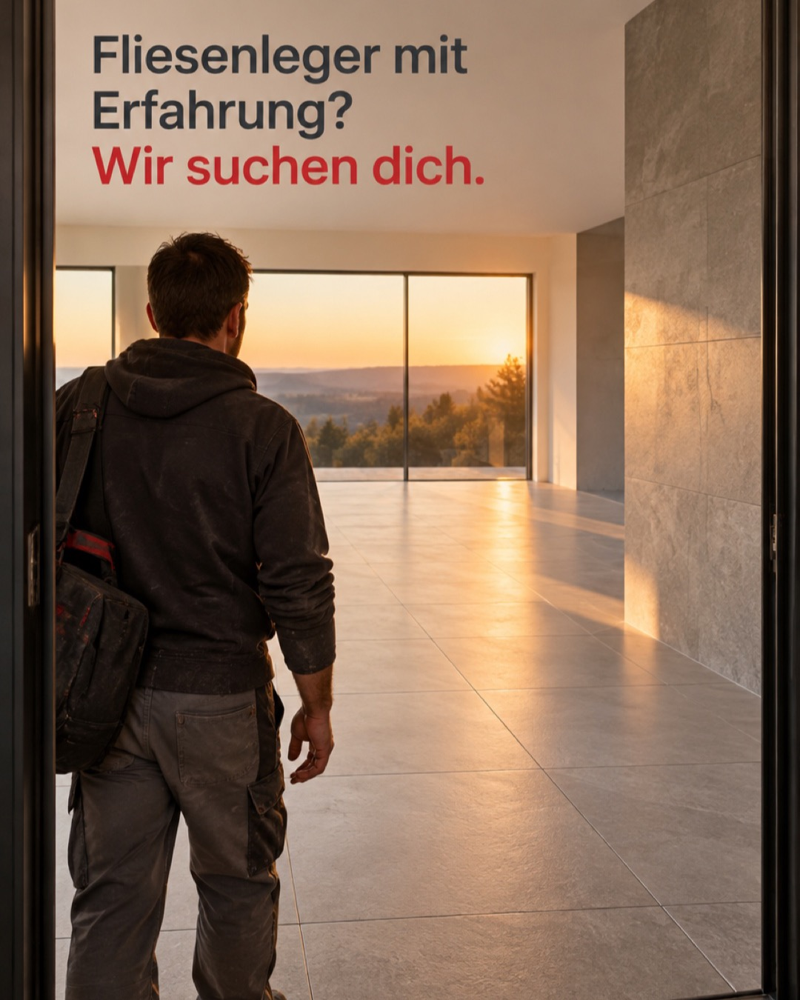 [TZ-104](prompts.md#tz-104) Fliesenleger mit Erfahrung gesucht ⚠️ | Symbolbild. Du verlegst gern große Formate und legst Wert auf gerade Fugen? Wir suchen erfahrene Fliesenleger (m/w/d) für unser Team in Aßlar, melde dich: Link in Bio. | [TZ-116](prompts.md#tz-116) Umfrage: Balkon oder Terrasse ✋ |
| Mi 25.11.2026 |  [TZ-011](prompts.md#tz-011) Fußbodenheizung | Fliesen leiten Wärme gut und passen ideal zur Fußbodenheizung. Wir achten auf die Belegreife des Estrichs und auf Entkopplung, damit die Fläche lange hält. Symbolbild. |  |
| Do 26.11.2026 | 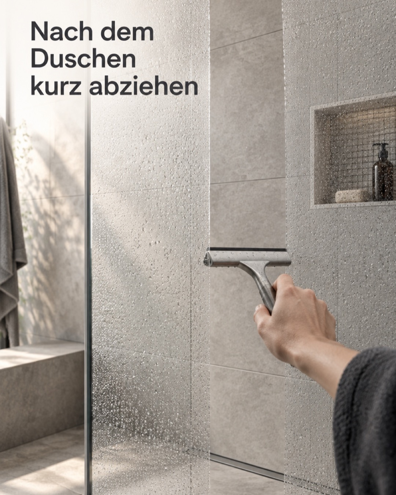 [TZ-112](prompts.md#tz-112) Nach dem Duschen abziehen | Wasser kurz abziehen und gut lüften: So bleiben Fliesen, Fugen und Silikon länger schön (Symbolbild). Bei Fragen zur Pflege beraten wir Sie gern. Termin vor Ort, kostenfrei: Link in Bio. |  |
| Fr 27.11.2026 | 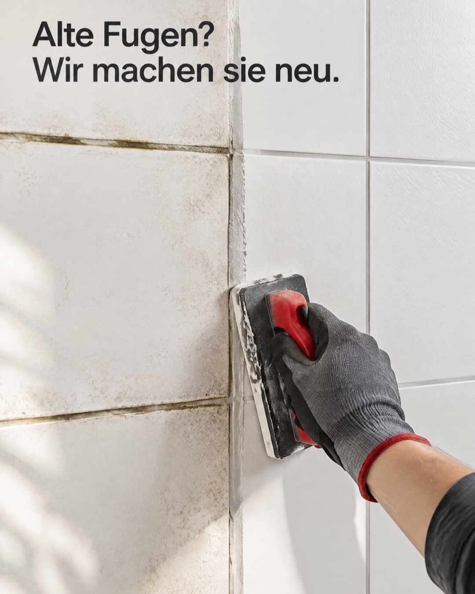 [TZ-007](prompts.md#tz-007) Fugen erneuern | Verfärbte oder bröselige Fugen lassen ein Bad schnell alt aussehen. Oft reicht es, die Fugen zu erneuern, statt alles neu zu fliesen. Symbolbild. Wir schauen es uns vor Ort an. | [TZ-117](prompts.md#tz-117) Fragen an den Fliesenleger ✋ |
| Sa 28.11.2026 | 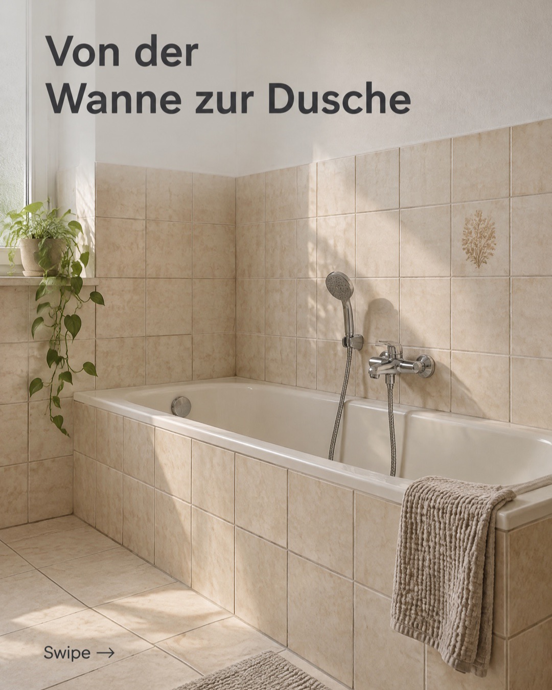 [TZ-021](prompts.md#tz-021) Von der Wanne zur Dusche (Karussell, 7 Bilder) ⚠️ | So läuft der Umbau bei uns ab, Schritt für Schritt. Symbolbilder, echte Fotos unserer Arbeit finden Sie auf tezgel.de. |  |
| So 29.11.2026 | 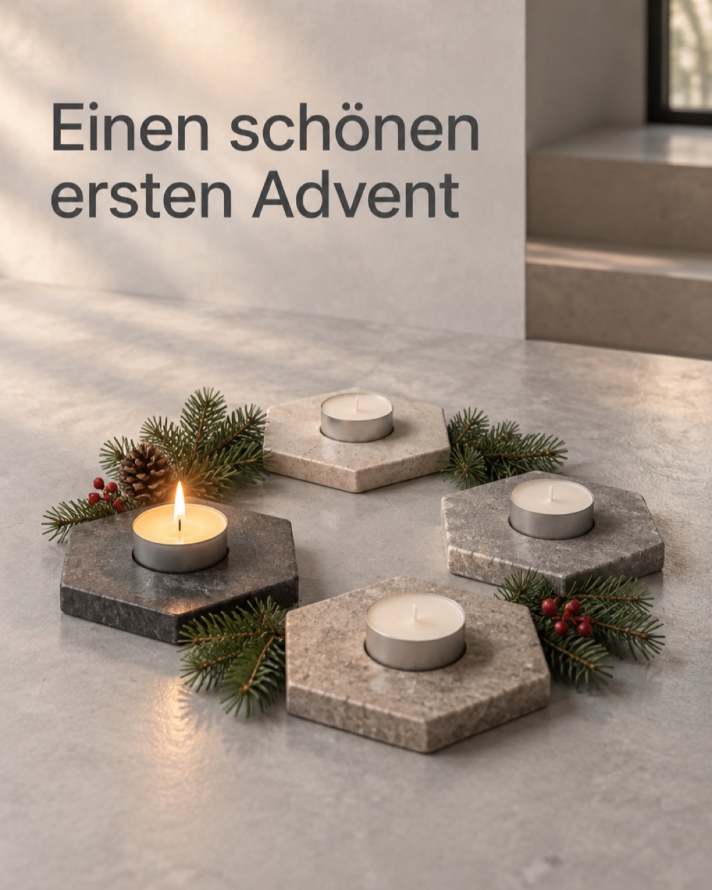 [TZ-110](prompts.md#tz-110) Erster Advent | Wir wünschen Ihnen eine ruhige Adventszeit. Wer im neuen Jahr ein neues Bad plant, kann schon jetzt einen Termin vor Ort vereinbaren, kostenfrei: Link in Bio. |  |
| Mo 30.11.2026 | 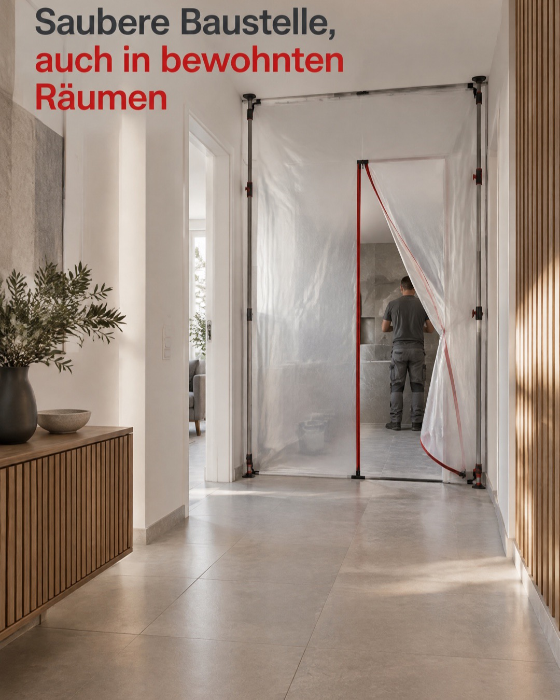 [TZ-016](prompts.md#tz-016) Staubschutz | Wir arbeiten mit Staubschutzwänden und Luftreinigern, damit Ihr Zuhause bewohnbar bleibt. Am Ende übergeben wir die Räume sauber gefegt und gehen alles gemeinsam durch. Symbolbild. | [TZ-118](prompts.md#tz-118) Echte Projekte ansehen ⚠️ ✋ |
| Di 01.12.2026 | 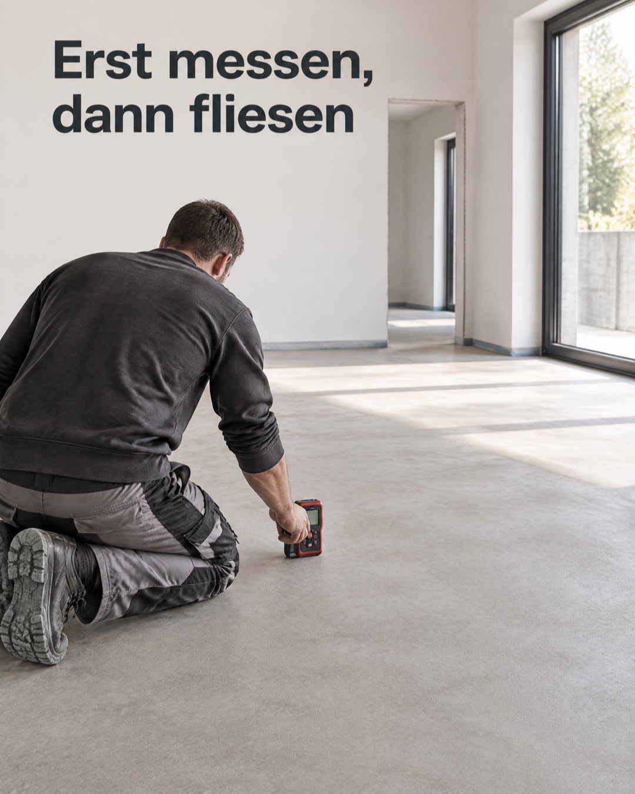 [TZ-054](prompts.md#tz-054) Erst messen, dann fliesen | Die Restfeuchte im Estrich messen wir direkt bei Ihnen. Symbolbild. Termin vor Ort, kostenfrei: Link in Bio. |  |
| Mi 02.12.2026 |  [TZ-018](prompts.md#tz-018) Handwerkerbonus 2026 ⚠️ (Wiederholung) | Für Arbeiten im bestehenden Zuhause können Sie 20 % der Arbeits- und Fahrtkosten von der Steuer abziehen, höchstens 1.200 € pro Jahr (§ 35a EStG, Zahlung per Überweisung). Nach dem Regierungsentwurf soll der Satz ab 2027 auf 15 % sinken. Stand: Oktober 2026. Keine Steuerberatung, fragen Sie Ihren Steuerberater. |  |
| Do 03.12.2026 | 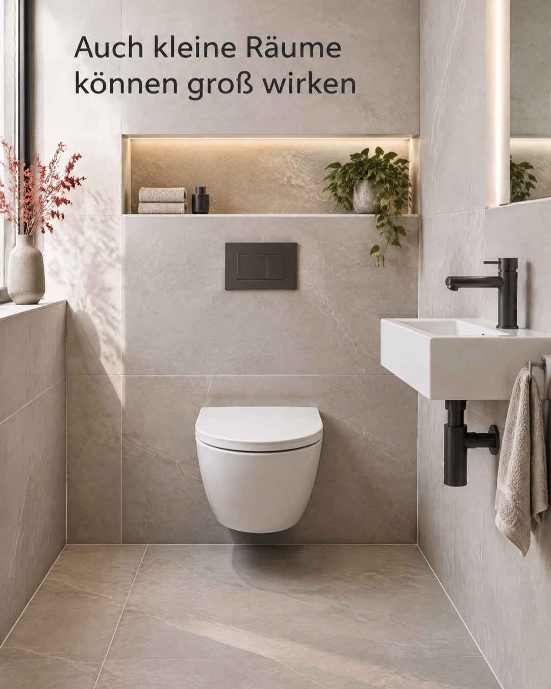 [TZ-041](prompts.md#tz-041) Kleines Gäste-WC | Wir haben Ideen für jede Badgröße, vom Gäste-WC bis zum großen Bad. Symbolbild. Termin vor Ort, kostenfrei: Link in Bio. | [TZ-119](prompts.md#tz-119) Handwerkerbonus: Zahlungszeitpunkt ⚠️ ✋ |
| Fr 04.12.2026 | 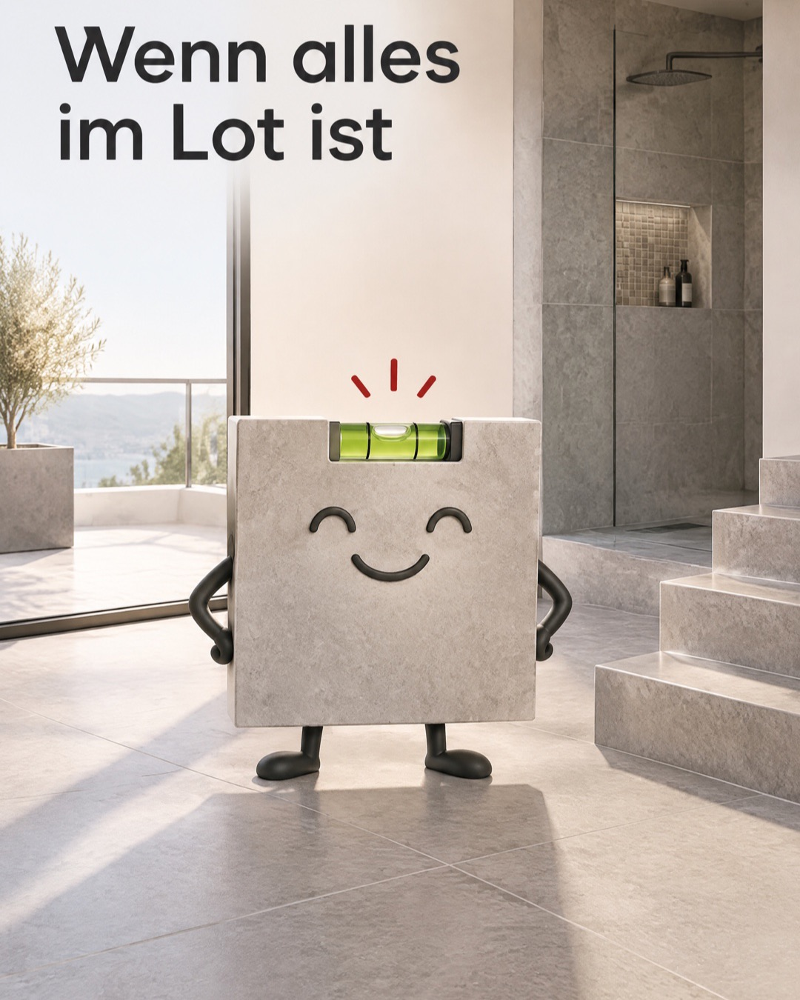 [TZ-062](prompts.md#tz-062) Wenn alles im Lot ist | Präzision macht uns glücklich. Termin vor Ort, kostenfrei: Link in Bio. |  |
| Sa 05.12.2026 | 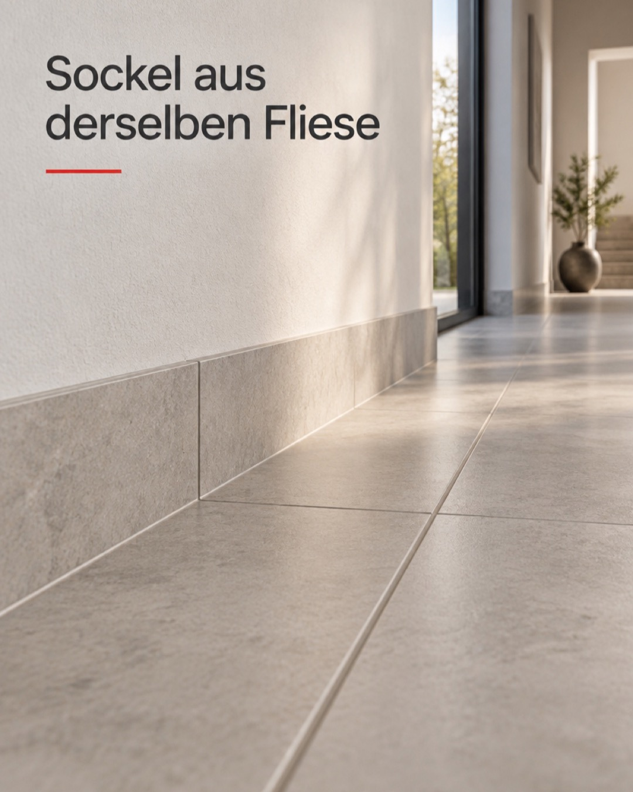 [TZ-085](prompts.md#tz-085) Sockel aus derselben Fliese | Sockelleisten aus derselben Fliese wie der Boden lassen Farbe und Fugen genau zusammenpassen (Symbolbild). Ein kleines Detail, das den ganzen Raum ruhiger macht. Termin vor Ort, kostenfrei: Link in Bio. |  |
| So 06.12.2026 | 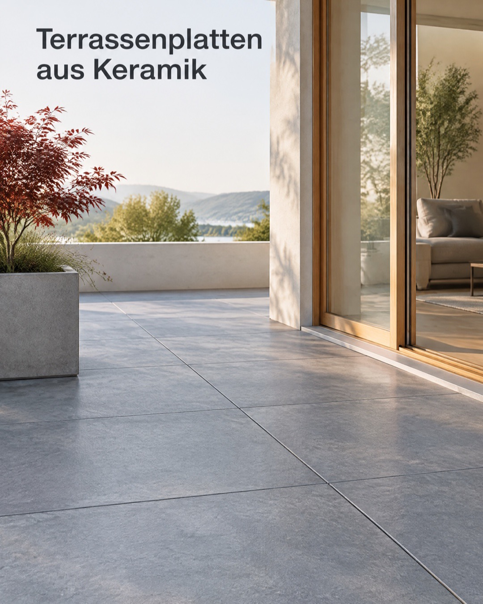 [TZ-052](prompts.md#tz-052) Terrassenplatten aus Keramik | Wir verlegen frostfeste Platten für draußen. Symbolbild. Termin vor Ort, kostenfrei: Link in Bio. |  |
| Mo 07.12.2026 | 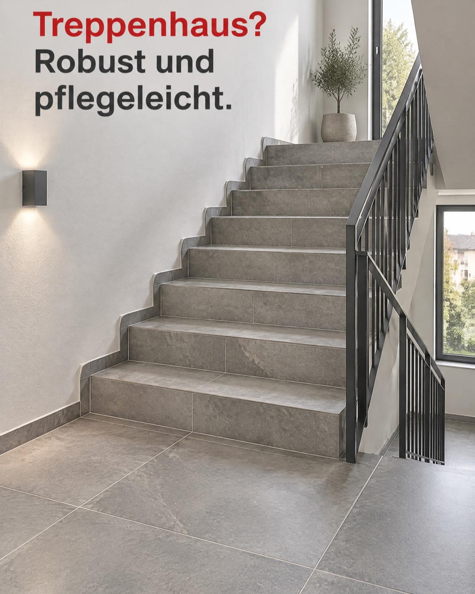 [TZ-046](prompts.md#tz-046) Treppenhaus | Im Treppenhaus braucht es Fliesen, die viel aushalten. Symbolbild. Termin vor Ort, kostenfrei: Link in Bio. |  |
| Di 08.12.2026 | 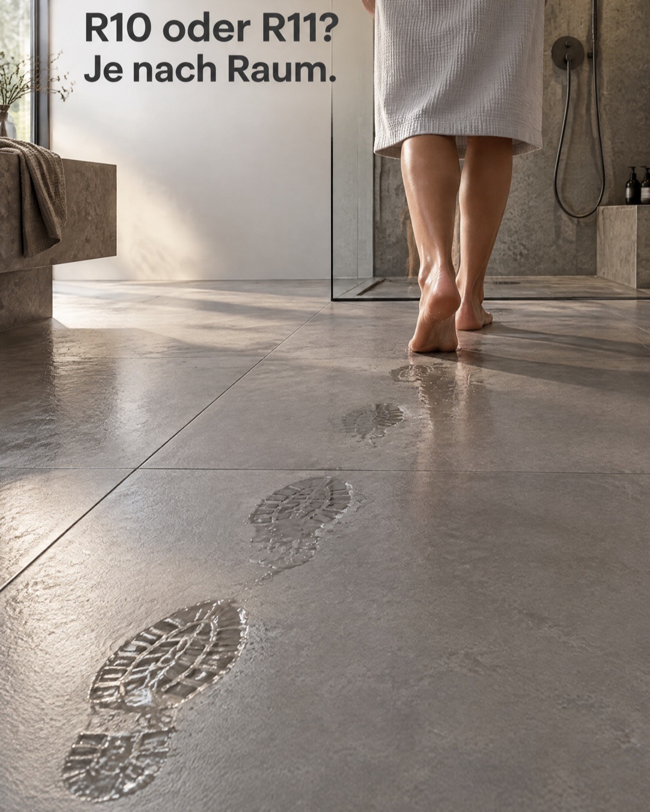 [TZ-049](prompts.md#tz-049) R10 oder R11 ⚠️ | Rutschhemmende Fliesen sorgen für mehr Sicherheit. Symbolbild. Termin vor Ort, kostenfrei: Link in Bio. |  |
| Mi 09.12.2026 | 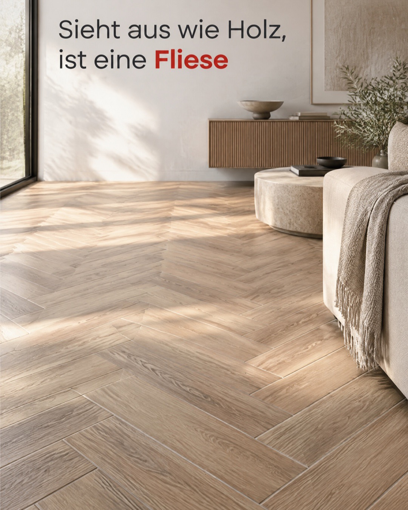 [TZ-010](prompts.md#tz-010) Holzoptik | Fliesen in Holzoptik sind pflegeleicht und passen gut zur Fußbodenheizung. Wir verlegen sie in verschiedenen Verlegemustern. Symbolbild. |  |
| Do 10.12.2026 | 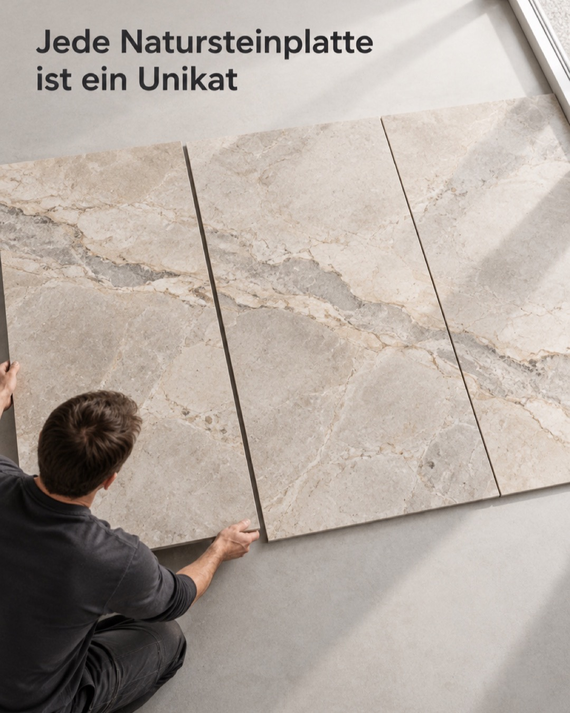 [TZ-083](prompts.md#tz-083) Naturstein als Unikat | Farbe und Maserung ändern sich bei Naturstein von Platte zu Platte (Symbolbild). Beim Verlegen achten wir darauf, dass die Platten stimmig zueinander passen. Termin vor Ort, kostenfrei: Link in Bio. |  |
| Fr 11.12.2026 | 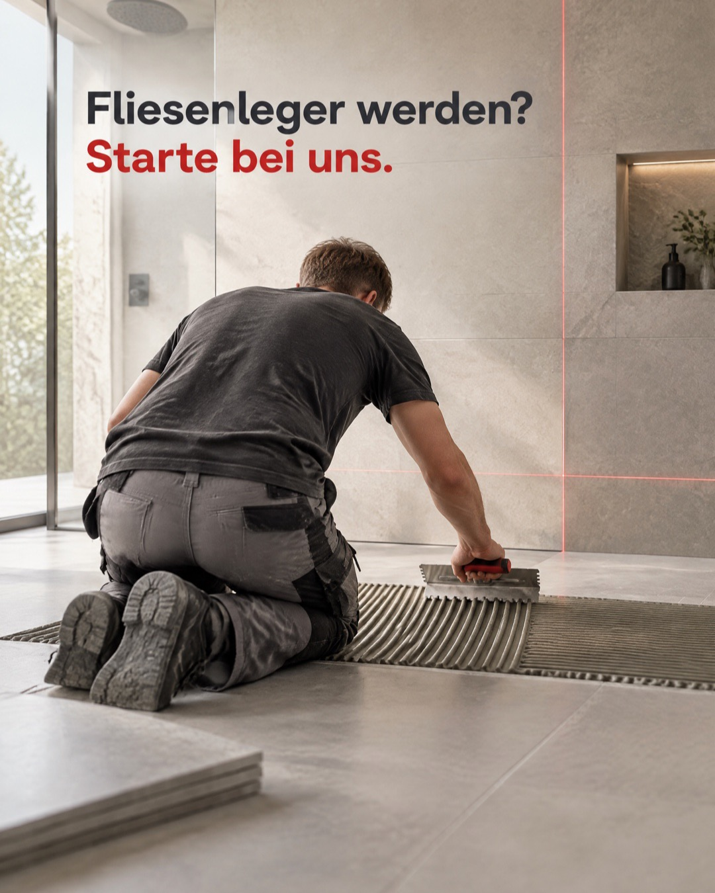 [TZ-020](prompts.md#tz-020) Ausbildung ⚠️ | Wir bilden aus und suchen Verstärkung (m/w/d). Wenn du gern mit den Händen arbeitest und abends sehen willst, was du geschafft hast: Melde dich, Link in Bio. Symbolbild. |  |
| Sa 12.12.2026 | 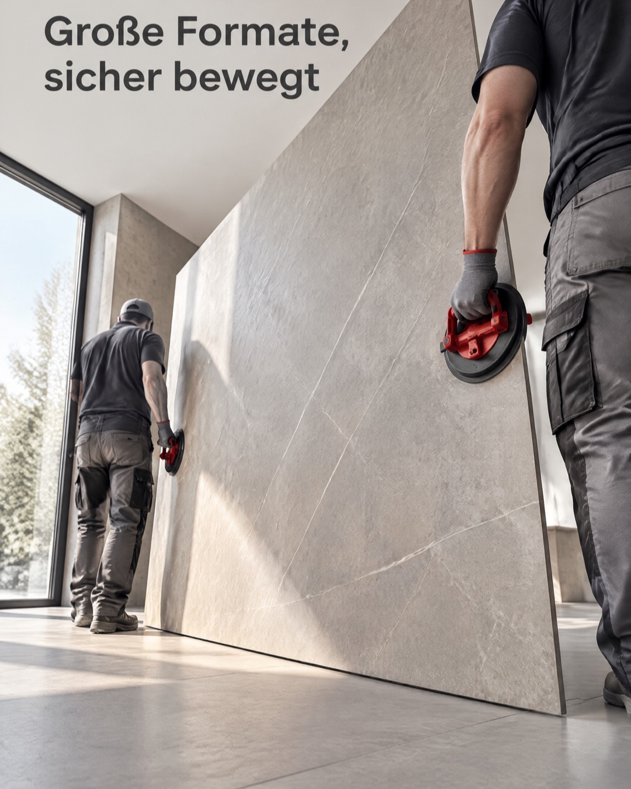 [TZ-061](prompts.md#tz-061) Große Formate | Wir arbeiten mit Vakuum-Hebern und Nivelliersystem für millimetergenaue Flächen. Symbolbild. Termin vor Ort, kostenfrei: Link in Bio. |  |
| So 13.12.2026 | 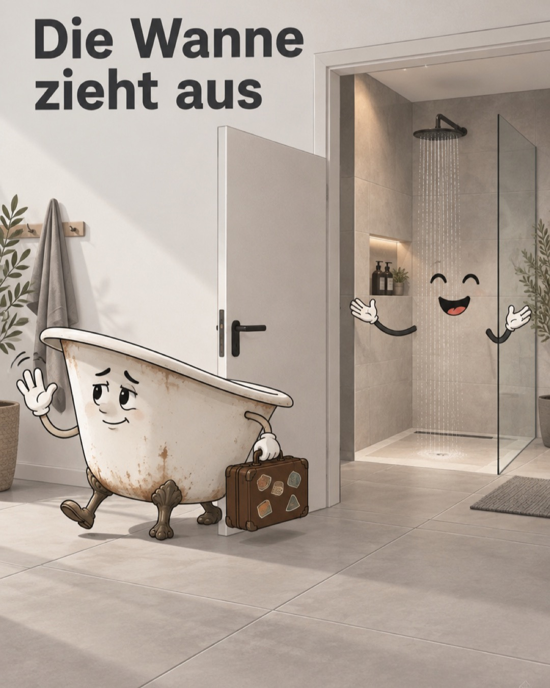 [TZ-108](prompts.md#tz-108) Die Wanne zieht aus | Und die Dusche ohne Stufe zieht ein. Wir planen den Umbau mit Ihnen, vom ersten Termin bis zur Übergabe. Termin vor Ort, kostenfrei: Link in Bio. |  |
| Mo 14.12.2026 | 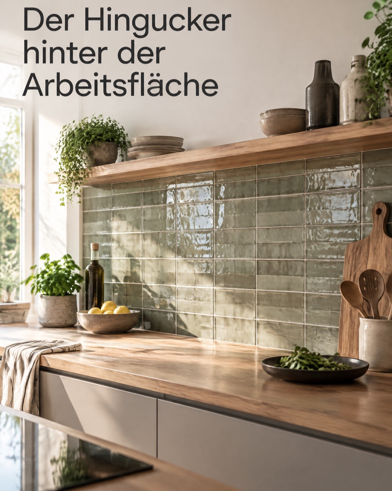 [TZ-012](prompts.md#tz-012) Küche | Eine geflieste Küchenwand ist pflegeleicht und setzt Akzente. Wir fliesen Boden und Wand in Ihrer Küche. Symbolbild. |  |
| Di 15.12.2026 | 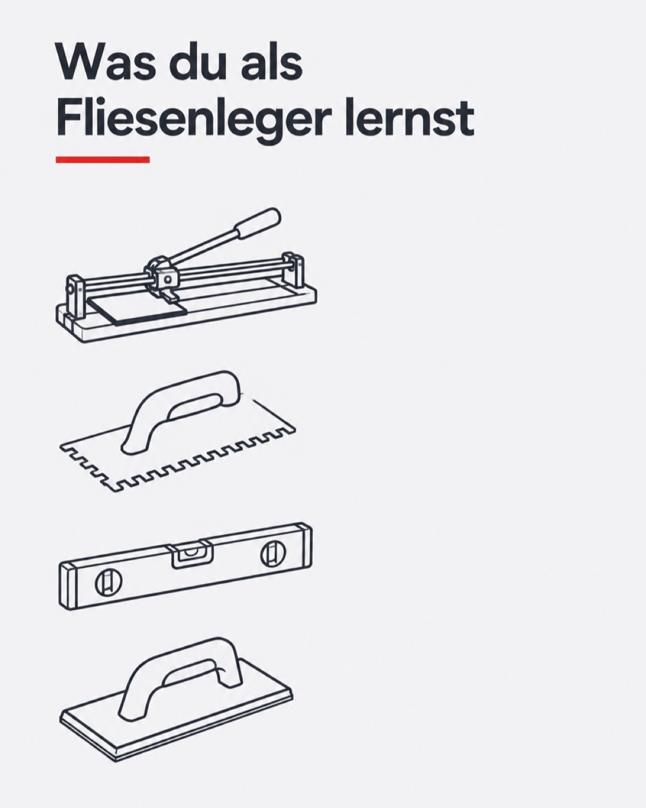 [TZ-105](prompts.md#tz-105) Was du als Fliesenleger lernst ⚠️ | Schneiden, verlegen, ausrichten, verfugen: Im Fliesenhandwerk siehst du abends, was du geschafft hast. Wir bilden Fliesenleger (m/w/d) aus und freuen uns auf deine Nachricht: Link in Bio. |  |
| Mi 16.12.2026 | 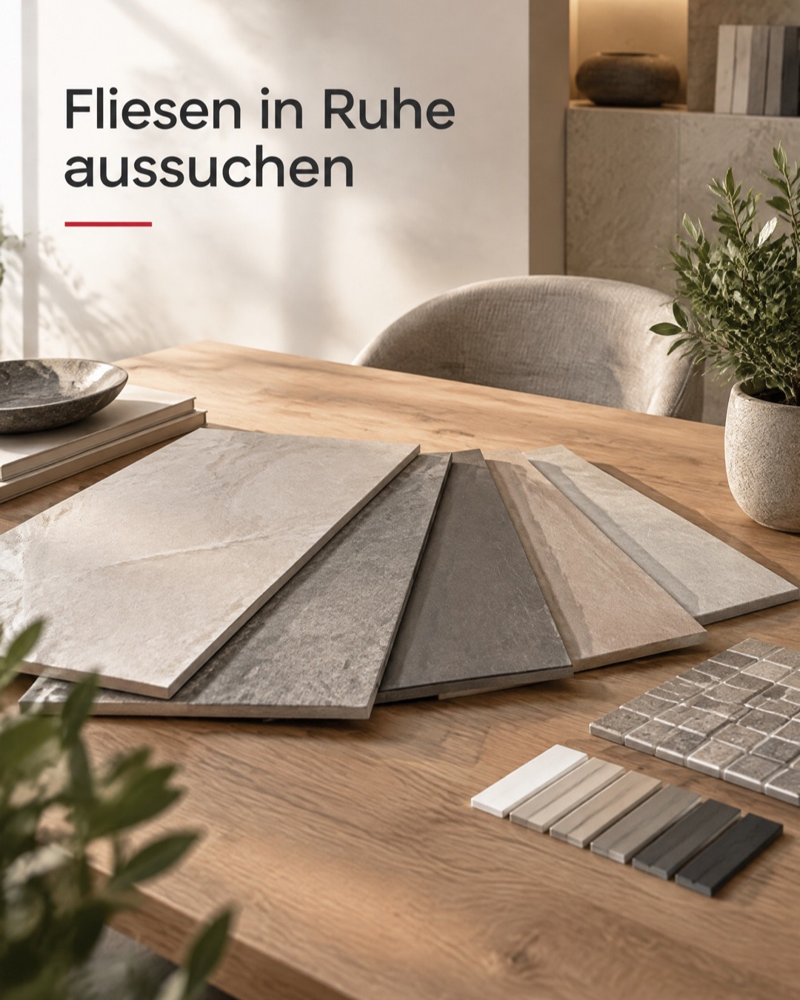 [TZ-019](prompts.md#tz-019) Fliesenberatung | Möchten Sie vorher in Ruhe über Fliesen sprechen? Fliesenberatung in Wetzlar und Gießen nach Terminvereinbarung. Symbolbild. |  |
| Do 17.12.2026 | 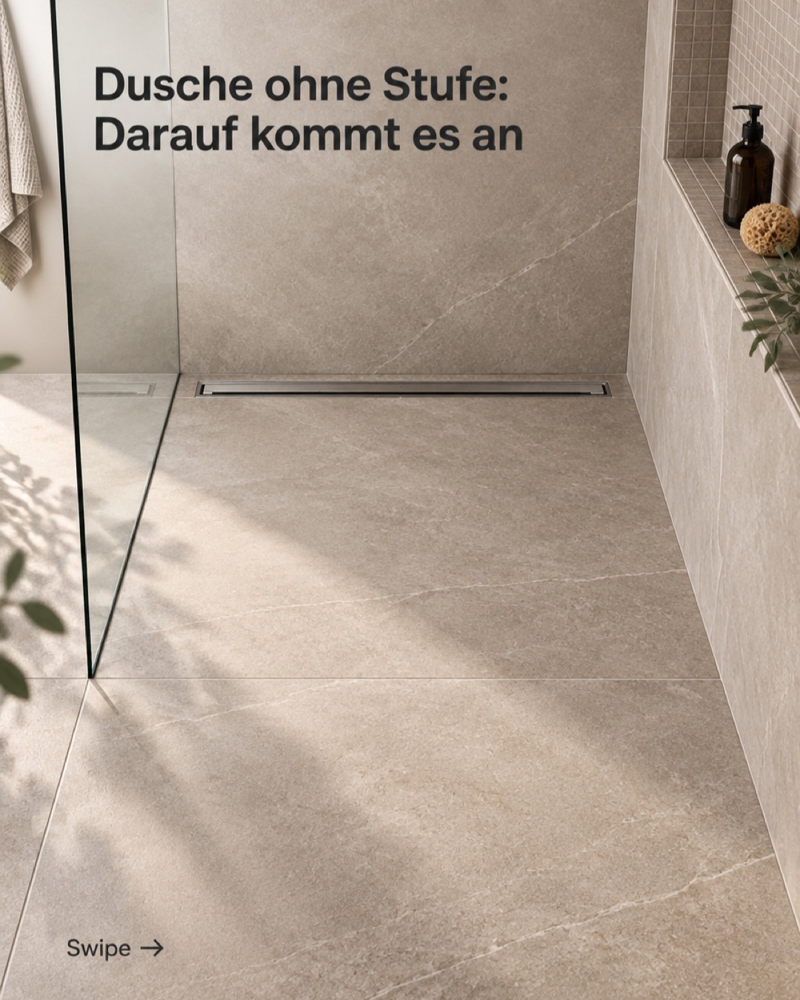 [TZ-076](prompts.md#tz-076) Dusche ohne Stufe im Detail (Karussell, 6 Bilder) | Bündige Rinne, sauberes Gefälle, Abdichtung bis in die Ecken und Fugen in einer Linie: Darauf achten wir bei der Dusche ohne Stufe (Symbolbilder). Termin vor Ort, kostenfrei: Link in Bio. |  |
| Fr 18.12.2026 | 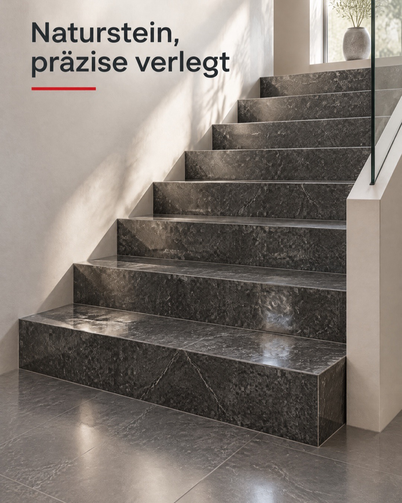 [TZ-013](prompts.md#tz-013) Naturstein | Granit, Marmor und Kalkstein brauchen Erfahrung beim Verlegen. Wir arbeiten mit Naturstein an Treppen, Böden und Wänden. Symbolbild. |  |
| Sa 19.12.2026 | 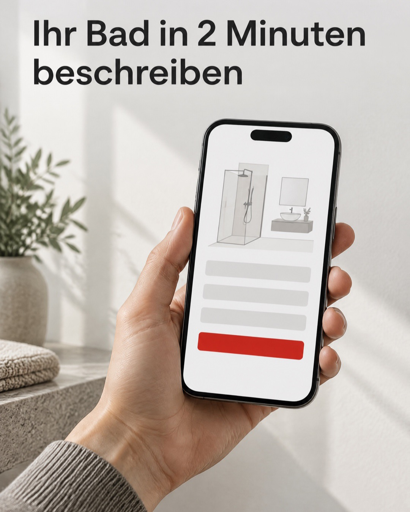 [TZ-055](prompts.md#tz-055) Projekt-Check ⚠️ | Beschreiben Sie Ihr Bad im Projekt-Check auf tezgel.de. Termin vor Ort, kostenfrei: Link in Bio. |  |
| So 20.12.2026 | 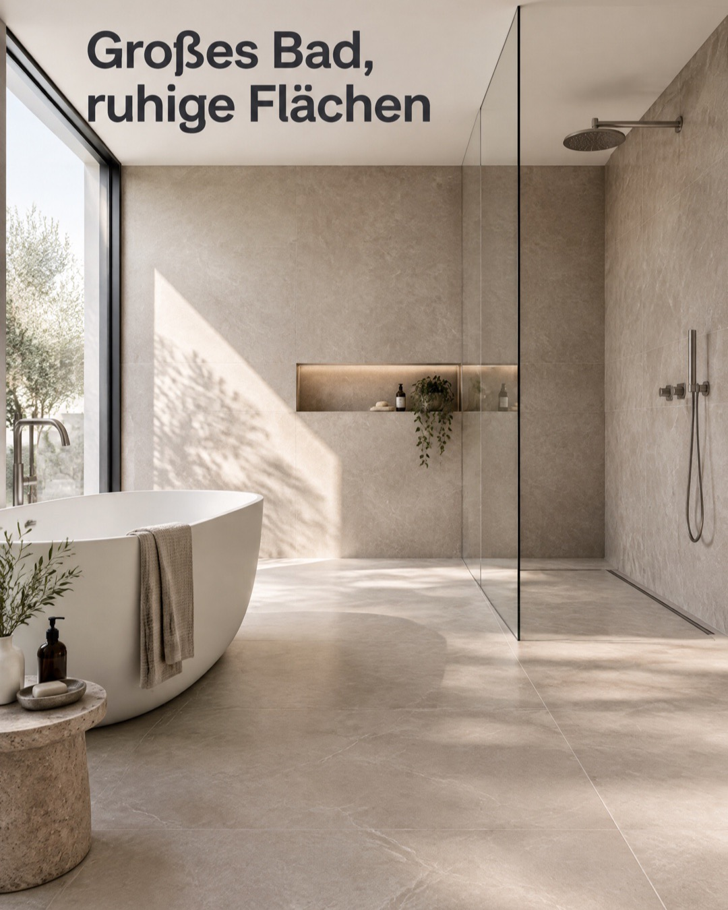 [TZ-042](prompts.md#tz-042) Großes Bad | Wenige Fugen bringen viel Ruhe ins Bad. Symbolbild. Termin vor Ort, kostenfrei: Link in Bio. |  |
| Mo 21.12.2026 | 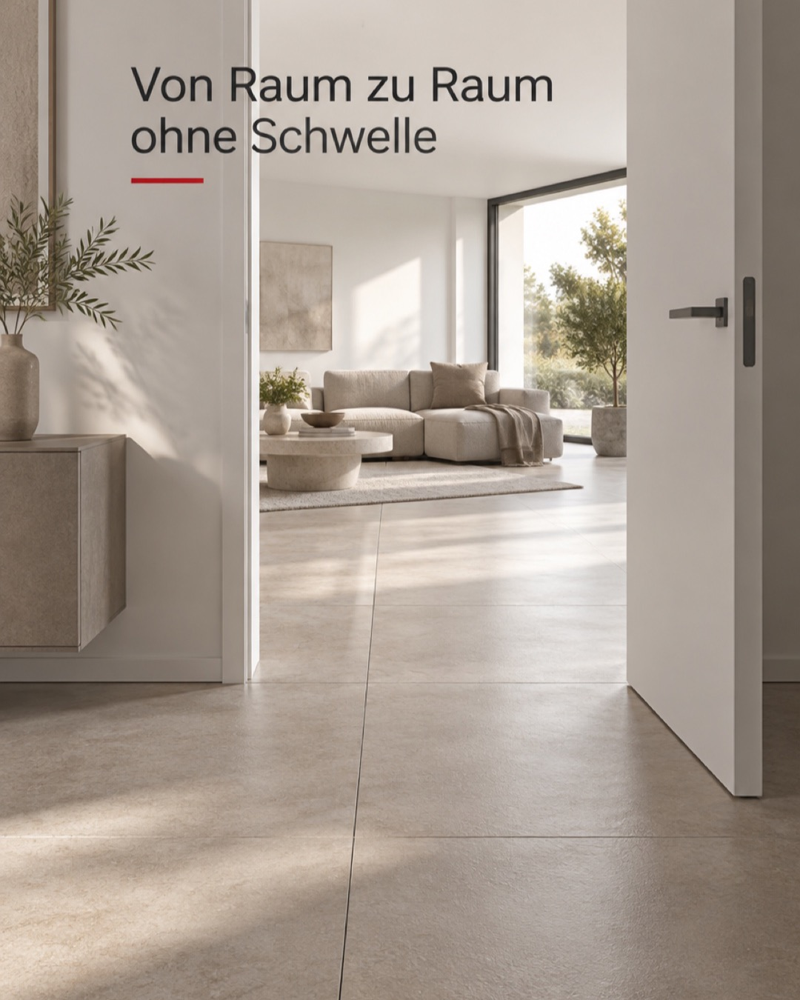 [TZ-086](prompts.md#tz-086) Ohne Schwelle durch die Räume | Laufen die Fliesen ohne Schwelle durch mehrere Räume, wirkt die Wohnung größer und ruhiger (Symbolbild). Wir planen das Fugenbild über alle Räume hinweg. Termin vor Ort, kostenfrei: Link in Bio. |  |
| Di 22.12.2026 | 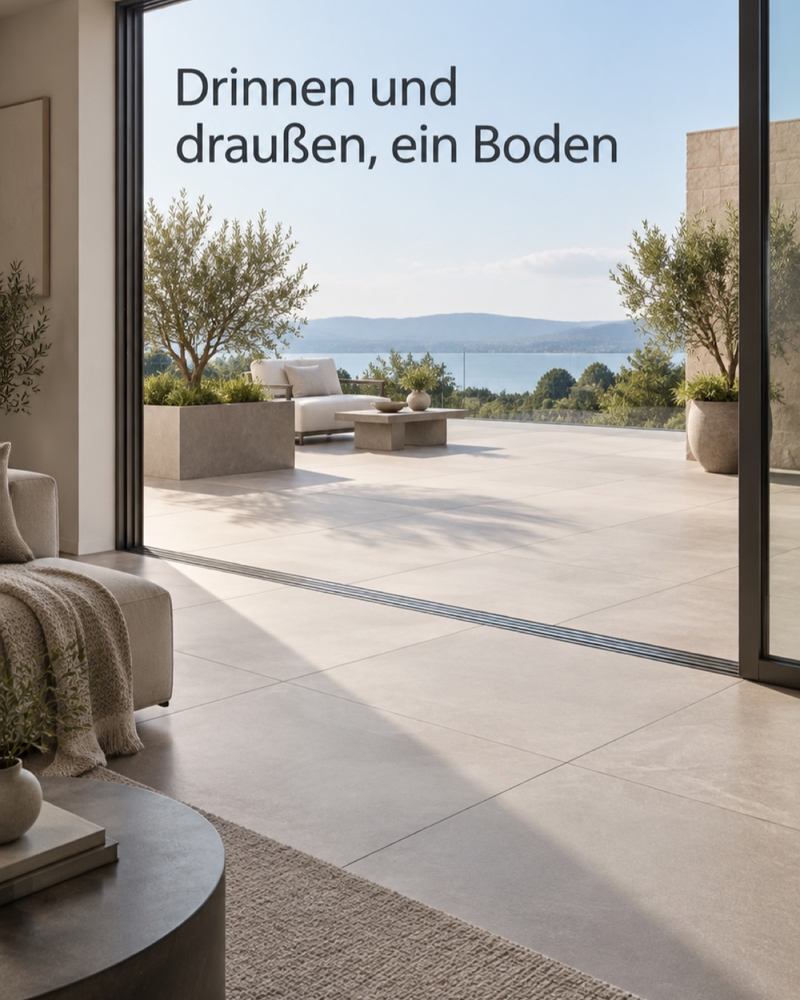 [TZ-094](prompts.md#tz-094) Drinnen und draußen, ein Boden | Passende Fliesen innen und Terrassenplatten außen verbinden Wohnraum und Terrasse zu einer Fläche (Symbolbild). Wir beraten Sie, welche frostfesten Platten und welcher Übergang zu Ihrem Haus passen. Termin vor Ort, kostenfrei: Link in Bio. |  |
| Mi 23.12.2026 | 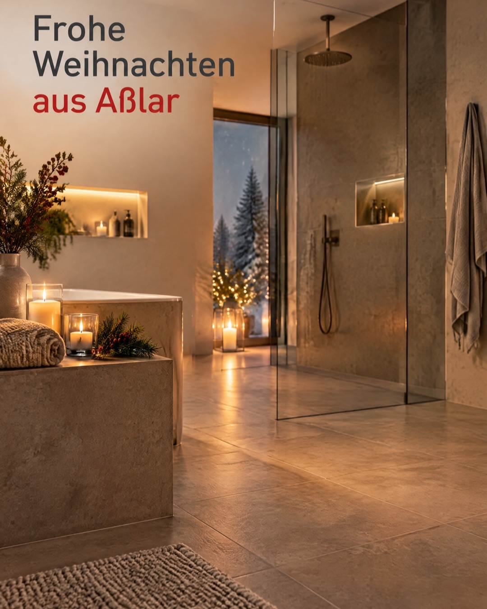 [TZ-064](prompts.md#tz-064) Frohe Weihnachten | Danke für Ihr Vertrauen und schöne Feiertage! Symbolbild. Termin vor Ort, kostenfrei: Link in Bio. |  |
| Do 24.12.2026 | 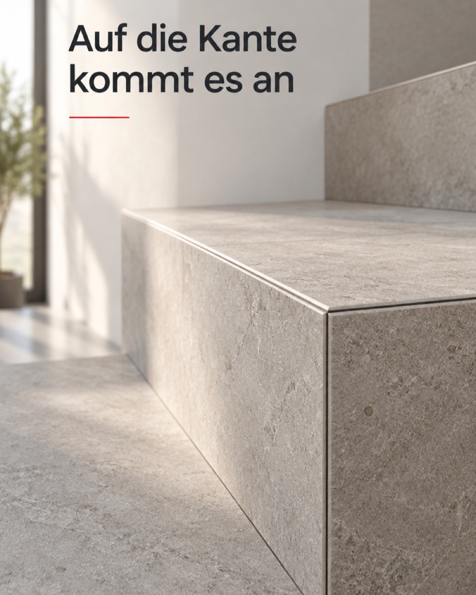 [TZ-082](prompts.md#tz-082) Die Stufenkante | An der Stufenkante sieht man, wie genau gearbeitet wurde (Symbolbild). Wir schneiden Tritt- und Setzstufen passgenau und richten die Fugen aufeinander aus. Termin vor Ort, kostenfrei: Link in Bio. |  |
| Sa 26.12.2026 | 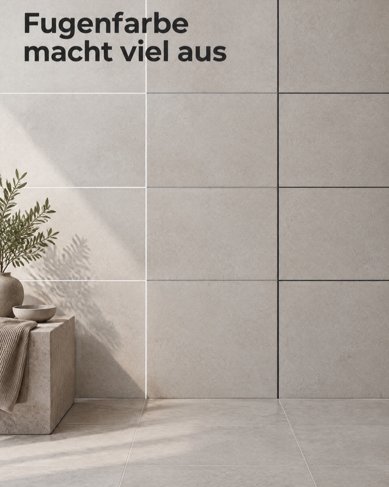 [TZ-050](prompts.md#tz-050) Fugenfarbe ⚠️ | Wir zeigen Ihnen die Wirkung vorher. Symbolbild. Termin vor Ort, kostenfrei: Link in Bio. |  |
| So 27.12.2026 | 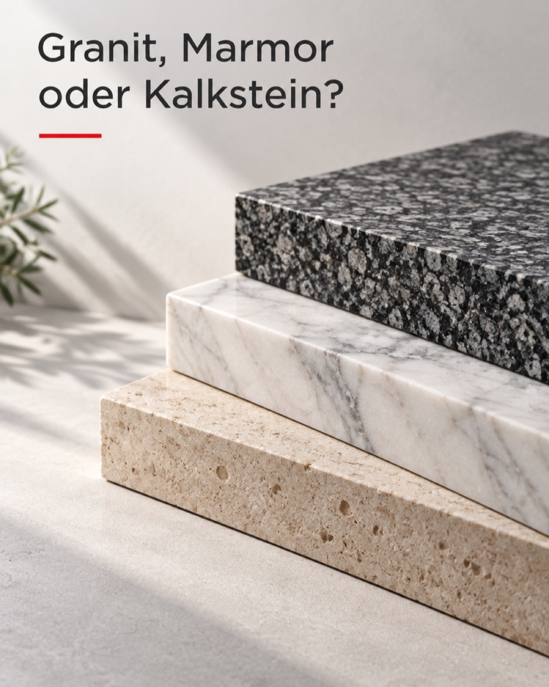 [TZ-087](prompts.md#tz-087) Granit, Marmor oder Kalkstein | Jeder Naturstein hat seinen eigenen Charakter, in Farbe, Oberfläche und Pflege (Symbolbild). Wir beraten Sie, welcher Stein zu Ihrem Raum passt. Termin vor Ort, kostenfrei: Link in Bio. | [TZ-120](prompts.md#tz-120) Umfrage: Neues Bad im neuen Jahr ✋ |
| Mo 28.12.2026 | 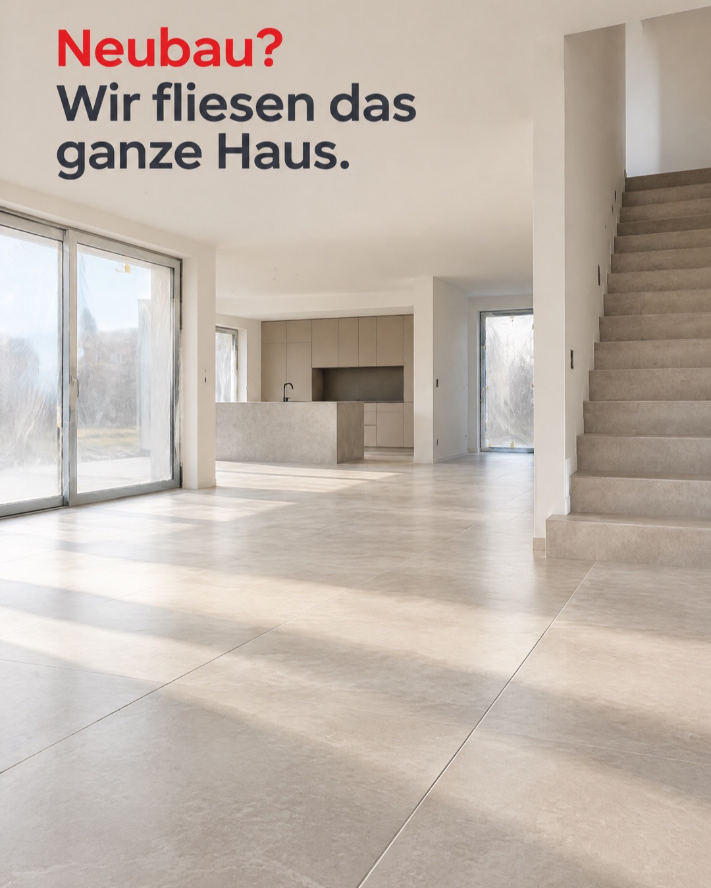 [TZ-014](prompts.md#tz-014) Neubau | Im Neubau fliesen wir Böden und Wände im ganzen Haus, vom Bad bis zur Treppe. Ein Ansprechpartner von der ersten Skizze bis zur Übergabe. Symbolbild. |  |
| Di 29.12.2026 |  [TZ-106](prompts.md#tz-106) Der Inhaber kommt selbst ⚠️ | Symbolbild. Zu Ihnen kommt Inhaber Deniz Tezgel selbst und bespricht mit Ihnen Boden, Wände und Fliesen. Fachbetrieb in Aßlar seit 2008. Termin vor Ort, kostenfrei: Link in Bio. |  |
| Mi 30.12.2026 |  [TZ-008](prompts.md#tz-008) Gesprungene Fliese | Einzelne Fliesen lassen sich oft austauschen, wenn passende Fliesen vorhanden sind. Symbolbild. Wir prüfen vor Ort, was möglich ist. |  |
| Do 31.12.2026 |  [TZ-109](prompts.md#tz-109) Guter Vorsatz | Große Fliesen haben weniger Fugen, also gibt es auch weniger zu putzen. Wir beraten Sie zu Formaten und Fugenfarben für Ihr neues Bad. Termin vor Ort, kostenfrei: Link in Bio. |  |
| Fr 01.01.2027 |  [TZ-059](prompts.md#tz-059) Seit 2008 in Aßlar ⚠️ | Wir sind ein Fachbetrieb, eingetragen bei der Handwerkskammer Wiesbaden. Symbolbild. Termin vor Ort, kostenfrei: Link in Bio. |  |
| Sa 02.01.2027 |  [TZ-111](prompts.md#tz-111) Gutes neues Jahr ⚠️ | Danke für die gute Zusammenarbeit im vergangenen Jahr. Wir freuen uns auf Ihre Projekte im neuen Jahr und wünschen Ihnen einen guten Start. Termin vor Ort, kostenfrei: Link in Bio. |  |
| So 03.01.2027 |  [TZ-088](prompts.md#tz-088) So liegen große Fliesen eben (Karussell, 6 Bilder) | Damit große Fliesen eben liegen, achten wir auf Untergrund, Entkopplung, Fugenbild und Nivelliersystem (Symbolbilder). Beim kostenfreien Termin vor Ort zeigen wir Ihnen, was Ihr Boden braucht: Link in Bio. |  |
| Mo 04.01.2027 |  [TZ-035](prompts.md#tz-035) Balkon: 4 Warnzeichen (Karussell, 6 Bilder) ⚠️ | Diese Zeichen können darauf hinweisen, dass Wasser eindringt. Lassen Sie es frühzeitig prüfen, der Termin vor Ort ist kostenfrei. Symbolbilder. |  |
| Di 05.01.2027 |  [TZ-056](prompts.md#tz-056) Fliesen-Konfigurator ⚠️ | Stellen Sie Ihre Fliesen im Fliesen-Konfigurator auf tezgel.de zusammen. Termin vor Ort, kostenfrei: Link in Bio. |  |
| Mi 06.01.2027 |  [TZ-004](prompts.md#tz-004) Wasser auf dem Balkon | Stehendes Wasser auf dem Balkon ist ein Warnzeichen, denn es kann in den Untergrund eindringen. Wir erneuern Balkone mit Gefälle und Abdichtung oder mit Platten auf Stelzen, unter denen der Regen abläuft. Symbolbild. | [TZ-124](prompts.md#tz-124) Story: Wasser auf dem Balkon |
| Do 07.01.2027 |  [TZ-043](prompts.md#tz-043) Nischen statt Regal | Ablagen setzen wir direkt in die Wand, sauber eingefliest. Symbolbild. Termin vor Ort, kostenfrei: Link in Bio. |  |
| Fr 08.01.2027 |  [TZ-009](prompts.md#tz-009) Außentreppe | Wir fliesen Außentreppen mit frostfesten, rutschhemmenden Platten und sauberen Kanten. Symbolbild. Termin vor Ort: kostenfrei. |  |
| Sa 09.01.2027 |  [TZ-095](prompts.md#tz-095) Balkon im Winter planen | Die ruhigen Wochen im Winter sind eine gute Zeit, die Balkonsanierung fürs Frühjahr zu planen (Symbolbild). Wir sehen uns Ihren Balkon an und beraten Sie zu Gefälle, Abdichtung oder Platten auf Stelzen. Termin vor Ort, kostenfrei: Link in Bio. |  |
| So 10.01.2027 |  [TZ-051](prompts.md#tz-051) Fliesen auf Fliesen | Manchmal geht das, manchmal nicht. Wir prüfen den Untergrund vor Ort. Symbolbild. Termin vor Ort, kostenfrei: Link in Bio. |  |
| Mo 11.01.2027 |  [TZ-057](prompts.md#tz-057) WhatsApp ⚠️ | Sie erreichen uns mobil und per WhatsApp unter 0172 / 67 28 504. Termin vor Ort, kostenfrei: Link in Bio. |  |
| Di 12.01.2027 |  [TZ-044](prompts.md#tz-044) Sitzbank mit Mosaik | Symbolbild, echte Beispiele finden Sie auf tezgel.de. Termin vor Ort, kostenfrei: Link in Bio. |  |
| Mi 13.01.2027 |  [TZ-096](prompts.md#tz-096) Frostfest und rutschhemmend | Für Balkon, Terrasse und Außentreppe verlegen wir frostfeste, rutschhemmende Platten (Symbolbild). Welche Platte zu Ihrer Fläche passt, klären wir gemeinsam mit Ihnen. Termin vor Ort, kostenfrei: Link in Bio. |  |
| Do 14.01.2027 |  [TZ-107](prompts.md#tz-107) Feinsteinzeug kurz erklärt | Feinsteinzeug ist sehr dicht gebrannt und nimmt kaum Wasser auf, deshalb passt es in Bad, Küche und Wohnraum (Symbolbild). Wir beraten Sie, welche Fliese zu Ihrem Raum passt. Termin vor Ort, kostenfrei: Link in Bio. |  |
| Fr 15.01.2027 |  [TZ-058](prompts.md#tz-058) Rückruf in 24 Stunden ⚠️ | Deniz Tezgel ruft Sie zurück und macht einen Termin aus. Termin vor Ort, kostenfrei: Link in Bio. |  |
| Sa 16.01.2027 |  [TZ-068](prompts.md#tz-068) Bad unter der Dachschräge | Auch unter einer Dachschräge lässt sich ein ruhiges Bad mit Dusche ohne Stufe oft gut planen (Symbolbild). Wir sehen uns Raumhöhe, Fenster und Abfluss bei Ihnen vor Ort an. Termin vor Ort, kostenfrei: Link in Bio. |  |
| So 17.01.2027 |  [TZ-097](prompts.md#tz-097) Saubere Balkonkante | Ein Abschlussprofil mit Tropfkante leitet Regenwasser vom Balkon weg, statt es an der Stirnseite herunterlaufen zu lassen (Symbolbild). Wir planen Gefälle, Abdichtung und Kante als Ganzes. Termin vor Ort, kostenfrei: Link in Bio. |  |
| Mo 18.01.2027 |  [TZ-098](prompts.md#tz-098) Übergabe | Zum Schluss übergeben wir die Räume sauber gefegt und gehen alles gemeinsam mit Ihnen durch (Symbolbild). So bleibt Zeit für Ihre Fragen, bevor wir uns verabschieden. Termin vor Ort, kostenfrei: Link in Bio. |  |
| Di 19.01.2027 |  [TZ-069](prompts.md#tz-069) Bis unter die Decke gefliest | Raumhohe Wandfliesen in großem Format lassen ein Bad ruhiger und höher wirken (Symbolbild). Wir planen das Fugenbild vorher, damit oben und unten saubere Abschlüsse entstehen. Termin vor Ort, kostenfrei: Link in Bio. |  |
| Mi 20.01.2027 |  [TZ-099](prompts.md#tz-099) Was beim Termin vor Ort passiert | Beim Termin vor Ort messen wir aus, prüfen Boden und Wände und sprechen mit Ihnen über Fliesen und Fugenfarbe (Symbolbild). Danach bekommen Sie ein Angebot mit festem Preis. Termin vor Ort, kostenfrei: Link in Bio. |  |
| Do 21.01.2027 |  [TZ-070](prompts.md#tz-070) Mosaik als Akzent | Eine Wand mit Mosaik setzt einen Akzent, die großen Fliesen drumherum halten das Bad ruhig (Symbolbild). Wir verlegen Mosaik mit gleichmäßigen, feinen Fugen. Termin vor Ort, kostenfrei: Link in Bio. |  |
| Fr 22.01.2027 |  [TZ-103](prompts.md#tz-103) Muster im eigenen Licht ⚠️ | Im Ausstellungsraum wirkt eine Fliese oft anders als bei Ihnen zu Hause (Symbolbild). Beim Termin vor Ort halten wir Muster direkt an Ihre Wand, damit Sie Farbe und Oberfläche in Ihrem Licht sehen. Termin vor Ort, kostenfrei: Link in Bio. |  |
| Sa 23.01.2027 |  [TZ-071](prompts.md#tz-071) Die Wanne bleibt | Nicht jeder möchte auf die Badewanne verzichten. Wir fliesen die Wannenverkleidung passend zum Bad, mit sauber gearbeiteten Kanten (Symbolbild). Termin vor Ort, kostenfrei: Link in Bio. |  |
| So 24.01.2027 |  [TZ-072](prompts.md#tz-072) Dusche ohne Stufe im Altbau | Symbolbild: So kann eine Dusche ohne Stufe in einem Altbau-Bad aussehen. Ob das bei Ihnen geht, hängt vor allem von Abfluss und Bodenaufbau ab. Wir prüfen es beim Termin vor Ort, kostenfrei: Link in Bio. |  |
| Mo 25.01.2027 |  [TZ-073](prompts.md#tz-073) Keine Stolperkante ⚠️ | Ohne Duschwanne gibt es keine Kante mehr, über die man steigen muss (Symbolbild). Mit anerkanntem Pflegegrad kann die Pflegekasse den Umbau bezuschussen, mehr dazu auf tezgel.de/foerderung. Termin vor Ort, kostenfrei: Link in Bio. |  |
| Di 26.01.2027 |  [TZ-074](prompts.md#tz-074) Betonoptik im Bad | Fliesen in Betonoptik wirken ruhig und modern und sind pflegeleicht (Symbolbild). Wir verlegen sie großformatig mit wenigen Fugen. Termin vor Ort, kostenfrei: Link in Bio. |  |

## Wartet auf Freigabe

Zum Freigeben die ID in `posting/geprueft.txt` eintragen.

| ID | Grund |
| --- | --- |
| [TZ-001](prompts.md#tz-001) | Fakten prüfen: Vor dem Posten prüfen (Stand 29.10.2026): Telefonnummer 06441 / 44 83 567. „Symbolbild“ in der Caption stehen lassen (gegenüber der Vorlage ergänzt). Posting-Plan: Woche 1 (Mo 2.11.2026), gegen 18 Uhr. |
| [TZ-002](prompts.md#tz-002) | Fakten prüfen: Vor dem Posten prüfen (Stand 29.10.2026): Angabe „Abdichtung nach DIN 18534“. „Symbolbild“ in der Caption stehen lassen. Posting-Plan: Woche 1 (Mi 4.11.2026), gegen 18 Uhr. |
| [TZ-003](prompts.md#tz-003) | Fakten prüfen: Vor dem Posten prüfen (Stand 29.10.2026): „Seit 2014“ Schwerpunkt große Fliesen. „Symbolbild“ in der Caption stehen lassen. Posting-Plan: Woche 1 (Fr 6.11.2026), gegen 18 Uhr. |
| [TZ-006](prompts.md#tz-006) | Fakten prüfen: Bild ohne jeden Text erzeugen. Text in Canva setzen: „5,0 von 5 Sternen · [Anzahl] Google-Bewertungen · Stand [Monat Jahr]“ plus ein echtes Kundenzitat, wörtlich von Google mit Initialen. Vor dem Posten prüfen (Stand 29. / Offene Frage: Bewertungskarte TZ-006: Sterne und Anzahl der Google-Bewertungen am Posting-Tag, dazu ein wörtliches Kundenzitat mit Initialen. |
| [TZ-015](prompts.md#tz-015) | Fakten prüfen: Vor dem Posten prüfen (Stand 29.10.2026): „Seit 2019“ und Abdichtung nach DIN 18534. Letzten Satz ohne absolute Zusage formuliert (Vorlage: „So dringt kein Wasser in Wand und Boden.“). „Symbolbild“ in der Caption stehen |
| [TZ-017](prompts.md#tz-017) | Fakten prüfen: Vor dem Posten prüfen (Stand 29.10.2026): bis zu 4.180 € je Maßnahme und pflegebedürftiger Person, Pflegegrad 1–5 (mehrere Pflegebedürftige im Haushalt: bis zu 16.720 € je Maßnahme); Stand in der Caption beim Posten aktu / Offene Frage: Die gegenüber dem Dokument geänderten Headlines freigeben: TZ-017, TZ-040, TZ-050, TZ-066, TZ-067. |
| [TZ-018](prompts.md#tz-018) | Fakten prüfen: Nur bis Mitte Dezember 2026 posten. Vor dem Posten prüfen (Stand 29.10.2026): 20 %, höchstens 1.200 € pro Jahr (§ 35a EStG); die Senkung auf 15 % und höchstens 900 € ab 2027 steht bisher nur im Regierungsentwurf; entsche |
| [TZ-020](prompts.md#tz-020) | Offene Frage: Recruiting TZ-020, TZ-104, TZ-105: Sind Ausbildungsplatz und Stelle wirklich offen, und wie sollen sich Bewerber melden? |
| [TZ-024](prompts.md#tz-024) | Fakten prüfen: Karussell K1 „Von der Wanne zur Dusche“, Slide 4 von 7; Caption und Hashtags gelten einmal für den ganzen Karussell-Post. Vor dem Posten prüfen (Stand 29.10.2026): Angabe „DIN 18534“. „Symbolbilder“ in der Caption stehen |
| [TZ-028](prompts.md#tz-028) | Fakten prüfen: Karussell K2 „5 Fragen vor dem Fliesenkauf“, Slide 1 von 7; Caption und Hashtags gelten einmal für den ganzen Karussell-Post. Vor dem Posten prüfen (Stand 29.10.2026): Die Caption nennt R10 bzw. R11 (R-Klassen gelten für |
| [TZ-029](prompts.md#tz-029) | Fakten prüfen: Karussell K2 „5 Fragen vor dem Fliesenkauf“, Slide 2 von 7; Caption und Hashtags gelten einmal für den ganzen Karussell-Post. Vor dem Posten prüfen (Stand 29.10.2026): Die Caption nennt R10 bzw. R11 (R-Klassen gelten für |
| [TZ-030](prompts.md#tz-030) | Fakten prüfen: Karussell K2 „5 Fragen vor dem Fliesenkauf“, Slide 3 von 7; Caption und Hashtags gelten einmal für den ganzen Karussell-Post. Vor dem Posten prüfen (Stand 29.10.2026): Die Caption nennt R10 bzw. R11 (R-Klassen gelten für |
| [TZ-031](prompts.md#tz-031) | Fakten prüfen: Karussell K2 „5 Fragen vor dem Fliesenkauf“, Slide 4 von 7; Caption und Hashtags gelten einmal für den ganzen Karussell-Post. Vor dem Posten prüfen (Stand 29.10.2026): Die Caption nennt R10 bzw. R11 (R-Klassen gelten für |
| [TZ-032](prompts.md#tz-032) | Fakten prüfen: Karussell K2 „5 Fragen vor dem Fliesenkauf“, Slide 5 von 7; Caption und Hashtags gelten einmal für den ganzen Karussell-Post. Vor dem Posten prüfen (Stand 29.10.2026): Die Caption nennt R10 bzw. R11 (R-Klassen gelten für |
| [TZ-033](prompts.md#tz-033) | Fakten prüfen: Karussell K2 „5 Fragen vor dem Fliesenkauf“, Slide 6 von 7; Caption und Hashtags gelten einmal für den ganzen Karussell-Post. Vor dem Posten prüfen (Stand 29.10.2026): Die Caption nennt R10 bzw. R11 (R-Klassen gelten für |
| [TZ-034](prompts.md#tz-034) | Fakten prüfen: Karussell K2 „5 Fragen vor dem Fliesenkauf“, Slide 7 von 7; Caption und Hashtags gelten einmal für den ganzen Karussell-Post. Vor dem Posten prüfen (Stand 29.10.2026): Die Caption nennt R10 bzw. R11 (R-Klassen gelten für |
| [TZ-040](prompts.md#tz-040) | Offene Frage: Die gegenüber dem Dokument geänderten Headlines freigeben: TZ-017, TZ-040, TZ-050, TZ-066, TZ-067. |
| [TZ-049](prompts.md#tz-049) | Fakten prüfen: Vor dem Posten prüfen (Stand 29.10.2026): Rutschhemmklassen R10 bzw. R11 je nach Raum (R-Klassen gelten für Bereiche mit Schuhen; für Barfußbereiche wie Duschen gibt es die Klassen A, B und C). Szene variiert, damit sie / Offene Frage: Rutschhemmung (K2, TZ-049): je nach Raum R10 oder R11? Welche Klasse (A, B, C) für Barfußbereiche? |
| [TZ-050](prompts.md#tz-050) | Offene Frage: Die gegenüber dem Dokument geänderten Headlines freigeben: TZ-017, TZ-040, TZ-050, TZ-066, TZ-067. |
| [TZ-055](prompts.md#tz-055) | Fakten prüfen: Vor dem Posten prüfen (Stand 29.10.2026): Projekt-Check auf tezgel.de erreichbar und in etwa 2 Minuten auszufüllen. Bildschirm nur mit abstrakten Formen, ohne lesbaren Text. / Offene Frage: Sind Projekt-Check (TZ-055), Fliesen-Konfigurator (TZ-056), tezgel.de/foerderung (TZ-073) und tezgel.de/referenzen (TZ-118) online, und zeigt die Referenzseite nur echte, freigegebene Fotos? |
| [TZ-056](prompts.md#tz-056) | Offene Frage: Sind Projekt-Check (TZ-055), Fliesen-Konfigurator (TZ-056), tezgel.de/foerderung (TZ-073) und tezgel.de/referenzen (TZ-118) online, und zeigt die Referenzseite nur echte, freigegebene Fotos? |
| [TZ-057](prompts.md#tz-057) | Fakten prüfen: Vor dem Posten prüfen (Stand 29.10.2026): Mobil- und WhatsApp-Nummer 0172 / 67 28 504. Bildschirm nur mit abstrakten Formen, ohne lesbaren Text und ohne App-Logo. „WhatsApp“ steht nur als Wort in der Headline; malt das M |
| [TZ-058](prompts.md#tz-058) | Fakten prüfen: Vor dem Posten prüfen (Stand 29.10.2026): Zusage „Rückruf innerhalb von 24 Stunden“. Telefon und Uhr ohne Ziffern, damit keine Zahlen im Bild entstehen. Freigabe durch Deniz Tezgel einholen, da die Zusage verbindlich wir / Offene Frage: Zusagen von Deniz Tezgel: Rückruf innerhalb von 24 Stunden (TZ-058)? Kommt er selbst zu jedem Termin (TZ-106) und bringt Muster mit (TZ-103)? |
| [TZ-059](prompts.md#tz-059) | Fakten prüfen: Vor dem Posten prüfen (Stand 29.10.2026): „Seit 2008“ und Eintrag bei der Handwerkskammer Wiesbaden. „Symbolbild“ in der Caption stehen lassen (gegenüber der Vorlage ergänzt), damit das KI-Bild nicht als echte Werkstatt / Offene Frage: Am 1.1.2027 sind zwei Posts geplant: TZ-059 oder der Neujahrsgruß TZ-111? |
| [TZ-066](prompts.md#tz-066) | Offene Frage: Die gegenüber dem Dokument geänderten Headlines freigeben: TZ-017, TZ-040, TZ-050, TZ-066, TZ-067. |
| [TZ-067](prompts.md#tz-067) | Offene Frage: Die gegenüber dem Dokument geänderten Headlines freigeben: TZ-017, TZ-040, TZ-050, TZ-066, TZ-067. |
| [TZ-073](prompts.md#tz-073) | Fakten prüfen: Vor dem Posten prüfen (Stand 29.10.2026): Zuschuss der Pflegekasse bei anerkanntem Pflegegrad 1–5 (bis zu 4.180 € je Maßnahme und pflegebedürftiger Person, Betrag hier bewusst nicht genannt) und Seite tezgel.de/foerderun / Offene Frage: Sind Projekt-Check (TZ-055), Fliesen-Konfigurator (TZ-056), tezgel.de/foerderung (TZ-073) und tezgel.de/referenzen (TZ-118) online, und zeigt die Referenzseite nur echte, freigegebene Fotos? |
| [TZ-102](prompts.md#tz-102) | Fakten prüfen: Auch für LinkedIn und Facebook geeignet (sachlicher Ton, Format 3:4 bleibt). Vor dem Posten prüfen (Stand 29.10.2026): Zuschuss der Pflegekasse bei anerkanntem Pflegegrad 1–5, Antrag möglichst vor Beginn der Arbeiten; bi |
| [TZ-103](prompts.md#tz-103) | Offene Frage: Zusagen von Deniz Tezgel: Rückruf innerhalb von 24 Stunden (TZ-058)? Kommt er selbst zu jedem Termin (TZ-106) und bringt Muster mit (TZ-103)? |
| [TZ-104](prompts.md#tz-104) | Offene Frage: Recruiting TZ-020, TZ-104, TZ-105: Sind Ausbildungsplatz und Stelle wirklich offen, und wie sollen sich Bewerber melden? |
| [TZ-105](prompts.md#tz-105) | Offene Frage: Recruiting TZ-020, TZ-104, TZ-105: Sind Ausbildungsplatz und Stelle wirklich offen, und wie sollen sich Bewerber melden? |
| [TZ-106](prompts.md#tz-106) | Fakten prüfen: Auch für LinkedIn und Facebook geeignet. Vor dem Posten prüfen (Stand 29.10.2026): „Fachbetrieb seit 2008“. Freigabe durch Deniz Tezgel einholen, weil der Post ihn namentlich nennt und zusagt, dass er selbst kommt. „Symb / Offene Frage: Zusagen von Deniz Tezgel: Rückruf innerhalb von 24 Stunden (TZ-058)? Kommt er selbst zu jedem Termin (TZ-106) und bringt Muster mit (TZ-103)? |
| [TZ-111](prompts.md#tz-111) | Offene Frage: Am 1.1.2027 sind zwei Posts geplant: TZ-059 oder der Neujahrsgruß TZ-111? |
| [TZ-118](prompts.md#tz-118) | Offene Frage: Sind Projekt-Check (TZ-055), Fliesen-Konfigurator (TZ-056), tezgel.de/foerderung (TZ-073) und tezgel.de/referenzen (TZ-118) online, und zeigt die Referenzseite nur echte, freigegebene Fotos? |
| [TZ-119](prompts.md#tz-119) | Fakten prüfen: Nur bis Mitte Dezember 2026 posten (spätestens Di 15.12.2026). Vor dem Posten prüfen (Stand 29.10.2026): Beim Handwerkerbonus (§ 35a EStG) ist der Zahlungszeitpunkt entscheidend; die Senkung auf 15 % und höchstens 900 € |
| [TZ-121](prompts.md#tz-121) | Fakten prüfen: Story-Version von TZ-001 (gleiche Aussage im Format 9:16). Vor dem Posten prüfen (Stand 29.10.2026): Telefonnummer 06441 / 44 83 567. „Symbolbild“ in der Caption stehen lassen (gegenüber der Vorlage ergänzt). Posting-Pla |
| [TZ-122](prompts.md#tz-122) | Fakten prüfen: Story-Version von TZ-002 (gleiche Aussage im Format 9:16). Vor dem Posten prüfen (Stand 29.10.2026): Angabe „Abdichtung nach DIN 18534“. „Symbolbild“ in der Caption stehen lassen. Posting-Plan: Woche 1 (Mi 4.11.2026), ge |
| [TZ-123](prompts.md#tz-123) | Fakten prüfen: Story-Version von TZ-003 (gleiche Aussage im Format 9:16). Vor dem Posten prüfen (Stand 29.10.2026): „Seit 2014“ Schwerpunkt große Fliesen. „Symbolbild“ in der Caption stehen lassen. Posting-Plan: Woche 1 (Fr 6.11.2026), |
| [TZ-125](prompts.md#tz-125) | Fakten prüfen: Story-Version von TZ-015 (gleiche Aussage im Format 9:16). Vor dem Posten prüfen (Stand 29.10.2026): „Seit 2019“ und Abdichtung nach DIN 18534. Letzten Satz ohne absolute Zusage formuliert (Vorlage: „So dringt kein Wasse |
| [TZ-126](prompts.md#tz-126) | Fakten prüfen: Story-Version von TZ-017 (gleiche Aussage im Format 9:16). Vor dem Posten prüfen (Stand 29.10.2026): bis zu 4.180 € je Maßnahme und pflegebedürftiger Person, Pflegegrad 1–5 (mehrere Pflegebedürftige im Haushalt: bis zu 1 |

## Nicht eingeplant

| Post | Titel | Grund |
| --- | --- | --- |
| TZ-U02 | Vorher/Nachher aus zwei echten Fotos (eigenes Foto) | eigenes Foto nötig, Termin 2026-11-23 ging an einen anderen Post |
| TZ-U01 | Projektfoto Instagram-fertig (eigenes Foto) | eigenes Foto nötig, Termin 2026-12-07 ging an einen anderen Post |
| TZ-U01 | Projektfoto Instagram-fertig (eigenes Foto) | eigenes Foto nötig, Termin 2026-12-21 ging an einen anderen Post |
